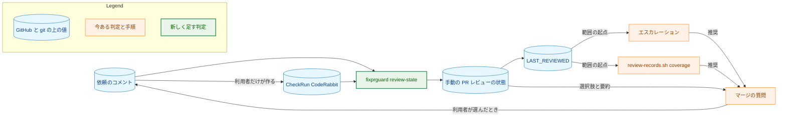
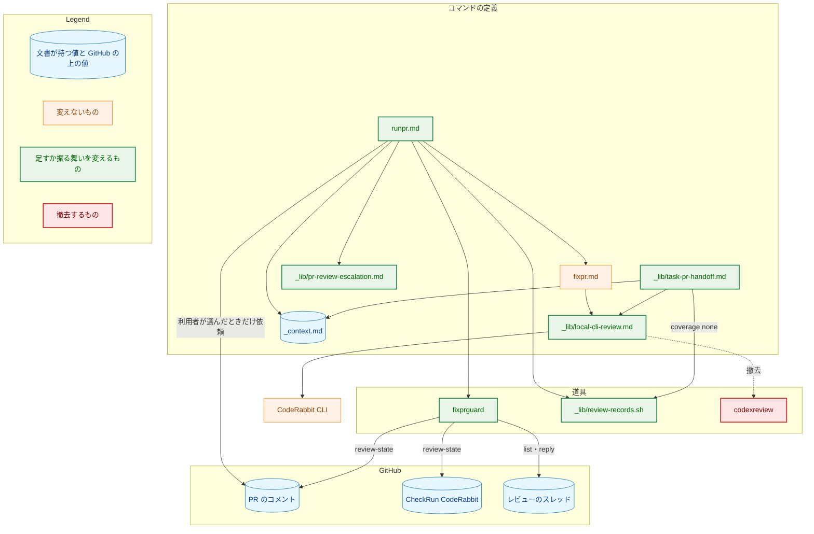
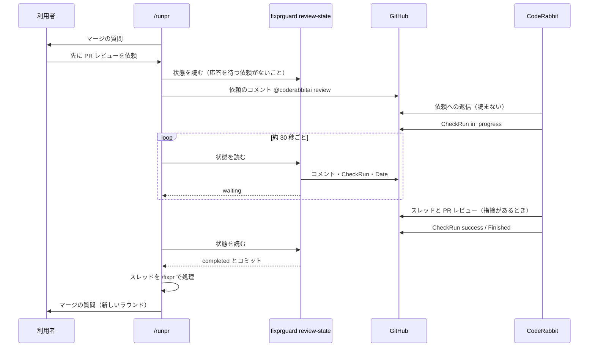
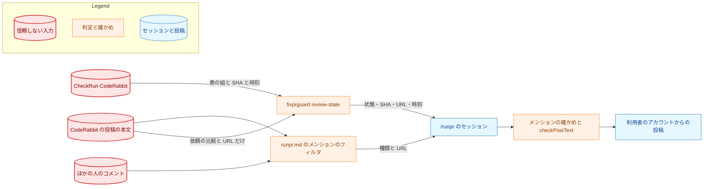
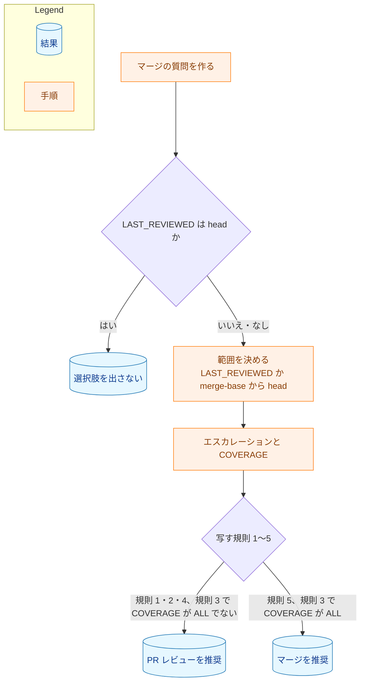
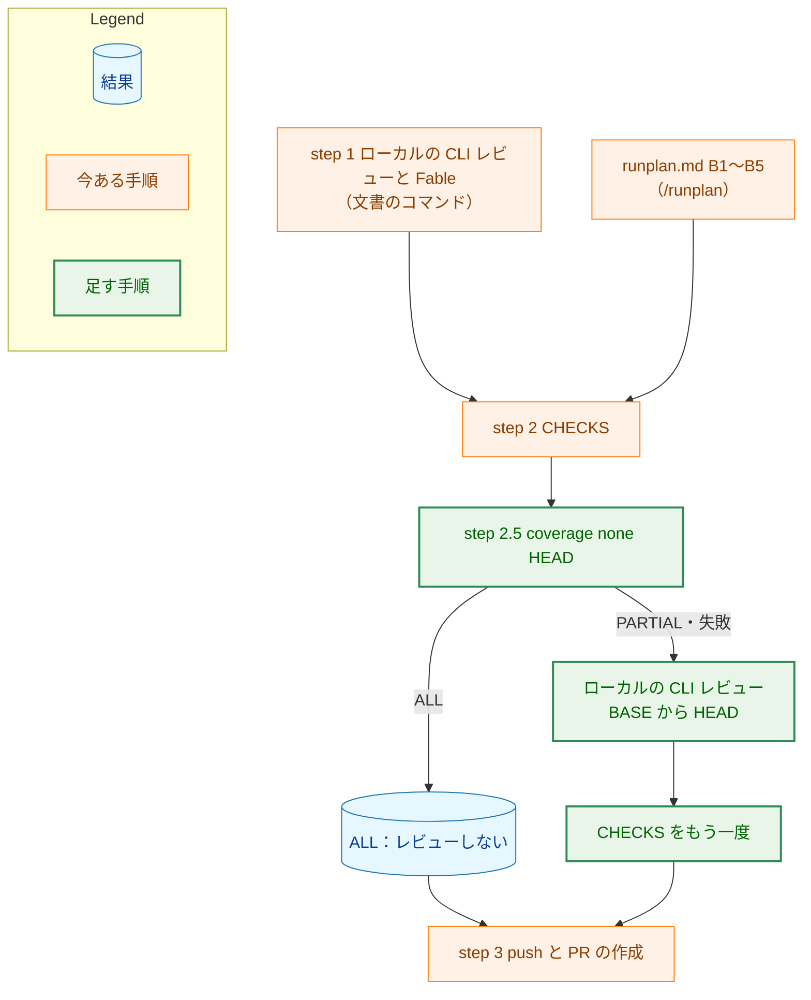

# 設計書：Codex の PR レビューと Codex CLI をレビューの体制から外す

## Document Status

| Item | Value |
|---|---|
| Status | `draft` |
| Created | 2026-11-20 |
| Review date | - |
| Reviewer | - |
| Comments | - |

## 1. 設計の全体像 (Design Overview)

本書は、[01_requirements.md](01_requirements.md)（以下、要件定義書）の F-002〜F-012 を、コマンドの定義・道具・ガードテスト・設定・文書の変更として設計する。F-001 の観測の記録は [observations.md](observations.md)（以下、観測の記録）にあり、本書が完了の印や割り当ての知らせとして使う値は、すべてそこにある（AC-05）。行番号を挙げる記述は、`main` の `e999fa2c` を読んだものである。

### 1.1. 設計原則

-   **手動の PR レビューの状態は、本文でなく CheckRun で決める。** 完了・割り当て切れ・レビューしたコミットを、本文を読まずに示すのは、CodeRabbit の app が作る CheckRun `CodeRabbit` だけである（観測の記録 3.2、3.3）。本文の文言は、完了の判定にも、本文だけの指摘やレビューしなかったファイルの判定にも使わない。
-   **判定は Go の道具に置く。** 手動の PR レビューの状態は、`fixprguard` の新しいサブコマンドが、GitHub の応答を厳密な JSON として検査して決める。interaction limits の判定（[ADR-0015](../../dev/adr/0015-untrusted-review-threads.md)）と同じ作りで、判定の誤りを Go のテストで壊して確かめられるようにする（[ADR-0014](../../dev/adr/0014-deterministic-checks-in-go.md) の 1）。
-   **依頼するのは利用者の選択だけである。** `/runpr` が依頼のコメントを投稿するのは、マージの質問で利用者が「先に PR レビューを依頼」を選んだときだけである（AC-13）。エスカレーションの判定は、その選択肢を推奨にするかだけを決める（F-005）。
-   **安全側に倒す。** 状態が読めない、形が観測と違う、待つ時間を過ぎた、のどれでも、レビュー済みとせずに止まる（AC-16、AC-18）。エスカレーションが答えを返せないときは、PR レビューを推奨にする（AC-55）。
-   **古い記録の行は読み続ける。** このタスクの前に作られたブランチの `Codex local review:` の行と `(codex)` の `Local CLI reviewed:` の行は、今と同じ意味で読む（AC-28）。新しく書く行の形だけを変える。
-   **既存の仕組みを使う。** まだ見ていない commit を求めるのは、`review-records.sh` の `coverage` である。`LAST_REVIEWED` を `none` として呼ぶと、すでに `origin/main..HEAD` のすべての commit を判定する（`.claude/commands/_lib/review-records.sh:445-446`）。新しい判定のスクリプトは作らない。

### 1.2. 概念モデル

矢印 A → B は「A が B を決める、または B を作る」を表す。



-   **手動の PR レビュー:** 依頼のコメントで始まる CodeRabbit の PR レビュー（要件定義書 3.1）。依頼のコメントは、利用者のアカウントが書いた、前後の空白を除いた本文が `_context.md` の「PR review request」の値（`@coderabbitai review`）とちょうど等しいコメントである。
-   **応答:** 依頼のコメントの後に始まった CheckRun のうち、3.3.2 の表で「数えない」でない最初のもの。
-   **完了の印:** 応答のうち、`completed`・`success`・`Finished` のもの。それが示すコミットは CheckRun の `head_sha` である。
-   **LAST_REVIEWED:** 完了の印が示すコミットのうち、ほかのすべてがその祖先であるもの。完了の印がなければ「なし」である。

### 1.3. 設計の際に決めたこと（2026-11-20）

-   **完了の印は CheckRun だけにする（H-01）:** CheckRun `CodeRabbit` で、app の slug が `coderabbitai`、`completed`・`success`、`output.title` が `Finished`、依頼のコメントの後に始まったものとする。`neutral` で `Review rate limited` のものを割り当ての知らせとし、それ以外の終わり方をエラーの知らせとする。推奨に従って利用者が選んだ。CheckRun は、レビューしたコミットを本文なしに示し、作れるのはその GitHub App だけである。依頼への返信の「Review finished.」も求める案は、返信の本文の形に依存し、形が変わると止まるので採らない。返信だけにする案は、返信がコミットを示さないので AC-17 を満たせず、採らない。要約コメントの「between」の行は、割り当て切れのときも書かれるので使えない（観測の記録 3.3）。ADR の判断: [ADR-0013](../../dev/adr/0013-review-setup.md) の「レビュー済みの判定」を更新する。
-   **判定は `fixprguard` のサブコマンドで行う（H-01）:** 新しいサブコマンド `review-state` が、GitHub の応答を厳密な JSON として検査し、状態・SHA・URL・時刻だけを出す。推奨に従って利用者が選んだ。`--jq` で判定する案は、重複した項目を黙って後勝ちにし（[ADR-0015](../../dev/adr/0015-untrusted-review-threads.md)）、判定の誤りを Go のテストで確かめられないので採らない。`fixprguard` は F-009 でプロトコル番号を上げるので、利用者の入れ直しの手間は増えない。ADR の判断: [ADR-0013](../../dev/adr/0013-review-setup.md) を更新する（上の項目と同じ更新）。質問では ADR-0014 の更新と見込んだが、判定を Go に置くこと自体は ADR-0014 の今の決定（1. 判定の置き場所）に従うもので、ADR-0014 の決定は変わらない。
-   **本文だけの指摘とレビューしなかったファイルは、分からないものとして扱う（AC-19、AC-20、AC-52）:** どちらも本文の英語の文言でしか分からず、API の欄にない（観測の記録 3.7、3.8）。本文の文言で分岐すると「Declare, don't infer」に例外を足すことになり、文言が変わると黙って見落とす。そのため、手動の PR レビューが完了した PR のマージの質問は、いつも、そのレビューの URL と、本文に指摘やレビューしなかったファイルの知らせがありうることを示す。AC-12 の選択肢は、head を示す完了の印があれば出さない。推奨に従って利用者が選んだ。ADR の判断: [ADR-0013](../../dev/adr/0013-review-setup.md) を更新する（上の項目と同じ更新）。
-   **まだ見ていない commit のローカルの CLI レビュー（F-007）は、Opus のレビューの後、PR を開く直前に 1 回だけ置く（H-08）:** `_lib/task-pr-handoff.md` Part B の CHECKS の後、push の前に置く。その直しは CodeRabbit CLI の 2 回目の試行が見て、Opus のレビューは見ない。それより後にできた commit は、PR の説明に、どの CLI もレビューしなかった commit として示す。推奨に従って利用者が選んだ。Opus のレビューの前に置く案は、Opus の直しと CHECKS の直しがまた見ていない commit になり、F-007 を満たすにはもう 1 回要るので採らない。ADR の判断: [ADR-0042](../../dev/adr/0042-implementation-model-tiers.md) を更新する。

次の項目は、要件定義書・申し送り・観測の記録から導かれ、利用者には尋ねていない。

-   **待つ時間の上限は、依頼のコメントの時刻から 15 分とする:** 観測した完了は依頼の 2〜3 分後だった（観測の記録 3.2）。今の Codex の上限（`runpr.md:655`）と同じ値で、余裕がある。ADR の判断: ADR なし。定数の値であるためである。
-   **`fixprguard` のプロトコル番号を「`main` の値 + 1」に上げる（H-03）:** 理由は 3.3.4 にある。chief の番号は上げない（F-012、3.7）。ADR の判断: ADR なし。`CLAUDE.md` の「Protocol numbers」の規則を当てはめただけであるためである。
-   **`AGENTS.md` のガードテストの理由を CodeRabbit に改める（H-09）:** CodeRabbit の PR レビューは `AGENTS.md` を既定で読む（観測の記録 3.11）。ADR の判断: ADR なし。テストのコメントの直しであるためである。
-   **Codex CLI を直接走らせるコマンドがないことのガード（`TestRunsCodex`）は、`cmd/codexreview` とともに外す:** このガードは、`codexreview` を迂回して Codex CLI を走らせることを防ぐものだった。Codex CLI を使わなくなれば、守る対象がない。ADR の判断: ADR なし。F-008 の撤去の範囲の中で閉じるためである。

## 2. システム構成 (System Structure)

### 2.1. 全体の構成

矢印 A → B は「A が B を読む、または B に書く」を表す。緑のノードが、このタスクで足すか、振る舞いを変えるものである。



-   **今の振る舞いを示す辺:** `RUNPR → FIXPR`、`FIXPR → LCR`、`LCR → CLI`、`FPG → THREADS`、`RUNPR → RR` は今あるものである（`runpr.md:837`、`fixpr.md` Phase 4.5、`local-cli-review.md:131`、`runpr.md:828`、`runpr.md:875`）。
-   **このタスクで足す辺:** `HANDOFF → RR`（F-007）、`FPG → COMMENTS` と `FPG → CHECKRUNS`（`review-state`）、`RUNPR → COMMENTS` の依頼（F-004）である。今の `RUNPR → COMMENTS` は Codex への依頼で、このタスクで CodeRabbit への、利用者が選んだときだけの依頼に変わる。

### 2.2. コンポーネントの配置

-   **`fixprguard review-state`:** `internal/fixprguard` の新しいファイルと、`cmd/fixprguard/main.go` のサブコマンドの登録。GitHub の読み取りは、今の `github.go` の `gh` の呼び出しと `internal/strictjson` を使う。GitHub の時刻は、`limits.go` の `Date` ヘッダの読み方（`parseDateHeader`、`internal/fixprguard/limits.go:281`）を使う。
-   **メンションの拒否:** `internal/fixprguard/write.go` の `checkPostText`（`write.go:91`）と `errors.go` の定数を、2 つのメンションに広げる。
-   **手順:** `runpr.md` の step 3 と step 4、`_lib/task-pr-handoff.md` Part B、`_lib/local-cli-review.md`、`_lib/pr-review-escalation.md`、`fixpr.md`、`runplan.md` の「Before the PR」。
-   **値:** `_context.md` の「Automated reviewer list」「Awaited PR reviewer」「PR review request」と、新しい行「Rejected mentions」。

### 2.3. データの流れ：手動の PR レビュー

マージの質問で利用者が「先に PR レビューを依頼」を選んだときの流れである。



-   矢印は呼び出しか投稿を、破線の矢印はその応答を表す。
-   割り当て切れ・エラー・時間切れでは、`review-state` がそれぞれの状態を返し、`/runpr` は止まって報告する（AC-18）。

## 3. コンポーネント設計 (Component Design)

### 3.1. `_context.md` の値

| 行 | 今 | 変えた後 |
|---|---|---|
| Automated reviewer list | `coderabbitai`、`chatgpt-codex-connector` | `coderabbitai`（AC-43） |
| Awaited PR reviewer | `chatgpt-codex-connector` | `coderabbitai`（AC-46）。REST の形は `coderabbitai[bot]` のまま作る |
| PR review request | `@codex review` | `@coderabbitai review`（AC-46） |
| Rejected mentions（新しい行） | なし | `@codex` と `@coderabbitai`。投稿の前のメンションの確かめが拒否するもの（F-009） |

-   **メンションの確かめの形:** 今は `grep -qiF -- '<review-mention>' <file>` で、`<review-mention>` は依頼の本文の最初の語である（`_lib/task-pr-handoff.md` Part A step 4 など）。変えた後は、「Rejected mentions」の各値を `-e` で並べた `grep -qiF -e '@codex' -e '@coderabbitai' -- <file>` とする。判定の意味（終了コード 1 のときだけ投稿する。0 と 2 以上は投稿しない）は変えない。依頼の本文の最初の語から作る `<review-mention>` は、どの文書でも使わない。
-   **依頼のコメントは例外のまま:** 依頼のコメントは、メンションの確かめを通さない唯一の投稿のまま変えない（AC-40）。
-   **文書が値を書ける場所:** 文書の中でメンションの対象を書いてよいのは、「PR review request」の行と「Rejected mentions」の行だけである（AC-56）。ほかの場所は、`Codex` や `CodeRabbit` と `@` なしで書く。

### 3.2. PR を開くコマンド（F-002、F-007）

`_lib/task-pr-handoff.md` Part B を次のように変える。`/runpr` の step 1 が単独の変更の PR を作るときも、同じ手順に従う。

| 手順 | 今 | 変えた後 |
|---|---|---|
| step 2 | CHECKS（`./cmd/codexreview/...` を含む） | CHECKS（`./cmd/codexreview/...` を外す） |
| 新しい step 2.5 | なし | まだ見ていない commit のローカルの CLI レビュー（下） |
| step 3 | push と PR の作成 | 同じ。本文の「Codex CLI が走った回数」を外す |
| step 5 | Codex の開始の印を約 2 分待ち、なければ `@codex review` を投稿する | 撤去する（AC-06） |
| step 6・7 | 通知と報告 | 同じ。PR レビューを待つ旨は書かない（AC-07） |

**まだ見ていない commit のローカルの CLI レビュー（step 2.5）:**

-   **判定:** `origin/main` から取り出した `review-records.sh` を、`coverage none <HEAD> [<PLAN>]` で呼ぶ。呼び方は `runpr.md` の COVERAGE（`runpr.md:871-876`）と同じく、スクリプトをスクラッチパッドに書き出してから走らせる。`<PLAN>` は、`/runplan` のときはその計画書、ほかのときは渡さない。
-   **見たとみなす commit（AC-31）:** `ALL` なら、このためのレビューは走らない。スクリプトは、空の commit と、計画書の PR の進み具合のチェックボックスだけを変える commit を、見たものとみなす（`review-records.sh` の header の Contract）。記録だけの commit は空の commit なので、ここに入る。
-   **範囲（AC-29）:** `PARTIAL <n>` なら、ローカルの CLI レビューを `BASE` = 一覧の最も古い commit の第 1 の親、`SCOPE` = PR 前の残り、`RECORD` = `commit` で走らせる。その親が merge-base でも `origin/main..HEAD` の commit でもないときは、`BASE` を merge-base とする。
-   **失敗したとき:** スクリプトが失敗したとき（終了コードが 0 でない、または 1 行目が `ALL`・`PARTIAL <n>` の形でない）は、`BASE` = merge-base でレビューする。安全側に倒すためである。
-   **回数（H-08）:** このレビューは、Part B の 1 回の実行につき 1 回だけである。その試行は `_lib/local-cli-review.md` の規則に従い、2 回目の試行がその直しを見る。直しの後に CHECKS をもう一度走らせ、CHECKS の直しができたら、その commit はレビューにかけ直さない。どの CLI もレビューしなかった commit として、step 3 の本文に示す。
-   **CodeRabbit CLI が失敗したとき（AC-30）:** `not run` の行を記録して進み、PR を開く。範囲は、PR の説明の「どの CLI もレビューしなかった commit」に出る。
-   **Fable との関係:** このレビューは FABLE を渡さない。Fable の部分レビューは、今と同じく step 1 だけで行う。step 2.5 の commit は、Fable の記録の後の commit であり、今と同じく Fable の記録の有効性の判定の対象になる（[ADR-0050](../../dev/adr/0050-fable-partial-review.md)）。
-   **Opus のレビューとの関係（H-08）:** `/runplan` では、Opus のレビュー（`runplan.md` の B2〜B4）が Part B の前に終わっている。step 2.5 の直しの commit は、Opus のレビューの done record の後の commit になる。PR を開いた後に Opus のレビューを走らせる手順はないので、この commit を Opus は見ない。`/runplan` が Part B の途中で止まって走り直したときは、B2 の判断が今と同じ規則でこの commit を扱う（`_lib/opus-review.md` の「Excludable commit」に当たらなければ、レビューをやり直す）。

**`runplan.md` の「Before the PR」:** 冒頭の理由（「Codex の最初の PR レビューが直したコードを見るため」、`runplan.md:270`）を、「直しがローカルの CLI レビューを通り、人のレビューは直した後のコードから始まるため」に改める（[ADR-0042](../../dev/adr/0042-implementation-model-tiers.md)）。B1 の「Codex CLI のフォールバックがレビューした phase group」の文（`runplan.md:288-289`）は外す。

### 3.3. `fixprguard`

#### 3.3.1. `review-state` サブコマンドの契約

```text
fixprguard review-state --protocol <N> <PR>
```

-   **入力:** PR の番号だけを取る。利用者の login は、道具が `gh api user` で読む。待つ時間の上限（15 分）と、依頼の本文（`@coderabbitai review`）、CodeRabbit の名前（`coderabbitai`）は、道具のコードの定数とする。依頼の本文と名前は `_context.md` の値と同じ値で、ガードテストが両者を照合する（7.3）。
-   **読むもの:** GitHub の応答だけである。git の作業ツリーは読まない。
    -   PR の head と、PR の commit の一覧（GraphQL の `pullRequest.commits`）。各 commit の CheckRun を、`checkSuites(filterBy: {appId})` と `checkRuns(filterBy: {checkName: "CodeRabbit"})` で、名前ごとの最新に限らず、すべて読む（観測の記録 3.1 の `filter` の違い）。
    -   PR の会話のコメント（REST の `issues/<n>/comments`、全ページ）の著者・本文・時刻。本文は、依頼のコメントかどうかの比較にだけ使い、出力しない。
    -   CodeRabbit の PR レビュー（REST の `pulls/<n>/reviews`）の著者・`commit_id`・`submitted_at`・URL。完了の印に URL を添えるためだけに使う。
    -   GitHub の時刻（同じ応答の `Date` ヘッダ）。
-   **上限:** PR の commit が 100 を超えるときと、1 つの commit の CodeRabbit の CheckRun が 50 を超えるときは、読めないものとして止まる（`ErrLimitExceeded`）。PR の commit の一覧の外にある CheckRun（force push で消えた commit の上のもの）は読まない。
-   **出力:** 標準出力に JSON を 1 つ書く。本文の文字列はどこにも含めない。CheckRun の `details_url` は CodeRabbit のサイトの共有の値を含むので出力しない（観測の記録 3.2）。

```go
// ReviewState is the output of fixprguard review-state.
type ReviewState struct {
	Head          string          // the PR's head, 40 lowercase hex
	Now           time.Time       // GitHub's clock (the Date header)
	Latest        *ReviewRequest  // the latest request comment, or nil
	LatestState   RequestState    // the state of Latest; RequestNone when Latest is nil
	Response      *ReviewResponse // Latest's response, when it has one
	Markers       []ReviewMarker  // every completion marker, oldest first
	LastReviewed  string          // see 3.3.3; "" when there is none
}

// ReviewRequest is a request comment: written by the user, whose body
// without surrounding whitespace is exactly the review request.
type ReviewRequest struct {
	URL       string
	CreatedAt time.Time
}

// ReviewResponse is the first counted CodeRabbit check run that started
// after a request comment and before the next one.
type ReviewResponse struct {
	CheckRunURL string    // the check run's html_url, never details_url
	Commit      string    // head_sha, 40 lowercase hex
	Kind        RunKind
	StartedAt   time.Time
}

// ReviewMarker is a completion marker: a response of kind RunFinished.
type ReviewMarker struct {
	Commit      string
	RequestURL  string
	CheckRunURL string
	ReviewURL   string // CodeRabbit's PR review for Commit submitted after the request, or ""
	CompletedAt time.Time
}

// RunKind classifies one CodeRabbit check run.
type RunKind int

const (
	RunUnknown     RunKind = iota // any form not in 3.3.2: counted, as an error
	RunRunning                    // queued or in_progress
	RunFinished                   // completed, success, "Finished"
	RunRateLimited                // completed, neutral, "Review rate limited"
	RunPushNotice                 // completed, skipped, "Review skipped: automatic reviews are disabled"
)

// RequestState is the state of the latest request comment.
type RequestState int

const (
	RequestIndeterminate RequestState = iota // zero value: assumes least
	RequestNone                              // no request comment on the PR
	RequestWaiting                           // no response yet, or a running one, within the deadline
	RequestCompleted                         // the response is RunFinished
	RequestRateLimited                       // the response is RunRateLimited
	RequestFailed                            // the response is RunUnknown (an error notice)
	RequestTimedOut                          // no finished response by the deadline
)
```

-   **ゼロ値:** `RequestState` のゼロ値は `RequestIndeterminate` とし、`RunKind` のゼロ値は `RunUnknown` とする。どちらも、入力について最も少なく仮定する解釈である（`CLAUDE.md` の「Declare, don't infer」）。
-   **JSON の形:** 列挙は `MarshalText` で小文字の決まった語（`indeterminate`、`none`、`waiting`、`completed`、`rate-limited`、`failed`、`timed-out`）として出す。今の `InteractionState` と同じ作りである（`internal/fixprguard/limits.go:26-39`）。

#### 3.3.2. CheckRun の分類

CodeRabbit の CheckRun は、次の値の組だけで分類する。app の slug が `coderabbitai` で、名前が `CodeRabbit` のものだけを読む。

| `status` | `conclusion` | `output.title` | 分類 | 応答として |
|---|---|---|---|---|
| `queued`・`in_progress` | なし | 問わない | `RunRunning` | 数える |
| `completed` | `success` | `Finished` | `RunFinished` | 数える |
| `completed` | `neutral` | `Review rate limited` | `RunRateLimited` | 数える |
| `completed` | `skipped` | `Review skipped: automatic reviews are disabled` | `RunPushNotice` | 数えない |
| ほかのすべての組 | | | `RunUnknown` | 数える（エラーの知らせ） |

-   **`RunPushNotice` を数えない理由:** PR を開いたときと push したときに、依頼がなくてもできる（観測の記録 3.5）。応答を待つ間に利用者が push しても、それを応答と取り違えないためである。
-   **エラーの扱い:** `RunUnknown` は、観測していない終わり方をすべて含む。公式の文書のエラー（`Review failed` など）と、`success` でも `Finished` 以外のタイトル（`No files to review` など）がここに入る（観測の記録 3.3）。どれもレビュー済みとしない。
-   **`output.title` を読むことの例外:** タイトルは CodeRabbit が書く外の値で、型にできない。エラーも `neutral` で終わりうるので、`conclusion` だけでは割り当て切れと区別できない（観測の記録 3.3）。そのため、`CLAUDE.md` の「Declare, don't infer」に、`review-state` が CheckRun の `status`・`conclusion`・`output.title` の組を表と照合することの例外を足す。
    -   **範囲:** 上の表の照合だけである。
    -   **理由:** 外の値で、型にできず、区別に要る値である。
    -   **境界:** 表にない組は `RunUnknown` として止まり、広く読まない。タイトルは完全一致で比べ、直さない。

#### 3.3.3. 状態の規則

最新の依頼のコメントの状態は、次の順に、最初に当たったもので決める。

1.  **`RequestNone`:** 依頼のコメントがない。
2.  **`RequestIndeterminate`:** 最新の依頼の後に始まり、数える CheckRun が 2 つ以上ある（AC-16 の (a)）。同じ CheckRun の更新は 1 つと数える（id で区別する）。
3.  **`RequestCompleted`・`RequestRateLimited`・`RequestFailed`:** 数える CheckRun が 1 つあり、その分類が `RunFinished`・`RunRateLimited`・`RunUnknown` である。
4.  **`RequestTimedOut`:** 依頼の時刻から 15 分を過ぎた。`RunRunning` の応答があっても、上限は延ばさない。
5.  **`RequestWaiting`:** 上のどれでもない。

-   **時刻の比べ方:** 「後に始まった」は、CheckRun の `started_at` が依頼の `created_at` より厳密に後であることとする（同じ秒は数えない）。今の Codex の判定と同じ規則である（`runpr.md:547-549`）。
-   **前の依頼の応答:** 前の依頼のコメントにも同じ規則で応答を決め、`RunFinished` の応答を完了の印として `Markers` に入れる。前の依頼の応答は、次の依頼より前に始まったものに限る（AC-17）。依頼のコメントのない CheckRun は、完了の印にならない（要件定義書 3.1 の手動の PR レビュー）。
-   **示すコミット（AC-16 の (c)・(d)）:** 示すコミットは、PR の commit の一覧にある `head_sha` に限る。読んだ一覧の外の commit を示す CheckRun はそもそも読まないので、完了の印が示すコミットは、構成上、head かその祖先である。この性質は本書が課す要件で、実装はテストで確かめる（7.1）。`head_sha` が 40 桁の小文字の 16 進でない CheckRun があれば、`ErrResponseRejected` で止まる。
-   **LAST_REVIEWED:** `Markers` のコミットのうち、PR の commit の一覧で最も後にあるもの。今の `runpr.md` は git の `merge-base --is-ancestor` で求めている（`runpr.md:740-748`）。`review-state` は git を読まないので、GitHub の一覧の順で決める。一覧が head までの線形の履歴でないとき（merge commit を含むとき）は、`LastReviewed` を空にして「なし」とする。安全側に倒すためで、そのときエスカレーションは PR の全体を範囲にする。
-   **スレッドへの返信に応じた投稿（AC-54）:** 観測では、返信に応じて CodeRabbit が付けたのは反応だけで、CheckRun はできなかった（観測の記録 3.10）。CheckRun を作らない投稿は、完了の印にならない。

#### 3.3.4. メンションの拒否とプロトコル番号

-   **拒否（AC-38）:** `checkPostText` は、ASCII の大文字と小文字を同じに扱った文面に `@codex` か `@coderabbitai` が含まれるとき、`ErrInvalidInput` に包んだ番兵で拒否する。当てはめる入力は今と同じで、`reply` の返信、`edit-pr` の PR のタイトルと説明、`append-pr` の後の PR の説明、`finish` の commit メッセージの本文である（`internal/fixprguard/write.go:76-93`）。
-   **`append-pr` の拒否（AC-39）:** 今の PR の説明にメンションの対象があって拒否されたときは、道具は今と同じく書き込まずに止まる。`fixpr.md` の手順は、その停止を「今の PR の説明が原因」と報告して止まり、同じ書き込みを繰り返さない。原因の区別は、道具が返す番兵（今の PR の説明の検査で拒否したもの）で行い、報告の文言では行わない。
-   **プロトコル番号（H-03）:** `fixprguard` の番号を「`main` の値 + 1」に上げ、すべての `--protocol` を合わせる。理由は次の組み合わせで、新しい文書と古い道具の組み合わせが、確かめを黙って弱めるためである。
    -   **古い文書と新しい道具:** 古い文書が渡す文面のうち、`@coderabbitai` を含むものが新たに拒否されるだけで、確かめは強まる。
    -   **新しい文書と古い道具:** 新しい文書は `@coderabbitai` の拒否を道具に任せるが、古い道具はそれを通す。新しい文書の呼ぶ `review-state` も古い道具にはない。
-   **chief の番号:** chief は `/runpr` の報告の形を読むが、このタスクはその形を変えない（3.7）。そのため上げない。

### 3.4. `/runpr`（F-003〜F-005、F-009、F-010）

#### 3.4.1. step 3：CI とスレッドを待つ

見出しを「Wait for CI and the review threads, running fixpr as comments appear」に改め、次の構成にする。

-   **撤去するもの:** 要約コメントと受領コメントの読み取り、状態の規則 1〜7、「Confirming a completion without a result」と承認の記録、自動の依頼と「Requesting the review」の自動の投稿、Codex に固有の停止の報告（`runpr.md:401-824`）。
-   **手動の PR レビューの状態:** 着いたときに、`fixprguard review-state` を 1 回読む。
    -   `RequestWaiting`: 新しく投稿せずに、約 30 秒ごとに読み直して待つ（AC-14）。状態が変わったら、下の扱いに従う。
    -   `RequestCompleted`・`RequestNone`: 先に進む。完了の後に開かれたスレッドは、下のスレッドの処理で `/fixpr` に渡す。
    -   `RequestRateLimited`・`RequestFailed`・`RequestTimedOut`: 最新の依頼は終わったものとして先に進む（AC-18 の「(a)〜(c) に当たった依頼は終わったものとし」）。ただし、待っていた依頼がこの実行で投稿したものなら、止まって報告する（3.5）。この実行の前に終わった依頼なら、step 4 の要約に出す（AC-53）。
    -   `RequestIndeterminate` と、道具が止まったとき: 止まって報告する（AC-16）。
-   **メンションの確かめ（AC-41）:** 今の `--jq` の 3 つの一覧（`runpr.md:433-534`）を残し、本文の比較を 2 つのメンションに広げる。分類は次のとおりである。
    -   利用者の依頼のコメントは、`request` として分ける（今と同じ）。
    -   `coderabbitai[bot]`（`Bot`）の投稿で、1 行目の末尾の CR を除いたものが、観測した 2 つの行（`<!-- coderabbit-ai-generated:v1 -->` と `<!-- This is an auto-generated comment: coding agent status by CodeRabbit -->`）のどちらかと等しいものは、メンションとして扱わない（観測の記録 3.6、AC-41 の 3）。
    -   それ以外で本文にどちらかのメンションを含むものは、今と同じく `by_user` と `by_bot` で分ける。Codex の投稿は、ここで `by_bot` になる（AC-41 の 4）。
    -   止まる・尋ねる・進むの扱いは、今の「Mentions by other accounts」（`runpr.md:569-587`）と同じである。
-   **スレッド:** `fixprguard list` と `/fixpr` の扱いは今と同じである（AC-10）。`--reviewer` に渡す一覧は `coderabbitai` だけになるので、`chatgpt-codex-connector` のスレッドは信頼しない著者のスレッドとして「Untrusted threads」で扱われる（AC-44）。
-   **エスカレーション:** 3.4.3。
-   **CI:** 今と同じく、`gh pr checks <number> --watch --fail-fast` で待つ。

#### 3.4.2. step 4：マージの質問

-   **選択肢「先に PR レビューを依頼」（AC-12）:** LAST_REVIEWED が head でないとき（なしのときを含む）だけ出す。説明は「CodeRabbit に PR レビューを頼み、終わったらこの問いに戻る」とする。推奨にするかは 3.4.3 が決める。推奨のときは最初に、推奨でないときは「マージ」の後に置く。今の表（`runpr.md:1410-1417`）の並べ方と同じである。
-   **要約の行:** 今の 4 行目と 13 行目（`runpr.md:1334`、`runpr.md:1343`）を次に改め、Codex の名前を出さない（AC-11）。
    -   **4 行目:** `未レビューの変更: あり（推奨: PR レビュー）`、`未レビューの変更: あり（推奨: マージ）`、`未レビューの変更: なし` のどれかを出す。「未レビュー」は、手動の PR レビューの完了の印が head を示さないことである。
    -   **13 行目:** `PR レビュー後: ローカル CLI 済 ／ Fable（PR 前）: run` の形にする。前半の判定と後半の Fable の記録の読み方は今と同じである。
    -   **新しい行:** `手動 PR レビュー: <状態>（<URL>）` を足す。
        -   **完了のとき:** `完了 <12 桁の SHA>` と、本文に指摘やレビューしなかったファイルの知らせがありうること（AC-19、AC-20、AC-52）を示す。URL は、完了の印の PR レビューの URL、それがなければ依頼のコメントの URL とする。
        -   **最新の依頼が終わっているとき:** `割り当て切れ`・`エラー`・`時間切れ` のどれかを出す（AC-53）。URL は依頼のコメントの URL とする。
        -   **出さないとき:** 依頼のコメントがなければ、この行は出さない。
    -   **行の数:** 要約の行は、今の 14 行から 15 行になる。
-   **詳細のファイル:** 承認の記録の項目（`runpr.md:1297-1301`）を外し、手動の PR レビューの `Markers` と最新の依頼の状態を足す。
-   **「先に PR レビューを依頼」を選んだとき（AC-13、AC-14）:**
    1.  `mergepr discard` する（今と同じ）。
    2.  `review-state` を読む。
        -   `RequestWaiting` なら、投稿せずに待つ。
        -   `RequestIndeterminate` なら、止まって報告する。
        -   それ以外なら、依頼のコメントを `gh pr comment <number> --body "<review-request>"` で 1 件投稿し、`gh` が出した URL をこの依頼の URL として控える。
    3.  `review-state` を約 30 秒ごとに読み、`RequestWaiting` でなくなるまで待つ。読み直したときの最新の依頼が控えた URL と違えば、止まって報告する（ほかの依頼が重なった）。
    4.  `RequestCompleted` なら、step 3 のスレッドの処理に戻り、step 2 を経て、step 4 の item 1 から問い直す。それ以外は 3.5 のとおり止まる。
-   **エスカレーションの「1 回だけの自動の依頼」:** 撤去する（AC-25）。今の `request` の扱い（`runpr.md:920-924`）がこれに当たる。

#### 3.4.3. エスカレーションと推奨（F-005、H-02）

-   **範囲（AC-21）:** LAST_REVIEWED があるときは LAST_REVIEWED から head まで、ないときは `origin/main` との merge-base から head までとする。LAST_REVIEWED が「なし」のときにファイルを走らせずに `ask` とする今の規則（`runpr.md:893`、`_lib/pr-review-escalation.md` の Inputs）は外す。
-   **COVERAGE:** 今と同じく `review-records.sh coverage <LAST_REVIEWED> <HEAD> [<PLAN>]` で求める。`none` を渡したときの範囲は、すでに `origin/main..HEAD` である（`review-records.sh:445-446`）。そのため、スクリプトの判定の規則は変えない。
-   **答えを推奨に写す規則:** `runpr.md` の 1 か所に置き、最初に当たったもので決める。今の規則 1〜5（`runpr.md:897-905`）の結果の語を、推奨に置き換えたものである。

| 規則 | エスカレーションの答え | 推奨 | 要件 |
|---|---|---|---|
| 1 | 決まった JSON でない、`criteria` の値が 1〜5 の外、`request` で `criteria` が空、`skip` で `criteria` が空でない、ファイルを走らせられなかった | PR レビュー | AC-55 |
| 2 | `request` で、`criteria` に 4 を含む | PR レビュー | AC-22 |
| 3 | `request` で、`criteria` が 1・2・3・5 だけ | COVERAGE が `ALL` ならマージ、それ以外は PR レビュー | AC-23 |
| 4 | `ask` | PR レビュー | AC-55 |
| 5 | `skip` | マージ | AC-24 |

-   **履歴が書き換わったとき:** ファイルの Procedure の step 1 は残す。LAST_REVIEWED が head の祖先でないとき（履歴の書き換え）は `ask`、LAST_REVIEWED が head と等しいときは `skip` とする。ただし、LAST_REVIEWED が head と等しいときは、選択肢そのものが出ない（3.4.2）。
-   **報告:** エスカレーションの理由、COVERAGE、決めた規則を、今と同じく報告する（`runpr.md:910-919`）。
-   **関門の範囲の記述:** `_lib/pr-review-escalation.md` の基準 4 が挙げるレビューの関門に、`fixprguard review-state` と、答えを推奨に写す規則を含める。今の「`runpr.md` step 3's definition of LAST_REVIEWED, its rules that turn this file's answer into a decision」を、新しい名前に改める。

### 3.5. `/runpr` が止まるときの報告（AC-16、AC-18）

| 状態 | 報告するもの | 次の手 |
|---|---|---|
| `RequestRateLimited` | 割り当てを使い切ったこと、依頼のコメントの URL、CheckRun の URL | 割り当てが戻ってから `/runpr` を再実行して選び直す、またはレビューなしでマージに進む |
| `RequestFailed` | エラーの知らせを受けたこと、依頼のコメントの URL、CheckRun の URL | 同上 |
| `RequestTimedOut` | 15 分を過ぎても完了の印がないこと、依頼のコメントの URL、依頼の時刻 | 同上 |
| `RequestIndeterminate` | 数える CheckRun が 2 つ以上あること、それぞれの CheckRun の URL、依頼のコメントの URL | CodeRabbit の画面で確かめてから、`/mergepr` で直接マージするか、手で依頼してから `/runpr` を再実行する |
| 道具が止まった（`ErrResponseRejected`・`ErrLimitExceeded` など） | 道具が出したもの | 同上 |

-   **本文を出さない:** どの報告も、CodeRabbit の投稿の本文を示さない（AC-16）。
-   **AC-18 の「次の手」:** 「割り当てが戻ってから再実行して選び直す」は、終わった依頼に対して新しく依頼することである。再実行の `review-state` は終わった依頼を `RequestRateLimited` などとして返すので、`/runpr` は自分では依頼せず、要約に出す（AC-53）。利用者がもう一度選んだときだけ、新しく依頼する。

### 3.6. ローカルの CLI レビュー（F-006、H-06）

`_lib/local-cli-review.md` を次のように変える。

-   **step 2:** CodeRabbit CLI の成功と失敗の判定は変えない。失敗はすべて `record` の扱いになり、試行の結果は `none` である。
-   **step 3:** `codexreview` の実行と、その表と、`stop` の扱いを撤去する（`local-cli-review.md:155-233`）。FABLE があるときの最初の試行は、今の `record` と同じく、Fable の指摘だけで step 4 に進む。
-   **step 7 の記録の行:** 新しく書く行の形を次に改める。

| 行 | 新しく書く形 |
|---|---|
| `Local CLI reviewed:` | `Local CLI reviewed: <START12>..<END12> (coderabbit)` |
| `Local CLI review: not run` | `Local CLI review: not run <START12>..<END12> (coderabbit: <kind>)` |
| HEAD2..HEAD3 の `not run` | `Local CLI review: not run <START12>..<END12> (after the second attempt, reviewed by coderabbit)` |

-   **「Reading the record lines」（AC-28）:** 次の古い形も、今と同じ意味で読み続ける。読み方の規則は外さない。
    -   `Codex local review:` の行は、指摘の行である。
    -   `(codex)` を持つ `Local CLI reviewed:` の行は、見た範囲である。
    -   `(coderabbit: <kind>; codex: <kind>)` を持つ `not run` の行は、見ていない範囲である。
    -   `review-records.sh` の正規表現（`review-records.sh:189`）も `(coderabbit|codex)` のまま変えない。
    -   **古い形を読む規則を外せる条件:** 古い形の行を持つ開いたブランチがなくなったとき。`_context.md` の古い値の表と同じ扱いで、外すときは別の PR で行う。
-   **step 8 の SUMMARY と PR の説明:** 「Codex CLI が走った回数」を外す（`local-cli-review.md:342-346`、`_lib/task-pr-handoff.md` Part B step 3）。
-   **`instructions_changed` の注記:** `codexreview` が出していた値なので、外す。

### 3.7. chief の読み取り（F-012）

chief の製品のコードは、Codex の文言で分岐しない（要件定義書 1 節）。このタスクは、`/runpr` の報告と NEXT 行の形を変えない。

-   **外す行:** step 5 の最後の報告から、受領コメントで認めた完了の行が外れる（`runpr.md:733-739`）。この行は `NEXT` で始まらず、chief が読む形（NEXT と PR の番号）に当たらない。
-   **サンプル:** 今のサンプルを残し、新しいサンプルを足さない（AC-50、AC-51）。実装の PR で `/runpr` の報告の形を変えることになったときだけ、AC-51 のとおり足す。

### 3.8. コンポーネントの責務と、変えるファイル

| ファイル | 変更 | 要件 |
|---|---|---|
| `.claude/commands/_context.md` | 3.1 の 4 つの行。「Automated reviewer list」の説明の Codex の記述 | F-009、F-010、AC-43、AC-46 |
| `.claude/commands/_lib/task-pr-handoff.md` | Part B step 2 の CHECKS、step 2.5 を足す、step 3 の本文の項目、step 5 を撤去、冒頭と「Authorization」の Codex の記述、メンションの確かめの形 | F-002、F-007、F-009 |
| `.claude/commands/runpr.md` | step 1（単独の PR）、step 3、step 4、step 5 の報告、メンションの確かめ、`fixprguard` の `--protocol` | F-002〜F-005、F-009 |
| `.claude/commands/_lib/pr-review-escalation.md` | 冒頭の説明、Inputs、基準 4 の関門の範囲 | F-005 |
| `.claude/commands/_lib/local-cli-review.md` | 3.6 | F-006、AC-28 |
| `.claude/commands/_lib/review-records.sh` | header の説明（LAST_REVIEWED は手動の PR レビューの完了の印、F-007 の呼び方）。判定の規則は変えない | F-005、F-007 |
| `.claude/commands/fixpr.md` | メンションの確かめの形、`replyBody` の規則、Phase 4.5 の Codex CLI の記述、`append-pr` の停止の報告、`--protocol` | F-006、F-009、AC-39 |
| `.claude/commands/runplan.md` | 「Before the PR」の理由と B1、step 7.7 の Codex CLI の記述 | F-006、F-007 |
| `.claude/commands/_lib/fable-review.md` | 冒頭の理由（[ADR-0050](../../dev/adr/0050-fable-partial-review.md) の新しい理由）、Codex CLI の指摘の記述 | F-011 |
| `.claude/commands/_lib/opus-review.md`、`.claude/commands/_lib/simple-process.md` | メンションの確かめの形、CHECKS の一覧、「Codex が見ていない変更」の記述 | F-009、F-011 |
| `internal/fixprguard/`（新しいファイル） | `review-state` の型・GitHub の読み取り・分類・状態の規則とそのテスト | F-004、H-01 |
| `internal/fixprguard/write.go`、`errors.go`、`types.go` | 2 つのメンションの拒否、番兵の名前、プロトコル番号 | F-009、H-03 |
| `cmd/fixprguard/main.go` | `review-state` の登録 | F-004 |
| `docs/dev/guides/fixprguard_guide.md` | `review-state` の章、メンションの拒否の記述、番号 | F-004、F-009 |
| `cmd/codexreview/`、`internal/codexreview/` | 撤去 | F-008、AC-32 |
| `Makefile` | `install-codexreview` を外す | AC-33 |
| `.claude/settings.json` | `Bash(codexreview *)` の許可と、`codexreview` のインストールとビルドの拒否の規則を外す | AC-34 |
| `.github/workflows/ci.yml` | `doc-guard` の一覧から `./cmd/codexreview` を外す | AC-37 |
| `.coderabbit.yaml` | コメントの「Codex does the PR review」を、手動の PR レビューの説明に改める。設定の値は変えない | F-011 |
| `CLAUDE.md` | Commands の `install-codexreview`、Claude Commands の Codex の PR レビューの段落、「Declare, don't infer」の `codexreview` の例外を外して `review-state` の例外を足す、Testing Strategy の `codexreview` の項目、「Protocol numbers」の道具の一覧、Tool Execution Safety の `codexreview` の項目、doc-guard の一覧 | F-008、F-011 |
| `docs/dev/conventions/dev_tools.md`、`package_reference.md`、`requirements_process.md` | `codexreview` と Codex CLI の記述 | F-008、F-011 |
| `docs/dev/guides/mergepr_guide.md` | 番号を持つ道具の一覧 | AC-35 |
| `docs/translation_glossary.md` | 「試行」などの定義を CodeRabbit CLI だけにする。「手動の PR レビュー」「完了の印」を足すかは実装で用語集の規則に従って決める | AC-48 |
| `docs/dev/adr/0013`・`0014`・`0015`・`0042`・`0047`・`0050` | 各 `## 決定` の食い違いの記述を、食い違いを解いた PR で外す。本書の決定で 0013 と 0042 を更新する（1.3） | AC-49 |
| `docs/dev/adr/0040`・`0046` | Codex に触れる箇所の直し（H-07、3.9） | F-011 |
| `cmd/yt2column/codex_review_docs_test.go` | 名前を `review_mention_docs_test.go` に改め、2 つのメンションを対象にする。`TestAgentsCodeReviewRules` の理由を CodeRabbit に改める | AC-56、H-09 |
| `cmd/yt2column/fixpr_docs_test.go` | `wantReviewers` を `coderabbitai` だけにする。要約コメントと受領コメントのフィルタのテストを外し、メンションのフィルタのテストを新しい分類に合わせる。step 3 の見出しの定数。Part B step 5 のテストを外す | F-003、F-009、F-010 |
| `cmd/fixprguard/docs_test.go`、`internal/doctestutil/` | `codexreview` の呼び出しの記述と、`codex` のコマンドを見つける部分を外す | F-008 |
| `internal/config/envaccess_test.go`、`internal/cmdrunner/runner.go`、`cmd/coveragecompare/main.go` | `codexreview` を名指すコメントと表の行 | AC-36 |

**既存のテストで、振る舞いの変更に合わせて直すもの:**

-   **`TestRunprDocContract`、`TestHandoffListingPrintsNoBody`（`cmd/yt2column/fixpr_docs_test.go`）:** `runpr.md` step 3 と Part B step 5 の `--jq` のフィルタを走らせるテストである。前者は、要約コメントと受領コメントの行を外し、メンションの行を 2 つのメンションと CodeRabbit の観測した形に合わせる。後者は、Part B step 5 がなくなるので外す。
-   **`TestCodexMentionOnlyInRequestRow`、`TestPostingPathsCheckMention`:** 2 つのメンションと、新しいメンションの確かめの形に合わせる（AC-56）。
-   **`internal/fixprguard/write_test.go`:** `@coderabbitai` の拒否の行を足す。
-   **`cmd/fixprguard/docs_test.go` のプロトコル番号のテスト:** 番号を上げたことに合わせる。
-   **`TestReviewRecordsCoverage`（`cmd/yt2column/review_records_test.go`）:** 判定の規則は変えないので、直さない。`(codex)` の行を見た範囲として読む既存の行は、AC-28 を確かめるものとして残す。

### 3.9. Codex にだけ触れる ADR と文書（H-07）

-   **ADR-0013・0014・0015・0042・0047・0050:** 要件定義書の PR で `## 決定` を更新し、食い違いの記述を持つ（AC-49）。実装の PR は、食い違いを解いたときにその記述を外す。本書は、0013（完了の印・判定の場所・本文の扱い）と 0042（F-007 の位置）の決定を更新する。
-   **ADR-0040・0046:** 実装の PR で、Codex に触れる箇所を、決定・理由・結果のどれかに分ける。
    -   **過去の出典としての名前:** 過去の決定の出典や採らなかった案の名前は、そのまま残す（AC-47 の例外）。
    -   **今の振る舞いとしての記述:** 今の振る舞いとして書いた箇所は、編集上の修正（`docs/dev/conventions/adr.md` の「Editorial corrections」）として直す。
    -   **理由が崩れる箇所:** 決定の理由が Codex の PR レビューに依っていて崩れる箇所があれば、実装の PR で人に確かめてから直す。
-   **`CLAUDE.md` の例外と、ガードテストと CI の一覧:** `codexreview` を名指すものは、F-008 と同じ PR で外す。

## 4. エラーハンドリング設計 (Error Handling Design)

### 4.1. `review-state` の番兵

新しい番兵は足さない。今の `fixprguard` の番兵を使う（`internal/fixprguard/errors.go:18-54`）。

| 番兵 | 起こるとき |
|---|---|
| `ErrResponseRejected` | GitHub の応答が厳密な JSON でない、項目が重複する、要る項目がないか型が違う、`head_sha` が 40 桁の小文字の 16 進でない、`Date` ヘッダが読めない |
| `ErrLimitExceeded` | PR の commit が 100 を超える、1 つの commit の CodeRabbit の CheckRun が 50 を超える、一覧のページが上限を超える |
| `ErrInvalidInput` | 引数の形が違う |

-   **番兵と状態の分け方:** `RequestIndeterminate` は番兵ではなく、読めた応答の状態である。応答が読めないことは番兵で、読めた応答が判定できないことは状態で表す。
-   **部分的な結果:** 番兵で止まるとき、部分的な結果は出さない（interaction limits と同じ。[ADR-0015](../../dev/adr/0015-untrusted-review-threads.md)）。

### 4.2. メンションの拒否の番兵

今の `errCodexMention`（`errors.go:58`）を、2 つのメンションを拒否する名前（`errMention`）に改める。`ErrInvalidInput` に包むことは変えない。`append-pr` で今の PR の説明が原因のときは、それを区別できる番兵（`ErrInvalidInput` に包む）を返し、`fixpr.md` はその番兵の終了の形で AC-39 の報告を選ぶ。

### 4.3. メッセージの形

-   **出さないもの:** 道具のエラーのメッセージは、本文の文字列と `details_url` を含めない。
-   **`/runpr` の報告:** 3.5 の表の項目だけを示す。

## 5. セキュリティ考慮事項 (Security Considerations)

条件付きのガイド（`docs/dev/security.md`）のきっかけに当たる機能はない（要件定義書 4.2）。開発用の道具の信頼の境界を、次のように変える。

### 5.1. 脅威モデル

矢印 A → B は「A の値が B に届く」を表す。赤のノードは信頼しない値である。



| 脅威 | 対策 |
|---|---|
| CodeRabbit の投稿の本文が、セッションへの指示として働く | 本文はセッションに出さない。`review-state` は本文を出力せず、メンションのフィルタは種類と URL だけを出す（AC-16、AC-19） |
| 偽の完了の印で、レビューされていない変更をレビュー済みとする | 完了の印は、app の slug が `coderabbitai` の CheckRun に限る。CheckRun はその GitHub App しか作れない。依頼の後に始まったものだけを数え、2 つ以上なら止まる（AC-15〜AC-17） |
| 割り当て切れやエラーを完了と取り違える | `conclusion` と `output.title` の組を表で照合し、表にない組はエラーとして止まる。「between」の行は使わない（観測の記録 3.3） |
| 利用者のアカウントからの投稿が自動レビュアーを動かす | 2 つのメンションを、文書の確かめと `checkPostText` の二重で拒否する（AC-38、AC-40） |
| メンションのないスレッドへの返信に、CodeRabbit が応じる | 応じても、観測では反応だけで、コードもブランチも変えなかった（観測の記録 3.10）。返信で CodeRabbit が何かを始めることは、メンションの拒否では防げない危険として受け入れる（要件定義書 4.2） |
| CodeRabbit が PR のブランチに push する | 今のブランチの制限の下では push できなかった（観測の記録 3.9）。この機能は利用者がチェックボックスを押したときだけ動く |
| 書き込み権限のない人が `@coderabbitai` で依頼する | interaction limits の確かめを残す（AC-42）。依頼のコメントは利用者の `User` のものだけを数える |
| `details_url` の共有の値が漏れる | 道具の出力と報告に含めない |

### 5.2. 外へ送るもの

Codex CLI がなくなるので、ローカルの CLI レビューが差分を OpenAI のサービスへ送ることはなくなる。CodeRabbit CLI が CodeRabbit のサービスへ送ることは変わらない。手動の PR レビューは、利用者が選んだときだけ CodeRabbit のサービスに PR を見せる（今の Codex の PR レビューと同じく、PR は公開のリポジトリにある）。

## 6. 処理フローの詳細 (Processing Flow Details)

### 6.1. マージの質問の推奨

矢印は判定の順を表す。



### 6.2. PR を開く直前（F-007）

矢印は手順の順を表す。



-   `S2B` の後にできた commit は、レビューにかけ直さず、PR の説明に示す（H-08）。

### 6.3. 移行の順序（4.4、H-05）

PR を 3 つに分ける。分け方の細部と、各 PR のステップは計画書で決める。

| PR | 入れるもの | マージの時点で動くもの |
|---|---|---|
| PR-1 | F-006（Codex CLI を外したローカルの CLI レビュー、AC-28 の古い行の読み方）、F-007（PR を開く直前のレビュー） | Codex の PR レビューと今の `/runpr` は動いたまま。ローカルの CLI レビューは、もう `codexreview` を呼ばない |
| PR-2 | F-002〜F-005、F-009、F-010、AC-46（`fixprguard` の `review-state` とメンションの拒否、番号の引き上げを含む） | PR を開いても依頼せず、`/runpr` は Codex を待たない。利用者は、このマージの直後に Codex の連携を切り、契約を終える |
| PR-3 | F-008（`codexreview` の撤去）、F-011 の残り（ADR の食い違いの記述、ADR-0040・0046、ガイド、用語集）、F-012 の確かめ | Codex に触れるのは、AC-47 の例外だけになる |

-   **AC-45 との関係:** F-004・F-006・F-007・AC-46 は PR-2 かそれより前に入る。F-009・AC-43・AC-44 は PR-2 に入る。AC-45 を満たす。
-   **PR-2 は自分の新しい定義で回る:** コマンドの定義はブランチの作業ツリーから読まれる（要件定義書 4.4）。そのため、PR-2 は自分の `/runpr` で回り、Codex を待たない。PR-2 の `fixprguard` は番号を上げるので、利用者は PR-2 のブランチから `fixprguard` を入れ直す（`CLAUDE.md` の「Tool Execution Safety」）。
-   **PR-3 を連携を切った後に回せる理由:** PR-1 の後は、ローカルの CLI レビューは `codexreview` を呼ばない（H-05）。そのため、PR-3 は連携を切った後に回せる。

## 7. テスト戦略 (Test Strategy)

### 7.1. 単体テスト

-   **`review-state` の分類と状態の規則:**
    -   入力のサンプルは、観測の記録の応答から、道具が読む項目だけを残したものを `internal/fixprguard/testdata/` に置く。`details_url` は置かない。
    -   表の行ごとに入力を作り、3.3.2 の分類と 3.3.3 の状態を確かめる。`RunPushNotice` を数えないこと、同じ秒を数えないこと、2 つ以上の応答で `RequestIndeterminate` になること、15 分の上限、前の依頼の応答を完了の印に入れることと、次の依頼の後のものを入れないこと、依頼のない CheckRun を数えないことを含む。
-   **厳密な検査:** 重複した項目、型の違い、16 進でない `head_sha`、読めない `Date` ヘッダで `ErrResponseRejected` になることを確かめる。
-   **構成上の性質（AC-16 の (d)）:** PR の commit の一覧にない commit の CheckRun を GitHub の応答に混ぜても、完了の印にならないことを確かめる。
-   **メンションの拒否:** `checkPostText` が、2 つのメンションを大文字と小文字を問わずどこにあっても拒否し、`@coderabbit`（`ai` なし）や全角の `＠` は拒否しないことを確かめる。今の `@codex` の表の行と同じ作りである。
-   **失敗を確かめる:** どのテストも、`CLAUDE.md` の「Every test must be able to fail for its stated reason」に従い、分類の表の行を消すなどして失敗を確かめてから commit する。

### 7.2. 結合テスト

-   **`cmd/fixprguard` の結合テスト:** 今の `cmd/fixprguard` のテストと同じく、偽の `gh` で `review-state` の標準出力と終了コードを確かめる。出力に本文の文字列と `details_url` が含まれないことも確かめる。

### 7.3. 文書のガードテスト

-   **値の照合:** `_context.md` の「PR review request」「Awaited PR reviewer」「Rejected mentions」の値を、`fixprguard` の定数（依頼の本文、CodeRabbit の名前、拒否するメンション）と照合する。文書の値と道具の値を比べるテストで、`CLAUDE.md` の「Document tests check values」に当たる。
-   **メンションの確かめ（AC-56）:** 投稿するすべての経路がメンションの確かめを通ること、文書がメンションの対象を書く場所が 3.1 の 2 つの行だけであること、`.coderabbit.yaml` が自動の PR レビューを止めていることを確かめる（`TestPostingPathsCheckMention`、`TestCodexMentionOnlyInRequestRow`、`TestCodeRabbitConfigStopsReview` を広げる）。
-   **フィルタの実行:** `runpr.md` step 3 のメンションのフィルタを `jq` で走らせ、CodeRabbit の観測した 2 つの 1 行目、末尾の CR、ほかの Bot、ほかの User、利用者の依頼のコメントを分類することを確かめる（`TestRunprDocContract` を改める）。
-   **呼び出しの形:** `review-state` の呼び出しの形と `--protocol` の値を、今の `fixprguard` の呼び出しと同じく確かめる（`cmd/fixprguard/docs_test.go`）。

### 7.4. テストの削除（H-04）

-   **`cmd/codexreview` と `internal/codexreview`:** 製品のコードとテストを 1 つの commit で消す。その commit で `make coverage-compare BASE=<親>` を走らせ、消えた関数が一覧に出るだけで PASS になることを確かめる。比べ方は、消えた関数を失敗にせず一覧に出す（`CLAUDE.md` の「Deleting a test is a claim that must be checked」）。
-   **残るパッケージのテスト:** `internal/doctestutil` の `codex` の部分、`cmd/fixprguard/docs_test.go` の `codexreview` の行、`cmd/yt2column/fixpr_docs_test.go` の要約コメントと受領コメントの行がこれに当たる。それぞれ製品のコードを消す commit と分け、テストを消すだけの commit で比べる。
-   **残すガード:** `codex_review_docs_test.go` のガード（メンションの確かめと `.coderabbit.yaml`）は消さず、名前を改めて広げる（AC-56）。名前を改める commit は、中身を変える commit と分ける。

### 7.5. セキュリティのテスト

-   **本文と共有の値:** `review-state` の出力と、メンションのフィルタの出力に、本文の文字列と `details_url` が含まれないことを、本文に目印の文字列を入れたサンプルで確かめる。今の `TestHandoffListingPrintsNoBody` と同じ作りである。
-   **偽の完了の印:** app の slug が違う CheckRun、名前が `CodeRabbit` でない CheckRun、`User` の `coderabbitai` の依頼のコメントを、数えないことを確かめる（AC-15）。

## 8. 実装の優先順位 (Implementation Priorities)

6.3 の 3 つの PR の順に実装する。

1.  **PR-1:**
    1.  `_lib/local-cli-review.md` の step 3 の撤去と、記録の行の新しい形。
    2.  `_lib/task-pr-handoff.md` の step 2.5。
    3.  `runplan.md` と `fixpr.md` の Codex CLI の記述。
    4.  [ADR-0042](../../dev/adr/0042-implementation-model-tiers.md) と ADR-0013 のローカルの CLI レビューの食い違いの記述を外す。
2.  **PR-2:**
    1.  `fixprguard` の `review-state` と、メンションの拒否と、番号。
    2.  `_context.md` の値。
    3.  Part B step 5 の撤去。
    4.  `runpr.md` の step 1・3・4・5。
    5.  エスカレーションのファイル。
    6.  ガードテストと、PR-2 で解いた ADR の食い違いの記述。
3.  **PR-3:**
    1.  `codexreview` の撤去と、そのテストの削除（7.4）。
    2.  `CLAUDE.md`・規約・ガイド・用語集・ADR の残り。
    3.  F-012 の確かめ。

## 9. 将来の拡張性 (Future Extensibility)

-   **CodeRabbit の形が変わったとき:** 表にない組は `RunUnknown` として止まる（要件定義書 4.5）。直すのは、3.3.2 の表と、観測の記録への追記である。
-   **CodeRabbit の CheckRun の作り方が変わったとき:** 公式の文書は、`reviews.review_progress` が `false` なら commit status に変わると書く（観測の記録 3.3 の出典）。この設定は今の既定のまま使い、`.coderabbit.yaml` で変えない。変えるなら、完了の印を設計し直す。
-   **本文だけの指摘とレビューしなかったファイル:** CodeRabbit が API の欄でこれを示すようになれば、AC-19・AC-20 の表示に切り替えられる。今は、いつも「ありうる」と示す。
-   **#1057:** Fable から Opus への置き換えは、PR を開く前のレビューの手順（`_lib/task-pr-handoff.md` Part B step 1）を変える。本書の step 2.5 は、その後ろに置くので影響を受けない。

## 付録 A. 申し送りの各項目の扱い

| 項目 | 扱い | 節 |
|---|---|---|
| H-01 | 完了の印は CheckRun で、判定は `fixprguard review-state`（Go）。本文を出さないことは、道具の出力の形と、本文に目印を入れたテストで確かめる。`--jq` の重複の問題は、Go で厳密に検査して避ける | 1.3、3.3、7.1、7.5 |
| H-02 | LAST_REVIEWED が「なし」のときの範囲を merge-base からにする。`review-records.sh` の `coverage` は `none` で、すでに `origin/main..HEAD` を判定するので変えない。答えを推奨に写す規則を `runpr.md` の 1 か所に置く | 3.4.3 |
| H-03 | `fixprguard` の番号を「`main` の値 + 1」に上げる。chief の番号は上げない | 3.3.4、3.7 |
| H-04 | `codexreview` は製品のコードとテストを 1 つの commit で消し、`coverage-compare` で消えた関数が一覧に出るだけで PASS になることを確かめる。残るパッケージのテストの削除は別の commit で比べる。`codex_review_docs_test.go` は名前を改めて残す | 7.4 |
| H-05 | 3 つの PR に分け、PR-2 のマージの直後に連携を切る | 6.3 |
| H-06 | 新しく書く行を CodeRabbit CLI だけの形にし、古い形も読み続ける。外せる条件を書く | 3.6 |
| H-07 | ADR-0040・0046 の Codex の箇所を、実装の PR で決定・理由・結果に分けて直す。`CLAUDE.md` の例外と、ガードテストと CI の一覧は F-008 の PR で外す | 3.9 |
| H-08 | まだ見ていない commit のレビューを、Opus のレビューの後、PR を開く直前に 1 回だけ置く | 1.3、3.2 |
| H-09 | CodeRabbit の PR レビューは `AGENTS.md` を読むので、`TestAgentsCodeReviewRules` の理由を CodeRabbit に改める。`AGENTS.md` は変えない | 1.3、3.8 |
