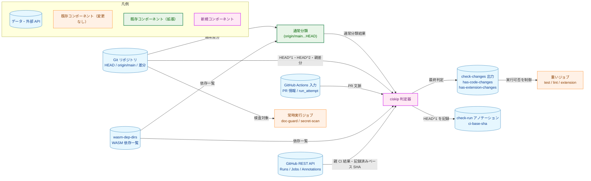
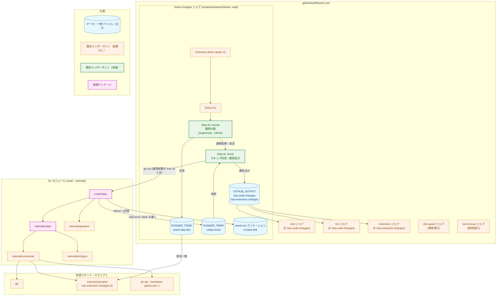
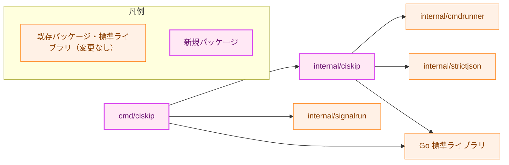
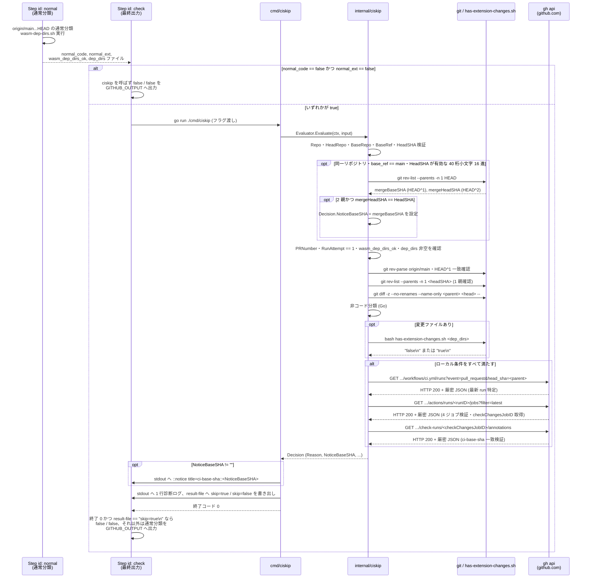
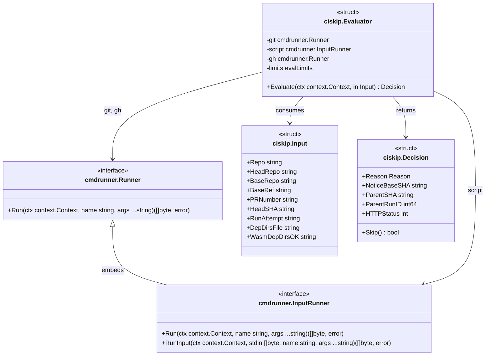
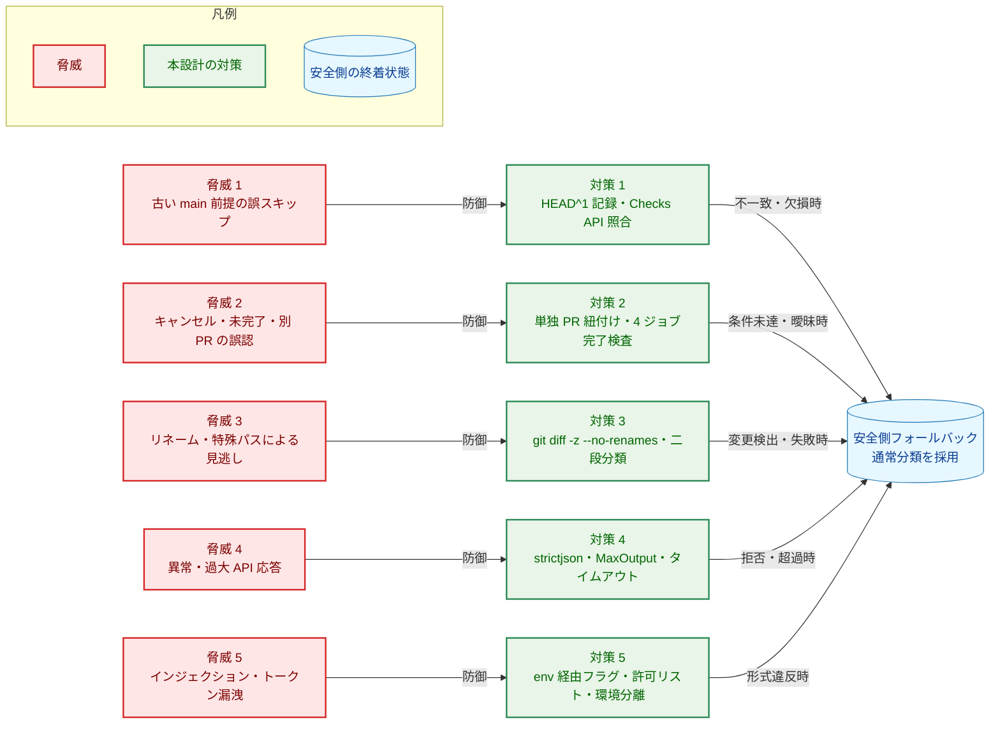
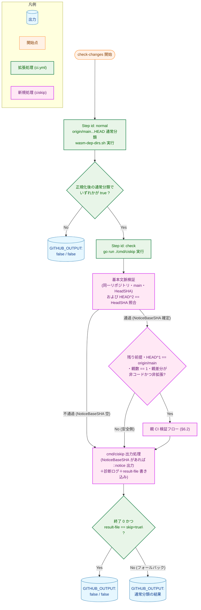
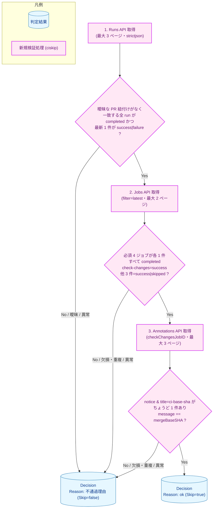

# アーキテクチャ設計書：直前コミットで CI 通過済みかつドキュメントのみの変更時に重いジョブをスキップする

## Document Status

| Item | Value |
|---|---|
| Status | `draft` |
| Created | 2026-11-21 |
| Review date | - |
| Reviewer | - |
| Comments | - |

本書は [01_requirements.md](01_requirements.md)（要件定義書。以下、要件書）の設計である。「計画で決める」は、本タスクの実装計画書（`03_implementation_plan.md`）で決めることを指す。既存のファイルの内容は、コミット `b004f8c0` で確かめた。`file:line` の行番号は、このコミットでの行番号である。F-NNN・AC-NN は要件書の項番を、H-NN は [design_handoff.md](design_handoff.md)（以下、申し送り）の項番を指す。申し送りへの対応は付録 A に、受け入れ基準との対応は付録 B にまとめる。

本書は、要件書 §6 の用語（重いジョブ・常時実行ジョブ・コードファイル／非コードファイル・拡張対象ファイル／非拡張ファイル・`PRE_MERGE` コミット・PR head コミット・親コミット・通常分類・安全側フォールバック・食い違いの記述）を同じ意味で使う。そのほかに、次の用語を使う。

-   **`ciskip`:** 本書が新設する Go 製の CI 専用ツール（CLI コマンド）。`cmd/ciskip` と `internal/ciskip` の組である（§2.2）。
-   **合成マージコミット:** GitHub Actions の `on: pull_request` イベントで `actions/checkout@v5` が既定でチェックアウトする `refs/pull/<N>/merge` のコミット（`HEAD`）。第 1 親（`HEAD^1`）が合成時点のベースブランチ（`main`）の先端、第 2 親（`HEAD^2`）が PR head コミットである（§3.3.1）。
-   **記録済みベース SHA:** 前回の `check-changes` 実行で `ciskip` が `::notice title=ci-base-sha::<sha>` として check-run のアノテーションに残した、その実行の `HEAD^1`（40 桁小文字 16 進 SHA）（§3.3.1）。
-   **判定理由:** `internal/ciskip` がスキップ可否とともに返す宣言された理由コード（`Reason` 型）（§4.1）。

---

## 1. 設計の全体像 (Design Overview)

### 1.1. 設計原則

-   判定はテストのある Go のコードに置く（[ADR-0014](../../dev/adr/0014-deterministic-checks-in-go.md)）。分岐が多く安全側に倒す必要がある判定（入力形式検査・合成マージコミット整合性・差分分類・GitHub API 応答の厳密検査・ジョブとアノテーションの照合）をシェルスクリプトではなく `internal/ciskip` に集約し、各条件をユニットテストで壊して確かめられるようにする（要件書 §4.5）。
-   不確かなことはすべて安全側（通常分類）へ倒し、`check-changes` を落とさない。前提崩れ・外部コマンド失敗・API 障害・応答の規約違反・上限超過・`ciskip` 自体の異常終了やコンパイル失敗まで含め、確実にスキップ可能と証明できた場合以外は通常分類の結果をそのまま採用する（要件書 F-003・§4.3、AC-12）。
-   既存の通常分類と拡張テストのピン留めを壊さない。`.github/workflows/ci.yml` の変更は `check-changes` ジョブ内に限定し（AC-16）、`origin/main...HEAD` の通常分類と `wasm-dep-dirs.sh`／`has-extension-changes.sh` の呼び出し・フォールバック（`extension/test/repository.test.ts:143-251`）を維持したまま、後段ステップでスキップ判定を行う（AC-17、H-04）。
-   既存の共有部品を再利用する（DRY）。外部コマンド（`git`・`bash`・`gh`）の実行境界は `internal/cmdrunner`（`GitHardening`・`GitEnv`・`MaxOutput`・`ProcessGroup`）を、シグナル処理は `internal/signalrun` を、JSON の厳密検査は `internal/strictjson` を、拡張変更分類は既存の `extension/scripts/has-extension-changes.sh` をそのまま使う。
-   ローカル検査を先に行い、不要な API 呼び出しと実行コストを避ける。すでに通常分類の両出力が `false` の PR では `ciskip` を起動しない。起動した場合も、入力検証・合成マージコミット整合性・親コミット数・親コミット差分分類をすべてローカルで先に判定し、通過した文書のみの変更コミットだけで GitHub API を呼ぶ（要件書 §4.1）。
-   宣言された事実だけで判定し、推測しない。コミットメッセージ文字列や `pull_requests[].base.sha` のような不確かな推測には頼らず、親コミット数・NUL 区切り差分・GitHub API のジョブ結論・明示的に記録した `ci-base-sha` アノテーションといった構造化された事実のみで判定する（要件書 §5）。

### 1.2. 設計の際に決めたこと（2026-11-21）

-   `main` 不変性の検証方式は「`ciskip` 実行時に `HEAD^1` を `::notice` で記録し、次回に Checks API で読み戻す」方式（案 A）とする（H-01・AC-11）。
    2026-11-21 に本リポジトリの実データ（オープン中の PR #1066 における先端コミット `a245ba90...` の run `44676354597`、およびその 1 つ前の親コミット `ba0d1760ebaf3144525a733309bd5aeca4bfa9ad` の run `44676325780`）を `gh api` で確認した。その結果、Workflow Runs API の `pull_requests[]` にはオープン中の PR で先端コミット・親コミットともに `[1066]` が入ったものの、`pull_requests[].base.sha` は PR 作成時のスナップショットであり、合成マージコミットが実際に検証した `main`（`HEAD^1`）とは一致しなかった。また REST API は合成マージコミット（`GITHUB_SHA`）やその `HEAD^1` を返さない。git 祖先判定のみ（`origin/main` が親コミットの祖先であること）は `checks: read` を不要にするが、他 PR が先に `main` にマージされた後に作業ブランチへ `PRE_MERGE` を積む一般的なケースでスキップが効かなくなる。そのため、通常分類でコードまたは拡張の変更があり `ciskip` が起動するたびに `::notice title=ci-base-sha::<HEAD^1>` を出力し、次回に親 run の `Check changed files` ジョブ（check-run）のアノテーションを Checks API（`checks: read` 追加）で読み戻して今回の `HEAD^1` および `origin/main` と照合する方式を採る。`GITHUB_TOKEN` + `checks: read` で `::notice` を確実に読み戻せるかは本リポジトリ上で未実測だが、読めない場合は安全側（通常実行）に倒れるため、実装 PR の実機確認（F-006）で検証する。人の答え：案 A（`check-changes` が `HEAD^1` を `::notice` で記録し Checks API で読み戻す、`checks: read` 追加）。
    -   ADR：[ADR-0054](../../dev/adr/0054-ci-skip-doc-only-commit.md) を更新する（CI の `main` 不変性検証方式および `checks: read` の権限追加はワークフロー権限と仕組みの根幹に関わるため）。
-   判定ロジックの配置先は Go 製の CI 専用ツール `cmd/ciskip` + `internal/ciskip` とし、`check-changes` ジョブから `go run ./cmd/ciskip` で呼ぶ（H-03・H-04）。
    [ADR-0014](../../dev/adr/0014-deterministic-checks-in-go.md) の方針に沿い、`check-changes` が `wasm-dep-dirs.sh`（`go list`）のためにすでに `actions/setup-go` を実行済み（`.github/workflows/ci.yml:26-30`）である点を活かして、`internal/strictjson` と `internal/cmdrunner` を再利用し包括的なユニットテストを書く。`go.mod` は外部依存がなく `cmd/ciskip` の依存パッケージも少ないため、`GOCACHE` が空のコールド状態から `go run` で都度ビルドしても数秒程度（4 vCPU 換算で約 4〜6 秒）にとどまり、スキップ適用時は常時実行の `doc-guard`（約 1 分）と並列に走るため PR 全体の待ち時間を増やさない（文書のみ PR で通常分類が両方 `false` のときは `ciskip` 自体を起動しない）。シェルスクリプト（`.github/scripts/`）＋ `curl` / `jq` 案は厳密 JSON 検査とテストの保守性が低く採らない。コンパイル済みバイナリを事前ビルドして再利用する案も、`setup-go` 自体を省けず短縮幅が小さい一方で、バイナリ配布・ソース整合性・`ciskip` 自身を修正する PR での検証切り替えといった運用コストとリスクが増えるため採らない（将来さらに数秒を短縮したい場合は、バイナリ配布ではなく `actions/cache` で `GOCACHE` をキャッシュする）。CI 専用のためインストール型ツール（installed tool）ではなく、都度ビルド型ツール（per-run tool）と同様に `make install-*`・Rule 5（利用者が `main` からインストールし、エージェントはインストールもビルドもしない規則）・プロトコル番号の対象外とする。既存の通常分類ステップ（`origin/main...HEAD`）はそのまま維持し、後段の最終出力ステップから `ciskip` を呼ぶ。人の答え：案 A（Go ツール `cmd/ciskip` + `internal/ciskip` を新設し `go run` で呼ぶ、既存分類ステップ維持）。
    -   ADR：[ADR-0054](../../dev/adr/0054-ci-skip-doc-only-commit.md) と [ADR-0014](../../dev/adr/0014-deterministic-checks-in-go.md) を更新する（CI 専用ツールの区分と Rule 5 の適用除外は ADR-0014 が定める `dev_tools.md` の規則に関わるため）。
-   GitHub API の呼び出しは `internal/cmdrunner` 経由の `gh` コマンド（`gh api --hostname github.com -i`）で行う（H-02・H-03・要件書 §3.2・§4.2）。
    既存の Go 製開発ツール（`fixprguard`・`numreserve`・`chief`）と同じ `gh` + `internal/cmdrunner` パターンを採用する。GitHub API の認証を `gh` の認証機構へ委譲できるため、`ciskip` 自身が `GITHUB_TOKEN`／`GH_TOKEN` を直接読み込んで保持・`Authorization` ヘッダ付与・ログやエラー出力からの秘匿を自前管理する必要がなく、`net/http` を直接使う場合に生じるトークン取り扱い（および環境変数読み込みに伴う [ADR-0024](../../dev/adr/0024-env-access-in-config.md) との衝突）を避けられる。HTTP リダイレクト（3xx）を拒否できない点と HTTP 層で応答サイズ上限を指定できない点は `gh` の制限として受け入れ、要件書 §3.2・§4.2 を同内容へ見直した（決定の変更として `01_requirements.md` を `draft` へ戻し変更履歴へ記録）。メモリ枯渇対策として、`gh` 呼び出し側（`internal/cmdrunner`）に出力読み込み上限（`MaxOutput`）とコマンドタイムアウト・プロセスグループ終了を課し、上限超過時は読み込みを打ち切って `ErrOutputTooLarge` として拒否（安全側フォールバック）する。`GH_TOKEN` は `ci.yml` のステップ環境変数で `gh` へ渡し、`cmd/ciskip` 自身は環境変数からトークンを直接読まないため、[ADR-0024](../../dev/adr/0024-env-access-in-config.md) の方針変更は不要（子プロセス環境引き継ぎ用の `os.Environ` 1 か所のみ `internal/config/envaccess_test.go` の一覧へ追加）。人の答え：gh コマンドを使用。リダイレクトを拒否できない点、ならびに応答サイズ上限を指定できない点は制限として受け入れ、応答サイズが一定以上になった場合でも gh コマンド呼び出し側が読み込みを打ち切るなどして、メモリ枯渇に至らないように対策を行う。
    -   ADR：[ADR-0054](../../dev/adr/0054-ci-skip-doc-only-commit.md) を更新する（`01_requirements.md` のセキュリティ要件の見直しと API 呼び出し境界の選択に関わるため）。[ADR-0024](../../dev/adr/0024-env-access-in-config.md) は変更しない。
-   親コミット差分の「非コード」分類規則は `internal/ciskip` に実装し、Go のテストで `.github/workflows/ci.yml:44` の既存規則との一致をピン留めする（H-03・H-04・F-001）。
    既存の通常分類ステップ（`.github/workflows/ci.yml:32-72`）を書き換えずに AC-17 と `extension/test/repository.test.ts:143-251` を完全維持しつつ、親コミット差分では `git -c core.quotePath=false diff -z --no-renames --name-only` の NUL 区切り出力を 1 パスずつ判定して AC-04（リネーム両側・非 ASCII・タブ／改行パス）を満たす。拡張分類は既存の `extension/scripts/has-extension-changes.sh`（通常分類ステップが生成した `wasm-dep-dirs` を入力）を再利用する。非コード分類を共通スクリプトへ切り出す案は、通常分類ステップにも変更が入り AC-17 の既存動作維持に影響するため採らない。人の答え：案 A（親差分の非コード分類を `internal/ciskip` に実装し Go テストで `ci.yml` とピン留め、拡張は既存スクリプト再利用）。
    -   ADR：なし（本タスク内部の実装構成に閉じる選択のため）。

### 1.3. なぜ既存の仕組みのままでは足りないか

-   **既存の `origin/main...HEAD` 差分分類（`.github/workflows/ci.yml:35-72`）:** PR 全体の差分を見るため、PR 内の過去コミットに 1 行でもコードや拡張の変更があれば、その後から文書のみを変える `PRE_MERGE` コミットや文書修正コミットを push しても毎回 `has-code-changes=true`／`has-extension-changes=true` となり、重いジョブが必ず再実行される。
-   **`[skip ci]` / `[no ci]` の付与:** ワークフロー全体が走らなくなり、`mergepr` の「チェック 0 件で停止・CI 通過済みの `headRefOid` のみマージ」の保証（`internal/mergepr/mergepr.go:275`、`docs/dev/guides/mergepr_guide.md:30`・`:265`）、必須ステータスチェック、および `doc-guard`・`secret-scan` の常時実行方針（[ADR-0016](../../dev/adr/0016-document-test-policy.md)）と衝突する。
-   **シェルスクリプトのみでの簡易スキップ:** 親コミットの CI 結果確認には、合成マージコミット `HEAD^1`／`HEAD^2` の照合、不正 UTF-8 や消費メンバの重複キーを拒否する厳密 JSON 解析、ジョブ名欠損・重複の検査、ページネーション上限、およびアノテーション照合が必要であり、既存の単純な `grep` ベース分類では要件書 F-001〜F-003 と §3.2 を満たせない。

### 1.4. 概念モデル

矢印 `A → B` は「A から B へデータ・入力・出力または制御が流れる」を表す。



---

## 2. システム構成 (System Structure)

### 2.1. 全体アーキテクチャ

矢印 `A → B` は「A から B への実行順序の遷移、呼び出し、またはデータの受け渡し」を表す。`check-changes` ジョブ内の通常分類（`id: normal`）は既存ロジックを維持し、最終出力ステップ（`id: check`）が新規の `cmd/ciskip` を呼び出して最終的な `has-code-changes` と `has-extension-changes` を決定する。`test`・`lint`・`extension`・`doc-guard`・`secret-scan` のジョブ定義は一切変更しない（AC-16）。



### 2.2. コンポーネント配置

パッケージの依存関係を示す。矢印 `A → B` は「パッケージ A がパッケージ B を import する」を表す。



#### リポジトリ規約・既存ガードテストとの整合（H-03・H-04）

| 規約・ガードテスト | 該当ファイル（`b004f8c0`） | 本設計での扱い |
|---|---|---|
| 開発ツールの区分（ADR-0014） | `docs/dev/adr/0014-deterministic-checks-in-go.md:26-33`、`docs/dev/conventions/dev_tools.md:10-24,140-142` | `cmd/ciskip` + `internal/ciskip` は GitHub Actions から `go run` で呼ぶ CI 専用ツールであり、インストール型ツール（installed tool）ではないため、`make install-*`・Rule 5・`--protocol` 番号の対象外とする。本 PR で ADR-0014 を更新し、実装 PR で `dev_tools.md` の「Kinds of tools」と「Rule 5」の適用除外を更新する |
| パッケージ一覧・`strictjson` 利用一覧 | `docs/dev/conventions/package_reference.md:52-58,109,112-129`、`internal/pipeline/pipeline_test.go:626-669`、`internal/pipeline/strictjson_users_test.go:654-685` | `package_reference.md` の「Kinds of package」の `Development tools` 定義に CI 専用ツールを含めるよう広げ、「Development Tools」表へ `cmd/ciskip`・`internal/ciskip` の行を追加する。あわせて `internal/strictjson` 行の利用パッケージ一覧へ `internal/ciskip` を追加する（`TestPackageReferenceListsPackages`・`TestPackageReferenceStrictjsonUsers` 対応） |
| 環境変数アクセスの制限（ADR-0024） | `docs/dev/adr/0024-env-access-in-config.md`、`internal/config/envaccess_test.go:65-102` | `cmd/ciskip/main.go` は子プロセス（`git`・`bash`・`gh`）へ環境を渡すために `os.Environ()` を 1 回だけ呼ぶ（`cmd/numreserve/main.go`・`cmd/mergepr/main.go` と同一パターン）。ADR-0024 の既存区分（子プロセス環境引き継ぎ）に収まるため ADR-0024 本体は変更せず、`internal/config/envaccess_test.go` の `allowedEnvRefs` に `"cmd/ciskip/main.go": {"call:os.Environ": 1}` を 1 行追加する |
| 「Declare, don't infer」例外 | `CLAUDE.md:405-620`（`internal/numreserve` の例は `:563-590`） | `internal/ciskip` が外部コマンド出力・API ヘッダ・アノテーション値・ファイルパス文字列を読んで振る舞いを決める範囲と境界を `CLAUDE.md` の例外および `internal/ciskip` のパッケージ doc コメントへ明記する |
| 拡張 CI ピンテスト | `extension/test/repository.test.ts:143-251` | `check-changes` の最終出力ステップの `id` を `check` に保ち（`outputs` 宣言 `steps.check.outputs.has-extension-changes` を維持）、通常分類ステップ（`id: normal`）内の `git -c core.quotePath=false diff -z --no-renames --name-only origin/main...HEAD`、`if bash extension/scripts/wasm-dep-dirs.sh > "$dep_dirs"; then`、`| bash extension/scripts/has-extension-changes.sh "$dep_dirs")`、`else` の `has_extension_changes=true` フォールバックをそのまま維持する。既存アサーションを 1 件も弱めずに通したうえで、新規の `workflow_pin_test.go`（§3.5・§7.1）で `id: check` 側のフォールバック伝播もピン留めする |
| 製品バイナリからの分離 | `cmd/yt2column/devdeps_test.go:22-31`、`internal/extjob` の `TestModuleDependencies`、`make wasm-check` | `cmd/yt2column`・`cmd/yt2column-wasm`・`cmd/yt2column-wasm-dev` は `internal/ciskip` を一切 import しない（なお既存の `devdeps_test.go` は `devfake`・`devbackend` の禁止を検査するテストであり、`internal/ciskip` に依存しないことはパッケージ設計と必要に応じた依存テストで保つ） |
| 外部依存の禁止 | `.golangci.yml:49-60` | Go 標準ライブラリと本モジュール内パッケージのみを使用し、外部モジュール・外部 GitHub Action を追加しない |

### 2.3. データフロー

実線矢印（`->>`）は同期呼び出しまたはファイル・標準出力への書き出しを、破線矢印（`-->>`）は戻り値・応答の返却を表す。



---

## 3. コンポーネント設計 (Component Design)

### 3.1. CLI 契約（`cmd/ciskip`）

`.github/workflows/ci.yml` の `check-changes` ジョブ（Step `id: check`）から `GOTOOLCHAIN=local go run ./cmd/ciskip` で呼び出す。`main` は `internal/signalrun.Run` で `SIGTERM`/`SIGINT`/`SIGHUP` を捕捉し、ワークフローキャンセル時に子プロセスグループを即座に停止できるようにする。

#### 引数（フラグ）

GitHub Actions の `${{ ... }}` コンテキスト値はすべてステップの `env:` に受け、シェルからは `--flag="$VAR"` の形で渡す（`=` 付きにすることで、先頭が `-` の文字列でもフラグ名と誤認されない）。

| フラグ | 供給元（`ci.yml` の `env:` 経由） | 受理形式（要件書 §3.2） |
|---|---|---|
| `--repo` | `github.repository` | 厳密な ASCII 許可リスト `^[A-Za-z0-9._-]+/[A-Za-z0-9._-]+$`（各セグメント非空、`.` および `..` を禁止、全長最大 200 バイト） |
| `--head-repo` | `github.event.pull_request.head.repo.full_name` | `--repo` と同じ許可リスト形式、かつ `--repo` と完全一致（フォーク・削除済みフォークの空文字を拒否） |
| `--base-repo` | `github.event.pull_request.base.repo.full_name` | `--repo` と同じ許可リスト形式、かつ `--repo` と完全一致 |
| `--base-ref` | `github.event.pull_request.base.ref` | ちょうど `main`（最大 100 バイト） |
| `--pr-number` | `github.event.pull_request.number` | 前後空白・符号なしの正の 10 進整数（`^[1-9][0-9]*$`、最大 10 桁） |
| `--head-sha` | `github.event.pull_request.head.sha` | 40 桁小文字 16 進（`^[0-9a-f]{40}$`） |
| `--run-attempt` | `github.run_attempt` | 前後空白・符号なしの正の 10 進整数（`^[1-9][0-9]*$`、最大 10 桁）。`1` のみスキップ対象、`2` 以上は手動再実行としてスキップ不可 |
| `--dep-dirs` | `$RUNNER_TEMP/wasm-dep-dirs` | `wasm-dep-dirs.sh` が生成したファイルのパス（`--wasm-dep-dirs-ok=true` のとき必須、非空かつ各非空行が `/` 終端） |
| `--wasm-dep-dirs-ok` | `steps.normal.outputs.wasm-dep-dirs-ok` | ちょうど `true` または `false` |
| `--result-file` | `$RUNNER_TEMP/ciskip-result.XXXXXX`（`mktemp` で作成） | 判定結果の書き出し先ファイルパス（CLI 必須） |

#### 出力・終了コード契約

-   **標準出力（`stdout`）:**
    -   `Decision.NoticeBaseSHA != ""`（§3.2）のとき（同一リポジトリ・`--base-ref=main`・有効な `--head-sha` であり、合成マージコミット `HEAD` の 2 親解決と `HEAD^2 == --head-sha` の照合に成功したとき）、`::notice title=ci-base-sha::<NoticeBaseSHA>` を 1 行出力する。GitHub Actions ランナーがこれを認識できるよう、`ci.yml` 側では `go run ./cmd/ciskip` の標準出力をコマンド置換 `$(...)` で捕捉せずそのままランナーへ流す。
    -   判定結果の 1 行診断ログ（§4.2）を出力する（AC-13）。
-   **結果ファイル（`--result-file`）:**
    -   ちょうど `skip=true\n` または `skip=false\n` の 1 行だけを書き込む。
    -   `ci.yml` 側は、`go run ./cmd/ciskip` の終了コードが `0` であり、かつ結果ファイルのバイト列が厳密に `skip=true\n`（`printf 'skip=true\n' | cmp -s - "$result_file"`）である場合のみ `has-code-changes=false` と `has-extension-changes=false` を出力する。それ以外のすべてのケースでは通常分類の結果へ安全側にフォールバックする（AC-12・AC-17）。
-   **終了コード:**
    -   `0`: `Evaluate` が完了したすべてのケース（`skip=true`、およびコンテキスト入力の欠損・空値・形式違反・フォーク PR を含むすべての `skip=false`）。これにより削除済みフォーク（`--head-repo=""`）や API 障害で `check-changes` ジョブが異常終了しない（AC-12）。
    -   `2`: 未知フラグ・フラグ構文エラー、`--result-file` 未指定／空、または結果ファイル書き込み失敗のみ。エラーを標準エラーへ出す際は固定メッセージのみとし、信頼できないフラグ値は出力しない（`ci.yml` 側でも非ゼロ終了を捕捉して通常分類へフォールバックする）。

### 3.2. 高レベル型・インターフェース定義

`internal/ciskip` が公開する型・定数・関数・メソッドを示す。外部コマンド実行には既存の `internal/cmdrunner`（`cmdrunner.Runner`・`cmdrunner.InputRunner`、`internal/cmdrunner/runner.go:22-33`）を利用する。ランナー構成用の上限値（`bounds`）とテスト注入用コンストラクタ（`newWithRunners`）はパッケージ非公開とし、公開 API を最小限に保つ（`internal/numreserve/tool.go:14-38` と同方針）。`cmd/ciskip` のユニットテストでは `cmd/ciskip` 側に非公開の `evaluator` インターフェースを置いて差し替える。

```go
package ciskip

import (
	"context"

	"github.com/isseis/yt2column/internal/cmdrunner"
)

// Reason is the declared verdict reason for a skip evaluation.
// Its zero value (ReasonUnspecified) means "do not skip" (fail-safe).
type Reason string

const (
	ReasonUnspecified          Reason = ""
	ReasonSkipped              Reason = "ok"
	ReasonInvalidInput         Reason = "invalid_input"
	ReasonForkOrRepoMismatch   Reason = "fork_or_repo_mismatch"
	ReasonNonMainBase          Reason = "non_main_base"
	ReasonManualRerun          Reason = "manual_rerun"
	ReasonWasmDepDirsFailed    Reason = "wasm_dep_dirs_failed"
	ReasonMergeCommitMismatch  Reason = "merge_commit_mismatch"
	ReasonMainMovedAtCheckout  Reason = "main_moved_at_checkout"
	ReasonNotSingleParent      Reason = "not_single_parent"
	ReasonCodeChanged          Reason = "code_changed"
	ReasonExtensionChanged     Reason = "extension_changed"
	ReasonGitFailed            Reason = "git_failed"
	ReasonExtensionCheckFailed Reason = "extension_check_failed"
	ReasonAPIFailed            Reason = "api_failed"
	ReasonAPITimeout           Reason = "api_timeout"
	ReasonAPIOutputTooLarge    Reason = "api_output_too_large"
	ReasonAPIInvalidResponse   Reason = "api_invalid_response"
	ReasonAPIPaginationLimit   Reason = "api_pagination_limit"
	ReasonNoParentRun          Reason = "no_parent_run"
	ReasonAmbiguousPRLink      Reason = "ambiguous_pr_link"
	ReasonParentRunIncomplete  Reason = "parent_run_incomplete"
	ReasonParentRunBadResult   Reason = "parent_run_bad_result"
	ReasonParentJobsInvalid    Reason = "parent_jobs_invalid"
	ReasonParentBaseMissing    Reason = "parent_base_missing"
	ReasonParentBaseDuplicate  Reason = "parent_base_duplicate"
	ReasonMainAdvanced         Reason = "main_advanced"
)

// Input holds the raw GitHub Actions context values and local paths passed to Evaluate.
type Input struct {
	Repo          string
	HeadRepo      string
	BaseRepo      string
	BaseRef       string
	PRNumber      string
	HeadSHA       string
	RunAttempt    string
	DepDirsFile   string
	WasmDepDirsOK string
}

// Decision is the outcome of one skip evaluation.
// Whether heavy jobs may be skipped is derived solely from Reason via Skip(),
// so an inconsistent (skip=true, non-ok reason) state is unrepresentable.
// NoticeBaseSHA is non-empty only when the synthetic merge commit's first parent (HEAD^1)
// was resolved and HEAD^2 matched the validated HeadSHA on a same-repo main PR.
// HTTPStatus is non-zero only when a gh api call returned a parseable non-200 HTTP status code.
type Decision struct {
	Reason        Reason
	NoticeBaseSHA string
	ParentSHA     string
	ParentRunID   int64
	HTTPStatus    int
}

// Skip reports whether every precondition and verification succeeded (Reason == ReasonSkipped).
func (d Decision) Skip() bool

// Evaluator runs the CI skip decision using bounded external command runners.
type Evaluator struct {
	git    cmdrunner.Runner
	script cmdrunner.InputRunner
	gh     cmdrunner.Runner
	limits evalLimits
}

// New builds a production Evaluator with isolated, bounded cmdrunner instances
// derived from the process environment (environ).
func New(environ []string) *Evaluator

// Evaluate determines whether heavy CI jobs may be skipped for the current PR head commit.
// Contract: Evaluate never returns an error for operational failures; every failure maps
// to a Decision with Skip() == false and a specific Reason (fail-safe).
func (e *Evaluator) Evaluate(ctx context.Context, in Input) Decision
```

#### クラス図

矢印 `A <|-- B` は「インターフェース B がインターフェース A を埋め込む」、`A --> B` は「A が B を保持・消費・または返却する」を表す。`cmdrunner.Runner` と `cmdrunner.InputRunner` のメソッドシグネチャは `internal/cmdrunner/runner.go:25-33`（`b004f8c0`）に一致する。



### 3.3. 判定条件と外部インターフェース契約

#### 3.3.1. 合成マージコミット・`HEAD^1` 記録・`main` 不変性（H-01・AC-01・AC-11）

1.  **基本文脈の先行検証:**
    -   `Repo`・`HeadRepo`・`BaseRepo` が厳密許可リスト `^[A-Za-z0-9._-]+/[A-Za-z0-9._-]+$`（各セグメント非空・`.`/`..` 禁止・全長 ≤ 200）に一致し、`Repo == BaseRepo && BaseRepo == HeadRepo` であることを検証する（不一致・空は `ReasonForkOrRepoMismatch`、AC-09）。
    -   `BaseRef == "main"` を検証する（不一致は `ReasonNonMainBase`、AC-09）。
    -   `HeadSHA` が厳密な 40 桁小文字 16 進（`^[0-9a-f]{40}$`）であることを検証する（不一致は `ReasonInvalidInput`、AC-12）。
2.  **合成マージコミットの検証と `NoticeBaseSHA` の確定:**
    -   上記 1 をすべて通過した後にのみ `git rev-list --parents -n 1 HEAD` を実行し、`HEAD` がちょうど 2 つの親（`<mergeSHA> <mergeBaseSHA> <mergeHeadSHA>`、各 40 桁小文字 16 進）を持ち、かつ `mergeHeadSHA == in.HeadSHA` であることを検証する（満たさなければ `ReasonMergeCommitMismatch` とし、`NoticeBaseSHA` は空のままにする）。
    -   `mergeHeadSHA == in.HeadSHA` が確認できた時点で初めて `Decision.NoticeBaseSHA = mergeBaseSHA` を設定する。これにより、以降の判定が `Skip() == false` となるケース（コード変更、手動再実行、`wasm-dep-dirs.sh` 失敗等）であっても、チェックアウトされた合成マージコミットがイベントの `HeadSHA` と一致することが証明された実行に限って `::notice title=ci-base-sha::<mergeBaseSHA>` が記録され、誤ったチェックアウトに対する偽のアノテーション発行を防ぐ。
    -   記録する値は `origin/main` ではなく `HEAD^1`（`mergeBaseSHA`）である。GitHub Actions の `pull_request` では全ジョブが同一の `GITHUB_SHA`（合成マージコミット）をチェックアウトするため、`test`・`lint`・`extension` が実際に検証する `main` コミットは常に `HEAD^1` に一致する。
3.  **残りの前提確認とチェックアウト時点の `main` 整合性:**
    -   `PRNumber`（正の 10 進整数）・`RunAttempt`（正の 10 進整数、`> 1` なら `ReasonManualRerun`、AC-10）・`WasmDepDirsOK == "true"`（`false` なら `ReasonWasmDepDirsFailed`、AC-12）を検証する。
    -   `git rev-parse --verify refs/remotes/origin/main^{commit}` で `originMainSHA` を取得し、`mergeBaseSHA == originMainSHA` を確認する。合成マージコミット作成からチェックアウトの間に `main` が進んだ場合は `ReasonMainMovedAtCheckout` で安全側へ倒す。
4.  **親コミットの特定と単一親チェック（F-001・AC-01）:**
    -   `git rev-list --parents -n 1 <headSHA>` を実行し、PR head コミットの親がちょうど 1 つ（`<headSHA> <parentSHA>`）であることを確認する。親が 0 個または 2 つ以上（マージコミット）なら `ReasonNotSingleParent` でスキップ不可とする。
5.  **親 CI 時点との `main` 不変性照合（AC-11）:**
    -   API 呼び出し 3（Checks API、§3.3.3）で取得した親 run の記録済みベース SHA（`parentBaseSHA`）が、`mergeBaseSHA`（＝ `originMainSHA`）と一致することを確認する。不一致なら `ReasonMainAdvanced` でスキップ不可とする。
    -   連続する文書のみの push（AC-08）でも、各スキップ実行が同じ `HEAD^1` を `::notice` で記録し直すため、帰納的に最後の通常実行と同じ `main` コミットに対する整合性が保たれる。

#### 3.3.2. 親コミット差分の分類（H-03・H-04・F-001・AC-02〜AC-04）

1.  **`wasm-dep-dirs` ファイルの独立検証（要件書 §3.2）:**
    -   `extension/scripts/has-extension-changes.sh:28-38` は空の依存一覧ファイルでもエラーにせず `false` を返すため、`internal/ciskip` が自ら `in.DepDirsFile` を読み込み（サイズ上限は §3.4 の `script` ランナー上限 `64 KiB` を適用）、ファイルが空でないこと、`/` で終わるディレクトリ行を少なくとも 1 行含むこと、およびすべての非空行が `/` で終わることを検証する。違反時は `ReasonWasmDepDirsFailed` とする。
2.  **差分パス一覧の取得:**
    -   `git -c core.quotePath=false diff -z --no-renames --name-only <parentSHA> <headSHA> --` を `cmdrunner.GitHardening()` 付きで実行する（末尾の `--` でリビジョンとパス指定の曖昧さを排除する）。
    -   出力が 0 バイト（空コミット）なら、変更ファイル 0 件として非コードかつ非拡張の条件を満たす（AC-02。ただし `WasmDepDirsOK == "true"` および上記 1 の非空検証は事前に通過済み）。
    -   出力が非空のとき、末尾が NUL（`\x00`）であることを確認し、NUL で分割してパス一覧を得る（空要素が含まれれば `ReasonGitFailed` で拒否）。`--no-renames` によりリネーム前後の両パスが出力され、`-c core.quotePath=false -z` により非 ASCII 文字・空白・タブ・改行を含むパスもクォートや行分割なしに元のバイト列のまま得られる（AC-04）。
3.  **非コード分類（Go 実装＋常設ピンテスト）:**
    -   各パス `p` について、`strings.HasSuffix(p, ".md") || strings.HasPrefix(p, "docs/") || strings.HasPrefix(p, ".claude/") || p == "LICENSE"` を満たすかを 1 パスずつ判定する（`.github/workflows/ci.yml:44` の `grep -vE '(\.md$|^docs/|^\.claude/|^LICENSE$)'` と同じ規則）。
    -   1 件でも該当しないパスがあれば即座に `ReasonCodeChanged` を返す（AC-03・AC-04）。
    -   `.github/workflows/ci.yml:44` の正規表現文字列と本規則の一致は、`internal/ciskip` の常設ユニットテストでピン留めする（§7.1）。
4.  **拡張対象分類（既存スクリプト再利用）:**
    -   変更ファイルが 1 件以上のとき、`git diff -z` の生のバイト列を標準入力として `bash extension/scripts/has-extension-changes.sh <depDirsFile>` を `cmdrunner.InputRunner.RunInput`（`StderrIsFailure: true`）で実行する。
    -   標準出力が厳密に `"false\n"` のときのみ非拡張と判定する。`"true\n"` なら `ReasonExtensionChanged`（AC-03・AC-04）、非ゼロ終了・標準エラー出力あり・それ以外の出力はすべて `ReasonExtensionCheckFailed` とする（AC-12・要件書 §3.2）。

#### 3.3.3. GitHub API の呼び出し・応答検証・ページネーション契約（H-02・F-002・要件書 §3.2）

すべての API 呼び出しは `gh api --hostname github.com -i <endpoint>` を `internal/cmdrunner` 経由で実行する。`gh` の実行環境からは `CLICOLOR_FORCE`・`GH_FORCE_TTY`・`NO_COLOR`・`GH_PROMPT_DISABLED`・`GH_REPO`・`GH_HOST`・`GH_DEBUG`・`GH_PAGER`・`PAGER`・`GIT_*`・`CISKIP_*` を除外し、`NO_COLOR=1`・`GH_PROMPT_DISABLED=1` を付与する（`GH_REPO`・`GH_HOST`・色・プロンプトの除外は `internal/numreserve/tool.go:45-63`、`GIT_*` の除外は `internal/chief/runner.go` および `internal/config/envaccess_test.go:87` と同方針）。`git` と `bash` の実行環境からは `cmdrunner.GitEnv` に加えて `GH_TOKEN`・`GITHUB_TOKEN`・`CISKIP_*` を除外する。

なお、`gh api -i` の HTTP フレーミング解析は既存の `internal/fixprguard/trust.go:203-242` および `internal/numreserve/reserve.go:199-242` にも存在するが、本タスクのスコープ外である既存の開発ツール（`fixprguard`・`numreserve`）への変更を避けるため（要件書 §2.3）、本タスクでは `internal/ciskip/github.go` に閉じた実装を置き、将来の共通化余地は §9 に残す。

すべての `gh api -i` 応答に対し、次の共通フレーミング検査を行う。
1.  **終了状態と HTTP ステータス抽出:**
    -   タイムアウトは `ReasonAPITimeout`、`cmdrunner.ErrOutputTooLarge` は `ReasonAPIOutputTooLarge` とし、出力を一切保持しない。
    -   コマンドが `*cmdrunner.ExitError` で非ゼロ終了したときは、`internal/numreserve/reserve.go:192-215` と同じ方式で `ExitError.Stdout` の 1 行目から 3 桁の整数 HTTP ステータスコードのみを抽出し（抽出できれば `Decision.HTTPStatus` へ記録）、ヘッダ・本文・`ExitError.Stderr` はすべて破棄して `ReasonAPIFailed` とする。起動不能など `*cmdrunner.ExitError` 以外の失敗も `ReasonAPIFailed` とする。
2.  **正常終了時のステータス行とヘッダ分離（`numreserve` と同形式の LF／CRLF 混在対応）:**
    -   `gh api -i` の出力は 1 行目（ステータス行）が LF（`\n`）終端、ヘッダ行と終端の空行が CRLF（`\r\n`）終端である（`internal/numreserve/reserve.go:199-242`）。1 行目を `\n` で切り出し、`^HTTP/(?:1\.1|2|2\.0) ([0-9]{3})(?: [^\r\n]*)?$` に一致することを検証する。ステータスコードが `200` 以外なら `Decision.HTTPStatus` に記録して `ReasonAPIFailed`（形式不正は `ReasonAPIInvalidResponse`）とする。
    -   残りを `\r\n` 単位で順に読み取り、最初の空行までをヘッダ行、その直後から末尾までを本文とする。空行が見つからない場合や、有効なヘッダ名（空文字・空白・タブ・改行を含まない）と `:` を持たない行がある場合は `ReasonAPIInvalidResponse` とする。
3.  **`Link` ヘッダによる次ページ判定:**
    -   全ヘッダ行のうち名前が `strings.EqualFold(name, "Link")` に一致する行をすべて調べ、RFC 8288 のリンク項目（カンマ区切りの `<URI>; param1; param2`）を構造解析し、パラメータに `rel="next"`（または引用符なしの `rel=next`）を持つ項目があるときだけ次ページありと判定する（URL 文字列内の部分一致は誤認しない）。
    -   `Link` ヘッダ中の URL 自体は一切辿らず、呼び出し側が検証済み `<owner>/<repo>` から固定エンドポイントの `&page=<p+1>` を組み立てて呼ぶ。ページ上限に到達しても次ページが残っていれば `ReasonAPIPaginationLimit` とする。
4.  **`internal/strictjson` による本文解析（[ADR-0020](../../dev/adr/0020-strict-json.md)）:**
    -   本文全体を `strictjson.ParseObject` または `strictjson.ParseArray` で解析し、文書全体について有効な UTF-8・不対サロゲートなし・単一トップレベル値・末尾余分データなしを保証する。
    -   各オブジェクトからのメンバ取り出しには `Object.CollectExactCase` を用い、下表の消費メンバに対する重複キーおよび大文字小文字違いキーを拒否する（未消費メンバは拡張可能として無視して受理する。要件書 §3.2）。
    -   正の整数メンバ（`id`・`pull_requests[].number`）は [ADR-0020](../../dev/adr/0020-strict-json.md) に従い必ず `strictjson.Value.AsNonNegativeInt64` を用いて `> 0` を検証する（`AsInt64` は使わない）。

| 順 | エンドポイント（固定形式） | 必要権限 | ページ上限 | 消費メンバ（厳密型・値検査） | 判定規則 |
|---|---|---|---|---|---|
| 1 | `repos/<owner>/<repo>/actions/workflows/ci.yml/runs?event=pull_request&head_sha=<parentSHA>&per_page=100&page=<p>` | `actions: read` | `MaxRunPages`（3） | トップレベル: `workflow_runs`（配列）<br>各要素: `id`（`AsNonNegativeInt64` > 0）, `path`（文字列）, `event`（文字列）, `head_sha`（40 桁小文字 16 進）, `status`（非空文字列）, `conclusion`（`null` または非空文字列）, `created_at`（RFC3339 UTC `time.RFC3339`）, `run_started_at`（RFC3339 UTC `time.RFC3339`）, `repository.full_name`（文字列）, `head_repository`（`null` または `full_name` 文字列を持つオブジェクト）, `pull_requests`（配列、各要素 `number` は `AsNonNegativeInt64` > 0） | ・`head_repository` が `null` の要素は削除済みフォーク由来の別リポジトリ実行として対象外（`null` でもオブジェクトでもない場合は `ReasonAPIInvalidResponse`）。<br>・`path == ".github/workflows/ci.yml"`、`event == "pull_request"`、`head_sha == parentSHA`、`repository.full_name == repo`、`head_repository.full_name == repo` を満たす同一リポジトリ実行のうち、`len(pull_requests) == 0` の要素、または `len(pull_requests) >= 2` で自 PR 番号を含む要素が 1 件でもあれば曖昧として即座に `ReasonAmbiguousPRLink`（AC-07、fail-closed）。<br>・上記同一リポジトリ実行のうち `len(pull_requests) == 1 && pull_requests[0].number == prNumber` を満たす実行を全件集める（`status` による事前絞り込みはしない）。<br>・0 件なら `ReasonNoParentRun`。<br>・集めた一致実行の中に `status != "completed"` の実行が 1 件でもあれば（過去 run の手動再実行が進行中のケースを含む）即座に `ReasonParentRunIncomplete`。<br>・全件完了であれば `(run_started_at, created_at, id)` が辞書順で最大となる最新 1 件を選び、`conclusion` が `"success"` または `"failure"` であることを要求する（それ以外は `ReasonParentRunBadResult`、AC-05〜AC-08） |
| 2 | `repos/<owner>/<repo>/actions/runs/<runID>/jobs?filter=latest&per_page=100&page=<p>` | `actions: read` | `MaxJobPages`（2） | トップレベル: `jobs`（配列）<br>各要素: `id`（`AsNonNegativeInt64` > 0）, `name`（非空文字列）, `head_sha`（40 桁小文字 16 進）, `status`（非空文字列）, `conclusion`（`null` または非空文字列） | ・全ジョブの `head_sha == parentSHA` を確認。<br>・必須 4 ジョブ（`.github/workflows/ci.yml:13,75,99,142` の表示名：`Check changed files`・`Test`・`Code Quality & Lint`・`Browser extension`）がそれぞれ**ちょうど 1 件ずつ**存在すること（欠損・重複は `ReasonParentJobsInvalid`）。<br>・4 ジョブすべてが `status == "completed"` であること（2026-11-21 の run `43963868589` attempt 1 で `status: in_progress` かつ `conclusion: success` が残る事例を実測しており、防御要件として必須とする）。<br>・`Check changed files` は `conclusion == "success"`、他の 3 ジョブは `conclusion` が `"success"` または `"skipped"` であること（満たさなければ `ReasonParentJobsInvalid`）。<br>・`Check changed files` の `id` を `checkChangesJobID` として取得する（AC-05・AC-06・AC-08） |
| 3 | `repos/<owner>/<repo>/check-runs/<checkChangesJobID>/annotations?per_page=100&page=<p>` | `checks: read` | `MaxAnnotationPages`（3） | トップレベル: 配列<br>各要素: `annotation_level`（文字列）, `title`（`null` または文字列）, `message`（文字列） | ・`annotation_level == "notice"` かつ `title == "ci-base-sha"` に一致する要素を集める。<br>・0 件なら `ReasonParentBaseMissing`、2 件以上なら `ReasonParentBaseDuplicate`。<br>・唯一の要素の `message` が厳密な 40 桁小文字 16 進 SHA（前後空白・大文字なし）であることを検証し、一致しなければ `ReasonAPIInvalidResponse`。<br>・`message == mergeBaseSHA` でなければ `ReasonMainAdvanced`（AC-11） |

#### 3.3.4. `.github/workflows/ci.yml` の `check-changes` ジョブ構成（F-004・H-04）

`.github/workflows/ci.yml` の変更は `check-changes` ジョブ内に限定する（AC-16）。

-   ワークフロー全体の `permissions: contents: read`（`.github/workflows/ci.yml:7-8`）は変更しない。
-   `check-changes` ジョブに限り `permissions:`（`contents: read`・`actions: read`・`checks: read` の読み取り権限 3 つのみ、書き込み権限なし、AC-15）と `timeout-minutes: 10`（`go run` のビルド停滞等で 6 時間の既定上限まで滞留するのを防ぐ）を設定する。
-   ジョブの `outputs:` は既存の `steps.check.outputs.has-code-changes` と `steps.check.outputs.has-extension-changes` をそのまま維持する（AC-17、`extension/test/repository.test.ts:145`）。
-   ステップ構成は次の 4 ステップとする。
    1.  `Checkout code`（既存、`fetch-depth: 0`）
    2.  `Setup Go`（既存）
    3.  `Classify changed files`（`id: normal`、`GH_TOKEN` を渡さない）: 既存の `origin/main...HEAD` によるコード分類と、`wasm_dep_dirs_ok=false` 初期化 → `if bash extension/scripts/wasm-dep-dirs.sh > "$dep_dirs"; then ... wasm_dep_dirs_ok=true` → `else ... has_extension_changes=true` の既存ブロックをそのまま維持し、`has-code-changes`・`has-extension-changes`・`wasm-dep-dirs-ok` を `$GITHUB_OUTPUT` へ出力する。
    4.  `Finalize change classification`（`id: check`、`env:` に `GH_TOKEN: ${{ secrets.GITHUB_TOKEN }}`、`GOTOOLCHAIN: local`、および `CISKIP_*` 各コンテキスト値・`steps.normal.outputs.*` を設定）:
        -   GitHub Actions の既定 `set -eo pipefail` 下でも異常終了しないよう、`mktemp`・`go run`・`cmp` の成否をすべて明示的に捕捉する（AC-12）。
        -   フォールバック時の既定値は安全側に正規化する（`CISKIP_NORMAL_CODE` が厳密に `false` のときだけ `false`、それ以外は空文字を含め `true`；`CISKIP_NORMAL_EXT` も同様）。
        -   正規化後の両方が `false` であれば `go run` を実行せず `false` / `false` を `$GITHUB_OUTPUT` へ出力する。
        -   いずれかが `true` であれば `mktemp "$RUNNER_TEMP/ciskip-result.XXXXXX"` の成功を確かめたうえで `go run ./cmd/ciskip --repo="$CISKIP_REPO" ... --result-file="$result_file"` を実行する（標準出力は捕捉せずそのままランナーへ流し `::notice` とログを届ける）。
        -   `go run` の終了コードが `0` であり、かつ `printf 'skip=true\n' | cmp -s - "$result_file"` が真のときだけ `has-code-changes=false` と `has-extension-changes=false` を出力する。それ以外（`mktemp` 失敗・`go run` 非ゼロ終了・コンパイル失敗・`skip=false`・想定外内容）は正規化済みの通常分類結果を出力する。

### 3.4. 上限とタイムアウト

#### ランナー別 `cmdrunner.Options` と上限

| ランナー | `MaxOutput` | `ProcessGroup` | `StderrIsFailure` | `WaitDelay` / `GroupStopGrace` | 超過・タイムアウト時の理由コード |
|---|---|---|---|---|---|
| `git` | `16 MiB`（`16 << 20`） | `true` | `false` | 各 `5s` | `ReasonGitFailed`（`CommandTimeout`: `15s`） |
| `script`（`has-extension-changes.sh`） | `64 KiB`（`64 << 10`） | `false`（注 1） | `true` | `WaitDelay: 5s` | `ReasonExtensionCheckFailed`（`CommandTimeout`: `15s`） |
| `gh`（`gh api -i`） | `4 MiB`（`4 << 20`） | `true` | `false` | 各 `5s` | `ReasonAPIOutputTooLarge` / `ReasonAPITimeout`（`CommandTimeout`: `15s`） |

> 注 1: `internal/cmdrunner/runner.go:170-173` の契約どおり、`ProcessGroup: true` は標準入力がパイプバッファに収まる前提を持つ。`has-extension-changes.sh` は最大 `16 MiB` の `git diff -z` を標準入力から受け取り、外部プロセスを起動しない bash 組込みのみで構成されているため、`script` ランナーは `ProcessGroup: false`（`exec.CommandContext` + `WaitDelay: 5s`）とする。

#### その他の運用上限

| 項目 | 既定値 | 根拠・超過時の振る舞い |
|---|---|---|
| `RunTimeout` | `45s` | `Evaluate` 全体の上限時間。重いジョブの実行時間（数分）より十分短く（要件書 §4.1）、API 遅延でジョブが滞留しないようにする |
| `check-changes` ジョブ `timeout-minutes` | `10`（分） | `go run` ビルドやランナー初期化の停滞でも GitHub 既定 6 時間まで滞留しないようにする上限 |
| `MaxRunPages` | `3`（最大 300 run） | 1 つの `parentSHA` に対する `ci.yml` の `pull_request` 実行数は通常 1〜数件。超過時は `ReasonAPIPaginationLimit` |
| `MaxJobPages` | `2`（最大 200 ジョブ） | `ci.yml` のジョブ数は現在 6 件。超過時は `ReasonAPIPaginationLimit` |
| `MaxAnnotationPages` | `3`（最大 300 件） | `check-changes` のアノテーションは通常数件。超過時は `ReasonAPIPaginationLimit` |
| コンテキスト入力長上限 | `Repo`/`HeadRepo`/`BaseRepo`: 200 バイト、`BaseRef`: 100 バイト、`PRNumber`/`RunAttempt`: 10 桁、`HeadSHA`: ちょうど 40 バイト | 要件書 §3.2 に基づく形式・長さの上限。超過時は `ReasonInvalidInput`（リポジトリ形式違反・不一致は `ReasonForkOrRepoMismatch`） |

### 3.5. コンポーネント責務一覧

| ファイル | 種別 | 責務 |
|---|---|---|
| `cmd/ciskip/main.go` | 新規 | CLI エントリポイント。`signalrun.Run` によるシグナル処理、フラグ解析、`os.Environ()` 1 回読み取り、`ciskip.New` 呼び出し、`::notice` と 1 行診断ログの出力、`--result-file` 書き込み、終了コード制御 |
| `cmd/ciskip/main_test.go` | 新規 | 非公開 `evaluator` インターフェース注入による CLI フラグ・結果ファイル書き込み・`::notice` 出力・診断ログ・終了コード（`0` / `2`）のユニットテスト |
| `internal/ciskip/ciskip.go` | 新規 | `Input`・`Decision`（`Skip()`）・`Reason`・`Evaluator` の公開型、非公開 `bounds`/`evalLimits`/`newWithRunners`、コンテキスト入力検証、環境変数サニタイズ、全体判定の制御フロー |
| `internal/ciskip/git.go` | 新規 | `git rev-list`・`git rev-parse`・`git diff -z --no-renames --name-only ... --` の実行と出力検証、`wasm-dep-dirs` 非空検証、非コードファイル分類、既存 `has-extension-changes.sh` の呼び出し |
| `internal/ciskip/github.go` | 新規 | `gh api --hostname github.com -i` の実行、LF ステータス行＋CRLF ヘッダ分離、RFC 8288 `Link` ヘッダ解析、`strictjson` による 3 エンドポイント（Runs・Jobs・Annotations）の厳密解析と照合 |
| `internal/ciskip/ciskip_test.go`・`git_test.go`・`github_test.go`・`workflow_pin_test.go` | 新規 | 全条件・全境界・全異常系のユニットテスト、一時 git リポジトリ＋実 `has-extension-changes.sh` 結合テスト、および `.github/workflows/ci.yml` の非コード正規表現・ジョブ表示名・権限・ステップ配線・フォールバック伝播の常設ピン留めテスト |
| `.github/workflows/ci.yml` | 変更 | `check-changes` ジョブのみ変更。ジョブ限定 `permissions`（`contents: read`・`actions: read`・`checks: read`）と `timeout-minutes: 10` 追加、`id: normal`（通常分類）と `id: check`（`cmd/ciskip` 呼び出し・最終出力）への分離 |
| `internal/config/envaccess_test.go` | 変更 | `allowedEnvRefs` に `"cmd/ciskip/main.go": {"call:os.Environ": 1}` を追加（既存テスト更新） |
| `docs/dev/conventions/package_reference.md` | 変更 | 「Kinds of package」の `Development tools` 定義へ CI 専用ツールを追記し、`cmd/ciskip`・`internal/ciskip` の行および `internal/strictjson` 行の利用者一覧へ `internal/ciskip` を追加（`TestPackageReferenceListsPackages`・`TestPackageReferenceStrictjsonUsers` 対応） |
| `docs/dev/conventions/dev_tools.md` | 変更 | 「Kinds of tools」と「Rule 5」に CI 専用ツール（`ciskip`）の区分と適用除外を追記（ADR-0014 の食い違い解消） |
| `CLAUDE.md` | 変更 | 「Declare, don't infer」に `internal/ciskip` の限定的な例外（外部出力・パス・API ヘッダの解析範囲と境界）を追記 |
| `docs/dev/adr/0054-ci-skip-doc-only-commit.md`・`docs/dev/adr/0014-deterministic-checks-in-go.md` | 変更 | 実装 PR で未実装の「食い違い」記述を除去（AC-19） |
| `extension/test/repository.test.ts` | 既存確認（変更不要、必要に応じて追加ピン） | `extension/test/repository.test.ts:143-251` が `check-changes` の出力宣言・通常分類・`wasm-dep-dirs.sh` フォールバックを検証している。本設計では既存アサーションがすべてそのまま通る。`id: check` 側のフォールバック伝播は `workflow_pin_test.go` で常設ピン留めする |

---

## 4. エラーハンドリング設計 (Error Handling Design)

### 4.1. エラー分類と単一フォールバック写像

`internal/ciskip` は外部 API や外部コマンドの失敗をすべてパッケージ内の非公開分類から公開 `Reason` 定数（§3.2）へ写像し、`Evaluator.Evaluate` 自体はエラーを返さず常に `Decision` を返す。

-   `Reason` のゼロ値（`ReasonUnspecified`）では `Decision.Skip()` は常に `false` を返す（安全側既定値）。
-   `Decision.Skip()` は `d.Reason == ReasonSkipped` のみで `true` を返すため、型レベルで不整合な状態（`skip=true` かつ不通過理由）を作れない。
-   外部コマンドや API 呼び出しの失敗は、原因別に次の `Reason` へ分類する。
    -   入力形式・長さ違反 → `ReasonInvalidInput`
    -   フォーク PR／リポジトリ不一致 → `ReasonForkOrRepoMismatch`
    -   非 `main` ベース → `ReasonNonMainBase`
    -   `run_attempt > 1` → `ReasonManualRerun`
    -   `wasm-dep-dirs.sh` 失敗／`depDirsFile` 空・不正 → `ReasonWasmDepDirsFailed`
    -   合成マージコミット不整合／`HEAD^1 != origin/main` → `ReasonMergeCommitMismatch`／`ReasonMainMovedAtCheckout`
    -   マージコミットまたはルートコミット → `ReasonNotSingleParent`
    -   コード／拡張変更あり → `ReasonCodeChanged`／`ReasonExtensionChanged`
    -   `git`／`has-extension-changes.sh` 異常 → `ReasonGitFailed`／`ReasonExtensionCheckFailed`
    -   `gh` 失敗／タイムアウト／出力上限超過／非 200・JSON 規約違反／ページ上限超過 → `ReasonAPIFailed`／`ReasonAPITimeout`／`ReasonAPIOutputTooLarge`／`ReasonAPIInvalidResponse`／`ReasonAPIPaginationLimit`
    -   親 CI 不在／PR 紐付け空または曖昧／未完了／結論不適合／必須ジョブ欠損・重複・未通過 → `ReasonNoParentRun`／`ReasonAmbiguousPRLink`／`ReasonParentRunIncomplete`／`ReasonParentRunBadResult`／`ReasonParentJobsInvalid`
    -   `ci-base-sha` アノテーション欠損・重複／`main` 更新 → `ReasonParentBaseMissing`／`ReasonParentBaseDuplicate`／`ReasonMainAdvanced`

### 4.2. ログ・エラーメッセージ設計パターン

-   **構造化された 1 行診断ログ（AC-13）:** `cmd/ciskip` は実行ごとに 1 行の固定形式ログを標準出力へ出し、スキップ適用時は親コミット短縮 SHA・参照した親 run ID・一致したベース短縮 SHA を、通常実行フォールバック時は `Reason` コードと安全な識別子（`ParentRunID > 0` なら `run=<id>`、`HTTPStatus > 0` なら `status=<code>`）のみを出力する。
    -   スキップ時: `ciskip: decision=skip reason=ok parent=<12hex> run=<runID> base=<12hex>`
    -   通常実行時: `ciskip: decision=run reason=<reason>`（該当すれば `run=<runID>` または `status=<code>` を付加）
-   **機密・生応答の非出力（要件書 §3.2・§4.2）:** `*cmdrunner.ExitError` の `Stdout`（1 行目の 3 桁整数ステータスコードを除く）・`Stderr`（非 200 応答の生本文を含む）、`GH_TOKEN`・`GITHUB_TOKEN`、および未検証の外部自由文字列（ブランチ名・コミットメッセージ・アノテーション本文の生値・フラグの生値）はログや標準エラー出力に一切出さない。終了コード `2` のときも固定の診断文のみを標準エラーへ出す。
-   **`ci.yml` 側のフォールバックログ:** `mktemp` 失敗、`go run ./cmd/ciskip` の非ゼロ終了、または結果ファイルが想定外の値だったときは、`ci.yml` のステップが終了コード番号だけを添えて通常分類へフォールバックした旨をログ出力する。

---

## 5. セキュリティ考慮事項 (Security Considerations)

### 5.1. 条件付きセキュリティガイドの適用有無

要件書 §4.2 のとおり、`docs/dev/security.md` の適用トリガ（外部コマンド `yt-dlp` の起動、LLM の API キー、キャッシュディレクトリ、LLM API へのネットワーク送信、信頼できないテキストのプロンプトまたは記事への埋め込み）には該当しないため、同ガイドの適用は **N/A** である。以下は CI 固有のセキュリティ考慮事項を扱う。

### 5.2. セキュリティ設計パターン

-   **最小権限の強制（AC-15）:** ワークフロー全体の `permissions`（`contents: read`）は変えず、`check-changes` ジョブに限り `contents: read`・`actions: read`・`checks: read` を付与する。他ジョブへは権限を波及させず、書き込み権限（`: write`）はいずれのジョブにも付与しない。
-   **トークンのスコープ最小化:** `GH_TOKEN: ${{ secrets.GITHUB_TOKEN }}` は `check-changes` の最終ステップ（`id: check`）の `env:` にのみ渡し、通常分類ステップ（`id: normal`）には渡さない。さらに `internal/ciskip` は `git` と `bash` の子プロセス環境から `GH_TOKEN`・`GITHUB_TOKEN` を明示的に除外する。
-   **シェルインジェクションおよび URL インジェクション防止（要件書 §4.2）:** `${{ github.event.pull_request.* }}` 等の外部由来コンテキスト値は YAML の `run:` 本文へ直接展開せず、すべてステップの `env:` 経由で受け取り、シェルからはダブルクォート付きの `--flag="$VAR"` として `cmd/ciskip` に渡す。`--repo` 等は厳密な ASCII 許可リスト（`^[A-Za-z0-9._-]+/[A-Za-z0-9._-]+$`、`.`/`..` 禁止）で検証し、`?`・`#`・`%`・`&` による URL パス／クエリ注入を遮断する。`cmd/ciskip` 内の外部コマンド実行はすべて `internal/cmdrunner`（シェルを介さない直接 `exec`）で行う。
-   **接続先・環境変数の固定:** `gh` は `--hostname github.com` を明示し、環境から `GH_HOST`・`GH_REPO`・`GH_DEBUG`・`GH_PAGER`・`PAGER`・`GIT_*`・`CISKIP_*` を除去する。ページネーションでも `Link` ヘッダの URL をそのまま辿らず、検証済み `<owner>/<repo>` から固定エンドポイント `&page=<p>` を構築する。
-   **厳密 JSON 解析とメモリ枯渇対策:** すべての API 応答を `internal/strictjson` で検査し、文書全体の不正 UTF-8・不対サロゲート・末尾データと、消費メンバの重複キー・大文字小文字違い・型不一致を拒否する。`cmdrunner.Options.MaxOutput`（`gh`: 4 MiB）と `ProcessGroup: true`＋タイムアウト（15s / 全体 45s）により、過大な応答による `ciskip` 側のメモリ枯渇とハングを防ぐ。
-   **フォーク PR と異ブランチの排除（AC-09）:** `Repo == BaseRepo && BaseRepo == HeadRepo` と `BaseRef == "main"`、さらに API 応答側でも `repository.full_name == repo && head_repository.full_name == repo` を二重検証する。

### 5.3. 受け入れる制限・残存リスクおよび導入時の挙動

-   **`gh` コマンドの HTTP 層制限（要件書 §3.2・§4.2、§1.2）:** `gh api` は HTTP 3xx リダイレクトを拒否できず、HTTP 層での応答サイズ上限も指定できない。この 2 点は制限として受け入れる（なお、`gh` 内部の Go `net/http` は別ドメインへのリダイレクト時に既定で `Authorization` ヘッダを取り除くが、`ciskip` 側で 3xx 自体を遮断するわけではない。また `cmdrunner.Options.MaxOutput` が制限するのは呼び出し側である `ciskip` の保持メモリであり、`gh` 子プロセス内部での読み込み——大きな HTTP 4xx/5xx エラー応答を `gh` が内部で一括読み込みする場合を含む——自体は直接制限できないため、子プロセスの異常な滞留には `CommandTimeout` と `ProcessGroup: true` による強制停止で対処する）。
-   **同一リポジトリ内 PR の信頼境界:** `check-changes` は PR ブランチのコード（`cmd/ciskip` と `.github/workflows/ci.yml`）を実行する。フォーク PR はそもそも本スキップの対象外であり、同一リポジトリ内にブランチを push できる書き込み権限者（リポジトリ管理者・コラボレータ）は `.github/workflows/ci.yml` 自体も編集できるため、同一リポジトリ内の書き込み権限者による意図的なワークフロー改ざんは本機能の脅威モデルの外とする。
-   **GitHub Actions 固有の未実測挙動:**
    -   `::notice title=ci-base-sha::<sha>` を `GITHUB_TOKEN` + `checks: read` で `GET /check-runs/{id}/annotations` から確実に読み戻せるかは実装 PR の実機確認（F-006・AC-20）で検証する。取得できない場合は `ReasonParentBaseMissing` となり安全側（通常実行）へ倒れるため、誤スキップ（偽陽性）は起きない。
    -   親コミットで「Re-run failed jobs」が走り `check-changes` が attempt 1 から引き継がれた場合にも `jobs?filter=latest` が返す check-run `id` にアノテーションが残るかは未実測である。仮に残らない場合は `ReasonParentBaseMissing` で安全側（通常実行）に倒れるため、偽陽性は生じない（AC-20 の必須ケース外だが、可能なら併せて確認する）。
-   **導入直後（コールドスタート）の挙動:** 本機能が `main` へマージされる前に親コミットの CI が走っていた既存 PR に文書のみのコミットを積んだ場合、親 run に `ci-base-sha` アノテーションがないため最初の 1 回は `reason=parent_base_missing` で通常実行へフォールバックし、その実行自身が `ci-base-sha` を記録する。以降に続く文書のみの push からはスキップが有効になる。

### 5.4. 脅威モデル

矢印 `A → B` は「脅威 A に対して対策 B が働き、未達・異常時に安全側状態へ遷移する」を表す。



---

## 6. 処理フロー詳細 (Processing Flow Details)

### 6.1. `check-changes` 全体の判定フロー

矢印 `A → B` は「処理ステップの遷移（分岐ラベルはその条件）」を表す。



### 6.2. 親コミットの CI 結果・アノテーション検証フロー

矢印 `A → B` は「API 検証の順序と判定分岐」を表す。いずれかの判定が `No`（または API エラー・解析エラー・上限超過）になった時点で即座に安全側（`Skip() == false`）を返す。



---

## 7. テスト戦略 (Test Strategy)

### 7.1. ユニットテスト戦略

`internal/ciskip` の判定ロジックはすべて非公開の `newWithRunners` に `internal/cmdrunner/testutil.Fake` を注入し、ネットワークや実リポジトリに依存せず決定論的にテストする。

-   **コンテキスト入力検証（AC-09・AC-10・AC-12）:** 正常入力、フォーク PR（`headRepo != baseRepo`）、空 `headRepo`（削除済みフォーク）、リポジトリ名に `?`・`#`・`%`・`&`・`..`・空白を含む入力、非 `main` ベース、`run_attempt` が `2` 以上・`0`・負数・非整数・空白付き、`pr_number` 不正、`head_sha` 大文字／桁不足、`wasm_dep_dirs_ok=false`・不正値、および `depDirsFile` が空または `/` 終端でない行を含むケース。
-   **合成マージコミット・親数・`main` 整合性（AC-01・AC-11）:** 2 親解決と `HEAD^2 == headSHA` 確認後の `NoticeBaseSHA` 設定、`HEAD^2 != headSHA` で `NoticeBaseSHA` が空のままになること、`HEAD^1 != origin/main`、PR head の親が 0 個（ルートコミット）および 2 個以上（マージコミット）。
-   **親差分分類（AC-02・AC-03・AC-04・AC-12）:**
    -   空コミット（0 バイト差分）→ スキップ適格。
    -   非コードかつ非拡張のみ（`docs/tasks/...`・`.claude/...`・`LICENSE`・`docs/dev/adr/...`）→ スキップ適格。
    -   コードファイル（`internal/foo/a.go`・`.github/workflows/ci.yml`・`Makefile`）→ `ReasonCodeChanged`（API を 1 回も呼ばないことも検証）。
    -   拡張対象文書（`README.md`・`README.en.md`・`docs/dev/guides/development.md`・WASM 依存配下の `.md`）→ `has-extension-changes.sh` の結果により `ReasonExtensionChanged`。
    -   リネーム両側（`internal/foo/a.go` と `docs/a.md` の組）、非 ASCII・タブ・改行を含むコード／拡張パス（AC-04）。
    -   `has-extension-changes.sh` の非ゼロ終了・標準エラー出力・`true`/`false` 以外の出力 → `ReasonExtensionCheckFailed`。
-   **親 CI 検証・厳密 JSON・ページネーション（AC-05〜AC-08・AC-11・AC-12・要件書 §3.2）:**
    -   正常通過（`doc-guard` や `secret-scan` が `failure` で run 全体が `failure` のケース、親 run 自体がスキップ済みで 3 ジョブすべて `skipped` の連鎖ケース（AC-08）を含む）。
    -   一致する run のいずれかが `in_progress`／`queued`（古い run の再実行が進行中で別 run が `completed` のケースを含む）、または最新 `(run_started_at, created_at, id)` の結論が `cancelled`／`timed_out`／`startup_failure`。
    -   別ワークフロー（`path != ".github/workflows/ci.yml"`）・別イベント・別 PR・別リポジトリ・`head_repository: null`（別リポジトリ扱いとして対象外、非オブジェクトは拒否）・同一リポジトリ実行で `pull_requests` 空または複数（`ReasonAmbiguousPRLink`）。
    -   必須 4 ジョブの欠損・重複・未完了（`status: in_progress` かつ `conclusion: success`）・`check-changes` 失敗・重いジョブの `failure`/`cancelled`/`timed_out`/`neutral`/`stale`。
    -   アノテーションの 0 件・2 件以上・`title: null` の無関係アノテーション混在・不正 SHA（大文字・空白付き）・`mergeBaseSHA` との不一致（`main` 更新）。
    -   HTTP 非 200（`ExitError.Stdout` 1 行目からの `Decision.HTTPStatus` 抽出と本文・stderr 破棄）・LF ステータス行＋CRLF ヘッダ分離・`Link` ヘッダ大文字小文字不問と RFC 8288 パラメータ解析・消費メンバ重複キー・大文字小文字違いキー・不正 UTF-8・不対サロゲート・末尾余分データ・`AsNonNegativeInt64` 違反（`-0`・負数・小数・`0`）・未消費フィールドの拡張受理・ページネーション上限超過・`ErrOutputTooLarge`・タイムアウト。
-   **環境分離の検証:** `New(environ)` が作る `git`／`script` ランナーの環境に `GIT_*`・`GH_TOKEN`・`GITHUB_TOKEN`・`CISKIP_*` が含まれないこと、および `gh` ランナーの環境に `GH_HOST`・`GH_REPO`・`GH_DEBUG`・`GH_PAGER`・`PAGER`・`GIT_*`・`CISKIP_*` が含まれず `NO_COLOR=1`・`GH_PROMPT_DISABLED=1` が付与されることを検証する。
-   **`.github/workflows/ci.yml` 常設ピン留めテスト（`internal/ciskip/workflow_pin_test.go`）:**
    -   `ci.yml` の通常分類の非コード除外正規表現（`(\.md$|^docs/|^\.claude/|^LICENSE$)`）が変わったときに失敗して Go 側の非コード分類との乖離を防ぐ。
    -   `ci.yml` の 4 ジョブの表示名（`Check changed files`・`Test`・`Code Quality & Lint`・`Browser extension`）と `internal/ciskip` の定数一覧の一致をピン留めする。
    -   `ci.yml` のワークフロー全体 `permissions` が `contents: read` のままであり、`check-changes` 以外に `permissions` が追加されておらず、`: write` が一切存在しないことを検証する（AC-15）。
    -   `ci.yml` の `check-changes` ジョブで `run:` 本文に `${{` が直接埋め込まれていないこと（インジェクション防止、要件書 §4.2）、`steps.normal.outputs.wasm-dep-dirs-ok` と `steps.normal.outputs.has-extension-changes` が `id: check` へ伝播されフォールバック時に維持されること、および `timeout-minutes` と `GOTOOLCHAIN` が設定されていることを検証する。

### 7.2. 結合テスト・既存ガードテストとの整合

-   `cmd/ciskip/main_test.go`: 非公開 `evaluator` インターフェース注入により、フラグ構文エラー（終了 `2`）・`--result-file` 欠落（終了 `2`）・空コンテキスト値（終了 `0`）・結果ファイル書き込み・`::notice` 出力・1 行診断ログ形式（`status=<code>` 含む、AC-13）をテストする。
-   `internal/ciskip` 内の一時 git リポジトリ結合テスト: 実 `git` と実 `extension/scripts/has-extension-changes.sh` を使い、合成マージコミット・リネーム両側・非 ASCII／タブ／改行パスを検証するほか、64 KiB を超える標準入力を渡した状態で `has-extension-changes.sh` が早期終了（例: `exit 2`）してもデッドロックしないことを結合テストで確認する。
-   既存ガードテストの確認:
    -   `make test`（`internal/config/envaccess_test.go`・`internal/pipeline/pipeline_test.go`・`internal/pipeline/strictjson_users_test.go`・`cmd/yt2column/adr_test.go`・`cmd/yt2column/devdeps_test.go` を含む）
    -   `make lint`（`golangci-lint`・`make wasm-check`）
    -   `make deadcode`
    -   `make ext-test`（`extension/test/repository.test.ts:143-251` が無変更で通ること）

### 7.3. セキュリティテスト戦略および実機確認（F-006・AC-20）

-   **セキュリティテスト:**
    -   非 200 応答本文や `ExitError.Stderr` にトークン様文字列や秘密文字列を仕込み、`Decision`・診断ログ・標準エラー出力・結果ファイルに一切出現しないことをテストで検証する。
    -   `Link` ヘッダに別ホスト URL（例: `<https://evil.example/page=2>; rel="next"`）や URL 中に `rel="next"` を含む偽リンクが含まれていても、`gh api` に渡される引数が常に固定の `repos/<owner>/<repo>/...&page=2` であり、偽リンクを次ページと誤認しないことをテストで検証する。
    -   `cmdrunner.ErrOutputTooLarge` および `context.DeadlineExceeded` に対してメモリ枯渇や異常終了を起こさず `Decision{Reason: ReasonAPIOutputTooLarge / ReasonAPITimeout}`（`Skip() == false`）を返すことを検証する。
-   **GitHub Actions 実機確認（F-006・AC-20）:**
    -   実装 PR 上で次の 2 ケースを実機確認し、確認日・PR 番号・実行 URL・全 6 ジョブの結果を `03_implementation_plan.md` に記録する。
        1.  コード変更を含むコミットの push で、`check-changes` が `::notice title=ci-base-sha::<sha>` を出力し、`test`・`lint`（該当すれば `extension`）・`doc-guard`・`secret-scan` が通常実行されて成功すること。
        2.  直後に非コードかつ非拡張のファイルのみを変更するコミットを追加 push したとき、`check-changes` が親 run の `ci-base-sha` アノテーションを Checks API で読み戻して一致を確認し、`has-code-changes=false`・`has-extension-changes=false` を出力して `test`・`lint`・`extension` が `skipped` になり、`doc-guard`・`secret-scan` が実行されて成功すること。

---

## 8. 実装優先順位 (Implementation Priorities)

### フェーズ 1: `internal/ciskip` コア実装とユニットテスト

1.  公開型（`Input`・`Decision`・`Reason`・`Evaluator`）と非公開の上限・コンテキスト入力検証・環境変数サニタイズを実装する。
2.  `git` 操作（合成マージコミット解決・`HEAD^2` 照合・`origin/main` 照合・親数確認・`git diff -z --no-renames --name-only ... --`）・`wasm-dep-dirs` 非空検証・非コード分類・`has-extension-changes.sh` 呼び出しを実装する。
3.  `gh api --hostname github.com -i` 呼び出し・LF／CRLF フレーミング・RFC 8288 `Link` ヘッダ解析・`strictjson` 解析・ページネーション上限・3 エンドポイント（Runs・Jobs・Annotations）の照合を実装する。
4.  全条件・全異常系・セキュリティテストを含むユニットテストと一時 git リポジトリ結合テストを追加する。

### フェーズ 2: `cmd/ciskip`・`.github/workflows/ci.yml` 統合・ピン留めテスト・規約更新

1.  `cmd/ciskip/main.go`（`internal/signalrun` 利用）と `cmd/ciskip/main_test.go` を実装する。
2.  `.github/workflows/ci.yml` の `check-changes` ジョブを更新する（ジョブ限定 `permissions`・`timeout-minutes: 10`・`id: normal` と `id: check` の構成）。
3.  `internal/ciskip/workflow_pin_test.go`（非コード規則・ジョブ表示名・権限・インジェクション防止・フォールバック伝播ピン）を追加する。
4.  `internal/config/envaccess_test.go`・`docs/dev/conventions/package_reference.md`・`docs/dev/conventions/dev_tools.md`・`CLAUDE.md` を更新し、`make test`・`make lint`・`make deadcode`・`make ext-test` をすべて通す。

### フェーズ 3: ADR の整合と GitHub Actions 実機確認

1.  `docs/dev/adr/0054-ci-skip-doc-only-commit.md` および `docs/dev/adr/0014-deterministic-checks-in-go.md` から本タスクの未実装を示す「食い違い」の記述を除去する（AC-19）。
2.  実装 PR を開いて GitHub Actions 上で実機確認（コード変更の通常実行 → 文書のみコミットでのスキップと常時実行ジョブの成功）を行い、結果を `03_implementation_plan.md` に記録する（AC-20）。

---

## 9. 将来の拡張性 (Future Extensibility)

-   **新しい重いジョブの追加:** 将来 `.github/workflows/ci.yml` に `check-changes` の出力で制御される新しい重いジョブを追加する場合、`internal/ciskip` の必須ジョブ定義テーブルと `workflow_pin_test.go` へそのジョブ表示名を追加するだけで対応できる（[ADR-0054](../../dev/adr/0054-ci-skip-doc-only-commit.md)「結果」）。
-   **GitHub API クライアントおよびフレーミングの共通化・差し替え:** 3 エンドポイントの呼び出しと `gh api -i` フレーミング検査を `internal/ciskip/github.go` に閉じ込めているため、将来 `fixprguard`・`numreserve` と共通の `gh` フレーミング部品へ統合する場合や、`gh` の制限（3xx リダイレクト拒否・HTTP 層のサイズ上限）を解消するために Go `net/http` 等へ差し替える場合も、判定ロジックや CLI 契約を変えずに通信層だけを入れ替えられる。
-   **`main` 不変性の伝達手段の差し替え:** 親 run のベース SHA 記録と取得を `NoticeBaseSHA` と Checks API 取得関数に分離しているため、将来 GitHub Actions API 自体が合成マージコミットの `base` SHA を直接返すようになった場合も、アノテーション方式から容易に切り替えられる。

---

## 付録 A: 申し送り事項（`design_handoff.md`）への対応

| 申し送り ID | 懸念の概要 | 本設計での対応 |
|---|---|---|
| H-01 | 合成マージコミット（`refs/pull/<N>/merge`）における PR head・親コミット・`main` 不変性の検証手段 | PR head は `--head-sha`（`HEAD^2` と一致検証した後にのみ `NoticeBaseSHA` を設定）で明示参照し、`git rev-list --parents -n 1 <headSHA>` で単一親を確認する。さらに `HEAD^1 == origin/main` でチェックアウト時の競合を排除し、`ciskip` 実行時に `HEAD^1` を `::notice title=ci-base-sha::<sha>` で記録して次回に Checks API で読み戻し、今回の `HEAD^1` と照合する（§1.2・§3.3.1） |
| H-02 | GitHub API エンドポイント選定・再実行ジョブ取得・最小読み取り権限・異常応答拒否 | `gh api --hostname github.com -i` で Actions Runs API・Jobs API（`filter=latest`）・Checks Annotations API の 3 つを呼ぶ。`actions: read` と `checks: read`（および `contents: read`）を `check-changes` ジョブに限定付与する。同一リポジトリ実行で `pull_requests` が空または複数のものは曖昧として拒否し、一致する実行に未完了が 1 件でもあれば拒否する。全件完了時は `(run_started_at, created_at, id)` が最大の最新 run を選んで `success`/`failure` を要求し、必須 4 ジョブについては各 1 件の存在と `status == completed` を要求する。リダイレクト拒否不可・HTTP 層サイズ上限なしは `gh` の制限として受け入れ（要件書 §3.2・§4.2 を更新）、`cmdrunner.Options.MaxOutput`・タイムアウト・ページ上限・`strictjson`（`CollectExactCase`・`AsNonNegativeInt64`）で保護する（§1.2・§3.3.3・§3.4） |
| H-03 | 判定ロジックの実装手段・配置先およびリポジトリ規約との整合 | Go 製の CI 専用ツール `cmd/ciskip` + `internal/ciskip` として実装し `go run ./cmd/ciskip` で呼ぶ。本 PR で ADR-0054 と ADR-0014 を更新し、実装 PR で `dev_tools.md`（区分と Rule 5 除外）・`package_reference.md`（`Development tools` 定義拡張・パッケージ行・`strictjson` 利用一覧）・`CLAUDE.md`（「Declare, don't infer」例外）・`internal/config/envaccess_test.go`（`os.Environ` 1 回のみ、ADR-0024 本体は無変更）を更新する。親差分の非コード分類は Go 実装＋`ci.yml:44` 常設ピンテスト、拡張分類は `depDirsFile` 非空検証のうえ既存スクリプト再利用とする（§1.2・§2.2・§3.3.2） |
| H-04 | 既存テスト（`extension/test/repository.test.ts:143-251`）との整合 | `check-changes` の通常分類を `id: normal` ステップとして既存の `git diff -z`・`wasm-dep-dirs.sh`・`has-extension-changes.sh`・`has_extension_changes=true` フォールバックをそのまま維持し、最終出力ステップの `id` を `check` に保つことで、既存テストのアサーションを一切弱めずにそのまま通す。さらに `workflow_pin_test.go` で `id: check` のフォールバック伝播もピン留めする（§2.2・§3.3.4・§3.5・§7.1） |

---

## 付録 B: 要件・受け入れ基準とのトレーサビリティ

| 受け入れ基準 | 要件の概要 | 対応する設計セクション |
|---|---|---|
| AC-01 | マージコミット／ルートコミットはスキップしない | §3.3.1（単一親チェック）・§4.1（`ReasonNotSingleParent`）・§7.1 |
| AC-02 | 単一親かつ非コード・非拡張のみ（空コミット含む）でスキップ | §3.3.2・§3.3.4・§6.1・§7.1 |
| AC-03 | コードまたは拡張対象ファイルが 1 つでもあれば通常分類 | §3.3.2（非コード分類＋`has-extension-changes.sh`）・§7.1 |
| AC-04 | リネーム両側・非 ASCII・タブ／改行パスを見逃さない | §3.3.2（`git -c core.quotePath=false diff -z --no-renames --name-only ... --`）・§7.1 |
| AC-05 | 親 CI 完了（`success`/`failure`）かつ 4 ジョブ条件充足でスキップ（`doc-guard`/`secret-scan` 成否不問） | §3.3.3・§6.2・§7.1 |
| AC-06 | 親 CI 未完了・`cancelled` 等・ジョブ不適合・欠損・重複で通常分類 | §3.3.3（全一致 run 完了確認・`status == completed`・重複/欠損拒否）・§4.1・§7.1 |
| AC-07 | 親 CI 不在・別ワークフロー／イベント／PR・PR 紐付け空／曖昧・最新より古い run のみ成功で通常分類 | §3.3.3（全候補収集→曖昧拒否→最新 1 件選択、`ReasonAmbiguousPRLink`）・§7.1 |
| AC-08 | スキップ済み親コミットからの連続文書 push でもスキップ連鎖 | §3.3.1（`ciskip` 実行ごとに `HEAD^1` を `::notice` 記録）・§3.3.3（`skipped` 許容）・§7.1 |
| AC-09 | フォーク PR・非 `main` ベース・取得／検証不能で通常分類 | §3.1・§3.3.1・§5.2・§7.1 |
| AC-10 | 手動再実行（`run_attempt >= 2`）・不正 `run_attempt` で通常分類 | §3.1・§4.1（`ReasonManualRerun`）・§7.1 |
| AC-11 | `main` 更新または不変性を確かめられない場合に通常分類 | §1.2・§3.3.1・§3.3.3（Checks API アノテーション照合）・§7.1 |
| AC-12 | API・git・拡張分類スクリプト失敗時にジョブを落とさず通常分類維持（`wasm-dep-dirs.sh` 失敗フォールバック含む） | §3.1（終了コード 0・`ci.yml` フォールバック）・§3.3.4・§4.1・§7.1 |
| AC-13 | スキップ適用／通常分類とその理由をジョブログへ出力 | §3.1・§4.2・§7.2 |
| AC-14 | スキップ時に `false`/`false` 出力、重いジョブ `skipped`、`doc-guard`/`secret-scan` 通常実行 | §2.1・§3.3.4・§6.1 |
| AC-15 | ワークフロー全体は `contents: read` のまま、`check-changes` 限定の読み取り権限のみ追加、`: write` なし | §3.3.4・§5.2・§7.1（`workflow_pin_test.go`） |
| AC-16 | `.github/workflows/ci.yml` の差分は `check-changes` ジョブ定義に限る | §2.1・§3.3.4・§3.5 |
| AC-17 | 既存出力名・値と非スキップ時の通常分類出力を維持 | §2.2・§3.3.4・§7.1 |
| AC-18 | ADR-0054 が有効で索引行があり `TestADRRecords` が通る | §1.2・§7.2（本 PR で ADR-0054・ADR-0014 更新） |
| AC-19 | 実装 PR で ADR-0054 の未実装「食い違い」記述を除去し実装と一致 | §3.5・§8（フェーズ 3） |
| AC-20 | GitHub Actions 実機確認（通常実行＋スキップ＋常時実行）と `03_implementation_plan.md` 記録 | §5.3・§7.3・§8（フェーズ 3） |
