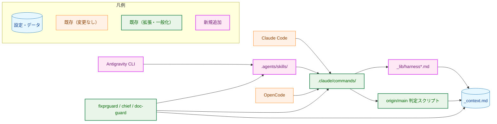
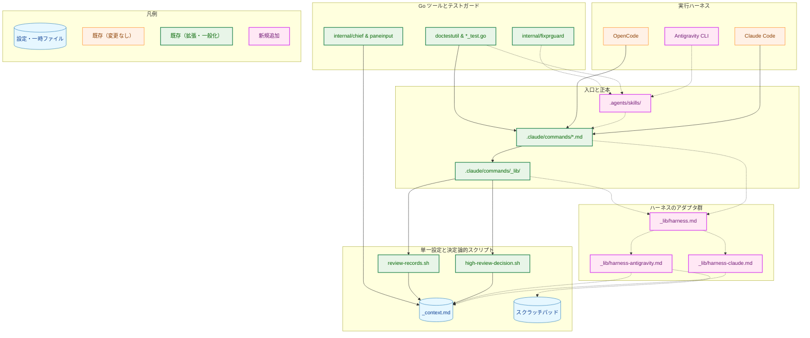
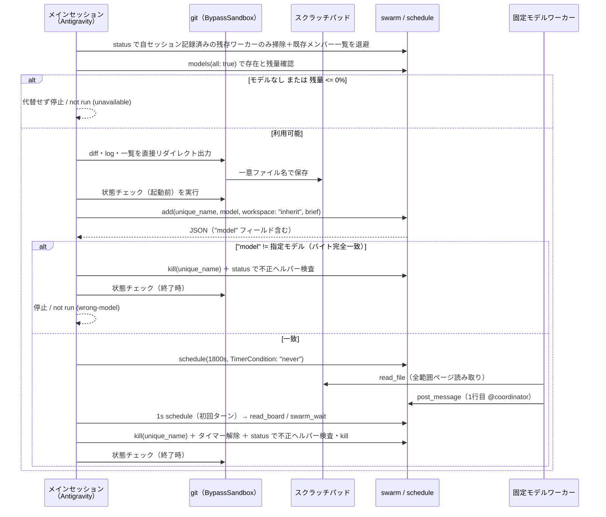
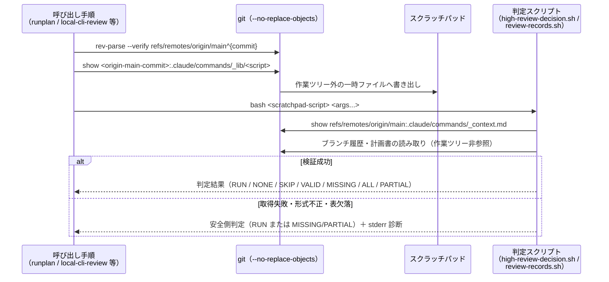
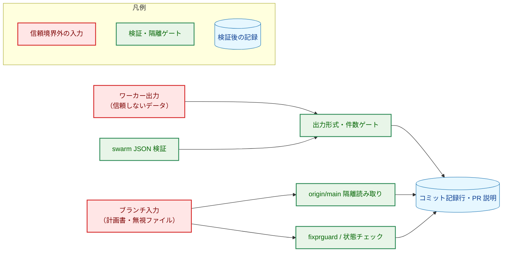
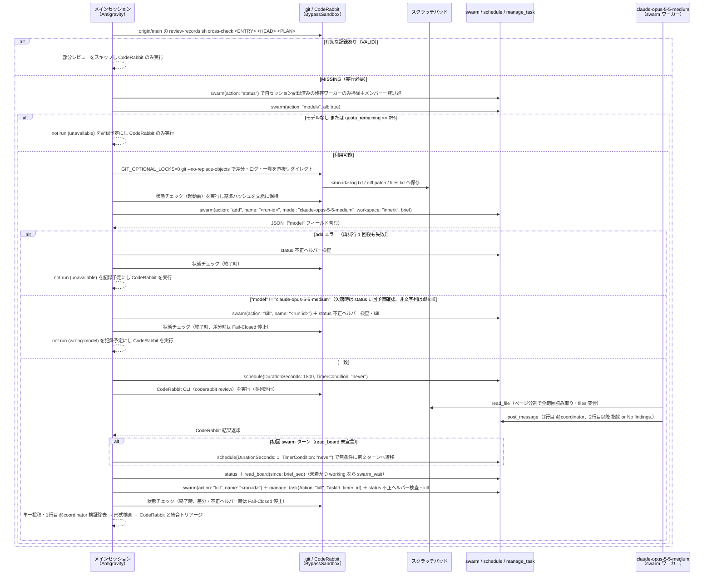
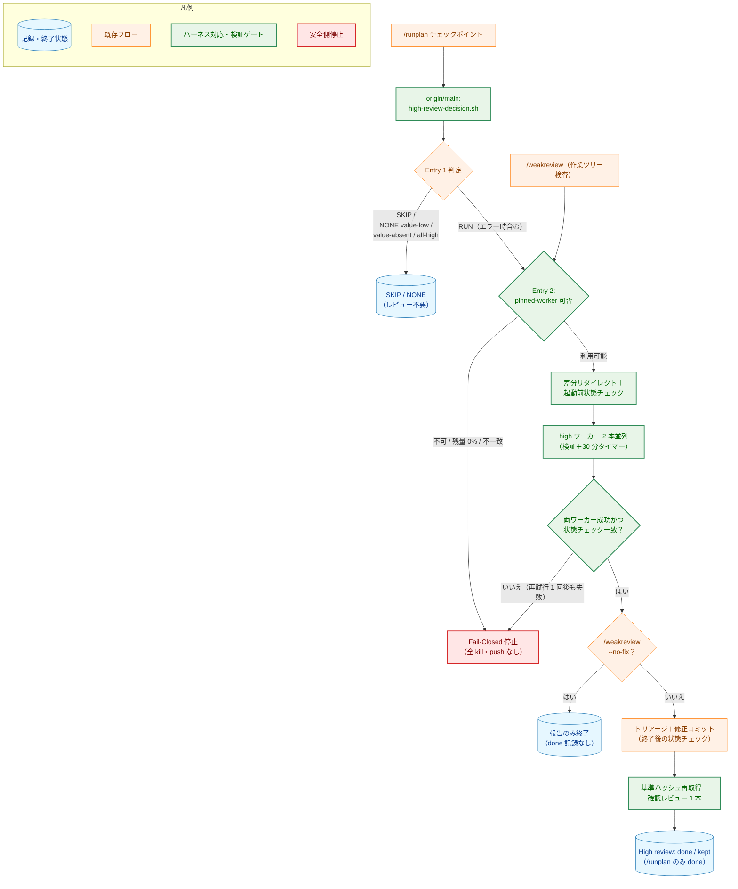

# アーキテクチャ設計書：開発コマンド定義と補助ツールのハーネス非依存化（Antigravity 対応）

## Document Status

| Item | Value |
|---|---|
| Status | `draft` |
| Created | 2026-11-22 |
| Review date | - |
| Reviewer | - |
| Comments | - |

## 1. 設計の全体像 (Design Overview)

本書は、`.claude/commands/` 配下の開発コマンド定義・共有手順・判定スクリプトおよび開発ツール（`fixprguard`・`chief`）をハーネス非依存へ移行し、Claude Code と Antigravity CLI（`agy`）の双方で同一の品質関門・承認規則・記録契約を維持するためのアーキテクチャを定義する。要件は [01_requirements.md](01_requirements.md)（AC-01〜AC-44）に基づき、設計への申し送り事項（[design_handoff.md](design_handoff.md) の H-01〜H-05）のすべてを本書で確定する。現行コードの参照は `origin/main` のコミット `8fbbfc4b` に基づく。

### 1.1. 設計原則

以下の 5 つの原則で全体の構造を揃える。

-   **単一の正本と薄い入口（DRY）:** コマンド手順の本文は `.claude/commands/` の 1 か所だけに置き、Antigravity 向けの `.agents/skills/<cmd>/SKILL.md` は正本・`_context.md`・アダプタへの参照だけを持つ薄い入口にとどめる（[ADR-0055](../../dev/adr/0055-harness-independent-commands.md)）。
-   **決定的なハーネス判別とアダプタ分離:** ハーネスごとの組み込みツール・モデル検証・一時領域・タイマー・サンドボックス規則は 3 ファイルのアダプタ群へ隔離し、セッションで利用可能な組み込みツールの有無で決定的に判別する。
-   **関門ごとの失敗時の振る舞い（Fail-Closed / Fail-Open）の厳守:** 上位モデルのレビューと判定スクリプト・`fixprguard`・`chief` は検証不能時に必ず安全側へ倒す（PR 停止、`RUN`、`MISSING`、`ErrGitFailed`、`errTaskDocument`、`errRouting`）。追加防御層であるクロスチェックの部分レビューは検証不能時に `not run` を記録して PR を止めず、エスカレーション判定は `ask` に倒す。
-   **厳密な文法と非正規表現照合:** `_context.md` から判定スクリプトが読むモデル検証パターンはリテラルまたは末尾 `*` の前方一致だけを許す固定文字集合とし、パターン文字列を正規表現や glob として解釈しない。
-   **最小権限のサンドボックス昇格:** Antigravity では既定の標準サンドボックス（`BypassSandbox: false`）を優先し、外部 git worktree やネットワーク通信で実際に拒否される単一コマンドだけを分離して昇格させる。

### 1.2. 設計の際に決めたこと（2026-11-22）

以下は、設計と実測評価を通じて利用者と合意した決定事項、その理由、および ADR の判断である。

-   **Antigravity の各役割モデルとクロスチェック担当モデルの変更（H-01、決定の変更）:** Antigravity の役割と実モデルの割り当てを `high` = `gemini-4-neon-high`、`standard` = `gemini-4-neon-medium`、`low` = `gemini-4-hydrogen-medium`、`cross-check` = `claude-opus-5-5-medium` とし、いずれも `swarm`（起動前の `models` 確認、返却 JSON の `"model"` 完全一致検証、終了時の `kill`）で実行する。
    -   **理由:** 136 PR の実運用実績と本設計での実測比較（1.4 節）の結果、`gemini-4-argon-medium` / `high` は延べ 9 回すべて指摘 0 件で検出力が不足し、`gemini-4-carbon-medium` と `gemini-4-neon-xhigh` は 10 分超タイムアウトかつ割り当て消費が大きかった。一方、Antigravity 組み込みの `claude-opus-5-5-medium` は実 PR `#1076` を 4 分 19 秒で完了し、4 つの範囲基準と `exclusion-error` の計 5 区分すべてにわたって 6 件の具体的な指摘を厳密形式で返し、通常セッション（Gemini 4 Neon）に対する異系統クロスチェックとして機能した。週次リセットの Claude 枠を 1 PR あたり数 % 消費する点は、枠枯渇時に `not run`（`unavailable`）で PR を止めない [ADR-0050](../../dev/adr/0050-fable-partial-review.md) の契約で受け入れる。ローカルの Claude Code CLI（`claude -p --model fable`）経由の呼び出しは認証とサンドボックス実行境界の設計が別途要るため、後続 issue（[#1082](https://github.com/isseis/yt2column/issues/1082)、`#1072` が前提）へ分離した。
    -   **ADR の判断:** [ADR-0050](../../dev/adr/0050-fable-partial-review.md) を更新し、[01_requirements.md](01_requirements.md) の該当箇所を改定して `draft` に戻した（`requirements_process.md`「Editing an approved document」の決定の変更に該当）。
-   **ハーネスのアダプタの 3 ファイル分割（H-02）:** 共通の判別表・抽象操作カタログ・OpenCode フォールバック規則を `.claude/commands/_lib/harness.md` に置き、ハーネス固有の実装を `.claude/commands/_lib/harness-claude.md` と `.claude/commands/_lib/harness-antigravity.md` の 2 ファイルに分離する。`_context.md` はプロジェクト固有設定と `### Harness model mapping` 表のみを保持する。
    -   **理由:** 単一ファイルに両ハーネスの手順を混在させると Antigravity セッションが Claude Code のツール詳細まで毎ターン読み込むことになり、逆にコマンドごとへ分散させると保守点が散るため、1 共通 + 2 実装の 3 ファイル構成が最も見通しがよい。
    -   **ADR の判断:** ADR なし（[ADR-0055](../../dev/adr/0055-harness-independent-commands.md) のアダプタ分離の枠内における内部ファイル構成の選択）。
-   **一般化したファイル名・モード名・記録行接頭辞・理由コードと移行互換（H-03）:** モデル固有名を含む名称を次のとおり改名し、記録行と `review-records.sh` のモード名に後方互換を設ける。
    -   共有手順・スクリプト: `_lib/opus-review.md` → `_lib/high-review.md`、`_lib/opus-review-decision.sh` → `_lib/high-review-decision.sh`（1 つの PR 内で呼び出し元と `CLAUDE.md`・各 ADR の参照と同時に改名し、第 3 のシェルスクリプトを増やさない）、`_lib/fable-review.md` → `_lib/cross-check-review.md`、呼び出し元パラメータ `FABLE` → `CROSS_CHECK`。
    -   `review-records.sh` のモード名: 新モード名を `cross-check` とし、進行中ブランチとの移行互換のため旧モード名 `fable` を同一動作の別名として維持する（コマンド文書の呼び出し箇所ガードは `cross-check` のみを許可する）。
    -   `high-review-decision.sh` の理由コード: `value-sonnet` → `value-low`、`all-opus` → `all-high`、`value-absent` は維持する（有効完了記録がある場合の `SKIP <done-line>` 出力形式も維持する）。
    -   コミット記録行の接頭辞と理由コード: 上位モデルのレビューは `High review: done` / `High review: kept`（読み取り側は旧 `Opus review:` も受理）、クロスチェックの部分レビューは `Cross-check review: run` / `Cross-check review: not run` / `Cross-check scope: in` / `Cross-check scope: out` / `Cross-check finding:` / `Cross-check review: checkpoint`（読み取り側は旧 `Fable ...` も受理）、モデル不一致の理由は `wrong-model`（読み取り側は旧 `not-fable` も受理）、PR の説明の見出しは `## クロスチェックの部分レビュー` と `<details><summary>クロスチェックの行</summary>` とする。
    -   **理由:** 進行中のブランチが古い呼び出し名や古い記録行を持っていても安全に動き続けられ、既存の記録行接頭辞のどれとも衝突しないためである。なお、`high-review-decision.sh` 改名直後の未マージブランチは `git show origin/main:...` の失敗により安全側の `RUN` に倒れるためレビュー素通りは起きず、停止した OpenCode / `low` ブランチは `git merge origin/main` で復旧できる（3.4 節・8 章）。
    -   **ADR の判断:** ADR なし（[ADR-0042](../../dev/adr/0042-implementation-model-tiers.md)・[ADR-0050](../../dev/adr/0050-fable-partial-review.md)・[ADR-0055](../../dev/adr/0055-harness-independent-commands.md) の方針に沿った具体文字列と別名の選定）。
-   **外部 git worktree 上の Antigravity ワーカー／サブエージェントへの入力受け渡し（H-04）:** `git` または `gh` 読み取りを要するすべての Antigravity `swarm` ワーカーおよび `invoke_subagent`（上位モデルのレビュー、クロスチェックの部分レビュー、エスカレーション判定、`runplan` ステップ 7/7.5、`fixpr` Phase 6）について、メインセッションが起動前に入力をスクラッチパッドへ直接リダイレクト書き出しし、ワーカーは `git`・`gh` を実行せずに `read_file` で読む方式を標準とする。
    -   **理由:** Herdr の外部 git worktree 上での実測（1.4 節）で、`swarm(workspace: "inherit")` ワーカーが標準サンドボックス下で `git` を実行すると終了コード 128（`fatal: not a git repository: .../worktrees/issue-1072`）で失敗し、ネットワークも遮断される一方、メインセッションのスクラッチパッドの `read_file` は成功することを確認したためである。メイン会話へ stdout を通さず直接リダイレクトすることで、巨大差分の切り詰め防止と `fixpr` Phase 6 の信頼しない PR 本文の隔離の両方を満たす。
    -   **ADR の判断:** ADR なし（[01_requirements.md](01_requirements.md) 1 章で設計レベルの実現手段として整理済み）。
-   **`fixprguard` の `.agents/` 配下におけるネスト `.git` 検査の追加（F-006 / AC-36）:** `internal/fixprguard/ignored.go` の監視トップディレクトリを `.claude` と `.agents` の両方に広げ、既存の `errClaudeGitName`（`.git name below .claude`）を維持したうえで `.agents/` 向けの規則 `errAgentsGitName`（`ignored .git name below .agents`）を追加する。
    -   **理由:** `.claude/` と同じ対称な防御を `.agents/` にも設けつつ、規則名に `ignored` を含めることで `cmd/fixprguard/docs_test.go:525-538`（`TestGuideDescribesIgnoredFiles`）および `fixpr.md` の規則判定条件にそのまま適合させるためである。
    -   **ADR の判断:** ADR なし（[ADR-0055](../../dev/adr/0055-harness-independent-commands.md) の監視拡張の内部規則細部）。

### 1.3. `design_handoff.md` 申し送り事項の対応一覧

[design_handoff.md](design_handoff.md) の 5 件（H-01〜H-05）すべてに対する本書の決定と記載箇所をまとめる。

| 申し送り ID | 論点 | 本書の決定 | 記載箇所 |
|---|---|---|---|
| H-01 | Antigravity のクロスチェック担当モデルの選定と各役割モデル割り当て | `high`=`gemini-4-neon-high`、`standard`=`gemini-4-neon-medium`、`low`=`gemini-4-hydrogen-medium`、`cross-check`=`claude-opus-5-5-medium`（すべて `swarm`）。`claude -p --model fable` は [#1082](https://github.com/isseis/yt2column/issues/1082) に分離 | 1.2、1.4、3.3 |
| H-02 | ハーネスのアダプタ構成、抽象操作形式、`.agents/skills/` の配置・ガード | 3 ファイル構成（`_lib/harness.md` + `harness-claude.md` + `harness-antigravity.md`）。11 コマンド分の `.agents/skills/<cmd>/SKILL.md` と 1 対 1・非 `chief` ガード | 1.2、3.1、3.2、7.4 |
| H-03 | 一般化後のファイル名・モード名・記録行・理由コード・PR 見出し・移行順 | `_lib/high-review*`、`_lib/cross-check-review.md`、`CROSS_CHECK`、`cross-check`（`fable` 別名維持）、`High review:` / `Cross-check ...:`、`wrong-model`、PR 単位の原子移行順 | 1.2、3.4、3.5、8 |
| H-04 | 外部 worktree での `swarm` 実測、`add`/`status` スキーマ、`schedule` 条件 | 全ワーカー／サブエージェントへの直接リダイレクト差分受け渡し、`add` 返却 JSON の `"model"` 検証（欠落時 `status` 1 回予備）、初回ターン無条件 1 秒 `schedule` 遷移、30 分 `schedule(TimerCondition: "never")` | 1.2、1.4、2.3、6.1 |
| H-05 | `_context.md` のハーネス別モデル対応表の節見出し・列構成・パーサ分離 | 独立した `### Harness model mapping` 節の 5 列固定表。リテラル / 末尾 `*`（接尾辞 1〜48 文字）の非正規表現照合で `ParseOldValues`・`ParseRouting`・`contextRow` と完全分離 | 3.3、5.2 |

### 1.4. 実測検証の結果（H-01・H-04）

設計上の不確実性を解消するため、本ワークツリー（`/Users/issei/.herdr/worktrees/yt2column/issue-1072`、コミット `8fbbfc4b`）上で H-04 と H-01 の実測を行った。

#### H-04: 外部 git worktree 上での `swarm` 挙動実測

`swarm(action: "add", workspace: "inherit")` でワーカーを起動し、外部 worktree 上での実行制約と返却スキーマを確認した。

| 検証項目 | 実測結果 | 設計への反映 |
|---|---|---|
| ワーカーの標準サンドボックスでの `git log -1 --oneline` | 終了コード 128 で失敗（`fatal: not a git repository: /Users/issei/git/yt2column/.git/worktrees/issue-1072`） | `git`・`gh` を要する全ワーカー／サブエージェントにこれらを実行させず、メインセッションがスクラッチパッドへ直接リダイレクト書き出ししたファイルを `read_file` で渡す |
| メインセッションのスクラッチパッドに対するワーカーの `read_file` | 成功（同一会話の `scratch/` 配下を読み取り可能。1 回の読み取り上限は 800 行 / 46,080 バイト） | スクラッチパッドをデータ受け渡し先に使い、brief でページ分割読み取り（`StartLine`/`ByteOffset`）と変更ファイル一覧との突合を必須化する |
| `swarm(action: "add")` の返却 JSON | `{"status":"added","name":...,"model":"<exact-model-id>","model_display_name":...,"conversation_id":...,"open_board":...,"note":...}` | 返却 JSON の `"model"` フィールドをバイト単位で完全一致検証する（`"model"` フィールド自体が `add` のスキーマに欠落している場合のみ起動直後の `status` を 1 回予備参照し、型違いを含む不一致時は補完せず即 `kill`） |
| `swarm(action: "status")` の返却 JSON | `title`・`board`・`head`・`tail_from_seq`・`members[].{name, role, model, model_display_name, state, killed, last_read_seq}` を返却。未投稿メンバーでは `last_post_seq` と `last_post_time` が省略される | 起動前の自セッション残存ワーカー確認、終了時の不正ヘルパーワーカー検出、および `@coordinator` 漏れ投稿によるハング回避に使用する（`last_post_seq` 欠落は「未投稿」として扱う） |
| トークンの使用量の取得可否 | `add`・`status`・`read_board` のいずれもトークン数を返さない | Antigravity のクロスチェック記録は常に経過秒数と `tokens unknown` を記録する（AC-27） |
| ワーカーのシステムプロンプトとツール構成 | 自身のモデルの ID は含まれない。`post_message`・`read_board`・`swarm_wait`・`swarm` を持ち、`send_message` は持たない | ワーカーには `Model:` 出力を求めず、単一投稿の 1 行目に厳密に `@coordinator` のみを置いた `post_message` で返し、メインセッション（コーディネータ）が 1 行目を検証・除去したうえで 2 行目以降を厳密検査する |
| 初回 `swarm(action: "add")` ターンのツール宣言遅延 | 初回 `add` 実行ターン内では `read_board`・`swarm_wait`・`post_message` が未宣言で、次ターンで宣言される。初回ターン中に長いフォアグラウンド作業（CodeRabbit CLI 等）の間にワーカーが投稿すると、単なるターン終了では起床しない | 初回 `swarm` ターンでは `status` で分岐せず、フォアグラウンド作業完了後に無条件で 1 秒タイマー（`schedule(DurationSeconds: 1, TimerCondition: "never")`）で第 2 ターンへ進める。第 2 ターンで宣言済みの `read_board(since: brief_seq)` を呼び、未着なら `swarm_wait(since: brief_seq, mentions_only: true)` で待機することで、確認と待機の間の取りこぼし（TOCTOU）なしに結果を取得する |

#### H-01: クロスチェック担当モデルの実運用実績と実測ベンチマーク

直近 7 日間（2026-11-15〜2026-11-22）の 136 PR の実運用実績と、本設計での実 PR ベンチマークを比較した。

| モデル | 評価条件 | 所要時間 / 完了可否 | 指摘件数・品質 | 判定 |
|---|---|---|---|---|
| `claude-fable-5-2`（参考: Claude Code 実績） | 136 PR 中の構造化記録 53 PR | 平均 695 秒（11.6 分） | 53/53 PR（100%）で検出、38/53 PR（71.7%）で Critical/Major、平均 7.6 件/PR | Claude Code 側の基準（維持） |
| `gemini-4-argon-medium` / `high` | 実運用 8 PR・延べ 9 回（うち上位モデルレビューなし文書 PR 4 件: `#1075`・`#1076`・`#1078`・`#1079`） | 平均 157 秒（medium）/ 210 秒（high） | 延べ 9 回すべて 0 件（0%） | 不採用（検出力不足） |
| `gemini-4-carbon-medium` | 試行 1: PR `21400a98`（1,148 行差分）<br>試行 2: 欠陥埋め込み 35 行パッチ | 試行 1: 600 秒超で未完了（Gemini 枠 -12%）<br>試行 2: 180 秒超で未完了 | どちらも応答なし | 不採用（遅延・割り当て消費過大） |
| `gemini-4-neon-xhigh` | PR `#1076`（`d45909cf`、1,082 行文書 PR。Argon は 0 件） | 600 秒超で未完了（Gemini 枠 -3%） | 応答なし | 不採用（遅延過大） |
| `claude-opus-5-5-medium` | PR `#1076`（`d45909cf`、同条件） | 259 秒（4 分 19 秒）で完了（Claude 枠 -6%） | 厳密形式 100% 遵守、4 つの範囲基準と `exclusion-error` の計 5 区分すべてにわたり 6 件の検証可能な欠陥を検出（`trust-boundary` 通知偽装、`external-claim` `pipefail` 漏れ、`prior-docs` 2 件、`undecided-choice` 1 件、`exclusion-error` 1 件） | 採用（異系統・高検出力・実用時間） |

### 1.5. コンセプトモデル

コマンドの入口、単一の正本、ハーネスのアダプタ、モデル対応表、および決定論的ガードの関係を以下に示す。



実線矢印（`-->`）は実行時の呼び出し・参照または検査対象の依存方向を表す。

## 2. システム構成 (System Structure)

本章では、リポジトリ全体のコンポーネント配置、ファイルの新設・改名・変更関係、および主要な起動・判定の協調構造を定義する。

### 2.1. 全体アーキテクチャ

ハーネス非依存化後の全体構成を以下に示す。既存の経路と本タスクで新設する経路を線種で区別する。



実線矢印（`-->`）は既存の呼び出し・参照経路（本タスクで一般化・改名するものを含む）、破線矢印（`-.->`）は本タスクで新設する経路を表す。

### 2.2. ファイル配置と構成変更の概要

主な配置先と役割は次の 5 領域に分かれる。

1.  **`.agents/skills/<cmd>/SKILL.md`（新設、11 ファイル）:** `chief.md` を除く全開発コマンド（`mkreq`・`mkarch`・`mkplan`・`mkplan2`・`runplan`・`runpr`・`fixpr`・`mergepr`・`weakreview`・`japrose`・`mktrans`、および実装時点で `main` に存在する `chief` 以外の利用者起動コマンド）の薄い入口を置く。
2.  **`.claude/commands/_lib/harness*.md`（新設、3 ファイル）:** `harness.md`（共通判別と抽象操作カタログ）、`harness-claude.md`（Claude Code 実装）、`harness-antigravity.md`（Antigravity 実装）を置く。
3.  **`.claude/commands/` 既存手順とスクリプト（改名・更新）:**
    -   `_lib/opus-review.md` → `_lib/high-review.md`
    -   `_lib/opus-review-decision.sh` → `_lib/high-review-decision.sh`
    -   `_lib/fable-review.md` → `_lib/cross-check-review.md`
    -   `_lib/review-records.sh`（ファイル名維持、`cross-check` モード追加 + `fable` 別名維持、`_context.md` 参照化）
    -   `_context.md`（`### Harness model mapping` 追加、旧値読み替え表 6 行化、part 5 更新、`Command routing` 行キー改名）
    -   その他すべての非 `chief` コマンドおよび共有手順からハーネス固有ツール名とモデル固有名を除去する。
4.  **Go 開発ツール（`internal/fixprguard`・`internal/chief`・`internal/chief/paneinput`）:** 監視の一覧・ネスト `.git` 検査・新役割名・改名後のルーティング行キー・プロトコル番号（`main` の値 + 1）を更新する。
5.  **文書のガードと仕様文書（`internal/doctestutil`・`cmd/` テスト・`CLAUDE.md`・`AGENTS.md`・`docs/dev/`・`docs/translation_glossary.md`）:** `.agents/skills/` のリンク・信頼境界・1 対 1 対応ガードを追加し、ガイドと仕様文書を一般化名称と新プロトコル番号に揃える。

### 2.3. コンポーネント間の協調構造

Antigravity 上でのモデル固定ワーカーの起動から終了までの責務分担、および `origin/main` 判定スクリプトの隔離実行経路を 2 つの概要図に示す（詳細な分岐条件は 6 章で扱う）。

#### 図 2-1: Antigravity モデル固定ワーカーの協調構造



実線矢印（`->>`）はツール呼び出し・操作、破線矢印（`-->>`）は返却値またはセッション内状態遷移を表す。

#### 図 2-2: `origin/main` 判定スクリプトの隔離実行経路



実線矢印（`->>`）は隔離スクリプトの取得・実行、破線矢印（`-->>`）は判定出力と標準エラー診断の返却を表す。

## 3. コンポーネント設計 (Component Design)

本章では、ハーネス判別、薄いスキル入口、`_context.md` のモデル対応表、一般化したレビュー手順と判定スクリプト、および Go パッケージのインターフェース・型・変更範囲を定義する。

### 3.1. ハーネス判別と 3 ファイルのアダプタ構成（F-001）

非 `chief` コマンドと共有手順からハーネス固有ツール名を取り除くため、`.claude/commands/_lib/` に次の 3 ファイルを置く。

1.  **`.claude/commands/_lib/harness.md`（共通入口・判別表・抽象操作カタログ）:**
    -   **決定的なハーネス判別規則（AC-03）:** セッションで利用可能な組み込みツールの有無を次の順序で評価し、該当した 1 つのアダプタを選ぶ（推測しない）。

| 判別順 | ハーネス | 必須の組み込みツール条件 | 読み込むアダプタ |
|---|---|---|---|
| 1 | `Antigravity` | `ask_question`・`run_command` の 2 つが利用可能（`swarm` の有無は `subagent-role` / `pinned-worker` の実行時に個別判定する） | `_lib/harness-antigravity.md` |
| 2 | `Claude Code` | `AskUserQuestion`・`Bash`・`Agent` の 3 つがすべて利用可能 | `_lib/harness-claude.md` |
| 3 | `OpenCode`（またはその他） | 上記 1・2 のいずれも満たさない | アダプタなし（`harness.md` 内のフォールバック規則に従う） |

    -   **Antigravity で `swarm` が利用できない文脈（`invoke_subagent` 内など）の扱い:** 判別条件から `swarm` を外すことで、`swarm` が使えない Antigravity 文脈でも必ず `_lib/harness-antigravity.md` のサンドボックス最小昇格規則と禁止コマンド一覧が適用される。その文脈で `pinned-worker` または `subagent-role` が呼ばれたときは、`swarm` 不在として 4.1 節の安全なフォールバック（上位モデルのレビューは停止、クロスチェックの部分レビューは `not run (agent-cannot-call)`、エスカレーション判定は `ask`、`subagent-role` はフォールバック）へ倒す。

    -   **抽象操作カタログ（AC-02、AC-04〜AC-08）:** 正本手順で使う操作を次の 10 個に統一し、`harness-claude.md` と `harness-antigravity.md` が同一の見出し番号・操作名で具体実装を定義する。

| # | 抽象操作名 | 正本からの呼び出し用途 | Claude Code 実装概要 | Antigravity 実装概要 | OpenCode フォールバック |
|---|---|---|---|---|---|
| 1 | `select-question` | 選択式の質問（1〜4 問、各 2〜4 択、先頭推奨、選択肢外は聞き直し） | `AskUserQuestion` | `ask_question` | OpenCode の質問機能または平文での再確認 |
| 2 | `file-io` | リポジトリ内ファイルの読み取り・作成・編集 | `Read`・`Write`・`Edit` | `read_file`・`write_file`・`edit_file` | 利用可能なファイル操作ツール |
| 3 | `scratchpad` | 作業ツリー外のセッション専用一時ファイルの作成・読み取り | Claude Code セッションのスクラッチパッド | `<appDataDir>/brain/<conversation-id>/scratch/` | 作業ツリー外の一時領域（git 追跡対象外） |
| 4 | `shell-run` | タイムアウト付きシェル実行とサンドボックス規則 | `Bash`（`.claude/settings.json` 準拠） | `run_command`（標準サンドボックス優先、必要単一コマンドのみ `BypassSandbox: true`） | 利用可能なシェル実行ツール |
| 5 | `web-lookup` | 外部仕様の確認（`mkreq`・`mkarch`・`mkplan` 等） | `WebSearch`・`WebFetch` | `search_web` | 利用可能な検索ツール（なければ省略せずその旨報告） |
| 6 | `subagent-inherit` | セッションのモデルを引き継ぐ一般サブエージェント（セルフレビュー、パネルレビュー、`/fixpr` Triage/Fix、`runplan` step 7/7.5、`mktrans`） | `Agent`（model 未指定） | `invoke_subagent(TypeName: "self", Model: "inherit")` または読み取り専用時は `research`。`git` 差分が必要な呼び出し（`runplan` step 7/7.5 等）はメインセッションが事前にスクラッチパッドへ直接リダイレクト書き出しして `read_file` で渡す | OpenCode の既定サブエージェント機構（`/fixpr` 等） |
| 7 | `subagent-role` | `standard` / `low` 段階を指定する一般サブエージェント（`japrose`、`fixpr` Phase 6、確認パス） | `Agent(model: "<mapping>")`（`sonnet` / `haiku`） | `swarm` 利用可否と `models` 残量を確認 → 既存メンバー一覧を退避 → 必要入力をスクラッチパッドへ直接リダイレクト書き出し → 起動前状態チェック → `swarm(action: "add", model: "<mapping>", workspace: "inherit")`（brief で `swarm` 呼び出し・ヘルパー追加を禁止）→ 初回ターン 1 秒 `schedule` 遷移 + 30 分 `schedule(TimerCondition: "never")` + `read_board` / `swarm_wait` → 全出口で `kill`・タイマー解除・`status` 不正ヘルパー検査・終了時状態チェック。`swarm` 不在または `models` 不可・失敗時は 4.1 節の呼び出し元別フォールバックに従う | OpenCode の既定サブエージェント機構 |
| 8 | `pinned-worker` | 厳密なモデル固定と検証が必須のワーカー（上位モデルのレビュー、クロスチェックの部分レビュー、エスカレーション判定、マージ後の確認） | `Agent(model: "<mapping>")` + 出力 1 行目 `Model: <id>` 検証 + `TaskStop` | `swarm` 利用可否確認 → 自セッション記録済みの残存ワーカー掃除＋既存メンバー一覧退避 → `models` 事前確認 → スクラッチパッド直接リダイレクト書き出し → 起動前状態チェック → `swarm(action: "add")`（brief で `swarm` 呼び出し・ヘルパー追加を禁止）→ 返却 JSON `"model"` バイト完全一致検証 → 初回ターン無条件 1 秒 `schedule` 遷移 + 30 分 `schedule(TimerCondition: "never")` + `read_board` / `swarm_wait` → 全出口で `kill`・タイマー解除・`status` 不正ヘルパー検査・終了時状態チェック | 呼び出し不可として安全側処理（エスカレーション=`ask`、上位モデルレビュー=停止、クロスチェック=`not run` 理由 `agent-cannot-call`） |
| 9 | `timer-wait` | 30 分タイムアウト監視と定期確認の待機 | バックグラウンド `sleep` + `TaskStop`（`ToolSearch` 経由） | `schedule(DurationSeconds: ..., TimerCondition: "never")` + `manage_task(Action: "kill")`（シェルの `sleep` 禁止） | 利用可能な待機手段 |
| 10 | `notify-user` | 長時間作業完了時の利用者通知 | `PushNotification`（利用可能な場合） | ツール不在のため最終報告で代替（`_context.md:52`） | 最終報告で代替 |

2.  **`.claude/commands/_lib/harness-claude.md`:** 現行 Claude Code の操作契約（`Agent` の `Model:` 1 行目検証、`TaskStop`、`AskUserQuestion`、`.claude/settings.json` の存在）を 1〜10 の節で定義する。
3.  **`.claude/commands/_lib/harness-antigravity.md`:** Antigravity の操作契約を 1〜10 の節で定義する。特に以下を明記する。
    -   `shell-run` 節に AC-33・AC-34 のサンドボックス昇格規則と禁止コマンド一覧を明記する。
    -   `subagent-inherit` / `subagent-role` / `pinned-worker` の各節に、外部 worktree で `git`・`gh` 読み取りが必要な場合のスクラッチパッド直接リダイレクト契約（メイン会話へ stdout を取り込まない）を明記する。
    -   **`fixpr.md` Phase 6 の信頼しない PR 本文の隔離（AC-06、H-04）:** `fixpr.md:1047-1048` は Phase 6 ワーカーに `gh pr view NUMBER --json title,body` と `git log --oneline -10` を実行させるが、Antigravity の `swarm` ワーカーは標準サンドボックスでどちらも失敗する。一方、`fixpr.md:1074` と `TestFixprPhase6CountFilter`（`cmd/yt2column/fixpr_docs_test.go:887-920`）は PR 本文がメインセッションの会話へ入らないことを要求する。そのため Antigravity アダプタの `subagent-role`（`fixpr` Phase 6 呼び出し時）では、メインセッションが `gh pr view <number> --json title,body > "<scratchpad>/<run-id>-pr.json"` および `GIT_OPTIONAL_LOCKS=0 git --no-replace-objects log --oneline -10 > "<scratchpad>/<run-id>-log.txt"` を stdout 出力なしでファイルへ直接リダイレクトし（メイン会話へ PR 本文を一切取り込まない）、ワーカーが `read_file` でそれを読む。コマンド定義本体 `fixpr.md` には件数取得コマンドだけを残すため `TestFixprPhase6CountFilter` の契約を保ち、あわせて `harness-antigravity.md` のリダイレクト形式が stdout へ漏らさないことを `fixpr_docs_test.go` で検証する。

### 3.2. `.agents/skills/<cmd>/SKILL.md` の薄い入口契約（F-002）

Antigravity CLI がカスタムスキルとして自動検出する `.agents/skills/` 配下に、`chief.md` を除く各開発コマンドと 1 対 1 に対応する薄い入口を置く（AC-09〜AC-11）。

-   **対象コマンド（`main` 現時点の 11 件）:** `mkreq`・`mkarch`・`mkplan`・`mkplan2`・`runplan`・`runpr`・`fixpr`・`mergepr`・`weakreview`・`japrose`・`mktrans`。実装時点で `main` に `chief.md` 以外の利用者起動コマンドが増えていれば同じ契約で追加する。`chief` のスキルは置かない（AC-11）。
-   **言語と形式:** `CLAUDE.md`「Document language」原則 (b) に従い英語で書く。YAML フロントマター（`name`・`description`）と、次の 4 点を指す短い本文のみを置き、コマンド手順のステップ本文は一切複製しない（AC-10）。
    1.  `.claude/commands/_context.md` を読むこと。
    2.  `.claude/commands/_lib/harness.md` を読み、その決定的判別規則に従って該当アダプタ（Antigravity セッションでは `.claude/commands/_lib/harness-antigravity.md`）を読み込み、全手順の抽象操作をアダプタ経由で実行すること。
    3.  正本 `.claude/commands/<cmd>.md` を読み、引数仕様・事前認可（Authorization）・停止条件を含めてそのまま実行すること。
    4.  `AGENTS.md` および `CLAUDE.md` の禁止規則（インストール型ツールのビルド・インストール禁止、`herdr` / `git worktree` 変更禁止等）を遵守すること。

### 3.3. `_context.md` のモデル対応表スキーマとパーサ分離契約（F-003、H-05）

`.claude/commands/_context.md` には既に 3 つの決定論的パーサが存在する。新しいモデル対応表はこれらと構造的に衝突しない独立した節として設計する。

#### 既存パーサとの衝突回避の検証

| 既存パーサ | 場所 | 読み取り範囲と条件 | 新表との分離保証 |
|---|---|---|---|
| `ParseOldValues` | `internal/chief/task.go:270-312`（および判定スクリプト） | 見出し `### PR marker conventions` の配下のみを走査し、2 列の表行を読む | 新表を別見出し `### Harness model mapping` に置くため一切走査されない |
| `ParseRouting` | `internal/chief/routing.go:21-104` | 見出し `### Command routing` の配下のみを走査し、4 列ヘッダ `\| Row \| Command \| Agent \| Model \|` の直後の表だけを読む | 新表は `### Command routing` の外（後続の独立した `###` 節）に置くため一切走査されない |
| `contextRow` | `cmd/yt2column/fixpr_docs_test.go:81-92` | 1 列目のヘッダセルが `Name` の表だけを走査する | 新表の 1 列目ヘッダは `Harness` とするため対象外になる |

#### `### Harness model mapping` 表の固定スキーマ

`_context.md` の `## Process convention` 節配下（`### Command routing` の直後、かつ `## Domain-specific (replace wholesale when porting)` より前）に独立した見出し `### Harness model mapping` を置き、他プロジェクトへの移植時に誤って削除されない配置にする。表は次の固定 5 列（ヘッダ `| Harness | Role | Launch | Model | Verification pattern |`、区切り `|---|---|---|---|---|`、各データセルは単一バッククォート囲み）で定義する（AC-16）。

| Harness | Role | Launch | Model | Verification pattern |
|---|---|---|---|---|
| `Claude Code` | `high` | `agent` | `opus` | `claude-opus-*` |
| `Claude Code` | `standard` | `agent` | `sonnet` | `claude-sonnet-*` |
| `Claude Code` | `low` | `agent` | `haiku` | `claude-haiku-*` |
| `Claude Code` | `cross-check` | `agent` | `fable` | `claude-fable-*` |
| `Antigravity` | `high` | `swarm` | `gemini-4-neon-high` | `gemini-4-neon-high` |
| `Antigravity` | `standard` | `swarm` | `gemini-4-neon-medium` | `gemini-4-neon-medium` |
| `Antigravity` | `low` | `swarm` | `gemini-4-hydrogen-medium` | `gemini-4-hydrogen-medium` |
| `Antigravity` | `cross-check` | `swarm` | `claude-opus-5-5-medium` | `claude-opus-5-5-medium` |
| `OpenCode` | `low` | `none` | `DeepSeek V4.1 Flash 1017 OpenCode Go` | `-` |

表の読み取り・検証契約は次のとおりである。

-   **表全体の厳密検証（Fail-Closed）:** 判定スクリプトはコードフェンス外の単一の `### Harness model mapping` 見出しのみを受理する（見出し欠落・重複、ヘッダ不一致、区切り行不一致、列数不一致、バッククォート欠落、未知の `Harness` / `Role` / `Launch`、重複する `(Harness, Role)` 行、または 1 行でも不正な `Verification pattern` があれば、該当役割だけでなく表全体を不正として拒否する）。
-   **列の許可値:**
    -   `Harness`: `Claude Code`・`Antigravity`・`OpenCode`
    -   `Role`: `high`・`standard`・`low`・`cross-check`
    -   `Launch`: `agent`・`swarm`・`none`
    -   `Model`: 空でない印刷可能 ASCII 文字列
    -   `Verification pattern`: 次の 3 形態のみを許可する。
        1.  `-`: 検証対象外（`Launch == none` の行のみ許可）。
        2.  リテラル完全一致: `^[a-z0-9][a-z0-9.-]{0,63}$`（`Launch != none` の行）。
        3.  末尾ワイルドカード前方一致: `^[a-z0-9][a-z0-9.-]{0,62}\*$`（`Launch != none` の行）。
-   **非正規表現照合と接尾辞長上限（5.2 節）:** パターン文字列を正規表現や非引用 glob として評価しない（`.` はリテラル文字 `.` としてのみ扱う）。リテラルパターンは文字列完全一致（`"$id" = "$pat"`）で照合し、末尾 `*` パターンはリテラル前方一致で接頭辞を切り出した残余接尾辞が固定文字集合・長さ上限 `^[a-z0-9.-]{1,48}$`（現行 `review-records.sh:195` と同じ 48 文字上限）に一致することだけを検証する。

#### `### PR marker conventions` の更新、`### Command routing` との役割分担、および AC-13 / AC-17

-   **旧値読み替え表（part 4、AC-12・AC-14）:** 正規の 3 値（`high`・`standard+high-review`・`low`）に対し、次の 6 行の旧値読み替えを置く。

| 旧値 | 読み替える値 |
|---|---|
| `opus` | `high` |
| `sonnet+opus-review` | `standard+high-review` |
| `sonnet` | `low` |
| `frontier-required` | `high` |
| `frontier-recommended` | `standard+high-review` |
| `standard` | `low` |

-   **`**判定理由**` の更新（AC-13）:** `mkplan2.md`・`mkplan.md`・簡易な進め方の `mkreq.md` で書く `**判定理由**` は、`high` と `standard+high-review` のときは当たった契機と「`high` より軽いモデルに任せたときに何が起きやすいか」を 1 行の日本語で書き、`low` のときは当たる契機がないことを書く（従来の「Sonnet に任せると」の固定文言を外す）。
-   **`### Command routing` の改名（AC-39）:** `runplan-opus` → `runplan-high`、`runplan-sonnet+opus-review` → `runplan-standard+high-review`、`runplan-sonnet` → `runplan-low` に改名し、`task-documents`・`runplan-takeover`・`runpr` と `Agent` 列の 2 値（`Claude Code`・`OpenCode`）は維持する。
-   **part 5（「What a reading recommends」）と `low` 役割の使い分け（AC-17）:** `_context.md:113-128` の part 5 を次のとおり更新し、2 つの表の責務を明確に分離する。
    -   **Claude Code / OpenCode セッションおよび `chief`:** プラン PR の実装に推奨するエージェントとモデルは `### Command routing`（`runplan-high` → Claude Code `opus`、`runplan-standard+high-review` → Claude Code `sonnet`、`runplan-low` → OpenCode `DeepSeek V4.1 Flash 1017 OpenCode Go`）から引く。`### Harness model mapping` の `(Claude Code, low) = haiku` は軽量サブエージェント（`fixpr` Phase 6 等の `subagent-role`）専用であり、プラン実装の推奨モデルには使わない。
    -   **Antigravity セッション:** Antigravity は `chief` の対象外のため `### Command routing` に行を持たない。そのため `runplan.md` と `runpr.md` は Antigravity 実行時に `### Harness model mapping` の `Antigravity` 行（`high` → `gemini-4-neon-high`、`standard+high-review` → `gemini-4-neon-medium`、`low` → `gemini-4-hydrogen-medium`）を参照して推奨モデルを案内し、`high`・`standard+high-review`・読めない値では上位モデルのレビューが常に走る見込み（AC-20）をあわせて示す。

### 3.4. 上位モデルのレビューと判定スクリプトの一般化（F-004）

-   **共有手順の改名（`.claude/commands/_lib/opus-review.md` → `_lib/high-review.md`）:**
    -   並列の発見レビュー 2 本（正しさ・弱いモデルの失敗）と確認のレビューの起動を `harness.md` の `pinned-worker`（役割 `high`）へ委譲する。
    -   Antigravity ではセッションが自身のモデルの ID を検証できないため、`runplan.md` は `Implementation model:` 行を書かない（AC-20）。その結果、`high`・`standard+high-review`・読めない値のプラン PR では、有効な完了記録がない限り `high-review-decision.sh` が `RUN` を返し、上位モデルのレビューが必ず走る。
    -   Claude Code では現行どおり `Implementation model: <START12>..<END12> <model-id>[, ...]` を書き、`high-review-decision.sh` が `_context.md` の `Role == high` のうちセッションが自身のモデルの ID を検証できるハーネス（`Launch == agent`、すなわち Claude Code）の `Verification pattern` のみと照合する（AC-19・AC-20）。Antigravity の `Role == high` 行（`Launch == swarm`、`gemini-4-neon-high`）は `Implementation model:` の照合対象に**含めない**。これにより、自身のモデルの ID を検証できない Antigravity セッション（`hydrogen` や `neon-medium` 等）が誤って `Implementation model: <range> gemini-4-neon-high` を書き込んでも、`NONE all-high` で上位モデルのレビューを素通りすることが構造上起きない。
    -   状態チェック（`The state check`）は `_lib/cross-check-review.md` の共通ブロックを参照し、発見レビュー起動前・終了時・修正コミット直前の再比較（終了後の状態チェック）、および修正コミット後の確認レビュー起動前（新基準ハッシュ再取得）・終了時のすべてで実行する。
    -   **記録行の厳密形式（AC-23、現行 `_lib/opus-review.md:85, 112` の接頭辞のみ一般化）:**
        -   完了記録: `High review: done <START12>..<END12> (critical <n>, major <n>, minor <n>)`（互換読み取り: 旧 `Opus review: done ...`）
        -   退けた指摘: `High review: kept <path>:<line> (<severity>; <reason>)[ <summary>]`（互換読み取り: 旧 `Opus review: kept ...`）
        -   `/weakreview` は現行どおり Entry 2（判定スクリプトを通さない直接レビュー入口）を呼び、`done` 記録行を書かない（AC-24）。
-   **判定スクリプトの改名と契約（`_lib/opus-review-decision.sh` → `_lib/high-review-decision.sh`）:**
    -   呼び出し元（`_lib/high-review.md` の Entry 1、すなわち判定スクリプトを経由する入口）は `git --no-replace-objects show <origin-main-commit>:.claude/commands/_lib/high-review-decision.sh > <decision-script>` で取り出して実行する。
    -   スクリプト本体に `review-records.sh` 相当の環境クリーンアップ、`set -o pipefail`、`GIT_NO_REPLACE_OBJECTS=1` を適用し、`origin/main:.claude/commands/_context.md` の取得失敗を `2>/dev/null` で握り潰さない。
    -   `value-low`・`value-absent` の早期返却より**前**に `origin/main:.claude/commands/_context.md` の旧値読み替え表と `### Harness model mapping` 表全体を検証し、`Role == high` かつ自己検証可能なハーネス（`Launch == agent`）の有効パターンが 1 件以上あることを確認する（AC-18・AC-19・AC-20）。表欠落・形式不正時は標準エラーへ診断を出力し、`RUN`（終了コード `0`）を返す。
    -   出力契約（現行 `_lib/opus-review-decision.sh:13-20, 43-47, 287-291` を維持し、理由コードのみ一般化）:
        -   `RUN`: レビュー必要、またはすべてのエラー時（終了コード `0`）。エラー時は標準エラーへ `high-review-decision: <reason>` を出力し、呼び出し元は `RUN` を受けたら標準エラーの診断を利用者へ表示する。
        -   `NONE value-low`（旧 `NONE value-sonnet`）
        -   `NONE value-absent`（変更なし）
        -   `NONE all-high`（旧 `NONE all-opus`）
        -   `SKIP <done-line>`: 有効な完了記録（新 `High review: done ...` または旧 `Opus review: done ...`）がブランチの対象コミットをすべてレビュー済みである場合。2 行目以降に `END` より後の除外可能コミットを古い順で `<12-hex-id> <subject>` として出力する。
    -   **原子改名と未マージブランチへの移行影響（H-03）:** 判定スクリプト改名は `_context.md`・`internal/chief`・`markers_parity_test.go`・呼び出し元手順・`CLAUDE.md`・各 ADR と同一 PR で行う（8 章フェーズ 2）。マージ直後に `main` を未取り込みの進行中ブランチが旧名 `origin/main:.claude/commands/_lib/opus-review-decision.sh` の取得を試みた場合は失敗して安全側の `RUN` に倒れるためレビュー素通りは起きないが、未マージの OpenCode / `low` ブランチは上位モデルを呼べず停止する（また完了済み PR も `SKIP` できない）。この場合の復旧手順は `git merge origin/main` で新しい呼び出し元を取り込むこととし、8 章に明記する。

### 3.5. クロスチェックの部分レビューと記録判定スクリプトの一般化（F-005）

-   **共有手順の改名（`.claude/commands/_lib/fable-review.md` → `_lib/cross-check-review.md`）:**
    -   呼び出し元パラメータを `FABLE` → `CROSS_CHECK` に改名し（`_lib/local-cli-review.md`・`runplan.md`・`_lib/task-pr-handoff.md`）、4 つの範囲基準（`trust-boundary`・`prior-docs`・`external-claim`・`undecided-choice`）・除外箇所検証（`exclusion-error`）・30 件上限・worktree 状態チェック・統合トリアージ・却下根拠確認をハーネス共通手順として保持する（AC-25、AC-31）。
    -   ワーカーの起動・モデル検証・30 分タイムアウト・停止は `harness.md` の `pinned-worker`（役割 `cross-check`）へ委譲する（AC-26、AC-27）。
    -   **記録行・見出し・理由コードの厳密形式（AC-29、AC-30、現行 `_lib/fable-review.md:446-464` の接頭辞と `not-fable` のみ一般化）:**

| 記録の種類 | 新形式（新規書き込み） | 旧形式（互換読み取り対象） |
|---|---|---|
| 実施記録 | `Cross-check review: run <START12>..<END12> (model <model-id>; fixed <n>, rejected <n>, deferred <n>, unclear <n>, invalid <n>; <seconds>s, tokens <tokens>)` | `Fable review: run <START12>..<END12> (model <model-id>; fixed <n>, rejected <n>, deferred <n>, unclear <n>, invalid <n>; <seconds>s, tokens <tokens>)` |
| 未実施記録 | `Cross-check review: not run <START12>..<END12> (<reason>[; <seconds>s, tokens <tokens>])` | `Fable review: not run <START12>..<END12> (<reason>[; <seconds>s, tokens <tokens>])` |
| `<reason>` の許可集合 | `no-target` \| `unavailable` \| `timeout` \| `wrong-model` \| `unreadable` \| `agent-cannot-call` | 左記のうち `wrong-model` に相当する旧値 `not-fable` を同義受理 |
| 範囲（対象・除外） | `Cross-check scope: in <location> (<criterion>)`<br>`Cross-check scope: out <location> (<reason>)` | `Fable scope: in <location> (<criterion>)`<br>`Fable scope: out <location> (<reason>)` |
| 指摘明細 | `Cross-check finding: <location> criterion=<criterion> kind=<kind> severity=<severity> local=<local> handling=<handling>[ (<reason>)][: <summary>]` | `Fable finding: <location> criterion=<criterion> kind=<kind> severity=<severity> local=<local> handling=<handling>[ (<reason>)][: <summary>]` |
| チェックポイント印 | `Cross-check review: checkpoint`（範囲引数なし） | `Fable review: checkpoint`（範囲引数なし） |
| PR 説明の見出し | `## クロスチェックの部分レビュー` / `<details><summary>クロスチェックの行</summary>` | （既存 PR の読み取り対象はコミット記録行） |

    -   `<kind>` 分類の拡張（AC-29）: `.agents/skills/` 配下を `command`、それ以外の `.agents/` 配下を `agent-config` として分類する。
    -   **`The state check` の `watched` 拡張と共有（AC-36）:** `_lib/cross-check-review.md` の `## The state check` ブロック（現行 `_lib/fable-review.md:389`）を `_lib/high-review.md`・`_lib/pr-review-escalation.md` からも参照する正本とする。`watched` パートの `awk` 条件に `l ~ /^\.agents\//` および `n ~ /^(claude\.md|agents\.md|agent\.md|gemini\.md|agents\.override\.md|makefile|gnumakefile|go\.mod|go\.work)$/` を追加し、さらに `.claude` / `.agents` 配下に名前が `.git`（大文字小文字無視）のエントリが存在すれば `watched` 出力へ含める（または非ゼロ終了させて比較不能停止とする）。一時インデックスファイル名は `cross-check-index.XXXXXX` に改める。
-   **判定スクリプトの更新（`.claude/commands/_lib/review-records.sh`、bash 3.2 互換維持）:**
    -   部分レビュー有効性判定の新モード名 `cross-check`（引数 `cross-check <ENTRY> <HEAD> <PLAN>`、`ENTRY` は `launch` または `checkpoint`）を追加し、移行中の進行中ブランチとの互換のため旧モード名 `fable` を同一処理への別名として受理する（コマンド文書が `cross-check` だけを呼ぶことは `TestReviewRecordsCallSite` で強制する）。
    -   `cross-check` / `fable` モードでのみ `origin/main:.claude/commands/_context.md` の `### Harness model mapping` 表全体を検証し、`Role == cross-check` の全行の `Verification pattern`（`-` 除外）を収集する。表の欠落・形式不正・有効パターン 0 件のときは標準出力に `MISSING`、標準エラーに診断を出して終了コード `1` で終わる（AC-30）。既存の `coverage` モードは `_context.md` を読まず、現行の動作と失敗時出力（`PARTIAL`、終了コード `1`）をそのまま維持する。
    -   実施記録・未実施記録・チェックポイント行は新旧両方の接頭辞および `wrong-model` / `not-fable` を同義として読み取る。
-   **タスク 0114（#988）との条件付き整合（AC-28）:** 本タスク実装時点で `#988`（記録後のマージコミットに対するマージ後の確認）が既に `main` にマージされていれば、(a) マージ後確認の起動を `pinned-worker`（役割 `high`）へ一般化し、(b) `review-records.sh` がマージ後確認記録（`MERGE <n>`・`unreviewed` モード）のモデルの ID 検証に `### Harness model mapping` の `Role == high` パターンを読むよう拡張し、(c) `.git/objects` への一時書き込みを伴う `git show --remerge-diff` を Antigravity 外部 worktree で `BypassSandbox: true` の単一コマンドとして扱う。本タスクが先に `main` に入る場合は `#988` 側が本設計のアダプタ上で実装する。

### 3.6. Go パッケージの設計変更（F-006、F-007、F-008）

以下では、変更対象となる Go パッケージの公開契約・型・定数・番兵エラーの変更点のみを定義する。

#### 3.6.1. `internal/fixprguard`（`ignored.go`・`types.go`）

-   **プロトコル番号（`internal/fixprguard/types.go:21`）:** 現行 `const Protocol = 6` を実装時に `main` の値 + 1 へ引き上げる（AC-36）。
-   **監視の一覧の拡張（`internal/fixprguard/ignored.go:35-90`）:**
    -   単一の `watchTopDir = ".claude"` を複数スライス `watchTopDirs = []string{".claude", ".agents"}` に改め、`WatchListPatterns()` が `".claude/"` と `".agents/"` の両方を先頭に出力する契約にする。
    -   `watchNames` に `"agents.md"`, `"agent.md"`, `"gemini.md"`, `"agents.override.md"` を追加する（AC-36 の 4 ファイル名を任意階層で Unicode 単純ケースフォールディング `foldEqual` により照合する。なお、`claude.local.md` は現行 `ignored.go:40` のとおり `watchTopFiles` として最上位のみ監視する点が任意階層の `scope.go:54` と異なるため、その既存仕様を維持する）。
-   **`.agents/` 配下のネスト `.git` 検査と番兵エラー（`internal/fixprguard/ignored.go:190-222,370-422`）:**
    -   既存の `errClaudeGitName`（`fmt.Errorf("%w: .git name below .claude", ErrGitFailed)`）はそのまま残し、`.agents/` 向けに新しい番兵エラーを 1 つ追加する。

```go
// ErrGitFailed をラップする新規番兵エラー（既存 errClaudeGitName と並列）
var errAgentsGitName = fmt.Errorf("%w: ignored .git name below .agents", ErrGitFailed)
```

    -   `ignoredFailures` スライスに `errAgentsGitName` を追加し、`IgnoredFailureRules()` が `"ignored .git name below .agents"` を返す契約とする。規則名に `"ignored"` を含むため、`fixpr.md` の規則判定および `cmd/fixprguard/docs_test.go:525-538`（`TestGuideDescribesIgnoredFiles`）の既存契約を壊さない。
    -   最上位の `.claude` と `.agents` の双方を走査し、大文字・小文字を区別しない照合（Unicode 単純ケースフォールディング）で `.git` と一致するエントリを含めば対応する番兵エラー（`errClaudeGitName` または `errAgentsGitName`）を返す。走査エントリ上限 `lim.walkEntries` は両ディレクトリの合算で適用する。

#### 3.6.2. `internal/chief`・`internal/chief/paneinput`

-   **プロトコル番号（`internal/chief/records.go:29`）:** 現行 `const Protocol = 6` を実装時に `main` の値 + 1 へ引き上げる（AC-40）。
-   **`Requirement` 列挙の改名（`internal/chief/task.go:235-275`）:**
    -   `RequirementOpus` → `RequirementHigh`（`"high"`）
    -   `RequirementSonnetReview` → `RequirementStandardReview`（`"standard+high-review"`）
    -   `RequirementSonnet` → `RequirementLow`（`"low"`）
    -   `RequirementUnreadable` と `RequirementAbsent` は維持する。
    -   `oldValueRow` の正規表現の 2 列目許可値を `(high|standard\+high-review|low)` に更新し、`ParseOldValues(contextDoc []byte) OldValues` が AC-14 の 6 つの旧値をすべて読み取る契約とする（AC-37）。
-   **`RouteKey` 列挙と `routingRows` の改名（`internal/chief/paneinput/paneinput.go:145-177,350-357`、`internal/chief/routing.go:27-34`）:**
    -   `RouteRunplanOpus` → `RouteRunplanHigh`（行キー `"runplan-high"`）
    -   `RouteRunplanSonnetReview` → `RouteRunplanStandardReview`（行キー `"runplan-standard+high-review"`）
    -   `RouteRunplanSonnet` → `RouteRunplanLow`（行キー `"runplan-low"`）
    -   `RouteTaskDocuments`・`RouteRunplanTakeover`・`RouteRunpr`・`AgentClaudeCode`・`AgentOpenCode`・`ClaudeModelOpus`・`ClaudeModelSonnet` は維持する（`chief` の Antigravity 操作対応はスコープ外、AC-39）。
-   **公開 API 署名:** `ParsePlan`・`ParseOldValues`・`ParseRouting`・`ReadRouting`・`NewRunplan`・`RouteKeys` の関数署名自体は変えず、列挙定数名と受け入れる行キー・値だけを改める。参照する本番ファイルは `internal/chief/{task.go,routing.go,state.go,skiprecord.go,records.go}` と `internal/chief/paneinput/paneinput.go` である。

#### 3.6.3. `internal/doctestutil`（`protocol.go`）

-   `CommandDocs(t testing.TB, root string) []string`（`internal/doctestutil/protocol.go:111-129`）の走査対象に `.agents/skills` を追加し、`.claude/commands` と `.agents/skills` の双方にあるすべての `.md` ファイルを返す契約とする（AC-42）。
    -   **理由:** 既存の 7 つの呼び出し箇所（`cmd/yt2column/{codex_review_docs_test.go,adr_candidates_docs_test.go,review_records_test.go}`・`cmd/chief/docs_test.go`・`cmd/fixprguard/docs_test.go`・`cmd/mergepr/docs_test.go`・`cmd/numreserve/docs_test.go` の 5 パッケージ）が漏れなく `.agents/skills/` に対しても `--protocol` 検査・禁止メンション検査・生の投稿コマンド検査・直接 `herdr` 呼び出し検査・`numreserve` 検査・`review-records.sh` 呼び出し検査を適用できる。`CommandDocs` の拡張は `.agents/skills/` を作成する同一 PR で行う（8 章フェーズ 4）。

### 3.7. コンポーネント責務一覧と変更対象ファイル（既存テスト含む）

本タスクの実装で作成・改名・変更するすべてのコンポーネントと、更新が必要な既存テストの一覧を以下に示す。なお、`.claude/settings.json` は本タスクの変更対象に含めない（AC-32）。

| 領域 | ファイルパス | 種別 | 主な責務・変更内容 |
|---|---|---|---|
| アダプタ | `.claude/commands/_lib/harness.md` | 新設 | 決定的ハーネス判別表、10 種の抽象操作カタログ、OpenCode フォールバック規則 |
| アダプタ | `.claude/commands/_lib/harness-claude.md` | 新設 | Claude Code 向け実装（`AskUserQuestion`・`Agent` + `Model:` 1 行目検証・`TaskStop` 等） |
| アダプタ | `.claude/commands/_lib/harness-antigravity.md` | 新設 | Antigravity 向け実装（`ask_question`・`swarm` 事前確認/残存掃除/直接リダイレクト/JSON 検証/初回ターン無条件 1 秒 `schedule` 遷移/`kill`・`fixpr` Phase 6 の PR 本文直接リダイレクト・サンドボックス規則・禁止コマンド） |
| スキル入口 | `.agents/skills/<cmd>/SKILL.md`（11 件） | 新設 | `chief` を除く 11 コマンドの英語薄い入口（正本・`_context.md`・Antigravity アダプタへの参照のみ） |
| 設定正本 | `.claude/commands/_context.md` | 更新 | `### Harness model mapping` 新設、旧値読み替え表 6 行化、part 5 更新、`Command routing` 行キー改名 |
| 共有手順 | `.claude/commands/_lib/high-review.md`（旧 `opus-review.md`） | 改名・更新 | 上位モデルのレビュー手順の一般化、`High review:` 記録行と旧行両読み、`--no-replace-objects` 付与、アダプタ委譲 |
| 判定スクリプト | `.claude/commands/_lib/high-review-decision.sh`（旧 `opus-review-decision.sh`） | 改名・更新 | `_context.md` 全体検証＋動的読み取り、環境隔離、`value-low`/`all-high`、`SKIP <done-line>` 両読み |
| 共有手順 | `.claude/commands/_lib/cross-check-review.md`（旧 `fable-review.md`） | 改名・更新 | クロスチェックの部分レビュー手順一般化、`Cross-check ...:` 記録行、`wrong-model`、`.agents/` 分類、状態チェック拡張と共通正本化 |
| 判定スクリプト | `.claude/commands/_lib/review-records.sh` | 更新 | `cross-check` モード追加（`fable` 別名維持）、`_context.md` パターン非正規表現検証（`coverage` は非依存）、新旧記録行両読み |
| 共有手順 | `.claude/commands/_lib/local-cli-review.md`・`pr-review-escalation.md`・`review-subagent-pattern.md`・`settle-decisions.md`・`simple-process.md`・`task-pr-handoff.md` | 更新 | `CROSS_CHECK` パラメータ化、エスカレーション `high` 固定化＋状態チェック、抽象操作への置換、新記録行・PR 見出し対応 |
| コマンド正本 | `.claude/commands/{mkreq,mkarch,mkplan,mkplan2,runplan,runpr,fixpr,mergepr,weakreview,japrose,mktrans}.md` | 更新 | ハーネス固有ツール名とモデル固有名の除去、新役割名・AC-13 判定理由・AC-17 案内・新スクリプト名・新プロトコル番号の反映 |
| コマンド正本 | `.claude/commands/chief.md` | 更新 | `chief` プロトコル番号（`main` の値 + 1）と一般化名称の反映（Antigravity 非対象は維持） |
| Go ツール | `internal/fixprguard/{ignored.go,types.go}` | 更新 | `watchTopDirs` に `.agents` 追加、`watchNames` に 4 指示ファイル追加、`errAgentsGitName` 追加、`Protocol` = `main` の値 + 1 |
| Go ツール | `internal/chief/{task.go,routing.go,state.go,skiprecord.go,records.go}`、`internal/chief/paneinput/paneinput.go` | 更新 | `Requirement*`・`RouteRunplan*` 定数改名、`oldValueRow`・`routingRows` 更新、`Protocol` = `main` の値 + 1 |
| テスト基盤 | `internal/doctestutil/protocol.go` | 更新 | `CommandDocs` の走査対象に `.agents/skills` を追加 |
| 既存テスト | `cmd/yt2column/docpaths_test.go` | 更新 | `instructionDocs`（`:106-120`）の走査対象に `.agents/skills` を追加、および 1 対 1・非 `chief` 構造ガードを追加 |
| 既存テスト | `cmd/yt2column/fixpr_docs_test.go` | 更新 | `fixprPhase6` 定数（`:42`、現行 `(model: haiku)`）を役割名表記へ追随、`harness-antigravity.md` の Phase 6 直接リダイレクトが stdout に漏れない検証を追加 |
| 既存テスト | `cmd/yt2column/fable_state_docs_test.go`（改名候補: `cross_check_state_docs_test.go`） | 更新 | 参照パスを `_lib/cross-check-review.md` へ変更、`.agents/`・指示ファイル・ネスト `.git` の `watched` 検出検証を追加 |
| 既存テスト | `cmd/yt2column/review_records_test.go` | 更新 | 参照パスを `_lib/cross-check-review.md`・`_lib/high-review.md` へ変更、`newRRFixture` への `_context.md` 追加、`cross-check` モード・`fable` 別名・新旧記録行・`_context.md` パターン検証・接頭辞一意性テストを更新 |
| 既存テスト | `cmd/yt2column/{codex_review_docs_test.go,adr_candidates_docs_test.go}`・`cmd/{mergepr,numreserve}/docs_test.go` | 確認・更新 | `CommandDocs` 拡張により `.agents/skills/` が自動で検査対象になることを確認（`#1059` 完了後の構成に整合） |
| 既存テスト | `internal/fixprguard/ignored_test.go`・`cmd/fixprguard/docs_test.go` | 更新 | 新規監視対象（`.agents/`・4 指示ファイル）、`errAgentsGitName`、ガイド表、新プロトコル番号を検証 |
| 既存テスト | `internal/chief/{task_test.go,routing_test.go,markers_parity_test.go,send_test.go,snapshot_test.go,maintask_test.go,running_test.go,autosend_test.go,test_helpers.go}`・`internal/chief/paneinput/paneinput_test.go`・`cmd/chief/docs_test.go` | 更新 | 改名した定数・行キー・`high-review-decision.sh` パス・`value-low`/`all-high`・新プロトコル番号に追随 |
| 仕様・規約文書 | `CLAUDE.md`・`AGENTS.md`・`docs/dev/chief_architecture.md`・`docs/dev/guides/{chief_guide,fixprguard_guide}.md`・`docs/translation_glossary.md`・`docs/dev/adr/0016-document-test-policy.md`（リンク訂正）・ADR-0013/0014/0035/0042/0046/0047/0050/0055 | 更新 | AC-34・AC-36・AC-40・AC-41・AC-44 に沿った仕様文書・用語集・リンク訂正・ADR 食い違い記述の解消 |

### 3.8. 既存方針に対する変更点と例外（インライン整理）

既存のリポジトリ規約・先行決定に対して意図的に変更を加える箇所を、元の規定・理由・更新対象の既存テストの 3 点で整理する（`.claude/settings.json` は変更しない。AC-32）。

1.  **`CLAUDE.md` の文書言語対象と対話言語表記の拡張（AC-41）:**
    -   **元の規定:** `CLAUDE.md:48-75`（「Document language」原則 (b)）は英語指示文書の対象を `CLAUDE.md`・`AGENTS.md`・`.claude/commands/` に限定し、`CLAUDE.md:161-165`（「Language」）は対話言語規則を Claude Code 前提で記述している。
    -   **変更の理由:** Antigravity 用の薄い入口 `.agents/skills/` はエージェントへの指示文書であり（[ADR-0035](../../dev/adr/0035-language-policy.md)・[ADR-0055](../../dev/adr/0055-harness-independent-commands.md)）、対話言語規則もハーネス共通にする必要がある。
    -   **更新対象の既存テスト:** `cmd/yt2column/docpaths_test.go`（`instructionDocs` への `.agents/skills` 追加）、`internal/doctestutil/protocol.go`（`CommandDocs` への `.agents/skills` 追加）。
2.  **`CLAUDE.md`「Go Idioms」および各 ADR の判定スクリプト名更新（AC-41）:**
    -   **元の規定:** `CLAUDE.md:813, 938, 981` および `ADR-0014:33`・`ADR-0035:24`・`ADR-0042:23` は日本語リテラル例外および判定スクリプト名として `.claude/commands/_lib/opus-review-decision.sh` を名指ししている（また `ADR-0016:25` は `_lib/opus-review.md` をリンクしている）。なお `docs/dev/conventions/dev_tools.md:158-173`（Rule 6）は固有スクリプト名を書かず、副作用なしの記録判定スクリプトに対する一般例外のみを定めている。
    -   **変更の理由:** モデル固有名を除去するため `_lib/high-review-decision.sh` へ 1 対 1 で原子改名し、Rule 6 の境界を守って新たな第 3 のシェルスクリプトは増やさない。
    -   **更新対象の既存テスト:** `internal/chief/markers_parity_test.go:17`（`decisionScript` パスと `decisionClass` 文字列）、`cmd/yt2column/docpaths_test.go`（`ADR-0016` のリンク実在検査）。
3.  **`01_requirements.md` および `ADR-0050` の Antigravity クロスチェック担当モデル変更（H-01）:**
    -   **元の規定:** 承認時点の `01_requirements.md`（AC-16・AC-27）と `ADR-0050` は、Antigravity のクロスチェック担当モデル候補を Gemini 4 Carbon / Argon の 2 者に限定していた。
    -   **変更の理由:** 1.4 節の実運用実績と実測により Gemini 系の候補 3 種が検出力不足または時間切れで不適格と判明し、Antigravity 組み込みの `claude-opus-5-5-medium` が異系統・高検出力・実用時間で機能することを確認したため。`01_requirements.md` は `draft` に戻して同時に再承認を仰ぎ、`ADR-0050` を更新した。
    -   **更新対象の既存テスト:** `cmd/yt2column/review_records_test.go`（`_context.md` の `cross-check` モデルパターン読み取りテスト）。
4.  **`fixprguard` と `chief` のプロトコル番号引き上げ（AC-36、AC-40）:**
    -   **元の規定:** `internal/fixprguard/types.go:21` と `internal/chief/records.go:29` は現在 `const Protocol = 6` である。
    -   **変更の理由:** `fixprguard` の監視の一覧・エラー規則追加および `chief` の新役割名・新行キー導入により古いインストール済みバイナリの誤動作を防ぐため、双方を `main` の値 + 1 へ引き上げる（`CLAUDE.md`「Protocol numbers」に従い具体数値は計画・設計に書かない）。
    -   **更新対象の既存テスト:** `cmd/fixprguard/docs_test.go`・`cmd/chief/docs_test.go`（プロトコル番号一致ガード）。

## 4. エラーハンドリング設計 (Error Handling Design)

各品質関門と決定論的コンポーネントは、役割に応じて Fail-Closed（安全側停止・再実行要求）と Fail-Open（理由付き `not run` 記録・継続）を厳格に使い分ける。

### 4.1. 関門・コンポーネント別の失敗時契約

| コンポーネント / 関門 | 想定される異常・失敗条件 | 失敗時の動作（安全側契約） | 終了コード / 出力 | 後始末の必須動作 |
|---|---|---|---|---|
| 上位モデルのレビュー（`_lib/high-review.md`、AC-22） | (1) モデル固定起動なし（OpenCode 等）<br>(2) `models` にモデルが存在しない、または割り当て `<= 0%`<br>(3) `add` 返却（予備 `status` 含む）の `"model"` 不一致<br>(4) `add` エラーまたは実行エラーの再試行（1 回）後失敗、または 30 分超過<br>(5) 出力形式不一致（複数投稿・1 行目 `@coordinator` 不一致含む）または状態チェック差分 | Fail-Closed: 別モデルで代替せず、呼び出し元コマンドを即時停止（`/runplan` は PR 作成も push もしない、`/weakreview` は修正コミットを作らない） | 停止理由と状態チェック差分パート名を利用者へ報告 | アクティブな全 `swarm` ワーカーを `kill`、タイマーを `manage_task(Action: "kill")` で解除、終了時状態チェック |
| クロスチェックの部分レビュー（`_lib/cross-check-review.md`、AC-27・AC-28・AC-31） | (1) 起動手段なし（`agent-cannot-call`）<br>(2) 対象なし（`no-target`）<br>(3) モデルが存在しない・割り当て `<= 0%`・`add` エラーや実行エラーの再試行後失敗（`unavailable`）<br>(4) モデルの ID 不一致（`wrong-model`）<br>(5) 30 分超過（`timeout`）<br>(6) 出力形式不正（複数投稿・1 行目 `@coordinator` 不一致・30 件超過含む、`unreadable`） | Fail-Open（PR 自体は止めない）: 該当理由コード付きで `Cross-check review: not run <START12>..<END12> (<reason>[; <seconds>s, tokens <tokens>])` を記録して続行。<br>**ただし**状態チェック（`wrong-model` 出口含む全出口）で差分が出た場合のみ Fail-Closed として即時停止 | 記録行へ反映、結果破棄 | 同上（不一致時は `add` 直後に即時 `kill` → 終了時状態チェック） |
| エスカレーション判定（`_lib/pr-review-escalation.md`、AC-07） | `high` ワーカー起動不可、割り当て切れ、モデルの ID 不一致、応答が固定 3 メンバ JSON（`decision`・`criteria`・`reason`）以外、タイムアウト | Fail-Safe: `ask`（マージの質問で PR レビュー依頼を推奨）として扱う。状態チェック差分時は Fail-Closed 停止 | `ask` 判定 | 同上 |
| `subagent-role`（`japrose`・`fixpr` Phase 6・確認パス、AC-06） | Antigravity で `swarm` 不在・`models` にモデルが存在しない・割り当て `<= 0%`・`add` エラー・30 分超過。<br>不正ヘルパーワーカー出現または終了時状態チェック差分 | `swarm` 不在・利用不可・タイムアウト時: `japrose`・確認パスは `invoke_subagent(TypeName: "self", Model: "inherit")` へフォールバック（それでも不可なら停止して報告）、`fixpr` Phase 6 は PR 説明を変更せず Final report へ記録（`fixpr.md` 現行契約維持）。<br>**ただし**不正ヘルパーワーカー出現または状態チェック差分時は Fail-Closed として結果を破棄し呼び出し元コマンドを即時停止 | フォールバック／未変更報告、または Fail-Closed 停止 | 全出口で `swarm(action: "kill")`・タイマー解除・`status` 不正ヘルパー検査（出現時は全ヘルパーも `kill`）・終了時状態チェック |
| `high-review-decision.sh`（AC-18） | 引数不正、git 失敗、`origin/main:_context.md` 欠落・表全体不正・パターン 0 件、計画書読取不能、重複値欄 | Fail-Closed: レビュー必要側へ倒す | 標準出力 `RUN`、標準エラー診断（呼び出し元が表示）、終了コード `0` | なし（読み取り専用） |
| `review-records.sh`（AC-30） | `cross-check`（および別名 `fable`）モードでの引数不正、git 失敗、`_context.md` 欠落・表全体不正・パターン 0 件 | Fail-Closed: 記録無効側へ倒す | 標準出力 `MISSING`、標準エラー診断、終了コード `1`（`coverage` モードは `_context.md` 非依存、`PARTIAL`・終了コード `1`） | なし（読み取り専用） |
| `internal/fixprguard`（AC-36） | `.claude/` または `.agents/` 配下の `.git` エントリ検出、走査上限超過、読み込み失敗 | Fail-Closed: ラウンドを停止し、ファイルパスや名称を漏らさず規則名のみを返す | `ErrGitFailed` を元のエラーに含めたエラー（`errClaudeGitName` / `errAgentsGitName` 等） | なし |
| `internal/chief`（AC-37・AC-39） | 未知・重複・フェンス内の `**実装モデル要件**` 値／未閉鎖フェンス・重複見出し／壊れた `Command routing` 表 | Fail-Closed: 自動送信を行わない／ワークスペースを「要確認」とする | `RequirementUnreadable`／`errTaskDocument`／`errRouting` | なし |

### 4.2. 並列ワーカー・再試行・タイムアウトの協調規則

-   **起動前の残存掃除と一意命名（他ワーカー非破壊）:** メインセッションは自身が起動したすべてのワーカー名をコマンド接頭辞＋実行 ID 付き（例: `high-correct-1`、`high-weak-1`、`cc-review-1`）でセッション文脈に記録する。1 回の実行単位（並列 2 ワーカー起動時は 1 本目を起動する直前の 1 回のみ）の開始前に `swarm(action: "status")` を確認し、**このセッションが前回の実行で起動・記録して未終了のまま残ったワーカーだけ**を `swarm(action: "kill")` で掃除する。利用者や別のライブ swarm が起動した無関係なワーカーは一切終了させない（`kill` は共有／分岐ワークスペースを恒久削除するため）。また同時に起動前の全メンバー名一覧をセッション文脈へ退避し、スクラッチパッドのファイル名も `<run-id>-diff.patch` のように一意化する。
-   **ワーカーによるヘルパー追加の禁止と終了時検出:** Antigravity の `swarm` ワーカーはツール一覧に `swarm` を持ち、親ワーカーを `kill` しても子が残存する仕様である。そのため、すべての `pinned-worker` と `subagent-role` の brief で `swarm` ツールの呼び出しおよびヘルパーワーカーの追加を明示的に禁止する。さらに、すべての出口（完了・不一致・エラー・タイムアウト）で対象ワーカーを `kill` した直後かつ終了時状態チェックより前に `swarm(action: "status")` を取得し、起動前に退避したメンバー一覧と自分が起動したワーカー以外に新たなメンバーが増えていれば、不正ヘルパーと判断して増えたメンバーをすべて `swarm(action: "kill")` し、結果を破棄して Fail-Closed で即時停止する（別モデルへの勝手な委譲と状態チェック後の作業ツリー改変を防ぐ）。
-   **並列 2 ワーカー（`high-review`）の部分失敗規則:**
    -   2 本の並列発見ワーカーのうち一方でもモデル不一致または状態チェック差分が出たときは、もう一方の稼働中ワーカーを含め全アクティブワーカーを直ちに `swarm(action: "kill")` し、タイマーを解除して終了時状態チェックを行ったうえで即時停止する（再試行しない）。
    -   一方が一時的なエラー（`add` エラーや実行エラー）で失敗したときは、残る稼働中ワーカーの完了または `kill` を済ませてアクティブワーカーを 0 にしてから終了時状態チェックを行い、差分がなければ 1 回限り再試行する。
-   **一時的エラー時の再試行境界:** 上位モデルのレビューおよびクロスチェックの部分レビューともに、1 回目の呼び出しが一時的なエラー・利用上限で失敗した場合に限り 1 回だけ再試行する（クロスチェックで再試行も失敗した場合は理由 `unavailable` を記録）。モデルの ID 不一致・状態チェック差分・30 分タイムアウトでは再試行しない。
-   **タイマーと並列作業の分離:** 30 分（1,800 秒）タイマーおよび初回ターン遷移用の 1 秒タイマーはいずれも `schedule(DurationSeconds: ..., TimerCondition: "never", Prompt: ...)` で設定し、並列の CodeRabbit CLI やサブエージェント通知による早期解除を防ぐ。ワーカーの応答取得・エラー・不一致・停止のすべての出口で `manage_task(Action: "kill", TaskId: ...)` により残存タイマーを必ず解除する。
-   **応答メッセージの厳密受理とハング防止:** Antigravity ワーカーは単一の `post_message` で 1 行目に `@coordinator` のみを置き、2 行目以降に本文を書く。メインセッションは 1 行目が厳密に `@coordinator`（前後空白除去後）であることと同一ワーカーからの投稿が 1 件のみであることを検証してから 1 行目を除いて形式検査し、違反は `unreadable`（クロスチェック）または `stopped-error`（上位モデルのレビュー）とする。また、ワーカーが `@coordinator` を付け忘れて `waiting` 状態になった場合に `swarm_wait` が 30 分間ハングするのを防ぐため、並列作業完了後の第 2 ターンで `swarm(action: "status")` と `read_board(since: brief_seq)` を併せて確認する。`last_post_seq` フィールドが欠落しているメンバーは「未投稿」（`0` 相当）として扱い（形式エラーにしない）、`waiting` かつ `last_post_seq` が存在して `last_post_seq > brief_seq` なら即座に回収・検査して終了する。

## 5. セキュリティ考慮事項 (Security Considerations)

### 5.1. 製品セキュリティガイドの適用範囲

`docs/dev/security.md` の適用条件（`yt-dlp` の起動、API キーの扱い、キャッシュの読み書き、LLM API へのネットワーク送信、信頼しないテキストのプロンプトや公開記事への埋め込み。`.claude/commands/_context.md:296`）に該当する製品機能の変更は含まれないため、製品向け攻撃ベクタの適用は N/A である。本タスクは開発ツールの信頼の境界とレビュー関門を扱うため、開発時セキュリティの信頼境界を以下に設計する。

### 5.2. 開発ツールの信頼境界と防御設計



実線矢印（`-->`）は検証ゲートを通過するデータの流れを表す。

各脅威に対する具体的な防御は次の 7 点である。

1.  **モデルすり替わりと自己申告偽装の防止（AC-07・AC-21・AC-27）:**
    -   Antigravity の `swarm` ワーカーはシステムプロンプトから自分のモデルの ID を読めず、本文の自己申告はプロンプトのオウム返しで偽装しうる。そのため本文の `Model:` 行は一切求めず、ハーネス自身が返す JSON のみを信頼する。
    -   `swarm(action: "models", all: true)` では、`models` 配列に指定モデルの ID が完全一致で含まれ、かつ `quotas.<model-id>.quota_remaining` が正の百分率文字列（`%` 終端かつ数値部 `> 0`）であることだけを検証し、他のメンバは無視する。欠落・型違い・`"0%"`・非百分率文字列は利用不可として拒否する。
    -   `swarm(action: "add")` の返却 JSON では `"model"`（文字列）だけを検証する（`"model"` フィールド自体が `add` のスキーマに欠落している場合のみ起動直後に `swarm(action: "status")` を 1 回予備参照する）。`"model"` が非文字列（`null`・数値・真偽値など）の場合や指定モデルの ID とバイト単位で完全一致しない場合は、`status` による補完・正規化・別モデル代替を一切行わず即座に `swarm(action: "kill")`・不正ヘルパー検査・終了時状態チェックを実行して終了する。
    -   ワーカーによるヘルパー追加（別モデルへの委譲や状態チェック後の改変）を防ぐため、全 `pinned-worker`・`subagent-role` の brief で `swarm` 呼び出しを禁止し、起動前後の `swarm(action: "status")` メンバー一覧を照合して不正追加メンバーがいればすべて `kill` して Fail-Closed 停止する。
    -   `high-review-decision.sh` が `Implementation model:` 行を照合する対象は、自己のモデルの ID を検証できるハーネス（`Launch == agent`、Claude Code）の `Role == high` パターンのみに限定し、Antigravity（`Launch == swarm`）の `gemini-4-neon-high` では `NONE all-high` を成立させない（AC-19・AC-20）。
2.  **`_context.md` パターン読み取りの改ざん・正規表現インジェクション防止（AC-18・AC-30）:**
    -   判定スクリプトは必ず `origin/main` の `.claude/commands/_context.md` を `--no-replace-objects`・クリーン環境下で読み、作業ブランチによる改変を無視する。
    -   `Verification pattern` は 3.3 節の厳密文法（リテラルまたは末尾 `*` 前方一致）で全行を検証し、照合時はパターン文字列を正規表現・非引用 glob として評価しない（`.` はリテラル文字 `.` のみ一致、接尾辞は固定文字集合・48 文字上限 `^[a-z0-9.-]{1,48}$`）。
3.  **差分書き出しの改ざん・欠損防止と `fixpr` Phase 6 の PR 本文隔離（H-04）:**
    -   メインセッションは起動前状態チェックより前に、`GIT_OPTIONAL_LOCKS=0 git --no-replace-objects -c core.fsmonitor=false diff --no-ext-diff --no-textconv <RANGE> > "<scratchpad>/<run-id>-diff.patch"` のように stdout をファイルへ直接リダイレクトする。これにより (a) 状態チェック後の `.git/index` 自己汚染、(b) `refs/replace` やブランチ側 diff ドライバによる改ざん、(c) メイン会話コンテキストや出力上限による巨大差分の切り詰めを防ぐ。
    -   `fixpr` Phase 6 の `gh pr view <number> --json title,body` も同様にファイルへ直接リダイレクトし、信頼しない PR 本文をメインセッション会話へ一切取り込まない。
4.  **ワーカー出力の無害化とメンション発火防止（AC-24・AC-31）:**
    -   レビュー・エスカレーションワーカーの出力は信頼しないデータとして扱い、スクラッチパッドのファイルにのみ保存する。コミットメッセージ・SUMMARY・PR の説明にはワーカー本文を一切転記せず、セッション自身の言葉で場所と要約だけを書く。
    -   GitHub 投稿およびコミット記録行の作成前に、既存のメンション確認（`grep -qiF -- '<review-mention>' <file>`）を必須とする。
5.  **git 無視ファイル経由の不正スキル・指示ファイルの永続化防止（AC-36）:**
    -   `internal/fixprguard/ignored.go` と `_lib/cross-check-review.md` の `watched` 状態チェックの双方に `.agents/` 配下すべておよび `agents.md`・`agent.md`・`gemini.md`・`agents.override.md` を追加する。
    -   `fixprguard` は `.claude/` と同様に `.agents/` 配下も走査して大文字・小文字を区別しない照合（Unicode 単純ケースフォールディング）で `.git` と一致する名前を `errAgentsGitName` で拒否し、`The state check` にも `.claude` / `.agents` 配下の `.git` エントリ検出を加える。
    -   状態チェックのハッシュ基準値はスクラッチパッドではなくメインセッションのコンテキスト内に保持し、コンパクション等で失われた場合は比較不能として停止する（現行 `_lib/fable-review.md:412-417` の契約維持）。
6.  **Antigravity サンドボックス昇格と禁止コマンド（AC-33・AC-34）:**
    -   標準サンドボックス（`BypassSandbox: false`）で先に試行し、外部 worktree やネットワーク通信で失敗した単一コマンドだけを分離して `BypassSandbox: true` で実行する。編集・ビルド・テストを `&&` や `;` で昇格コマンドに連結しない。
    -   PR タイトルの秘密展開防止（`_context.md:209-216` の `--title "$(cat "<title-file>")"`）は前方一致自動承認の利便性より優先する。
7.  **受け入れる残余リスク（AC-35、`01_requirements.md` §4.2）:**
    -   Antigravity には `.claude/settings.json` のようなリポジトリ内の機械的 `deny` 機構がないため、禁止コマンドは指示文書と `BypassSandbox: true` の利用者承認で守り、指示違反の残余リスクを受け入れる（[ADR-0055](../../dev/adr/0055-harness-independent-commands.md)）。
    -   Antigravity セッションは自身のモデルの ID を検証できないため、利用者が手動で Claude 系モデルをメインセッションに選んだ場合はクロスチェックの `claude-opus-5-5-medium` と同系統になりうる。独立ワーカー文脈と CodeRabbit CLI による別系統レビューで補い、このリスクを受け入れる（[ADR-0050](../../dev/adr/0050-fable-partial-review.md)）。
    -   `The state check` のシェルスクリプト版 `watched` は `LC_ALL=C` の ASCII 大文字小文字無視であり、Go 製 `fixprguard` が持つ Unicode 単純ケースフォールディングおよび無視されたネストリポジトリ内部の再帰ハッシュとは検査能力差がある（`/fixpr` 経路では `fixprguard` 自身が全検査を担う）。この差を明示的な残余リスクとして記録する。
    -   Antigravity 上でのコマンド実行時はリポジトリのコード・差分・文書が Antigravity の接続先プロバイダへ送信される（利用者の起動をもって承認済みとする）。

## 6. 主要処理フロー (Processing Flow Details)

本章では、ハーネス非依存化で最も複雑な 3 つの実行フローを整理する。

### 6.1. Antigravity でのクロスチェック部分レビューとローカル CLI レビューの並列実行

1.4 節で判明した `swarm` 初回ターンのツール宣言遅延・TOCTOU 競合・外部 worktree 制約をすべて回避するため、次のシーケンスで実行する。



実線矢印（`->>`）はツール呼び出し・操作、破線矢印（`-->>`）は返却またはセッション内遷移を表す。30 分タイマーが先に発火した場合は即時 `swarm(action: "kill")` と終了時状態チェックを行い、`not run (timeout)` を記録して進む。

### 6.2. 上位モデルのレビューの 2 入口（`/runplan` と `/weakreview`）

`/runplan` チェックポイント（Entry 1 経由、`done` 記録あり）と `/weakreview`（Entry 2 直接、`done` 記録なし、`--no-fix` 分岐あり）の 2 つの入口を分離して以下に示す。



実線矢印（`-->`）は処理の遷移方向と分岐条件を表す。Antigravity の `/runplan` では各 phase group 終了時に `Implementation model:` 行を書かないため、`high`・`standard+high-review`・読めない値のプランでは有効な完了記録（`SKIP <done-line>`）がない限り常に `RUN` 経路へ入る。

### 6.3. `review-records.sh` の新旧両読みと `_context.md` パターン検証フロー

1.  呼び出し元は `origin/main:.claude/commands/_lib/review-records.sh` を取り出し、`cross-check <ENTRY> <HEAD> <PLAN>`（`ENTRY` は `launch` または `checkpoint`。進行中ブランチ互換として `fable` モード名も同一処理）を実行する。
2.  スクリプトは `cross-check` / `fable` モードでのみ `origin/main:.claude/commands/_context.md` から `### Harness model mapping` 節を切り出し、コードフェンス外・単一見出し・固定 5 列ヘッダと区切り行・全行の列値と `(Harness, Role)` 一意性を検証する（`coverage` モードは `_context.md` を読まない）。
3.  `Role == cross-check` の全行について `Verification pattern`（`-` 除外）を収集し、表不正または有効パターン 0 件なら直ちに標準出力 `MISSING`・標準エラー診断・終了コード `1` で終わる。
4.  対象コミット範囲のメッセージを走査し、先頭列から始まる新旧両方の記録行（`Cross-check review: run` / `Fable review: run`、`Cross-check review: not run` / `Fable review: not run`、引数なしの `Cross-check review: checkpoint` / `Fable review: checkpoint`）を解析する。
5.  実施記録の `<model-id>` はステップ 3 のパターン群と非正規表現照合（完全一致、またはリテラル前方一致＋接尾辞 `^[a-z0-9.-]{1,48}$`）を行い、未実施記録の理由は `wrong-model` と `not-fable` を同義として扱う。

## 7. テスト戦略 (Test Strategy)

本タスクはコマンド手順・シェルスクリプト・Go 開発ツール・文書ガードにまたがるため、5 層で自動検証を構成する（AC-42・AC-43）。なお、AC-02（コマンド正本にハーネス固有ツール名を直接書かないこと）のような変更前後の不在確認は、[ADR-0016](../../dev/adr/0016-document-test-policy.md) および `CLAUDE.md:737-766` に従い恒久的な Go テストにはせず、`03_implementation_plan.md` の実装時 `_checks/` 確認スクリプトで 1 回検証する。

### 7.1. Go 単体テスト

-   **`internal/fixprguard/ignored_test.go`:**
    -   `WatchListPatterns()` が `.claude/`・`.agents/`・`agents.md`・`agent.md`・`gemini.md`・`agents.override.md` を含むことを検証する。
    -   git 無視された `.agents/` 配下のファイル、および任意ディレクトリ配下の 4 指示ファイル（大文字小文字混在・Unicode ケースフォールディング含む）の変更が `PartIgnored` として検出されることを検証する。
    -   `.agents/` 配下に `.git`（および `.GIT` 等のケース違い）が存在するとき `errAgentsGitName`（`ErrGitFailed` を元のエラーに含める）を返し、既存の `.claude/` 配下では引き続き `errClaudeGitName` を返すことを検証する。
    -   `IgnoredFailureRules()` の全項目が `"ignored"` を含むか `".git name below .claude"` であることを確認する。
-   **`internal/chief/task_test.go`・`routing_test.go`・`paneinput/paneinput_test.go` 等:**
    -   `ParsePlan` と `ParseOldValues` が正規の 3 値（`high`・`standard+high-review`・`low`）、AC-14 の全 6 旧値、未知値・重複値・コードフェンス内の値（`RequirementUnreadable`）、未閉鎖フェンス・重複見出し（`errTaskDocument`）を正しく分類することを検証する。
    -   `ParseRouting` が改名後の 3 行キー（`runplan-high`・`runplan-standard+high-review`・`runplan-low`）と残り 3 行を受理し、旧行キー・未知エージェント（`Antigravity` を含む）・欠落行・重複行・余分な列を `errRouting` で拒否すること、さらに `_context.md` に `### Harness model mapping` 表を追加しても `ParseOldValues` と `ParseRouting` の双方に影響しないことを検証する。

### 7.2. 計画書読み取りのパリティテスト

-   **`internal/chief/markers_parity_test.go`:**
    -   対象スクリプトを `_lib/high-review-decision.sh` に更新し、新 3 値・6 旧値・読めない値・値なし・CRLF・フェンス・重複見出しの全フィクスチャに対して `internal/chief` と `high-review-decision.sh` の分類結果（`RUN`・`NONE value-low`・`NONE value-absent`）が一致することを検証する（AC-38）。

### 7.3. シェルスクリプトのフィクスチャテスト（bash 3.2 / 4 互換）

-   **`cmd/yt2column/review_records_test.go`:**
    -   `newRRFixture` に `_context.md`（`### Harness model mapping` 含む）を組み込み、`review-records.sh` の `cross-check` モードと互換別名 `fable` モードの両方で、新記録行（`Cross-check ...`）・旧記録行（`Fable ...`）・引数なしチェックポイント行・新理由 `wrong-model` と旧理由 `not-fable`・Claude Code（`claude-fable-*`）と Antigravity（`claude-opus-5-5-medium`）のモデルの ID が正しく判定されることを検証する（bash 3.2 と bash 4+ の双方で実行）。あわせて `coverage` モードが `_context.md` なしでも動作することを検証する。
    -   `high-review-decision.sh` のフィクスチャテストを追加または拡張し、`_context.md` の自己検証可能な `high` パターン（`Launch == agent` の `claude-opus-*`）での `NONE all-high`、新旧 `High review: done` / `Opus review: done` による `SKIP <done-line>`（END 以降の除外可能コミット一覧含む）、および不正 `_context.md` 時の安全側 `RUN`＋標準エラー診断を検証する。
-   **状態チェックのブロックテスト（現行 `cmd/yt2column/fable_state_docs_test.go` を一般化）:**
    -   `_lib/cross-check-review.md` の `## The state check` ブロックを実行し、既存の `flags`・`hooks`・`replace`・`ops`・破損インデックスに加えて、git 無視された `.agents/skills/evil/SKILL.md`・`AGENTS.md`・`GEMINI.md`・`AGENTS.override.md` の追加・変更、および `.agents/` 配下の `.git` エントリ検出で `watched` ハッシュ変化または非ゼロ終了となることを検証する。

### 7.4. 文書のガードと構造テスト

-   **リンクとパス解決（`cmd/yt2column/docpaths_test.go`）:** `instructionDocs` に `.agents/skills` を追加し、すべてのスキルファイルの相対リンクと `docs/dev/` 参照が実在することを検証する（AC-42 (1)）。
-   **コマンド指示文書の信頼境界（`internal/doctestutil/protocol.go` と全 7 呼び出しテスト）:** `CommandDocs` に `.agents/skills` を含めることで、禁止メンション・生の投稿コマンド・直接の `herdr` 呼び出し・未承認形の `numreserve` 呼び出し・`review-records.sh` 呼び出し・プロトコル番号不一致が `.agents/skills/` に対しても検査されることを保証する（AC-42 (2)）。
-   **スキルとコマンドの 1 対 1 対応・非 `chief` 構造ガード（`cmd/yt2column/` 新規テスト）:** `.claude/commands/*.md`（`_` 始まりと `chief.md` を除く）の集合と `.agents/skills/<cmd>/SKILL.md` の集合が完全一致し、`.agents/skills/chief/SKILL.md` が存在しないことを検証する（AC-09・AC-11・AC-42 (3)）。
-   **`fixpr` Phase 6 の PR 本文隔離検証（`cmd/yt2column/fixpr_docs_test.go`）:** `TestFixprPhase6CountFilter` の既存契約を維持しつつ、`harness-antigravity.md` の Phase 6 向け `gh pr view` コマンドがファイルへの直接リダイレクト形であり標準出力へ本文を出さないことを検証する。
-   **記録行接頭辞の一意性と形式一致（`cmd/yt2column/review_records_test.go`・`cmd/fixprguard/docs_test.go`・`cmd/chief/docs_test.go`）:** すべての新旧記録行接頭辞の衝突がないこと、`fixprguard_guide.md` の監視の一覧とエラー規則表、および `chief` のマーカー形式・ルーティング表がコードと一致することを検証する。

### 7.5. セキュリティテスト

-   **`_context.md` のモデルパターン不正入力・非正規表現照合テスト（`review_records_test.go`）:** `Verification pattern` に正規表現メタ文字（`.*`・`[a-z]+`・`(a|b)`・`^foo$`）・空白・途中ワイルドカード（`foo*bar`）・長さ超過を含む表、重複 `(Harness, Role)` 行、表欠落、別役割行の 1 行破損を与えたとき、`review-records.sh` が `MISSING`（終了コード `1`）、`high-review-decision.sh` が `value-low` 計画であっても `RUN`（終了コード `0`）＋標準エラー診断を返すことを検証する。さらに `.` を含むパターン（例: `v1.0-*`）が `v1X0-a` に一致しない（`.` がリテラル一致のみである）ことと、49 文字以上の接尾辞が拒否されることを検証する。
-   **未許可モデルの ID と自己検証不能ハーネスの拒否テスト:** `claude-opus-`（空接尾辞）、`claude-opus-4 7`（空白含む）、`gemini-4-argon-high`（未登録モデル）が実施記録として受理されないこと、および `Implementation model: <range> gemini-4-neon-high`（`Launch == swarm` の自己検証不能ハーネス）を含むブランチに対して `high-review-decision.sh` が `NONE all-high` ではなく `RUN` を返すことを検証する。
-   **`.agents/` ネスト `.git` 隠蔽テスト（`internal/fixprguard/ignored_test.go`）:** `.agents/sub/.git` や `.agents/sub/.GIT` が存在するとき `errAgentsGitName` で停止することを検証する。

## 8. 実装優先順位とフェーズ分割 (Implementation Priorities)

前提タスク `#1059`（タスク 0118：Codex 撤去）の完了後に、各フェーズ（各 PR）が単独で `make test`・`doc-guard`・実運用を壊さずにマージできる単位で次の 4 フェーズに分けて実装する。

1.  **フェーズ 1: `fixprguard` の監視拡張とプロトコル番号更新（単独 PR で完結）:**
    -   `internal/fixprguard/{ignored.go,types.go,ignored_test.go}` の監視の一覧拡張（`.agents/`・4 指示ファイル）・`errAgentsGitName`・`Protocol` 引き上げ（`main` の値 + 1）。
    -   同一 PR で `.claude/commands/{fixpr,runpr}.md` の `fixprguard --protocol` 更新、`docs/dev/guides/fixprguard_guide.md`、`cmd/fixprguard/docs_test.go` を更新する（マージ後に利用者が `fixprguard` を再インストールする）。
2.  **フェーズ 2: `_context.md`・`chief`・`high-review-decision.sh` 原子改名とパリティ維持（単独 PR で完結）:**
    -   `.claude/commands/_context.md`（旧値読み替え表 6 行化、part 5 更新、`Command routing` 行キー改名、`### Harness model mapping` 新設）。
    -   `internal/chief/{task.go,routing.go,state.go,skiprecord.go,records.go}`・`internal/chief/paneinput/paneinput.go`・全 `chief` テスト・`chief.md`・`chief_guide.md`・`chief_architecture.md`・`cmd/chief/docs_test.go`（`Protocol` = `main` の値 + 1、マージ後に利用者が `chief` を再インストールする）。
    -   同一 PR で `_lib/opus-review-decision.sh` → `_lib/high-review-decision.sh` への原子改名、`_lib/opus-review.md` 内部の呼び出し先スクリプト名更新（`_lib/opus-review.md` 本体の改名はフェーズ 4 で全呼び出し元・テストと同時に行う）、`internal/chief/markers_parity_test.go`、`CLAUDE.md:813, 938, 981`、`ADR-0014/0035/0042` の参照更新を行う。これにより `markers_parity_test.go`・`TestRecordLinePrefixesDistinct`・`origin/main` 呼び出しのいずれも中間状態で壊れない。
    -   **未マージブランチへの移行注意:** 本 PR マージ直後、`main` を未取り込みの進行中ブランチが旧名 `opus-review-decision.sh` の取得に失敗すると安全側の `RUN` に倒れる（OpenCode / `low` ブランチは停止し、完了済み PR も `SKIP` 不能になる）。該当ブランチは `git merge origin/main` で新しい呼び出し元を取り込むことで即座に復旧する。
3.  **フェーズ 3: `review-records.sh` 一般化とハーネスのアダプタ 3 ファイル新設（単独 PR で完結）:**
    -   `_lib/review-records.sh` の `cross-check` モード追加（`fable` 別名維持）、`_context.md` 非正規表現検証（`coverage` は非依存）、新旧記録行両読み、`cmd/yt2column/review_records_test.go`（`newRRFixture` への `_context.md` 追加と `cross-check`/`fable` 両モード・セキュリティテスト）の更新。
    -   `_lib/harness.md`・`harness-claude.md`・`harness-antigravity.md` の新設（既存コマンド手順のパスやパラメータは本フェーズで変えないため、`main` 上の既存コマンド参照を壊さない）。
4.  **フェーズ 4: 共有手順・全コマンド正本の改名とハーネス非依存化、`.agents/skills/` 新設、および文書・ガード完結（単独 PR で完結）:**
    -   共有手順の改名・一般化（`_lib/opus-review.md` → `_lib/high-review.md`、`_lib/fable-review.md` → `_lib/cross-check-review.md`、`FABLE` → `CROSS_CHECK`、`_lib/{local-cli-review,pr-review-escalation,review-subagent-pattern,settle-decisions,simple-process,task-pr-handoff}.md` の抽象操作化と状態チェック拡張）と、すべての呼び出し元（非 `chief` の 11 コマンドおよび実装時点の追加非 `chief` コマンド）のハーネス非依存化・新パス参照・新役割名・AC-13/AC-17 反映を同一 PR で原子的に行う。
    -   同一 PR で `.agents/skills/<cmd>/SKILL.md` を新設し、`internal/doctestutil/protocol.go`（`CommandDocs` への `.agents/skills` 追加）・`cmd/yt2column/docpaths_test.go`・`fixpr_docs_test.go`・`review_records_test.go`（新パス参照と接頭辞一意性）・状態チェックテスト・1 対 1 / 非 `chief` 構造ガードを追加する。
    -   同一 PR で `CLAUDE.md`・`AGENTS.md`・`docs/translation_glossary.md` の更新、`ADR-0016:25` の `_lib/high-review.md` リンク訂正、各 ADR から `#1072` 食い違い記述を除去、`03_implementation_plan.md` の `_checks/` で AC-02（ツール名非混入）を確認し、`make test`・`make lint`・`make deadcode`・`make readme-sync-check` および全 `doc-guard` パッケージの成功を確認する。

## 9. 将来拡張性 (Future Extensibility)

本設計により、次の将来の拡張を既存コマンド正本に手を入れずに行える。

-   **Antigravity からのローカル Claude Code CLI（`claude -p --model fable`）呼び出し（[#1082](https://github.com/isseis/yt2column/issues/1082)、`#1072` が前提）:** Antigravity の週次 Claude 枠消費を抑えつつ実績ある `claude-fable-*` を使う拡張は、`_lib/harness-antigravity.md` の `pinned-worker`（または `Launch` 列への新値追加）と専用実行境界設計だけで組み込める。
-   **`chief` の Antigravity 操作対応（別タスク）:** `_context.md` の `### Command routing` と `internal/chief/paneinput` に `AgentAntigravity` を追加し、Herdr・`transcript.jsonl` 読み取り・`.agents/skills/chief/SKILL.md` を追加する形で独立して拡張できる。
-   **計画書・実装 PR の部分レビューの置き換え（[#1057](https://github.com/isseis/yt2column/issues/1057)）とマージ後確認（[#988](https://github.com/isseis/yt2column/issues/988)）:** 起動・検証・待機・停止をアダプタへ隔離したため、レビュー基準やマージ後確認の拡張はハーネス共通の共有手順 1 か所の変更で両ハーネスへ反映される。
-   **第 4 のハーネスの追加:** `_context.md` の `### Harness model mapping` への行追加、`_lib/harness-<name>.md` の新設、`_lib/harness.md` の判別表への 1 行追加のみで、全開発コマンドを新ハーネスへ展開できる。

## 付録: 受け入れ基準（AC-01〜AC-44）との対応表

[01_requirements.md](01_requirements.md) のすべての受け入れ基準が本書のどの節で実現されるかを以下に示す。

| 機能群 | AC 番号 | 本書の対応節 |
|---|---|---|
| F-001: コマンド定義とアダプタ | AC-01〜AC-08 | 1.2、2.1、3.1、3.7、4.1、4.2、7 |
| F-002: `.agents/skills/` 薄い入口 | AC-09〜AC-11 | 2.2、3.2、3.7、7.4 |
| F-003: 役割名とモデル対応表 | AC-12〜AC-17 | 1.2、1.4、3.3、3.7、3.8、7.1 |
| F-004: 上位モデルのレビュー一般化 | AC-18〜AC-24 | 1.2、1.4、2.3、3.4、4.1、4.2、5.2、6.2、7.2、7.3 |
| F-005: クロスチェックの部分レビュー一般化 | AC-25〜AC-31 | 1.2、1.4、2.3、3.5、4.1、4.2、5.2、6.1、6.3、7.3、7.5 |
| F-006: サンドボックス・監視拡張 | AC-32〜AC-36 | 1.2、3.1、3.5、3.6.1、3.7、3.8、4.1、5.2、7.1、7.3、7.5 |
| F-007: `chief` 追随と行キー改名 | AC-37〜AC-40 | 3.3、3.6.2、3.7、3.8、4.1、7.1、7.2 |
| F-008: 文書・ADR・ガード更新 | AC-41〜AC-44 | 1.2、3.6.3、3.7、3.8、7.4、8 |
