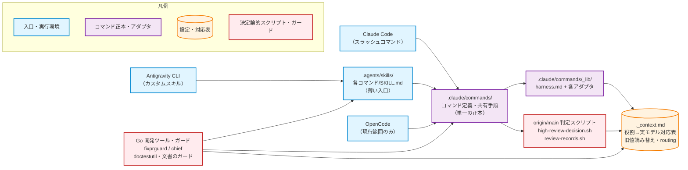
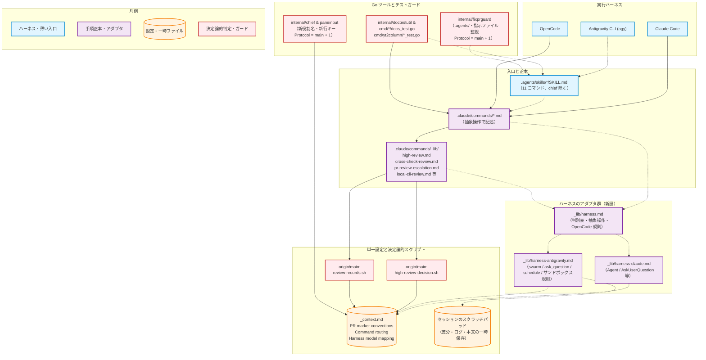
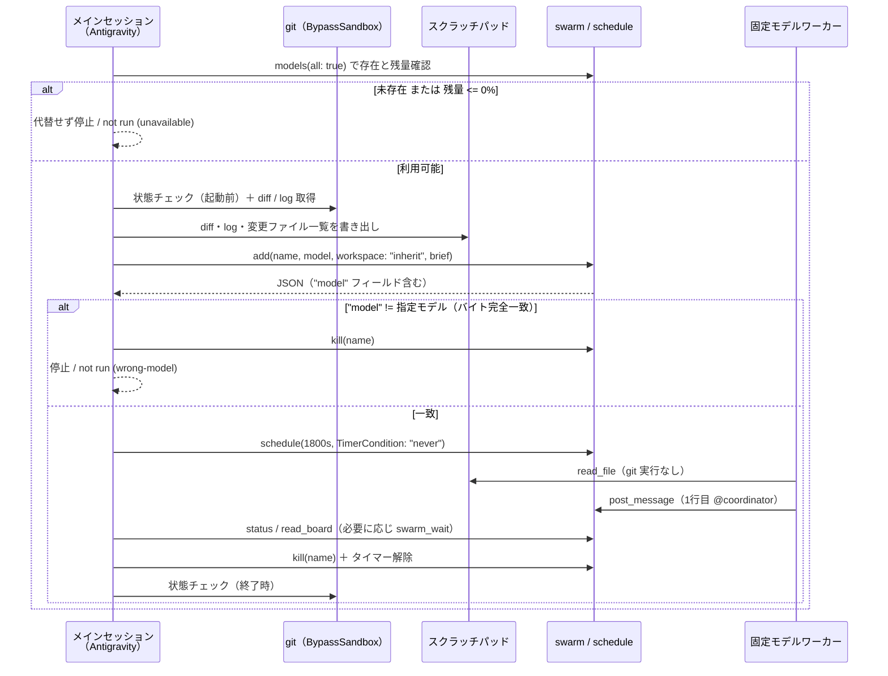
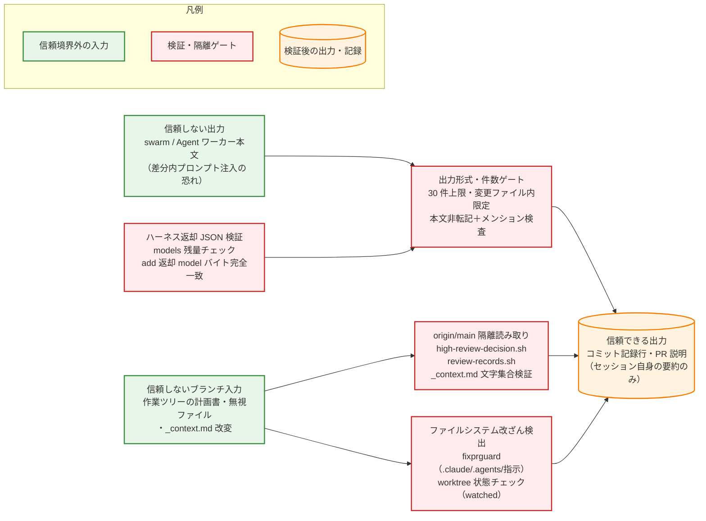
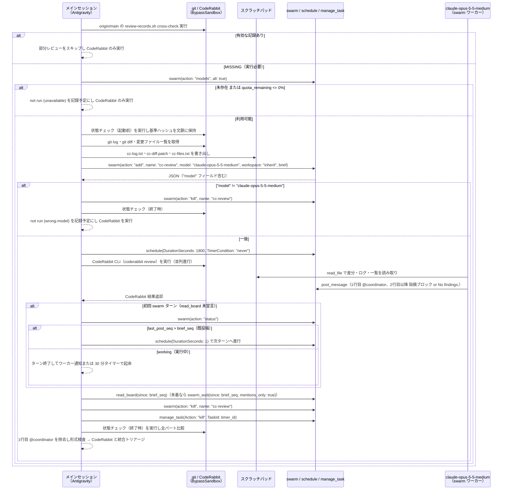
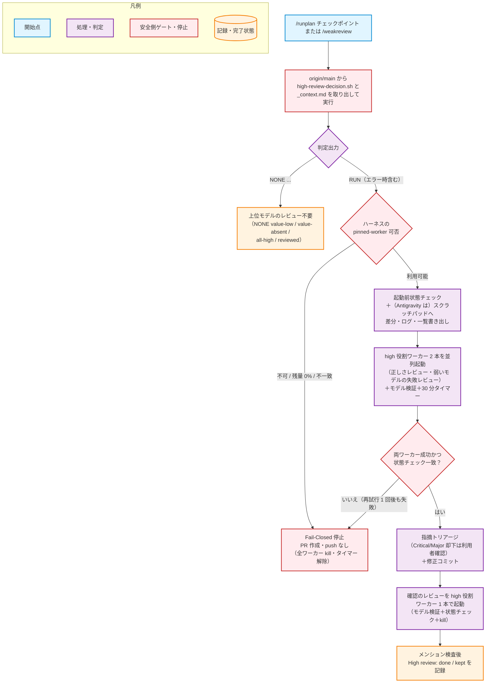

# アーキテクチャ設計書：開発コマンド定義と補助ツールのハーネス非依存化（Antigravity 対応）

## Document Status

| Item | Value |
|---|---|
| Status | `draft` |
| Created | 2026-11-22 |
| Review date | - |
| Reviewer | - |
| Comments | - |

## 1. 設計の全体像 (Design Overview)

本書は、`.claude/commands/` 配下の開発コマンド定義・共有手順・判定スクリプトおよび開発ツール（`fixprguard`・`chief`）をハーネス非依存へ移行し、Claude Code と Antigravity CLI（`agy`）の双方で同一の品質関門・承認規則・記録契約を維持するためのアーキテクチャを定義する。要件は [01_requirements.md](01_requirements.md)（AC-01〜AC-44）に基づき、設計への申し送り事項（[design_handoff.md](design_handoff.md) の H-01〜H-05）のすべてを本書で確定する。現行コードの参照は `origin/main` のコミット `8fbbfc4b` に基づく。

### 1.1. 設計原則

以下の 5 つの原則で全体の構造を揃える。

-   **単一の正本と薄い入口（DRY）:** コマンド手順の本文は `.claude/commands/` の 1 か所だけに置き、Antigravity 向けの `.agents/skills/<cmd>/SKILL.md` は正本・`_context.md`・アダプタへの参照だけを持つ薄い入口にとどめる（[ADR-0055](../../dev/adr/0055-harness-independent-commands.md)）。
-   **決定的なハーネス判別とアダプタ分離:** ハーネスごとの組み込みツール・モデル検証・一時領域・タイマー・サンドボックス規則は 3 ファイルのアダプタ群へ隔離し、セッションで利用可能な組み込みツールの有無で決定的に判別する。
-   **関門ごとの失敗安全（Fail-Closed / Fail-Open）の厳守:** 上位モデルのレビューと判定スクリプト・`fixprguard`・`chief` は検証不能時に必ず安全側へ倒す（PR 停止、`RUN`、`MISSING`、`ErrGitFailed`、`errTaskDocument`、`errRouting`）。追加防御層であるクロスチェックの部分レビューは検証不能時に `not run` を記録して PR を止めず、エスカレーション判定は `ask` に倒す。
-   **厳密な文法とインジェクション耐性:** `_context.md` から判定スクリプトが読むモデル検証パターンはリテラルまたは末尾 `*` の前方一致だけを許す固定文字集合とし、任意正規表現やメタ文字の解釈を許さない。
-   **最小権限のサンドボックス昇格:** Antigravity では既定の標準サンドボックス（`BypassSandbox: false`）を優先し、外部 git worktree やネットワーク通信で実際に拒否される単一コマンドだけを分離して昇格させる。

### 1.2. 設計の際に決めたこと（2026-11-22）

以下は、設計と実測評価を通じて利用者と合意した決定事項、その理由、および ADR の判断である。

-   **Antigravity の各役割モデルとクロスチェック担当モデルの変更（H-01、決定の変更）:** Antigravity の役割と実モデルの割り当てを `high` = `gemini-4-neon-high`、`standard` = `gemini-4-neon-medium`、`low` = `gemini-4-hydrogen-medium`、`cross-check` = `claude-opus-5-5-medium` とし、いずれも `swarm`（起動前の `models` 確認、返却 JSON の `"model"` 完全一致検証、終了時の `kill`）で実行する。
    -   **理由:** 136 PR の実運用実績と本設計での実測比較（1.4 節）の結果、`gemini-4-argon-medium` / `high` は延べ 9 回すべて指摘 0 件で検出力が不足し、`gemini-4-carbon-medium` と `gemini-4-neon-xhigh` は 10 分超タイムアウトかつ割り当て消費が大きかった。一方、Antigravity 組み込みの `claude-opus-5-5-medium` は実 PR `#1076` で 4 分 19 秒・全 5 基準にわたり 6 件の具体的な指摘を厳密形式で返し、通常セッション（Gemini 4 Neon）に対する異系統クロスチェックとして機能した。週次リセットの Claude 枠を 1 PR あたり数 % 消費する点は、枠枯渇時に `not run`（`unavailable`）で PR を止めない [ADR-0050](../../dev/adr/0050-fable-partial-review.md) の契約で受け入れる。ローカルの Claude Code CLI（`claude -p --model fable`）経由の呼び出しは認証とサンドボックス実行境界の設計が別途要るため、後続 issue（[#1082](https://github.com/isseis/yt2column/issues/1082)、`#1072` がブロッキング）へ分離した。
    -   **ADR の判断:** [ADR-0050](../../dev/adr/0050-fable-partial-review.md) を更新し、[01_requirements.md](01_requirements.md) の該当箇所を改定して `draft` に戻した（`requirements_process.md`「Editing an approved document」の決定の変更に該当）。
-   **ハーネスのアダプタの 3 ファイル分割（H-02）:** 共通の判別表・抽象操作カタログ・OpenCode フォールバック規則を `.claude/commands/_lib/harness.md` に置き、ハーネス固有の実装を `.claude/commands/_lib/harness-claude.md` と `.claude/commands/_lib/harness-antigravity.md` の 2 ファイルに分離する。`_context.md` はプロジェクト固有設定と `### Harness model mapping` 表のみを保持する。
    -   **理由:** 単一ファイルに両ハーネスの手順を混在させると Antigravity セッションが Claude Code のツール詳細まで毎ターン読み込むことになり、逆にコマンドごとへ分散させると保守点が散るため、1 共通 + 2 実装の 3 ファイル構成が最も見通しがよい。
    -   **ADR の判断:** ADR なし（[ADR-0055](../../dev/adr/0055-harness-independent-commands.md) のアダプタ分離の枠内における内部ファイル構成の選択）。
-   **一般化したファイル名・モード名・記録行接頭辞・理由コードと移行互換（H-03）:** モデル固有名を含む名称を次のとおり改名し、記録行と `review-records.sh` のモード名に後方互換を設ける。
    -   共有手順・スクリプト: `_lib/opus-review.md` → `_lib/high-review.md`、`_lib/opus-review-decision.sh` → `_lib/high-review-decision.sh`（1 つの PR 内で `CLAUDE.md`「Go Idioms」・`dev_tools.md` Rule 6 と同時に改名し、第 3 のシェルスクリプトを増やさない）、`_lib/fable-review.md` → `_lib/cross-check-review.md`、呼び出し元パラメータ `FABLE` → `CROSS_CHECK`。
    -   `review-records.sh` のモード名: 新モード名を `cross-check` とし、進行中ブランチとの移行互換のため旧モード名 `fable` を同一動作の別名として維持する（コマンド文書の呼び出し箇所ガードは `cross-check` のみを許可する）。
    -   `high-review-decision.sh` の理由コード: `value-sonnet` → `value-low`、`all-opus` → `all-high`、`value-absent` は維持する。
    -   コミット記録行の接頭辞と理由コード: 上位モデルのレビューは `High review: done` / `High review: kept`（読み取り側は旧 `Opus review:` も受理）、クロスチェックの部分レビューは `Cross-check review: run` / `Cross-check review: not run` / `Cross-check scope: in` / `Cross-check scope: out` / `Cross-check finding:` / `Cross-check review: checkpoint`（読み取り側は旧 `Fable ...` も受理）、モデル不一致の理由は `wrong-model`（読み取り側は旧 `not-fable` も受理）、PR の説明の見出しは `## クロスチェックの部分レビュー` と `<details><summary>クロスチェックの行</summary>` とする。
    -   **理由:** 進行中のブランチが古い呼び出し名や古い記録行を持っていても安全に動き続けられ（`high-review-decision.sh` 改名直後の未マージブランチは `git show origin/main:...` 失敗により安全側の `RUN` に倒れる）、既存の記録行接頭辞のどれとも衝突しないためである。
    -   **ADR の判断:** ADR なし（[ADR-0042](../../dev/adr/0042-implementation-model-tiers.md)・[ADR-0050](../../dev/adr/0050-fable-partial-review.md)・[ADR-0055](../../dev/adr/0055-harness-independent-commands.md) の方針に沿った具体文字列と別名の選定）。
-   **外部 git worktree 上の Antigravity `swarm` ワーカーへの差分受け渡し（H-04）:** すべての Antigravity `swarm` レビュー・エスカレーションワーカーについて、メインセッションが起動前に `git log`・`git diff`・変更ファイル一覧をスクラッチパッドへ書き出し、ワーカーは `git` を実行せずに `read_file` でそれを読む方式を標準とする。
    -   **理由:** Herdr の外部 git worktree 上での実測（1.4 節）で、`swarm(workspace: "inherit")` ワーカーが標準サンドボックス下で `git` を実行すると終了コード 128（`fatal: not a git repository: .../worktrees/issue-1072`）で失敗する一方、メインセッションのスクラッチパッドの `read_file` は成功することを確認したためである。
    -   **ADR の判断:** ADR なし（[01_requirements.md](01_requirements.md) 1 章で設計レベルの実現手段として整理済み）。
-   **`fixprguard` の `.agents/` 配下におけるネスト `.git` 検査の追加（F-006 / AC-36）:** `internal/fixprguard/ignored.go` の監視トップディレクトリを `.claude` と `.agents` の両方に広げ、既存の `errClaudeGitName`（`.git name below .claude`）を維持したうえで `.agents/` 向けの規則 `errAgentsGitName`（`ignored .git name below .agents`）を追加する。
    -   **理由:** `.claude/` と同じ対称な防御を `.agents/` にも設けつつ、規則名に `ignored` を含めることで `cmd/fixprguard/docs_test.go:525-538`（`TestGuideDescribesIgnoredFiles`）および `fixpr.md` の規則判定条件にそのまま適合させるためである。
    -   **ADR の判断:** ADR なし（[ADR-0055](../../dev/adr/0055-harness-independent-commands.md) の監視拡張の内部規則細部）。

### 1.3. `design_handoff.md` 申し送り事項の対応一覧

[design_handoff.md](design_handoff.md) の 5 件（H-01〜H-05）すべてに対する本書の決定と記載箇所をまとめる。

| 申し送り ID | 論点 | 本書の決定 | 記載箇所 |
|---|---|---|---|
| H-01 | Antigravity のクロスチェック担当モデルの選定と各役割モデル割り当て | `high`=`gemini-4-neon-high`、`standard`=`gemini-4-neon-medium`、`low`=`gemini-4-hydrogen-medium`、`cross-check`=`claude-opus-5-5-medium`（すべて `swarm`）。`claude -p --model fable` は [#1082](https://github.com/isseis/yt2column/issues/1082) に分離 | 1.2、1.4、3.3 |
| H-02 | ハーネスのアダプタ構成、抽象操作形式、`.agents/skills/` の配置・ガード | 3 ファイル構成（`_lib/harness.md` + `harness-claude.md` + `harness-antigravity.md`）。11 コマンド分の `.agents/skills/<cmd>/SKILL.md` と 1 対 1・非 `chief` ガード | 1.2、3.1、3.2、7.4 |
| H-03 | 一般化後のファイル名・モード名・記録行・理由コード・PR 見出し・移行順 | `_lib/high-review*`、`_lib/cross-check-review.md`、`CROSS_CHECK`、`cross-check`（`fable` 別名維持）、`High review:` / `Cross-check ...:`、`wrong-model`、原子改名順 | 1.2、3.4、3.5、8 |
| H-04 | 外部 worktree での `swarm` 実測、`add`/`status` スキーマ、`schedule` 条件 | 全ワーカーへスクラッチパッド経由で差分受け渡し、`add` 返却 JSON の `"model"` 検証、初回ターン `status`+`schedule` 補完、30 分 `schedule(TimerCondition: "never")` | 1.2、1.4、2.3、6.1 |
| H-05 | `_context.md` のハーネス別モデル対応表の節見出し・列構成・パーサ分離 | 独立した `### Harness model mapping` 節の 5 列固定表。リテラル / 末尾 `*` のみの検証パターン文法で `ParseOldValues`・`ParseRouting`・`contextRow` と完全分離 | 3.3、5.2 |

### 1.4. 実測検証の結果（H-01・H-04）

設計上の不確実性を解消するため、本ワークツリー（`/Users/issei/.herdr/worktrees/yt2column/issue-1072`、コミット `8fbbfc4b`）上で H-04 と H-01 の実測を行った。

#### H-04: 外部 git worktree 上での `swarm` 挙動実測

`swarm(action: "add", workspace: "inherit")` でワーカーを起動し、外部 worktree 上での実行制約と返却スキーマを確認した。

| 検証項目 | 実測結果 | 設計への反映 |
|---|---|---|
| ワーカーの標準サンドボックスでの `git log -1 --oneline` | 終了コード 128 で失敗（`fatal: not a git repository: /Users/issei/git/yt2column/.git/worktrees/issue-1072`） | 全 `swarm` ワーカーに `git` を実行させず、メインセッションがスクラッチパッドへ書き出した `git log`・`git diff`・変更ファイル一覧を `read_file` で渡す |
| メインセッションのスクラッチパッドに対するワーカーの `read_file` | 成功（同一会話の `scratch/` 配下を読み取り可能） | 差分・ログ・ファイル一覧の受け渡し先としてメインセッションのスクラッチパッドを使用する |
| `swarm(action: "add")` の返却 JSON | `{"status":"added","name":...,"model":"<exact-model-id>","model_display_name":...,"conversation_id":...,"open_board":...,"note":...}` | 返却 JSON の `"model"` フィールドをバイト単位で直接検証する（`status` の再取得は `"model"` 欠落時の予備のみ） |
| `swarm(action: "status")` の返却 JSON | `head`、`members[].{name, role, model, model_display_name, state, killed, last_read_seq, last_post_seq, last_post_time}` を返却 | 初回ターン完了確認および異常終了時の残存ワーカー確認に使用する |
| トークン使用量の取得可否 | `add`・`status`・`read_board` のいずれもトークン数を返さない | Antigravity のクロスチェック記録は常に経過秒数と `tokens unknown` を記録する（AC-27） |
| ワーカーのシステムプロンプトとツール構成 | 自身のモデル ID は含まれない。`post_message`・`read_board`・`swarm_wait`・`swarm` を持ち、`send_message` は持たない | ワーカーには `Model:` 出力を求めず、応答は `@coordinator` を 1 行目に置いた `post_message` で返し、コーディネータが 1 行目を除いて厳密形式を検査する |
| 初回 `swarm(action: "add")` ターンのツール宣言遅延 | 初回 `add` 実行ターン内では `read_board`・`swarm_wait`・`post_message` がまだ宣言されず、次ターンで宣言される。初回ターン中に長いフォアグラウンド作業（CodeRabbit CLI 等）を走らせている間にワーカーが投稿すると、単なるターン終了では起床しない | 初回ターンでフォアグラウンド作業を終えた直後に `swarm(action: "status")` を確認し、`last_post_seq > brief_seq` なら 1 秒の `schedule` タイマーで次ターンへ進めて `read_board(since: <brief_seq>)` で取得する（2 ターン目以降は `read_board` → 未着なら `swarm_wait(since: <brief_seq>, mentions_only: true)`） |

#### H-01: クロスチェック担当モデルの実運用実績と実測ベンチマーク

直近 7 日間（2026-11-15〜2026-11-22）の 136 PR の実運用実績と、本設計での実 PR ベンチマークを比較した。

| モデル | 評価条件 | 所要時間 / 完了可否 | 指摘件数・品質 | 判定 |
|---|---|---|---|---|
| `claude-fable-5-2`（参考: Claude Code 実績） | 136 PR 中の構造化記録 53 PR | 平均 695 秒（11.6 分） | 53/53 PR（100%）で検出、38/53 PR（71.7%）で Critical/Major、平均 7.6 件/PR | Claude Code 側の基準（維持） |
| `gemini-4-argon-medium` / `high` | 実運用 8 PR・延べ 9 回（うち上位モデルレビューなし文書 PR 4 件: `#1075`・`#1076`・`#1078`・`#1079`） | 平均 157 秒（medium）/ 210 秒（high） | 延べ 9 回すべて 0 件（0%） | 不採用（検出力不足） |
| `gemini-4-carbon-medium` | 試行 1: PR `21400a98`（1,148 行差分）<br>試行 2: 欠陥埋め込み 35 行パッチ | 試行 1: 600 秒超で未完了（Gemini 枠 -12%）<br>試行 2: 180 秒超で未完了 | どちらも応答なし | 不採用（遅延・割り当て消費過大） |
| `gemini-4-neon-xhigh` | PR `#1076`（`d45909cf`、1,082 行文書 PR。Argon は 0 件） | 600 秒超で未完了（Gemini 枠 -3%） | 応答なし | 不採用（遅延過大） |
| `claude-opus-5-5-medium` | PR `#1076`（`d45909cf`、同条件） | 259 秒（4 分 19 秒）で完了（Claude 枠 -6%） | 厳密形式 100% 遵守、全 5 基準にわたり 6 件の検証可能な欠陥を検出（`trust-boundary` 通知偽装、`external-claim` `pipefail` 漏れ、`prior-docs` 2 件、`undecided-choice` 1 件、`exclusion-error` 1 件） | 採用（異系統・高検出力・実用時間） |

### 1.5. コンセプトモデル

コマンドの入口、単一の正本、ハーネスのアダプタ、モデル対応表、および決定論的ガードの関係を以下に示す。



実線矢印（`-->`）は実行時の参照・呼び出しまたは検査対象の依存方向を表す。

## 2. システム構成 (System Structure)

本章では、リポジトリ全体のコンポーネント配置、ファイルの新設・改名・変更関係、および主要な起動・判定の協調構造を定義する。

### 2.1. 全体アーキテクチャ

ハーネス非依存化後の全体構成を以下に示す。既存の仕組みと本タスクで新設・拡張する境界を線種で区別する。



実線矢印（`-->`）は既存からある呼び出し・参照経路（本タスクで一般化・改名するものを含む）、破線矢印（`-.->`）は本タスクで新設する経路（`.agents/skills/`、アダプタ群、スクラッチパッド差分受け渡し、`.agents/` 監視・ガード）を表す。

### 2.2. ファイル配置と構成変更の概要

主な配置先と役割は次の 5 領域に分かれる。

1.  **`.agents/skills/<cmd>/SKILL.md`（新設、11 ファイル）:** `chief.md` を除く全開発コマンド（`mkreq`・`mkarch`・`mkplan`・`mkplan2`・`runplan`・`runpr`・`fixpr`・`mergepr`・`weakreview`・`japrose`・`mktrans`、および実装時点で `main` に存在する `chief` 以外の利用者起動コマンド）の薄い入口を置く。
2.  **`.claude/commands/_lib/harness*.md`（新設、3 ファイル）:** `harness.md`（共通判別と抽象操作カタログ）、`harness-claude.md`（Claude Code 実装）、`harness-antigravity.md`（Antigravity 実装）を置く。
3.  **`.claude/commands/` 既存手順とスクリプト（改名・更新）:**
    -   `_lib/opus-review.md` → `_lib/high-review.md`
    -   `_lib/opus-review-decision.sh` → `_lib/high-review-decision.sh`
    -   `_lib/fable-review.md` → `_lib/cross-check-review.md`
    -   `_lib/review-records.sh`（ファイル名維持、`cross-check` モード追加 + `fable` 別名維持、`_context.md` 参照化）
    -   `_context.md`（`### Harness model mapping` 追加、旧値読み替え表 6 行化、`Command routing` 行キー改名）
    -   その他すべての非 `chief` コマンドおよび共有手順（`_lib/local-cli-review.md`・`pr-review-escalation.md`・`review-subagent-pattern.md`・`settle-decisions.md`・`simple-process.md`・`task-pr-handoff.md`）からハーネス固有ツール名とモデル固有名を除去する。
4.  **Go 開発ツール（`internal/fixprguard`・`internal/chief`・`internal/chief/paneinput`）:** 監視の一覧・ネスト `.git` 検査・新役割名・改名後のルーティング行キー・プロトコル番号（`main` の値 + 1）を更新する。
5.  **文書のガードと仕様文書（`internal/doctestutil`・`cmd/` テスト・`CLAUDE.md`・`AGENTS.md`・`docs/dev/`・`docs/translation_glossary.md`）:** `.agents/skills/` のリンク・信頼境界・1 対 1 対応ガードを追加し、ガイドと仕様文書を一般化名称と新プロトコル番号に揃える。

### 2.3. コンポーネント間の協調構造

Antigravity 上でのモデル固定ワーカーの起動から終了までの責務分担、および `origin/main` スクリプト実行の経路を 2 つの概要図に示す（詳細な分岐条件は 6 章で扱う）。



実線矢印（`->>`）は同期呼び出しまたはツール指示、破線矢印（`-->>`）は返却値またはセッション内状態遷移を表す。

## 3. コンポーネント設計 (Component Design)

本章では、ハーネス判別、薄いスキル入口、`_context.md` のモデル対応表、一般化したレビュー手順と判定スクリプト、および Go パッケージのインターフェース・型・変更範囲を定義する。

### 3.1. ハーネス判別と 3 ファイルのアダプタ構成（F-001）

非 `chief` コマンドと共有手順からハーネス固有ツール名を取り除くため、`.claude/commands/_lib/` に次の 3 ファイルを置く。

1.  **`.claude/commands/_lib/harness.md`（共通入口・判別表・抽象操作カタログ）:**
    -   **決定的なハーネス判別規則（AC-03）:** セッションで利用可能な組み込みツールの有無を次の順序で評価し、該当した 1 つのアダプタを選ぶ（推測しない）。

| 判別順 | ハーネス | 必須の組み込みツール条件 | 読み込むアダプタ |
|---|---|---|---|
| 1 | `Antigravity` | `ask_question`・`run_command`・`swarm` の 3 つがすべて利用可能 | `_lib/harness-antigravity.md` |
| 2 | `Claude Code` | `AskUserQuestion`・`Bash`・`Agent` の 3 つがすべて利用可能 | `_lib/harness-claude.md` |
| 3 | `OpenCode`（またはその他） | 上記 1・2 のいずれも満たさない | アダプタなし（`harness.md` 内のフォールバック規則に従う） |

    -   **抽象操作カタログ（AC-02、AC-04〜AC-08）:** 正本手順で使う操作を次の 10 個に統一し、`harness-claude.md` と `harness-antigravity.md` が同一の見出し番号・操作名で具体実装を定義する。

| # | 抽象操作名 | 正本からの呼び出し用途 | Claude Code 実装概要 | Antigravity 実装概要 | OpenCode フォールバック |
|---|---|---|---|---|---|
| 1 | `select-question` | 選択式の質問（1〜4 問、各 2〜4 択、先頭推奨、選択肢外は聞き直し） | `AskUserQuestion` | `ask_question` | OpenCode の質問機能または平文での再確認 |
| 2 | `file-io` | リポジトリ内ファイルの読み取り・作成・編集 | `Read`・`Write`・`Edit` | `read_file`・`write_file`・`edit_file` | 利用可能なファイル操作ツール |
| 3 | `scratchpad` | 作業ツリー外のセッション専用一時ファイルの作成・読み取り | Claude Code セッションのスクラッチパッド | `<appDataDir>/brain/<conversation-id>/scratch/` | 作業ツリー外の一時領域（git 追跡対象外） |
| 4 | `shell-run` | タイムアウト付きシェル実行とサンドボックス規則 | `Bash`（`.claude/settings.json` 準拠） | `run_command`（標準サンドボックス優先、必要単一コマンドのみ `BypassSandbox: true`） | 利用可能なシェル実行ツール |
| 5 | `web-lookup` | 外部仕様の確認（`mkreq`・`mkarch`・`mkplan` 等） | `WebSearch`・`WebFetch` | `search_web` | 利用可能な検索ツール（なければ省略せずその旨報告） |
| 6 | `subagent-inherit` | セッションのモデルを引き継ぐ一般サブエージェント（セルフレビュー、パネルレビュー、`/fixpr` Triage/Fix、`mktrans`） | `Agent`（model 未指定） | `invoke_subagent(TypeName: "self", Model: "inherit")` または読み取り専用時は `research` | OpenCode の既定サブエージェント機構（`/fixpr` 等） |
| 7 | `subagent-role` | `standard` / `low` 段階を指定する一般サブエージェント（`japrose`、`fixpr` Phase 6、確認パス） | `Agent(model: "<mapping>")`（`sonnet` / `haiku`） | `swarm(action: "add", model: "<mapping>", workspace: "inherit")` + 完了時 `kill`（`models` 事前確認で不可なら `invoke_subagent` へ落とさず当該手順の規約に従う） | OpenCode の既定サブエージェント機構 |
| 8 | `pinned-worker` | 厳密なモデル固定と検証が必須のワーカー（上位モデルのレビュー、クロスチェックの部分レビュー、エスカレーション判定、マージ後の確認） | `Agent(model: "<mapping>")` + 出力 1 行目 `Model: <id>` 検証 + `TaskStop` | `swarm(action: "models", all: true)` 事前確認 + スクラッチパッド差分書き出し + `swarm(action: "add")` + 返却 JSON `"model"` バイト完全一致検証 + 30 分 `schedule` + `read_board` + 全出口 `kill` | 呼び出し不可として安全側処理（エスカレーション=`ask`、上位モデルレビュー=停止、クロスチェック=`not run` 理由 `agent-cannot-call`） |
| 9 | `timer-wait` | 30 分タイムアウト監視と定期確認の待機 | バックグラウンド `sleep` + `TaskStop`（`ToolSearch` 経由） | `schedule(DurationSeconds: ..., TimerCondition: "never")` + `manage_task(Action: "kill")`（シェルの `sleep` 禁止） | 利用可能な待機手段 |
| 10 | `notify-user` | 長時間作業完了時の利用者通知 | `PushNotification`（利用可能な場合） | ツール不在のため最終報告で代替（`_context.md:52`） | 最終報告で代替 |

2.  **`.claude/commands/_lib/harness-claude.md`:** 現行 Claude Code の操作契約（`Agent` の `Model:` 1 行目検証、`TaskStop`、`AskUserQuestion`、`.claude/settings.json` の存在）を 1〜10 の節で定義する。
3.  **`.claude/commands/_lib/harness-antigravity.md`:** Antigravity の操作契約を 1〜10 の節で定義する。特に `shell-run` 節に AC-33・AC-34 のサンドボックス昇格規則と禁止コマンド一覧を明記し、`pinned-worker` 節に 1.4 節で実測した `swarm` 初回ターン待機・差分書き出し・JSON 検証・全出口 `kill`・`tokens unknown` 記録の手順を明記する。

### 3.2. `.agents/skills/<cmd>/SKILL.md` の薄い入口契約（F-002）

Antigravity CLI がカスタムスキルとして自動検出する `.agents/skills/` 配下に、`chief.md` を除く各開発コマンドと 1 対 1 に対応する薄い入口を置く（AC-09〜AC-11）。

-   **対象コマンド（`main` 現時点の 11 件）:** `mkreq`・`mkarch`・`mkplan`・`mkplan2`・`runplan`・`runpr`・`fixpr`・`mergepr`・`weakreview`・`japrose`・`mktrans`。実装時点で `main` に `chief.md` 以外の利用者起動コマンドが増えていれば同じ契約で追加する。`chief` のスキルは置かない（AC-11）。
-   **言語と形式:** `CLAUDE.md`「Document language」原則 (b) に従い英語で書く。YAML フロントマター（`name`・`description`）と、次の 4 点を指す短い本文のみを置き、コマンド手順のステップ本文は一切複製しない（AC-10）。
    1.  `.claude/commands/_context.md` を読むこと。
    2.  `.claude/commands/_lib/harness.md` と `.claude/commands/_lib/harness-antigravity.md` を読み、全手順の抽象操作を Antigravity アダプタで実行すること。
    3.  正本 `.claude/commands/<cmd>.md` を読み、引数仕様・事前認可（Authorization）・停止条件を含めてそのまま実行すること。
    4.  `AGENTS.md` および `CLAUDE.md` の禁止規則（インストール型ツールのビルド・インストール禁止、`herdr` / `git worktree` 変更禁止等）を遵守すること。

### 3.3. `_context.md` のモデル対応表スキーマとパーサ分離契約（F-003、H-05）

`.claude/commands/_context.md` には既に 3 つの決定論的パーサが存在する。新しいモデル対応表はこれらと構造的に衝突しない独立した節として設計する。

#### 既存パーサとの衝突回避の検証

| 既存パーサ | 場所 | 読み取り範囲と条件 | 新表との分離保証 |
|---|---|---|---|
| `ParseOldValues` | `internal/chief/task.go:270-312`（および判定スクリプト） | 見出し `### PR marker conventions` の配下のみを走査し、2 列の表行を読む | 新表を別見出し `### Harness model mapping` に置くため一切走査されない |
| `ParseRouting` | `internal/chief/routing.go:21-104` | 見出し `### Command routing` の配下のみを走査し、4 列ヘッダ `\| Row \| Command \| Agent \| Model \|` の直後の表だけを読む | 新表は `### Command routing` の外（後続の独立した `###` 節）に置くため一切走査されない |
| `contextRow` | `cmd/yt2column/fixpr_docs_test.go:81-92` | 1 列目のヘッダセルが `Name` の表だけを走査する | 新表の 1 列目ヘッダは `Harness` とするため対象外になる |

#### `### Harness model mapping` 表の固定スキーマ

`_context.md` の末尾付近に独立した見出し `### Harness model mapping` を置き、次の固定 5 列（ヘッダ `| Harness | Role | Launch | Model | Verification pattern |`、区切り `|---|---|---|---|---|`）で表を定義する（AC-16）。

| Harness | Role | Launch | Model | Verification pattern |
|---|---|---|---|---|
| `Claude Code` | `high` | `agent` | `opus` | `claude-opus-*` |
| `Claude Code` | `standard` | `agent` | `sonnet` | `claude-sonnet-*` |
| `Claude Code` | `low` | `agent` | `haiku` | `claude-haiku-*` |
| `Claude Code` | `cross-check` | `agent` | `fable` | `claude-fable-*` |
| `Antigravity` | `high` | `swarm` | `gemini-4-neon-high` | `gemini-4-neon-high` |
| `Antigravity` | `standard` | `swarm` | `gemini-4-neon-medium` | `gemini-4-neon-medium` |
| `Antigravity` | `low` | `swarm` | `gemini-4-hydrogen-medium` | `gemini-4-hydrogen-medium` |
| `Antigravity` | `cross-check` | `swarm` | `claude-opus-5-5-medium` | `claude-opus-5-5-medium` |
| `OpenCode` | `low` | `none` | `DeepSeek V4.1 Flash 1017 OpenCode Go` | `-` |

各列の契約は次のとおりである。

-   **`Harness`:** `Claude Code`・`Antigravity`・`OpenCode` のいずれか。
-   **`Role`:** `high`・`standard`・`low`・`cross-check` のいずれか。同一 `(Harness, Role)` の重複行は判定スクリプトが不正な表として拒否する。
-   **`Launch`:** `agent`（Claude Code の `Agent` ツール）、`swarm`（Antigravity の `swarm` ツール）、`none`（モデル固定ワーカー起動不可）。
-   **`Model`:** 起動ツールまたはセッション案内で指定するモデル値。
-   **`Verification pattern`:** モデル検証に使う厳密な文字集合パターン。次の 3 形態だけを許可し、それ以外の文字（正規表現メタ文字・空白・括弧・パイプ等）を含む行は判定スクリプトが表全体（または該当役割の検証）を失敗として拒否する（AC-30、5.2 節）。
    1.  `-`: 検証対象外（`Launch` が `none` の行のみ許可）。
    2.  リテラル完全一致: `^[a-z0-9][a-z0-9.-]{0,63}$`（Antigravity のように厳密なモデル ID が定まる場合）。
    3.  末尾ワイルドカード前方一致: `^[a-z0-9][a-z0-9.-]{0,62}\*$`（末尾の `*` は `[a-z0-9.-]+` に 1 文字以上で一致する前方一致として扱う。例: `claude-opus-*` は `claude-opus-4-7` に一致し、`claude-opus-` のような空接尾辞や空白・改行・記号を含む文字列には一致しない）。

#### `### PR marker conventions` の旧値読み替え表と `### Command routing` の改名

-   **旧値読み替え表（AC-12、AC-14）:** 正規の 3 値（`high`・`standard+high-review`・`low`）に対し、次の 6 行の旧値読み替えを置く。

| 旧値 | 読み替える値 |
|---|---|
| `opus` | `high` |
| `sonnet+opus-review` | `standard+high-review` |
| `sonnet` | `low` |
| `frontier-required` | `high` |
| `frontier-recommended` | `standard+high-review` |
| `standard` | `low` |

-   **`### Command routing` の改名（AC-39）:** `runplan-opus` → `runplan-high`、`runplan-sonnet+opus-review` → `runplan-standard+high-review`、`runplan-sonnet` → `runplan-low` に改名し、`task-documents`・`runplan-takeover`・`runpr` と `Agent` 列の 2 値（`Claude Code`・`OpenCode`）は維持する。

### 3.4. 上位モデルのレビューと判定スクリプトの一般化（F-004）

-   **共有手順の改名（`.claude/commands/_lib/opus-review.md` → `_lib/high-review.md`）:**
    -   並列の発見レビュー 2 本（正しさ・弱いモデルの失敗）と確認のレビューの起動を `harness.md` の `pinned-worker`（役割 `high`）へ委譲する。
    -   Antigravity ではセッションが自身のモデル ID を検証できないため、`runplan.md` は `Implementation model:` 行を書かない（AC-20）。その結果、`high`・`standard+high-review`・読めない値のプラン PR では、有効な完了記録がない限り `high-review-decision.sh` が `RUN` を返し、上位モデルのレビューが必ず走る。
    -   Claude Code では現行どおり `Implementation model: <START12>..<END12> <model-id>[, ...]` を書き、`high-review-decision.sh` が `_context.md` の全 `high` 役割の `Verification pattern` と照合する（AC-19）。
    -   新しいコミット記録行は `High review: done <START12>..<END12>` および `High review: kept <START12>..<END12> ...` とし、読み取り側（`high-review-decision.sh`・PR 説明生成・クロスチェックへの決着済み論点渡し）は `High review:` と旧 `Opus review:` の両方を同一の意味で読む（AC-23）。
-   **判定スクリプトの改名と契約（`_lib/opus-review-decision.sh` → `_lib/high-review-decision.sh`）:**
    -   `origin/main` の `.claude/commands/_context.md` から (a) `### PR marker conventions` の旧値読み替え表、(b) `### Harness model mapping` の `Role == high` の全 `Verification pattern` を読み取る。スクリプト内に `claude-opus-*` や旧値一覧をハードコードしない（AC-18）。
    -   出力契約:
        -   `RUN`（レビュー必要、および git 失敗・計画書読み取り不能・`_context.md` 欠落・モデル表不正・複数値欄などすべてのエラー時の安全側出力、終了コード `0`）
        -   `NONE value-low`（旧 `NONE value-sonnet`）
        -   `NONE value-absent`（変更なし）
        -   `NONE all-high`（旧 `NONE all-opus`）
        -   `NONE reviewed`（有効な `High review: done` または `Opus review: done` 記録がある場合。現行と同じ）
    -   **原子改名と移行互換（H-03）:** 1 つの実装 PR 内でスクリプトの改名、全呼び出し元（`runplan.md`・`high-review.md`・`internal/chief/markers_parity_test.go`）、`CLAUDE.md`「Go Idioms」例外、`docs/dev/conventions/dev_tools.md` Rule 6 を同時に更新する。マージ直後にまだ `main` を取り込んでいない進行中ブランチが旧名 `git show origin/main:.claude/commands/_lib/opus-review-decision.sh` を試みた場合はファイル不在で失敗し、既存の失敗安全規則により `RUN` に倒れるため、レビューが素通りすることはない。

### 3.5. クロスチェックの部分レビューと記録判定スクリプトの一般化（F-005）

-   **共有手順の改名（`.claude/commands/_lib/fable-review.md` → `_lib/cross-check-review.md`）:**
    -   呼び出し元パラメータを `FABLE` → `CROSS_CHECK` に改名し（`_lib/local-cli-review.md`・`runplan.md`・`_lib/task-pr-handoff.md`）、4 基準（`trust-boundary`・`prior-docs`・`external-claim`・`undecided-choice`）・除外箇所検証・30 件上限・worktree 状態チェック・統合トリアージ・却下根拠確認をハーネス共通手順として保持する（AC-25、AC-31）。
    -   ワーカーの起動・モデル検証・30 分タイムアウト・停止は `harness.md` の `pinned-worker`（役割 `cross-check`）へ委譲する（AC-26、AC-27）。
    -   記録行・見出し・理由コードの一般化（AC-29、AC-30）:

| 記録の種類 | 新形式（新規書き込み） | 旧形式（互換読み取り対象） |
|---|---|---|
| 実施記録 | `Cross-check review: run <START12>..<END12> <model-id> <N>s (<tokens>)` | `Fable review: run <START12>..<END12> <model-id> <N>s (<tokens>)` |
| 未実施記録 | `Cross-check review: not run <START12>..<END12> (<reason>)` | `Fable review: not run <START12>..<END12> (<reason>)` |
| モデル不一致の理由 | `wrong-model` | `not-fable` |
| 範囲（対象・除外） | `Cross-check scope: in ...` / `Cross-check scope: out ...` | `Fable scope: in ...` / `Fable scope: out ...` |
| 指摘明細 | `Cross-check finding: ...` | `Fable finding: ...` |
| チェックポイント印 | `Cross-check review: checkpoint <START12>..<END12>` | `Fable review: checkpoint <START12>..<END12>` |
| PR 説明の見出し | `## クロスチェックの部分レビュー` / `<details><summary>クロスチェックの行</summary>` | （既存 PR の読み取り対象はコミット記録行） |

    -   `<kind>` 分類の拡張（AC-29）: `.agents/skills/` 配下を `command`、それ以外の `.agents/` 配下を `agent-config` として分類する。
    -   **`The state check` の `watched` 拡張（AC-36）:** `_lib/cross-check-review.md` の状態チェックブロック（現行 `_lib/fable-review.md:389`）の `awk` 条件に `l ~ /^\.agents\//` および `n ~ /^(claude\.md|agents\.md|agent\.md|gemini\.md|agents\.override\.md|makefile|gnumakefile|go\.mod|go\.work)$/` を追加し、`internal/fixprguard/ignored.go` の監視の一覧と一致させる。また一時インデックスファイル名も `fable-index.XXXXXX` から `cross-check-index.XXXXXX` に改める。
-   **判定スクリプトの更新（`.claude/commands/_lib/review-records.sh`、bash 3.2 互換維持）:**
    -   部分レビュー有効性判定の新モード名 `cross-check` を追加し、移行中の進行中ブランチとの互換のため旧モード名 `fable` を同一処理への別名として受理する（コマンド文書が `cross-check` だけを呼ぶことはテスト `TestReviewRecordsCallSite` で強制する）。
    -   `origin/main:.claude/commands/_context.md` の `### Harness model mapping` から `Role == cross-check` の全行の `Verification pattern`（`-` を除く）を読み取り、3.3 節の厳密な文字集合検証（リテラルまたは末尾 `*` の前方一致）を通ったパターンだけをモデル ID 照合に使う。表の欠落・形式不正・有効パターン 0 件のときは安全側に倒して標準出力に `MISSING`、標準エラーに診断を出し終了コード `1` で終わる（AC-30）。
    -   実施記録・未実施記録・チェックポイント行は新接頭辞（`Cross-check ...`）と旧接頭辞（`Fable ...`）、および `wrong-model` と `not-fable` を両読みする。
    -   既存の `coverage` モードの動作と失敗時出力（`PARTIAL`、終了コード `1`）は維持する。
-   **タスク 0114（#988）との条件付き整合（AC-28）:** 本タスク実装時点で `#988`（記録後のマージコミットに対するマージ後の確認）が既に `main` にマージされていれば、マージ後の確認の起動も `pinned-worker`（役割 `high`）へ一般化する。本タスクが先に `main` に入る場合は `#988` 側が本設計のアダプタ上で実装する。

### 3.6. Go パッケージの設計変更（F-006、F-007、F-008）

以下では、変更対象となる Go パッケージの公開契約・型・定数・番兵エラーの変更点のみを定義する。

#### 3.6.1. `internal/fixprguard`（`ignored.go`・`types.go`）

-   **プロトコル番号（`internal/fixprguard/types.go:21`）:** 現行 `const Protocol = 6` を実装時に `main` の値 + 1 へ引き上げる（AC-36）。
-   **監視の一覧の拡張（`internal/fixprguard/ignored.go:35-90`）:**
    -   単一の `watchTopDir = ".claude"` を複数スライス `watchTopDirs = []string{".claude", ".agents"}` に改め、`WatchListPatterns()` が `".claude/"` と `".agents/"` の両方を先頭に出力する契約にする。
    -   `watchNames` に `"agents.md"`, `"agent.md"`, `"gemini.md"`, `"agents.override.md"` を追加する（`internal/fixprguard/scope.go:54` の指示ファイル名集合と一致、Unicode 単純ケースフォールディング `foldEqual` で照合）。
-   **`.agents/` 配下のネスト `.git` 検査と番兵エラー（`internal/fixprguard/ignored.go:190-222,370-422`）:**
    -   既存の `errClaudeGitName`（`fmt.Errorf("%w: .git name below .claude", ErrGitFailed)`）はそのまま残し、`.agents/` 向けに新しい番兵エラーを 1 つ追加する。

```go
// ErrGitFailed をラップする新規番兵エラー（既存 errClaudeGitName と並列）
var errAgentsGitName = fmt.Errorf("%w: ignored .git name below .agents", ErrGitFailed)
```

    -   `ignoredFailures` スライスに `errAgentsGitName` を追加し、`IgnoredFailureRules()` が `"ignored .git name below .agents"` を返す契約とする。規則名に `"ignored"` を含むため、`fixpr.md` の規則判定および `cmd/fixprguard/docs_test.go:525-538`（`TestGuideDescribesIgnoredFiles`）の既存契約を壊さない。
    -   最上位の `.claude` と `.agents` の双方を走査し、どちらかが `.git` にフォールディングするエントリを含めば対応する番兵エラー（`errClaudeGitName` または `errAgentsGitName`）を返す。走査エントリ上限 `lim.walkEntries` は両ディレクトリの合算で適用する。

#### 3.6.2. `internal/chief`・`internal/chief/paneinput`

-   **プロトコル番号（`internal/chief/records.go:29`）:** 現行 `const Protocol = 6` を実装時に `main` の値 + 1 へ引き上げる（AC-40）。
-   **`Requirement` 列挙の改名（`internal/chief/task.go:235-275`）:**
    -   `RequirementOpus` → `RequirementHigh`（`"high"`）
    -   `RequirementSonnetReview` → `RequirementStandardReview`（`"standard+high-review"`）
    -   `RequirementSonnet` → `RequirementLow`（`"low"`）
    -   `RequirementUnreadable` と `RequirementAbsent` は維持する。
    -   `oldValueRow` の正規表現の 2 列目許可値を `(high|standard\+high-review|low)` に更新し、`ParseOldValues(contextDoc []byte) OldValues` が AC-14 の 6 つの旧値をすべて読み取る契約とする（AC-37）。
-   **`RouteKey` 列挙と `routingRows` の改名（`internal/chief/paneinput/paneinput.go:145-177,350-357`、`internal/chief/routing.go:27-34`）:**
    -   `RouteRunplanOpus` → `RouteRunplanHigh`（行キー `"runplan-high"`）
    -   `RouteRunplanSonnetReview` → `RouteRunplanStandardReview`（行キー `"runplan-standard+high-review"`）
    -   `RouteRunplanSonnet` → `RouteRunplanLow`（行キー `"runplan-low"`）
    -   `RouteTaskDocuments`・`RouteRunplanTakeover`・`RouteRunpr`・`AgentClaudeCode`・`AgentOpenCode`・`ClaudeModelOpus`・`ClaudeModelSonnet` は維持する（`chief` の Antigravity 操作対応はスコープ外、AC-39）。
-   **公開 API 署名:** `ParsePlan`・`ParseOldValues`・`ParseRouting`・`ReadRouting`・`NewRunplan`・`RouteKeys` の関数署名自体は変えず、列挙定数名と受け入れる行キー・値だけを改める。

#### 3.6.3. `internal/doctestutil`（`protocol.go`）

-   `CommandDocs(t testing.TB, root string) []string`（`internal/doctestutil/protocol.go:111-129`）が `.claude/commands` に加えて `.agents/skills` 配下のすべての `.md` ファイルを返すように拡張するか、同一契約の補助関数を追加してすべてのコマンド指示文書ガード（`codex_review_docs_test.go`・`cmd/chief/docs_test.go`・`cmd/fixprguard/docs_test.go`・`cmd/mergepr/docs_test.go`・`cmd/numreserve/docs_test.go`）が `.agents/skills/` を漏れなく検査対象に含めるようにする（AC-42）。
    -   **理由:** `CommandDocs` 自体が `.claude/commands` と `.agents/skills` の双方を返せば、既存の 5 パッケージの呼び出し側が一切漏れなく `.agents/skills/` の `--protocol` 検査・禁止メンション検査・生の投稿コマンド検査・直接 `herdr` 呼び出し検査・`numreserve` 検査を自動的に適用できる。

### 3.7. コンポーネント責務一覧と変更対象ファイル（既存テスト含む）

本タスクの実装で作成・改名・変更するすべてのコンポーネントと、更新が必要な既存テストの一覧を以下に示す。

| 領域 | ファイルパス | 種別 | 主な責務・変更内容 |
|---|---|---|---|
| アダプタ | `.claude/commands/_lib/harness.md` | 新設 | 決定的ハーネス判別表、10 種の抽象操作カタログ、OpenCode フォールバック規則 |
| アダプタ | `.claude/commands/_lib/harness-claude.md` | 新設 | Claude Code 向け実装（`AskUserQuestion`・`Agent` + `Model:` 1 行目検証・`TaskStop` 等） |
| アダプタ | `.claude/commands/_lib/harness-antigravity.md` | 新設 | Antigravity 向け実装（`ask_question`・`swarm` 事前確認/差分書き出し/JSON 検証/初回ターン補完/`schedule`/`kill`・サンドボックス規則・禁止コマンド） |
| スキル入口 | `.agents/skills/<cmd>/SKILL.md`（11 件） | 新設 | `chief` を除く 11 コマンドの英語薄い入口（正本・`_context.md`・Antigravity アダプタへの参照のみ） |
| 設定正本 | `.claude/commands/_context.md` | 更新 | `### Harness model mapping` 新設、旧値読み替え表 6 行化、`Command routing` 行キー改名 |
| 共有手順 | `.claude/commands/_lib/high-review.md`（旧 `opus-review.md`） | 改名・更新 | 上位モデルのレビュー手順の一般化、`High review:` 記録行と旧行両読み、アダプタ委譲 |
| 判定スクリプト | `.claude/commands/_lib/high-review-decision.sh`（旧 `opus-review-decision.sh`） | 改名・更新 | `_context.md` から旧値と `high` パターンを動的読み取り、`value-low`/`all-high`、新旧記録行両読み |
| 共有手順 | `.claude/commands/_lib/cross-check-review.md`（旧 `fable-review.md`） | 改名・更新 | クロスチェック部分レビュー手順一般化、`Cross-check ...:` 記録行、`wrong-model`、`.agents/` 分類、状態チェック拡張 |
| 判定スクリプト | `.claude/commands/_lib/review-records.sh` | 更新 | `cross-check` モード追加（`fable` 別名維持）、`_context.md` から `cross-check` パターン動的読み取り、新旧記録行両読み |
| 共有手順 | `.claude/commands/_lib/local-cli-review.md`・`pr-review-escalation.md`・`review-subagent-pattern.md`・`settle-decisions.md`・`simple-process.md`・`task-pr-handoff.md` | 更新 | `CROSS_CHECK` パラメータ化、エスカレーション `high` 固定化、抽象操作への置換、新記録行・PR 見出し対応 |
| コマンド正本 | `.claude/commands/{mkreq,mkarch,mkplan,mkplan2,runplan,runpr,fixpr,mergepr,weakreview,japrose,mktrans}.md` | 更新 | ハーネス固有ツール名とモデル固有名（`sonnet`/`haiku`/`opus`/`fable`）の除去、新役割名と新スクリプト名・新プロトコル番号の反映 |
| コマンド正本 | `.claude/commands/chief.md` | 更新 | `chief` プロトコル番号（`main` の値 + 1）と一般化名称の反映（Antigravity 非対象は維持） |
| Go ツール | `internal/fixprguard/{ignored.go,types.go}` | 更新 | `watchTopDirs` に `.agents` 追加、`watchNames` に 4 指示ファイル追加、`errAgentsGitName` 追加、`Protocol` = `main` の値 + 1 |
| Go ツール | `internal/chief/{task.go,routing.go,records.go,snapshot.go,autosend.go,send.go,maintask.go}` 等、`internal/chief/paneinput/paneinput.go` | 更新 | `Requirement*`・`RouteRunplan*` 定数改名、`oldValueRow`・`routingRows` 更新、`Protocol` = `main` の値 + 1 |
| テスト基盤 | `internal/doctestutil/protocol.go` | 更新 | `CommandDocs` の走査対象に `.agents/skills` を追加 |
| 既存テスト | `cmd/yt2column/docpaths_test.go` | 更新 | `instructionDocs`（`:106-120`）の走査対象に `.agents/skills` を追加、および 1 対 1・非 `chief`・ツール名禁止ガードを追加 |
| 既存テスト | `cmd/yt2column/fixpr_docs_test.go` | 更新 | `fixprPhase6` 定数（`:42`、現行 `(model: haiku)`）を役割名表記へ追随 |
| 既存テスト | `cmd/yt2column/fable_state_docs_test.go`（改名候補: `cross_check_state_docs_test.go`） | 更新 | 参照パスを `_lib/cross-check-review.md` へ変更、`.agents/`・指示ファイルの `watched` 検出検証を追加 |
| 既存テスト | `cmd/yt2column/review_records_test.go` | 更新 | 参照パスを `_lib/cross-check-review.md`・`_lib/high-review.md` へ変更、`cross-check` モード・`fable` 別名・新旧記録行・`_context.md` モデルパターン検証・接頭辞一意性テストを更新 |
| 既存テスト | `cmd/yt2column/codex_review_docs_test.go` | 確認・更新 | `CommandDocs` 拡張により `.agents/skills/` が自動で検査対象になることを確認（`#1059` 完了後の構成に整合） |
| 既存テスト | `internal/fixprguard/ignored_test.go`・`cmd/fixprguard/docs_test.go` | 更新 | 新規監視対象（`.agents/`・4 指示ファイル）、`errAgentsGitName`、ガイド表、新プロトコル番号を検証 |
| 既存テスト | `internal/chief/{task_test.go,routing_test.go,markers_parity_test.go,send_test.go,snapshot_test.go,maintask_test.go,running_test.go,autosend_test.go}`・`internal/chief/paneinput/paneinput_test.go`・`cmd/chief/docs_test.go` | 更新 | 改名した定数・行キー・`high-review-decision.sh` パス・`value-low`/`all-high`・新プロトコル番号に追随 |
| 仕様・規約文書 | `CLAUDE.md`・`AGENTS.md`・`docs/dev/conventions/dev_tools.md`・`docs/dev/chief_architecture.md`・`docs/dev/guides/{chief_guide,fixprguard_guide}.md`・`docs/translation_glossary.md`・各 ADR の食い違い記述除去 | 更新 | AC-34・AC-36・AC-40・AC-41・AC-44 に沿った仕様文書・用語集・ADR の同期 |

### 3.8. 既存方針に対する変更点と例外（インライン整理）

既存のリポジトリ規約・先行決定に対して意図的に変更を加える箇所を、元の規定・理由・更新対象の既存テストの 3 点で整理する。

1.  **`CLAUDE.md` の文書言語対象と対話言語表記の拡張（AC-41）:**
    -   **元の規定:** `CLAUDE.md:48-75`（「Document language」原則 (b)）は英語指示文書の対象を `CLAUDE.md`・`AGENTS.md`・`.claude/commands/` に限定し、`CLAUDE.md:161-165`（「Language」）は対話言語規則を Claude Code 前提で記述している。
    -   **変更の理由:** Antigravity 用の薄い入口 `.agents/skills/` はエージェントへの指示文書であり（[ADR-0035](../../dev/adr/0035-language-policy.md)・[ADR-0055](../../dev/adr/0055-harness-independent-commands.md)）、対話言語規則もハーネス共通にする必要がある。
    -   **更新対象の既存テスト:** `cmd/yt2column/docpaths_test.go`（`instructionDocs` への `.agents/skills` 追加）、`internal/doctestutil/protocol.go`（`CommandDocs` への `.agents/skills` 追加）。
2.  **`CLAUDE.md`「Go Idioms」および `dev_tools.md` Rule 6 の判定スクリプト名更新（AC-41）:**
    -   **元の規定:** `CLAUDE.md:936-952` と `docs/dev/conventions/dev_tools.md` Rule 6 は、日本語リテラルとシェルスクリプトの例外対象として `.claude/commands/_lib/opus-review-decision.sh` を名指ししている。
    -   **変更の理由:** モデル固有名を除去するため `_lib/high-review-decision.sh` へ 1 対 1 で原子改名する。新たな第 3 のシェルスクリプトは増やさない。
    -   **更新対象の既存テスト:** `internal/chief/markers_parity_test.go:17`（`decisionScript` パスと `decisionClass` 文字列）。
3.  **`01_requirements.md` および `ADR-0050` の Antigravity クロスチェック担当モデル変更（H-01）:**
    -   **元の規定:** 承認時点の `01_requirements.md`（AC-16・AC-27）と `ADR-0050` は、Antigravity のクロスチェック担当モデル候補を Gemini 4 Carbon / Argon の 2 者に限定していた。
    -   **変更の理由:** 1.4 節の実運用実績と実測により Gemini 系の候補 3 種が検出力不足または時間切れで不適格と判明し、Antigravity 組み込みの `claude-opus-5-5-medium` が異系統・高検出力・実用時間で機能することを確認したため。`01_requirements.md` は `draft` に戻して同時に再承認を仰ぎ、`ADR-0050` を更新した。
    -   **更新対象の既存テスト:** `cmd/yt2column/review_records_test.go`（`_context.md` の `cross-check` モデルパターン読み取り試験）。
4.  **`fixprguard` と `chief` のプロトコル番号引き上げ（AC-36、AC-40）:**
    -   **元の規定:** `internal/fixprguard/types.go:21` と `internal/chief/records.go:29` は現在 `const Protocol = 6` である。
    -   **変更の理由:** `fixprguard` の監視の一覧・エラー規則追加および `chief` の新役割名・新行キー導入により古いインストール済みバイナリの誤動作を防ぐため、双方を `main` の値 + 1 へ引き上げる（`CLAUDE.md`「Protocol numbers」に従い具体数値は計画・設計に書かない）。
    -   **更新対象の既存テスト:** `cmd/fixprguard/docs_test.go`・`cmd/chief/docs_test.go`（プロトコル番号一致ガード）。

## 4. エラーハンドリング設計 (Error Handling Design)

各品質関門と決定論的コンポーネントは、役割に応じて Fail-Closed（安全側停止・再実行要求）と Fail-Open（理由付き `not run` 記録・継続）を厳格に使い分ける。

### 4.1. 関門・コンポーネント別の失敗時契約

| コンポーネント / 関門 | 想定される異常・失敗条件 | 失敗時の動作（安全側契約） | 終了コード / 出力 | 後始末の必須動作 |
|---|---|---|---|---|
| 上位モデルのレビュー（`_lib/high-review.md`、AC-22） | (1) モデル固定起動なし（OpenCode 等）<br>(2) `models` に未存在または割り当て `<= 0%`<br>(3) モデル ID 不一致<br>(4) 再試行（1 回）後もエラーまたは 30 分超過<br>(5) 形式不一致または状態チェック差分 | Fail-Closed: 別モデルで代替せず、呼び出し元コマンドを即時停止（`/runplan` は PR 作成も push もしない、`/weakreview` は修正コミットを作らない） | 停止理由と状態チェック差分パート名を利用者へ報告 | アクティブな全 `swarm` ワーカーを `kill`、タイマーを `manage_task(Action: "kill")` で解除 |
| クロスチェックの部分レビュー（`_lib/cross-check-review.md`、AC-27・AC-28・AC-31） | (1) 起動手段なし（`agent-cannot-call`）<br>(2) 未存在・割り当て `<= 0%`（`unavailable`）<br>(3) モデル ID 不一致（`wrong-model`）<br>(4) 30 分超過（`timeout`）<br>(5) 再試行後もエラー（`error`）<br>(6) 形式不正・30 件超過（`unreadable`） | Fail-Open（PR 自体は止めない）: 該当理由コード付きで `Cross-check review: not run <START12>..<END12> (<reason>)` を記録して続行。<br>**ただし**状態チェックで差分が出た場合のみ Fail-Closed として即時停止 | 記録行へ反映、結果破棄 | 同上（不一致時は `add` 直後に即時 `kill`） |
| エスカレーション判定（`_lib/pr-review-escalation.md`、AC-07） | `high` ワーカー起動不可、割り当て切れ、モデル ID 不一致、応答が固定 3 メンバ JSON（`decision`・`criteria`・`reason`）以外、タイムアウト | Fail-Safe: `ask`（マージの質問で PR レビュー依頼を推奨）として扱う | `ask` 判定 | 同上 |
| `high-review-decision.sh`（AC-18） | 引数不正、git 失敗、`origin/main:_context.md` 欠落・モデル表不正・パターン文字集合不正、計画書読取不能、重複値欄 | Fail-Closed: レビュー必要側へ倒す | 標準出力 `RUN`、終了コード `0` | なし（読み取り専用） |
| `review-records.sh`（AC-30） | `cross-check`（および別名 `fable`）モードでの引数不正、git 失敗、`_context.md` 欠落・モデル表不正・パターン 0 件 | Fail-Closed: 記録無効側へ倒す | 標準出力 `MISSING`、標準エラー診断、終了コード `1`（`coverage` モードは `PARTIAL`、終了コード `1`） | なし（読み取り専用） |
| `internal/fixprguard`（AC-36） | `.claude/` または `.agents/` 配下の `.git` エントリ検出、走査上限超過、読み込み失敗 | Fail-Closed: ラウンドを停止し、ファイルパスや名称を漏らさず規則名のみを返す | `ErrGitFailed` ラップエラー（`errClaudeGitName` / `errAgentsGitName` 等） | なし |
| `internal/chief`（AC-37・AC-39） | 未知・重複・フェンス内の `**実装モデル要件**` 値／未閉鎖フェンス・重複見出し／壊れた `Command routing` 表 | Fail-Closed: 自動送信を行わない／ワークスペースを「要確認」とする | `RequirementUnreadable`／`errTaskDocument`／`errRouting` | なし |

### 4.2. 再試行とタイムアウトの境界

-   **一時的エラー時の再試行:** 上位モデルのレビューおよびクロスチェックの部分レビューともに、1 回目の呼び出しが一時的なエラー・利用上限で失敗した場合に限り 1 回だけ再試行する（再試行前に状態チェックと旧ワーカーの `kill` を行う）。モデル ID 不一致・状態チェック差分・30 分タイムアウトでは再試行しない。
-   **タイマーと並列作業の分離:** Antigravity でクロスチェックの部分レビューをローカルの CLI レビュー（CodeRabbit CLI）と並列に走らせる場合、30 分（1,800 秒）タイマーは必ず `schedule(DurationSeconds: 1800, TimerCondition: "never", Prompt: ...)` で設定し、CodeRabbit CLI やサブエージェントの完了通知によって早期解除されないようにする。ワーカーが正常終了・失敗・不一致で終了したときは、必ず `manage_task(Action: "kill", TaskId: ...)` で残存タイマーを解除する。

## 5. セキュリティ考慮事項 (Security Considerations)

### 5.1. 製品セキュリティガイドの適用範囲

`docs/dev/security.md` の適用条件（`yt-dlp` の起動、API キーの扱い、キャッシュの読み書き、LLM API へのネットワーク送信、信頼しないテキストのプロンプトや公開記事への埋め込み。`.claude/commands/_context.md:296`）に該当する製品機能の変更は含まれないため、製品向け攻撃ベクタの適用は **N/A** である。本タスクは開発ツールの信頼の境界とレビュー関門を扱うため、開発時セキュリティの信頼境界を以下に設計する。

### 5.2. 開発ツールの信頼境界と防御設計



実線矢印（`-->`）は検証ゲートを通過するデータの流れを表す。

各脅威に対する具体的な防御は次の 6 点である。

1.  **モデルすり替わりと自己申告偽装の防止（AC-07・AC-21・AC-27）:**
    -   Antigravity の `swarm` ワーカーはシステムプロンプトから自分のモデル ID を読めず、本文の自己申告はプロンプトのオウム返しで偽装しうる。そのため本文の `Model:` 行は一切求めず、ハーネス自身が返す JSON のみを信頼する。
    -   `swarm(action: "models", all: true)` では、`models` 配列に指定モデル ID が完全一致で含まれ、かつ `quotas.<model-id>.quota_remaining` が正の百分率文字列（`%` 終端かつ数値部 `> 0`）であることだけを検証し、他のメンバは無視する。欠落・型違い・`"0%"`・非百分率文字列は利用不可として拒否する。
    -   `swarm(action: "add")` の返却 JSON では `"model"`（文字列）だけを検証し、指定モデル ID とバイト単位で完全一致しなければ即座に `swarm(action: "kill")` を実行して終了する。
2.  **`_context.md` パターン読み取りにおける正規表現インジェクション防止（AC-18・AC-30）:**
    -   判定スクリプトは必ず `origin/main` の `.claude/commands/_context.md` を読み、作業ブランチによる改変を無視する。
    -   さらに `Verification pattern` の各セルが `^[a-z0-9][a-z0-9.-]{0,63}$`（リテラル）または `^[a-z0-9][a-z0-9.-]{0,62}\*$`（末尾 `*` 前方一致）に完全一致することを検証してから照合に使う。bash 3.2/4 の `[[ ... ]]` や `awk` に任意正規表現を渡さないため、メタ文字の誤解釈や ReDoS・過大一致が構造上起きない。
3.  **ワーカー出力の無害化とメンション発火防止（AC-24・AC-31）:**
    -   レビュー・エスカレーションワーカーの出力は信頼しないデータとして扱い、スクラッチパッドのファイルにのみ保存する。コミットメッセージ・SUMMARY・PR の説明にはワーカー本文を一切転記せず、セッション自身の言葉で場所と要約だけを書く。
    -   GitHub 投稿（`gh pr create`・`gh issue create` 等）およびコミット記録行の作成前に、既存のメンション確認（`grep -qiF -- '<review-mention>' <file>`）を必須とする。
4.  **git 無視ファイル経由の不正スキル・指示ファイルの永続化防止（AC-36）:**
    -   `internal/fixprguard/ignored.go` と `_lib/cross-check-review.md` の `watched` 状態チェックの双方に `.agents/` 配下すべておよび `agents.md`・`agent.md`・`gemini.md`・`agents.override.md` を追加する。
    -   `fixprguard` は `.claude/` と同様に `.agents/` 配下も走査して `.git` にフォールディングする名前を `errAgentsGitName` で拒否し、自己無視やネストリポジトリによる隠しファイルを防ぐ。
    -   状態チェックのハッシュ基準値はスクラッチパッドではなくメインセッションのコンテキスト内に保持し、コンパクション等で失われた場合は比較不能として停止する（現行 `_lib/fable-review.md:412-417` の契約維持）。
5.  **Antigravity サンドボックス昇格と禁止コマンド（AC-33・AC-34）:**
    -   標準サンドボックス（`BypassSandbox: false`）で先に試行し、外部 worktree やネットワーク通信で失敗した単一コマンドだけを分離して `BypassSandbox: true` で実行する。編集・ビルド・テストを `&&` や `;` で昇格コマンドに連結しない。
    -   PR タイトルの秘密展開防止（`_context.md:209-216` の `--title "$(cat "<title-file>")"`）は前方一致自動承認の利便性より優先する。
6.  **受け入れる残余リスク（AC-35、`01_requirements.md` §4.2）:**
    -   Antigravity には `.claude/settings.json` のようなリポジトリ内の機械的 `deny` 機構がないため、禁止コマンド（インストール型ツールのインストール・ビルド、`herdr`・`git worktree` 変更等）は指示文書と `BypassSandbox: true` の利用者承認で守り、指示違反の残余リスクを受け入れる（[ADR-0055](../../dev/adr/0055-harness-independent-commands.md)）。
    -   Antigravity セッションは自身のモデル ID を検証できないため、利用者が手動で Claude 系モデルをメインセッションに選んだ場合はクロスチェックの `claude-opus-5-5-medium` と同系統になりうる。独立ワーカー文脈と CodeRabbit CLI による別系統レビューで補い、このリスクを受け入れる（[ADR-0050](../../dev/adr/0050-fable-partial-review.md)）。
    -   Antigravity 上でのコマンド実行時はリポジトリのコード・差分・文書が Antigravity の接続先プロバイダへ送信される（利用者の起動をもって承認済みとする）。

## 6. 主要処理フロー (Processing Flow Details)

本章では、ハーネス非依存化で最も複雑な 3 つの実行フローを整理する。

### 6.1. Antigravity でのクロスチェック部分レビューとローカル CLI レビューの並列実行

1.4 節で判明した `swarm` 初回ターンのツール宣言遅延と外部 worktree の制約を安全に扱うため、次のシーケンスで実行する。



実線矢印（`->>`）はツール呼び出し・操作、破線矢印（`-->>`）は返却またはセッション内遷移を表す。ワーカーが 30 分タイマー発火まで応答しなかった場合は即時 `swarm(action: "kill")` と終了時状態チェックを行い、`not run (timeout)` を記録して進む。

### 6.2. 上位モデルのレビューと `origin/main` 判定スクリプトのフロー

`/runplan` のチェックポイントおよび `/weakreview` における判定と並列ワーカー実行の流れを以下に示す。



実線矢印（`-->`）は処理の遷移方向と分岐条件を表す。Antigravity の `/runplan` では各 phase group 終了時に `Implementation model:` 行を書かないため、`high`・`standard+high-review`・読めない値のプランでは有効な完了記録がない限り常に `RUN` 経路へ入る。

### 6.3. `review-records.sh` の新旧両読みと `_context.md` パターン検証フロー

1.  呼び出し元は `origin/main:.claude/commands/_lib/review-records.sh` を取り出し、`cross-check <plan> <target> <head>`（進行中ブランチ互換として `fable` も同一処理）を実行する。
2.  スクリプトは `origin/main:.claude/commands/_context.md` から `### Harness model mapping` 節を切り出し、5 列ヘッダと区切り行の一致を確認する。
3.  `Role == cross-check` の全行について、`Verification pattern`（`-` を除く）が 3.3 節の厳密文法（リテラルまたは末尾 `*` 前方一致）に一致するか検証し、不正行・重複 `(Harness, Role)`・有効パターン 0 件のいずれかなら直ちに `MISSING`（終了コード `1`）で失敗させる。
4.  対象コミット範囲のメッセージを走査し、先頭列から始まる新旧両方の記録行（`Cross-check review: run` / `Fable review: run`、`Cross-check review: not run` / `Fable review: not run`、`Cross-check review: checkpoint` / `Fable review: checkpoint`）を解析する。
5.  実施記録の `<model-id>` はステップ 3 で収集した有効パターンのいずれかに一致するものだけを有効とみなし（末尾 `*` の場合は前方一致かつ接尾辞が 1 文字以上の `[a-z0-9.-]+`）、未実施記録の理由は `wrong-model` と `not-fable` を同義として扱う。

## 7. テスト戦略 (Test Strategy)

本タスクはコマンド手順・シェルスクリプト・Go 開発ツール・文書ガードにまたがるため、5 層で自動検証を構成する（AC-42・AC-43）。

### 7.1. Go 単体テスト

-   **`internal/fixprguard/ignored_test.go`:**
    -   `WatchListPatterns()` が `.claude/`・`.agents/`・`agents.md`・`agent.md`・`gemini.md`・`agents.override.md` を含むことを検証する。
    -   git 無視された `.agents/` 配下のファイル、および任意ディレクトリ配下の 4 指示ファイル（大文字小文字混在・Unicode ケースフォールディング含む）の変更が `PartIgnored` として検出されることを検証する。
    -   `.agents/` 配下に `.git`（および `.GIT` 等のケース違い）が存在するとき `errAgentsGitName`（`ErrGitFailed` をラップ）を返し、既存の `.claude/` 配下では引き続き `errClaudeGitName` を返すことを検証する。
    -   `IgnoredFailureRules()` の全項目が `"ignored"` を含むか `".git name below .claude"` であることを確認する。
-   **`internal/chief/task_test.go`・`routing_test.go`・`paneinput/paneinput_test.go` 等:**
    -   `ParsePlan` と `ParseOldValues` が正規の 3 値（`high`・`standard+high-review`・`low`）、AC-14 の全 6 旧値、未知値・重複値・コードフェンス内の値（`RequirementUnreadable`）、未閉鎖フェンス・重複見出し（`errTaskDocument`）を正しく分類することを検証する。
    -   `ParseRouting` が改名後の 3 行キー（`runplan-high`・`runplan-standard+high-review`・`runplan-low`）と残り 3 行を受理し、旧行キー・未知エージェント（`Antigravity` を含む）・欠落行・重複行・余分な列を `errRouting` で拒否すること、さらに `_context.md` に `### Harness model mapping` 表を追加しても `ParseOldValues` と `ParseRouting` の双方に影響しないことを検証する。

### 7.2. 計画書読み取りのパリティテスト

-   **`internal/chief/markers_parity_test.go`:**
    -   対象スクリプトを `_lib/high-review-decision.sh` に更新し、新 3 値・6 旧値・読めない値・値なし・CRLF・フェンス・重複見出しの全フィクスチャに対して `internal/chief` と `high-review-decision.sh` の分類結果（`RUN`・`NONE value-low`・`NONE value-absent`）が一致することを検証する（AC-38）。

### 7.3. シェルスクリプトのフィクスチャテスト（bash 3.2 / 4 互換）

-   **`cmd/yt2column/review_records_test.go`:**
    -   `review-records.sh` の `cross-check` モードと互換別名 `fable` モードの両方で、新記録行（`Cross-check ...`）・旧記録行（`Fable ...`）・新理由 `wrong-model` と旧理由 `not-fable`・Claude Code（`claude-fable-*`）と Antigravity（`claude-opus-5-5-medium`）のモデル ID が正しく判定されることを検証する（bash 3.2 と bash 4+ の双方で実行）。
    -   `high-review-decision.sh` のフィクスチャテストを追加または拡張し、`_context.md` の `high` パターン（`claude-opus-*`・`gemini-4-neon-high`）での `NONE all-high`、新旧 `High review: done` / `Opus review: done` による `NONE reviewed`、および不正 `_context.md` 時の安全側 `RUN` を検証する。
-   **状態チェックのブロックテスト（現行 `cmd/yt2column/fable_state_docs_test.go` を一般化）:**
    -   `_lib/cross-check-review.md` の `## The state check` ブロックを実行し、既存の `flags`・`hooks`・`replace`・`ops`・破損インデックスに加えて、git 無視された `.agents/skills/evil/SKILL.md`・`AGENTS.md`・`GEMINI.md`・`AGENTS.override.md` の追加・変更で `watched` ハッシュが変化することを検証する。

### 7.4. 文書のガードと構造テスト

-   **リンクとパス解決（`cmd/yt2column/docpaths_test.go`）:** `instructionDocs` に `.agents/skills` を追加し、すべてのスキルファイルの相対リンクと `docs/dev/` 参照が実在することを検証する（AC-42 (1)）。
-   **コマンド指示文書の信頼境界（`internal/doctestutil/protocol.go`・`cmd/yt2column/codex_review_docs_test.go`・`cmd/*/docs_test.go`）:** `CommandDocs` に `.agents/skills` を含めることで、禁止メンション・生の投稿コマンド・直接の `herdr` 呼び出し・未承認形の `numreserve` 呼び出し・プロトコル番号不一致が `.agents/skills/` に対しても検査されることを保証する（AC-42 (2)）。
-   **スキルとコマンドの 1 対 1 対応・非 `chief` ガード（`cmd/yt2column/` 新規テスト）:** `.claude/commands/*.md`（`_` 始まりと `chief.md` を除く）の集合と `.agents/skills/<cmd>/SKILL.md` の集合が完全一致し、`.agents/skills/chief/SKILL.md` が存在しないことを検証する（AC-09・AC-11・AC-42 (3)）。
-   **ハーネス固有ツール名の非混入ガード（`cmd/yt2column/` 新規テスト）:** アダプタ 3 ファイル（`_lib/harness*.md`）と `chief.md` を除く `.claude/commands/` 配下に、AC-02 で列挙したハーネス固有ツール名（`AskUserQuestion`・`ask_question`・`invoke_subagent`・`swarm_wait`・`read_board`・`TaskStop`・`ToolSearch`・`PushNotification` 等）が直接書かれていないことを検証する。
-   **記録行接頭辞の一意性と形式一致（`cmd/yt2column/review_records_test.go`・`fixpr_docs_test.go`・`cmd/fixprguard/docs_test.go`・`cmd/chief/docs_test.go`）:** すべての新旧記録行接頭辞の衝突がないこと、`fixprguard_guide.md` の監視一覧とエラー規則表、および `chief` のマーカー形式・ルーティング表がコードと一致することを検証する。

### 7.5. セキュリティテスト

-   **`_context.md` のモデルパターン不正入力テスト（`review_records_test.go`）:** `Verification pattern` に正規表現メタ文字（`.*`・`[a-z]+`・`(a|b)`・`^foo$`）・空白・途中ワイルドカード（`foo*bar`）・長さ超過を含む表、重複 `(Harness, Role)` 行、表欠落を与えたとき、`review-records.sh` が `MISSING`（終了コード `1`）、`high-review-decision.sh` が `RUN`（終了コード `0`）を返すことを検証する。
-   **未許可モデル ID とモデル不一致の拒否テスト:** `claude-opus-`（空接尾辞）、`claude-opus-4 7`（空白含む）、`gemini-4-argon-high`（未登録モデル）が実施記録として受理されないことを検証する。
-   **`.agents/` ネスト `.git` 隠蔽テスト（`internal/fixprguard/ignored_test.go`）:** `.agents/sub/.git` や `.agents/sub/.GIT` が存在するとき `errAgentsGitName` で停止することを検証する。

## 8. 実装優先順位とフェーズ分割 (Implementation Priorities)

前提タスク `#1059`（タスク 0118：Codex 撤去）の完了後に、依存関係と `origin/main` スクリプト移行の安全性を保って次の順序で実装する。

1.  **フェーズ 1: Go 開発ツールとテスト基盤の更新（`internal/fixprguard`・`internal/chief`・`internal/chief/paneinput`・`internal/doctestutil`）**
    -   `fixprguard` の監視の一覧拡張・`errAgentsGitName`・プロトコル番号引き上げ（`main` の値 + 1）および `fixprguard_guide.md`・`docs_test.go` の同時更新。
    -   `chief` / `paneinput` の新役割名・新行キー・プロトコル番号引き上げ（`main` の値 + 1）と、`chief.md`・`chief_guide.md`・`chief_architecture.md`・`_context.md`（`### Command routing`・旧値読み替え表・`### Harness model mapping`）の整合更新。
    -   `internal/doctestutil` の `CommandDocs` 拡張。
2.  **フェーズ 2: 判定スクリプトの一般化と原子改名（`_lib/high-review-decision.sh`・`_lib/review-records.sh`）**
    -   `_lib/opus-review-decision.sh` → `_lib/high-review-decision.sh` の改名、`_context.md` からの動的読み取り、新旧記録行両読み、`markers_parity_test.go`・`CLAUDE.md`「Go Idioms」・`dev_tools.md` Rule 6 の同時更新。
    -   `_lib/review-records.sh` の `cross-check` モード追加（`fable` 別名維持）、`_context.md` パターン検証、新旧記録行両読み、`review_records_test.go` の更新。
3.  **フェーズ 3: ハーネスのアダプタ新設と共有手順の一般化（`_lib/`）**
    -   `_lib/harness.md`・`harness-claude.md`・`harness-antigravity.md` の作成。
    -   `_lib/high-review.md`・`_lib/cross-check-review.md` への改名と一般化、`_lib/pr-review-escalation.md`・`local-cli-review.md`・`review-subagent-pattern.md`・`settle-decisions.md`・`simple-process.md`・`task-pr-handoff.md` の更新。
    -   状態チェックテストの一般化と `.agents/` 監視検証の追加。
4.  **フェーズ 4: 全コマンド正本のハーネス非依存化と `.agents/skills/` の新設**
    -   非 `chief` の 11 コマンド（および実装時点の追加非 `chief` コマンド）のハーネス非依存化・新役割名反映。
    -   `.agents/skills/<cmd>/SKILL.md` の作成と、1 対 1 対応・非 `chief`・ツール名非混入・パス解決ガードの追加。
5.  **フェーズ 5: 仕様文書・用語集・ADR 食い違い解消と全体検証**
    -   `CLAUDE.md`・`AGENTS.md`・`docs/translation_glossary.md` の更新、および ADR-0013・0014・0035・0042・0046・0047・0050・0055 から `#1072` 食い違い記述を除去。
    -   `make test`・`make lint`・`make deadcode`・`make readme-sync-check` および全 `doc-guard` パッケージの成功を確認。

## 9. 将来拡張性 (Future Extensibility)

本設計により、次の将来の拡張を既存コマンド正本に手を入れずに行える。

-   **Antigravity からのローカル Claude Code CLI（`claude -p --model fable`）呼び出し（[#1082](https://github.com/isseis/yt2column/issues/1082)、`#1072` がブロッキング）:** Antigravity の週次 Claude 枠消費を抑えつつ実績ある `claude-fable-*` を使う拡張は、`_lib/harness-antigravity.md` の `pinned-worker`（または `Launch` 列への新値追加）と専用実行境界設計だけで組み込める。
-   **`chief` の Antigravity 操作対応（別タスク）:** `_context.md` の `### Command routing` と `internal/chief/paneinput` に `AgentAntigravity` を追加し、Herdr・`transcript.jsonl` 読み取り・`.agents/skills/chief/SKILL.md` を追加する形で独立して拡張できる。
-   **計画書・実装 PR の部分レビューの置き換え（[#1057](https://github.com/isseis/yt2column/issues/1057)）とマージ後確認（[#988](https://github.com/isseis/yt2column/issues/988)）:** 起動・検証・待機・停止をアダプタへ隔離したため、レビュー基準やマージ後確認の拡張はハーネス共通の共有手順 1 か所の変更で両ハーネスへ反映される。
-   **第 4 のハーネスの追加:** `_context.md` の `### Harness model mapping` への行追加、`_lib/harness-<name>.md` の新設、`_lib/harness.md` の判別表への 1 行追加のみで、全開発コマンドを新ハーネスへ展開できる。

## 付録: 受け入れ基準（AC-01〜AC-44）との対応表

[01_requirements.md](01_requirements.md) のすべての受け入れ基準が本書のどの節で実現されるかを以下に示す。

| 機能群 | AC 番号 | 本書の対応節 |
|---|---|---|
| F-001: コマンド定義とアダプタ | AC-01〜AC-08 | 1.2、2.1、3.1、3.7、4.1、4.2、7.4 |
| F-002: `.agents/skills/` 薄い入口 | AC-09〜AC-11 | 2.2、3.2、3.7、7.4 |
| F-003: 役割名とモデル対応表 | AC-12〜AC-17 | 1.2、1.4、3.3、3.7、3.8、7.1 |
| F-004: 上位モデルのレビュー一般化 | AC-18〜AC-24 | 1.2、1.4、2.3、3.4、4.1、5.2、6.2、7.2、7.3 |
| F-005: クロスチェック部分レビュー一般化 | AC-25〜AC-31 | 1.2、1.4、2.3、3.5、4.1、4.2、5.2、6.1、6.3、7.3、7.5 |
| F-006: サンドボックス・監視拡張 | AC-32〜AC-36 | 1.2、3.1、3.5、3.6.1、3.8、4.1、5.2、7.1、7.3、7.5 |
| F-007: `chief` 追随と行キー改名 | AC-37〜AC-40 | 3.3、3.6.2、3.7、3.8、4.1、7.1、7.2 |
| F-008: 文書・ADR・ガード更新 | AC-41〜AC-44 | 1.2、3.6.3、3.7、3.8、7.4、8 |
