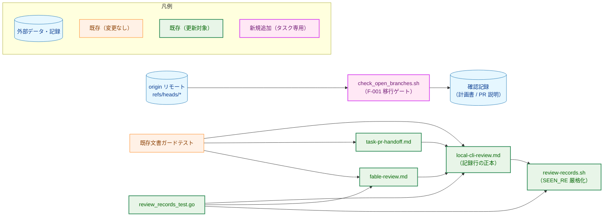
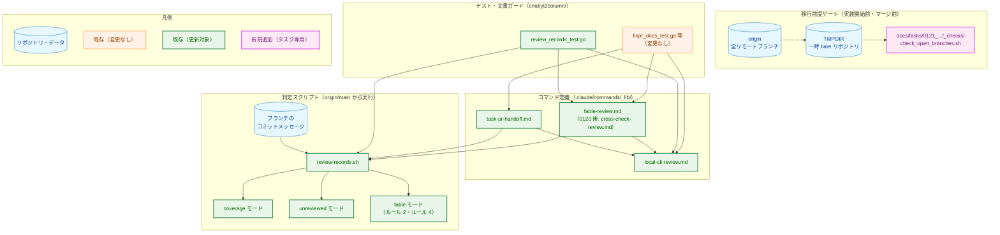
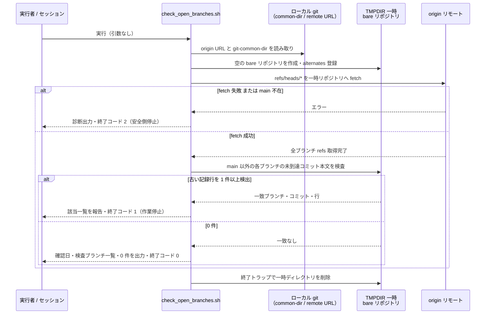
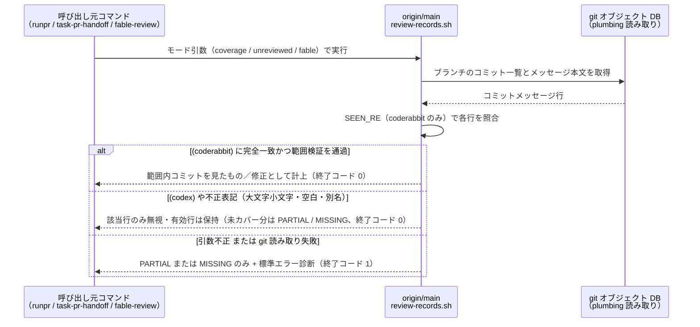
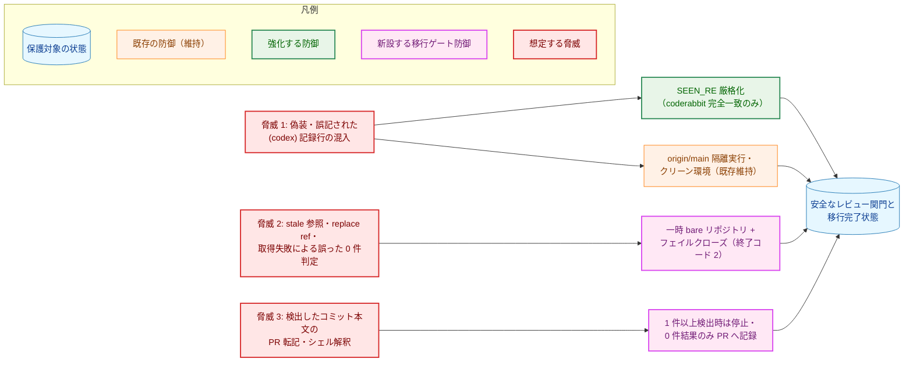
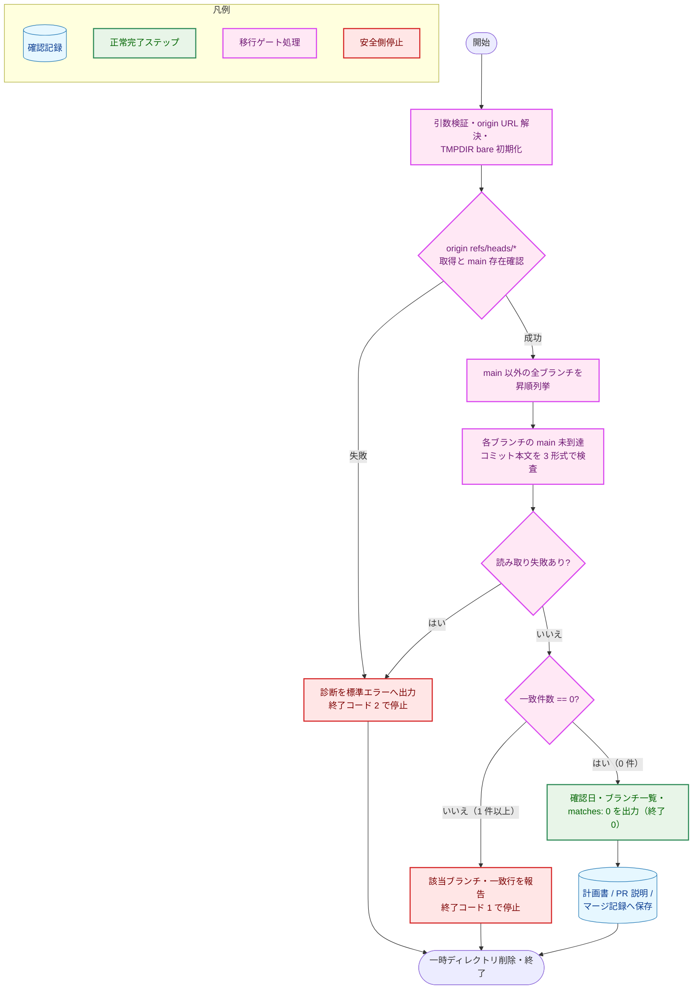
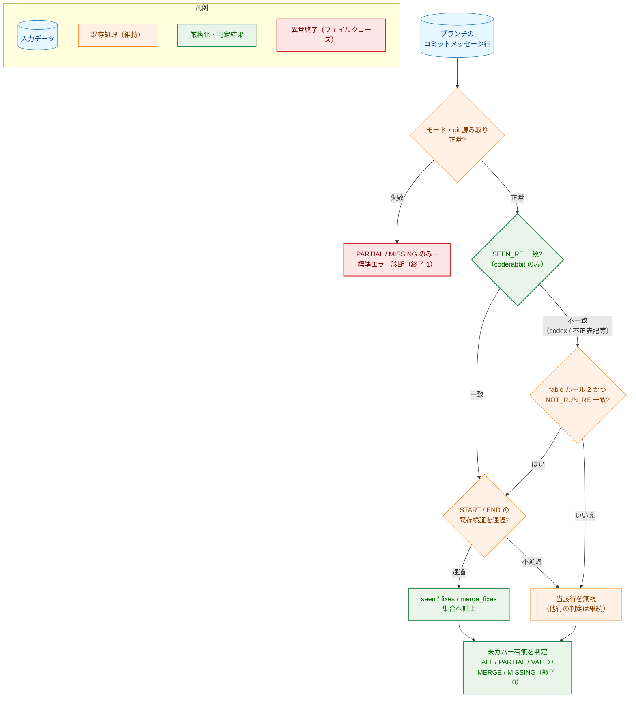

# アーキテクチャ設計書：古い記録行の読み方規則を、対象ブランチがなくなった後に外す

## Document Status

| Item | Value |
|---|---|
| Status | `draft` |
| Created | 2026-11-23 |
| Review date | - |
| Reviewer | - |
| Comments | - |

## 1. 設計の全体像 (Design Overview)

本書は、タスク 0118（Codex の PR レビューと Codex CLI の撤去）で移行期の後方互換として残した古い記録行の 3 形式（`Codex local review:`・`(codex)`・`(coderabbit: <kind>; codex: <kind>)`）の読み方規則を、`origin` に該当ブランチがないことを確認したうえで安全に撤去するためのアーキテクチャを定義する。要件は [01_requirements.md](01_requirements.md)（F-001〜F-004、AC-01〜AC-12）に基づき、設計への申し送り事項（[design_handoff.md](design_handoff.md) の H-01〜H-03）をすべて確定する。現行コードおよび文書の参照は `origin/main` のコミット `a3f3830e` に基づく。なお、本タスクは Go の製品コードや外部サービス連携を追加・変更しない（新たな外部 API 機能の利用やターゲット環境検証は N/A）。

### 1.1. 設計原則

以下の 5 つの原則で設計を統一する。

-   **単一の正本と単一の正規表現（DRY）:** 記録行の形式の正本は `.claude/commands/_lib/local-cli-review.md` の 1 か所に保ち（`.claude/commands/_lib/local-cli-review.md:310-312`、コミット `a3f3830e`）、判定スクリプト `.claude/commands/_lib/review-records.sh` では `SEEN_RE` の 1 定義をすべてのモードで共有する（`.claude/commands/_lib/review-records.sh:250,574,657,705`、コミット `a3f3830e`）。
-   **移行ゲートの分離とフェイルクローズ:** 古い記録行を持つ開いたブランチの有無を確かめる検査（F-001）は、共有の作業ツリーや `refs/remotes/origin/*` を一切書き換えない独立した一時リポジトリで行い、1 件以上の検出だけでなく `origin` 取得・読み取りの失敗も非ゼロ終了で安全側に停止する。
-   **行単位の厳格拒否と影響隔離:** `review-records.sh` は `(coderabbit)` に完全一致しない `Local CLI reviewed:` 行を補正も読み替えもせずに無視し、同一コミット・同一ブランチ上の有効な `(coderabbit)` 行や `NOT_RUN_RE` 行の判定を妨げずに終了コード `0` で進む。
-   **既存テスト資産の維持（YAGNI・非削除移行）:** 既存の `(codex)` 受理テストを削除して書き直すのではなく、そのまま `(codex)` 拒否の回帰テストへ書き換えることで、不要な削除専用コミットと重複実装を避けながら全モードの回帰検証を網羅する。
-   **並行タスクに対する順序非依存:** 現行 `origin/main`（PR #1066 マージ済み・タスク 0120 改名前）を基準に設計し、進行中のタスク 0120 が先にマージされた場合の差し替え対応を明示して、本タスクの実装順序が他タスクに過度に縛られないようにする。

### 1.2. 既存の仕組みを維持せず撤去・厳格化する理由

タスク 0118 が残した既存の `SEEN_RE`（`^Local CLI reviewed: ([0-9a-f]{12})\.\.([0-9a-f]{12}) \((coderabbit|codex)\)$`、`.claude/commands/_lib/review-records.sh:250`、コミット `a3f3830e`）およびコマンド定義の互換読み取り規則は、記録行がいつ書かれたかを区別しない。そのため、Codex CLI 撤去後に誤って、あるいは不適切に書かれた `(codex)` の行も見た範囲として受理してしまう。AC-08 および AC-09 は、`(coderabbit)` に完全一致しないレビュアー表記（`(codex)` を含む）を補正も読み替えもせずに無視することを求めており、既存の互換正規表現と互換記述のままでは満たせない。よって、F-001 により対象ブランチの残存がないことを確認したうえで撤去・厳格化する。

### 1.3. 設計の際に決めたこと（2026-11-23）

以下は、設計時に利用者と合意した 3 つの決定事項、その理由、および ADR の判断である。いずれの決定も有効な ADR（[ADR-0013](../../dev/adr/0013-review-setup.md)・[ADR-0014](../../dev/adr/0014-deterministic-checks-in-go.md)・[ADR-0015](../../dev/adr/0015-untrusted-review-threads.md)・[ADR-0016](../../dev/adr/0016-document-test-policy.md)・[ADR-0037](../../dev/adr/0037-test-deletion-coverage.md)・[ADR-0050](../../dev/adr/0050-fable-partial-review.md)・[ADR-0055](../../dev/adr/0055-harness-independent-commands.md)）の決定を変えず、新たな ADR の作成・更新は行わない。

-   **`review_records_test.go` の既存 `(codex)` テストケースの扱い（H-01）:** `cmd/yt2column/review_records_test.go:335-339`（コミット `a3f3830e`）の `"seen by codex"` を削除するのではなく、期待値を `PARTIAL`（`f.partial(f.rev("HEAD~1"))`）へ変更して `(codex)` 拒否の回帰テストへ書き換える。あわせて、PR #1066 で追加された `unreviewedCases()` 内の `"fix seen by the standalone path's review"`（`cmd/yt2column/review_records_test.go:865-872`、コミット `a3f3830e`）の `:870` を `"coderabbit"` へ更新し、不正表記・混在行および `fable` モード（ルール 2・ルール 4）の拒否ケースを追加する。
    -   **理由:** テストの削除が発生しないため、[ADR-0037](../../dev/adr/0037-test-deletion-coverage.md) に基づく削除専用コミットと `make coverage-compare` を挟む必要がなく、シェルスクリプト変更と同一コミットで一貫して検証できる。削除して直後にほぼ同構造の拒否テストを書き直す二重手間も避けられる。
    -   **ADR の判断:** ADR なし（本タスク内のテスト移行方法の選択であり、ADR-0037 の規則を変えないため）。
-   **F-001（開いたブランチの確認）の検査機構の配置（H-02 前半）:** タスク専用の確認スクリプト `docs/tasks/0121_retire_legacy_review_records/_checks/check_open_branches.sh` を配置し、実装開始前と実装 PR マージ前の 2 時点で同一スクリプトを実行する。スクリプトは `TMPDIR` 配下の一時 bare リポジトリにローカルの共有オブジェクトディレクトリを読み取り専用参照（alternates）させて `origin` の全 `refs/heads/*` を取得・検査する。
    -   **理由:** 2 時点で同じ 3 形式の正規表現・`--no-replace-objects`・フェイルクローズ判定・出力形式を再現でき、手動コマンド組み立てによる見落としや書き間違いを防げる。一時 bare リポジトリを使うことで、共有 `.git` の `refs/remotes/origin/*` を一切書き換えず、削除済みリモート追跡ブランチの残留も構造上起きない。`_checks/` は本タスク完了後の保守対象外であり、`docs/dev/conventions/dev_tools.md` Rule 6 の常設スクリプト増設にも当たらない。
    -   **ADR の判断:** ADR なし（本タスクの移行条件確認のための一時的な検査であり、常設の開発ツールや ADR-0014 の方針を変えないため）。
-   **進行中タスク 0120 との整合方針と実装順序（H-02 後半）:** 現行 `origin/main`（PR #1066 マージ済み・タスク 0120 改名前、コミット `a3f3830e`）を基準に設計し、タスク 0120 が本タスクより先にマージされた場合の差し替え対応表（3.4 節）を本書に明記して順序非依存とする。
    -   **理由:** F-001 の条件（古い記録行を持つ開いたブランチが 0 件）を満たした時点でタスク 0120 の完了を待たずに実装でき、逆にタスク 0120 が先にマージされても本書を `draft` に戻さず対応表どおりに実装計画・実装を進められるためである。
    -   **ADR の判断:** ADR なし（本タスクと進行中タスクの作業順序の調整であり、タスク内で閉じるため）。

### 1.4. `design_handoff.md` 申し送り事項の対応一覧

[design_handoff.md](design_handoff.md) の 3 件（H-01〜H-03）すべてに対する本書の決定と記載箇所をまとめる。

| 申し送り ID | 論点 | 本書の決定 | 記載箇所 |
|---|---|---|---|
| H-01 | `review_records_test.go` の `(codex)` テストケースの扱いと `coverage-compare`、`rrFixture.seen` の整理 | 既存 `"seen by codex"`（`:335-339`）を削除せず `PARTIAL` 期待の拒否ケースへ書き換え、`unreviewedCases()`（`:870`）を `"coderabbit"` へ更新。テスト削除なしのため `coverage-compare` 専用コミット不要。`rrFixture.seen` は `seenRangeForm` を基に負例構築に再利用（3.4 節） | 1.3、3.4、7.1 |
| H-02 | 先行タスク（PR #1066・PR #1051・タスク 0120）との相互作用および F-001 確認手順の設計 | PR #1066・PR #1051 は `origin/main`（`a3f3830e`）へマージ済みと確認し、`unreviewed` モード・`fable` ルール 4・`:870` テストを現行基準に組み込む。タスク 0120 先行時の差し替え対応表を明記。F-001 用に一時 bare リポジトリ方式の `_checks/check_open_branches.sh` を配置 | 1.3、3.1、3.3、3.4、6.1 |
| H-03 | 既存文書ガードテストへの影響確認 | `cmd/yt2column/*_test.go`（`review_records_test.go`・`fixpr_docs_test.go`・`review_mention_docs_test.go`・`fable_state_docs_test.go`）と `internal/ciskip/git_test.go` を精査し、更新が必要なのは `review_records_test.go` のスクリプト動作ケースのみと確定 | 3.4、3.5、7.2 |

### 1.5. 先行タスクの方針に対する変更・退役（インライン整理）

本タスクは先行タスク 0118 が設けた移行期方針を意図的に退役させる。対象となる元の規定・退役理由・更新が必要な既存テストの 3 点を以下に示す。

1.  **元の規定と所在:** タスク 0118 の要件定義書 `docs/tasks/0118_codex_removal/01_requirements.md:194`（AC-28）および設計書 `docs/tasks/0118_codex_removal/02_architecture.md:610-616`（§3.6）が定めた「移行期の後方互換として、`Codex local review:`・`(codex)`・`(coderabbit: <kind>; codex: <kind>)` の 3 形式を読み続け、`review-records.sh` の `SEEN_RE` を `(coderabbit|codex)` のまま残す」方針。
2.  **意図的な退役の理由:** 0118 の設計書（`docs/tasks/0118_codex_removal/02_architecture.md:615-616`）自身が、新しく書かれた `(codex)` 行も見た範囲として受理してしまう危険を一時的に受け入れたうえで「古い形の行を持つ開いたブランチがなくなったときに外す」とあらかじめ定めた移行完了手順である。本タスクは F-001 で対象ブランチが 0 件であることを確認してから退役を実施する。なお、`docs/tasks/0118_codex_removal/` 配下の過去文書自体は変更しない（`01_requirements.md` §2.3）。
3.  **更新が必要な既存テスト:** コミット `a3f3830e` 時点で旧振る舞いを前提とするテストは `cmd/yt2column/review_records_test.go` の次の 4 か所である。
    -   `:335-339`（`coverageCases()` の `"seen by codex"`、`TestReviewRecordsCoverage` と `TestReviewRecordsUnreviewed` の双方で実行）: `(codex)` 受理を `want: rrAll` で検証している。
    -   `:865-872`（`unreviewedCases()` の `"fix seen by the standalone path's review"`、PR #1066 で追加）: `:870` で `f.seen(r, fix, "codex")` を与えて `want: rrAll` を検証している。
    -   `:405,411`（`coverageCases()` の `not run` 系 2 ケース）: 旧形式の入力 `(coderabbit: other; codex: timeout)` を使用している。
    -   `:362`（`HEAD behind LAST_REVIEWED` のコメント）: Codex の PR レビューを前提とする記述が残っている。

### 1.6. コンセプトモデル

移行前提の確認ゲート（F-001）と、撤去後の記録行の正本・呼び出し元コマンド定義・判定スクリプト・回帰テストの関係を以下に示す。

矢印 `A --> B` は、A から B へのデータ供給、仕様参照、または検査対象への依存を表す。

## 2. システム構成 (System Structure)

本章では、本タスクで変更・追加するコンポーネントの全体配置と、移行ゲート（F-001）および判定スクリプト（F-003）におけるデータフローを定義する。

### 2.1. 全体アーキテクチャ

現行（Before）と本タスク適用後（After）の判定・参照構成を以下に示す。既存経路と本タスクで新設する移行ゲート経路を色と線種で区別する。

実線矢印（`-->`）は既存の参照・実行・検査経路（本タスクで更新するものを含む）、破線矢印（`-.->`）は本タスクで新設する一時 bare リポジトリ経由の確認経路を表す。

### 2.2. コンポーネント配置

本タスクが扱うファイルは次の 4 領域に収まり、Go の製品パッケージ（`internal/`・`cmd/yt2column/*.go` の非テストファイル）や `docs/dev/conventions/package_reference.md` は変更しない。

1.  **タスク専用の移行ゲート（`docs/tasks/0121_retire_legacy_review_records/_checks/`）:** `check_open_branches.sh` を新設する。`_` で始まるディレクトリのため `go list ./...` の対象外であり、タスク完了後の常設保守対象にならない。
2.  **共有コマンド定義（`.claude/commands/_lib/`）:** `local-cli-review.md`・`task-pr-handoff.md`・`fable-review.md`（タスク 0120 先行時は `cross-check-review.md`）の 3 ファイルから古い記録行の読み方規則と退役条件記述のみを撤去する。
3.  **判定スクリプト（`.claude/commands/_lib/`）:** `review-records.sh` の `SEEN_RE`（`:250`）を `(coderabbit)` 単一へ厳格化し、ヘッダコメント（`:78`）を単一 CLI 表記へ整合する。
4.  **回帰テストと関連文書（`cmd/yt2column/`・`docs/dev/`・`CLAUDE.md`）:** `cmd/yt2column/review_records_test.go` の既存ケース書き換え・新規拒否ケース追加を行う。`docs/dev/guides/`・`docs/dev/conventions/`・`CLAUDE.md` は実装開始時に再検索し、追加された記述があれば合わせる。

### 2.3. データフロー

F-001 の事前・マージ前確認と、F-003 の `review-records.sh` 実行時におけるコンポーネント間のやり取りを以下に示す。

#### 図 2-1: F-001 開いたブランチ確認のデータフロー

実線矢印（`->>`）は呼び出し・指示、破線矢印（`-->>`）は応答・結果返却を表す。

#### 図 2-2: F-003 `review-records.sh` の見た範囲判定データフロー

実線矢印（`->>`）は起動・読み取り要求、破線矢印（`-->>`）は取得データまたは判定結果の返却を表す。

## 3. コンポーネント設計 (Component Design)

本タスクでは Go の製品コード・公開型・インターフェース・番兵エラーを新規追加または変更しない。以下では、新設する移行ゲートスクリプトと、変更対象のコマンド定義・判定スクリプト・テストの契約および責務を定義する。

### 3.1. 移行ゲートスクリプト（`_checks/check_open_branches.sh`、F-001）

実装開始前と実装 PR マージ前の 2 時点で、AC-01・AC-02 を決定論的に検証するタスク専用スクリプトを `docs/tasks/0121_retire_legacy_review_records/_checks/check_open_branches.sh` に置く。

-   **入力インターフェース:** 引数なし（引数が与えられた場合は使い方の誤りとして終了コード `2` で失敗する）。リポジトリ内の任意のディレクトリ（メインクローンおよび外部 git worktree の双方）から実行できる。
-   **副作用と権限の契約:**
    -   **変更しない対象:** 作業ツリー、インデックス、`HEAD`、ローカルブランチ、共有 `.git` 配下の `refs/remotes/origin/*`・`FETCH_HEAD`・設定ファイルを一切変更しない。
    -   **許可される副作用:** `TMPDIR` 配下に一時ディレクトリを作成して空の bare リポジトリを初期化し、ネットワーク経由で `origin` の全 `refs/heads/*` を読み取り専用取得する。スクリプト終了時（正常・異常を問わず）に一時ディレクトリを削除する。
    -   **実行時の承認:** `origin` の全リモートブランチ取得はネットワーク通信を伴うため、`CLAUDE.md`「Tool Execution Safety」および Antigravity のサンドボックス昇格規則に従い、利用者の明示承認のもと単一コマンドとして実行する。
-   **隔離取得と stale ブランチ排除の仕組み:**
    -   ローカルリポジトリから `origin` の URL と共有オブジェクトディレクトリ（worktree 対応のため `git-common-dir` 基準の `objects` 絶対パス）を取得し、一時 bare リポジトリの alternates に登録して `origin` の `refs/heads/*` を取得する。
    -   一時リポジトリは毎回空の状態から作るため、削除済みリモートブランチの追跡参照（stale `refs/remotes/origin/*`）が混入しない。
    -   実行環境はクリーンな `LC_ALL=C`、`GIT_CONFIG_NOSYSTEM=1`、`GIT_CONFIG_GLOBAL=/dev/null`、`GIT_NO_REPLACE_OBJECTS=1`、`GIT_GRAFT_FILE=/dev/null`、`GIT_TERMINAL_PROMPT=0` に固定する（bash 3.2 以降で動作）。
-   **検査対象と 3 形式の契約:**
    -   一時リポジトリ内の `refs/heads/main` の存在を必須とし、存在しない場合は異常終了（終了コード `2`）する。
    -   `refs/heads/main` を除くすべての `refs/heads/*`（PR を開いていないブランチおよび本タスク自身のブランチを含む）を昇順で列挙し、各ブランチについて `refs/heads/main` から到達できないすべてのコミット（マージコミットおよび孤立ブランチのコミットを含む）のメッセージ本文を `git cat-file commit` で読み取る。
    -   コミットメッセージ本文の 1 列目から始まる行が次の 3 形式のいずれかに一致するかを検査する（大文字小文字は区別し、補正・前後空白除去は行わない）。

| 番号 | 対象形式（1 列目固定） | 照合仕様（POSIX ERE） |
|---|---|---|
| 1 | `Codex local review:` で始まる指摘の行 | `^Codex local review:` |
| 2 | `(codex)` を持つ見た範囲の行 | `^Local CLI reviewed: [0-9a-f]{12}\.\.[0-9a-f]{12} \(codex\)$` |
| 3 | 括弧内に `codex:` を含む未レビュー範囲の行 | `^Local CLI review: not run [0-9a-f]{12}\.\.[0-9a-f]{12} \([^)]*codex:[^)]*\)$` |

-   **出力と終了コードの契約:**

| 終了コード | 状態 | 標準出力 / 標準エラーの内容 | 呼び出し側の動作 |
|---|---|---|---|
| `0` | 検査成功・一致 0 件 | 標準出力に、確認日（`YYYY-MM-DD`）、基準とした `origin/main` の 40 桁コミット ID、検査した `main` 以外の全ブランチ一覧（ブランチ名と先端 12 桁コミット ID。0 本のときは `(none)`）、および結果 `matches: 0` を出力 | 出力を実装開始前の記録（実装計画書／PR 説明）またはマージ前の記録（PR 説明／マージ記録）へ残し、次工程へ進む（AC-01） |
| `1` | 古い記録行を 1 件以上検出 | 標準出力に、確認日・基準 `origin/main`・検査ブランチ一覧・一致件数に加え、一致した各件について `<branch> <commit12> <matched-line>` を列挙 | 実装を開始せず、実装 PR もマージせず停止する。該当ブランチと一致行を報告する（AC-02） |
| `2` | 取得・読み取り・前提異常（`origin` 取得失敗、`main` 不在、`git` 失敗、引数不正等） | 標準エラーに失敗した操作と診断メッセージを出力（標準出力に `matches: 0` を出さない） | 0 件とみなさず安全側に倒して停止し、失敗内容と診断を報告する（AC-02） |

### 3.2. コマンド定義の更新（F-002）

コミット `a3f3830e` 時点の 3 ファイルについて、撤去対象と維持対象を以下に確定する。変更差分は AC-03〜AC-05 の古い記録行の読み方規則の撤去とそれに伴う文言調整に限定する（AC-06）。

| ファイル | 対象箇所（`a3f3830e` 基準） | 変更内容 | 維持する内容（スコープ外・既存契約） |
|---|---|---|---|
| `.claude/commands/_lib/local-cli-review.md` | `## Reading the record lines`（`:286-317`） | 1. `:300-301` から `and \`Codex local review:\`` を外し、指摘の行の接頭辞を `CodeRabbit local review:` のみにする。 2. `:305` の `(<cli>)` を `(coderabbit)` に改め、見た範囲の行の形を `Local CLI reviewed: <START12>..<END12> (coderabbit)` のみと定める。 3. `:314-317` の `(codex)`・`(coderabbit: <kind>; codex: <kind>)` 読み取り規則および退役条件の段落を削除する | `:295-296` の `Local CLI review: not run <START12>..<END12> (...)`、`:297-299` の範囲なし `CodeRabbit local review: not run`、`:302-304` の Fable 行、`:306-312` の `review-records.sh` との関係記述 |
| `.claude/commands/_lib/task-pr-handoff.md` | `Part B step 3`（`:252-263`） | 1. `:256-258` の ``the `CodeRabbit local review:` and `Codex local review:` lines`` から `and \`Codex local review:\`` を外す。 2. `:261-263` の `Describe a Codex CLI or a Fable finding ... never with Codex's or Fable's text;` から Codex CLI および Codex の言及を外し、Fable の指摘に対する本文転記禁止規則を保つ | `:259-260` の `Fable finding:` 読み取り、Fable 指摘の場所・自分の要約のみ記載する規則（タスク 0120 先行時はクロスチェック指摘も維持）、`:269-271` の範囲なし `CodeRabbit local review: not run` |
| `.claude/commands/_lib/fable-review.md`（タスク 0120 先行時: `_lib/cross-check-review.md`） | `## The prompt` — `Settled issues`（`:323-325`） | `:323-325` の `` `Codex local review:` (legacy lines from older branches), `` を外す | `CodeRabbit local review:`・`Fable finding:`（タスク 0120 先行時は `Cross-check finding:` を含む）の却下済み指摘の読み取り |

### 3.3. `review-records.sh` の厳格化（F-003）

`.claude/commands/_lib/review-records.sh`（コミット `a3f3830e`）では、見た範囲の行の正規表現を `SEEN_RE` の 1 変数で定義し、全 3 モードの 3 か所で共有している。

-   **正規表現の変更（`:250`）:**
    -   変更前: `SEEN_RE='^Local CLI reviewed: ([0-9a-f]{12})\.\.([0-9a-f]{12}) \((coderabbit|codex)\)$'`
    -   変更後: `SEEN_RE='^Local CLI reviewed: ([0-9a-f]{12})\.\.([0-9a-f]{12}) \(coderabbit\)$'`
    -   キャプチャグループ 1（`START12`）と 2（`END12`）の位置は変わらず、3 つ目のグループを参照する箇所は存在しない（`:575,658,706`、コミット `a3f3830e`）。POSIX ERE として bash 3.2 以降で同一に動作する。
-   **全モード・全参照箇所の網羅（コミット `a3f3830e`）:**
    1.  `judge_seen`（`:574`）: `coverage` モード（`:545`）と `unreviewed` モード（`:559`）の双方から呼ばれる。`SEEN_RE` に一致しない行は `continue` で読み飛ばされ、同じコミットや別コミットの有効な `(coderabbit)` 行は通常どおり `seen` 集合へ追加される（AC-07・AC-08）。
    2.  `fable` モード・ルール 2「同じ実行の修正」（`:657`）: `[[ $line =~ $SEEN_RE ]] || [[ $line =~ $NOT_RUN_RE ]] || continue` により評価される。`(codex)` 行は `SEEN_RE` にも `NOT_RUN_RE` にも一致せず無視されるが、同一コミット上の有効な `(coderabbit)` 行や `NOT_RUN_RE` 行は引き続き `fixes` 集合へ計上される（AC-09）。
    3.  `fable` モード・ルール 4「マージ後確認の修正」（`:705`、PR #1066 で追加）: `[[ $line =~ $SEEN_RE ]] || continue` により評価される。マージ後確認コミット上の `(codex)` 行は無視され、有効な `(coderabbit)` 行のみが `merge_fixes` 集合へ計上される（AC-09）。
-   **変更しない箇所:** `NOT_RUN_RE`（`:252`）、`checked_range` の `START`/`END` 検証（`:485-504`）、クリーン環境再実行と git plumbing 読み取り（`:207-236`）、異常終了時の `fail` 契約（`:240-247`）は変更しない。
-   **ヘッダコメントの整合（`:78`）:** `# Mode unreviewed: the commits of a PR neither local CLI reviewed, for the PR` は 2 つの CLI を前提とした表現のため、単一 CLI 表現（`the local CLI review did not review` 等）へ合わせる（挙動変更なし）。

### 3.4. テスト・既存ガードの整合およびタスク 0120 先行時の差し替え対応表（F-004、H-01〜H-03）

#### 既存テストおよび文書ガードの影響調査（H-03、コミット `a3f3830e`）

`cmd/yt2column/` および `internal/` で対象 4 ファイルを参照する全テストを調査した結果を以下に示す。

| テストファイル / テスト名 | 読んでいる対象・箇所 | 本タスクでの要否と理由 |
|---|---|---|
| `cmd/yt2column/review_records_test.go`（`TestReviewRecordsCoverage`・`TestReviewRecordsUnreviewed`・`TestReviewRecordsFable`） | `review-records.sh` の全 3 モード、`coverageCases()`・`unreviewedCases()`・`fableCases()` | **更新必須:** `:335-339`（`"seen by codex"`）の拒否ケース化、`:870`（`"fix seen by the standalone path's review"`）の `"coderabbit"` 化、`:405,411` の `not run` 入力更新、`:362` コメント修正、および新規拒否・混在ケースの追加 |
| `cmd/yt2column/review_records_test.go`（`seenRangeForm` `:83-86`・`readFableForms` `:997-1014`・`TestReviewRecordsCallSite` `:1847-1878`・`TestRecordLinePrefixesDistinct` `:1934-1985`・`TestRecordCommitsCheckMention` `:2000-2024`） | `local-cli-review.md` step 7 表、`fable-review.md` `## Record lines`・`## The validity decision`・`## The standalone path`、`task-pr-handoff.md` Part B step 2.5 | **更新不要:** F-002 は `local-cli-review.md` の `## Reading the record lines`、`task-pr-handoff.md` の Part B step 3、`fable-review.md` の `## The prompt` のみを編集するため、いずれの読取アンカーも変わらない |
| `cmd/yt2column/fixpr_docs_test.go`（`TestContextAndCommandsAgree` `:1121-1149`・`TestLocalReviewGuard` `:1296-1318`） | `task-pr-handoff.md` のレビュアー名非記載、`local-cli-review.md` の `## Inputs` と `## Procedure` steps 1/5/6/7 | **更新不要:** 読取対象の見出し・ステップ・値は不変 |
| `cmd/yt2column/review_mention_docs_test.go`（`TestMentionsOnlyInAllowedRows`・`TestPostingPathsCheckMention`・`TestPostingCommandsInventory`） | 全コマンド文書の禁止メンション、`task-pr-handoff.md` Part B step 3 の `**Mention check.**` と投稿コマンド | **更新不要:** Part B step 3 の `**Mention check.**` や見出しアンカー（`:223`・`:310`）は変更しない |
| `cmd/yt2column/fable_state_docs_test.go` | `fable-review.md` `## The state check` | **更新不要:** 対象外セクション |
| `internal/ciskip/git_test.go:290` | `.claude/commands/_lib/review-records.sh` のコード分類 | **更新不要:** スクリプトのパスとコード扱いは不変 |

#### `rrFixture.seen` ヘルパの整理（H-01）

`cmd/yt2column/review_records_test.go:173-175`（コミット `a3f3830e`）の `func (f *rrFixture) seen(start, end, cli string) string` は、`seenRangeForm`（`:83-86`、正本 `local-cli-review.md` step 7 から読んだ `(coderabbit)` 形式）の `(coderabbit)` を `("+cli+")` に置換して行を作る。負例（`"codex"`・`"CodeRabbit"`・`" coderabbit"`・`"fable"`）の組み立てでも同じヘルパ（または `cli` を受ける負例生成）を再利用でき、正本 `local-cli-review.md` step 7 の形式変更にも追従する構造を保つ。

#### 関連文書（AC-11）

コミット `a3f3830e` 時点で `docs/dev/guides/`・`docs/dev/conventions/`・`CLAUDE.md` を横断検索した結果、撤去対象の 3 形式（`Codex local review:`・`(codex)`・`(coderabbit: <kind>; codex: <kind>)`）を現行の読み方規則として記述した箇所は 0 件であることを確認済みである（`docs/dev/guides/fixprguard_guide.md` の `@codex` メンション拒否記述は 0118 で残すと決めたスコープ外仕様）。実装開始時点で再度横断検索を行い、その間に追加された箇所があれば合わせて更新する。

#### タスク 0120 先行マージ時の差し替え対応表（H-02、決定 3）

本タスクの実装着手時点でタスク 0120（`docs/tasks/0120_harness_independent_commands/02_architecture.md` §3.5）が `origin/main` へマージ済みであった場合は、本書を `draft` に戻さず以下の対応に従って実装対象を差し替える。

| 現行 `origin/main`（`a3f3830e`）基準 | タスク 0120 マージ後の対応先 | 適用方針 |
|---|---|---|
| `.claude/commands/_lib/fable-review.md` | `.claude/commands/_lib/cross-check-review.md` | `Settled issues` から `Codex local review:` を撤去し、`CodeRabbit local review:`・`Cross-check finding:`・`Fable finding:` を維持する（AC-05） |
| `.claude/commands/_lib/task-pr-handoff.md` Part B step 3 の `Fable finding:` | `Cross-check finding:` / `Fable finding:` 記述 | Codex 関連記述のみを撤去し、クロスチェック指摘の読み取りと本文転記禁止を維持する（AC-04） |
| `.claude/commands/_lib/review-records.sh` の `fable` モード | `cross-check` モードおよび互換別名 `fable` | 共有の `SEEN_RE` を 1 か所厳格化することで `coverage`・`unreviewed`・`cross-check`・`fable` の全モードへ一括適用する（AC-07〜AC-09） |
| `cmd/yt2column/review_records_test.go` の `TestReviewRecordsFable` | 0120 で更新された `cross-check` / `fable` モードテスト | 新設する `(codex)` 拒否・混在ケース（ルール 2・ルール 4）を 0120 後のテスト関数（`cross-check` モードおよび `fable` 別名）へ組み込む |

### 3.5. コンポーネント責務と変更対象ファイル一覧

本タスクで新設・変更・確認するすべてのファイルを以下に示す。

| 種別 | ファイルパス | 責務・変更内容 | 対応要件・AC |
|---|---|---|---|
| 新設（タスク専用） | `docs/tasks/0121_retire_legacy_review_records/_checks/check_open_branches.sh` | 一時 bare リポジトリ経由で `origin` の全非 `main` ブランチから古い記録行 3 形式を検査し、確認日・ブランチ一覧・件数を出力。1 件以上または異常時は非ゼロ停止 | F-001、AC-01、AC-02 |
| 変更 | `.claude/commands/_lib/local-cli-review.md` | `## Reading the record lines` から `Codex local review:`・`(codex)`・`(coderabbit: <kind>; codex: <kind>)` と退役条件段落を撤去し、見た範囲を `(coderabbit)` に固定 | F-002、AC-03、AC-06 |
| 変更 | `.claude/commands/_lib/task-pr-handoff.md` | Part B step 3 から `Codex local review:` と Codex CLI 指摘の記述を撤去（Fable / クロスチェック指摘の規則と範囲なし `CodeRabbit local review: not run` は維持） | F-002、AC-04、AC-06 |
| 変更 | `.claude/commands/_lib/fable-review.md`（0120 後: `_lib/cross-check-review.md`） | `## The prompt` の `Settled issues` から `Codex local review:` の記述を撤去 | F-002、AC-05、AC-06 |
| 変更 | `.claude/commands/_lib/review-records.sh` | `SEEN_RE`（`:250`）を `(coderabbit)` 単一へ厳格化し、`:78` の `unreviewed` モード説明コメントを単一 CLI 表記へ整合 | F-003、AC-07〜AC-09 |
| 変更（既存テスト） | `cmd/yt2column/review_records_test.go` | `:335-339` を `(codex)` 拒否ケースへ書き換え、`:870` を `"coderabbit"` へ更新、`:405,411` の `not run` 入力と `:362` コメントを現行形式へ統一、`coverage`/`unreviewed`/`fable`（ルール 2・4）の拒否・混在ケースを追加 | F-003、F-004、AC-07〜AC-10、AC-12 |
| 確認のみ（該当時変更） | `docs/dev/guides/`・`docs/dev/conventions/`・`CLAUDE.md` | 実装開始時に 3 形式の現行読み方規則の記述がないことを横断検索で再確認し、新規追加があれば整合 | F-004、AC-11 |

## 4. エラーハンドリング設計 (Error Handling Design)

本タスクは Go の製品コードや開発ツールバイナリを変更しないため、新たな Go エラー型・番兵エラーは定義しない（N/A）。代わりに、2 つのシェルスクリプトの終了コード・出力・フェイルクローズ契約を以下のように定める。

### 4.1. `review-records.sh` の拒否・失敗契約

| 事象の区分 | 対象入力・状態 | 終了コード | 標準出力 | 標準エラー | 方針 |
|---|---|---|---|---|---|
| 行単位の拒否（正常終了） | `(codex)`、大文字小文字違い（`(CodeRabbit)` 等）、余分な空白、別レビュアー名（`(fable)` 等）、末尾追加文字列、インデント・文中記載の `Local CLI reviewed:` 行 | `0` | 該当行を無視して計算した判定結果（カバーされないコミットは `PARTIAL <n>` または `MISSING <START>`、他行でカバーされれば `ALL` / `VALID`） | なし | 補正・読み替えせず行単位で無視し、同一コミット・ブランチ上の有効な `(coderabbit)` 行や `NOT_RUN_RE` 行に影響させない（AC-08・AC-09） |
| 呼び出し・環境失敗（フェイルクローズ） | 引数不正、未知モード、`origin/main` 不在、`HEAD`/`LAST_REVIEWED` 不正、`git` コマンド失敗 | `1` | `PARTIAL`（`coverage` / `unreviewed`）、`MISSING`（`fable`）、または空（モード不明時） | `review-records: <diagnostic>` | 既存契約（`:240-247`、コミット `a3f3830e`）を維持し、呼び出し元が安全側（未見／再レビュー必要）に倒す |

### 4.2. `_checks/check_open_branches.sh` のエラー・停止契約

| 事象の区分 | 対象状態 | 終了コード | 出力パターン | 呼び出し側の扱い |
|---|---|---|---|---|
| 検査完了（0 件） | `origin` 取得成功、`refs/heads/main` 存在、全非 `main` ブランチに一致なし | `0` | 確認日・基準 `origin/main`・検査ブランチ一覧・`matches: 0`（標準出力） | 記録を残して実装開始またはマージへ進む |
| 残存検出（1 件以上） | 3 形式のいずれかに一致する行を 1 件以上検出 | `1` | 上記ヘッダと一覧に加え、`matches: <n>` と各一致行（`<branch> <commit12> <matched-line>`）を標準出力へ列挙 | 実装を開始せず、実装 PR もマージせず停止し、該当ブランチと一致行を報告（AC-02） |
| 実行異常（フェイルクローズ） | 引数指定、`git` 実行失敗、`origin` URL 不在、ネットワーク・認証失敗による `fetch` 失敗、`refs/heads/main` 不在、一時ディレクトリ作成失敗 | `2` | 標準エラーに `check-open-branches: <failed-step>: <diagnostic>` を出力し、標準出力には `matches: 0` を出力しない | 0 件とみなさず停止し、失敗した操作と診断を報告（AC-02） |

エラーメッセージおよび診断は英語で出力する（`CLAUDE.md`「Language」）。また、一時ディレクトリの後始末（`trap EXIT`）は終了コードを変えない形で必ず実行する。

## 5. セキュリティ考慮事項 (Security Considerations)

### 5.1. 製品セキュリティガイド（`docs/dev/security.md`）の適用

`docs/dev/security.md` の適用条件（外部コマンド `yt-dlp` の起動、API キーの扱い、キャッシュの読み書き、LLM API へのネットワーク送信、信頼しないテキストのプロンプトまたは公開記事への埋め込み。`.claude/commands/_context.md:296`）に該当する機能は本タスクに含まれない。したがって、製品向けセキュリティガイドの適用は **N/A** である（`01_requirements.md` §4.2）。

### 5.2. 開発ツールの信頼境界（レビューの関門）と脅威モデル

本タスクは、[ADR-0013](../../dev/adr/0013-review-setup.md) および `.claude/commands/_lib/pr-review-escalation.md:53-62` が開発ツールの信頼の境界（レビューの関門）に含める `review-records.sh` と記録行の読み方規則を変更する。関門に対する脅威と防御設計を以下に示す。

矢印 `A --> B` は、脅威から対応する防御策への対応、および防御策によって保護対象の状態が保たれる関係を表す。

-   **脅威 1（偽装・誤記された `(codex)` 行による関門のすり抜け）:** タスク 0118 の設計書（`docs/tasks/0118_codex_removal/02_architecture.md` §3.6）で一時的に受け入れていた「撤去後に書かれた `(codex)` 行も見た範囲として受理される」状態を、`SEEN_RE` の `(coderabbit)` 固定化で解消する。あわせて、大文字小文字の違いや空白混入も一切正規化せず無視する。既存の防御（`origin/main` からのスクリプト取得、クリーン環境再実行、`GIT_NO_REPLACE_OBJECTS=1`、`GIT_GRAFT_FILE=/dev/null`、plumbing コマンドによる読み取り）はすべて維持する。
-   **脅威 2（移行ゲートにおける誤った 0 件判定および共有リポジトリ汚染）:** `check_open_branches.sh` がローカルの古い追跡参照（stale `refs/remotes/origin/*`）を読むと、削除済みブランチを誤検出する一方、未取得の新規リモートブランチを見落とす。また `git fetch --prune origin` を共有 `.git` に対して実行すると他 worktree の参照状態に影響する。空の `TMPDIR` bare リポジトリへ都度 `origin` の全 `refs/heads/*` を取得し、`--no-replace-objects` とクリーン git 設定で検査し、取得・読み取り失敗や `main` 不在を終了コード `2` で停止することで、見落としと共有状態汚染の双方を防ぐ。
-   **脅威 3（信頼しないコミットメッセージ本文の取り扱い）:** コミットメッセージには任意の文字列や禁止メンション（`@codex`・`@coderabbitai`）が含まれうる。`review-records.sh` と `check_open_branches.sh` はいずれもコミットメッセージをデータとしてのみ扱い、`eval` やシェル展開を行わない。また、`check_open_branches.sh` が 1 件以上検出した場合は作業を停止するため、一致したコミット行が PR 説明へ自動転記されることはない（PR 説明・計画書に記録するのは 0 件確認時の確認日・ブランチ一覧・`matches: 0` のみとする）。

## 6. 処理フロー詳細 (Processing Flow Details)

### 6.1. F-001 開いたブランチ確認の処理フロー

実装開始前と実装 PR マージ前のそれぞれで実行する `_checks/check_open_branches.sh` の処理フローを以下に示す。

矢印 `A --> B` は処理の実行順と条件分岐を表す。

### 6.2. F-003 `review-records.sh` における `Local CLI reviewed:` 行の判定フロー

`coverage`・`unreviewed`・`fable`（ルール 2・ルール 4）のすべてで共通して適用される、1 行ごとの受理・無視判定とモード別出力の関係を以下に示す。

矢印 `A --> B` は入力行の評価順と条件分岐を表す。

## 7. テスト戦略 (Test Strategy)

### 7.1. ユニットテスト戦略（`cmd/yt2column/review_records_test.go`）

`cmd/yt2column/review_records_test.go` は、リポジトリに存在するすべての bash 環境（`scriptBashes`、macOS の bash 3.2 を含む）で `review-records.sh` を実リポジトリフィクスチャに対して実行する。本タスクではテスト削除を行わず（決定 1）、次の書き換えと追加を行う。

| 対象関数・セクション | 変更種別 | 検証内容 | 対応 AC |
|---|---|---|---|
| `coverageCases()` `:335-339`（旧 `"seen by codex"`） | 書き換え | ケース名を実態に合わせ（例: `"codex reviewer"`）、期待値を `f.partial(f.rev("HEAD~1"))`・終了コード `0` に変更。`TestReviewRecordsCoverage` と `TestReviewRecordsUnreviewed` の双方で実行される | AC-08、AC-10 |
| `unreviewedCases()` `:865-872`（`"fix seen by the standalone path's review"`） | 書き換え | `:870` の `f.seen(r, fix, "codex")` を `"coderabbit"` へ更新し、単独経路の現行形式を検証 | AC-07、AC-10 |
| `coverageCases()` `:405,411`（`not run` 系 2 ケース）および `:362` コメント | 書き換え | 旧入力 `(coderabbit: other; codex: timeout)` を現行の CodeRabbit 単体形式（例: `(coderabbit: other)`）へ統一し、`:362` の Codex 前提コメントを修正 | AC-10 |
| `coverageCases()`（新規追加） | 追加 | 1. レビュアー表記の大文字小文字違い（`(CodeRabbit)`・`(CODERABBIT)`）と空白混入（`( coderabbit)`・`(coderabbit) `）が無視され `PARTIAL`・終了コード `0` になること。 2. 同一コミットおよび同一ブランチに `(codex)` 行と有効な `(coderabbit)` 行が混在しても、有効行の範囲は見たものとして `ALL`（未見分があればそれのみ `PARTIAL`）になること（`unreviewed` でも自動検証される） | AC-07、AC-08 |
| `fableCases()`（新規追加、タスク 0120 後は `cross-check` / `fable`） | 追加 | 1. **ルール 2（同じ実行の修正）:** レコード保持コミット上の `(codex)` 行だけでは修正コミットがカバーされず `MISSING <START>`・終了コード `0` になること。 2. **ルール 2 混在:** 同一コミット上に `(codex)` 行と有効な `(coderabbit)` 行、または `(codex)` 行と `Local CLI review: not run` 行が併存すれば `VALID`・終了コード `0` になること。 3. **ルール 4（マージ後確認の修正）:** マージ後確認コミット上の `(codex)` 行だけではマージ後修正コミットがカバーされず `MISSING <merge-base>`・終了コード `0` になること、および有効な `(coderabbit)` 行と併存すれば `VALID` になること | AC-09 |

### 7.2. 文書整合・`diff` 検証・既存ガード戦略

-   **コマンド定義の差分検証（AC-03〜AC-06）:** 変更対象 3 ファイル（`_lib/local-cli-review.md`・`_lib/task-pr-handoff.md`・`_lib/fable-review.md` [0120 後: `_lib/cross-check-review.md`]）の変更は数行から十数行の小さな差分にとどまる見込みであるため、実装計画では `requirements_process.md` §4 に従った記録した差分の読み取り（または差分が膨らむ場合は `_checks/` スクリプト）で AC-06 を検証し、AC-03〜AC-05 はレビュー読み取りと合わせて確かめる。
-   **関連文書の横断検索（AC-11）:** `docs/dev/guides/`・`docs/dev/conventions/`・`CLAUDE.md` を対象に撤去対象 3 形式の不在を実装開始時および実装完了時に検索して確認する。
-   **既存テスト・品質関門（AC-12）:** `make test`・`make lint`・`make deadcode` および CI の `doc-guard` ジョブ（`go test -tags test ./cmd/yt2column ./cmd/fixprguard ./cmd/chief ./cmd/mergepr ./cmd/numreserve ./internal/pipeline ./internal/chief`）をすべて通過させる。テスト削除を行わないため `make coverage-compare` は不要だが、万一実装時にテスト削除が必要になった場合は [ADR-0037](../../dev/adr/0037-test-deletion-coverage.md) に従い削除専用コミットと `make coverage-compare BASE=<親>` を実施する。

### 7.3. 移行ゲート・セキュリティテスト戦略

-   **`_checks/check_open_branches.sh` の壊し確認（F-001）:** 本スクリプトはタスク専用の一時検査スクリプト（`make test` や CI には含めない）だが、実装時にローカルの一時リポジトリを擬似 `origin` として以下を必ず実測確認する。
    1.  3 形式それぞれ（`Codex local review:`、`(codex)`、括弧内に `codex:` を含む `not run`）を持つ非 `main` ブランチを配置すると、各形式で終了コード `1` と該当ブランチ・一致行を返すこと。
    2.  `main` 側のみに古い記録行がある場合や、インデントされた行・現行 `(coderabbit)` 行のみの場合は誤検出せず終了コード `0` を返すこと。
    3.  存在しないリモート URL・`main` 不在の擬似 `origin` に対して終了コード `2` でフェイルクローズし、`matches: 0` を出力しないこと。
    4.  検査実行後に呼び出し元リポジトリの `refs/remotes/origin/*` と作業ツリーが変化していないこと。
-   **関門バイパス防止テスト（F-003）:** 7.1 節の `(codex)`・大文字小文字違い・空白混入・混在行ケースにより、`coverage`・`unreviewed`・`fable`（ルール 2・ルール 4）のいずれの経路からも `(codex)` 行による関門すり抜けが起きないことを恒久テストで保証する。

## 8. 実装優先順位 (Implementation Priorities)

実装は前提条件の確認（フェーズ 1）を最優先の関門とし、条件成立を確認できた場合にのみ撤去・厳格化（フェーズ 2〜3）へ進む。全体は 1 本の実装 PR として完結する規模である。

### フェーズ 1: 移行ゲートの整備と実装開始前の前提確認（F-001）

1.  `docs/tasks/0121_retire_legacy_review_records/_checks/check_open_branches.sh` を作成し、擬似 `origin` による壊し確認（7.3 節）を行う。
2.  タスク 0120 のマージ状況を確認し、3.4 節の差し替え対応表の適用要否を確定する。
3.  利用者の承認を得て実 `origin` に対して `_checks/check_open_branches.sh` を実行する。
    -   **停止条件（AC-02）:** 終了コードが `0` 以外（1 件以上検出、または取得・読み取り失敗）であれば、該当ブランチ・一致行または診断を報告して**ここで停止**し、フェーズ 2 以降へ進まない。
    -   **通過条件（AC-01）:** 終了コード `0`（`matches: 0`）であれば、確認日・検査ブランチ一覧・0 件の結果を記録してフェーズ 2 へ進む。

### フェーズ 2: コマンド定義の撤去と `review-records.sh` の厳格化（F-002・F-003）

1.  `.claude/commands/_lib/local-cli-review.md`・`.claude/commands/_lib/task-pr-handoff.md`・`.claude/commands/_lib/fable-review.md`（タスク 0120 先行時は `_lib/cross-check-review.md`）から古い記録行の読み方規則と退役条件記述を撤去する（AC-03〜AC-06）。
2.  `.claude/commands/_lib/review-records.sh` の `SEEN_RE`（`:250`）を `(coderabbit)` のみに厳格化し、`:78` の説明コメントを整合する（AC-07〜AC-09）。

### フェーズ 3: テスト更新・関連文書確認・マージ前再確認（F-004・F-001）

1.  `cmd/yt2column/review_records_test.go` の既存ケース書き換えと新規拒否・混在ケース追加を行う（AC-07〜AC-10）。
2.  `docs/dev/guides/`・`docs/dev/conventions/`・`CLAUDE.md` を横断検索し、3 形式の現行読み方規則の記述がないことを確かめる（あれば更新、AC-11）。
3.  `make test`・`make lint`・`make deadcode` および `doc-guard` 対象テストを実行してすべて成功することを確認し、AC-06 の差分検証を記録する（AC-12）。
4.  実装 PR のマージ前に、利用者の承認を得て実 `origin` に対して `_checks/check_open_branches.sh` を再実行し、終了コード `0`（`matches: 0`）であることを確認・記録する（1 件以上検出または異常時はマージせず停止、AC-01・AC-02）。

## 9. 将来の拡張性 (Future Extensibility)

-   **タスク 0120 の `cross-check` モードとの共存:** `review-records.sh` の見た範囲判定は `SEEN_RE` の 1 定義に集約されているため、タスク 0120 が `cross-check` モード（および `fable` 別名）を追加した前後いずれの順序でも、同一の `(coderabbit)` 規則が全モードへ一貫して適用される。
-   **別のローカル CLI レビュアーを将来導入する場合:** 将来、CodeRabbit CLI 以外のローカル CLI レビュアーを追加するときは、正本 `.claude/commands/_lib/local-cli-review.md` step 7 および `Reading the record lines` に新しいトークンを明示追加し、`review-records.sh` の `SEEN_RE` を許可リスト（明示列挙）として更新する。自由文字列（例: `[a-z]+`）へ緩める設計は採らない。
-   **残存する他の旧形式の見直し:** 本タスクのスコープ外として残した範囲なし `CodeRabbit local review: not run`（タスク 0049 以前の旧形式）および `NOT_RUN_RE` の `\(.*\)` は、必要になった時点で別タスクとして同様の移行ゲート（残存ブランチ確認）を経て整理できる。
