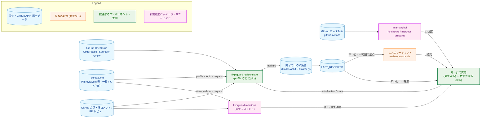
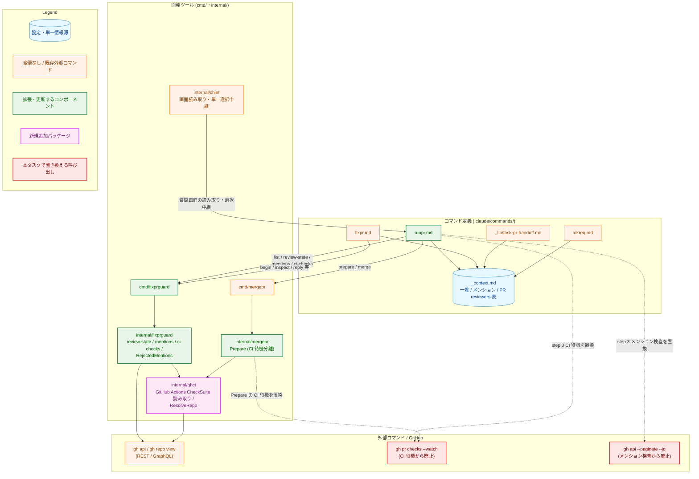
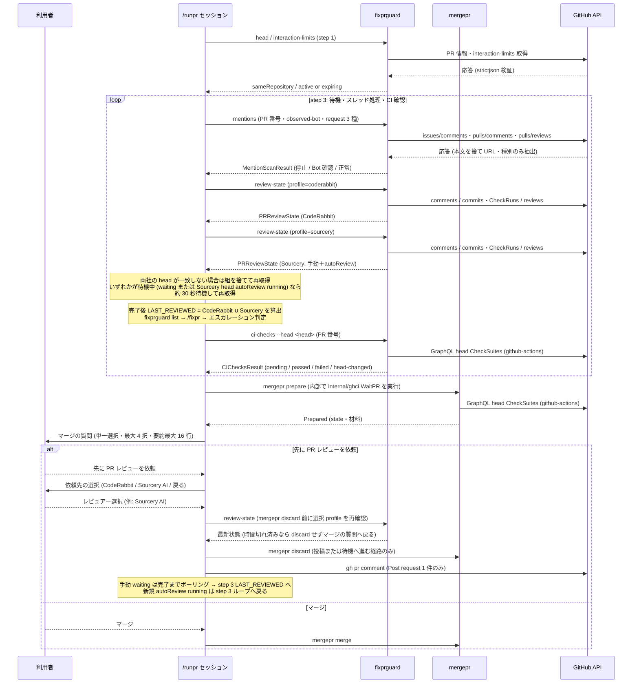
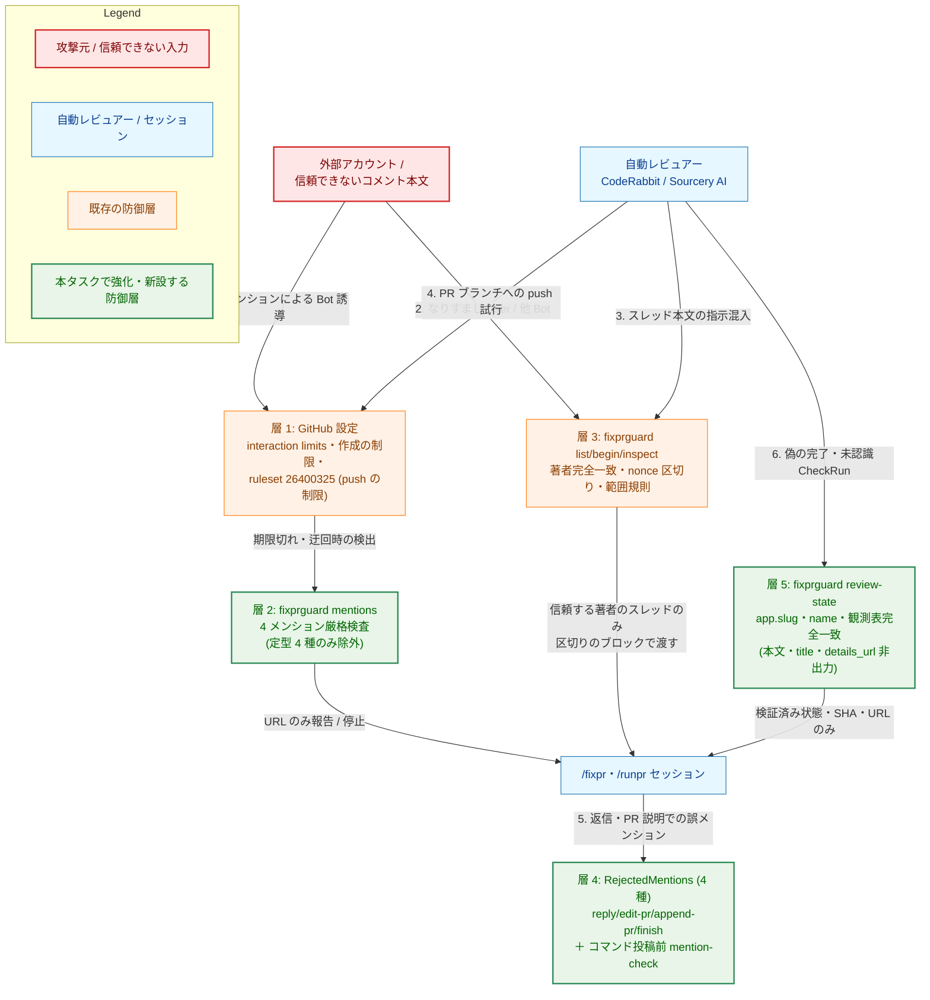
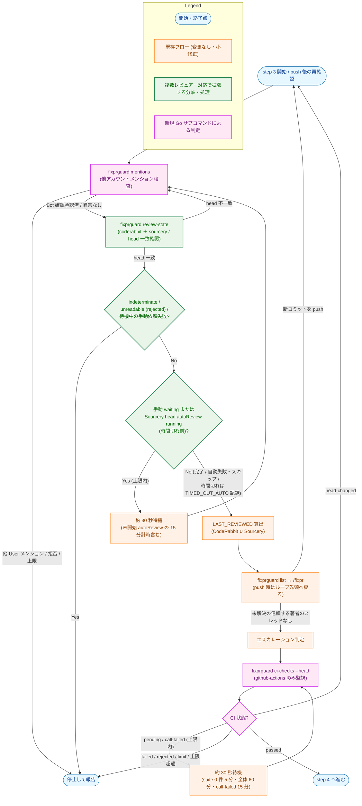
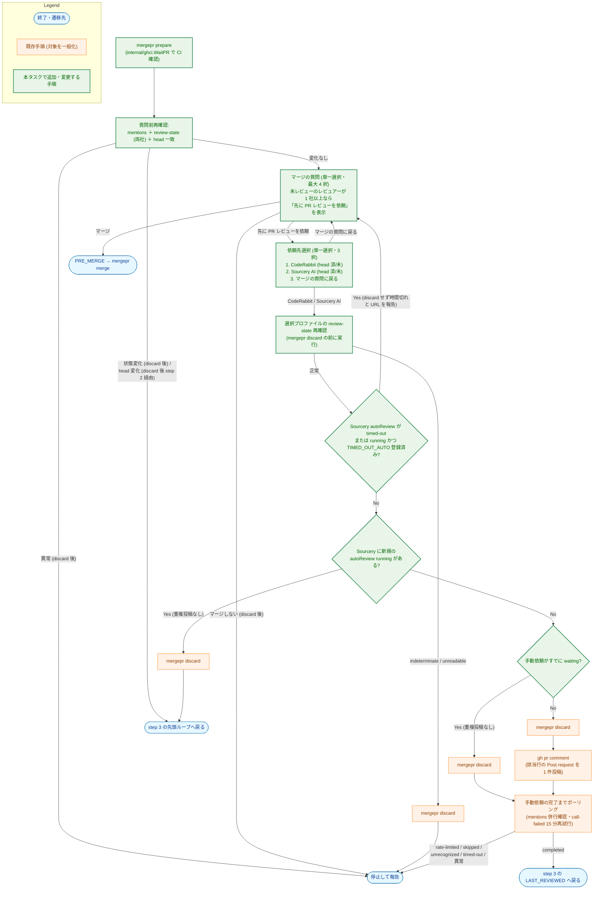

# アーキテクチャ設計書：Sourcery AI を自動レビュアーの一覧と PR レビュー体制に加える

## Document Status

| Item | Value |
|---|---|
| Status | `approved` |
| Created | 2026-11-24 |
| Review date | 2026-11-24 |
| Reviewer | isseis |
| Comments | - |

## 1. 設計の全体像 (Design Overview)

本書は、[01_requirements.md](01_requirements.md)（以下、要件定義書）の F-002〜F-005 を、コマンド定義（`.claude/commands/`）、ガードツール（`fixprguard`）、マージ支援ツール（`mergepr`）、共有パッケージ（`internal/ghci`）、ガードテスト、および仕様文書・ADR の変更として設計する。

-   **観測の記録:** F-001（AC-01〜AC-05）の観測結果は [observations.md](observations.md)（以下、観測の記録）にまとめ、本書と同じ PR でコミットする（AC-03）。観測結果は要件定義書の前提と食い違わなかったため、利用者の確認（2026-11-24）を経て設計へ進んだ（AC-04）。本書が完了の印・スキップ・エラー・メンション除外の判定に使う値は、すべて観測の記録にある（AC-05）。
-   **既存コードの参照基準:** 本書が引用する既存コードの `file:line` は、コミット `7d86a397`（`origin/main`）を確認したものである。
-   **申し送りの扱い:** [design_handoff.md](design_handoff.md) の H-01〜H-06 はすべて本書に反映し、対応箇所を付録 A にまとめる。受け入れ基準 AC-01〜AC-31 との対応は付録 B に示す。

### 1.1. 設計原則

本設計は、以下の 6 つの原則に従う。

-   **決定的な判定の Go 開発ツールへの集約（[ADR-0014](../../dev/adr/0014-deterministic-checks-in-go.md)）:** PR レビュー状態判定（`fixprguard review-state`）、他アカウントのメンション検査（新サブコマンド `fixprguard mentions`）、リポジトリ CI チェック判定（`internal/ghci` と `fixprguard ci-checks`・`mergepr prepare`）をすべて Go の `strictjson` ベースで実装し、`gh api --paginate --jq` 依存（重複キー後勝ちの例外）を解消する。
-   **宣言による分岐と推測の排除（`CLAUDE.md`「Declare, don't infer」）:** `fixprguard review-state` と `fixprguard mentions` はレビュアー種別をログイン文字列から推測せず、列挙型（`ReviewProfile`: `coderabbit` / `sourcery`）を引数で明示的に受け取る。外部 API の値（CheckRun の `name`・`status`・`conclusion`・`title`、コメント本文のメンション・1 行目ヘッダー）を読む箇所は `CLAUDE.md` の例外境界に明示して閉じ込める。
-   **本文の非出力と安全側の判定（[ADR-0015](../../dev/adr/0015-untrusted-review-threads.md)）:** どのサブコマンドもコメント本文・CheckRun の `title`・`details_url`・`output.summary` を標準出力にも標準エラーにも出さない。観測表にない `COMPLETED` の CheckRun は `unknown`（レビュー済みとしない）とし、手動依頼の異常終了時は必ず停止する。一方、Sourcery AI の自動の PR レビューの異常終了・スキップ・時間切れでは停止せず、完了の印に数えないまま要約へ状態と URL を出してマージの質問へ進む。
-   **定義の単一情報源の維持:** 自動レビュアーの一覧（`Automated reviewer list`）、拒否するメンション（`Rejected mentions`）、PR レビュー待機・依頼の対象（新設の `### PR reviewers` 表）は `.claude/commands/_context.md` の 1 か所だけに置き、`fixpr.md`・`runpr.md`・`mkreq.md`・`_lib/task-pr-handoff.md` へレビュアー名やメンションを直書きしない（AC-08・AC-12・AC-15）。`fixprguard` バイナリは `_context.md` を直接読まない（要件定義書 5 章）。
-   **共通 CI 判定ロジックの重複排除（DRY）:** `/runpr` step 3（`fixprguard ci-checks`）と `/runpr` step 4・`/mergepr`（`mergepr prepare`）が同じ基準（`app.slug == "github-actions"`）でリポジトリの CI を判定するよう、共通の厳格 GraphQL 読み取りを `internal/ghci` へ切り出す。
-   **既存プロトコルと `chief` との互換性維持:** `fixprguard` の `Protocol` は F-004 の契約変更時にのみ `main` の値 + 1 へ引き上げ、F-002 と `RejectedMentions()` 拡張は先行フェーズで据え置く。`mergepr` は CLI 契約を変えないため `Protocol`（`3`）を据え置く。マージの質問は最大 4 択・単一選択を維持し、依頼先選択も単一選択とすることで `internal/chief` の中継・画面読み取りと整合させる。

### 1.2. 概念モデル

矢印 A → B は「A の値・定義から B の判定や表示が決まる」を表す。



主な概念の定義は次のとおりである。

-   **レビュープロファイル（`ReviewProfile`）:** `review-state` と `mentions` が適用するレビュアー固有の規則集合を宣言する型。`coderabbit`（手動のみ）と `sourcery`（自動＋手動）の 2 つを持ち、ゼロ値は不正（`ProfileUnknown`）とする。
-   **手動依頼コメント:** 著者の種類が `User` で認証済み利用者と login が完全一致し、前後空白を除いた本文が該当プロファイルの受理依頼文面（`coderabbit`: `@coderabbitai review`、`sourcery`: `@sourcery-ai review` または `@sourceryai review`）のいずれかと完全一致する会話コメント。
-   **自動の PR レビュー（`AutoReview`）:** `sourcery` プロファイルで `head` コミット上に存在し、手動依頼コメントの応答として割り当てられていない `Sourcery review` CheckRun のうち、3.2.2 の 4 段階の優先順位で選んだ 1 件。祖先コミットの CheckRun や CheckRun が 0 件の空 `QUEUED` CheckSuite は含めない。
-   **完了の印（`ReviewMarker`）:** `coderabbit` では未編集の手動依頼に対する `finished`（`COMPLETED`・`SUCCESS`・`"Finished"`）応答、`sourcery` では PR コミット上の `finished`（`COMPLETED`・`SUCCESS`・`"✅ Completed successfully"`）の CheckRun（自動実行・手動依頼応答の両方）。
-   **`LAST_REVIEWED`:** CodeRabbit と Sourcery AI の `markers` の和集合（`unreadable (limit)` のレビュアーは除外）から、他のすべての完了コミットを祖先とする最新のコミット。和集合が空、または唯一の最新コミットが決まらない場合（履歴分岐等）は `none`。

### 1.3. 設計の際に決めたこと（2026-11-24）

利用者と確認して決めた設計判断と ADR の判断を以下に記録する。

-   **F-001 の観測完了判断（AC-04）:**
    -   **決定:** 直近の実際の PR 7 件（#1092・#1094・#1096・#1097・#1098・#1100・#1101）、リポジトリの ruleset（`26400325`・`24096227`）、および公式文書を [observations.md](observations.md) に記録して F-001 を完了とし、設計へ進む。項目 8（push 不可）は `rulesets/26400325` の `bypass_actors` が Repository Admin のみで GitHub App を含まないことと、行コメントに Bot による push を起動する UI がないことで確認済みとする。未観測の 2 点（同一コミットへの手動再依頼時の CheckRun 生成／更新挙動、エラー・ブロッキング指摘時の `title`）は安全側（`startedAt > req.created`・未登録 `COMPLETED` は `unknown`）に設計する。
    -   **理由:** Sourcery AI の 7 日間予算（250,000 diff characters）を使い切っており試験 PR でレビューを実行できない一方、直近 7 PR から成功完了（指摘あり・なし）、予算超過・サイズ超過 `SKIPPED`、スレッド返信 30 件、時刻重複のすべてを実測できたためである。
    -   **ADR の判断:** ADR なし（観測の完了判断であり設計決定ではないため）。
-   **Sourcery AI の 7 日間予算超過コメントのメンション検査からの除外（F-003・AC-13）:**
    -   **決定:** `/runpr` のメンション検査（`fixprguard mentions`）で、`sourcery-ai[bot]` の会話コメント（`issues/<number>/comments` のみ）について、レビューガイド（1 行目 `<!-- Generated by sourcery-ai[bot]: start review_guide -->`）に加え、1 行目（末尾 CR を除く）が `Sorry @<user-login>, you've used your own review budget of <数字とカンマ> diff characters for the last 7 days.` の固定書式に完全一致する 7 日間予算超過コメントも観測済み定型コメントとして除外する。
    -   **理由:** 予算超過中の全 PR（#1097・#1098・#1100・#1101）で毎回投稿され `` `@sourcery-ai review` `` を含むため、除外しないと予算超過中のすべての PR で毎回 Bot メンション確認が割り込む。対象を `issues/<number>/comments` の `Bot`・`sourcery-ai[bot]` かつ認証済み利用者の `<user-login>` を含む厳密な 1 行目書式に絞ることで誤除外を防ぐ（AC-13 項目 3「F-001 で他に定型ヘッダーが観測された場合は設計で加える」の適用）。
    -   **ADR の判断:** [ADR-0015](../../dev/adr/0015-untrusted-review-threads.md) を更新する（`/runpr` のメンション検査の除外対象を広げる決定であるため）。
-   **`fixprguard review-state` の呼び出し構造と競合判定（H-02）:**
    -   **決定:** 1 回の呼び出しで 1 レビュアーを判定する構造を維持し、`--profile <coderabbit|sourcery>`（列挙型）と繰り返し可能な `--request` を導入する。出力 JSON に自動の PR レビュー状態（`autoReview`）を追加し、`sourcery` の `markers` には自動完了の印も含める。`competing-runs` の判定は、`sourcery` では同一コミットまたはより古いコミット（`commitIndex(run.commit) <= commitIndex(earliest.commit)`）に属する CheckRun の重なりを競合とし、後続コミットの push による自動 CheckRun とは競合させない（`coderabbit` は既存どおり）。
    -   **理由:** 1 社ごとの再確認（step 4 の投稿前確認や片方だけのポーリング）が簡潔になり、出力 JSON の肥大化を避けられる。また PR #1094 で手動依頼実行中に後続コミットが push されて CheckRun 時刻が重なる実例を観測しており、後続コミットを競合させると正当な push で `indeterminate` になってしまう一方、より古いコミットの CheckRun が後から重なった場合は帰属が曖昧なため競合として安全側に止めるためである。
    -   **ADR の判断:** ADR なし（`review-state` の引数・出力の形と競合判定の細部は [ADR-0013](../../dev/adr/0013-review-setup.md) の「判定を `fixprguard review-state` に置く」決定の範囲内に閉じるため）。
-   **CI 待機と外部レビュー CheckRun の分離対象（H-06・AC-19）:**
    -   **決定:** `.claude/commands/runpr.md` step 3（新サブコマンド `fixprguard ci-checks`）と `internal/mergepr/mergepr.go:275`（`mergepr prepare`。`/mergepr` 単独実行を含む）の**両方**で、リポジトリの CI チェック（`app.slug == "github-actions"` の CheckSuite・CheckRun）のみを待機・成否判定の対象とし、外部レビュー Bot の CheckRun（`Sourcery review`・`CodeRabbit`）を除外する。共通の読み取りロジックは新パッケージ `internal/ghci` に置く。
    -   **理由:** `mergepr prepare` が `gh pr checks <number> --watch --fail-fast` のままだと、`Sourcery review` が失敗のままマージへ進んだときに step 4 の `mergepr prepare` が `CI checks failed` で停止し、時間切れ・未完了のまま進んだときは `--watch` がその CheckRun の完了を待ち続けるため、AC-19 を満たせない。`main` の ruleset（`24096227`）に必須チェック設定がないため `--required` は使えない。より単純な `gh pr checks --json name,state,bucket,workflow`（`internal/chief/detail.go:215-244` が表示用に使う方式）も `app.slug` を返さず、`headRefOid` との一致確認、`needs:` 待機でジョブ未生成の `CheckSuite` 状態取得、および重複 JSON キーの拒否（`strictjson`）を満たせないため、GraphQL を厳格に読む `internal/ghci` を新設する。
    -   **ADR の判断:** [ADR-0013](../../dev/adr/0013-review-setup.md) を更新する（CI 待機と外部レビュアー CheckRun の分離を `/runpr` だけでなく `mergepr prepare`（`/mergepr` を含む）へ広げ、2 ツール共通の契約として定めるため）。
-   **`_context.md` の複数 PR レビュアー定義形式（H-01・H-04）:**
    -   **決定:** `.claude/commands/_context.md` の Domain-specific 節に専用の `### PR reviewers` 表（列: `Reviewer`・`Profile`・`Mode`・`Post request`・`Accepted requests`）を新設し、単一行の `Awaited PR reviewer`・`PR review request` を置き換える。`TestMentionsOnlyInAllowedRows` はこの表の `Post request`・`Accepted requests` 列と `Rejected mentions` 行のみ拒否するメンションの記載を許可する。
    -   **理由:** レビュアーごとに `Profile`・投稿用文面・手動認識用文面・自動/手動モードを 1 対 1 で対応付けでき、パーサと文書ガードが明瞭になるためである。
    -   **ADR の判断:** ADR なし（`_context.md` の表形式は [ADR-0013](../../dev/adr/0013-review-setup.md) の「一覧とは別に `_context.md` の別項目で定める」決定の表現詳細に閉じるため）。
-   **`/runpr` step 3 のメンション検査の Go 化（要件定義書 3.2 項目 4・H-04）:**
    -   **決定:** `/runpr` step 3・step 4 の PR メンション検査を、既存の `gh api --paginate --jq` 3 本から `fixprguard` の新サブコマンド `mentions`（`strictjson` による厳格検査）へ移す。これにより要件定義書 3.2 項目 4 の `jq` 例外（重複メンバーの後勝ち）を解消する。
    -   **理由:** 除外条件に Sourcery AI のレビューガイドと予算超過コメントが加わり、依頼コメントも 3 種に増えるため、`jq` での保守と `sourcery-ai` 直書き禁止（AC-08）の両立が複雑になる。Go 化すれば `review-state` と同一の依頼コメント判定関数を共有でき、厳格 JSON 検査と単体テストによる検証が可能になる（[ADR-0014](../../dev/adr/0014-deterministic-checks-in-go.md)）。
    -   **ADR の判断:** [ADR-0015](../../dev/adr/0015-untrusted-review-threads.md) を更新する（他アカウントのメンション検査の実装経路を `fixprguard mentions` とし、未実装の食い違いを `#1095` へ紐付ける）。
-   **マージの質問の要約行形式（H-05）:**
    -   **決定:** マージの質問の要約行を最大 16 行とし、PR レビュー状態をレビュアーごとに 1 行ずつ（kind 15: `PR レビュー (CodeRabbit): ...`、kind 16: `PR レビュー (Sourcery AI): ...`、各社の状態が存在するときのみ表示）とする。
    -   **理由:** 2 社の URL と注記を 1 行に詰め込むと視認性が落ちるためである。`internal/chief/screen.go:113-177`（`7d86a397`）を確認したところ、`chief` は質問文（`PR #<number> をどうしますか…`）と選択肢ウィジェットのみを読み取り、会話本文の要約行数・書式には依存しない。
    -   **ADR の判断:** ADR なし（[ADR-0047](../../dev/adr/0047-runpr-merge-question.md) の「1 項目 1 行の要約」の範囲内に閉じるため）。
-   **`fixprguard` の `Protocol` 引き上げと実装フェーズの分割（H-03）:**
    -   **決定:** フェーズ 1（`Protocol` 据え置き）では、F-002（`Automated reviewer list` へ `sourcery-ai` 追加と文書ガード更新）および F-003 の `fixprguard.RejectedMentions()` 拡張・`_context.md` `Rejected mentions` 更新を先行実装する。フェーズ 2（`Protocol` 据え置き）では `internal/ghci`・`mergepr prepare` を実装する。フェーズ 3（`fixprguard` の `Protocol` を `main` の値 + 1 へ引き上げ）では `fixprguard`（`review-state` 拡張・`mentions`・`ci-checks`）・`runpr.md`・`_context.md` `PR reviewers` 表・ガイド・`CLAUDE.md` 例外を一括更新し、フェーズ 4 で残りの文書・ADR・`chief` 確認を仕上げる。`mergepr` の `Protocol`（`3`）は CLI 契約が変わらないため据え置く。
    -   **理由:** F-002 と受け付ける入力を狭める `RejectedMentions()` 拡張は `fixprguard_guide.md:670`（`7d86a397`）により `Protocol` を上げずに先行導入でき、`sourcery-ai` のスレッド自動処理を最速で有効化できるためである。
    -   **ADR の判断:** ADR なし（実装順序と PR 分割はタスク内に閉じるため）。

## 2. システム構成 (System Structure)

### 2.1. 全体の構成

実線の矢印 A → B は「A が B を呼ぶ・インポートする・参照する」を表す。破線の矢印は、本タスクで廃止する呼び出しを表す。



### 2.2. コンポーネント配置と既存コードの再利用

既存パッケージの責務と新規・変更ファイルの関係は次のとおりである。

-   **`internal/ghci`（新規・`package_reference.md` の `Shared Parts`）:** `internal/cmdrunner.Runner` と `internal/strictjson` のみに依存し、リポジトリ解決（`ResolveRepo`: `gh repo view --json nameWithOwner` の厳格解析）と PR の `head` コミット上の `app.slug == "github-actions"` の `CheckSuite`・`CheckRun` の厳格 GraphQL 読み取り・待機（`ReadPR`・`WaitPR`）を提供する。`internal/fixprguard` と `internal/mergepr` の双方から呼ぶことで、リポジトリ解決と CI 判定の重複をなくし、`internal/mergepr` が `internal/fixprguard` の作業ツリー監視等に依存する結合を避ける。
-   **`internal/fixprguard`（拡張）:**
    -   `errors.go`（`7d86a397` 時点 `79-81` 行目）: `RejectedMentions()` を 4 つに拡張する。`write.go` の `checkPostText`（`84-97` 行目）は `RejectedMentions()` をそのまま走査するため、`reply`・`edit-pr`・`append-pr`・`finish` のすべてに自動反映される。
    -   `types.go`（`7d86a397` 時点 `21` 行目）: `Protocol` をフェーズ 3 で `main` の値 + 1 へ引き上げる。`ParseReviewers`（`89-105` 行目）と `trust.go` は複数 `--reviewer` をすでに受け付けるため変更不要（AC-07）。
    -   `github.go`（`7d86a397` 時点 `51`・`99-124` 行目）: `resolveRepository` を `internal/ghci.ResolveRepo` へ委譲する形に整理し、`NewGitHubWithoutReviewer` の doc コメントへ `PRReviewState`・`PRMentions`・`CIChecks` を反映する。
    -   `review_state.go`（`7d86a397` 時点 `1-1203` 行目）: `ReviewProfile`・複数 `--request`・`RunSkipped`・`RequestSkipped`・`AutoReview`・`sourcery` プロファイルの自動完了の印および同一コミット競合判定を追加する。既存の `restGet`・`restPages`・`readHead`・`readUser`・`readRequests`・`parseCommitsPage` の厳格 JSON 基盤を再利用する。
    -   `mentions.go`（新規）: PR の会話コメント・行コメント・PR レビューを `restPages`（`review_state.go` と共有）で厳格に読み取り、`RejectedMentions()`・プロファイル別観測済み定型コメント除外・`isRequestComment`（`review_state.go` と共有）を適用して `MentionScanResult` を返す。
    -   `ci_checks.go`（新規）: `internal/ghci.ReadPR` を呼び、`fixprguard ci-checks` の出力（`Protocol` 付与）を返す薄いラッパー。
-   **`cmd/fixprguard`（拡張）:** `main.go`（`7d86a397` 時点 `56-141`・`205`・`495-518` 行目）に `cmdMentions`・`cmdCIChecks`・`flagProfile`・`flagObservedBot`・`flagHead`（`ci-checks` 用の任意 `--head`）を追加し、`flagRequest` と `flagObservedBot` の**両方**を `multiFlags` に加える。`specs` に `cmdReviewState`（`flagProfile`・`flagReviewer`・`flagRequest`、位置引数 1 件）・`cmdMentions`（`flagObservedBot`・`flagRequest`、位置引数 1 件）・`cmdCIChecks`（任意の `flagHead`、位置引数 1 件）を登録する。
-   **`internal/mergepr`（拡張）:** `mergepr.go:275`（`7d86a397`）の `gh pr checks --watch --fail-fast` を `internal/ghci.ResolveRepo`＋`internal/ghci.WaitPR` に置き換える。`ghci` 用の `gh` 呼び出しには `MaxOutput: 32 MiB`・`WaitDelay: 5s` を設定した `cmdrunner.Runner`（`internal/mergepr/runner.go` に追加）を使う。引数・出力・終了コードは変えないため `internal/mergepr/mergepr.go:63` の `Protocol = 3` は据え置く。
-   **コマンド定義（`.claude/commands/`）:** `_context.md` に `### PR reviewers` 表を追加し、`Automated reviewer list` と `Rejected mentions` を更新する。`runpr.md` の step 3・step 4 を複数レビュアー・`fixprguard mentions`・`fixprguard ci-checks`・依頼先選択（3 択）へ更新する。`mergepr.md:47` の CI 待機記述を `github-actions` チェック監視へ更新する。`fixpr.md`・`mkreq.md`・`_lib/task-pr-handoff.md` はすでに `_context.md` 参照と `<mention-check>`（投稿前メンション検査、3.1 参照）を使うため構造変更は不要である（`fixpr.md` の `--protocol` 番号のみフェーズ 3 の `Protocol` 引き上げ時に更新）。
-   **`internal/chief`（確認・必要時テスト追加）:** `internal/chief/screen.go:113-177`（`7d86a397`）はマージの質問を質問文 `^PR #[1-9][0-9]* をどうしますか（第 [1-9][0-9]* 回。要約と詳細ファイルを確認のうえ）$` で判定し、他の単一選択の問いは `Merge: false`・`QuestionSingle`・`RelayAllowed` として中継する（`relay.go:69-77`）。依頼先選択の 3 択の問いの質問文をこの正規表現に一致させないことで、既存の `chief` ロジック変更なしにそのまま中継できる（AC-28）。

### 2.3. データフロー（`/runpr` step 3〜step 4）

矢印は呼び出し元から呼び出し先への処理・データ受け渡しを表す。



## 3. コンポーネント設計 (Component Design)

### 3.1. `.claude/commands/_context.md` のデータ構造（H-01・H-04）

Domain-specific 節（`7d86a397` 時点 `351-364` 行目）を次のように改める。

1.  **`Automated reviewer list` 行:** `` `coderabbitai`, `sourcery-ai` ``（GraphQL の `author.login` の形、`[bot]` なし、ちょうど 2 つ。AC-06）。
2.  **`Rejected mentions` 行:** `` `@codex`, `@coderabbitai`, `@sourcery-ai`, `@sourceryai` ``（ちょうど 4 つ。AC-10）。`<mention-check>`（`grep -qiF` に `-e '<mention>'` を各値 1 つずつと `--`）の定義を維持する。`<rejected-mentions>` プレースホルダーは `runpr.md` の `--jq` 廃止に伴い削除する。
3.  **`Awaited PR reviewer` 行と `PR review request` 行の廃止と `### PR reviewers` 表の新設:** Domain-specific 表の直下に専用の 5 列表 `### PR reviewers` を置く。`contextRow`（`Name` 列先頭の表を読む）と干渉しないよう、1 列目の見出しは `Reviewer` とする（`### Harness model mapping` と同じ分離規約）。

| 列名 | 意味・形式 | 値（本タスク） |
|---|---|---|
| `Reviewer` | GraphQL `author.login` / `checkSuite.app.slug`（単一コードスパン） | `` `coderabbitai` `` / `` `sourcery-ai` `` |
| `Profile` | `fixprguard` へ渡す `--profile` 値（単一コードスパン） | `` `coderabbit` `` / `` `sourcery` `` |
| `Mode` | PR レビューの実行形態（単一コードスパン） | `` `manual` `` / `` `auto+manual` `` |
| `Post request` | `/runpr` が投稿する手動依頼コメント（単一コードスパン） | `` `@coderabbitai review` `` / `` `@sourcery-ai review` `` |
| `Accepted requests` | 利用者が手動で投稿した依頼として受理する文面一覧（カンマ＋空白区切りコードスパン） | `` `@coderabbitai review` `` / `` `@sourcery-ai review`, `@sourceryai review` `` |

-   **直書き禁止とガード（AC-08・AC-09・AC-12・AC-15）:**
    -   `cmd/yt2column/fixpr_docs_test.go` の `wantReviewers` を `[]string{"coderabbitai", "sourcery-ai"}` に更新し、`checkContextReviewers` が `### PR reviewers` 表の 5 列・行数・文法（`ParseLogin`・`ParseReviewProfile`・`Post request` が `Accepted requests` に含まれること・各依頼文面の先頭語が `fixprguard.RejectedMentions()` に含まれること）と、旧行（`Awaited PR reviewer`・`PR review request`・`Automated reviewer`）が 0 行であることを検査する。
    -   `TestContextAndCommandsAgree` は `Automated reviewer list` と `PR reviewers` 表の全 `Reviewer` 名が `fixpr.md`・`runpr.md`・`mkreq.md`・`_lib/task-pr-handoff.md` に 1 文字も現れないことを検査する。
    -   `cmd/yt2column/review_mention_docs_test.go` の `TestMentionsOnlyInAllowedRows` は、`fixprguard.RejectedMentions()` の 4 メンションが出現してよい場所を `_context.md` の `Rejected mentions` 行と `### PR reviewers` 表のデータ行のみに限定する。`TestPostingCommandsInventory` は `runpr.md` step 4 の `gh pr comment <number> --body "<post-request>"` を唯一のメンション検査免除コマンドとして検証する。

### 3.2. `internal/fixprguard` の拡張（H-02・F-003・F-004）

#### 3.2.1. `RejectedMentions()` の拡張（`internal/fixprguard/errors.go`）

`RejectedMentions()`（`7d86a397` 時点 `79-81` 行目）の返り値を `[]string{"@codex", "@coderabbitai", "@sourcery-ai", "@sourceryai"}` にする。`write.go` の `checkPostText`・`AppendPR`・`EditPR`・`Reply` および `worktree.go` の `Finish` はすべて `RejectedMentions()` を参照するため、4 メンションの ASCII 大文字小文字無視・部分文字列拒否と `current-body-mention` 停止が統一して適用される（AC-11）。

#### 3.2.2. `review-state` のデータ型とインターフェース（`internal/fixprguard/review_state.go`）

既存の `PRReviewState`・`ReviewStateRequest`・`RunKind`・`RequestState` を次のように拡張する。既存の `Protocol`（`internal/fixprguard/types.go:21`）はフェーズ 3 で `main` の値 + 1 へ引き上げる。

```go
// ReviewProfile declares which reviewer's CheckRun naming, classification,
// automatic-review, and competing-run rules apply. Zero value fails closed
// (ProfileUnknown.MarshalText returns an error).
type ReviewProfile int

const (
	ProfileUnknown ReviewProfile = iota
	ProfileCodeRabbit            // "coderabbit": CheckRun "CodeRabbit", manual only
	ProfileSourcery              // "sourcery": CheckRun "Sourcery review", auto + manual
)

func ParseReviewProfile(s string) (ReviewProfile, error)
func (p ReviewProfile) MarshalText() ([]byte, error)
func ReviewProfiles() []ReviewProfile

// RunKind adds RunSkipped for Sourcery's terminal SKIPPED outcome.
type RunKind int

const (
	RunUnknown     RunKind = iota // "unknown" (zero value: fail closed)
	RunRunning                    // "running"
	RunFinished                   // "finished"
	RunRateLimited                // "rate-limited"
	RunSkipNotice                 // "skip-notice" (CodeRabbit auto-review-off notice; ignored)
	RunSkipped                    // "skipped" (Sourcery terminal SKIPPED)
)

// RequestState adds RequestSkipped for a manual request answered by RunSkipped.
type RequestState int

const (
	RequestIndeterminate RequestState = iota // "indeterminate"
	RequestUnreadable                        // "unreadable"
	RequestNone                              // "none"
	RequestWaiting                           // "waiting"
	RequestCompleted                         // "completed"
	RequestRateLimited                       // "rate-limited"
	RequestSkipped                           // "skipped"
	RequestUnrecognized                      // "unrecognized"
	RequestTimedOut                          // "timed-out"
)

// AutoReviewState is the state of the non-manual CheckRun on head chosen by
// the four-step priority of AutoReview
// (ProfileSourcery only; AutoNone when absent or ProfileCodeRabbit).
type AutoReviewState int

const (
	AutoNone         AutoReviewState = iota // "none"
	AutoRunning                             // "running"
	AutoCompleted                           // "completed"
	AutoSkipped                             // "skipped"
	AutoUnrecognized                        // "unrecognized"
	AutoTimedOut                            // "timed-out"
)

func (s AutoReviewState) MarshalText() ([]byte, error)
func AutoReviewStates() []AutoReviewState

type ReviewStateRequest struct {
	PR       PRNumber
	Profile  ReviewProfile
	Reviewer Login
	Requests []string // 1 or more non-empty, unique request texts (1..1024 bytes each)
}

type ReviewRequest struct { // existing type (unchanged)
	ID        int64  `json:"id"`
	URL       string `json:"url"`
	CreatedAt string `json:"createdAt"` // RFC 3339 UTC
}

type ReviewResponse struct { // existing type (unchanged)
	Kind       RunKind `json:"kind"`
	Status     string  `json:"status"`
	Conclusion string  `json:"conclusion"`
	Commit     string  `json:"commit"`
	URL        string  `json:"url"`
	StartedAt  string  `json:"startedAt"`
}

type AutoReview struct {
	State      AutoReviewState `json:"state"`
	Kind       RunKind         `json:"kind"`
	Status     string          `json:"status"`
	Conclusion string          `json:"conclusion"`
	Commit     string          `json:"commit"`    // always PR head
	URL        string          `json:"url"`       // permanent unique CheckRun URL (https://github.com/<owner>/<repo>/runs/<id>)
	StartedAt  string          `json:"startedAt"` // "" when status != COMPLETED and startedAt is null
}

type ReviewMarker struct { // existing type (semantics extended for automatic reviews)
	Commit      string `json:"commit"`
	RequestID   int64  `json:"requestId"`   // 0 for automatic Sourcery review
	RequestURL  string `json:"requestUrl"`  // "" for automatic Sourcery review
	CheckRunURL string `json:"checkRunUrl"`
	ReviewURL   string `json:"reviewUrl"`   // "" when reviewer posted no PR review object
	CompletedAt string `json:"completedAt"`
}

type PRReviewState struct {
	Protocol            int                 `json:"protocol"`
	Profile             ReviewProfile       `json:"profile"` // always populated from req.Profile (including unreadable/none)
	State               RequestState        `json:"state"`
	Reason              UnreadableReason    `json:"reason"`
	IndeterminateReason IndeterminateReason `json:"indeterminateReason"`
	Head                string              `json:"head"`
	Now                 string              `json:"now"`
	Request             *ReviewRequest      `json:"request"`
	Response            *ReviewResponse     `json:"response"`
	AutoReview          *AutoReview         `json:"autoReview"` // null when AutoNone or unreadable
	IndeterminateURLs   []string            `json:"indeterminateUrls"`
	Markers             []ReviewMarker      `json:"markers"`
}

func (g *GitHub) PRReviewState(ctx context.Context, req ReviewStateRequest) (PRReviewState, error)
```

-   **`Profile` の初期化契約:** `PRReviewState` は `RequestUnreadable`・`RequestNone` を含むすべての返却経路で `Profile: req.Profile` を必ず設定する（`ProfileUnknown` のまま JSON 化しようとすると `MarshalText()` がエラーになるため、`req.Profile` の妥当性を入口で検査して `ErrInvalidInput` を返す）。
-   **CheckRun の取得と厳密分類（AC-05・AC-17・AC-29）:**
    -   GraphQL クエリ（現行 `review_state.go:655-679`、`7d86a397`）に変数 `$checkName: String!` を導入し、`checkRuns(first: 100, filterBy: {checkName: $checkName, checkType: ALL})` に `name`・`status`・`conclusion`・`title`・`startedAt`・`completedAt`・`url` を要求する（非推奨の 32-bit `databaseId` は読まず、CheckRun の一意識別にはすでに必須取得している `url` を使う。観測の記録 2.2）。
    -   取得した各 CheckRun の `name` がプロファイル固有の名前（`coderabbit`: `"CodeRabbit"`、`sourcery`: `"Sourcery review"`）と完全一致しない場合は `UnreadableRejected` で拒否する（GraphQL フィルタの異常や改ざんに対する多層防御）。`checkSuite.app.slug` は `--reviewer` と完全一致するもののみを採用し、他 App の CheckSuite は読み飛ばす。`checkRuns` が 0 件の `QUEUED` CheckSuite は CheckRun を作らないため、自動の PR レビュー待機には影響しない（観測の記録 2.1）。
    -   `COMPLETED` 以外の `status`（`QUEUED`・`IN_PROGRESS` 等）では `conclusion`・`title`・`startedAt`・`completedAt` の `null` を許容し、`RunRunning` に分類する。`status == "COMPLETED"` ではこれら 4 項目すべてが非 `null` であることを要求する（既存 `review_state.go:956-962` と同じ）。
    -   プロファイル別の分類表は次のとおり（すべて観測の記録 2.2・2.3 および 0118 観測記録にある値のみ）：

| `Profile` | `name` | `status` | `conclusion` | `title` | `RunKind` |
|---|---|---|---|---|---|
| `coderabbit` | `CodeRabbit` | `COMPLETED` 以外 | 問わない | 問わない | `running` |
| `coderabbit` | `CodeRabbit` | `COMPLETED` | `SUCCESS` | `Finished` | `finished` |
| `coderabbit` | `CodeRabbit` | `COMPLETED` | `NEUTRAL` | `Review rate limited` | `rate-limited` |
| `coderabbit` | `CodeRabbit` | `COMPLETED` | `SKIPPED` | `Review skipped: automatic reviews are disabled` | `skip-notice` |
| `coderabbit` | `CodeRabbit` | `COMPLETED`（上記以外） | — | — | `unknown` |
| `sourcery` | `Sourcery review` | `COMPLETED` 以外 | 問わない | 問わない | `running` |
| `sourcery` | `Sourcery review` | `COMPLETED` | `SUCCESS` | `✅ Completed successfully` | `finished` |
| `sourcery` | `Sourcery review` | `COMPLETED` | `SKIPPED` | `⏭️ Skipped` | `skipped` |
| `sourcery` | `Sourcery review` | `COMPLETED`（上記以外） | — | — | `unknown` |

-   **手動依頼応答・競合判定・自動の PR レビュー・完了の印の規則（AC-16〜AC-20）:**
    -   **読み取り省略の条件:** `ProfileCodeRabbit` では依頼コメントが 0 件なら CheckRun と PR レビューを読まずに `RequestNone` を返す（既存 `review_state.go:417-421` と同じ）。`ProfileSourcery` では依頼コメントが 0 件でも常に CheckRun と PR レビューを読み取り、`AutoReview` と自動完了の印（`Markers`）を構築する。
    -   **手動依頼の応答判定:** 判定対象とする CheckRun（`RunSkipNotice` 以外かつ `startedAt != nil`）のうち、依頼コメントの作成時刻より厳密に後に開始した（`startedAt > req.created`）最早のものを選ぶ。
        -   `ProfileCodeRabbit`: 既存の競合判定を維持する（最早の CheckRun と同じ秒に開始した別の CheckRun、または最早の CheckRun が完了する前に開始した別の CheckRun があれば `competing-runs`）。
        -   `ProfileSourcery`: 期限切れの手動依頼が後続コミットの自動 CheckRun を奪わないよう、応答候補は **`startedAt > req.created` かつ `startedAt - req.created <= 15 分`（`reviewWaitLimit`）** の CheckRun に限る。競合判定は、PR のコミット列順で **最早の CheckRun と同一またはより古いコミット（`commitIndex(run.commit) <= commitIndex(earliest.commit)`）** に属する CheckRun が重なった場合に `competing-runs` とする。これにより、PR #1094 のように手動依頼の実行中に後続コミット（`commitIndex` が大）が push されて自動 CheckRun が重なっても競合にしない一方、後続コミットの自動 CheckRun が先に開始して古いコミットの手動 CheckRun が後から重なった場合は帰属が曖昧なため `competing-runs` で安全に停止する（5.4 に残余リスクを記録）。
        -   完了済み CheckRun がある同一コミットへ手動依頼したときに Sourcery が既存 CheckRun を上書きし `startedAt` を変えない挙動であった場合、この規則は応答を拾わず 15 分後に `timed-out` となる（誤って完了としない安全側の挙動。観測の記録 2.1 の未観測リスク）。
    -   **自動の PR レビュー（`AutoReview`、`ProfileSourcery` のみ）:** PR の `head` コミット上の CheckRun のうち、いずれの手動依頼の応答にも割り当てられていない CheckRun（祖先コミットは除外）を対象とする。ただし、手動依頼が `RequestWaiting` かつ `Response == nil` の間は、`startedAt == nil`（未開始）の CheckRun はその手動依頼が起動した直後の CheckRun でありうるため、`AutoReview` へ仮割り当てしない（手動依頼の応答判定へ委ねる）。対象 CheckRun が複数ある場合の 1 件選定は、停滞・時間切れの CheckRun が後続の新しい実行を隠さないよう、次の 4 段階の優先順位で行う（同順位は `startedAt` 最新、それも同値または未開始同士なら `url` の文字数・辞書順最大）：
        1.  実行中かつ時間内（`RunRunning`・`startedAt != nil`・`now - startedAt <= 15 分`）
        2.  未開始の待機中（`RunRunning`・`startedAt == nil`）
        3.  開始済みで時間切れ（`RunRunning`・`startedAt != nil`・`now - startedAt > 15 分`）
        4.  終了済み（`RunFinished`・`RunSkipped`・`RunUnknown`）
        -   `RunRunning`: `startedAt != nil` かつ `now - startedAt > 15 分` なら `AutoTimedOut`、それ以外は `AutoRunning`（`startedAt == nil` のとき `StartedAt: ""` とし、15 分上限の起点は `/runpr` が待機を始めた時刻とする。AC-16）。なお、同一 `head` に停滞した `QUEUED`（未開始）と `COMPLETED` が併存しても、停滞した `QUEUED` は 15 分で `TIMED_OUT_AUTO`（後述の 3.3 で定義するセッション内の時間切れ集合）に入って進行を妨げず、`COMPLETED` は `Markers` に正しく残る。また、同じ `head` で新しい実行中 CheckRun が開始すれば順位 1 が順位 2・3 より優先されるため、古い未開始・時間切れの CheckRun に隠されない。
        -   `RunFinished` → `AutoCompleted`、`RunSkipped` → `AutoSkipped`、`RunUnknown` → `AutoUnrecognized`。
    -   **完了の印（`Markers`）:** `ProfileCodeRabbit` は既存どおり未編集手動依頼の `RunFinished` 応答のみ。`ProfileSourcery` は PR コミット上のすべての `RunFinished` CheckRun（手動応答に結び付くものは `RequestID`・`RequestURL` を付与、それ以外の自動完了は `RequestID: 0`・`RequestURL: ""`）を `CompletedAt`・`CheckRunURL` 昇順で含める。各完了の印の `ReviewURL` は、同じコミットに対するレビュアーの PR レビューのうち、`RequestID > 0` なら依頼時刻より後の最初のもの、自動完了で `startedAt != nil` なら `startedAt` 以降の最初のもの、自動完了で `startedAt == nil` なら当該コミット最新のものの URL とする。
    -   **出力の非公開性:** `title`・`details_url`・`output.summary`・コメント本文はどのフィールドにも出さない。フェーズ 3 の同一 PR で `CLAUDE.md:490-502` の `Declare, don't infer` 例外へ `review_state.go` の `name` 照合と `mentions.go` の 1 行目・メンション検査を追加する（AC-29）。

#### 3.2.3. `mentions` のデータ型とインターフェース（`internal/fixprguard/mentions.go`、新規）

`/runpr` step 3・step 4 の PR メンション検査を `gh api --paginate --jq` 3 本から置き換えるサブコマンド。

```go
// ObservedBot binds a ReviewProfile to its GraphQL reviewer login (without [bot])
// for observed status-comment exclusion in PRMentions.
type ObservedBot struct {
	Profile  ReviewProfile
	Reviewer Login
}

func ParseObservedBot(s string) (ObservedBot, error) // "<profile>=<login>"

type MentionScanRequest struct {
	PR           PRNumber
	ObservedBots []ObservedBot // 1 or more, unique profiles and unique logins
	Requests     []string      // 1 or more accepted manual request texts (same check as ReviewStateRequest)
}

type MentionScanState int

const (
	MentionScanUnreadable MentionScanState = iota // "unreadable" (zero value: fail closed)
	MentionScanOK                                 // "ok"
)

func (s MentionScanState) MarshalText() ([]byte, error)
func MentionScanStates() []MentionScanState

type MentionSource int

const (
	MentionSourceUnknown      MentionSource = iota // invalid (MarshalText returns error)
	MentionSourceIssueComment                      // "issue-comment"
	MentionSourceLineComment                       // "line-comment"
	MentionSourceReview                            // "review"
)

func (s MentionSource) MarshalText() ([]byte, error)
func MentionSources() []MentionSource

// MentionScanStage identifies which read stage failed when State == MentionScanUnreadable.
type MentionScanStage int

const (
	MentionStageNone          MentionScanStage = iota // ""
	MentionStageRepo                                  // "repo"
	MentionStageUser                                  // "user"
	MentionStageIssueComments                         // "issue-comments"
	MentionStageLineComments                          // "line-comments"
	MentionStageReviews                               // "reviews"
)

func (s MentionScanStage) MarshalText() ([]byte, error)
func MentionScanStages() []MentionScanStage

type MentionFinding struct {
	Source    MentionSource `json:"source"`
	URL       string        `json:"url"`
	CreatedAt string        `json:"createdAt"`           // review: submitted_at, or "" when null/absent
	UpdatedAt string        `json:"updatedAt,omitempty"` // omitted for MentionSourceReview
	ByUser    bool          `json:"byUser"`
	ByBot     bool          `json:"byBot"`
}

type MentionScanResult struct {
	Protocol int              `json:"protocol"`
	State    MentionScanState `json:"state"`
	Reason   UnreadableReason `json:"reason"`   // "" | "call-failed" | "rejected" | "limit"
	Stage    MentionScanStage `json:"stage"`    // "" on ok; failing endpoint on unreadable
	Mentions []MentionFinding `json:"mentions"` // empty list, never null; ordered by source then API order
}

func (g *GitHub) PRMentions(ctx context.Context, req MentionScanRequest) (MentionScanResult, error)
```

-   **検査対象と厳格 JSON 境界（AC-13・要件定義書 3.2 項目 4 の例外解消）:**
    -   `internal/ghci.ResolveRepo`（`gh repo view --json nameWithOwner`）、`gh api user` に続き、`restPages` で `issues/<PR>/comments`（上限 3000 件）・`pulls/<PR>/comments`（上限 3000 件）・`pulls/<PR>/reviews`（上限 3000 件）を 1 応答 16 MiB 上限・`strictjson` で読み取る。3 エンドポイントすべてで `body` の `null` を許容し（`null` は空文字列扱い）、`pulls/<PR>/reviews` では `submitted_at` の `null`・欠落を許容して `MentionFinding.CreatedAt: ""`（`UpdatedAt` は省略）に変換する。
    -   `Mentions` の順序は `issue-comment` → `line-comment` → `review`、各エンドポイント内は GitHub API の返却順とする（契約として明示）。
    -   どの段で失敗しても部分結果を返さず `State: MentionScanUnreadable`（`Reason`: `call-failed`・`rejected`・`limit`、`Stage`: 失敗した段の安全な列挙値）を終了コード `0` で返す（引数文法不正のみ `ErrInvalidInput`・終了コード `2`）。
-   **判定規則（AC-13）:**
    1.  **観測済み定型コメントの除外（メンション扱いしない）:**
        -   `ProfileCodeRabbit`（`user.type == "Bot"` かつ `user.login == <cr-login>+"[bot]"`、3 経路すべて）: 1 行目（末尾 `\r` 除去後）が `<!-- coderabbit-ai-generated:v1 -->` または `<!-- This is an auto-generated comment: coding agent status by CodeRabbit -->` と完全一致。
        -   `ProfileSourcery`（`user.type == "Bot"` かつ `user.login == <sourcery-login>+"[bot]"`、`issues/<PR>/comments` のみ）: 1 行目（末尾 `\r` 除去後）が次のいずれかに完全一致：
            -   `<!-- Generated by <sourcery-login>[bot]: start review_guide -->`（観測の記録 2.5）
            -   `Sorry @<user-login>, you've used your own review budget of <1 桁以上の ASCII 数字とカンマ> diff characters for the last 7 days.`（観測の記録 2.3・2.5。`<user-login>` は `gh api user` で取得した認証済み利用者の login、`[0-9,]+` は先頭末尾が数字）
        -   同じ login の `User`、および上記に合わない `sourcery-ai[bot]`・`coderabbitai[bot]` の投稿（例: `linked_issues` や行コメントのメンション引用）は除外しない。
    2.  **手動依頼コメントの除外（`issues/<PR>/comments` のみ）:** `review-state` と同一の `isRequestComment` 判定（`user.type == "User"`・`user.login == <user-login>`・前後空白除去後の本文が `req.Requests` のいずれかと完全一致）に当たるコメントはメンション報告に含めない（これにより、旧 `TestRunprDocContract/request_comment_agrees_with_review_state` が検証していた `jq` 対 `review-state` の一致がコード共有で保証される）。
    3.  **拒否するメンションの検出:** 残りの項目の `body` が `RejectedMentions()` の 4 メンションのいずれかを ASCII 大文字小文字無視・部分文字列で含む場合、`MentionFinding`（`ByUser`: `User` かつ `<user-login>`、`ByBot`: `Bot`）を出力する。本文は一切出力しない。

#### 3.2.4. `internal/ghci` と `fixprguard ci-checks`・`mergepr prepare`（H-06・AC-19）

リポジトリの CI チェックのみを監視する新パッケージ `internal/ghci`（依存は `internal/cmdrunner`・`internal/strictjson`・標準ライブラリのみ）を置く。

```go
package ghci

type State int

const (
	StateUnreadable State = iota // "unreadable" (zero value: fail closed)
	StatePending                 // "pending"
	StatePassed                  // "passed"
	StateFailed                  // "failed"
)

func (s State) MarshalText() ([]byte, error)
func States() []State

type UnreadableReason int

const (
	UnreadableNone        UnreadableReason = iota // ""
	UnreadableCall                                // "call-failed" (transient; retried in WaitPR)
	UnreadableRejected                            // "rejected" (permanent; strict JSON / schema violation, or a GraphQL error declared permanent)
	UnreadableLimit                               // "limit" (permanent; pagination cap exceeded)
	UnreadableHeadChanged                         // "head-changed" (permanent; headRefOid != ExpectedHead)
)

func (r UnreadableReason) MarshalText() ([]byte, error)
func UnreadableReasons() []UnreadableReason

type FailingCheck struct {
	Name       string `json:"name"`       // CheckRun name, or workflow name / "github-actions-check-suite" for suite-level failure
	Conclusion string `json:"conclusion"`
	URL        string `json:"url"`        // validated GitHub URL, or "" for suite-level failure with 0 CheckRuns
}

type Request struct {
	Owner        string
	Repo         string
	PRNumber     int
	ExpectedHead string // optional; 40 lowercase hex when set; mismatch returns UnreadableHeadChanged
}

type Result struct {
	State   State            `json:"state"`
	Reason  UnreadableReason `json:"reason"`
	Head    string           `json:"head"`    // 40 lowercase hex, or "" on unreadable before head read
	Suites  int              `json:"suites"`  // count of evaluated github-actions check suites
	Checks  int              `json:"checks"`  // count of evaluated github-actions LATEST check runs
	Failing []FailingCheck   `json:"failing"` // empty list, never null; element order is unspecified (callers must not depend on order)
}

type WaitOptions struct {
	PollInterval   time.Duration
	Timeout        time.Duration
	PerCallTimeout time.Duration // bounds each ReadPR call (e.g., 2m)
	NoCheckGrace   time.Duration // fail closed if Suites == 0 (no evaluated github-actions suite) persists past grace
	Sleep          func(context.Context, time.Duration) error // optional override for tests
}

// ResolveRepo runs "gh repo view --json nameWithOwner" and strictly parses owner/repo.
func ResolveRepo(ctx context.Context, run cmdrunner.Runner) (owner, repo string, err error)

func ReadPR(ctx context.Context, run cmdrunner.Runner, req Request) (Result, error)
func WaitPR(ctx context.Context, run cmdrunner.Runner, req Request, opts WaitOptions) (Result, error)
```

`internal/fixprguard/ci_checks.go` の出力型および `*GitHub` メソッドは次のとおりである（`ghci` の状態・理由・失敗型をそのまま再利用して重複を避ける）。

```go
// internal/fixprguard/ci_checks.go
type CIChecksRequest struct {
	PR           PRNumber
	ExpectedHead string // optional 40 lowercase hex
}

type CIChecksResult struct {
	Protocol int                   `json:"protocol"`
	State    ghci.State            `json:"state"`
	Reason   ghci.UnreadableReason `json:"reason"`
	Head     string                `json:"head"`
	Suites   int                   `json:"suites"`
	Checks   int                   `json:"checks"`
	Failing  []ghci.FailingCheck   `json:"failing"` // empty list, never null
}

func (g *GitHub) CIChecks(ctx context.Context, req CIChecksRequest) (CIChecksResult, error)
```

-   **引数検証（`ErrInvalidRequest`）:** `ReadPR`・`WaitPR` は `run == nil`、`Owner`/`Repo` が空または GitHub 識別子として不正、`PRNumber <= 0`、`ExpectedHead` が非空かつ 40 桁小文字 16 進でない場合に `ErrInvalidRequest` を返す。`WaitPR` はさらに `PollInterval <= 0`・`Timeout <= 0`・`PerCallTimeout <= 0`・`NoCheckGrace < 0` でも `ErrInvalidRequest` を返す。
-   **GraphQL クエリと判定規則:**
    -   `pullRequest(number: $number)` の `headRefOid` と `commits(last: 1)` の `commit { oid checkSuites(first: 50) { pageInfo { hasNextPage } nodes { app { slug } status conclusion createdAt workflowRun { workflow { name } } checkRuns(first: 100, filterBy: {checkType: LATEST}) { pageInfo { hasNextPage } nodes { name status conclusion url } } } } }` を `gh api graphql -f owner=... -f name=... -F number=... -f query=...`（文字列変数は型変換・`@file` 展開を避けるため `-f`、整数 `number` のみ `-F`）で取得し、16 MiB 上限・`strictjson`・`internal/ghci` 内の厳格 GitHub URL 検証で検査する。
    -   `commits.nodes` が 1 件でない、または `commit.oid != headRefOid` のときは `StateUnreadable`（`UnreadableRejected`）を返す。`ExpectedHead != ""` かつ `headRefOid != ExpectedHead` のときは永続状態 `StateUnreadable`（`UnreadableHeadChanged`）を返す（`WaitPR` は再試行せず即時終了する）。`checkSuites.pageInfo.hasNextPage == true` は `UnreadableLimit` とする。
    -   **GraphQL エラーの分類（`gh` の終了コード 1）:** `gh api graphql` は、応答の `errors` が空でないと HTTP の状態（200・5xx を問わない）にかかわらず終了コード 1 で終わり、応答本文を標準出力へ書く（`gh` 2.96.0 で、解決できない PR 番号と存在しないフィールドの問い合わせについて実機で確認した。どちらも標準エラーに `gh: <message>` を出す。5xx・403 の場合も同じであることを、ローカルの偽サーバーで確認した）。そのため、終了コードから HTTP の状態は区別できない。そのため、`errors` が空でないものを拒否する `strictjson` 側の規則には、実際の呼び出しではほぼ到達しない。`ReadPR` は呼び出し失敗のうち、次の条件をすべて満たすものだけを恒久的な `UnreadableRejected` とする。
        -   `ctx` が終了していない。
        -   `*cmdrunner.ExitError` の終了コードが 1 である。
        -   標準出力が 16 MiB 以内で、厳格 JSON の GraphQL 応答として `errors` が空でない配列である。
        -   その全要素が恒久的と宣言されている。恒久的とするのは次の 2 種類である。
            -   `type` が `NOT_FOUND`・`FORBIDDEN`・`INSUFFICIENT_SCOPES`（トークンのスコープ不足）のもの。
            -   応答に `data` メンバーがない場合（GraphQL 仕様では、実行前に起きたエラーの応答は `data` を持たない）に、`type` がなく、`extensions.code` が静的検証の失敗を示すもの。対象は、スキーマの変更で `prChecksQuery` が当たりうる `undefinedField`・`argumentNotAccepted`・`missingRequiredArguments`・`argumentLiteralsIncompatible` に限る。

        それ以外は一時的な `UnreadableCall` のまま再試行する。具体的には、`RATE_LIMITED`、`type` のない GitHub 側のタイムアウト、未知の `type`、`type` が `null`、上記以外の `extensions.code`（5xx 応答の内部エラーなど）、`data` メンバーを持つ応答の `extensions.code`、要素の一部だけが恒久的な場合、JSON でない出力、ほかの終了コードである。標準エラーと `message` は読まない。理由: 存在しない PR や権限不足、スキーマ変更のような恒久的なエラーで、`mergepr prepare` が最大 60 分、`/runpr` が最大 15 分待ってから停止するのを避けるためである。それでいて、レート制限やタイムアウトのような一時的なエラーで即時停止させないよう、恒久的と宣言された種類だけを許可リストで選ぶ（PR #1143 のレビューで人が決定）。
    -   `checkSuite.app.slug != "github-actions"`（外部レビュアー `sourcery-ai`・`coderabbitai` や `app == null` を含む）の CheckSuite は、`checkRuns.pageInfo.hasNextPage` を検査する前に読み飛ばす（他 App の CheckRun 上限超過による誤停止を防ぐ）。`github-actions` CheckSuite 側で `checkRuns.pageInfo.hasNextPage == true` なら `UnreadableLimit` とする。
    -   **単一ワークフローの前提とそのガード:** 下記の判定は「head コミットに付いた `github-actions` の CheckSuite がすべて成功」を CI 通過とみなす。これが成り立つのは、PR の head コミットに CheckSuite を付けるワークフローが `ci.yml` だけの間である。2 つ目のワークフローがあると、遅れて現れる CheckSuite を待たずに `passed` を返しうるうえ、CI でないワークフロー（Actions 上のレビューボットなど）の失敗がマージを止める。そこで `internal/ghci/workflows_test.go` は、`.github/workflows/` の各ワークフローのトップレベル `on` を読み、`ci.yml` のトリガーがちょうど `pull_request` であること、ほかのワークフローのトリガーが `workflow_dispatch`・`schedule` に限られることを検査する。読めない形は失敗とする。ワークフローを増やすときはこのテストが落ちるので、評価の方式（必須ワークフローの宣言など）を見直す（PR #1143 のレビューで人が決定）。
    -   `github-actions` の CheckSuite 群のうち、CheckRun が 0 件かつ `workflowRun == null` かつ `status != "COMPLETED"` の**ワークフロー未発火の空 CheckSuite のみ**を除外する。残りの CheckSuite のうち、`workflowRun != null` かつ `workflowRun.workflow.name != ""` のものは同一ワークフロー名ごとに `createdAt` が最新の 1 件だけを残し（同一 `head` でワークフローが別 CheckSuite として再実行・再起動された場合に、旧 CheckSuite の失敗・キャンセルが新しい成功を塞がないようにするため）、`workflowRun == null` の完了済み CheckSuite（`STARTUP_FAILURE` 等）はそのまま評価対象とする。評価対象の CheckSuite 数を `Suites` に記録し、次の順で判定する：
        1.  **即座に失敗（fail-fast）:** 評価対象の CheckRun のいずれかが `status == "COMPLETED"` かつ `conclusion` が `"SUCCESS"`・`"SKIPPED"` 以外（例: `FAILURE`・`TIMED_OUT`・`CANCELLED`・`ACTION_REQUIRED`・`STARTUP_FAILURE`・`NEUTRAL`・未知値）なら、`Failing` に該当 CheckRun の `name`・`conclusion`・`url` を集めて `StateFailed` を返す。また、評価対象の CheckSuite のいずれかが `status == "COMPLETED"` かつ `conclusion` が `"SUCCESS"`・`"SKIPPED"` 以外（例: 0 CheckRun の `STARTUP_FAILURE`、または CheckRun に失敗が出ない CheckSuite `FAILURE`）である場合も、その CheckSuite に対応する失敗 CheckRun が `Failing` に含まれていなければ CheckSuite 単位の項目（`Name`: `workflowRun.workflow.name` または `"github-actions-check-suite"`、`Conclusion`: CheckSuite の `conclusion`、`URL`: `""`）を加えて即時 `StateFailed` を返す。
        2.  **待機中:** 評価対象の CheckSuite が 0 件（`Suites == 0`、push 直後で未作成）、またはいずれかの評価対象 CheckSuite の `status != "COMPLETED"`（`workflowRun != null` でジョブ生成待ち、`needs: check-changes` の後続ジョブ待ちを含む）、またはいずれかの CheckRun の `status != "COMPLETED"` なら `StatePending` を返す。
        3.  **成功:** 評価対象の CheckSuite が 1 件以上あり、すべて `status == "COMPLETED"` かつ `conclusion` が `"SUCCESS"` または `"SKIPPED"` であり、かつ配下のすべての CheckRun が `status == "COMPLETED"` かつ `conclusion` が `"SUCCESS"` または `"SKIPPED"` なら `StatePassed` を返す。それ以外は安全側で `StateFailed` とする。
    -   `Failing` の要素順は呼び出し元が依存しない非公開契約（表示の安定のため `Name`・`URL` 昇順で整列するが契約上は不定）とする。
-   **呼び出し側の設計:**
    -   **`fixprguard ci-checks --protocol <N> [--head <40-hex>] <PR>`（`internal/fixprguard/ci_checks.go`）:** `ghci.ResolveRepo` ののち `ghci.ReadPR` を 1 回呼び、`Protocol` を付与した `CIChecksResult` を終了コード `0` で出力する。`/runpr` step 3 は直前の `review-state` が返した `head` を `--head` に渡して呼び、`pending` の間約 30 秒間隔でポーリングする（`suites == 0` の `pending` は 5 分上限、`suites > 0` のジョブ生成待ち・実行待ちは CI 全体の 60 分上限、`unreadable (call-failed)` は約 30 秒間隔で最大 15 分再試行）。`passed` で step 4 へ進み、`unreadable (head-changed)` なら step 3 の先頭へ戻り、`failed`・`rejected`・`limit`・上限超過では失敗ジョブ名と URL（または理由）を報告して停止する。
    -   **`mergepr prepare`（`internal/mergepr/mergepr.go:275`）:** `gh pr checks <number> --watch --fail-fast` を `ghci.ResolveRepo`＋`ghci.WaitPR`（`ExpectedHead: state.HeadRefOID`、`PollInterval: 30s`、`NoCheckGrace: 5m`、`Timeout: 60m`、`PerCallTimeout: 2m`）へ置き換える。`WaitPR` 内では一時的な `UnreadableCall` のみを `Timeout` まで再試行し、`UnreadableHeadChanged`・`UnreadableRejected`・`UnreadableLimit` は即時終了とする。`ghci` 用の `gh` 呼び出しには出力上限 32 MiB・`WaitDelay: 5s` を設定した専用 `cmdrunner.Runner`（`internal/mergepr/runner.go`）を渡す。`StatePassed` 以外は既存の `errChecksFailed`（`internal/mergepr/errors.go:16`）を返す。CLI の引数・出力・終了コードは不変のため `mergepr` の `Protocol`（`3`）は上げない（フェーズ 2 マージ後の `make install-mergepr` の手順と古いバイナリ判別法を 8 章および `mergepr_guide.md` に明記する）。

### 3.3. `/runpr`（`.claude/commands/runpr.md`）の設計（F-003・F-004・H-04・H-05・H-06）

-   **プレースホルダー定義（冒頭）:** 既存の `<reviewer>` は `Automated reviewer list` の展開用（`list`/`begin`/`inspect`/`reply`）としてそのまま維持し、`<awaited-reviewer>`・`<review-request>` を廃止する。`_context.md` の `### PR reviewers` 表から各行の `<pr-profile>`・`<pr-reviewer>`・`<post-request>`・`<accepted-request>` および `<observed-bot>`（`<pr-profile>=<pr-reviewer>`）を展開する。`cmd/fixprguard/docs_test.go` の `documentedInvocations` パーサと整合させるため、コードブロック内のコマンド例では繰り返しフラグを `...` なしで 1 回ずつ書き（`fixprguard mentions --protocol <N> --observed-bot <observed-bot> --request "<accepted-request>" <number>`、`fixprguard review-state --protocol <N> --profile <pr-profile> --reviewer <pr-reviewer> --request "<accepted-request>" <number>`）、各行・各依頼文面ごとに繰り返す規則を地の文で定義する。`runpr.md` 内に `coderabbitai`・`sourcery-ai`・4 メンションのリテラルは一切書かない。
-   **step 3 の読み取り・待機・`LAST_REVIEWED`・CI 待機:**
    1.  **セッション内の時間切れ記録:** `TIMED_OUT_AUTO`（`(head, autoReview.url)` の集合）および未開始（`startedAt == ""`）の自動の PR レビューの初回観測時刻 `FIRST_SEEN_AUTO`（`(head, autoReview.url) -> now`）をセッション内で保持する（AC-16・AC-23）。
    2.  **読み取りとメンション検査:** ポーリングのたびに `fixprguard mentions`（全行の `--observed-bot` と全受理依頼の `--request` を渡す）と、各プロファイルの `fixprguard review-state`（該当行の `--profile`・`--reviewer`・全受理依頼の `--request` を渡す）を呼ぶ。`mentions` が `unreadable (call-failed)` なら約 30 秒間隔で最大 15 分再試行し、他の `unreadable`（`rejected`・`limit`）なら即停止する。`mentions` の結果に `!byUser && !byBot` があれば停止、未承認の `byBot` があれば単一選択で確認する（本文は出さない）。両社の `review-state` がともに読めたのに `coderabbit.head != sourcery.head` だった場合（取得の間に push が挟まった場合）は、その組を捨てて取り直す。
    3.  **待機条件（AC-16・AC-20）:** 以下のいずれかが成り立つ間、約 30 秒間隔でポーリングを続ける（両社同時進行中はすべてが終了条件に達するまで待つ）：
        -   いずれかのレビュアーの `state == "waiting"`（手動依頼待ち）。
        -   `sourcery` の `autoReview != null` かつ `autoReview.state == "running"` かつ `(head, autoReview.url)` が `TIMED_OUT_AUTO` に未登録。ここで `autoReview.startedAt == ""`（未開始）を最初に観測したときは `FIRST_SEEN_AUTO[(head, autoReview.url)] = now` を記録し、後から `startedAt` が埋まった場合でも上限時刻を `min(FIRST_SEEN_AUTO + 15 分, startedAt + 15 分)` として 15 分超過時に `TIMED_OUT_AUTO` へ記録して待機を終える（未開始 14 分＋開始後 15 分の二重待機を防ぐ）。`autoReview.state == "timed-out"` を受け取った場合も `(head, autoReview.url)` を `TIMED_OUT_AUTO` へ記録して待機を終える（停止しない。AC-16・AC-19）。
    4.  **異常終了の扱い（AC-19・AC-20）:**
        -   いずれかのレビュアーで `state == "indeterminate"` または `state == "unreadable"`（`reason == "rejected"`）→ 即停止。
        -   `state == "unreadable"`（`reason == "call-failed"`）→ 約 30 秒間隔で最大 15 分再試行し、回復しなければ停止。
        -   `state == "unreadable"`（`reason == "limit"`）→ そのレビュアーの手動依頼をこの実行が待機していた場合のみ停止。それ以外は要約へ `読めない（上限）` を示して続行。
        -   手動依頼が `rate-limited`・`skipped`・`unrecognized`・`timed-out` で終了 → この実行がその依頼を待機していた場合のみ停止（状態・依頼 URL・応答 URL・次の行動を報告）。到着前からすでに終わっていた場合は停止せず要約へ示す。
        -   `sourcery` の `autoReview` が `skipped`・`unrecognized`・`timed-out` → 停止せず、完了の印に数えないまま要約へ状態と URL を示して進む。
    5.  **`LAST_REVIEWED`（AC-18）:** CodeRabbit と Sourcery AI の `markers`（`unreadable (limit)` のレビュアーは空集合扱い）の和集合から、git の祖先関係で他のすべての完了コミットを祖先とする唯一の最新コミットを `LAST_REVIEWED` とする（和集合が空、または唯一の最新コミットがない場合は `none`）。
    6.  **スレッド処理と push 後の再確認（AC-16・H-06）:** `/fixpr` が新しいコミットを push した後は、step 3 のループ先頭へ戻り、新しい `head` 上で進行中の Sourcery の自動の PR レビューがあれば完了（上限 15 分）まで待機し、新たに開かれたスレッドを処理してから CI 待機へ進む。
    7.  **CI 待機（AC-19・H-06）:** `gh pr checks <number> --watch --fail-fast` を廃止し、`fixprguard ci-checks --protocol <N> --head <head> <number>` をポーリングして `passed` を待つ（`suites == 0` 猶予 5 分・`suites > 0` の全体 60 分上限、`call-failed` は最大 15 分再試行、`head-changed` は step 3 先頭へ戻る、`failed`・`rejected`・`limit`・上限超過は失敗ジョブ名と URL または理由を示して停止）。
-   **step 4 の再読込・マージの質問・依頼先選択（AC-21〜AC-24・H-05）:**
    1.  **質問前の再読込:** 各質問の前に `fixprguard mentions` と両プロファイルの `fixprguard review-state` を再実行する（`coderabbit.head != sourcery.head` または `state.json` の `head` と異なる場合は `mergepr discard` して step 2 へ戻る）。`sourcery` の `autoReview.state == "running"` で `(head, autoReview.url)` がすでに `TIMED_OUT_AUTO` にある場合、または `autoReview.state == "timed-out"` の場合は待機へ戻らない（AC-16）。それ以外の新しい `waiting`・`running`・`markers` 変化は `mergepr discard` して step 3 へ戻る。
    2.  **要約行（最大 16 行）:** kind 1〜14 は現行を維持し、kind 15 を `PR レビュー (CodeRabbit): ...`、kind 16 を `PR レビュー (Sourcery AI): ...` とする。完了の印の URL は `reviewUrl` → `requestUrl` → `checkRunUrl` の順で空でない最初のものを使う（指摘なしの自動完了では `checkRunUrl` が選ばれる）。kind 16 の表示条件は `request != null || autoReview != null || len(markers) > 0 || (state == "unreadable" && reason == "limit")` とし、同一 `head` に対する状態の優先順位と表示書式は次のとおりとする（AC-24）：
        -   `head` に一致する完了の印があるとき（自動・手動を問わず、複数あれば `completedAt` 最新）: `PR レビュー (Sourcery AI): <12-hex head> 完了（<URL>、本文に指摘やレビューしなかったファイルの知らせがありうる）`（先に `AutoSkipped` があっても後から同一 `head` で手動完了した場合は完了を優先表示する）。
        -   上記に該当せず `autoReview != null` が `skipped`・`unrecognized`・`timed-out`、または（`running` かつ `(head, autoReview.url)` が `TIMED_OUT_AUTO` 登録済み）のとき: `PR レビュー (Sourcery AI): 自動 <スキップ|判定できない終わり方（conclusion=<autoReview.conclusion>）|時間切れ>（<autoReview.url>）`（直前の完了の印があれば `；直前の完了 <12-hex SHA>（<URL>、本文に指摘やレビューしなかったファイルの知らせがありうる）` を併記）。
        -   上記に該当せず到着前から終わっていた異常終了の `request` があるとき: 既存の手動依頼異常終了の書式（状態・`request.url`・`response.url`、直前の完了の印があれば併記）。
        -   上記に該当せず祖先コミットの完了の印があるとき: `PR レビュー (Sourcery AI): <12-hex SHA> 完了（<URL>、本文に指摘やレビューしなかったファイルの知らせがありうる）`。
        -   `state == "unreadable" && reason == "limit"` のとき: `PR レビュー (Sourcery AI): 読めない（上限）`。
    3.  **マージの質問の選択肢と推奨（AC-21・AC-22）:**
        -   「先に PR レビューを依頼」の表示条件: CodeRabbit または Sourcery AI のうち、`head` に対する完了の印を持たないレビュアーが 1 社以上あるとき表示し、両社とも `head` 完了済みのときは非表示にする。説明文は「CodeRabbit または Sourcery AI に PR レビューを頼み、終わったらこの問いに戻る」とする。
        -   推奨: `LAST_REVIEWED == head` のときは「未レビューの変更: なし」とし、「先に PR レビューを依頼」が表示されていても推奨は「マージ」とする。`LAST_REVIEWED != head` のときは既存のエスカレーション結果に従う。
        -   最大 4 択・単一選択の形式と質問文（`PR #<number> をどうしますか（第 <round> 回。要約と詳細ファイルを確認のうえ）`）は変えない。
    4.  **依頼先選択の 1 問と投稿前確認（AC-23）:**
        -   利用者が「先に PR レビューを依頼」を選んだ直後に、単一選択の 1 問（質問文: `PR #<number> の PR レビューをどのレビュアーに依頼しますか` — `chief` の `mergeQuestionText` に一致しないため通常の単一選択として中継される）を出す。
        -   選択肢は 3 択で固定し、各社のラベルまたは説明に `head` レビュー済み／未レビューを併記する：`CodeRabbit`、`Sourcery AI`、`マージの質問に戻る`。
        -   `マージの質問に戻る` → 何も投稿せず（`mergepr discard` もせず）マージの質問へ戻る。
        -   レビュアーを選択 → **`mergepr discard` の前に**そのプロファイルの `fixprguard review-state` を再確認する（時間切れ済みでマージの質問へ戻る経路で `state.json` を壊さないため）：
            -   `indeterminate`・`unreadable`（`call-failed` は 15 分再試行後）→ `mergepr discard` して停止・報告。
            -   `sourcery` で `autoReview != null` かつ（`autoReview.state == "timed-out"`、または `autoReview.state == "running"` かつ `(head, autoReview.url)` が `TIMED_OUT_AUTO` に登録済み）→ `mergepr discard` も再待機も重複投稿もせず、時間切れの状態と `autoReview.url` を報告してマージの質問へ戻る（AC-23）。
            -   `sourcery` で上記に該当せず `autoReview != null && autoReview.state == "running"`（新規の自動の PR レビューが進行中）→ 重複投稿せず `mergepr discard` して step 3 のループ先頭へ戻る（step 3 の自動の PR レビュー待機・15 分時間切れ記録・非停止規則 AC-19 に合流する）。
            -   `state == "waiting"`（手動依頼がすでに進行中）→ 重複投稿せず `mergepr discard` して手動依頼の完了待機ループ（完了で step 3 の `LAST_REVIEWED` へ戻り、`rate-limited`・`skipped`・`unrecognized`・`timed-out` で停止。AC-20）へ入る。
            -   いずれにも当たらない → `mergepr discard` ののち、`_context.md` の該当行の `Post request`（`<post-request>`）を `gh pr comment <number> --body "<post-request>"` で 1 件だけ投稿し、`<posted-id>` の出現確認（約 2 分上限）と手動依頼の完了待機ループを行う。

### 3.4. コンポーネント責務と変更ファイル一覧

本タスクで新規作成・変更する全ファイルと、既存のテストで期待値の更新が必要な箇所を以下に一覧化する。

| ファイル | 種別 | 責務・変更内容 | 更新が必要な既存テスト |
|---|---|---|---|
| `docs/tasks/0122_sourcery_trusted_reviewer/observations.md` | 新規（本 PR） | F-001 観測記録（AC-01〜AC-05） | なし |
| `docs/tasks/0122_sourcery_trusted_reviewer/02_architecture.md` | 新規（本 PR） | 本設計書 | なし |
| `docs/dev/adr/0013-review-setup.md` | 変更（本 PR＋実装 PR） | `mergepr prepare` の CI 分離（`internal/ghci`）を反映（実装 PR で `#1095` 食い違い削除） | `cmd/yt2column/adr_test.go` |
| `docs/dev/adr/0015-untrusted-review-threads.md` | 変更（本 PR＋実装 PR） | 予算超過コメント除外と `fixprguard mentions` 反映（実装 PR で `#1095` 食い違い削除） | `cmd/yt2column/adr_test.go`（整合検証） |
| `docs/dev/adr/0047-runpr-merge-question.md` | 変更（実装 PR） | 実装完了時に `#1095` の食い違い記述を削除（編集上の訂正） | `cmd/yt2column/adr_test.go` |
| `internal/ghci/ghci.go`・`ghci_test.go` | 新規 | GitHub Actions CheckSuite/CheckRun の厳格読み取り・待機（`ReadPR`・`WaitPR`）および `ResolveRepo` | なし（新規単体テスト） |
| `internal/fixprguard/errors.go` | 変更 | `RejectedMentions()` に `@sourcery-ai`・`@sourceryai` 追加 | `internal/fixprguard/write_test.go`・`worktree_flow_test.go` |
| `internal/fixprguard/types.go` | 変更 | `Protocol` を `main` の値 + 1 へ引き上げ（フェーズ 3） | `cmd/fixprguard/docs_test.go`・`main_test.go` |
| `internal/fixprguard/github.go` | 変更 | `resolveRepository` を `internal/ghci.ResolveRepo` へ委譲、`NewGitHubWithoutReviewer` の doc コメント更新 | `internal/fixprguard/review_state_test.go` |
| `internal/fixprguard/review_state.go` | 変更 | `ReviewProfile`・複数 `Requests`・`RunSkipped`・`RequestSkipped`・`AutoReview`・`name` 照合・`sourcery` 同一コミット競合判定・15 分応答上限・自動完了の印 | `internal/fixprguard/review_state_test.go`・`test_helpers_review.go` |
| `internal/fixprguard/mentions.go`・`mentions_test.go` | 新規 | PR 会話・行コメント・レビューの厳格メンション検査と観測済み定型コメント除外 | なし（新規単体テスト） |
| `internal/fixprguard/ci_checks.go`・`ci_checks_test.go` | 新規 | `fixprguard ci-checks`（`internal/ghci.ReadPR` のラッパー） | なし（新規単体テスト） |
| `cmd/fixprguard/main.go` | 変更 | `review-state` の `--profile`・複数 `--request` 対応、`mentions`（`flagObservedBot` を `multiFlags` 登録）・`ci-checks`（任意 `--head`）サブコマンド追加 | `cmd/fixprguard/main_test.go`・`docs_test.go` |
| `internal/mergepr/mergepr.go`・`runner.go` | 変更 | `Prepare` の `gh pr checks --watch --fail-fast` を `internal/ghci.ResolveRepo`＋`WaitPR` へ置換、出力上限付き `gh` runner 追加（`Protocol = 3` 据え置き） | `internal/mergepr/mergepr_test.go`（`gh pr checks` モックを GraphQL 応答へ更新） |
| `.claude/commands/_context.md` | 変更 | `Automated reviewer list` 拡張、`Rejected mentions` 拡張、`### PR reviewers` 表新設（旧 2 行廃止） | `cmd/yt2column/fixpr_docs_test.go`・`review_mention_docs_test.go` |
| `.claude/commands/runpr.md` | 変更 | `mentions`・複数 `review-state`・`ci-checks`・要約 16 行・マージの質問表示条件・依頼先 3 択・`--protocol` 更新 | `cmd/yt2column/fixpr_docs_test.go`・`review_mention_docs_test.go`・`cmd/fixprguard/docs_test.go` |
| `.claude/commands/fixpr.md` | 変更 | `fixprguard` の `--protocol` 番号更新のみ（フェーズ 3） | `cmd/fixprguard/docs_test.go` |
| `.claude/commands/mergepr.md` | 変更 | `47` 行目の CI 待機記述（`gh pr checks --watch --fail-fast`）を `github-actions` チェック監視へ更新 | `cmd/mergepr/docs_test.go` |
| `cmd/yt2column/fixpr_docs_test.go`・`review_mention_docs_test.go` | 変更 | `wantReviewers`・`PR reviewers` 表パーサ・壊した写しテスト・`mentions` 呼び出し契約テスト・`TestPostingCommandsInventory` 更新（旧 `TestRunprDocContract/listings_print_no_body`・`request_comment_agrees_with_review_state` を置換） | （テストファイル自体） |
| `cmd/fixprguard/docs_test.go` | 変更 | `checkDocumentedReviewer` を `review-state`（`--profile`/`--reviewer`/`--request`）・`mentions`（`--observed-bot`/`--request`）へ拡張、ガイドの状態・分類表・`ci-checks`・`--protocol` 検証を追加 | （テストファイル自体） |
| `docs/dev/guides/fixprguard_guide.md` | 変更 | 1・4・5・7.1・7.2・10 章へ `sourcery-ai`・4 メンション・`review-state` 拡張・`mentions`・`ci-checks`・新 `--protocol` を反映 | `cmd/fixprguard/docs_test.go` |
| `docs/dev/guides/mergepr_guide.md` | 変更 | `prepare` の CI 待機方式（`github-actions` CheckSuite 監視）・フェーズ 2 後の再インストール手順・6.2 節の前提を更新 | `cmd/mergepr/docs_test.go` |
| `docs/dev/conventions/package_reference.md` | 変更 | `Shared Parts` に `internal/ghci` 行を追加し、`internal/strictjson` 行（`110` 行目）の参照元へ `internal/ghci` を追記 | なし |
| `CLAUDE.md` | 変更 | `178-179` 行目（`PR review request` 参照）・`215,249-261` 行目（`/runpr`・PR レビュー体制）・`490-502` 行目（`Declare, don't infer` 例外：`review_state.go` の `name` 照合と `mentions.go`、フェーズ 3 で更新）・`831-835` 行目（`TestRunprDocContract` の `--jq` 記述）を更新 | なし |
| `docs/translation_glossary.md` | 変更 | `完了を待つ PR レビュアー`・`手動の PR レビュー`・`完了の印`・`自動の PR レビュー` の定義を更新（AC-30） | なし |
| `internal/chief/` | 確認（必要時テスト追加） | 依頼先選択（3 択・`Merge: false`）の単一選択中継テスト確認（既存画面読み取り規則の変更は不要の見込み。AC-28） | `internal/chief/screen_test.go`・`relay_test.go` |

## 4. エラーハンドリング設計 (Error Handling Design)

### 4.1. 番兵エラーと状態型

既存のエラー契約（`internal/fixprguard/errors.go`、`7d86a397` 時点 `11-73` 行目）を維持し、読み取り専用判定サブコマンド（`review-state`・`mentions`・`ci-checks`）と書き込み系サブコマンドでエラー表現を分離する。

```go
// internal/fixprguard/errors.go (existing sentinels reused, no new sentinel needed)
var (
	ErrInvalidInput       // exit 2: malformed flag/profile/observed-bot/request/PR or rejected mention in post text
	ErrCurrentBodyMention // exit 1 (stop "current-body-mention"): append-pr saw any of the 4 rejected mentions in current PR body
	ErrResponseRejected   // exit 1 (stop "response-rejected"): threads/write GitHub call or strict JSON failure
	ErrLimitExceeded      // exit 1 (stop "thread-cap" / "change-cap")
)

// internal/ghci (read-only state machine; returns error only on invalid Request arguments)
var (
	ErrInvalidRequest = errors.New("invalid CI check request")
)
```

### 4.2. エラーメッセージと終了コードの方針

-   **外部値の非漏えい:** どのエラーメッセージ・標準エラー診断・JSON 出力にも、GitHub 応答の本文・CheckRun の `title`・`details_url`・`output.summary`・`gh` の引数や標準エラーを含めない。規則名（例: `invalid input: review profile`）または列挙値（`reason: "rejected"` 等）のみを出力する。
-   **終了コードの一貫性:**
    -   `fixprguard review-state`・`mentions`・`ci-checks`: 引数・フラグの文法誤りまたは `--protocol` 不一致のみ終了コード `2`（標準出力なし）。実行時の GitHub 呼び出し失敗・厳格 JSON 拒否・上限超過はすべて終了コード `0` で `state: "unreadable"`＋`reason` を返す（`interaction-limits` と同じ契約）。
    -   `mergepr prepare`: `internal/ghci.WaitPR` が `StatePassed` 以外（`StateFailed`・`StateUnreadable`・コンテキスト期限切れ・`ExpectedHead` 不一致）を返したときは既存の `errChecksFailed`（失敗ジョブ名と URL のみ、または理由コードのみを含む）で停止する。
-   **再試行と停止の境界:**
    -   `unreadable` (`call-failed`): `/runpr` step 3、step 4 の投稿前 `review-state`、および step 4 の手動依頼完了待機ループ内の `review-state`・`mentions` は約 30 秒間隔で最大 15 分再試行し、回復しなければ停止する。step 4 の質問前再確認における `mentions` の読み取り失敗は即停止する（`runpr.md:776-779` の現行契約を維持）。
    -   `unreadable` (`head-changed`): `fixprguard ci-checks` が返した場合は step 3 の先頭へ戻る（`mergepr prepare` の `WaitPR` では即時に `errChecksFailed` で停止する）。
    -   `unreadable` (`rejected`): 厳格 JSON 違反や API 構造変化の兆候、または GraphQL が恒久的と宣言したエラー（`ci-checks` の場合。存在しない PR・権限やスコープの不足・クエリの静的検証失敗。3.2.4 参照）であるため、再試行せず即停止する。
    -   `unreadable` (`limit`): `review-state` は手動依頼を待機していた場合のみ停止し、それ以外は他方レビュアーの完了の印のみで `LAST_REVIEWED` を算出して要約に `読めない（上限）` を表示する（AC-18・AC-20）。`mentions` と `ci-checks` の `limit` は安全側で即停止する。
    -   **API 呼び出し量と `githubTimeout`（2 分）:** step 3 のポーリング 1 回あたり `mentions`・`review-state`（2 社）の 3 プロセスが直列に `gh` を呼ぶ。大規模 PR（コメント・レビューが上限 3000 件付近）では `mentions` が 2 分の `githubTimeout`（`internal/fixprguard/github.go:22`、`7d86a397`）に先に到達して `call-failed` を返しうるが、その場合は `stage` フィールドで詰まったエンドポイントを特定でき、15 分上限で安全に停止する。

## 5. セキュリティ考慮事項 (Security Considerations)

### 5.1. 製品セキュリティガイド（`docs/dev/security.md`）の適用

-   **N/A:** 本タスクは開発ツール（`fixprguard`・`mergepr`・`internal/ghci`）および開発コマンド定義（`.claude/commands/`）の信頼の境界を変更するものであり、製品バイナリ（`yt2column` CLI・ブラウザ拡張・WASM 記事生成モジュール）の `yt-dlp` 起動・API キー・キャッシュ・LLM API 送信・製品プロンプト／記事埋め込みには一切触れない。したがって `docs/dev/security.md` は適用対象外である（要件定義書 4.2）。

### 5.2. 開発ツールの信頼の境界と脅威モデル（[ADR-0015](../../dev/adr/0015-untrusted-review-threads.md)）

矢印 A → B は「攻撃経路または防御層による遮断の流れ」を表す。



### 5.3. 信頼できない入力の境界チェックリスト（`requirements_process.md` §1）

本タスクが変更・新設する 5 つの境界すべてに対し、厳格 JSON 検証（`internal/strictjson`）と上限を適用する。

| 境界 | バイト列・UTF-8・サロゲート | トップレベル・配列・数値 | 必須／任意・未知メンバー | 上限・部分結果 |
|---|---|---|---|---|
| 1. スレッド著者（`list`/`begin`/`inspect`/`reply`） | 既存 `strictjson` 維持 | 既存維持 | `__typename`・`login` の完全一致（`[bot]` 補完・大文字小文字畳み込みなし）。他メンバーは拡張可能として無視 | 応答 16 MiB、スレッド 2000 件、1 スレッド 100 コメント、権限照会 100 回。拒否時部分結果なし |
| 2. PR レビュー状態（`review-state`） | 既存 `strictjson` 維持 | 既存維持（非推奨 `databaseId` は読まない） | `name` 必須文字列＋プロファイル期待名と完全一致。`status`/`conclusion`/`title`/`url` 厳密照合。他メンバーは拡張可能として無視 | 応答 16 MiB、コメント 3000・レビュー 3000・コミット 1000・CheckSuite 50・CheckRun 100・待機 15 分。失敗は `unreadable`、部分結果なし |
| 3. 書き込み・`append-pr`（`write.go`・`worktree.go`） | `utf8.Valid`・NUL 禁止・通常ファイル（`O_NOFOLLOW`） | `append-pr` 既存本文取得は単一 JSON オブジェクト | `body` 文字列ちょうど 1 つ。4 メンション ASCII 大文字小文字無視・部分文字列拒否 | 入力および追記後 64 KiB、GitHub 応答 16 MiB。拒否時は一切書き込まない |
| 4. PR メンション検査（`mentions`・新規） | `strictjson`（不正 UTF-8・単独サロゲート拒否） | 単一配列・要素オブジェクト・`id` 正の `int64` | `user.login`/`user.type`（`user: null` は停止）・3 経路すべてで `body`（`null` 許容）・`html_url`（`validCommentURL`）・時刻（`created_at`/`updated_at`、`reviews` は `submitted_at` `null`/欠落許容）。他メンバーは拡張可能として無視 | 応答 16 MiB、各エンドポイント 3000 件。失敗は `unreadable`（`stage` 付き）、部分結果なし・本文非出力（要件定義書 3.2 項目 4 の `jq` 例外を解消） |
| 5. CI チェック読み取り（`internal/ghci`・新規） | `strictjson` | 単一 GraphQL `data` オブジェクト・`errors` 非空拒否（`gh` 終了コード 1 時は標準出力の `errors` の `type`（`NOT_FOUND`・`FORBIDDEN`・`INSUFFICIENT_SCOPES`）または `data` のない応答の静的検証 `extensions.code` で恒久的と宣言されたもののみ `rejected`、ほかは `call-failed`。3.2.4 参照） | `headRefOid`（40 桁小文字 hex、`ExpectedHead` 不一致は `head-changed`）・`commit.oid`（一致確認）・`checkSuites`・`app.slug`・`status`・`conclusion`・`createdAt`・`workflowRun.workflow.name`（任意）・`checkRuns`・`name`・`url`（`internal/ghci` の厳格 GitHub URL 検証）。他メンバーは拡張可能として無視 | 応答 16 MiB（`mergepr` runner は 32 MiB 上限）、CheckSuite 50・`github-actions` CheckRun 100（非 `github-actions` は `hasNextPage` 検査前にスキップ）。失敗は `unreadable`、部分結果なし |

### 5.4. 残余リスクと緩和策

-   **予算超過コメントの 1 行目除外:** 除外対象を `issues/<PR>/comments` の `Bot`・`sourcery-ai[bot]` かつ認証済み `<user-login>` を含む厳密な 1 行目書式に限定する。万一 Sourcery AI が同一 1 行目で別の内容を送る仕様変更をした場合は除外されうるが、`sourcery-ai[bot]` は信頼済み自動レビュアーであり、外部の `User` が同じ 1 行目を書いても `user.type == "User"` のため停止する。
-   **スレッドへのメンションなし返信の応答（観測の記録 2.9）:** 30 件すべて `THUMBS_UP` のみだったが、公式文書上は質問形式の返信等にチャットコメントを返しうる。`/fixpr` の返信は解決とセットの対応報告にとどめ、返信に 4 メンションを含めない。
-   **push の制限の前提（観測の記録 2.8）:** `rulesets/26400325` の `bypass_actors` が変更されると Sourcery GitHub App（`code: read & write` 権限）がブランチを更新しうるため、`fixprguard_guide.md` 10 章の運用確認事項として引き続き管理する。
-   **未観測の同一コミット手動再依頼挙動（観測の記録 2.1）:** Sourcery AI が既存 CheckRun を上書きし `startedAt` を更新しない場合、手動再依頼が `timed-out` になりうる（誤完了は起きない安全側）。予算回復後に実測し、必要なら別タスクで調整する。
-   **手動依頼後 15 分以内の別コミット push 競合:** `ProfileSourcery` では、期限切れ依頼が将来の自動 CheckRun を奪わないよう応答候補を `startedAt - req.created <= 15 分` に制限し、さらに後続コミットの自動 CheckRun が先に開始して古いコミットの手動 CheckRun が重なった場合は `commitIndex(run.commit) <= commitIndex(earliest.commit)` により `competing-runs` で安全に停止する。残るのは、古いコミットの手動 CheckRun 自体が一切起動せず後続コミットの自動 CheckRun だけが 15 分以内に開始した場合に限られる。後続コミットは古いコミットの子孫であるが、その自動 CheckRun が PR の差分全体を見たかどうかは次の項目の未確認の前提に依存する。
-   **再レビューが見る範囲（未確認の前提）:** `ProfileSourcery` の完了の印は、示すコミットとその祖先をレビュー済みとする（AC-17・AC-18 の `LAST_REVIEWED`）。しかし公式文書では自動再レビューの予算消費が通常の 1/10 とされ、観測の記録 2.3 の備考（#1097・#1098）では、初回コミットが予算超過で `SKIPPED` になった後の後続コミットが `SUCCESS` で完了している。再レビューが前回からの差分だけを見る場合、どのレビューも見ていない変更が、自動・手動応答を問わず後続コミットの完了の印でレビュー済みと数えられ、マージの質問は「未レビューの変更: なし」を示しうる。この前提は 1.3 の未観測の 2 点と違い、安全側に設計していない。確かめ方（#1097・#1098 のレビューコメントが指すコミットと行を読む、または予算回復後に実測する）と、差分だけを見ると分かったときに完了の印の規則を変えるかは、AC-17・AC-18・AC-22 と ADR-0013 の決定を変えるため、実装計画の前に利用者と決める。
-   **Sourcery AI の PR 説明追記と `current-body-mention`:** Sourcery AI は完了後に PR の説明末尾へ概要を追記し、レビューのたびに更新する（観測の記録 2.1）。観測した 7 PR の追記にメンションはなかったが、`@sourcery-ai` の拒否を加える本タスク自身の PR のように変更の内容がメンションを扱う PR では、概要が `@sourcery-ai` などを引用しうる。そのとき `append-pr` は `current-body-mention` で止まる（誤投稿ではなく停止に倒れる安全側）。止まったときは `fixprguard_guide.md` の `current-body-mention` の対処のとおり `append-pr` を繰り返さず、利用者が PR の説明を GitHub 上で確かめ、必要なら訂正の段落を手で追記する。概要はレビューのたびに更新されるため、この停止は `/fixpr` のラウンドごとに繰り返しうる。また、`append-pr` は PR の説明全体を書き込むため、Sourcery AI の更新と重なると一方の書き込みが失われうる（未観測）。
-   **`/mergepr` 単独実行での `github-actions` 限定監視:** `mergepr prepare` が `app.slug == "github-actions"` のみを監視対象とするため、将来 GitHub Actions 以外の外部必須 CI サービスを導入する場合は `internal/ghci` の対象 App を見直す必要がある（`mergepr_guide.md` 6.2 節に前提として明記する）。逆に、`github-actions` の CheckSuite であっても CI でないものは区別しない。リポジトリには GitHub Actions で動くレビューのワークフロー `.github/workflows/deepseek-review.yml`（`name: Code Review`、自動の起動は無効で手動実行のみ）があり、PR のブランチで手動実行すると `head` コミットに `github-actions` の CheckSuite ができ、その失敗は CI の失敗として待機を止める。このワークフローを PR のブランチで動かす運用を戻す場合は、`internal/ghci` の対象をワークフロー名などで絞るかを見直す。

## 6. 処理フロー詳細 (Processing Flow Details)

### 6.1. `/runpr` step 3 の待機・処理・CI 確認フロー

矢印 A → B は「処理の進行順序または条件分岐」を表す。



### 6.2. `/runpr` step 4 のマージの質問と依頼先選択フロー

矢印 A → B は「利用者の選択または再確認結果による遷移」を表す。



## 7. テスト戦略 (Test Strategy)

### 7.1. 単体テスト戦略

-   **`internal/fixprguard`:**
    -   `trust_test.go`・`threads_test.go`: `--reviewer coderabbitai --reviewer sourcery-ai` で `Bot`/`sourcery-ai` が権限照会なしで信頼され、混在スレッドも信頼される一方、`Sourcery-AI`・`sourcery-ai[bot]`・`User`/`sourcery-ai` が自動レビュアー扱いにならないことを検証する（AC-07）。
    -   `write_test.go`・`worktree_flow_test.go`: `@sourcery-ai`・`@sourceryai`（大文字小文字混在・部分文字列含む）が `reply`・`edit-pr`・`append-pr`（新規ファイルおよび既存 PR 本文の `current-body-mention`）・`finish` ですべて拒否されることを検証する（AC-11）。
    -   `review_state_test.go`: `ProfileCodeRabbit` の既存ケース全件を維持したうえで、`ProfileSourcery` の全状態（依頼なし自動実行の `running`・`completed`・`skipped`・`unknown`・`timed-out`、未開始 `startedAt: null`、手動 `waiting` かつ `Response == nil` 時の未開始 CheckRun 非誤認、4 段階優先順位で時間切れ・未開始の CheckRun が新しい実行中 CheckRun を隠さないこと、祖先コミット未完了の非待機）を網羅する。また、手動依頼の認識（`@sourcery-ai review`・`@sourceryai review`、`RequestSkipped`）、期限切れ手動依頼が 15 分超の後続コミット自動 CheckRun を奪わないこと、同一・古いコミット競合の `competing-runs` と後続コミット自動の PR レビュー重複の非競合を検証する。あわせて、空 `QUEUED` CheckSuite の無視、`name` 不一致の `rejected`、`PRReviewState.Profile` の常時設定、および本文・`title`・`details_url` の非出力を検証する（AC-16〜AC-20）。
    -   `mentions_test.go`（新規）: 4 メンション（大文字小文字混在）× 3 エンドポイント（`body: null`・`submitted_at: null` 含む）× 著者種別（利用者本人・他 `User`・`Bot`）の組み合わせを検証する。除外規則として、CodeRabbit 定型 2 種（LF/CRLF）、Sourcery レビューガイド（LF/CRLF、`issues/<n>/comments` のみ）、Sourcery 予算超過コメント（認証済み利用者名の一致のみ除外し、他の利用者名・行コメント・レビュー本文は除外しない）、および手動依頼 3 種（`review-state` と同一入力で一致確認）を検証する。さらに、`User` なりすまし（`sourcery-ai[bot]` の `User`・`user: null` は停止）、重複キーや不正 JSON の `unreadable (rejected)`・`stage` 設定、上限超過の `limit`、本文非出力を検証する（AC-13）。
    -   `ci_checks_test.go`（新規）: `fixprguard ci-checks` の出力 JSON（`suites`・`checks`）・`--head` 引き渡し・プロトコル番号・`unreadable` 伝播を検証する。
-   **`internal/ghci`（新規 `ghci_test.go`）:**
    -   `ResolveRepo` の正常解析・不正 JSON 拒否と、`ReadPR` の各種状態判定を検証する。具体的には、`github-actions` の `SUCCESS`・`SKIPPED` 混在での `StatePassed`、同一ワークフロー名で旧失敗 CheckSuite と新成功 CheckSuite が併存するときに最新 `createdAt` のみ採用して `StatePassed` となること、`FAILURE`・`TIMED_OUT`・`CANCELLED`・0 CheckRun の `STARTUP_FAILURE`・CheckSuite 単位 `FAILURE` での即時 `StateFailed`（`Failing` にジョブ名／ワークフロー名と URL）、および `QUEUED`/`IN_PROGRESS`・`workflowRun != null` の 0 CheckRun `QUEUED`（`Suites > 0`）・0 件時（`Suites == 0`）の `StatePending` を確認する。あわせて、外部アプリ（`sourcery-ai` の `FAILURE`・`QUEUED` や 100 件超 `hasNextPage: true` CheckSuite、`coderabbitai` の `SKIPPED`）の完全無視、`ExpectedHead` 不一致の `UnreadableHeadChanged`、`headRefOid != commit.oid`・`github-actions` 側 `hasNextPage: true`・重複キー不正 JSON での `StateUnreadable` を検証する。最後に、`ErrInvalidRequest` の境界、および `WaitPR` の一時エラー再試行・`Suites == 0` の `NoCheckGrace` 適用と `Suites > 0` の全体 `Timeout` 適用・`UnreadableHeadChanged` 即時終了・時間切れを検証する（AC-19）。
-   **`internal/mergepr`（`mergepr_test.go`）:**
    -   `Prepare` が `ghci.ResolveRepo`＋`WaitPR` を呼び、`Sourcery review` が `FAILURE` でも `github-actions` が成功なら通過し、`github-actions` 失敗時は `errChecksFailed` で止まることを検証する。
-   **`cmd/fixprguard`（`main_test.go`・`docs_test.go`）:**
    -   新サブコマンド `mentions`（複数 `--observed-bot`・複数 `--request`）・`ci-checks`（任意 `--head`）、`review-state` の `--profile`・複数 `--request` の引数解析・終了コード `2`・`0` を検証する。
    -   `docs_test.go` が `checkDocumentedReviewer` による `review-state`・`mentions` プレースホルダー分離、`fixprguard_guide.md` の状態・理由・分類表（`AutoReviewState`・`MentionScanState`・`MentionSource`・`MentionScanStage`・`CIChecks` 含む）、全サブコマンドの呼び出し文法、4 メンション記載、`--protocol` 一致を検証する（AC-26）。

### 7.2. 文書ガード・統合テスト戦略

-   **`cmd/yt2column/fixpr_docs_test.go`・`review_mention_docs_test.go`:**
    -   `_context.md` の `Automated reviewer list`（`coderabbitai`・`sourcery-ai`）、`Rejected mentions`（4 つ）、`### PR reviewers` 表（5 列・2 行）と壊した写し全パターンを検証する（AC-06・AC-09・AC-10・AC-15）。
    -   コマンド文書に `coderabbitai`・`sourcery-ai` が直書きされないこと（AC-08）、および 4 メンションが `_context.md` の許可箇所（`Rejected mentions` 行と `### PR reviewers` 表）以外に書かれないこと（AC-12）を検証する。
    -   `runpr.md` が `fixprguard mentions`・`fixprguard review-state`・`fixprguard ci-checks` を適切なステップで呼び、旧 `gh api --paginate` メンション一覧および `gh pr checks --watch` が残っていないこと、さらに投稿コマンド棚卸し（`TestPostingCommandsInventory`）で `gh pr comment <number> --body "<post-request>"` が `runpr.md` step 4 に 1 か所だけあることを検証する（AC-25）。なお、旧 `--jq` フィルタを対象としていた `TestRunprDocContract/listings_print_no_body` および `TestRunprDocContract/request_comment_agrees_with_review_state`（`cmd/yt2column/fixpr_docs_test.go:189-196`、`7d86a397`）は、`fixprguard mentions` の呼び出し契約検査および `internal/fixprguard/mentions_test.go` へ置き換える（実装計画でテスト削除・置換として記録する）。
-   **`internal/chief`（AC-28）:**
    -   既存の `internal/chief` 全テストの通過に加え、`PR #<number> の PR レビューをどのレビュアーに依頼しますか`（3 択）が `Merge: false`・`QuestionSingle`・`RelayAllowed` として中継可能であることを単体テストで確認する。

### 7.3. セキュリティテスト戦略

-   **本文・出力禁止フィールドの非出力保証:** `review_state_test.go`・`mentions_test.go`・`ghci_test.go` の全フィクスチャに固有マーカー文字列を埋め込み、標準出力・標準エラーのいずれにも一切現れないことを機械的に検査する。
-   **なりすまし・厳格 JSON 拒否:** `User` で login が `sourcery-ai` / `sourcery-ai[bot]` の偽装投稿、`user: null`、大文字小文字違いの `Sourcery-AI`、重複 JSON キー、不正 UTF-8、単独サロゲート、後続ゴミデータ、サイズ上限超過がすべて安全側（拒否／停止／`unreadable`）に倒れることをテストする。
-   **壊して確かめる検証:** `fixprguard_guide.md` 7.1 の保証を変える箇所（4 メンション拒否・`mentions` 検査）は、実装を一時的に壊してテストが失敗することを実装フェーズで確認する（`CLAUDE.md`「Testing Strategy」）。

## 8. 実装優先度 (Implementation Priorities)

設計判断（1.3）に従い、`Protocol` を上げない先行フェーズと、`fixprguard` の `Protocol` を `main` の値 + 1 へ引き上げる後続フェーズに分けて実装する。

1.  **フェーズ 1（先行：`fixprguard` の `Protocol` 据え置き）— F-002・F-003 基礎:**
    -   ステップ 1-1: `internal/fixprguard/errors.go` の `RejectedMentions()` を 4 つへ拡張し、関連単体テストを更新。
    -   ステップ 1-2: `.claude/commands/_context.md` の `Automated reviewer list` に `sourcery-ai`、`Rejected mentions` に `@sourcery-ai`・`@sourceryai` を追加し、`cmd/yt2column/fixpr_docs_test.go`・`docs/dev/guides/fixprguard_guide.md`（該当箇所）を更新。
    -   **移行期の挙動と再インストール（明示）:** フェーズ 1 マージ後、利用者は `main` から `make install-fixprguard` を実行する（`fixprguard append-pr` の `current-body-mention` 検査などバイナリ側の 4 メンション拒否を即時有効にするため）。フェーズ 1 マージ後・フェーズ 3 マージ前の間は、`/runpr` は旧 `--jq` 経路で 4 メンションを検査するため、`sourcery-ai[bot]` のレビューガイド・予算超過コメントに対して `by_bot` 確認が出る（安全側）。確認済みの URL は 1 回の `/runpr` 実行の中でだけ覚えるため、この確認は PR ごと、`/runpr` の実行ごとに出る。`sourcery-ai` のレビュースレッド自動処理はフェーズ 1 マージ直後から有効になる。
2.  **フェーズ 2（基盤＋`mergepr` CI 分離）— `internal/ghci`・`internal/mergepr`:**
    -   ステップ 2-1: `internal/ghci`（`ResolveRepo`・`ReadPR`・`WaitPR`）を新設し、単体テストと `docs/dev/conventions/package_reference.md`（`internal/ghci` 追加＋`internal/strictjson` 参照元更新）を更新。
    -   ステップ 2-2: `internal/mergepr/mergepr.go`・`runner.go` の `Prepare` を `internal/ghci.ResolveRepo`＋`WaitPR` へ切り替え、`internal/mergepr/mergepr_test.go`・`.claude/commands/mergepr.md:47`・`docs/dev/guides/mergepr_guide.md`・`cmd/mergepr/docs_test.go` を更新（`mergepr.Protocol` は `3` 据え置き）。
    -   **再インストール（明示）:** `mergepr.Protocol` を据え置くため、フェーズ 2 マージ後に `main` から `make install-mergepr` を実行する。古いバイナリのままでは、`Sourcery review` の失敗時に `mergepr prepare` が `CI checks failed` で停止し、未完了時は完了まで待ち続ける（`mergepr_guide.md` 7 章に古いバイナリの判別法と対処を記載する）。
3.  **フェーズ 3（`fixprguard` の `Protocol` を `main` の値 + 1 へ引き上げ）— F-003 完了・F-004:**
    -   ステップ 3-1: `internal/fixprguard` に `review-state` 拡張（`ReviewProfile`・複数 `--request`・`AutoReview`・`RunSkipped`・`RequestSkipped`・`name` 照合・15 分応答上限・同一コミット競合判定・自動完了の印）、`mentions` サブコマンド、`ci-checks` サブコマンド、`github.go` の `ghci.ResolveRepo` 委譲、および `cmd/fixprguard` 統合を実装し、`Protocol` を `main` の値 + 1 へ引き上げ。
    -   ステップ 3-2: 同一 PR で、`.claude/commands/_context.md`（`### PR reviewers` 表新設・旧 2 行廃止）、`.claude/commands/runpr.md`（`mentions`・両社 `review-state`・`ci-checks`・要約 16 行・マージの質問・依頼先 3 択・新 `--protocol`）、および `.claude/commands/fixpr.md`（新 `--protocol`）を更新する。あわせて、`cmd/yt2column/fixpr_docs_test.go`・`review_mention_docs_test.go`、`cmd/fixprguard/docs_test.go`、`docs/dev/guides/fixprguard_guide.md`、および `CLAUDE.md:490-502`（`Declare, don't infer` の `review_state.go` `name` 照合・`mentions.go` 例外）を一括更新する。`CLAUDE.md`「Protocol numbers」および例外規則に従い、コード・コマンド文書・ガイド・例外記述を同一 PR で整合させる。
4.  **フェーズ 4（文書・ADR・`chief` 仕上げ）— F-005:**
    -   ステップ 4-1: `CLAUDE.md`（`178-179`・`215,249-261`・`831-835` 行目の `/runpr`・PR レビュー体制・`TestRunprDocContract` 記述）と `docs/translation_glossary.md` を更新。
    -   ステップ 4-2: [ADR-0013](../../dev/adr/0013-review-setup.md)・[ADR-0015](../../dev/adr/0015-untrusted-review-threads.md)・[ADR-0047](../../dev/adr/0047-runpr-merge-question.md) の `#1095` 食い違い記述を削除。
    -   ステップ 4-3: `internal/chief` の単一選択中継テスト確認と、全体の `make test`・`make lint`・`doc-guard` 確認（AC-28・AC-31）。

## 9. 将来の拡張性 (Future Extensibility)

-   **第 3 の自動レビュアー追加:** `ReviewProfile` enum に新しいプロファイルを追加し、`_context.md` の `Automated reviewer list`・`### PR reviewers` 表・`Rejected mentions` と、各プロファイルの観測済み CheckRun 分類表・定型コメント除外規則を追加すれば判定は拡張できる。`runpr.md` や `fixpr.md` にレビュアーの login を直書きしない構造のため、コマンド文書の構造変更を最小限に抑えられる。ただし、`runpr.md` は AC-23・AC-24 が定める表示名（`CodeRabbit`・`Sourcery AI`）の要約行（kind 15・16）と依頼先選択の選択肢、および自動の PR レビューを持つ `sourcery` の `autoReview` の扱いをレビュアーごとに書くため、第 3 のレビュアーではこれらの行と選択肢も足す必要がある（依頼先選択の選択肢が増えるため、単一選択の選択肢数の上限も確かめる）。
-   **未観測 Sourcery 挙動の事後反映:** 予算回復後に「同一コミット手動再依頼時の CheckRun 挙動」や「ブロッキング指摘（`FAILURE`）時の正確な `output.title`」を観測できた場合、`observations.md` へ追記し、`review_state.go` の `ProfileSourcery` 分類表へ安全に組み込める。
-   **CI ワークフロー追加への追随:** `internal/ghci` は特定のジョブ名をハードコードせず `app.slug == "github-actions"` で判定するため、`.github/workflows/` に新しい CI ジョブやワークフローが追加されても、コード変更なしで自動的に監視対象に含まれる。

## 付録 A. `design_handoff.md` 項目の対応

| 項目 | 要旨 | 本設計で採った方針 | 参照節 |
|---|---|---|---|
| H-01 | `_context.md` での複数 PR レビュアーと依頼文面の表表現・文書ガード更新 | Domain-specific 節に 5 列表 `### PR reviewers` を新設し、単一行 2 行を置換。`wantReviewers`・壊した写しテスト・`TestMentionsOnlyInAllowedRows`・`TestPostingCommandsInventory` を対応させる | 1.3・3.1・7.2 |
| H-02 | `fixprguard review-state` の複数レビュアー・自動の PR レビュー対応 | 1 回 1 レビュアーを維持し、`--profile`（enum）・複数 `--request`・`AutoReview`・`RunSkipped`・`RequestSkipped`・`name` 照合・15 分応答上限・`sourcery` 同一コミット競合判定・自動完了の印を導入。フェーズ 3 で `CLAUDE.md` の `Declare, don't infer` 例外へ `name` 照合を反映 | 1.3・3.2.2・6.1 |
| H-03 | `fixprguard` の `Protocol` 引き上げと PR 分割 | フェーズ 1（F-002＋`RejectedMentions()`）は `Protocol` 据え置きで先行導入し、フェーズ 3（F-004）で `Protocol` を `main` の値 + 1 へ引き上げる（コマンド文書・ガイドと同一 PR）。`mergepr` は CLI 契約不変のため `Protocol` 据え置き（フェーズ 2 後に再インストール） | 1.3・2.2・8 |
| H-04 | `/runpr` step 3 のメンション除外フィルタと依頼コメント分類の一般化 | 既存の `gh api --paginate --jq` 3 本を廃止し、`fixprguard mentions`（Go・`strictjson`）へ移行。`--observed-bot <observed-bot>` と複数 `--request` で直書き禁止（AC-08）と `review-state` との判定一致を両立し、観測した 7 日間予算超過コメントも除外対象へ追加 | 1.3・3.2.3・5.3 |
| H-05 | マージの質問の要約行・依頼先選択質問と `chief` の整合 | 要約を最大 16 行（CodeRabbit・Sourcery AI 各 1 行）とし、依頼先選択は `Merge: false` となる単一選択 3 択の問いとする。`internal/chief/screen.go:113-177` の質問文判定と競合せずそのまま中継可能 | 1.3・2.2・3.3・6.2 |
| H-06 | `/runpr` の CI 待機と `Sourcery review` CheckRun の分離 | 共有パッケージ `internal/ghci` で `app.slug == "github-actions"` の CheckSuite・CheckRun のみを厳格に監視し、`runpr.md` step 3（`fixprguard ci-checks`）と `mergepr prepare`（`ghci.WaitPR`）の双方から使う（[ADR-0013](../../dev/adr/0013-review-setup.md) 更新） | 1.3・2.2・3.2.4・6.1 |

## 付録 B. 受け入れ基準（AC）との対応

| AC | 設計での対応箇所 |
|---|---|
| AC-01〜AC-05 | [observations.md](observations.md)（本 PR に同梱）、1 章・1.3・3.2.2・3.2.3・5.4 |
| AC-06〜AC-09 | 3.1・3.4・7.1・7.2・8（フェーズ 1・3） |
| AC-10〜AC-12 | 3.1・3.2.1・3.4・7.1・7.2・8（フェーズ 1・3） |
| AC-13 | 1.3・3.2.3・3.3・5.3・7.1（`fixprguard mentions` で厳格検査＋予算超過コメント除外追加） |
| AC-14 | 2.3・3.3（既存の step 1 `interaction-limits` 停止を維持） |
| AC-15 | 3.1・3.3・7.2（`_context.md` `### PR reviewers` 表と直書き禁止ガード） |
| AC-16〜AC-18 | 1.2・3.2.2・3.3・6.1・7.1（`AutoReview`・`TIMED_OUT_AUTO`・CheckRun 分類表・`LAST_REVIEWED` 和集合） |
| AC-19 | 1.3・3.2.2・3.2.4・3.3・6.1・7.1（自動失敗・スキップ非停止、`internal/ghci` による `runpr.md`＋`mergepr prepare` の CI 分離） |
| AC-20 | 3.2.2・3.3・4.2・6.1・7.1（手動依頼失敗時停止・`indeterminate`/`unreadable` 規則・同時進行待機） |
| AC-21〜AC-24 | 1.3・3.3・6.2・7.2（最大 4 択・表示条件・推奨規則・依頼先 3 択・投稿前確認・要約最大 16 行） |
| AC-25 | 3.1・3.4・7.2（`TestPostingCommandsInventory` で `runpr.md` step 4 以外からの依頼投稿なしを保証） |
| AC-26 | 3.4・7.1・8（`fixprguard_guide.md` 更新と `cmd/fixprguard/docs_test.go`） |
| AC-27 | 1.3・3.4・8（本 PR で ADR-0013・ADR-0015 更新、実装 PR で ADR-0013・0015・0047 の `#1095` 食い違い削除） |
| AC-28 | 1.3・2.2・3.3・7.2・8（`internal/chief` 単一選択中継確認） |
| AC-29 | 3.2.2・3.2.3・3.4・8（`CLAUDE.md` PR レビュー体制および `Declare, don't infer` 例外更新） |
| AC-30 | 3.4・8（`docs/translation_glossary.md` 更新） |
| AC-31 | 7.1・7.2・8（`make test`・`make lint`・`doc-guard` 通過） |

## 変更履歴

- 2026-11-24 承認（isseis、#1102）
