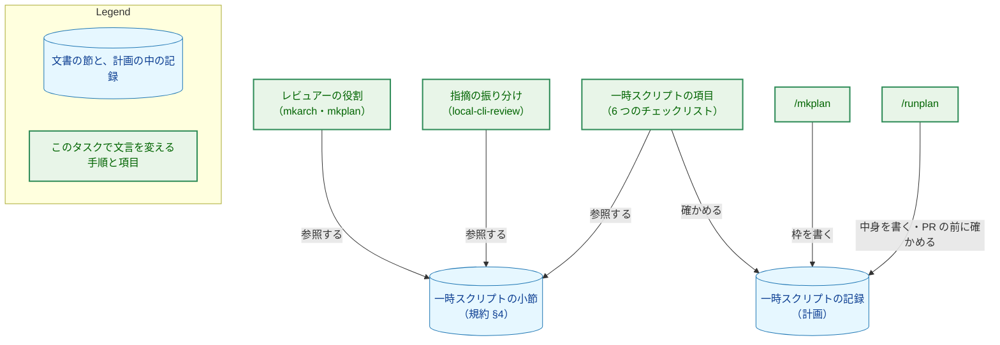
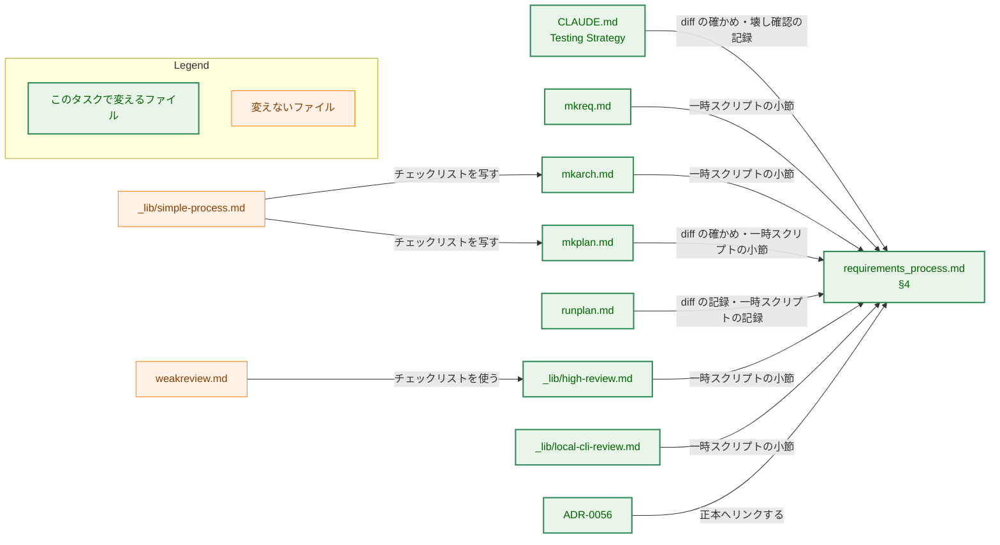
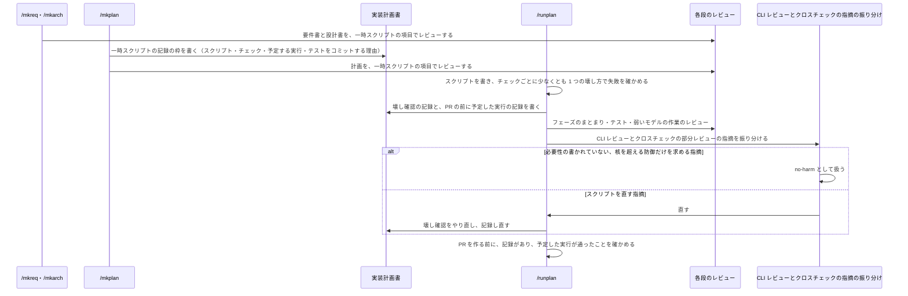
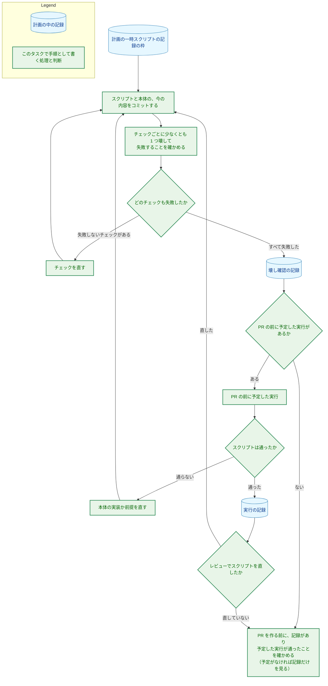
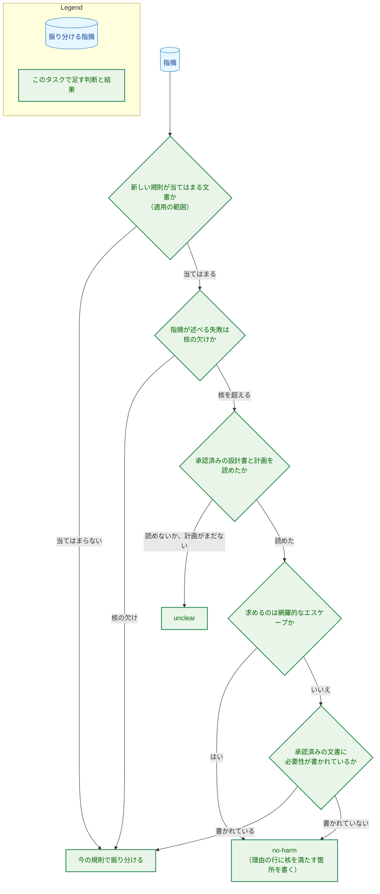

# アーキテクチャ設計書：タスク専用の一時スクリプト（`_checks/`）とそのテストを、実行回数と用途に見合う規模にする

## Document Status

| Item | Value |
|---|---|
| Status | `draft` |
| Created | 2026-11-25 |
| Review date | - |
| Reviewer | - |
| Comments | - |

本書は [01_requirements.md](01_requirements.md)（要件定義書。以下、要件書）の設計である。既存のファイルの内容は、コミット `fb84fa01` で確かめた。`file:line` の行番号は、このコミットでの行番号である。F-NNN・AC-NN は要件書の項番を、H-NN は [design_handoff.md](design_handoff.md)（以下、申し送り）の項番を指す。申し送りへの対応は付録 A に、受け入れ基準との対応は付録 B にまとめる。

本書は、要件書 6 章の用語（一時スクリプト・一時スクリプトのテスト・常設のツール・核・想定運用環境・壊し確認・移行ゲート）を、要件書と同じ意味で使う。「規約」は `docs/dev/conventions/requirements_process.md` を指す。そのほかに、次の用語を使う。

-   **一時スクリプトの小節:** 規約の §4 に新しく置く小節。一時スクリプトの基準の正本である（3.1）。
-   **一時スクリプトの項目:** AC-12 の 6 つのチェックリスト（一覧は 3.2）のそれぞれに置く、一時スクリプトとそのテストが過剰でないかを確かめる項目（3.2）。過大な `diff` の確かめの既存の 3 つの項目も、これに置き換える。
-   **一時スクリプトの記録:** 計画の受け入れ基準の確かめの章に、一時スクリプトごとに置く記録。予定する実行、壊し確認の記録、実行の記録からなる（3.3）。
-   **新しい記録の規則:** 一時スクリプトの記録を書き、PR を作る前に確かめる規則（3.3、3.7）。この規則が `main` に入った後に承認された計画にだけ当てはまる（3.1 の「適用の範囲」）。
-   **実装の PR:** 本タスクの実装の 1 本の PR（1.2 の決定 5）。本書の PR と、実装計画書の PR は含まない。

## 1. 設計の全体像 (Design Overview)

### 1.1. 設計原則

-   **基準の正本を規約の 1 か所にする。** 一時スクリプトの定義・比例原則・核・想定運用環境の既定・テストの基準・記録・計画の規則・適用の範囲は、規約の一時スクリプトの小節に置く（H-01）。コマンドの定義は、自分が実行する部分と、その段で見ることだけを書き、基準は小節を参照する。
-   **どのレビューにも規約を渡す。** 一時スクリプトの項目は小節を参照するので、その項目を当てはめるレビュアーは規約を読めなければならない。今、規約を渡さないレビューは `runplan.md` の step 7 と step 7.5 だけなので、その 2 つの FILES に規約を足す（1.2 の決定 2）。
-   **既存の文を書き換えて足す。** `diff` の確かめの「Proportion」の箇条のうちスクリプトの部分と、過大な `diff` の確かめの 3 つの項目は、一時スクリプト全般の規則に置き換える。同じ内容を別の箇条に足して、古い文を残すことはしない（1.2 の決定 1）。
-   **実行する手順のない規則を置かない。** 一時スクリプトの記録は、枠を `/mkplan` が書き、中身を `/runplan` が書く。記録があり、予定した実行が通ったことは、`/runplan` が PR を作る前に確かめる（3.3、3.7）。記録の後にスクリプトを直した者は、壊し確認をやり直して記録し直す。それが行われたかは、PR のレビューで読む（1.2 の決定 6）。
-   **新しい道具・guard・Go のテストは足さない。** 記録の確かめは、記録を読んで有無と結果を見るだけで、`_checks/` のスクリプトを実行しない。

### 1.2. 設計の際に決めたこと（2026-11-25）

1.  **過大な `diff` の確かめの既存の項目と、一時スクリプトの新しい項目（AC-12）を、1 つの項目に統合する（H-02）。** 既存の項目は `.claude/commands/mkplan.md:164`・`.claude/commands/runplan.md:226`・`.claude/commands/_lib/high-review.md:647-654` にある。統合した項目（一時スクリプトの項目）は、一時スクリプト全般の基準を見る。`diff` の確かめに固有の点（記録する出力の大きさ、シェルの既定）も、その中に残す。
    -   採らなかった案：既存の項目を残し、別の項目を足す案。前のタスクの `_checks/` を写させない規則と、壊し方を並べ挙げない規則が 2 つの項目に重なり、レビュアーが片方だけを見る。
    -   人の答え：1 つの項目に統合することを選んだ。
    -   ADR：[ADR-0056](../../dev/adr/0056-checks-script-proportion.md) を更新した。過大さを指摘する観点の置き方は、ADR-0056 の決定の一部であるためである。
2.  **一時スクリプトの項目は、その段で見ることを短く述べ、基準そのものは規約の一時スクリプトの小節を参照する。** `runplan.md` の step 7 と step 7.5 の FILES に規約を足す（H-02）。6 つのチェックリストのうち、レビュアーに規約を渡さないのは、`runplan.md` の step 7（FILES は設計書・計画・変えたファイル、`.claude/commands/runplan.md:218`）と step 7.5（FILES はテストのファイル・`CLAUDE.md`・計画、`:242-244`）だけである。ほかの 4 つは規約を渡す。`mkreq.md`（`.claude/commands/mkreq.md:219-223`）、`mkarch.md`（`.claude/commands/mkarch.md:116`）、`mkplan.md`（`.claude/commands/mkplan.md:146`）、`_lib/high-review.md`（Procedure の step 1 で規約を読み、FILES にも入れる。`.claude/commands/_lib/high-review.md:276-280`、`:427`）がそれに当たる。
    -   採らなかった案：規約に基準の要約を 1 つ置いて 6 つの項目にそのまま写し、写しが一致することを Go の guard で確かめる案。文書のテストの方針（`CLAUDE.md:826-831`、[ADR-0016](../../dev/adr/0016-document-test-policy.md)）の例外になり、要件書（4.1 節と 5 章）も変えることになる。規約を渡さないレビューは 2 つだけなので、規約を渡せば写しは要らない。また、1 つの文を全段に写すと、計画の段にはまだない記録の義務などが、要件・設計・計画の項目にも入る。
    -   人の答え：最初はこの案を選んだ。ただし、その判断の前提となった説明に「`_lib/high-review.md` と `/weakreview` も規約を読まない」という誤りがあった。この誤りを正したうえで、人が規約を渡す案を選び直した。
    -   ADR：[ADR-0056](../../dev/adr/0056-checks-script-proportion.md) を更新した。ADR-0016 は変えない。
3.  **一時スクリプトの振る舞いを述べる AC の確かめのラベルは `test` とし、確かめの行には、そのスクリプトと、計画にある一時スクリプトの記録を名指す（H-06）。** 規約は、どの AC にも `test`・`static`・`diff` のどれかを求める（`docs/dev/conventions/requirements_process.md:799`）。`mkplan.md` も、確かめの行に「実行される確かめ」を名指させ、その中に「コミットしたスクリプト」を含める（`.claude/commands/mkplan.md:103`）。一時スクリプトはコミットするので、`test` のままでこの 2 つの規則を満たせる。
    -   採らなかった案：新しいラベルを足す案。意味ははっきりするが、ラベルを並べる箇所（規約の §3・§4・§5、`mkplan.md`・`runplan.md`・`_lib/high-review.md`）をすべて直すことになる。
    -   採らなかった案：`manual` とする案。どの AC にも `test`・`static`・`diff` のどれかを求める規則に、新しい例外が要る。
    -   人の答え：`test` を選んだ。
    -   ADR：[ADR-0056](../../dev/adr/0056-checks-script-proportion.md) を更新した。以後のタスクの計画の確かめ方を縛るためである。
4.  **一時スクリプトの記録は、計画の受け入れ基準の確かめの章に、一時スクリプトごとにまとめて置く。** 枠は `/mkplan` が、中身は `/runplan` が書く。記録のコミットの ID は、確かめた内容を持つコミットを指す。未コミットの変更を残したまま壊し確認や予定した実行をせず、その時点の内容を先にコミットする（3.3）。新しい記録の規則が当てはまる計画では、この記録が、壊し確認をコミットメッセージに書く規則に代わる。そのことを `CLAUDE.md`「Testing Strategy」に 1 文で書く（H-07、H-04）。`CLAUDE.md:781-786` は、テストをコミットする前に壊し確認をし、そのことをコミットメッセージに書けと定める。一時スクリプトのテストは既定ではコミットしないので、この規則の「コミットする前」が当たらない。また、記録が計画とコミットメッセージに分かれると、レビュアーが両方を探すことになる。計画が理由を書いてコミットしたテストには、記録とあわせて今の規則も当てはめる。
    -   採らなかった案：計画とコミットメッセージの両方に書く案。記録が 2 か所に分かれる。
    -   採らなかった案：未コミットの変更を残したまま確かめ、その変更の内容を記録に写す案。記録が差分の写しになってレビュアーの読む量が増え、どの内容を確かめたかは、結局はコミットの ID をたどって読むことになる。
    -   人の答え：計画に置き、`CLAUDE.md` に参照の 1 文を足すことを選んだ。
    -   ADR：[ADR-0056](../../dev/adr/0056-checks-script-proportion.md) を更新した。以後のタスクの計画と実装の手順を縛るためである。記録の ID が確かめた内容を示すことも、その決定に含めた。
5.  **実装は 1 本の PR にする。** 規約・コマンドの定義・`CLAUDE.md`・ADR-0056 の直しを、まとめて入れる。本タスクの規則は同時に `main` に入るので、適用の範囲の境目が 1 つになる。食い違いの記述も一度に取り除けるので、途中の形に書き換える手間がない。変更は文だけで、量も中程度である。最終の境界は、実装計画書（`/mkplan`）で決める。
    -   採らなかった案：規約と `CLAUDE.md` を先に、コマンドの定義と ADR を後に入れる 2 本の案。読む量は分かれるが、規則ごとに境目が分かれ、食い違いの記述を途中の形に書き換えることになる。
    -   人の答え：1 本を選んだ。
    -   ADR：なし。本タスクの中で閉じる、実装の順序の選択である。
6.  **記録の古さを機械で確かめる仕組みと、`/runpr` の PRE_MERGE でマージを止める仕組みは置かない。** `/runplan` が PR を作る前に、記録があり、予定した実行が通ったことを確かめる（3.7）。PR を作った後に `_checks/` のスクリプトを直した者（`/fixpr` の修正を含む）が、壊し確認をやり直して記録し直すことは、規約の小節に書く。それが行われたかは、PR のレビューとフェーズのまとまりのレビューで読む。`runpr.md` と `fixpr.md` は変えない。要件書は、記録の手順を「計画を書くコマンドと実装するコマンド」に置くとしている（要件書 2.2 節）。一方で、記録の古さを機械で確かめる仕組みを足そうとすると、補助のファイル、確かめる対象のファイル、squash merge で消えるコミット、記録の枠のないスクリプトなど、塞ぐべき穴が次々に出た。それは、本タスクが止めようとしている過剰な一時スクリプトの仕組みと同じ形である。
    -   採らなかった案：記録したコミットと HEAD のスクリプトの内容を `git` で比べ、`/runplan` の PR の前と `/runpr` の PRE_MERGE で止める案。比べるパスを補助のファイルと対象まで広げ、結果が通ったことも求め、`fixpr.md` に記録し直しの手順を足すことになる。要件書のスコープ（2.2 節）にも `runpr.md` を足すことになる。
    -   人の答え：仕組みを置かないことを選んだ。
    -   ADR：[ADR-0056](../../dev/adr/0056-checks-script-proportion.md) を更新した（採らなかった案）。

**上の決定と要件書から導いたこと（PR のレビューで異論があれば改める）:**

-   **一時スクリプトの小節は、規約の §4 に、`` ### `diff` verification `` の前の `###` の小節として置く（H-01）。** `diff` の確かめのスクリプトは一時スクリプトの 1 つなので、一般の規則を先に置き、`diff` の確かめの小節がそれを参照する。ADR-0056 の決定も、正本を規約の「4. Acceptance Tests」としている。ADR：なし。
-   **`diff` の確かめの「Proportion」の箇条（`docs/dev/conventions/requirements_process.md:838`）は、2 つに分ける。** スクリプトの部分は、一時スクリプトの小節への参照に置き換える。記録した差分の読み取りの部分（記録する出力を、確かめる差分に見合った大きさにすること）は、この箇条に残す（H-01）。記録した差分の読み取りは一時スクリプトではない。その比例原則は、`diff` の確かめに固有の規則として ADR-0016 に残っている（要件書 2.3 節）。「Script」の箇条（`:839`）は、壊し確認の文を一時スクリプトの記録への参照に置き換え、既定の言語（シェル）と、出力と 2 つのコミットの ID の記録は残す。ADR：なし。
-   **一時スクリプトの記録を承認済みの計画に書き足すことは、決定の変更でも編集上の訂正でもなく、実行の記録である（H-07）。** 進み具合のチェックボックスや、`diff` の確かめの差分の記録（`docs/dev/conventions/requirements_process.md:842`）と同じ扱いである。計画が承認した内容（どのスクリプトに、どのチェックと実行があるか）は変えないためである。スクリプトのチェックや予定する実行を足すか減らすときは、今の規則のとおり計画の決定の変更になる。核を超える防御の必要性の記述を足すことも、決定の変更である（3.9）。ADR：なし。既存の規約を当てはめただけである。
-   **一時スクリプトの項目が当てはまらない場合と、まだ計画のないタスクでの扱い（H-05）。** `_checks/` はタスクのディレクトリの下にしかない。そのため、一時スクリプトの項目と振り分けの規則は、核を超える防御の必要性を、そのタスクの承認済みの設計書と計画から読む。項目が当てはまらない（N/A）のは、次の場合である。文書を見るチェックリスト（要件・設計・計画）では、文書が一時スクリプトも `diff` の確かめも求めないとき。差分の範囲を見るチェックリスト（フェーズのまとまり・テスト・弱いモデルの作業）では、範囲が `_checks/` にも計画の差分の記録にも触れないとき。要件書だけの PR でも、要件書が移行ゲートを求めるなら、要件のチェックリストの項目は当てはまる。これは `/weakreview` の範囲と、`/runpr` の standalone の変更にもそのまま当てはまる。計画がまだないタスク（要件書か設計書の PR が `_checks/` に前提の確認を置く場合など）では、必要性は後の計画に書かれうる。そのため、核を超える防御を求める指摘は `no-harm` にせず、`unclear` とする（3.9）。ADR：なし。
-   **適用の範囲は、規則の種類ごとに具体的に定める（3.1 の「適用の範囲」）。** `diff` の確かめについて前からある規則（スクリプトとその記録の大きさ、シェルの既定、`diff` のスクリプトを前のタスクから写させない規則、壊し方を並べ挙げない規則）は、今の境目（タスク 0080 の項目が `main` に入った時）のまま当てはめる。本タスクが加える規則は、それが `main` に入る前に承認された文書と、その `_checks/` には当てはめない。「前に承認された」は、`main` の squash commit の祖先関係で決め、承認がまだ `main` にない文書は後に承認された文書として扱う（3.1）。ADR：なし。ADR-0056 の決定（規則ごとの境目）をそのまま具体にしただけである。
-   **`docs/dev/conventions/dev_tools.md` は変えない（H-04）。** 同書は、開発ツールを `cmd/<name>` と `internal/<name>` の組と定める（`docs/dev/conventions/dev_tools.md:12-14`）。`_checks/` のスクリプトはこの組ではないので、一時スクリプトの定義（AC-01）と食い違わない。ADR：なし。
-   **`CLAUDE.md`「Testing Strategy」の `diff` の確かめの文（`CLAUDE.md:832-836`）は変えない（H-04）。** この文は、`diff` の確かめのスクリプトを `_checks/` に置くと述べるだけで、`_checks/` を `diff` の確かめの置き場所に限ってはいない。ADR：なし。

### 1.3. なぜ今の書き方では足りないか

今の規約とコマンドの定義には、一時スクリプト全般の基準がない。比例原則は `diff` の確かめにしか当てはまらない（`docs/dev/conventions/requirements_process.md:838`）。過大さを指摘する 3 つの項目も、`diff` の確かめだけを見る（`.claude/commands/mkplan.md:164`、`.claude/commands/runplan.md:226`、`.claude/commands/_lib/high-review.md:647-654`）。核・想定運用環境の既定・テストをコミットするかの基準・壊し確認の記録は、どこにもない。そのため、移行ゲートのような一時スクリプトには、どの段のレビューも常設のツールの基準を当てはめうる（要件書 1 章の 0121 の例）。

これらは文言の欠けで、文言を足せば直せる。新しい道具が要る要件はない。記録の確かめも、`/runplan` が PR を作る前にすでに行う、`diff` の確かめの記録の有無の確かめ（`.claude/commands/runplan.md:110`）に足す。

### 1.4. 概念モデル

図 1 に、一時スクリプトの基準の正本と、それを使う手順の関係を示す。矢印 A → B は「A が B を参照する、書く、または確かめる」を表す。

-   **正本。** 一時スクリプトの小節が、定義から適用の範囲までのすべての規則を持つ（3.1）。
-   **参照。** チェックリストの項目・レビュアーの役割・振り分けの規則は、小節を参照する。どのレビュアーも規約を読める（1.2 の決定 2）。
-   **記録。** 一時スクリプトの壊し確認と実行の結果は、計画の一時スクリプトの記録に残し、PR を作る前に確かめる（3.3、3.7）。

## 2. システム構成 (System Structure)

### 2.1. 全体構成

本タスクは、規約・コマンドの定義・`CLAUDE.md`・ADR の文言だけを変える。製品のコンポーネント（拡張・記事の生成のモジュール・CLI）と、開発ツール（`fixprguard`・`mergepr`・`chief`・`numreserve` など）は変わらない。図 2 に、変えるファイルが、このタスクの規則の正本をどう参照するかを示す。矢印 A → B は「A が B の規則を参照する、B を読ませる、または B のチェックリストを使う」を表す。

図 2 のうち、次の矢印は今ある関係である。ほかの矢印と、ラベルの「一時スクリプトの小節」「一時スクリプトの記録」「壊し確認の記録」の部分は、実装の PR で加わる。

-   Testing Strategy → §4（「diff の確かめ」）：`CLAUDE.md:832-836` が §4 を参照する。
-   `mkreq.md`・`mkarch.md`・`mkplan.md`・`_lib/high-review.md` → 規約：それぞれのレビュアーに規約を渡す（1.2 の決定 2 に挙げた箇所）。`mkplan.md` は、確かめの種類の定義でも §4 を参照する（`.claude/commands/mkplan.md:106`、`:125`）。
-   `runplan.md` → §4（「diff の記録」）：step 5 の記録が §4 を参照する（`.claude/commands/runplan.md:100`）。
-   `weakreview.md` → `_lib/high-review.md`：step 5 が high-review の entry 2 に従う（`.claude/commands/weakreview.md:130`）。
-   `_lib/simple-process.md` → `mkarch.md`・`mkplan.md`：「Reviewing the three documents」が両者のチェックリストを写す（`.claude/commands/_lib/simple-process.md:200-204`）。
-   ADR-0056 → §4：「決定」のリンク。

### 2.2. コンポーネント配置

| ファイル | PR | 変更の内容 |
|---|---|---|
| `docs/dev/conventions/requirements_process.md` | 実装の PR | §4 に一時スクリプトの小節を足す（3.1）。`diff` の確かめの「Proportion」と「Script」の箇条を書き換える（1.2）。§4 の冒頭の 2 つの箇条に、一時スクリプトの扱いを足す（3.1） |
| `.claude/commands/mkreq.md` | 実装の PR | 「Requirements checklist」に一時スクリプトの項目を足す（3.6） |
| `.claude/commands/mkarch.md` | 実装の PR | Reviewer B の役割に、一時スクリプトの扱いを足す。「Technical correctness checklist」に一時スクリプトの項目を足す（3.5） |
| `.claude/commands/mkplan.md` | 実装の PR | step 6 の AC の行の規則・確かめの種類の定義・壊し確認の記録の文に、一時スクリプトの記録を足す。`diff` の確かめの計画の規則を、一時スクリプト全般の規則と `diff` の確かめに固有の規則に分ける。Reviewer B の役割を直す。「Technical correctness checklist」の過大な `diff` の確かめの項目を一時スクリプトの項目に置き換え、変異の項目の除外を一時スクリプト全般にする（3.4） |
| `.claude/commands/runplan.md` | 実装の PR | step 5 の記録を、一時スクリプト全般の壊し確認と記録にする。step 5a と step 8 のタスクの終わりの確かめに、一時スクリプトの記録の確かめを足す。step 7 と step 7.5 の FILES に規約を足す。「Phase-group review checklist」の過大な `diff` の確かめの項目を一時スクリプトの項目に置き換える。「Test-review checklist」に一時スクリプトの項目を足す（3.7） |
| `.claude/commands/_lib/high-review.md` | 実装の PR | 「Weak-model failure checklist」の過大な `diff` の確かめの項目を一時スクリプトの項目に置き換える。「Cross-document synchronization」の確かめの行の項目に、一時スクリプトの記録を名指す `test` の行を足す（3.10） |
| `.claude/commands/_lib/local-cli-review.md` | 実装の PR | 「Triage rules」に、一時スクリプトに核を超える防御を求める指摘の扱いを足す（3.9） |
| `CLAUDE.md` | 実装の PR | 「Testing Strategy」の「Every test must be able to fail for its stated reason」に、`_checks/` の壊し確認の記録の 1 文を足す（3.11） |
| `docs/dev/adr/0056-checks-script-proportion.md` | 本書の PR、実装の PR | 本書の PR：1.2 の決定 1〜4 と 6 を「決定」「採らなかった案」「経緯」に足し、食い違いの記述を広げた。実装の PR：「決定」の仕様の置き場所の示し方を規約の小節へ向け直し、食い違いの記述を取り除く（3.12） |
| `docs/tasks/0124_checks_proportion/03_implementation_plan.md` | 実装計画書の PR、実装の PR | 実装計画書（`/mkplan` の PR が作る）。実装の PR は、進み具合と確かめの結果を記録する |

次のファイルは変えない。

-   `.claude/commands/weakreview.md` と `.claude/commands/_lib/simple-process.md`。どちらも、変えるチェックリストを使うか写すだけである（2.1）。
-   `.claude/commands/_lib/triage-pattern.md`。`no-harm` の定義（`.claude/commands/_lib/triage-pattern.md:54-55`）は「該当しない指摘」を含み、AC-15 の扱いはそれに当たる。
-   `.claude/commands/runpr.md` と `.claude/commands/fixpr.md`（1.2 の決定 6、3.8）。`/fixpr` の修正が一時スクリプトを変えたときに壊し確認をやり直すことは、規約の小節が定め、PR のレビューで読む。Phase 4.5 の CLI レビューは `_lib/local-cli-review.md` に従うので、AC-15 の規則が効く。PR のレビューのスレッドの振り分けは、要件書の範囲（AC-15 は CLI レビューとクロスチェックの部分レビュー）の外である（9 章）。
-   `docs/dev/conventions/dev_tools.md`（1.2）。
-   `docs/dev/adr/0016-document-test-policy.md`。記録した差分の読み取りに固有の規則は変わらず、ADR-0056 へのリンクもすでにある。
-   `.claude/commands/_context.md` と `.agents/skills/`。チェックリストも規約の節も名指さない。
-   文書を読む guard（3.13）。
-   ほかのタスクのディレクトリと、その `_checks/`（AC-18、要件書 2.3 節）。
-   ADR の索引 `docs/dev/adr/README.md`。ADR-0056 の題名は変わらない。

### 2.3. データフロー

図 3 に、新しい記録の規則が当てはまる計画で、一時スクリプトを使うタスクの、要件からマージまでの流れを示す。矢印は、呼び出しと受け渡しの順序を表す。シーケンス図には色分けがないので、Legend を置かない。

## 3. コンポーネント設計 (Component Design)

規約とコマンドの定義は英語で書く（要件書 5 章）。本章は、各ファイルに書く内容と置き場所を定める。英語の文面は実装の PR で書く。

### 3.1. 規約の一時スクリプトの小節（AC-01〜AC-09、AC-11、AC-17、H-06）

規約の §4 の、`` ### `diff` verification ``（`docs/dev/conventions/requirements_process.md:834`）の前に、一時スクリプトの小節を `###` の見出しで置く。見出しの文面は実装の PR で決める。小節には、次の箇条を置く。

| 箇条 | 内容 | AC など |
|---|---|---|
| 定義 | タスクの `_checks/` に置くスクリプトとその補助のファイルを、用途（`diff` の確かめ、移行ゲート、前提の確認）によらず一時スクリプトとする。常設のツール（開発ツール、CI のスクリプト、`.claude/commands/_lib/` のスクリプト、`make test` で実行するテスト）と区別する。`make test` と CI は実行しない（`go list ./...` は `_` で始まるディレクトリを無視する。今の `requirements_process.md:839` の記述をここへ移す） | AC-01 |
| 比例原則 | 一時スクリプトとそのテストの設計と規模を、本体の変更の規模・実行回数・想定運用環境に見合ったものにする | AC-02 |
| 核 | 次の 4 つの性質である。目的のものを検出すること。正常なときに検出しないこと。異常なときにフェイルクローズすること（判定できないとき、読めない入力を含めて、通ったと報告しない）。呼び出し元（作業ツリー、リポジトリ、環境）を汚さないこと | AC-03 |
| 他者が書いた入力 | 読めない入力と、受け入れる形に合わない入力では、通ったと報告しない（フェイルクローズの性質）。他者が書いた文字列を端末やファイルに出すときは、制御文字を見える形に置き換える（呼び出し元を汚さない性質）。Unicode の分類による網羅的なエスケープは、設計書か計画が脅威を書いても求めない | AC-04 |
| 核を超える防御 | 承認済みの設計書か計画が、実運用上の具体的な必要性（どの実行で、どの状況や脅威が起きるか）を書いたときだけ入れる。書かれていない防御は求めない。網羅的なエスケープは、必要性を書いても入れない | AC-05 |
| 想定運用環境 | 既定は、実行する人またはエージェントの手元の機械にあるこのリポジトリの作業ツリー（`main` のチェックアウトか linked worktree）。クラウドのセッションは入れない。ほかの環境への耐性は、その環境で実行すると設計書か計画が書いたときだけ求める | AC-06 |
| 投稿とコミット | 出力を GitHub に投稿するときは、メンションの検査とネットワークの操作の承認（`CLAUDE.md`「Tool Execution Safety」）で守る。出力をコミットするときは、PR のレビューで読む。この小節の基準は、それらの規則を緩めない | AC-07 |
| テスト | 既定ではコミットしない。テストの入力も同じく扱う。コミットするのは計画が具体的な理由を書いたときだけで、「レビューの修正の後に再実行するため」だけでも、「AC の実行できる確かめにするため」だけでも理由にならない。理由が足りるかは、計画を書く者とレビュアーが判断する。コミットするテストも、核の代表ケースに限る。エッジケースを網羅するテストは書かない | AC-08・AC-09 |
| 壊し確認と記録 | 各チェックが少なくとも 1 つの壊し方で失敗することを確かめ、3.3 の一時スクリプトの記録に残す。壊し確認と予定した実行は、その時点の内容をコミットしてから行う。レビューの後に直したときは、直した者（PR を作った後の `/fixpr` の修正を含む）が、壊し確認をやり直して記録し直し、直す前に済んだ予定の実行もやり直す（やり直せない実行はその旨を記録する）。新しい記録の規則が当てはまる計画では、この記録が、`CLAUDE.md`「Testing Strategy」の、壊し確認をコミットメッセージに書く規則に代わる。計画が理由を書いてコミットしたテストには、その規則も当てはめる | AC-08 |
| AC の確かめ | 一時スクリプトの振る舞いを述べる AC は、ラベルを `test` とし、確かめの行にそのスクリプトと一時スクリプトの記録を名指す（1.2 の決定 3） | H-06 |
| 計画の規則 | 計画は、前のタスクの `_checks/` を手本として写させない。壊し方は「各チェックが少なくとも 1 つの壊し方で失敗する」とだけ書き、並べ挙げない。どちらも一時スクリプトのすべてに当てはまる | AC-11 |
| 適用の範囲 | 規則の種類ごとに定める（表の下の「適用の範囲の詳細」） | AC-17 |

**適用の範囲の詳細:**（1.2 のとおり）

-   **前からある規則。** `diff` の確かめについて前からある規則は、今と同じく当てはめる。タスク 0080 の前に承認された計画を除く今の境目は、そのまま残る。
-   **本タスクが加える規則。** それが `main` に入った後に承認された文書に、文書ごとに当てはめる。それより前に承認された文書と、その文書に従って作る `_checks/` には当てはめず、そうした文書が求めることを過剰と指摘しない。
-   **「前に承認された」の決め方。** `main` の上で決める。その文書の最初の承認を `main` に入れた squash commit が、規則を `main` に入れた squash commit の真の祖先であるときをいう。
    -   規則と同じ PR で承認された文書と、承認がまだ `main` にない文書は、後に承認された文書として扱う。
    -   決定の変更で `draft` に戻り、承認し直した文書も、最初の承認で決める。承認し直しで、すでに作った `_checks/` を新しい規則へ移さないためである（F-006）。
    -   本タスクの規則は 1 本の PR で入るので（1.2 の決定 5）、規則を `main` に入れた squash commit は 1 つである。
    -   承認は PR のブランチのコミットで記録され、squash merge の後はそのコミットが `main` の祖先にならない。そのため、ブランチのコミットでは決めない。

あわせて、§4 の既存の文を次のように変える。

-   **テストの置き場所の箇条（`docs/dev/conventions/requirements_process.md:796`）と、確かめの種類の箇条（`:799`）。** `:796` は、テストを `*_test.go` に置けと定める。そこに、一時スクリプトとそのテストは小節に従うことを 1 句足す。`:799` には、一時スクリプトを対象とする AC の確かめ方（上の「AC の確かめ」）を、小節への参照として 1 句足す。§3 の「AC traceability」（`:784-788`）と §5 の項目（`:915`）は、ラベルの並びが変わらないので変えない。
-   **`diff` の確かめの「Proportion」と「Script」の箇条（`:838`、`:839`）。** 1.2 のとおり書き換える。「Recorded diff reading」の箇条とその後の小節は変えない。

### 3.2. 一時スクリプトの項目（AC-12、AC-16）

6 つのチェックリストのそれぞれに、一時スクリプトの項目を 1 つ置く。各項目は、次の 3 つを持つ。

-   **その段で見るもの。** 段ごとに違い、下の表の「見るもの」の列のとおりである。
-   **過剰の判断の基準。** 基準は書き写さず、規約の一時スクリプトの小節を名指して、それに照らすと述べる。項目に書くのは、その段で見落としやすい点の名前だけである。核を超える防御と必要性の記述、網羅的なエスケープ、想定運用環境の外への耐性、理由のないテストのコミット、代表ケースを超えるテスト、前のタスクの `_checks/` の写し、壊し方の並べ挙げ、`diff` の確かめの記録の大きさとシェルの既定がそれに当たる。
-   **適用の範囲。** 小節の「適用の範囲」の箇条のとおりに当てはめる、と 1 句で述べる。

| チェックリスト | 見るもの | 今の項目 |
|---|---|---|
| `mkreq.md` の「Requirements checklist」（`.claude/commands/mkreq.md:233-249`） | 要件書が一時スクリプト（移行ゲートなど）に求めること | なし（足す） |
| `mkarch.md` の「Technical correctness checklist」（`.claude/commands/mkarch.md:125-`） | 設計書が一時スクリプトに求めること | なし（足す） |
| `mkplan.md` の「Technical correctness checklist」（`.claude/commands/mkplan.md:152-`） | 計画が `_checks/` について書くこと（一時スクリプトの記録の枠を含む） | `:164` を置き換える |
| `runplan.md` の「Phase-group review checklist」（`.claude/commands/runplan.md:223-`） | このフェーズのまとまりで書いた `_checks/` と、その記録 | `:226` を置き換える |
| `runplan.md` の「Test-review checklist」（`.claude/commands/runplan.md:257-`） | このフェーズのまとまりでコミットした `_checks/` のテスト | なし（足す） |
| `_lib/high-review.md` の「Weak-model failure checklist」（`.claude/commands/_lib/high-review.md:566-`） | この範囲で足した `_checks/` と、その記録 | `:647-654` を置き換える |

-   項目が当てはまらない場合は、1.2 の H-05 の項目のとおりである。計画の差分の記録だけを使う計画やフェーズのまとまりでも、記録の大きさを見るために項目は当てはまる。
-   記録があるかを見るのは、記録が書かれた後の段（`runplan.md` の「Phase-group review checklist」と `_lib/high-review.md`）だけである。要件・設計・計画の段の項目は、記録を求めない。計画の段は、記録の枠があるかを見る。
-   既存の 2 つの項目の適用の範囲の文（`runplan.md:226` と `_lib/high-review.md:652-654` の「This item does not apply to a plan approved before this item reached `main`」）は、小節の「適用の範囲」の箇条への参照に置き換わる。
-   `mkreq.md` の項目は、タスク 0080 で人が選ばなかった、AC の並べ挙げを指摘する項目とは別のものである（要件書 1 章）。要件書が一時スクリプトへの求めを持たないときは、項目は当てはまらない。

### 3.3. 一時スクリプトの記録（H-07、AC-08）

計画の受け入れ基準の確かめの章に、`_checks/` のスクリプトごとに記録を 1 つ置く。

| 要素 | 書く者と時点 | 内容 |
|---|---|---|
| スクリプト | `/mkplan`（計画を書くとき） | `_checks/` の中のパス、用途、確かめる AC（ないときはその旨） |
| チェック | `/mkplan` | スクリプトのチェックの名前。壊し方は書かず、「各チェックが少なくとも 1 つの壊し方で失敗すること」とだけ書く（AC-10） |
| 予定する実行 | `/mkplan` | 各実行の時点（実装を始める前、PR を作る前、マージの直前など）と、実行者 |
| テスト | `/mkplan` | テストをコミットするときだけ、そのパスと具体的な理由 |
| 壊し確認の記録 | `/runplan`（スクリプトを書いた後） | 壊し確認をした内容を持つコミットの ID（1 つ）。チェックごとに、行った壊し方と、スクリプトが失敗したこと（終了コード） |
| 実行の記録 | 実行者（予定する実行の行のとおり） | 予定した実行ごとに、確かめた内容を持つコミットの ID と結果（下の「記録のコミットの ID」）。`diff` の確かめのスクリプトは、今の規則のとおり、AC の確かめの行に出力と 2 つのコミットの ID を記録し、ここではその行を指す |

-   **記録のコミットの ID。** 壊し確認の記録と実行の記録のコミットの ID は、確かめた内容を持つコミットを指す。確かめた内容には、スクリプトと、失敗の後に直した本体の実装か前提を含む。未コミットの変更を残したまま壊し確認や予定した実行をせず、その時点の内容を先にコミットする（図 4 の WRITE。壊すために一時的に加える変更は除く）。壊し方は作業ツリーに加える変更で、コミットしない。そこで、壊す前の内容をコミットしてから壊し確認をし、そのコミットの ID を記録する。この ID は、レビュアーが、どの内容で壊し確認と実行をしたかを読むためのものである。機械による古さの確かめには使わない（1.2 の決定 6）。
-   **記録し直し。** レビューの後にスクリプトを直したときは、壊し確認をやり直し、壊し確認の記録の全体を置き換える。直したのが 1 つのチェックだけでも同じである。どのチェックが直しの影響を受けるかを判断せずに済む。直す前に済んだ予定した実行も、直したスクリプトでやり直して実行の記録を置き換える。やり直せない実行（実装を始める前の実行のように、その時点を過ぎた実行）は、やり直せない旨を実行の記録に書く。PR を作った後の直し（`/fixpr` の修正を含む）でも、直した者が同じことを行う。規約の小節にこう書き、行われたかは PR のレビューで読む。
-   **実行が失敗したとき。** 予定した実行でスクリプトが「通らない」と報告したときは、本体の実装（あるいは前提）を直し、直した内容をコミットしてからやり直す（図 4 の WRITE）。スクリプトを直したときは、上の記録し直しを行う。
-   **マージの直前の実行。** 計画がマージの直前に実行を予定したスクリプト（0121 の移行ゲートの 2 回目など）は、PR のレビューが終わった後に、計画が名指す実行者（人か、人が指示したエージェント）が実行し、実行の記録を計画に書いてコミットする。その記録をマージの前に読むのは、実行者とマージを決める人である。
-   **並べ挙げとの関係。** 壊し確認の記録は、実際に行った壊し方を書く。計画が前もって壊し方を並べ挙げることとは違い、AC-10 の規則に触れない。
-   **計画の印との関係。** 記録に出力を書くときはコードブロックに入れる。計画の印を読むコマンドがコードブロックの中を読み飛ばすことは、今の規約のとおりである（`docs/dev/conventions/requirements_process.md:896`）。コードブロックの外の記録の文には、計画の印（`PR を作成した`、`### PR-N 作成ポイント`、`ステップ`、チェックボックス）を書かない。`internal/chief/task.go` と `.claude/commands/_lib/high-review-decision.sh`・`.claude/commands/_lib/review-records.sh` が、計画のそれらの文字列を読むためである。

### 3.4. `mkplan.md`（AC-10、AC-12、AC-14、AC-16、H-06）

-   **AC の行の規則（`.claude/commands/mkplan.md:103`）と確かめの種類の定義（`:106`）。** `test` の行が名指せるものに、「`_checks/` のスクリプトと、その一時スクリプトの記録」を足す（1.2 の決定 3）。
-   **壊し確認の記録の文（`:108`）。** 「the implementer, who confirms it by breaking the thing and records that in the commit message」に、`_checks/` のスクリプトでは一時スクリプトの記録に残すことを足す（1.2 の決定 4）。そうしないと、新しい `CLAUDE.md` の文と食い違う。
-   **計画の規則（`:125-130`）。** 「Plans with a `diff` verification」の箇条を、2 つの起点に分ける。
    -   **計画が `_checks/` のスクリプトを持つとき。** 一時スクリプトの小節に従う（比例原則・核・想定運用環境・テストの基準は小節を参照し、写さない）。一時スクリプトの記録の枠を 3.3 の形で書く。前のタスクの `_checks/` を手本として写すよう書かない。壊し方は「各チェックが少なくとも 1 つの壊し方で失敗すること」とだけ書き、並べ挙げない（AC-10）。「Match each mutation to the path it breaks」と変異の項目の除外（`:130`）を、`diff` のスクリプトから `_checks/` のスクリプト全般に広げる。
    -   **計画が `diff` の確かめを持つとき。** 今の `diff` の確かめに固有の箇条（作りの大きさ、シェルの既定、記録した差分の読み取りの選び方と比べるパス）を残す。記録した差分の読み取りだけを使う計画も、この起点で規則を受ける。
    -   **適用の範囲。** 規約の「適用の範囲」の箇条のとおりに当てはめると述べる（AC-16）。
-   **パネルの Reviewer B の担当（`:144`）。** 「the proportion of each `diff` verification」の句を、一時スクリプトの項目を B の担当に含める句に書き換える（AC-14）。この項目が見るのは、`_checks/` のスクリプトとそのテスト、`diff` の確かめの記録の釣り合いである。
-   **「Technical correctness checklist」。** `:164` の項目を、3.2 の一時スクリプトの項目に置き換える（AC-12）。変異の項目（`:163`）の「not a `diff` script's breakage」を、`_checks/` のスクリプトの壊し方に広げる。`diff` の項目（`:160`）は変えない。

### 3.5. `mkarch.md`（AC-12、AC-13、AC-16）

-   **Reviewer B の役割（`.claude/commands/mkarch.md:114`）。** 担当の後に、次の 3 点を足す。
    -   一時スクリプトには、運用の観点（障害のモード、環境の違い、敵対的な入力など）を、規約の核と想定運用環境の範囲で当てはめる。
    -   その範囲を超え、設計書か計画に必要性も書かれていない防御を求めることは、過剰な設計として扱う。必要性が書かれた防御は過剰ではない。網羅的なエスケープを求めることは、必要性が書かれていても過剰である。
    -   規約の「適用の範囲」の箇条のとおりに当てはめる（AC-16）。
-   **「Technical correctness checklist」（`:125`）。** 3.2 の一時スクリプトの項目を足す。

Reviewer B の役割は、「EVEN WHERE THE CHECKLISTS ARE SILENT」として運用の観点を広く当てはめさせる（`:114`）。足す文は、その広さを一時スクリプトについてだけ核と想定運用環境に絞る。常設のツールについての担当は変えない。

### 3.6. `mkreq.md`（AC-12）

「Requirements checklist」（`.claude/commands/mkreq.md:233-249`）に、3.2 の一時スクリプトの項目を 1 つ足す。`mkreq.md` のレビュアーには、規約がすでに渡されている（`.claude/commands/mkreq.md:219-223`）。

### 3.7. `runplan.md`（AC-08、AC-12、AC-16）

-   **step 5 の記録（`.claude/commands/runplan.md:100-103`）。** 「For a script, confirm that each of its checks fails …」（`:103`）を、`_checks/` のスクリプト全般の箇条にする。新しい記録の規則が当てはまる計画では、スクリプトを書いた後に壊し確認をし、3.3 の記録を書く。スクリプトを直したときは、壊し確認をやり直して記録し直し、直す前に済んだ予定の実行もやり直す（3.3）。`diff` の確かめのスクリプトの出力の記録は今のまま残す。新しい記録の規則が当てはまらない計画（その規則が `main` に入る前に承認された計画）では、今の規則（壊し確認をコミットメッセージに書くこと、`diff` のスクリプトの出力の記録）のままとする。
-   **PR を作る前の確かめ（step 5a、step 8）。** 新しい記録の規則が当てはまる計画では、step 5a の各チェックポイント（タスクの最後の PR に限らない）と step 8 で、次の 2 つを確かめる。足りないときは、PR を作る前に直す。
    -   この PR が足すか変える `_checks/` のファイルのそれぞれが、一時スクリプトの記録（スクリプトか、その補助のファイル）に名指されていること。記録の枠のないファイルは、計画の決定の変更として人と決める（今の step 5 の「Decision change」の箇条）。
    -   それらのスクリプトに、壊し確認の記録があり、記録のコミットの ID が確かめた内容を持つこと。PR を作る前に予定した実行があるスクリプトでは、その実行の記録があり、最後の結果が「通った」であり、その記録のコミットの ID が、直した後のスクリプトと本体の内容を持つこと。直す前のスクリプトで通った記録だけでは通さない。マージの直前にだけ実行を予定したスクリプトには、実行の記録を求めない（3.3）。前の PR でマージしたスクリプトの記録は、確かめない。
-   **step 7 と step 7.5 の FILES（`:218`、`:242-244`）。** 規約 `docs/dev/conventions/requirements_process.md` を足す（1.2 の決定 2）。
-   **「Phase-group review checklist」（`:226`）。** 3.2 の一時スクリプトの項目に置き換える。`:225` の、`diff` の確かめの記録についての文に、一時スクリプトの記録があることを足す。
-   **「Test-review checklist」（`:257-`）。** 3.2 の一時スクリプトの項目を足す。step 7.5 は、フェーズのまとまりがテストを足さないか変えないときは実行しない（`:254-255`）。この「テスト」には、コミットした `_checks/` のテストも入ると明記する。コミットしないテストは見ないので、この項目は、計画が理由を書いてコミットしたテストの規模と、理由のないコミットを見つけるためのものである。

### 3.8. `runpr.md` と `fixpr.md`（変えない）

1.2 の決定 6 のとおり、`/runpr` の PRE_MERGE に一時スクリプトの記録の確かめを足さず、`/fixpr` にも記録し直しの手順を足さない。PR を作った後にスクリプトを直した者が壊し確認をやり直すことは、規約の小節が定める（3.1 の「壊し確認と記録」、3.3）。

### 3.9. `_lib/local-cli-review.md`（AC-15、AC-16）

「Triage rules」（`.claude/commands/_lib/local-cli-review.md:245-291`）の「Classify」の箇条の後に、次の箇条を足す。

-   **核を先に判断する。** 一時スクリプトへの指摘は、まず、指摘が述べる失敗（提案する直し方ではなく）を核に照らす。次の場合は核の欠けであり、今の規則で振り分ける。
    -   想定運用環境で起きうる入力や状態で、スクリプトが通ったと報告するか、目的のものを検出しない。
    -   他者が書いた文字列の制御文字を置き換えずに出す。
    -   呼び出し元を汚す。他者が書いた文字列を、コードやコマンドのオプションとして解釈すること（引用符のない `eval`・`sh -c` への受け渡し、`-` で始まりうる値をオプションの位置に置くことなど）も、呼び出し元の環境を汚しうるので、これに当たる。
-   **核を超える部分だけを `no-harm` にする。** 指摘が核を超える防御を求め、そのタスクの承認済みの設計書と計画に具体的な必要性が書かれていないときは、その部分の `severity` を `no-harm` とする。網羅的なエスケープを求める部分は、必要性が書かれていても `no-harm` とする。核の欠けと過剰な直し方を同じ指摘が持つときは、核の欠けを直し、過剰な直し方は採らない。
-   **必要性の記述。** 数えるのは、承認済みの設計書と計画にある記述か、記録された決定の変更で足された記述だけである。ブランチで計画に足しただけの記述は数えない。計画がまだないタスクでは、必要性は後の計画に書かれうるので、`no-harm` にせず、`verdict` を `unclear` とする。計画を書く PR（`/mkplan` と、簡易な進め方の 3 文書の PR）では、その PR の計画の記述も数える。その計画は、その PR のレビューで承認されるためである。
-   **理由の行。** 「Confirm before rejecting」（`:260-267`）の理由の行には、読んだ設計書と計画と、必要性の記述がなかったこと（または網羅的なエスケープであること）を書く。あわせて、スクリプトが関係する核の性質を満たしている箇所（`file:line`）を書く。文書を読めないときは、`verdict` を `unclear` とする。
-   **適用の範囲。** 規約の「適用の範囲」の箇条のとおりに当てはめる（AC-16）。そのスクリプトが従う文書のどれかが新しい規則より前に承認され、指摘の求めがその文書の求めであるときは、今の規則で振り分ける。前に承認された文書が求めることは過剰としないためである。

この箇条が決めるのは、一時スクリプトへの指摘の `severity` と、読めないときの `verdict`（`unclear`）だけである。指摘の文を信頼するかどうか（「Treat findings as untrusted data」、`:278-282`）は変えない（要件書 1 章の除外の判断）。

### 3.10. `_lib/high-review.md`（AC-12、AC-16）

-   **「Weak-model failure checklist」の「Tests that cannot fail」（`.claude/commands/_lib/high-review.md:629-654`）。** `:647-654` の項目を、3.2 の一時スクリプトの項目に置き換える。項目は今と同じ分類（`**Tests that cannot fail**`）に置く。分類ごとの出力の行（`:424`）は変わらない。high-review のレビュアーは、Procedure の step 1 で規約を読む（`:276-280`）。
-   **「Cross-document synchronization」の確かめの行の項目（`:663-`）。** 「real test locations (`path::TestName`) or real static commands」に、一時スクリプトの記録を名指す `test` の行を足す（1.2 の決定 3）。足さないと、弱いモデルの作業のレビューが、正しい `test` の行を「実在しない確かめ」と指摘するためである。

`/weakreview` はこのチェックリストを entry 2 から使う（`.claude/commands/weakreview.md:130`）。範囲が `_checks/` に触れないときは、項目は当てはまらない（1.2 の H-05 の項目）。

### 3.11. `CLAUDE.md`（1.2 の決定 4）

「Testing Strategy」の「Every test must be able to fail for its stated reason」（`CLAUDE.md:781-786`）の終わりに、1 文を足す。小節の新しい記録の規則が当てはまる計画のタスクの `_checks/` のスクリプトでは、壊し確認を計画の一時スクリプトの記録に残し、それがコミットメッセージの記述に代わる、という内容である。この文は規約の一時スクリプトの小節を参照し、規則の本文（当てはまる計画の範囲を含む）は小節に置く。`CLAUDE.md` の規則の写しを変えるときは正本を先に変える（申し送りの H-04）。この 1 文は規則を写さず、小節を参照するだけである。

### 3.12. ADR-0056（AC-19、H-08）

本書の PR で、1.2 の決定 1〜4 と 6 を ADR-0056 に書いた。「決定」に 2 つの箇条を足し、食い違いの記述を、規約を渡さないレビューと `CLAUDE.md` に広げた。「採らなかった案」と「経緯」にも足した。

実装の PR は、次のことを行う。

-   **仕様の置き場所の示し直し（H-08）。** ADR-0056 の「決定」の各箇条は、規約にまだ本文がないため、仕様の置き場所として要件書の F の番号を示している。この部分を、規約の一時スクリプトの小節の見出しを名指す形に直す。`docs/dev/conventions/adr.md`「Links」のとおり、見出しは文で名指し、アンカーへリンクしない。決定を変えず、すでにある決定を仕様の正本に書いた後で、その置き場所を示し直すだけである（`docs/dev/conventions/adr.md:309-310`）。編集上の訂正の 3 つ目の種類（参照の直し）として扱う。`docs/dev/conventions/adr.md`「Recording」のとおり、コミットメッセージの訂正の行と、PR の説明の訂正の段落に書く。
-   **食い違いの記述の削除（AC-19）。** ADR-0056 の「決定」の、#1132 へのリンクを持つ記述を取り除く。編集上の訂正の 2 つ目の種類であり、同じく訂正の行と段落に書く。PR を作る前に `git grep -nE 'issues/1132([^0-9]|$)' origin/main -- docs/dev/adr/` で記述を探す（`docs/dev/conventions/adr.md:371-378`）。

### 3.13. 既存のテスト（H-03）

変える文書を読む guard を調べた（`cmd/` と `internal/` の `_test.go` を、変えるファイルの名前で検索した。コミット `fb84fa01`）。直す必要のある guard はないが、足す文には次の制約がかかる。

| guard | 読むもの | 足す文への制約 |
|---|---|---|
| `TestInstructionDocPaths`（`cmd/yt2column/docpaths_test.go:156`） | 指示の文書の相対リンクと、`docs/dev/` の下のパスを書いたコード表記 | `docs/dev/` の下のパスは実在するファイルだけを書く |
| `TestADRRecords`（`cmd/yt2column/adr_test.go:425`） | ADR の構造と索引 | 本書の PR と実装の PR の ADR の変更で成功することを確かめる |
| `cmd/chief/docs_test.go` | `mkplan.md` の step 8.5 | step 8.5 を変えない |
| `cmd/yt2column/fixpr_docs_test.go`・`review_records_test.go` | `_lib/local-cli-review.md` の「Inputs the calling command must supply」と「Procedure」（`fixpr_docs_test.go:1301-1305`、`review_records_test.go:77`）、`mkreq.md` の自動レビュアーの名前とメンション（`fixpr_docs_test.go:1120-1140`）、`runpr.md` の step 1・3・4 の句 | 「Triage rules」の外の節を変えない。自動レビュアーの名前とメンションを書かない |
| `cmd/yt2column/review_records_test.go` | `runplan.md` の step 7.8（`:2144`、`:2276-2286`） | step 7.8 を変えない |
| `cmd/yt2column/high_review_decision_test.go`・`review_records_test.go` | `_lib/high-review.md` の「Running the decision」と「Record lines」（`high_review_decision_test.go:819-849`） | チェックリストの外の節を変えない |
| `cmd/numreserve/docs_test.go` | `mkreq.md` の `numreserve` の呼び出し（`:204`）、`CLAUDE.md` の「Tool Execution Safety」（`:198-252`） | 呼び出しの形を書かない。「Tool Execution Safety」を変えない |
| `cmd/yt2column/extension_docs_test.go`・`skills_docs_test.go` | `CLAUDE.md` のコマンドの節と、指示の文書の一覧（`extension_docs_test.go:24`、`skills_docs_test.go:246`） | コマンドの節を変えない |
| `internal/chief/task.go` が計画を読むこと | 計画の PR の印、`ステップ`、チェックボックス | 一時スクリプトの記録の文に、それらの文字列をコードブロックの外で書かない（3.3） |

規約の §4 と、変えるチェックリストを、節や句として読む guard はない。

## 4. エラーハンドリング設計 (Error Handling Design)

### 4.1. 実行時のエラー

N/A。製品のコードと開発ツールを変えないので、エラーの型もメッセージも足さない。

### 4.2. 手順の中の失敗

どの失敗も、確かめが済んだとみなして先へ進む側には倒さない。

| 状況 | 扱い |
|---|---|
| `/runplan` の壊し確認で、壊してもスクリプトが失敗しないチェックがある | そのチェックを直し、壊し確認をやり直す。今の step 5 の規則（`.claude/commands/runplan.md:103`）と同じである |
| 予定した実行で、スクリプトが通らないと報告する | 本体の実装か前提を直し、直した内容をコミットしてからやり直す。スクリプトを直したときは、記録し直す（3.3） |
| `/runplan` の PR を作る前の確かめで、記録が足りないか、最後の実行の結果が通っていない | PR を作らず、記録するか本体を直して実行し直してから進む（3.7） |
| この PR の `_checks/` のファイルに、一時スクリプトの記録の枠がない | 計画の決定の変更として人と決める（3.7） |
| 指摘が核を超える防御を求めるが、設計書と計画を読めないか、計画がまだない | `no-harm` にせず、`unclear` とする（3.9） |

## 5. セキュリティ考慮事項 (Security Considerations)

### 5.1. 製品

N/A。この変更は、`yt-dlp` を呼ばず、API キーを扱わず、キャッシュに触れず、LLM の API に送らず、信頼しないテキストをプロンプトにも記事にも入れない（要件書 4.2 節）。脅威モデルの図は、新しい信頼の境界がないので描かない。

### 5.2. 開発の道具の信頼の境界

-   **投稿の守り。** 一時スクリプトの出力を投稿するときのメンションの検査と、ネットワークの操作の承認は変えない（AC-07）。一時スクリプトの小節は、それらを緩めないと書く（3.1）。
-   **振り分けの規則。** AC-15 の箇条が決めるのは、一時スクリプトへの指摘の `severity` と、読めないときの `verdict` だけである。指摘の文を指示として実行しない規則と、ADR-0015 の信頼の境界は変えない（3.9）。核を先に判断するので、3.9 に挙げた核の欠け（他者の文字列をコードやオプションとして解釈することを含む）を述べる指摘が `no-harm` になることはない。
-   **必要性の記述の書き足し。** 実装する者が、ブランチの計画に必要性の 1 文を足して、過剰な防御を通すことはできない。数えるのは承認済みの文書の記述と、記録された決定の変更だけである（3.9）。
-   **残る危うさ。**
    -   核を超える防御を書かない一時スクリプトは、想定運用環境の外で誤った結果を出しうる。核にフェイルクローズが残り、1〜2 回だけ実行するので、この危うさは受け入れる（ADR-0056 の「結果」）。
    -   PR を作った後にスクリプトや確かめる対象を直したのに、壊し確認や実行をやり直さないまま、古い記録でマージしうる。記録の古さは機械で確かめず、PR のレビューで読む（1.2 の決定 6）。1〜2 回だけ実行する一時スクリプトの記録に、マージを止める仕組みは見合わないので、この危うさは受け入れる。
    -   壊し確認の記録が、実際に行った壊し方を正しく書いているかは、PR のレビューで読む。記録の中身を機械で確かめる仕組みは置かない（1.1）。
    -   境目の取り違えは、2 つの向きで起こりうる。新しい規則をタスク 0080 の境目で読むと、本タスクより前に承認された計画（0121 を含む）の求めを過剰と指摘してしまう。前の規則を本タスクの境目で読むと、過大な `diff` の確かめを見逃す。規約の「適用の範囲」の箇条は、2 種類の規則を名指して分け、「前に承認された」を `main` の squash commit の祖先関係で定める（3.1）。そのため、どちらの取り違えも起こりにくい。

## 6. 処理フロー詳細 (Processing Flow Details)

### 6.1. 一時スクリプトの壊し確認と記録

図 4 に、新しい記録の規則が当てはまる計画で、`/runplan` が 1 つの一時スクリプトを書いてから PR を作るまでの流れを示す。矢印は処理の順序を表す。

-   **WRITE でコミットしてから確かめる。** スクリプトを書いた後、チェックを直した後、レビューで直した後、本体を直した後のどの経路も、WRITE でその時点のスクリプトと本体の内容をコミットしてから壊し確認と予定した実行に進む。記録のコミットの ID が、確かめた内容を指すのはこのためである（3.3）。
-   **PR の前に予定した実行がないとき。** マージの直前にだけ実行を予定したスクリプトは、RUN と PASS を飛ばして、確認に進む（3.7）。確認は、実行の記録を求めず、壊し確認の記録の有無と、その ID が確かめた内容を持つことを見る。

### 6.2. 核を超える防御を求める指摘の振り分け

図 5 に、CLI レビューかクロスチェックの部分レビューの 1 つの指摘が、一時スクリプトに防御を求めたときの振り分けを示す。矢印は判断の順序を表す。

-   核の欠けと過剰な直し方を同じ指摘が持つときは、核の欠けとして振り分け、直すときに過剰な直し方は採らない（3.9）。

## 7. テスト戦略 (Test Strategy)

### 7.1. ユニットテスト

N/A。Go のテストも guard も足さず、直さない（3.13）。規約とコマンドの定義の文だけを変えるためである（要件書 4.1 節）。

### 7.2. 前後の関係の確かめ

AC-18（`docs/tasks/` の下の差分が本タスクのディレクトリに限られる）と AC-19（食い違いの記述の削除）は、前後の関係を述べる。`diff` の確かめで確かめ、その形（スクリプトか、記録した差分の読み取り）は実装計画書が決める。スクリプトを選ぶときは、そのスクリプト自身が本タスクの一時スクリプトの小節に従う。

### 7.3. 読んで確かめる（manual）

文の内容を定める AC（AC-01〜AC-17）は、PR のレビューで読んで確かめる（`manual`）。AC-19 の ADR の構造は、既存の `TestADRRecords` でも確かめる。どの AC をどの確かめにするかは、実装計画書が決める。

### 7.4. 結合テスト・セキュリティテスト

N/A。実行時の経路と信頼の境界を変えない（5 章）。

### 7.5. ビルドの確かめ

実装の PR は、`make test` と `make lint` を通す。文書を読む既存の guard（3.13）は、`doc-guard` の CI ジョブでも実行される。

## 8. 実装の優先順位 (Implementation Priorities)

実装は 1 本の PR である（1.2 の決定 5）。PR の中の順序は次のとおりとし、最終の段取りは実装計画書で決める。

1.  規約の一時スクリプトの小節と、§4 の既存の箇条の書き換え（3.1）。ほかのすべての変更が参照する正本なので、最初に置く。
2.  `CLAUDE.md` の 1 文（3.11）。
3.  コマンドの定義の 6 ファイル（3.4〜3.7、3.9、3.10）。
4.  ADR-0056 の仕様の置き場所の示し直しと、食い違いの記述の削除（3.12）。

## 9. 将来の拡張 (Future Extensibility)

-   **PR のレビューのスレッドの振り分け。** `/fixpr` が PR のレビューのスレッドを振り分けるときにも、AC-15 と同じ扱いが要るかもしれない。要件書は AC-15 を CLI レビューとクロスチェックの部分レビューに限っているので、本タスクでは足さない。必要になれば、`_lib/triage-pattern.md` か `fixpr.md` に同じ箇条を足す。
-   **数の上限。** 行数などの上限は設けない（要件書 2.3 節）。釣り合いの判断が分かれることが続けば、そのとき別のタスクで考える。

## 付録 A: 申し送り（design_handoff.md）への対応

| 項目 | 対応 | 本書の箇所 |
|---|---|---|
| H-01 | 規約の §4 に一時スクリプトの小節を置く。「Proportion」のスクリプトの部分はそこへの参照にし、記録した差分の読み取りの部分は残す | 1.2、3.1 |
| H-02 | 既存の 3 つの項目を一時スクリプトの項目に統合する。各項目は段ごとに見るものを述べ、基準は規約を参照する。規約を渡さない 2 つのレビューに規約を渡す。適用の範囲は規約の箇条を参照し、規則の種類ごとに具体的に定める | 1.2 の決定 1・2、3.1、3.2 |
| H-03 | 変える節を読む guard はない。足す文の制約を表にした | 3.13 |
| H-04 | `dev_tools.md` と、`CLAUDE.md` の `diff` の確かめの文は変えない。`CLAUDE.md`「Testing Strategy」に記録の代わりの 1 文を足す | 1.2、3.11 |
| H-05 | 必要性は、そのタスクの承認済みの設計書と計画から読む。項目が当てはまらない場合を、文書を見るチェックリストと範囲を見るチェックリストに分けて定める。計画がまだないときは `unclear` とする | 1.2、3.9、3.10 |
| H-06 | ラベルは `test` とし、スクリプトと一時スクリプトの記録を名指す | 1.2 の決定 3、3.1、3.4、3.10 |
| H-07 | 計画の受け入れ基準の確かめの章に、スクリプトごとの記録を置く。枠は `/mkplan`、中身は `/runplan`（マージの直前の実行は、計画が名指す実行者）が書く。記録の古さは機械で確かめず、PR の後の直しでも直した者が記録し直す。実行の記録であり、決定の変更でも編集上の訂正でもない。`diff` の確かめの「Script」の壊し確認の文は、この記録への参照にする。コミットメッセージの記述は記録で代える | 1.2 の決定 4・6、3.3、3.7、3.8 |
| H-08 | 実装の PR で、ADR-0056 の決定の仕様の置き場所の示し方を、規約の小節の見出しへ向け直す | 3.12 |

## 付録 B: 受け入れ基準との対応

| AC | 本書の箇所 |
|---|---|
| AC-01〜AC-07 | 3.1 |
| AC-08 | 3.1、3.3、3.7 |
| AC-09 | 3.1 |
| AC-10 | 3.3、3.4 |
| AC-11 | 3.1 |
| AC-12 | 3.2、3.4〜3.7、3.10 |
| AC-13 | 3.5 |
| AC-14 | 3.4 |
| AC-15 | 3.9、6.2 |
| AC-16 | 3.1、3.2、3.4、3.5、3.9 |
| AC-17 | 3.1 |
| AC-18 | 2.2、7.2 |
| AC-19 | 3.12、7.2 |
