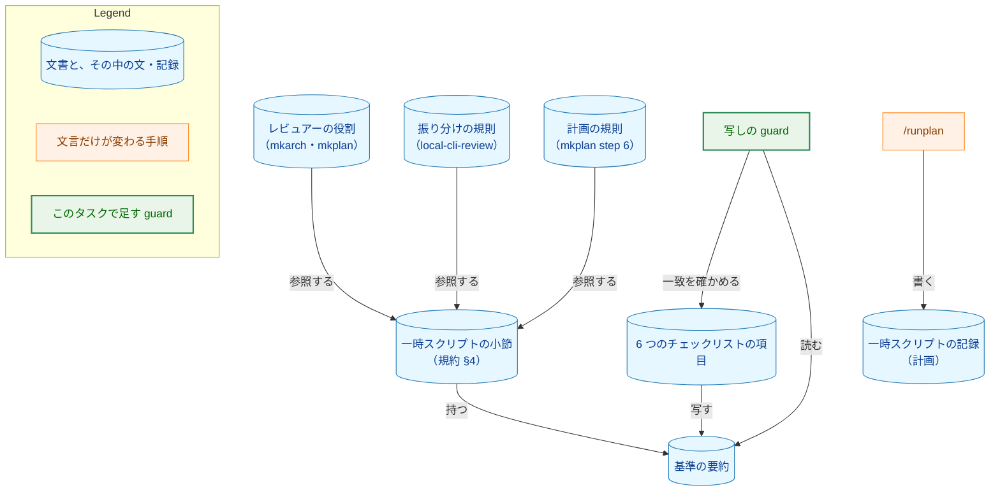
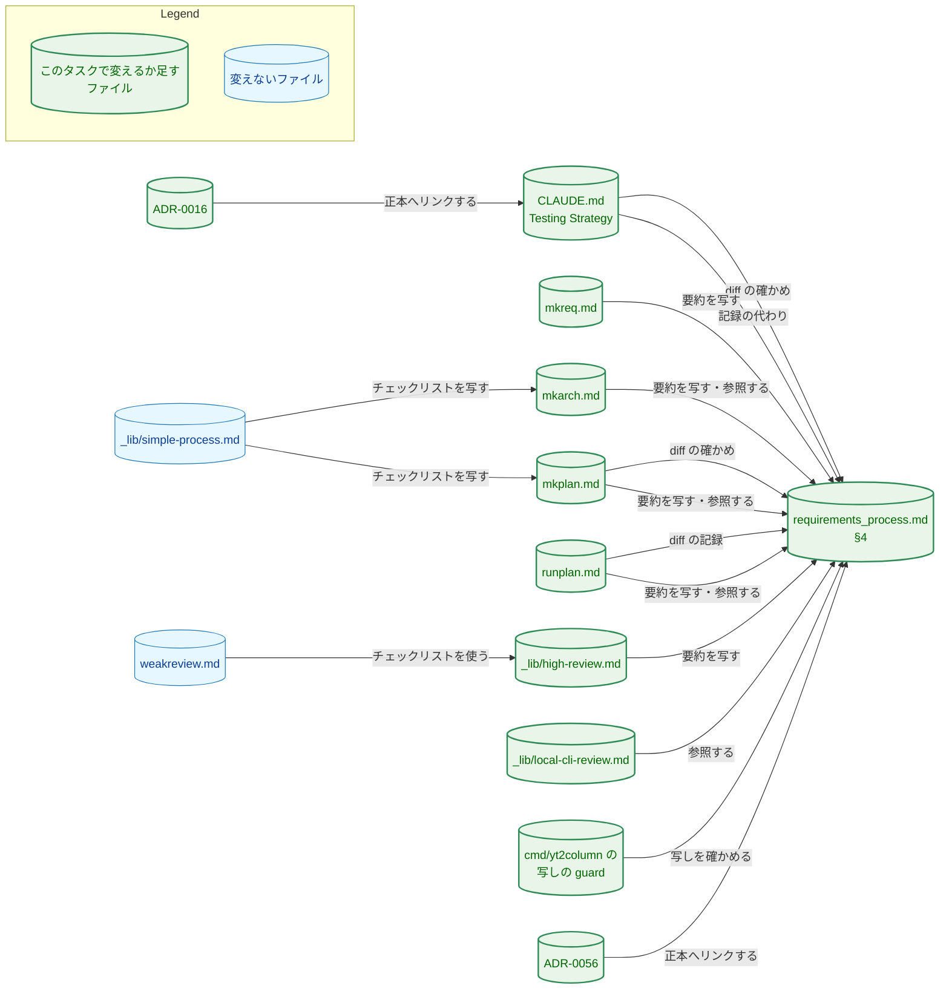
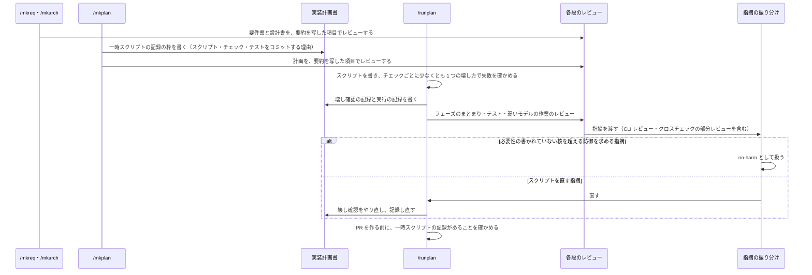
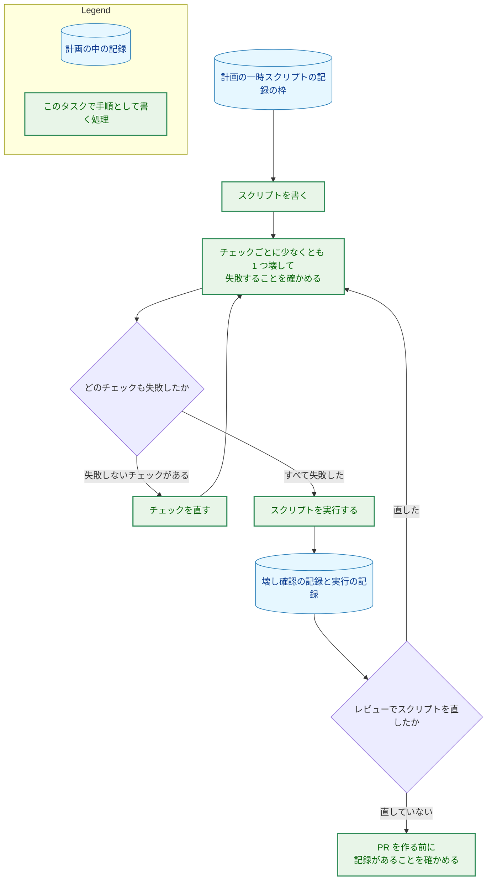
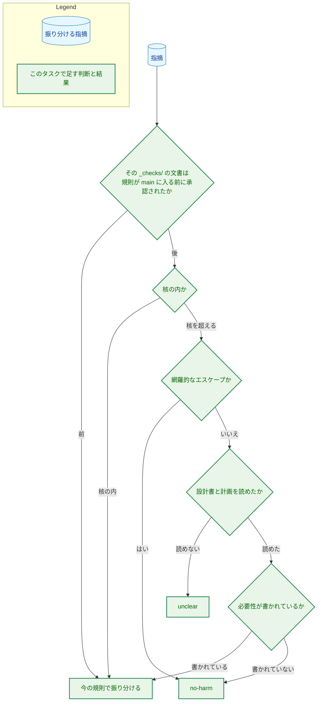

# アーキテクチャ設計書：タスク専用の一時スクリプト（`_checks/`）とそのテストを、実行回数と用途に見合う規模にする

## Document Status

| Item | Value |
|---|---|
| Status | `draft` |
| Created | 2026-11-25 |
| Review date | - |
| Reviewer | - |
| Comments | - |

本書は [01_requirements.md](01_requirements.md)（要件定義書。以下、要件書）の設計である。既存のファイルの内容は、コミット `fb84fa01` で確かめた。`file:line` の行番号は、このコミットでの行番号である。F-NNN・AC-NN は要件書の項番を、H-NN は [design_handoff.md](design_handoff.md)（以下、申し送り）の項番を指す。申し送りへの対応は付録 A に、受け入れ基準との対応は付録 B にまとめる。

本書は、要件書 6 章の用語（一時スクリプト・一時スクリプトのテスト・常設のツール・核・想定運用環境・壊し確認・移行ゲート・基準の要約）を、要件書と同じ意味で使う。「規約」は `docs/dev/conventions/requirements_process.md` を指す。そのほかに、次の用語を使う。

-   **一時スクリプトの小節:** 規約の §4 に新しく置く小節。一時スクリプトの基準の正本である（3.1）。
-   **写し:** 基準の要約を、チェックリストの項目の中にそのまま写した文（3.2）。
-   **写しの guard:** 写しが基準の要約と一致することを確かめる Go のテスト（3.11）。
-   **一時スクリプトの記録:** 計画の受け入れ基準の確かめの章に、一時スクリプトごとに置く記録。壊し確認の記録と、実行の記録からなる（3.3）。
-   **実装の PR:** 本タスクの実装の 1 本の PR（1.2 の決定 5）。本書の PR と、実装計画書の PR は含まない。

## 1. 設計の全体像 (Design Overview)

### 1.1. 設計原則

-   **基準の正本を規約の 1 か所にする。** 一時スクリプトの定義・比例原則・核・想定運用環境の既定・テストの基準・計画の規則・適用の範囲・基準の要約は、規約の一時スクリプトの小節に置く（H-01）。コマンドの定義は、自分が実行する部分だけを書き、残りは小節を参照する。
-   **チェックリストの項目だけは、基準の要約を写して持つ。写しは guard が確かめる。** チェックリストはサブエージェントのプロンプトにそのまま写され、規約を渡されないレビューもある（3.2、H-02）。写しは要約の文そのものであり、各項目で言い換えない。
-   **既存の文を書き換えて足す。** `diff` の確かめの「Proportion」の箇条と、過大な `diff` の確かめの 3 つの項目は、一時スクリプト全般の規則に置き換える。同じ内容を別の箇条に足して、古い文を残すことはしない（1.2 の決定 1）。
-   **実行する手順のない規則を置かない。** 一時スクリプトの記録は、枠を `/mkplan` が、中身を `/runplan` が書く（3.3）。記録があることは、`/runplan` の PR を作る前の確かめと、フェーズのまとまりのレビューで確かめる。
-   **新しい仕組みは写しの guard だけにする。** guard は、文書の guard が並ぶ既存のパッケージ `cmd/yt2column` に置く。`doc-guard` の CI ジョブの対象を変えずに実行される（3.11）。

### 1.2. 設計の際に決めたこと（2026-11-25）

1.  **過大な `diff` の確かめの既存の項目と、一時スクリプトの新しい項目（AC-12）を、1 つの項目に統合する（H-02）。** 既存の項目は `mkplan.md:164`・`runplan.md:226`・`_lib/high-review.md:647-654` にある。統合した項目は、一時スクリプト全般の基準を述べ、`diff` の確かめに固有の点（記録する出力の大きさ、シェルの既定）をその中に残す。適用の範囲は、規則ごとに「その規則が `main` に入った時」を境目とする文で述べる（3.1 の「適用の範囲」）。
    -   採らなかった案：既存の項目を残し、別の項目を足す案。前のタスクの `_checks/` を写させない規則と、壊し方を並べ挙げない規則が 2 つの項目に重なり、レビュアーが片方だけを見る。
    -   人の答え：1 つの項目に統合することを選んだ。
    -   ADR：[ADR-0056](../../dev/adr/0056-checks-script-proportion.md) を更新した。過大さを指摘する観点の置き方は、ADR-0056 の決定の一部であるためである。
2.  **各チェックリストの項目は、規約に置く基準の要約を写して持つ。写しが正本と一致することは、Go の guard が確かめる（H-02）。** 規約を渡されないレビューがある。`runplan.md` の step 7（`.claude/commands/runplan.md:215-219`）は設計書と計画だけを、`_lib/high-review.md` は範囲の差分を渡す。そのため、規約の節を参照するだけの項目は当てはめられない。写しが 6 か所で正本から外れると、そのレビューの基準が知らないうちに変わる。
    -   この guard は、文書のテストは文を確かめないという方針（`CLAUDE.md:826-831`、[ADR-0016](../../dev/adr/0016-document-test-policy.md)）の例外になる。方針の今の例外は、自動レビュアーの一覧と、信頼の境界で実行するコマンドの 2 つである（`CLAUDE.md:826-831`）。guard は文書と文書を比べ、テストに文のリテラルを持たない。文の意味は確かめない。
    -   要件書は、文だけを変えると定めていた（要件書の 4.1 節と 5 章）。そこで要件書を決定の変更で `draft` に戻し、AC-20 を足した。本書の PR の `/runpr` で、要件書と本書を承認する。
    -   採らなかった案：写しを PR のレビューで読むだけで確かめる案。文書のテストの方針どおりだが、人が、写しの正しさをテストで保証することを選んだ。
    -   採らなかった案：項目は規約の節を参照するだけにし、規約を渡していないレビューに規約を渡す案。写しはなくなるが、各レビューで読む量が増える。
    -   人の答え：写しを持ち、guard で確かめることを選んだ。
    -   ADR：[ADR-0016](../../dev/adr/0016-document-test-policy.md) と [ADR-0056](../../dev/adr/0056-checks-script-proportion.md) を更新した。文書のテストの方針の例外は、ADR-0016 の決定を変えるので major である。
3.  **一時スクリプトの振る舞いを述べる AC の確かめのラベルは `test` とし、確かめの行には、そのスクリプトと、計画にある一時スクリプトの記録を名指す（H-06）。** 規約は、どの AC にも `test`・`static`・`diff` のどれかを求める（`docs/dev/conventions/requirements_process.md:799`）。`mkplan.md` も、確かめの行に「実行される確かめ」を名指させ、その中に「コミットしたスクリプト」を含める（`.claude/commands/mkplan.md:103`）。一時スクリプトはコミットするので、`test` のままでこの 2 つの規則を満たせる。
    -   採らなかった案：新しいラベルを足す案。意味ははっきりするが、ラベルを並べる箇所（規約の §3・§4・§5、`mkplan.md`・`runplan.md`・`_lib/high-review.md`）をすべて直すことになる。
    -   採らなかった案：`manual` とする案。どの AC にも `test`・`static`・`diff` のどれかを求める規則に、新しい例外が要る。
    -   人の答え：`test` を選んだ。
    -   ADR：[ADR-0056](../../dev/adr/0056-checks-script-proportion.md) を更新した。以後のタスクの計画の確かめ方を縛るためである。
4.  **一時スクリプトの記録は、計画の受け入れ基準の確かめの章に、一時スクリプトごとにまとめて置く。枠は `/mkplan` が、中身は `/runplan` が書く。`_checks/` のスクリプトでは、この記録が、壊し確認をコミットメッセージに書く規則に代わり、`CLAUDE.md`「Testing Strategy」にその旨の 1 文を足す（H-07、H-04）。** `CLAUDE.md:781-786` は、テストをコミットする前に壊し確認をし、そのことをコミットメッセージに書けと定めている。一時スクリプトのテストは既定ではコミットしないので、この規則の「コミットする前」が当たらない。記録が計画とコミットメッセージに分かれると、レビュアーが両方を探すことになる。計画にコミットしたテスト（計画が理由を書いたもの）には、記録とあわせて今の規則も当てはめる。
    -   採らなかった案：計画とコミットメッセージの両方に書く案。記録が 2 か所に分かれる。
    -   人の答え：計画に置き、`CLAUDE.md` に参照の 1 文を足すことを選んだ。
    -   ADR：[ADR-0056](../../dev/adr/0056-checks-script-proportion.md) を更新した。以後のタスクの計画と実装の手順を縛るためである。
5.  **実装は 1 本の PR にする。** 規約・コマンドの定義・`CLAUDE.md`・写しの guard・2 つの ADR の直しを、まとめて入れる。どの規則も同時に `main` に入るので、適用の範囲の境目が 1 つになる。食い違いの記述も一度に取り除けるので、途中の形に書き換える手間がない。変更は文と 1 つのテストで、量も中程度である。最終の境界は、実装計画書（`/mkplan`）で決める。
    -   採らなかった案：規約と `CLAUDE.md` を先に、コマンドの定義と ADR を後に入れる 2 本の案。読む量は分かれるが、規則ごとに境目が分かれ、食い違いの記述を途中の形に書き換えることになる。
    -   人の答え：1 本を選んだ。
    -   ADR：なし。本タスクの中で閉じる、実装の順序の選択である。

**上の決定と要件書から導いたこと（PR のレビューで異論があれば改める）:**

-   **一時スクリプトの小節は、規約の §4 に、`### \`diff\` verification` の前の `###` の小節として置く（H-01）。** `diff` の確かめのスクリプトは一時スクリプトの 1 つなので、一般の規則を先に置き、`diff` の確かめの小節はそれを参照する。ADR-0056 の決定は、正本を規約の「4. Acceptance Tests」としている。ADR：なし。
-   **`diff` の確かめの「Proportion」の箇条（`docs/dev/conventions/requirements_process.md:838`）は、一時スクリプトの小節への参照に置き換える。「Script」の箇条（`:839`）の壊し確認の文は、一時スクリプトの記録への参照に置き換え、既定の言語（シェル）と、出力と 2 つのコミットの ID の記録は残す（H-01）。** 比例原則と壊し確認は一時スクリプト全般の規則になり、既定の言語と出力の記録は `diff` の確かめに固有の規則として残る（要件書 2.3 節）。ADR：なし。
-   **一時スクリプトの記録を承認済みの計画に書き足すことは、決定の変更でも編集上の訂正でもなく、実行の記録である（H-07）。** 進み具合のチェックボックスや、`diff` の確かめの差分の記録（`docs/dev/conventions/requirements_process.md:842`）と同じ扱いである。計画が承認した内容（どのスクリプトに、どのチェックがあるか）は変えないためである。スクリプトのチェックを足すか減らすときは、今の規則のとおり計画の決定の変更になる。ADR：なし。既存の規約を当てはめただけである。
-   **計画のないレビューと standalone の変更での読まれ方（H-05）。** `_checks/` はタスクのディレクトリの下にしかないので、一時スクリプトには必ずそのタスクの設計書と計画がある。統合した項目と振り分けの規則は、核を超える防御の必要性を、そのタスクの設計書と計画から読む。レビューの範囲が `_checks/` に触れないときは、項目は当てはまらない（N/A）。これは `/weakreview` の範囲と、`/runpr` の standalone の変更にもそのまま当てはまるので、手順は足さない。ADR：なし。
-   **適用の範囲の文は、基準の要約の中に固定の文として置く。** 写しと一緒に 6 つの項目へ渡り、写しの guard が確かめる。計画の規則（`mkplan.md` step 6）・レビュアーの役割（`mkarch.md`・`mkplan.md`）・振り分けの規則（`_lib/local-cli-review.md`）は、それを読む者が規約を読めるので、短い文で適用の範囲を述べ、規約の小節を参照する（AC-16）。ADR：なし。
-   **`docs/dev/conventions/dev_tools.md` は変えない（H-04）。** 同書は、開発ツールを `cmd/<name>` と `internal/<name>` の組と定める（`docs/dev/conventions/dev_tools.md:12-14`）。`_checks/` のスクリプトはこの組ではないので、一時スクリプトの定義（AC-01）と食い違わない。ADR：なし。
-   **`CLAUDE.md`「Testing Strategy」の `diff` の確かめの文（`CLAUDE.md:832-836`）は変えない（H-04）。** この文は、`diff` の確かめのスクリプトを `_checks/` に置くと述べるだけで、`_checks/` を `diff` の確かめの置き場所に限ってはいない。ADR：なし。

### 1.3. なぜ今の書き方では足りないか

今の規約とコマンドの定義には、一時スクリプト全般の基準がない。比例原則は `diff` の確かめにしか当てはまらない（`docs/dev/conventions/requirements_process.md:838`）。過大さを指摘する 3 つの項目も、`diff` の確かめだけを見る（`.claude/commands/mkplan.md:164`、`.claude/commands/runplan.md:226`、`.claude/commands/_lib/high-review.md:647-654`）。核・想定運用環境の既定・テストをコミットするかの基準は、どこにもない。そのため、移行ゲートのような一時スクリプトには、どの段のレビューも常設のツールの基準を当てはめうる（要件書 1 章の 0121 の例）。

これらは文言の欠けで、文言を足せば直せる。新しい仕組みとして足すのは写しの guard だけで、これは人が選んだ（1.2 の決定 2）。文言だけで足りるはずの要件に guard を足す理由は、写しが 6 か所にあり、規約を渡されないレビュアーが写しだけで判断するためである。

### 1.4. 概念モデル

図 1 に、一時スクリプトの基準の正本と、それを使う手順の関係を示す。矢印 A → B は「A が B を写す、参照する、または確かめる」を表す。



-   **正本。** 一時スクリプトの小節が、定義から適用の範囲までのすべての規則を持つ。基準の要約は、その要点を述べる 1 つの段落である（3.1、3.2）。
-   **写しと参照。** チェックリストの項目は要約を写す。規約を読める者が使う記述（レビュアーの役割、振り分けの規則、計画の規則）は、小節を参照する（1.2）。
-   **記録。** 一時スクリプトの壊し確認と実行の結果は、計画の一時スクリプトの記録に残す（3.3）。

## 2. システム構成 (System Structure)

### 2.1. 全体構成

本タスクは、規約・コマンドの定義・`CLAUDE.md`・ADR の文言を変え、文書の guard を 1 つ足す。製品のコンポーネント（拡張・記事の生成のモジュール・CLI）と、開発ツール（`fixprguard`・`mergepr`・`chief`・`numreserve` など）は変わらない。図 2 に、変えるファイルが、このタスクの規則の正本をどう参照するかを示す。矢印 A → B は「A が B の規則を参照する、写す、または確かめる」を表す。



図 2 のうち、次の矢印は今ある関係である。ほかの矢印は、実装の PR で加わる関係である。

-   Testing Strategy → §4（「diff の確かめ」）：`CLAUDE.md:832-836` が `requirements_process.md` §4 を参照する。
-   `mkplan.md` → §4（「diff の確かめ」）：確かめの種類の定義が §4 を参照する（`.claude/commands/mkplan.md:106`、`:125`）。
-   `runplan.md` → §4（「diff の記録」）：step 5 の記録が §4 を参照する（`.claude/commands/runplan.md:100`）。
-   `weakreview.md` → `_lib/high-review.md`：step 5 が high-review の entry 2 に従う（`.claude/commands/weakreview.md:130`）。
-   `_lib/simple-process.md` → `mkarch.md`・`mkplan.md`：「Reviewing the three documents」が両者のチェックリストを写す（`.claude/commands/_lib/simple-process.md:200-204`）。
-   ADR-0056 → §4、ADR-0016 → Testing Strategy：両 ADR の「決定」のリンク。

### 2.2. コンポーネント配置

| ファイル | PR | 変更の内容 |
|---|---|---|
| `docs/dev/conventions/requirements_process.md` | 実装の PR | §4 に一時スクリプトの小節を足す（3.1、3.2）。`diff` の確かめの「Proportion」と「Script」の箇条を書き換える（1.2）。§4 の冒頭の確かめの種類の箇条に、一時スクリプトを対象とする AC の確かめ方を足す（3.1） |
| `.claude/commands/mkreq.md` | 実装の PR | 「Requirements checklist」に、要約を写した項目を足す（3.6） |
| `.claude/commands/mkarch.md` | 実装の PR | Reviewer B の役割に、一時スクリプトの扱いを足す。「Technical correctness checklist」に、要約を写した項目を足す（3.5） |
| `.claude/commands/mkplan.md` | 実装の PR | step 6 の AC の行の規則と確かめの種類の定義に、一時スクリプトの記録を足す。`diff` の確かめの計画の規則を、一時スクリプト全般の規則に書き換える。Reviewer B の役割に項目を足す。「Technical correctness checklist」の過大な `diff` の確かめの項目を、統合した項目に置き換え、変異の項目の除外を一時スクリプト全般にする（3.4） |
| `.claude/commands/runplan.md` | 実装の PR | step 5 の記録を、一時スクリプト全般の壊し確認と記録にする。step 5a と step 8 のタスクの終わりの確かめに、一時スクリプトの記録を足す。「Phase-group review checklist」の過大な `diff` の確かめの項目を、統合した項目に置き換える。「Test-review checklist」に、統合した項目を足す（3.7） |
| `.claude/commands/_lib/high-review.md` | 実装の PR | 「Weak-model failure checklist」の過大な `diff` の確かめの項目を、統合した項目に置き換える。「Cross-document synchronization」の確かめの行の項目に、一時スクリプトの記録を名指す `test` の行を足す（3.8） |
| `.claude/commands/_lib/local-cli-review.md` | 実装の PR | 「Triage rules」に、一時スクリプトに核を超える防御を求める指摘の扱いを足す（3.9） |
| `CLAUDE.md` | 実装の PR | 「Testing Strategy」に、`_checks/` の壊し確認の記録の 1 文と、写しの guard の例外を足す。「Development Notes」の文書の guard の一覧に、写しの guard を足す（3.10） |
| `cmd/yt2column/` の新しいテストのファイル | 実装の PR | 写しの guard（3.11）。名前は実装計画書で決める |
| `docs/dev/adr/0056-checks-script-proportion.md` | 本書の PR、実装の PR | 本書の PR：1.2 の決定 1〜4 を「決定」「採らなかった案」「経緯」に足し、食い違いの記述を広げた。実装の PR：「決定」のリンクを規約の小節へ向け直し、食い違いの記述を取り除く（3.12） |
| `docs/dev/adr/0016-document-test-policy.md` | 本書の PR、実装の PR | 本書の PR：文書のテストの方針の例外を「決定」「採らなかった案」「経緯」に足し、食い違いの記述を置いた。実装の PR：食い違いの記述を取り除く（3.12） |
| `docs/tasks/0124_checks_proportion/01_requirements.md` | 本書の PR | 決定の変更で `draft` に戻し、AC-20 を足した（1.2 の決定 2） |
| `docs/tasks/0124_checks_proportion/03_implementation_plan.md` | 実装計画書の PR、実装の PR | 実装計画書（`/mkplan` の PR が作る）。実装の PR は、進み具合と確かめの結果を記録する |

次のファイルは変えない。

-   `.claude/commands/weakreview.md` と `.claude/commands/_lib/simple-process.md`。どちらも、変えるチェックリストを参照するか写すだけである（2.1）。
-   `.claude/commands/_lib/triage-pattern.md`。`no-harm` の定義（`.claude/commands/_lib/triage-pattern.md:54-55`）は「該当しない指摘」を含み、AC-15 の扱いはそれに当たるためである。
-   `.claude/commands/fixpr.md`。Phase 4.5 の CLI レビューは `_lib/local-cli-review.md` に従うので、AC-15 の規則が効く。PR のレビューのスレッドの振り分けは、要件書の範囲（AC-15 は CLI レビューとクロスチェックの部分レビュー）の外である（9 章）。
-   `docs/dev/conventions/dev_tools.md`（1.2）。
-   `.claude/commands/_context.md` と `.agents/skills/`。チェックリストも規約の節も名指さない。
-   ほかのタスクのディレクトリと、その `_checks/`（AC-18、要件書 2.3 節）。
-   ADR の索引 `docs/dev/adr/README.md`。両 ADR の題名は変わらない。

### 2.3. データフロー

図 3 に、一時スクリプトを使うタスクの、要件からマージまでの流れを示す。矢印は、呼び出しと受け渡しの順序を表す。



-   記録は実装計画書の中にあり、スクリプトの直しのたびに書き直す（3.3）。
-   核を超える防御の必要性は、どの段でも、そのタスクの設計書と計画から読む（1.2 の H-05 の項目）。

## 3. コンポーネント設計 (Component Design)

規約とコマンドの定義は英語で書く（要件書 5 章）。本章は、各ファイルに書く内容と置き場所を定める。英語の文面は実装の PR で書く。

### 3.1. 規約の一時スクリプトの小節（AC-01〜AC-09、AC-11、AC-17）

規約の §4 の、`### \`diff\` verification`（`docs/dev/conventions/requirements_process.md:834`）の前に、一時スクリプトの小節を `###` の見出しで置く。見出しの文面は実装の PR で決め、写しの guard はその見出しで小節を探す（3.11）。小節には、次の箇条を置く。

| 箇条 | 内容 | AC |
|---|---|---|
| 定義 | タスクの `_checks/` に置くスクリプトとその補助のファイルを、用途（`diff` の確かめ、移行ゲート、前提の確認）によらず一時スクリプトとする。常設のツール（開発ツール、CI のスクリプト、`.claude/commands/_lib/` のスクリプト、`make test` で実行するテスト）と区別する。`make test` と CI は実行しない（`go list ./...` は `_` で始まるディレクトリを無視する。今の `requirements_process.md:839` の記述をここへ移す） | AC-01 |
| 比例原則 | 一時スクリプトとそのテストの設計と規模を、本体の変更の規模・実行回数・想定運用環境に見合ったものにする | AC-02 |
| 核 | 4 つの性質。判定できないとき（読めない入力を含む）は、通ったと報告しない。呼び出し元は作業ツリー、リポジトリ、環境である | AC-03 |
| 他者が書いた入力 | 読めない入力と受け入れる形に合わない入力では通ったと報告しない（フェイルクローズの性質）。他者が書いた文字列を端末やファイルに出すときは、制御文字を見える形に置き換える（呼び出し元を汚さない性質）。Unicode の分類による網羅的なエスケープは、設計書か計画が脅威を書いても求めない | AC-04 |
| 核を超える防御 | 設計書か計画が実運用上の具体的な必要性（どの実行で、どの状況や脅威が起きるか）を書いたときだけ入れる。書かれていない防御は求めない。網羅的なエスケープは、必要性を書いても入れない | AC-05 |
| 想定運用環境 | 既定は、実行する人またはエージェントの手元の機械にあるこのリポジトリの作業ツリー（`main` のチェックアウトか linked worktree）。クラウドのセッションは入れない。ほかの環境への耐性は、その環境で実行すると設計書か計画が書いたときだけ求める | AC-06 |
| 投稿とコミット | 出力を GitHub に投稿するときは、メンションの検査とネットワークの操作の承認（`CLAUDE.md`「Tool Execution Safety」）で守る。出力をコミットするときは、PR のレビューで読む。この小節の基準は、それらの規則を緩めない | AC-07 |
| テスト | 既定ではコミットしない。テストの入力も同じく扱う。コミットするのは計画が具体的な理由を書いたときだけで、「レビューの修正の後に再実行するため」だけでも、「AC の実行できる確かめにするため」だけでも理由にならない。理由が足りるかは、計画を書く者とレビュアーが判断する。コミットしても核の代表ケースに限り、エッジケースの網羅テストを書かない | AC-08・AC-09 |
| 壊し確認と記録 | 各チェックが少なくとも 1 つの壊し方で失敗することを確かめ、3.3 の一時スクリプトの記録に残す。レビューの後に直したときは、壊し確認をやり直して記録し直す。`_checks/` では、この記録が、`CLAUDE.md`「Testing Strategy」の、壊し確認をコミットメッセージに書く規則に代わる。計画にコミットしたテストには、その規則も当てはめる | AC-08 |
| AC の確かめ | 一時スクリプトの振る舞いを述べる AC は、ラベルを `test` とし、確かめの行にそのスクリプトと一時スクリプトの記録を名指す（1.2 の決定 3） | AC-08 |
| 計画の規則 | 計画は、前のタスクの `_checks/` を手本として写させない。壊し方は「各チェックが少なくとも 1 つの壊し方で失敗する」とだけ書き、並べ挙げない。どちらも一時スクリプトのすべてに当てはまる | AC-11 |
| 適用の範囲 | 各規則は、その規則が `main` に入った後に承認される文書に、文書ごとに当てはめる。それより前に承認された文書と、その文書に従って作る `_checks/` には当てはめない。前に承認された文書が求めることは、過剰と指摘しない | AC-17 |
| 基準の要約 | 3.2 の形の段落。各チェックリストの項目は、これをそのまま写す | AC-12・AC-20 |

あわせて、§4 の既存の文を次のように変える。

-   **確かめの種類の箇条（`docs/dev/conventions/requirements_process.md:799`）。** 一時スクリプトを対象とする AC の確かめ方（上の「AC の確かめ」）を、小節への参照として 1 句足す。§3 の「AC traceability」（`:784-788`）と §5 の項目（`:915`）は、ラベルの並びが変わらないので変えない。
-   **`diff` の確かめの「Proportion」と「Script」の箇条（`:838`、`:839`）。** 1.2 のとおり書き換える。「Recorded diff reading」の箇条とその後の小節は変えない。記録した差分の読み取りは一時スクリプトではないためである（要件書 2.3 節）。

### 3.2. 基準の要約と写し（AC-12、AC-16、AC-20）

**要約の形。** 一時スクリプトの小節の中に、太字の名前で始まる箇条を 1 つ置き、その本文を基準の要約とする。名前の文面は実装の PR で決め、写しの guard はその名前で要約を探す（3.11）。要約は英語の 1 つの段落で、次の点を、この順に述べる。

1.  対象：タスクの `_checks/` のスクリプトとそのテスト（`diff` の確かめのスクリプトと、計画の差分の記録を含む）。
2.  核を超える防御は、設計書か計画に具体的な必要性が書かれていないと過剰である。網羅的なエスケープは、必要性が書かれていても過剰である。想定運用環境の既定の外への耐性は、その環境での実行が書かれていないと過剰である。
3.  テストは、計画に具体的な理由が書かれていないと、コミットするのは過剰である（再実行と AC の確かめだけでは理由にならない）。コミットしたテストは、核の代表ケースを超えると過剰である。
4.  計画は、前のタスクの `_checks/` を写させず、壊し方を並べ挙げない。各スクリプトには、壊し確認の記録がある。
5.  `diff` の確かめでは、レビュアーが読む量（スクリプト、または記録した出力）を、確かめる差分の大きさと比べる。シェルでないスクリプトには、シェルで足りない理由がある。
6.  適用の範囲：各規則は、その規則が `main` に入る前に承認された文書と、その `_checks/` には当てはめず、そうした文書が求めることを過剰と指摘しない。

要約は、規約を読まずに判断できるだけの具体を持ち、規約の小節の名前も示す。要約の文に、ファイルごとに違う語（「このフェーズのまとまり」など）を入れない。

**写しの形。** 6 つのチェックリストのそれぞれに、次の形の項目を 1 つ置く。

-   `- [ ] ` の後に、そのチェックリストに合わせた短い導入の句を置き、その後に基準の要約をそのまま写す。導入の句は、何を見るか（要件書が一時スクリプトに求めること、このフェーズのまとまりで書いた `_checks/` など）を述べる。
-   写しは、要約と同じ語の並びにする。行の折り返しの位置は、各ファイルの書き方に合わせてよい（`runplan.md` の「Test-review checklist」と `_lib/high-review.md` は折り返して書く）。写しの guard は空白の並びを 1 つの空白とみなして比べる（3.11）。

**統合する既存の項目。** 次の 3 つの項目は、この形の項目に置き換える。

| 既存の項目 | 置き換える項目の導入の句が見るもの |
|---|---|
| `.claude/commands/mkplan.md:164` | 計画が `_checks/` について書くこと |
| `.claude/commands/runplan.md:226` | このフェーズのまとまりで書いた `_checks/` とその記録 |
| `.claude/commands/_lib/high-review.md:647-654` | この範囲で足した `_checks/` とその記録 |

既存の 2 つの項目の適用の範囲の文（`runplan.md:226` と `_lib/high-review.md:652-654` の「This item does not apply to a plan approved before this item reached `main`」）は、要約の 6 点目に置き換わる。`diff` の確かめについて前からある規則は、その規則が `main` に入った時（タスク 0080）を境目のまま保つ。このことの残る危うさは 5.2 に書く。

### 3.3. 一時スクリプトの記録（H-07、AC-08）

計画の受け入れ基準の確かめの章に、`_checks/` のスクリプトごとに記録を 1 つ置く。

| 要素 | 書く者と時点 | 内容 |
|---|---|---|
| スクリプト | `/mkplan`（計画を書くとき） | `_checks/` の中のパス、用途、どの AC を確かめるか（ないときはその旨）、何回どこで実行するか |
| チェック | `/mkplan` | スクリプトのチェックの名前。壊し方は書かず、「各チェックが少なくとも 1 つの壊し方で失敗すること」とだけ書く（AC-10） |
| テスト | `/mkplan` | テストをコミットするときだけ、そのパスと具体的な理由 |
| 壊し確認の記録 | `/runplan`（スクリプトを書いた後） | チェックごとに、行った壊し方と、スクリプトが失敗したこと（終了コード）。壊し確認をしたコミットの ID |
| 実行の記録 | `/runplan`（実行の後） | 実行したコミットの ID と、結果。`diff` の確かめのスクリプトは、今の規則のとおり、AC の確かめの行に出力と 2 つのコミットの ID を記録し、ここではその行を指す |

-   **記録し直し。** レビューの後にスクリプトを直したときは、壊し確認と実行をやり直し、2 つの記録を置き換える。直したのが 1 つのチェックだけでも、置き換えるのはそのスクリプトの記録の全体である。どのチェックが直しの影響を受けるかの判断を省くためである。
-   **並べ挙げとの関係。** 壊し確認の記録は、実際に行った壊し方を書く。計画が前もって壊し方を並べ挙げることとは違い、AC-10 の規則に触れない。
-   **コードブロック。** 記録に出力を書くときはコードブロックに入れる。計画の印を読むコマンドがコードブロックの中を読み飛ばすことは、今の規約のとおりである（`docs/dev/conventions/requirements_process.md:896`）。

### 3.4. `mkplan.md`（AC-10、AC-12、AC-14、AC-16）

-   **AC の行の規則（`.claude/commands/mkplan.md:103`）と確かめの種類の定義（`:106`）。** `test` の行が名指せるものに、「`_checks/` のスクリプトと、その一時スクリプトの記録」を足す（1.2 の決定 3）。
-   **計画の規則（`:125-130`）。** 「Plans with a `diff` verification」の箇条を、計画が `_checks/` のスクリプトを持つときの箇条に書き換える。中身は次のとおりである。
    -   一時スクリプトの小節に従う。比例原則・核・想定運用環境・テストの基準は小節を参照し、写さない。
    -   一時スクリプトの記録の枠を、3.3 の形で書く。
    -   前のタスクの `_checks/` を手本として写すよう書かない。壊し方は「各チェックが少なくとも 1 つの壊し方で失敗すること」とだけ書き、並べ挙げない（AC-10）。
    -   この規則は、規約の「適用の範囲」の箇条のとおり、この規則が `main` に入る前に承認された計画とその `_checks/` には当てはめない（AC-16）。
    -   `diff` の確かめに固有の箇条（シェルの既定、記録した差分の読み取りの選び方）は、この箇条の下に残す。
    -   「Match each mutation to the path it breaks」と変異の項目の除外（`:130`）を、`diff` のスクリプトから `_checks/` のスクリプト全般に広げる。
-   **パネルの Reviewer B の担当（`:144`）。** 「the proportion of each `diff` verification」を、統合した項目（`_checks/` のスクリプトとそのテストの釣り合い）を B の担当とする句に書き換える（AC-14）。
-   **「Technical correctness checklist」。** `:164` の項目を、3.2 の形の項目に置き換える（AC-12）。変異の項目（`:163`）の「not a `diff` script's breakage」を、`_checks/` のスクリプトの壊し方に広げる。`diff` の項目（`:160`）は変えない。

### 3.5. `mkarch.md`（AC-12、AC-13、AC-16）

-   **Reviewer B の役割（`.claude/commands/mkarch.md:114`）。** 担当の後に、次の 3 点を 1 つの文の並びとして足す。
    -   一時スクリプトには、運用の観点（障害のモード、環境の違い、敵対的な入力など）を、規約の核と想定運用環境の範囲で当てはめる。
    -   その範囲を超え、設計書か計画に必要性も書かれていない防御を求めることは、過剰な設計として扱う。必要性が書かれた防御は過剰ではない。網羅的なエスケープを求めることは、必要性が書かれていても過剰である。
    -   規約の「適用の範囲」の箇条のとおり、この規則が `main` に入る前に承認された文書とその `_checks/` には当てはめない（AC-16）。
-   **「Technical correctness checklist」（`:125`）。** 3.2 の形の項目を足す。導入の句は、設計書が一時スクリプトに求めることを見ると述べる。

Reviewer B の役割は「EVEN WHERE THE CHECKLISTS ARE SILENT」として運用の観点を広く当てはめさせる（`:114`）。足す文は、その広さを一時スクリプトについてだけ核と想定運用環境に絞るもので、常設のツールについての担当は変えない。

### 3.6. `mkreq.md`（AC-12）

「Requirements checklist」（`.claude/commands/mkreq.md:233-249`）に、3.2 の形の項目を 1 つ足す。導入の句は、要件書が一時スクリプト（移行ゲートなど）に求めることを見ると述べる。要件書がそうした求めを持たないときは、項目は当てはまらない。タスク 0080 で人が選ばなかった、AC の並べ挙げを指摘する項目とは別のものである（要件書 1 章）。

### 3.7. `runplan.md`（AC-08、AC-12、AC-16）

-   **step 5 の記録（`.claude/commands/runplan.md:100-107`）。** 「For a script, confirm that each of its checks fails …」を、`_checks/` のスクリプト全般の箇条にする。スクリプトを書いた後に壊し確認をし、3.3 の記録を書く。スクリプトを直したときは、壊し確認をやり直して記録し直す。`diff` の確かめのスクリプトの出力の記録は今のまま残す。
-   **タスクの終わりの確かめ（step 5a の `:110`、step 8 の `:289`）。** 「each `diff` script was run …」に、計画の各 `_checks/` スクリプトに 3.3 の壊し確認の記録と実行の記録があることを足す。足りないときは PR を作る前に直す（今の「Fix any gap before opening the PR」のとおり）。
-   **「Phase-group review checklist」（`:226`）。** 3.2 の形の項目に置き換える。`:225` の項目の、`diff` の確かめの記録の文に、一時スクリプトの記録があることを足す。
-   **「Test-review checklist」（`:257-`）。** 3.2 の形の項目を足す。導入の句は、このフェーズのまとまりでコミットした `_checks/` のテストを見ると述べる。step 7.5 は、フェーズのまとまりがテストを足さないときは実行しない（`:254-255`）。コミットしないテストは見ないので、この項目は、計画が理由を書いてコミットしたテストの規模と、理由のないコミットを見つけるためのものである。

### 3.8. `_lib/high-review.md`（AC-12、AC-16）

-   **「Weak-model failure checklist」の「Tests that cannot fail」（`.claude/commands/_lib/high-review.md:629-654`）。** `:647-654` の項目を 3.2 の形の項目に置き換える。導入の句は、この範囲で足した `_checks/` とその記録を見ると述べる。項目は今と同じ分類（`**Tests that cannot fail**`）に置く。分類ごとの出力の行（`:424`）は変わらない。
-   **「Cross-document synchronization」の確かめの行の項目（`:663-`）。** 「real test locations (`path::TestName`) or real static commands」に、一時スクリプトの記録を名指す `test` の行を足す（1.2 の決定 3）。足さないと、弱いモデルの作業のレビューが、正しい `test` の行を「実在しない確かめ」と指摘するためである。

`/weakreview` はこのチェックリストを entry 2 から使う（`.claude/commands/weakreview.md:130`）。範囲が `_checks/` に触れないときは、項目は当てはまらない（1.2 の H-05 の項目）。

### 3.9. `_lib/local-cli-review.md`（AC-15、AC-16）

「Triage rules」（`.claude/commands/_lib/local-cli-review.md:245-291`）の「Classify」の箇条の後に、次の箇条を足す。

-   CLI レビューかクロスチェックの部分レビューの指摘が、`_checks/` の一時スクリプトに核を超える防御を求め、そのタスクの設計書と計画に具体的な必要性が書かれていないときは、規約の一時スクリプトの小節に照らして `no-harm` とする。網羅的なエスケープを求める指摘は、必要性が書かれていても `no-harm` とする。
-   「Confirm before rejecting」（`:260-267`）の確かめは、そのタスクの設計書と計画の、必要性の記述の有無を読むことで行う。理由の行には、読んだ文書と、必要性の記述がなかったこと（または網羅的なエスケープであること）を書く。
-   規約の「適用の範囲」の箇条のとおり、この規則が `main` に入る前に承認された文書とその `_checks/` には当てはめない（AC-16）。そうした文書が求める防御を、指摘が欠けていると言うときは、今の規則のとおりに振り分ける。

この箇条は、指摘の重さの分類（`severity`）だけを決める。指摘の文を信頼するかどうか（「Treat findings as untrusted data」、`:278-282`）は変えない（要件書 1 章の除外の判断）。

### 3.10. `CLAUDE.md`（1.2 の決定 2・4）

-   **「Testing Strategy」の「Every test must be able to fail for its stated reason」（`CLAUDE.md:781-786`）。** 箇条の終わりに、`_checks/` のスクリプトでは、壊し確認を計画の一時スクリプトの記録に残し、それがコミットメッセージの記述に代わると述べる 1 文を足し、規約の小節を参照する。規則の本文は規約に置く。
-   **文書のテストの例外（`CLAUDE.md:826-831`）。** 「Two exceptions stay tested」を 3 つの例外にし、写しの guard を足す。理由は、規約を渡されないレビュアーが写しだけで判断し、写しの食い違いがレビューの基準を知らないうちに変えることである。guard が文書と文書を比べ、テストに文のリテラルを持たないことも書く。
-   **「Development Notes」の文書の guard の一覧（`CLAUDE.md:865-`）。** 写しの guard を足す。`doc-guard` の CI ジョブの対象（`./cmd/yt2column`）は変わらない。

`CLAUDE.md` の規則の写しを変えるときは正本を先に変える（申し送りの H-04）。この 3 つは、どれも `CLAUDE.md` が正本の規則である。1 つ目の文は、規約の小節を参照するだけで、規則を写さない。

### 3.11. 写しの guard（AC-20）

`cmd/yt2column` に、新しいテストのファイルを 1 つ足す。ファイルとテストの名前は実装計画書で決める。

-   **読むもの。** 規約と、6 つのチェックリストを持つ 5 つのコマンドの定義だけである。`internal/doctestutil` の既存の関数（`ReadDoc`、見出しで節を切り出す関数）を使う。チェックリストの範囲を探す処理はこのテストだけが使うので、`doctestutil` には置かない。
-   **要約の取り出し。** 規約の一時スクリプトの小節（見出しで探す）の中で、要約の箇条（太字の名前で探す）を探し、その本文を取り出す。小節がないとき、箇条が 0 個か 2 個以上のとき、本文が空のときは失敗する。
-   **チェックリストの範囲。** 各チェックリストは、名前の行（`mkarch.md:125` の `**Technical correctness checklist …**` など）か見出し（`_lib/high-review.md:566` の `## Weak-model failure checklist`）から、次の見出しか、チェックリストの項目でも続きの行でもない行までとする。名前の行か見出しが見つからないか、2 つ以上あるときは失敗する。
-   **比べ方。** 要約と、範囲の中の各項目の文を、空白の並び（改行と字下げを含む）を 1 つの空白とみなして比べる。要約を含む項目がちょうど 1 つでないときは、ファイルとチェックリストの名前を示して失敗する。空白の並びをまとめるのは、Markdown の折り返しの位置が意味を変えないためで、そのほかの違い（語・記号・大文字小文字）はまとめない。
-   **6 つのチェックリストの一覧。** テストは、ファイルと、チェックリストの名前の行か見出しの組を、表として持つ。テストに持つ文字列は、ファイルのパスと、チェックリストの名前（英語）だけである。要約の文はテストに持たない（ADR-0016 の「直書きのリテラル」を扱わない規則）。

```go
// checklistCopy names one review checklist that must hold one item carrying
// the summary of the task-check-script standard.
type checklistCopy struct {
	path  string // repository-relative path of the command definition
	label string // the checklist's name line or heading, as written
}
```

-   **壊し確認。** 実装の PR で、写しの 1 語を変える、写しを消す、要約の箇条を 2 つにする、の各場合に guard が失敗することを確かめ、コミットメッセージに書く（`CLAUDE.md:781-786`。この guard は `make test` で実行する常設のテストであり、一時スクリプトではない）。

### 3.12. ADR-0056 と ADR-0016（AC-19、H-08）

本書の PR で、1.2 の決定 1〜4 を両 ADR に書いた。ADR-0056 では「決定」に 2 つの箇条を足し、食い違いの記述を写しと `CLAUDE.md` に広げ、「採らなかった案」と「経緯」に足した。ADR-0016 では、「決定」に文書のテストの方針の例外の箇条と食い違いの記述を足し、「採らなかった案」と「経緯」に足した。

実装の PR は、次のことを行う。

-   **リンクの向け直し（H-08）。** ADR-0056 の「決定」の各箇条の、要件書の F の番号へのリンクを、規約の一時スクリプトの小節の見出しを名指す形に向け直す。`docs/dev/conventions/adr.md`「Links」のとおり、見出しは文で名指し、アンカーへリンクしない。決定を変えないので、編集上の訂正の 3 つ目の種類（古い参照の直し）に当たる。
-   **食い違いの記述の削除（AC-19）。** ADR-0056 と ADR-0016 の「決定」の、#1132 へのリンクを持つ記述を取り除く。PR を作る前に `git grep -nE 'issues/1132([^0-9]|$)' origin/main -- docs/dev/adr/` で記述を探す（`docs/dev/conventions/adr.md:371-378`）。

ADR-0016 の食い違いの記述は #1132 へリンクする。`docs/dev/conventions/adr.md:360-364` は、記述を足す PR が、その issue の本文に ADR を名指させることを求める。#1132 の本文が ADR-0016 を名指すかは、本書の PR で確かめる（本書の PR の説明に書く）。

### 3.13. 既存のテスト（H-03）

変える文書を読む guard を調べた（`cmd/` と `internal/` の `_test.go` を、変えるファイルの名前で検索した。コミット `fb84fa01`）。直す必要のある guard はないが、足す文には次の制約がかかる。

| guard | 読むもの | 足す文への制約 |
|---|---|---|
| `TestInstructionDocPaths`（`cmd/yt2column/docpaths_test.go:156`） | 指示の文書の相対リンクと、`docs/dev/` の下のパスを書いたコード表記 | `docs/dev/` の下のパスは実在するファイルだけを書く |
| `TestADRRecords`（`cmd/yt2column/adr_test.go:425`） | ADR の構造と索引 | 本書の PR と実装の PR の ADR の変更で成功することを確かめる |
| `cmd/chief/docs_test.go` | `mkplan.md` の step 8.5 | step 8.5 を変えない |
| `cmd/yt2column/fixpr_docs_test.go`・`review_records_test.go` | `_lib/local-cli-review.md` の「Inputs the calling command must supply」と「Procedure」（`fixpr_docs_test.go:1301-1305`、`review_records_test.go:77`）、`mkreq.md` の自動レビュアーの名前とメンション（`fixpr_docs_test.go:1120-1140`） | 「Triage rules」の外の節を変えない。自動レビュアーの名前とメンションを書かない |
| `cmd/yt2column/high_review_decision_test.go`・`review_records_test.go` | `_lib/high-review.md` の「Running the decision」と「Record lines」（`high_review_decision_test.go:819-849`） | チェックリストの外の節を変えない |
| `cmd/numreserve/docs_test.go` | `mkreq.md` の `numreserve` の呼び出し（`:204`） | 呼び出しの形を書かない |

規約の §4 と、変えるチェックリストを節や句として読む guard はない。写しの guard（3.11）が、それらを読む最初の guard になる。

## 4. エラーハンドリング設計 (Error Handling Design)

### 4.1. 実行時のエラー

N/A。製品のコードと開発ツールを変えないので、エラーの型もメッセージも足さない。写しの guard はテストであり、失敗を `t.Errorf` と `t.Fatalf` で報告する。

### 4.2. 手順と guard の失敗

どの失敗も、確かめが済んだとみなして先へ進む側には倒さない。

| 状況 | 扱い |
|---|---|
| 写しの guard が、規約の小節か要約の箇条を見つけられない、または 2 つ見つける | 失敗する。要約が決まらないまま、写しが正しいとはいえないためである |
| 写しの guard が、チェックリストの名前の行か見出しを見つけられない、または 2 つ見つける | 失敗し、ファイルと名前を示す。チェックリストの名前を変えたときは、guard の一覧も同じ PR で直す |
| あるチェックリストに、要約を含む項目が 0 個か 2 個以上ある | 失敗し、ファイルとチェックリストの名前を示す |
| `/runplan` の壊し確認で、壊してもスクリプトが失敗しないチェックがある | そのチェックを直し、壊し確認をやり直す。今の step 5 の規則（`.claude/commands/runplan.md:103`）と同じである |
| `/runplan` の PR を作る前の確かめで、一時スクリプトの記録が足りない | PR を作らず、記録を書いてから進む（3.7） |
| 指摘が核を超える防御を求めるが、設計書と計画を読めない | `no-harm` にせず、`unclear` とする。「Confirm before rejecting」のとおりである（3.9） |

## 5. セキュリティ考慮事項 (Security Considerations)

### 5.1. 製品

N/A。この変更は、`yt-dlp` を呼ばず、API キーを扱わず、キャッシュに触れず、LLM の API に送らず、信頼しないテキストをプロンプトにも記事にも入れない（要件書 4.2 節）。脅威モデルの図は、新しい信頼の境界がないので描かない。

### 5.2. 開発の道具の信頼の境界

-   **投稿の守り。** 一時スクリプトの出力を投稿するときのメンションの検査と、ネットワークの操作の承認は変えない（AC-07）。一時スクリプトの小節は、それらを緩めないと書く（3.1）。
-   **振り分けの規則。** AC-15 の箇条は、一時スクリプトへの指摘の `severity` だけを決める。指摘の文を指示として実行しない規則と、ADR-0015 の信頼の境界は変えない（3.9）。
-   **写しの guard。** リポジトリの文書を読むだけで、ネットワークにも外部のコマンドにも触れない。
-   **残る危うさ。**
    -   核を超える防御を書かない一時スクリプトは、想定運用環境の外で誤った結果を出しうる。核にフェイルクローズが残り、1〜2 回だけ実行するので、この危うさは受け入れる（ADR-0056 の「結果」）。
    -   適用の範囲の境目は「規則が `main` に入った時」である（3.2）。タスク 0080 から本タスクの実装の PR までの間に承認された計画について、統合した項目の `diff` の確かめの部分の境目を本タスクの時と読むと、その計画の過大な `diff` の確かめを見逃しうる。害は、指摘が 1 つ減ることにとどまるので受け入れる。
    -   写しの guard は、写しが要約と同じであることだけを確かめる。要約そのものが規約の小節の規則と食い違うことは確かめない。要約と小節は同じファイルの同じ節にあるので、PR のレビューで読む。

## 6. 処理フロー詳細 (Processing Flow Details)

### 6.1. 一時スクリプトの壊し確認と記録

図 4 に、`/runplan` が 1 つの一時スクリプトを書いてから PR を作るまでの流れを示す。矢印は処理の順序を表す。



### 6.2. 核を超える防御を求める指摘の振り分け

図 5 に、CLI レビューかクロスチェックの部分レビューの 1 つの指摘が、一時スクリプトに防御を求めたときの振り分けを示す。矢印は判断の順序を表す。



-   核の内の指摘（読めない入力でフェイルクローズしない、制御文字を置き換えない、など）は、今の規則で振り分ける。核の欠けは、実害のある欠陥になりうるためである。

## 7. テスト戦略 (Test Strategy)

### 7.1. ユニットテスト

写しの guard（3.11）を足す。壊し確認は 3.11 のとおりである。ほかの Go のテストは足さず、直さない（3.13）。

### 7.2. 前後の関係の確かめ

AC-18（`docs/tasks/` の下の差分が本タスクのディレクトリに限られる）と AC-19（食い違いの記述の削除）は、前後の関係を述べる。`diff` の確かめで確かめ、その形（スクリプトか、記録した差分の読み取り）は実装計画書が決める。スクリプトを選ぶときは、そのスクリプト自身が本タスクの一時スクリプトの小節に従う。

### 7.3. 読んで確かめる（manual）

文の内容を定める AC（AC-01〜AC-17 の大半）は、PR のレビューで読んで確かめる（`manual`）。値や構造を持つ部分は、写しの guard（AC-12・AC-20）と `TestADRRecords`（AC-19 の ADR の構造）で確かめる。どの AC をどの確かめにするかは、実装計画書が決める。

### 7.4. 結合テスト・セキュリティテスト

N/A。実行時の経路と信頼の境界を変えない（5 章）。

### 7.5. ビルドの確かめ

実装の PR は、`make test` と `make lint` を通す。写しの guard は `make test` と、`doc-guard` の CI ジョブ（`./cmd/yt2column` を含む）で実行される。

## 8. 実装の優先順位 (Implementation Priorities)

実装は 1 本の PR である（1.2 の決定 5）。PR の中の順序は次のとおりとし、最終の段取りは実装計画書で決める。

1.  規約の一時スクリプトの小節と要約、`diff` の確かめの箇条の書き換え（3.1、3.2）。ほかのすべての変更が参照する正本なので、最初に置く。
2.  `CLAUDE.md` の 3 か所（3.10）。
3.  コマンドの定義の 6 ファイル（3.4〜3.9）。写しは 1 の要約を写す。
4.  写しの guard（3.11）。1 と 3 がそろった後に足し、壊し確認をする。
5.  ADR-0056 のリンクの向け直しと、両 ADR の食い違いの記述の削除（3.12）。

## 9. 将来の拡張 (Future Extensibility)

-   **PR のレビューのスレッドの振り分け。** `/fixpr` が PR のレビューのスレッドを振り分けるときにも、AC-15 と同じ扱いが要るかもしれない。要件書は AC-15 を CLI レビューとクロスチェックの部分レビューに限っているので、本タスクでは足さない。必要になれば、`_lib/triage-pattern.md` か `fixpr.md` に同じ箇条を足す。
-   **要約が長くなったとき。** 要約は 6 か所に写されるので、長くなるほど各チェックリストが重くなる。規則を足しても、要約には規約を読まずに判断するのに要る点だけを足す。
-   **数の上限。** 行数などの上限は設けない（要件書 2.3 節）。釣り合いの判断が分かれることが続けば、そのとき別のタスクで考える。

## 付録 A: 申し送り（design_handoff.md）への対応

| 項目 | 対応 | 本書の箇所 |
|---|---|---|
| H-01 | 規約の §4 に一時スクリプトの小節を置き、「Proportion」をそこへの参照にする | 1.2、3.1 |
| H-02 | 既存の 3 つの項目を統合し、各項目は要約を写して持つ。写しは guard が確かめる | 1.2 の決定 1・2、3.2、3.11 |
| H-03 | 変える節を読む guard はない。足す文の制約を表にした | 3.13 |
| H-04 | `dev_tools.md` と `CLAUDE.md` の `diff` の確かめの文は変えない。`CLAUDE.md`「Testing Strategy」に記録の代わりの 1 文と guard の例外を足す | 1.2、3.10 |
| H-05 | `_checks/` には必ずタスクの設計書と計画がある。範囲が `_checks/` に触れないときは当てはまらない | 1.2、3.8、3.9 |
| H-06 | ラベルは `test` とし、スクリプトと一時スクリプトの記録を名指す | 1.2 の決定 3、3.1、3.4 |
| H-07 | 計画の受け入れ基準の確かめの章に、スクリプトごとの記録を置く。枠は `/mkplan`、中身は `/runplan`。実行の記録であり、決定の変更でも編集上の訂正でもない。`diff` の確かめの「Script」の壊し確認の文は、この記録への参照にする。コミットメッセージの記述は記録で代える | 1.2 の決定 4、3.3、3.7 |
| H-08 | 実装の PR で、ADR-0056 の決定のリンクを規約の小節の見出しへ向け直す | 3.12 |

## 付録 B: 受け入れ基準との対応

| AC | 本書の箇所 |
|---|---|
| AC-01〜AC-07 | 3.1 |
| AC-08 | 3.1、3.3、3.7 |
| AC-09 | 3.1 |
| AC-10 | 3.3、3.4 |
| AC-11 | 3.1 |
| AC-12 | 3.2、3.4〜3.8 |
| AC-13 | 3.5 |
| AC-14 | 3.4 |
| AC-15 | 3.9、6.2 |
| AC-16 | 1.2、3.2、3.4、3.5、3.9 |
| AC-17 | 3.1 |
| AC-18 | 2.2、7.2 |
| AC-19 | 3.12、7.2 |
| AC-20 | 3.2、3.10、3.11 |
