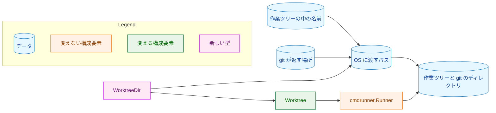
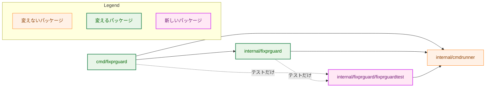
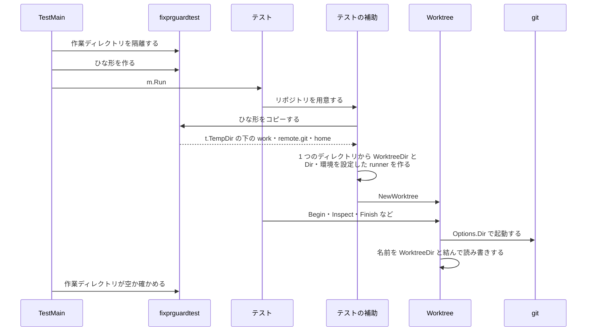
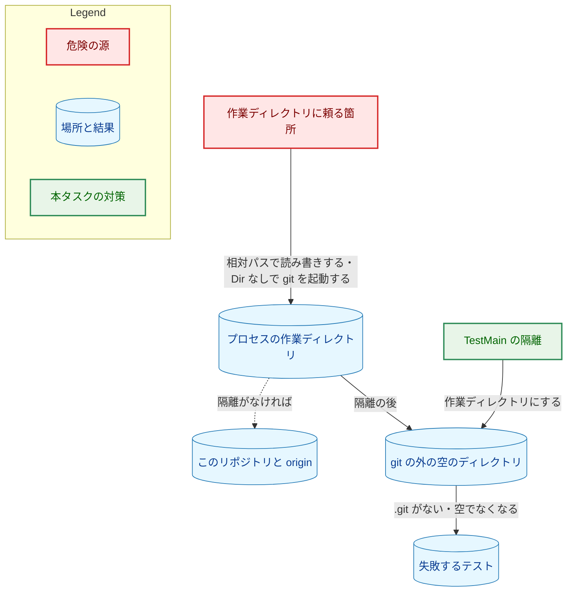
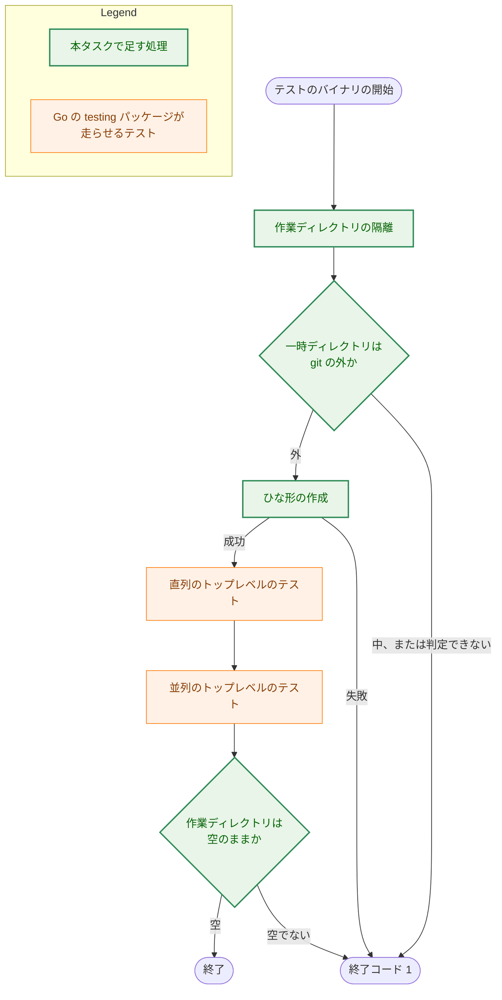

# 設計書：fixprguard のテストの並列化と git フィクスチャの軽量化

## Document Status

| Item | Value |
|---|---|
| Status | `approved` |
| Created | 2026-11-26 |
| Review date | 2026-11-26 |
| Reviewer | isseis |
| Comments | - |

## 1. 設計の全体像

本タスクでは、`internal/fixprguard` と `cmd/fixprguard` のテストを並列に実行できるようにし、テストのリポジトリを作る費用を下げる（[01_requirements.md](01_requirements.md) F-001〜F-006）。そのために、次の 4 つを変える。

-   **製品:** `internal/fixprguard` の `Worktree` は、作業ツリーのディレクトリを呼び出し元から受け取る。CLI は、プロセスの作業ディレクトリを表す値を渡す（F-002）。
-   **テストの補助:** 補助は、`t.Chdir` と `t.Setenv` を使わずに、テストごとのリポジトリと `HOME` を用意する。runner と準備の git には、テストごとの環境を渡す（F-001）。
-   **フィクスチャ:** フィクスチャは、パッケージで 1 回だけ作ったひな形のコピーにする（F-003）。
-   **冗長なテスト:** ほかのテストと同じ確かめを持つだけのテストとサブテストを、並列化の前に削除する（F-006、8.4 節）。

本書の行番号は、コミット `98456465`（`origin/main`）で確かめた。H-01〜H-07 は、要件の段階から申し送られた設計の事項（[design_handoff.md](design_handoff.md)）で、各項目の扱いは 11 章にまとめる。

### 1.1. 設計原則

-   作業ツリーの中の名前と、OS に渡すパスを分ける。fixprguard は、git が出す作業ツリーの中の相対の名前（変更されたパス、無視されたファイル、`.claude` などの見張るディレクトリ）を、比較・digest・記録のファイル・出力の値として使う。この値は変えない。ファイルのシステムコールに渡すときだけ、作業ツリーのディレクトリと結んだパスを使う。結ぶ操作と、その逆の操作は、`WorktreeDir` のメソッドに限る（3.2 節）。
-   CLI の振る舞いはバイト単位で変えない。CLI が渡す値は `"."` を表す（1.3 節の 2 つ目の決定）。`"."` と結んだパスは、相対の名前そのものになる。そのため、CLI が OS に渡すパス、記録のファイルの中身、digest の値、出力、終了コードは、変更の前と同じである（AC-08、AC-09）。
-   作業ディレクトリに頼る箇所の見落としは、テストが失敗して見つかる形にする。各パッケージの `TestMain` は、プロセスの作業ディレクトリを、どの git リポジトリにも含まれない空のディレクトリに変えてから、テストを走らせる（3.5 節）。渡したディレクトリを使わずに作業ディレクトリに頼る箇所が残っていると、その操作は `.git` を見つけられずに失敗する。このリポジトリには届かない（AC-07）。
-   プロセス全体の状態を確かめるテストだけを直列に残す。直列に残すテストは、4 章の一覧のものだけである（AC-03）。ほかのテストとサブテストは、すべて `t.Parallel()` を呼ぶ（AC-01）。
-   テストの判定は変えない。テストの差分は、製品の呼び出しの引数と、テストの準備の変更に限る（AC-16）。直列のまま残すテストの期待値も変えない。

### 1.2. 概念モデル



矢印 A → B は、A が B を作るときの材料になること、または A が B を使うことを表す。`Worktree` は `WorktreeDir` を持ち、runner を使う。OS に渡すパスは、作業ツリーの中の名前か git が返す場所を、`WorktreeDir` と結んで作る（3.2 節）。runner は、呼び出し元が `Options.Dir` に同じディレクトリを設定して作り、作業ツリーと git のディレクトリを対象に動く（3.3 節）。

### 1.3. 設計の際に決めたこと（2026-11-26）

-   **作業ツリーのディレクトリを渡す API の形:** 検証済みの型 `WorktreeDir` を足し、`fixprguard.NewWorktree(dir, gitRun, listRun, makeRun)` で受け取る。runner の `cmdrunner.Options.Dir` は、呼び出し元が同じディレクトリに設定する（3.2 節、3.3 節）。
    -   理由: `cmdrunner.Runner` の `Run` には作業ディレクトリの引数がなく、`Dir` は runner を作るときの `Options` で決まる（`internal/cmdrunner/runner.go:24-62`）。テストは、呼び出しを記録する `gitRouter` で本物の runner を包み、`ConfigList` と `Before` で一部の呼び出しを差し替える（`internal/fixprguard/test_helpers_git.go:34-79`）。この形は残したい。
    -   受け入れる危険: `WorktreeDir` と runner の `Dir` が食い違っても、型では防げない。`Dir` を設定し忘れた場合は、`TestMain` の空の作業ディレクトリ（3.5 節）の下で git が失敗するので、見つかる。`Dir` が別の実在のリポジトリを指す場合は、テストが誤った理由で通りうる。テストでは、補助が 1 つのディレクトリの引数から `WorktreeDir` と runner の `Dir` の両方を作り、テストが別々に設定できないようにして防ぐ（3.3 節）。CLI では、`CurrentDir()` と空の `Dir` がどちらもプロセスの作業ディレクトリを指すので、食い違いは起こらない。
    -   採らなかった案: `NewWorktree` が `cmdrunner.Options` を受け取り、runner を自分で作る案。食い違いは型で防げるが、テストが runner を差し替える経路を作り直すことになり、変更が大きくなる。
    -   2026-11-26 に人が選んだ。
    -   ADR: なし。`internal/fixprguard` の内部の構造で、CLI の契約もほかの構成要素も変えない。
-   **CLI が渡す値:** `fixprguard.CurrentDir()`（`"."` を表す値）を渡す。
    -   理由: `"."` と結んだパスは相対の名前そのものなので、CLI が OS に渡すパス、`.git` のファイルの相対の `gitdir:` の解き方、記録のファイルの置き場所、`filepath.Abs` の結果（`internal/fixprguard/gitstate.go:280`）が、今と変わらない（H-02）。
    -   採らなかった案: `os.Getwd()` の絶対パスを渡す案。`Getwd` の失敗という新しい失敗の経路ができる。シンボリックリンクを含む `$PWD` と物理パスの違いで、digest の値が変わりうる。
    -   2026-11-26 に人が選んだ。
    -   ADR: なし。既存の CLI の契約を保つだけである。
-   **フィクスチャを速くする手段:** ひな形をパッケージで 1 回だけ作り、テストごとにコピーする。パスを含む 2 つの設定（`remote.origin.url` と `core.excludesFile`）は、コピーした `.git/config` に直接書き直してコピー先に合わせる（3.6 節）。
    -   理由: この機械で計ると、今のフィクスチャと同じ 13 回の git を起動する手順は 1 つ約 240ms、作ったリポジトリを `cp -Rp` でコピーすると 1 つ約 20ms だった（`-race` なし、直列のシェルのループで 20 回ずつ）。コピーなら、テストごとに起動する git は、index の stat の情報を合わせる 1 回（3.6 節）だけになる。
    -   採らなかった案: `git config` だけを直接の書き込みに置き換える案（git の起動は `internal/fixprguard` で 13 回から 6 回になるが、1 つ約 110ms 残る見込み）。2 つを組み合わせる案（ひな形を作る費用は 1 回だけなので、組み合わせても得はない）。
    -   2026-11-26 に人が選んだ。
    -   `CLAUDE.md`「Performance」の、正しさの義務を足す最適化に当たる。義務は「コピーしたリポジトリは、今の手順で作ったリポジトリと、テストごとに変わる値を除いて同じであること」で、3.6 節のテストで固定する。義務は実装のコミットメッセージに書き、最適化は振る舞いの変更と別のコミットにする。
    -   ADR: なし。テストの補助の作り方で、このタスクの中で閉じる。
-   **2 つのパッケージで共通の補助の置き場所:** テスト専用の新しいパッケージ `internal/fixprguard/fixprguardtest`（`//go:build test`）に、作業ディレクトリの隔離、テストの環境、ひな形のコピーの 3 つを置く。フィクスチャの中身（コミットするファイル、設定）は、それぞれのパッケージが今のまま持つ（3.4 節）。
    -   理由: 3 つの補助は 2 つのパッケージで同じになる（`CLAUDE.md`「DRY」）。テスト専用のパッケージを置く例は、`internal/doctestutil` と `internal/maketestutil` にある。fixprguard の下に置き、ほかのタスク（0127 など）とは結びつけない（10 章）。
    -   採らなかった案: 2 つのパッケージにそれぞれ書く案（約 100 行が重複する）。
    -   2026-11-26 に人が選んだ。
    -   ADR: なし。テストの補助の置き場所で、このタスクの中で閉じる。
-   **`TestMain` での作業ディレクトリの変更:** 2 つのパッケージの `TestMain` は、`m.Run` の前に一度だけ、プロセスの作業ディレクトリを空の一時ディレクトリに変える。プロセスの `PWD` は変えない。その一時ディレクトリが git のリポジトリに含まれないことは、変える前に git で確かめる。含まれるときは、テストを走らせずに失敗する。`m.Run` の後には、作業ディレクトリが空のままであることを確かめる（3.5 節）。AC-04 は、設計書に場所と理由を記録することを条件に、この変更を例外として認めている。場所と理由は 3.5 節に書く。
    -   理由: パッケージのディレクトリ（このリポジトリの中）のままでは、漏れた操作がこのリポジトリを読み書きし、その `origin` に push しうる。空のディレクトリなら、漏れた操作は失敗する（AC-07）。
    -   作成者が決めた（要件書と H-01 の候補のとおり）。PR のレビューで確かめてもらう。
    -   ADR: なし。テストの実行の準備で、このタスクの中で閉じる。
-   **ゼロ値の `WorktreeDir`:** `NewWorktree` は、ゼロ値の `WorktreeDir` を受け取ると panic する。戻り値の型（`*Worktree`）は変えない（3.2 節）。
    -   理由: ゼロ値は、CLI からは渡らない（`osEnv` が `CurrentDir()` を設定する）。渡るのは、テストの補助の誤りだけである。`ErrInvalidInput` で返すと、CLI は終了コード `2` で止まる。これは、「`.git` がない」「最上位でない」を確かめるテストが期待する結果と同じなので、補助の誤りでもテストが通ってしまう。panic なら、どのテストでも失敗する。
    -   採らなかった案: `ErrInvalidInput` を返す案（上の理由）。`ErrInvalidInput` でない別の番兵を返す案（`NewWorktree` の戻り値の型が変わり、CLI の `execute` に、通らない経路の処理が増える）。
    -   作成者が決めた（設計書のレビューで見つかった問題への対策）。PR のレビューで確かめてもらう。
    -   ADR: なし。
-   **子のコマンドの `PWD`:** テストの補助は、runner の `Dir` を設定するときに、渡す環境の `PWD` も同じディレクトリにする。CLI の runner は今のまま `Dir` を設定しない（3.3 節）。
    -   背景: Go の `os/exec` は、`Cmd.Env` が nil のときだけ、子の `PWD` を `Cmd.Dir` に合わせる（`go doc os/exec.Cmd` の `Dir`、Go 1.27.1 の `src/os/exec/exec.go:1225-1237`）。fixprguard の runner は `Env` を必ず渡す。
    -   理由: git は、`PWD` が作業ディレクトリと同じ場所を指すときだけ `PWD` を使う。そのため、古い `PWD` が残っても git の対象は変わらない。ただし、フックのシェルなど、git の子が `PWD` を読む余地を残さないために、テストでは `PWD` を合わせる。CLI は `Dir` を設定しないので、子は今と同じ正しい `PWD` を受け継ぐ。
    -   作成者が決めた（H-01）。PR のレビューで確かめてもらう。
    -   ADR: なし。

### 1.4. 実装の際に決めたこと（2026-11-27）

-   **冗長なテストの削除:** 並列化の前に、ほかのテストと同じ経路と判定を確かめているだけのテストとサブテストを削除する（要件書 F-006）。候補と確かめ方は 8.4 節に置く。
    -   理由: 消えるテストを速くする手間を省く。`internal/fixprguard` は直列に動くので、削除した葉のテストの時間は、そのまま壁時計の時間から減る。
    -   採らなかった案: 別のタスクにする案（同じテストを先に速くする手間が無駄になる）。
    -   人が選んだ。ADR: なし（このタスクの範囲の変更で、[ADR-0037](../../dev/adr/0037-test-deletion-coverage.md) の削除の規則は変えずに当てはめる）。
-   **削除と計測（AC-12）:** 計測の前の木は変えない。削除で減った時間も短縮に数え、その分をパッケージごとに記録する（8.2 節、要件書 AC-13）。人が選んだ。ADR: なし。

## 2. システム構成

### 2.1. コンポーネント配置



矢印 A → B は、パッケージ A のコードが B を import することを表す。破線は、A の `_test.go` のファイルとテストの補助（`//go:build test`）だけが import することを表す。実線の `CLI → LIB`・`CLI → CMDR`・`LIB → CMDR` は今もある関係である（`cmd/fixprguard/main.go:27-28`、`internal/fixprguard/worktree.go:19`）。破線の 2 本と `FT → CMDR` は、本タスクで足す。`fixprguardtest` は `internal/fixprguard` を import しない。そのため、`internal/fixprguard` のテスト（同じパッケージのテスト）からも import できる。

### 2.2. データの流れ（並列のテスト 1 つ）



矢印は呼び出しを、破線はその戻り値を表す。シーケンス図には色で分けるノードがないので、Legend のブロックは置かない。プロセスの作業ディレクトリと環境変数は、`TestMain` の隔離のあと、どのテストも変えない（直列のまま残すテストを除く。4 章）。

## 3. コンポーネント設計

### 3.1. 変更するファイル

| ファイル | 変更 | 責務 |
|---|---|---|
| `internal/fixprguard/workdir.go` | 追加 | `WorktreeDir` の型、構築の関数、結ぶ操作と逆の操作（3.2 節） |
| `internal/fixprguard/worktree.go` | 変更 | `Worktree` が `WorktreeDir` を持つ。`NewWorktree` は `dir` を受け取り、ゼロ値で panic する。`checkReviewInput`（`:577`）と `blobOf`（`:521`）は `WorktreeDir` を受け取る |
| `internal/fixprguard/gitstate.go` | 変更 | `locateGitDirs`（`:187`）は `WorktreeDir` を受け取る。`hooksState`（`:535`）は、`git rev-parse --git-path hooks` の出力を git が返す場所として解いてから `hooksDigest`（`:311`）に渡す |
| `internal/fixprguard/ignored.go` | 変更 | 無視されたファイルの走査（`:256-600`）は `WorktreeDir` を受け取る。名前は比較と記録に使い、システムコールには結んだパスを渡す |
| `internal/fixprguard/changes.go` | 変更 | 変更の分類（`:305` の `os.Lstat`、`untrackedChange`・`examine`、`:318-390`）は `WorktreeDir` を受け取る |
| `cmd/fixprguard/main.go` | 変更 | `env` に `dir fixprguard.WorktreeDir` を足し、`osEnv` は `fixprguard.CurrentDir()` を設定する。`execute`（`:378`）は `NewWorktree(e.dir, ...)` を呼ぶ |
| `internal/fixprguard/fixprguardtest/*.go` | 追加 | テスト専用のパッケージ。作業ディレクトリの隔離（3.5 節）、テストの環境（3.3 節）、ひな形のコピー（3.6 節）。このパッケージ自身のテストも、`TestMain` で `IsolateWorkingDir` を呼び、git にはディレクトリを指定して起動する |
| `internal/fixprguard/testmain_test.go`、`cmd/fixprguard/testmain_test.go` | 追加 | `TestMain`。作業ディレクトリを隔離し、ひな形を作ってから `m.Run` を呼び、後で作業ディレクトリが空かを確かめる |
| `internal/fixprguard/test_helpers_git.go` | 変更 | `newTestRepo` は `t.Setenv`・`t.Chdir` を呼ばず、ひな形をコピーする。`newTestWorktree` はディレクトリを受け取り、そこから `WorktreeDir`、runner の `Dir`、環境を作る（3.3 節）。今の作る手順は、ひな形を作る関数として残す（3.6 節） |
| `cmd/fixprguard/test_helpers.go` | 変更 | 同上。`newTestRun`・`realGit`・`realGitList` と、`NewWorktree(...).Baseline` などを続けて呼ぶ補助（`:140`・`:150`・`:169`）は、ディレクトリを受け取る |
| `internal/fixprguard/*_test.go`、`cmd/fixprguard/*_test.go` | 変更 | `t.Parallel()` を足す（4 章）。`t.Chdir` で作業ディレクトリを変えていたテストは、同じディレクトリを補助に渡す。相対パスで読み書きしていたテストは、結んだパスを使う（3.5 節）。自分で runner を作るテスト（`internal/fixprguard/ignored_test.go:330`）も、補助の環境と `Dir` を使う |
| `internal/fixprguard/construction_test.go` | 変更 | `WorktreeDir` を、構築の関数でしか作れない型の一覧に加える（3.2 節） |
| `internal/pipeline/pipeline_test.go` | 変更 | `testOnlyPackageDirs`（`:540`）に `internal/fixprguard/fixprguardtest` を加える。`TestFakesCarryBuildTag` が、このパッケージのファイルに `test` の build constraint があることを確かめる |
| `docs/dev/conventions/package_reference.md` | 変更 | 「Test-Only Packages」の表に `internal/fixprguard/fixprguardtest` の行を足す（`internal/pipeline/pipeline_test.go:630` の `TestPackageReferenceListsPackages` が求める） |

`internal/cmdrunner` は変えない（要件書 2.3 節）。`docs/dev/guides/fixprguard_guide.md` と `const Protocol` の行も変えない（AC-09）。

### 3.2. `WorktreeDir`

```go
// WorktreeDir is the top of the work tree a Worktree guards. The zero value
// is not usable: NewWorktree panics on it.
type WorktreeDir struct{ path string }

// CurrentDir is the process's current directory, as ".". The CLI passes it:
// a name joined with it is the name itself, so every path the tool opens is
// the one it opened before WorktreeDir existed.
func CurrentDir() WorktreeDir

// NewWorktreeDir accepts an absolute path other than "/" that filepath.Clean
// leaves as it is, and fails with ErrInvalidInput otherwise. It does not touch
// the file system: whether a .git is there is checked where it is checked
// today.
func NewWorktreeDir(path string) (WorktreeDir, error)

// NewWorktree returns a Worktree that guards the work tree at dir. gitRun,
// listRun and makeRun must run their commands in dir (cmdrunner.Options.Dir);
// for CurrentDir that is the process's current directory (an empty Dir).
func NewWorktree(dir WorktreeDir, gitRun, listRun, makeRun cmdrunner.Runner) *Worktree
```

-   **公開する名前:** `WorktreeDir`・`CurrentDir`・`NewWorktreeDir` と、`NewWorktree` の新しい第 1 引数だけである。`NewWorktree` の戻り値の型は変えない。`WorktreeDir` が持つパスを返す公開のメソッドは置かない。`cmd/fixprguard` のテストは、runner の `Dir` に設定するパスを、自分で作ったディレクトリのパスとして持っているので、それは要らない。`NewWorktreeDir` を公開するのは、`cmd/fixprguard` のテストが使うためである。製品のコードで呼ぶのは `CurrentDir` だけである。
-   **2 つの操作（非公開のメソッド）:** 作業ツリーの中の名前と、git が返す場所とは、呼び出し側が別々のメソッドで結ぶ。値の中身からどちらかを推し量らない（`CLAUDE.md`「Declare, don't infer」）。
    -   **名前を結ぶ操作:** 作業ツリーの中の名前（git の一覧やファイルの走査から得た相対の名前、`".git"`、`".claude"`）を受け取る。`CurrentDir()` のときは、名前をそのまま返す。それ以外は、ディレクトリと名前を `/` で結ぶ。名前の中身は調べない。名前が相対であることは、名前を作る側がすでに確かめている（たとえば、`parseIgnoredListing` は絶対パスと空の要素を拒む。`internal/fixprguard/ignored.go:321-345`）。
    -   **場所を解く操作:** git が返す場所（`.git` のファイルの `gitdir:`、`rev-parse --git-path hooks` の出力）を受け取る。絶対パスならそのまま返し、相対なら名前を結ぶ操作と同じに結ぶ。絶対パスも正当な値なので、ここでだけ絶対かどうかで分ける。`commondir` は、今と同じく git のディレクトリから解く（`gitstate.go:219-221`）。
    -   **逆の操作:** 結んだパスを根にしてファイルを走査すると（`filepath.WalkDir`）、コールバックの名前も結んだパスになる。逆の操作は、それを作業ツリーの中の名前に戻す。`CurrentDir()` のときは名前をそのまま返す。それ以外は、`ディレクトリ + "/"` で始まる名前からその接頭辞をちょうど取り除く。接頭辞で始まらない名前は、走査の失敗として扱う（`errReadIgnoredDir` と同じ扱い。名前を推し量らない）。`isWatched`、`slices.Contains(dirs, p)`、`p == topDir`、記録の行（`ignored.go:499`）には、戻した名前を渡す。
-   **`filepath.Join` を使わない理由:** `Join` はパスを `Clean` するので、末尾の `/`（追跡されていないファイルの一覧が入れ子のリポジトリに付け、`changes.go:340`・`:357` まで残る）の意味が、OS が相対パスとして解くときと変わりうる。たとえば、`os.Lstat("link/")` はリンクをたどるが、`Clean` した `os.Lstat("dir/link")` はたどらない。`filepath.WalkDir` は子の名前を `Join` で作るが、子の要素は 1 つのディレクトリの項目の名前（`/` も `..` も含まない）なので、根の後の部分は変わらない。
-   **`NewWorktreeDir` の前提（テストだけが使う）:** テストのディレクトリは `t.TempDir()` の下に `os.MkdirAll` で作るので、最後の要素はシンボリックリンクではない。そのため、`.git` のファイルの相対の `gitdir:` を結んだ後に下流の `filepath.Join`（`gitstate.go:209`・`:220`・`:286`・`:298`）が `..` を字面で畳んでも、物理的なパスと同じ場所を指す。`"/"` を拒むのは、`"/" + "/" + 名前` が `//名前` になるのを避けるためである。
-   **ゼロ値:** `NewWorktree` は、ゼロ値の `WorktreeDir` を受け取ると panic する（1.3 節）。CLI がゼロ値を渡すことはない。
-   **構築の規則のテスト:** `construction_test.go` の `restrictedConstructors`（`internal/fixprguard/construction_test.go:17-22`）は、型ごとに構築の関数を 1 つだけ許す。`WorktreeDir` は `CurrentDir` と `NewWorktreeDir` の 2 つで作るので、一覧の値を関数の集合にして加える。このテストの変更は、テストだけを変えるコミットで行う（AC-14）。
-   **標準ライブラリの `os.Root` と `os.DirFS` を使わない理由:** どちらも、作業ツリーからの相対の名前で操作できる。しかし、`os.Root` は根の外へ出るシンボリックリンクをたどらない。fixprguard は、根の外を指すリンクをたどって中身を記録する（`linkTarget`、`digestPathType`、`hooksDigest`。`ignored.go:554`、`gitstate.go:311-415`）。リンクされた作業ツリーの `.git` のファイルも、根の外の git のディレクトリを指す。`os.DirFS` は、末尾の `/` や `..` を含む名前と、絶対パスを受け付けない（`fs.ValidPath`）。どちらも今の判定の意味を変えるので、使わない。

#### `WorktreeDir` を受け取る非公開の関数

コミット `98456465` で、作業ディレクトリからの相対パスをシステムコールに渡している箇所を、`grep -nE 'os\.(Lstat|Stat|ReadFile|Open|OpenFile|Readlink|Remove|CreateTemp|Rename)|filepath\.(Abs|WalkDir|EvalSymlinks)'` で製品のファイルから探し、相対の値が届く箇所を読んで確かめた。該当した箇所を含む関数の引数を、次のように変える。

| 関数 | 今の場所 | 変更 |
|---|---|---|
| `locateGitDirs` | `gitstate.go:187` | `WorktreeDir` を受け取る。`".git"` は名前を結ぶ操作で、`gitdir:` は場所を解く操作で結ぶ。返す `gitDirs` の値は結んだパスなので、`commondir`・`config`・`info/*`・記録のファイル（`gitstate.go:208-224`・`:277-306`・`:614`、`ignored.go:663`・`:674`）は、そのまま結んだパスになる |
| `hooksDigest` | `gitstate.go:311` | 引数の `dir` に、`hooksState` が場所を解く操作で結んだパスを受け取る。関数の中は変えない |
| `checkReviewInput` | `worktree.go:577` | `WorktreeDir` を受け取り、`".git"` を結んで `os.Lstat` する（`:581`） |
| `blobOf` | `worktree.go:521` | `WorktreeDir` を受け取り、名前を結んで読む（`:532`・`:538`） |
| `trackedChange`、`untrackedChange`、`examine`、`readChanged` | `changes.go:289`・`:318`・`:339`・`:382` | `WorktreeDir` を受け取り、名前を結んで読む（`:305`・`:340`・`:351`・`:383`）。`change.path` は名前のまま持つ |
| `checkTopDirGitNames`、`walkIgnoredDir` | `ignored.go:410`・`:453` | `WorktreeDir` を受け取り、結んだパスを根に走査し、逆の操作で名前に戻す |
| `targetStateOf`、`targetEntry`、`linkTarget`、`readTarget` | `ignored.go:482-600` | `WorktreeDir` を受け取り、名前を結んで読む。記録の行と digest には名前を書く |
| `lstatFunc`（注入する lstat） | `ignored.go:256` | 型は変えない。**結んだパス**を受け取る。製品は `os.Lstat` を渡す |

`Worktree` のメソッド（`collectTargets`、`enumerateChanges`、`hooksState`、`CheckState` など）は、`w.dir` を上の関数に渡す。

`lstatFunc` が結んだパスを受け取るので、`internal/fixprguard/ignored_test.go:760-770` の fake は、比べる名前を `".envrc"` から、リポジトリの `.envrc` を結んだパスに変える。`os.Remove` と `syscall.Mkfifo` に渡す名前も同じになる。これは、fake が反応する入力の作り方の変更で、判定（`errReadIgnoredFile` を期待すること）は変えない。AC-16 の「テストの準備の変更」として PR の説明に記録する。

呼び出し元が名前で指定するテキストのファイル（`fence` のファイル、`--body-file`、`--title-file`。`cmd/fixprguard/main.go:620-640`、`internal/fixprguard/write.go:28`・`:54`）は、作業ツリーのファイルではない。今と同じく、渡された名前をプロセスの作業ディレクトリから解く。テストは絶対パスを渡す。

`GitHub`（gh の呼び出し）は、ライブラリの API を変えない。gh は、自分が動くディレクトリの git の remote からリポジトリを決める。そのため、`CurrentDir()` でない `WorktreeDir` を渡す呼び出し元は、gh の runner も同じディレクトリで動かす必要がある。CLI は `CurrentDir()` と空の `Dir` を使うので当てはまらない。テストの gh は fake でプロセスを起動しない。

### 3.3. runner とテストの環境

-   **CLI:** `osEnv`（`cmd/fixprguard/main.go:178-190`）の runner は変えない。`Dir` は空のままで、環境は `cmdrunner.GitEnv(os.Environ())` である。足すのは `dir: fixprguard.CurrentDir()` だけである。gh の runner も変えない。gh は今と同じくプロセスの作業ディレクトリ（作業ツリーの最上位）で動く。
-   **テストの環境:** `fixprguardtest.Env` が、`cmdrunner.GitEnv(os.Environ())` から `HOME`・`XDG_CONFIG_HOME`・`PWD` の項目を除き、テストごとの値を足した環境を返す。`HOME` はテストの `t.TempDir()` の下の空のディレクトリ、`XDG_CONFIG_HOME` はその下の `.config`、`PWD` はその runner の `Dir` である。`GitEnv` は `GIT_*` を除くので、`GIT_CONFIG_GLOBAL` で利用者の設定を遮ることはできない（`internal/cmdrunner/git.go:36-45`）。`HOME` を差し替えて遮る（H-03）。
    -   `internal/mergepr` のテストの補助も同じ形で `HOME` を差し替え、さらに `GIT_CONFIG_NOSYSTEM=1` を足している（`internal/mergepr/test_helpers_git.go:252-255`）。本タスクは `GIT_CONFIG_NOSYSTEM` を足さない。今の fixprguard のテストはシステムの設定を読んでおり、足すとテストの環境が変わって、AC-11 の「変更の前と同じリポジトリと `HOME`」の比べ方の前提が崩れるからである。システムの設定を遮るかどうかは、このタスクの範囲の外とする。
-   **環境を渡す先:** 製品の runner（git と無視の一覧）、テストの準備の git（`gitIn`・`ConfigList` など。`internal/fixprguard/test_helpers_git.go:178-199`、`cmd/fixprguard/test_helpers.go:102-135`）、ひな形を作る git、自分で runner を作るテスト（`internal/fixprguard/ignored_test.go:330`）に、同じ規則の環境を渡す。make と gh は fake で、プロセスを起動しない。
-   **1 つのディレクトリからすべてを作る:** テストの補助（`internal/fixprguard` の `newTestWorktree`、`cmd/fixprguard` の `newTestRun`・`realGit`・`realGitList` など）は、対象のディレクトリを必須の引数として受け取る。補助は、その 1 つの値から、`WorktreeDir`（`NewWorktreeDir`）、作業ツリーを対象にする runner の `Options.Dir`、環境の `PWD` を作る。テストは、`WorktreeDir` と runner の `Dir` を別々に設定しない。対象のディレクトリは、テストが確かめたい場所である。
    -   ふつうは、テストのリポジトリの作業ツリー（`r.Dir`）。
    -   最上位でない場所を確かめるテストは、`r.Dir` の下の `docs`（`internal/fixprguard/review_test.go:239`・`:430`）。
    -   リンクされた作業ツリーを確かめるテストは、その作業ツリー（`gitstate_test.go:249`、`ignored_test.go:1386`）。
    -   `.git` のないディレクトリや、形の誤った `.git` を持つディレクトリを確かめるテストは、テストが作る `t.TempDir()`（`review_test.go:257`、`ignored_test.go:379-929`、`cmd/fixprguard/main_test.go:180`・`:381`・`:971`・`:1129`・`:1549`）。

    `HOME` は、リポジトリを作ったテストではそのリポジトリの `home`、リポジトリのないテストでは、補助が対象のディレクトリとは別の `t.TempDir()` の呼び出しで作る空のディレクトリである。対象のディレクトリの下には作らない。
-   プロセスの環境を読むのは、補助が runner を作るときだけである。並列のテストが `os.Environ()` を読む間に、プロセスの環境変数を変えるテストは走らない。プロセスの環境変数を変えるテストは直列のトップレベルのテストだけで、Go の `testing` パッケージは、直列のトップレベルのテストがすべて終わってから並列のトップレベルのテストを再開する（`go doc testing.T.Parallel`）。`-count` で繰り返すときも、1 回分のテストがすべて終わってから次の回が始まる。`t.Setenv` は終わりに値を戻す。

### 3.4. `internal/fixprguard/fixprguardtest`

テスト専用のパッケージである。すべてのファイルに `//go:build test` を付け、`internal/fixprguard` を import しない。公開する関数の形の目安を示す。名前と引数の細部は実装計画で決める。

```go
package fixprguardtest

// Isolation is what IsolateWorkingDir set up for one test binary.
type Isolation struct {
	// PackageDir is the directory the test binary started in: the package
	// directory, from which tests read testdata, sources and documents.
	PackageDir string
	// TemplateRoot is where a package's fixture template is built.
	TemplateRoot string
}

// IsolateWorkingDir records the current directory, makes a new empty
// directory, checks with git that no repository contains it, and makes it the
// process's working directory. TestMain calls it once before m.Run.
// The returned function checks that the directory is still empty and removes
// everything it made.
func IsolateWorkingDir() (Isolation, func() error, error)

// Env returns cmdrunner.GitEnv(os.Environ()) with HOME and XDG_CONFIG_HOME
// pointing under home and PWD set to dir, the Dir of the runner it is for.
func Env(home, dir string) []string

// Template is a fixture root (work, remote.git, home) built once and copied
// per test.
type Template struct{ /* unexported */ }

// BuildTemplate builds the template under root with build. TestMain calls it
// once, after IsolateWorkingDir.
func BuildTemplate(root string, build func(root string) error) (*Template, error)

// Copy copies the template to dst and writes the two path values of the work
// tree's .git/config (remote.origin.url, core.excludesFile) for dst.
func (t *Template) Copy(dst string) error
```

-   ひな形の中身は、各パッケージが渡す `build` が決める。`build` は、今の `newTestRepo` の手順（`git init` から `git push` まで）から、`t.Setenv` と `t.Chdir` を除いたものである。git は、`Env` の環境とディレクトリを指定して起動する。2 つのパッケージのフィクスチャは中身が違う（`internal/fixprguard` は 5 つのファイルと `tag.gpgSign`、`cmd/fixprguard` は 1 つのファイル）ので、それぞれが自分の `build` を持つ。
-   **共有する状態:** `TestMain` は、`m.Run` の前に `Isolation` と `*Template` をパッケージの変数に 1 回だけ書く。テストはどちらも読むだけで、ひな形を書き換えない。ほかに、テストの間で共有する書き換えられる状態は置かない（H-06）。

### 3.5. 作業ディレクトリの隔離（`TestMain`）

-   **場所:** `internal/fixprguard/testmain_test.go` と `cmd/fixprguard/testmain_test.go` の `TestMain` が、`fixprguardtest.IsolateWorkingDir` を呼ぶ。プロセスの作業ディレクトリを変える `os.Chdir` は、`IsolateWorkingDir` の中の 1 か所だけにある。AC-04 が認める例外は、この 1 か所である。
-   **理由:** テストの中で動く fixprguard の操作が、渡したディレクトリを使わずに作業ディレクトリに頼ったとき、その操作がこのリポジトリとその `origin` に届かないようにするためである（AC-07）。空のディレクトリでは、`.git` がないので `locateGitDirs` が失敗し、git は `not a git repository` で失敗する。`os.Chdir` はプロセスの `PWD` を変えないので（`t.Chdir` は変える）、`Env` を通らない子（漏れた runner）は、このリポジトリの中を指す古い `PWD` を受け継ぐ。git は `PWD` が作業ディレクトリと同じ場所を指すときだけ使うので、古い `PWD` は git の対象を変えない。`PWD` を合わせるには `os.Setenv` が要り、AC-04 の例外（作業ディレクトリの変更だけ）の外に出るので、合わせない。`osEnv` の runner を使う直列のテストは `t.Chdir` を使うので、`PWD` は合う。
-   **一時ディレクトリが git の外にあることの確かめ:** `os.MkdirTemp` で作った根の下に、作業ディレクトリにする空の `cwd`、確かめ用の空の `home`、ひな形を置く `template` を作る。`cwd` で、`Env(home, cwd)` の環境の git に `rev-parse --git-dir` を実行させる。`t.TempDir()` は、`GOTMPDIR` があればその下に作る（Go 1.27.1 の `src/testing/testing.go:1613`）。`GOTMPDIR` があるときは、その下に作った空のディレクトリでも同じ確かめをする。テストが `.git` のない場所として補助に渡す `t.TempDir()` が、このリポジトリの中に入らないようにするためである。
    -   git が終了コード `128` で終わったときだけ先へ進む。`128` は、リポジトリが見つからないときのほか、所有者を git が信頼しないリポジトリ（dubious ownership）や壊れた設定でも返る。どの場合も、漏れた git は同じ環境で同じように拒まれるので、先へ進んで安全である。
    -   git がリポジトリを見つけた（終了コード `0`）とき、ほかの終了コードのとき、git を起動できなかったときは、テストを走らせずに、1 行の診断を標準エラーに出して終了コード `1` で終わる。リポジトリを見つけたときの診断は、`TMPDIR` を git のリポジトリの外に向ければ直ることを示す。
    -   `GitEnv` は `GIT_CEILING_DIRECTORIES` と `GIT_DISCOVERY_ACROSS_FILESYSTEM` も除くので、この確かめと漏れた git は、同じ規則でリポジトリを探す。
-   **ディレクトリの構成:** git は作業ディレクトリから親の方向にだけリポジトリを探すので、`cwd` と並ぶ `template` のリポジトリは見つからない。
-   **後の確かめ:** `m.Run` の後で、`cwd` が空のままであることを確かめる。空でなければ、1 行の診断を出して終了コード `1` で終わる。結んだパスに直し忘れた、相対パスでの書き込みは、すべてのテストが共有する `cwd` に入る。`.git` の形の書き込みが入ると、それより後の漏れた `os.Lstat(".git")` が成功しうる。この確かめで、そうした書き込みを見つける。その後、根を消す。`cwd` を読み取り専用にする案は採らない。書き込みをその場で止められるが、後の確かめで同じ漏れを見つけられるので、仕組みを 2 つにしない。なお、`go test` を通さずにテストのバイナリを直接動かし、プロファイルの出力先を相対パスで指定すると、出力が `cwd` に入って後の確かめが失敗する（`-test.outputdir` がないときの `toOutputDir`、Go 1.27.1 の `src/testing/testing.go:2914-2917`）。そのときは出力先を絶対パスで指定する。
-   **パッケージのディレクトリから読むテスト:** 作業ディレクトリを変えると、パッケージのディレクトリからの相対パスで読むテストが読めなくなる（H-01）。次のテストは、`Isolation.PackageDir` を起点に読むように変える。どれもファイルを読むだけで、fixprguard の操作も git も起動しないので、AC-07 の対象ではない。`PackageDir` を補助に渡す対象のディレクトリにすることはない（3.3 節）。
    -   `cmd/fixprguard/docs_test.go` の `repoRoot = "../.."`（`:22-23`）と、それを使う `readDoc`・`doctestutil.CommandDocs`。
    -   `internal/fixprguard/review_state_test.go:839` の `testdata/review_state`。
    -   `internal/fixprguard/construction_test.go:153` の `filepath.Glob("*.go")` と `:163` の `os.ReadFile`。
-   **相対パスで読み書きするテスト:** 今は `t.Chdir` でテストのリポジトリが作業ディレクトリになっているので、相対パスでファイルを読み書きするテストがある。たとえば、`internal/fixprguard/ignored_test.go:380-382` の `writeFile(t, "file")`・`mkdir(t, "dir")`・`symlink(t, "dir", "link")`、`:730` の `os.WriteFile("sparse", ...)`、`cmd/fixprguard/main_test.go:1307` の `os.ReadFile(beginRecordName)`、`:1445` の `os.Symlink`。これらは、補助に渡したディレクトリと結んだパスを使うように変える。実装では、`t.Chdir` を外すテストごとに、相対の名前を渡すファイルの操作（`os.` と `filepath.` の呼び出し、`writeFile`・`mkdir`・`symlink`・`stateOf`・`stateWithin`・`walkedEntries` などの補助）を `grep` で探して、すべて変える。漏れは、後の確かめ（`cwd` が空か）と、失敗するテストで見つかる。

### 3.6. フィクスチャのひな形とコピー

-   **作る手順:** 各パッケージの `build` は、ひな形の根（`Isolation.TemplateRoot` の下のパッケージごとの場所）に、`work`・`remote.git`・`home` を作る。手順は今の `newTestRepo` と同じで、`internal/fixprguard` は git を 13 回（`init` 2 回、`config` 7 回、`remote add`・`add`・`commit`・`push` 1 回ずつ。`internal/fixprguard/test_helpers_git.go:129-169`）、`cmd/fixprguard` は 12 回（`config` 6 回。`cmd/fixprguard/test_helpers.go:54-95`）起動する。`core.excludesFile` が指す空のファイルは、ひな形の `home` の下に作る（今の `pinIgnoreConfig` と同じ）。
-   **作る時:** `TestMain` が、隔離の後、`m.Run` の前に 1 回だけ作る（`BuildTemplate`）。最初にフィクスチャを使うテスト（直列のテストで、環境変数や作業ディレクトリを変えているものもある）に左右されず、決まった環境で作るためである。失敗したときは、1 行の診断を出してテストを走らせずに終わる。費用は、テストのバイナリごとに約 240ms である。
-   **コピー:** `newTestRepo` は、テストの `t.TempDir()` の下に根をコピーし、コピーした作業ツリーで `git update-index -q --refresh` を 1 回実行する（下の「index の stat の情報」）。コピーは、ディレクトリと通常のファイルの種類・権限の値・中身を保つ。ひな形には、シンボリックリンクとほかの特別なファイルはない。それ以外を見つけたら、コピーは失敗する。
-   **パスを含む設定の書き直し:** ひな形の根の絶対パスは、`work/.git/config` の 2 つの値（`remote.origin.url` と `core.excludesFile`）にだけ現れる。`Copy` は、この 2 つの値を、コピー先の根から作った値（`<根>/remote.git` と `<根>/home/excludes`）に書き直す。値は、git の設定ファイルの引用符の形（`"` で囲み、`\` と `"` の前に `\` を置く）で書く。`t.TempDir()` の名前には `#` や空白が入りうる（重なったサブテストの名前には `#01` が付く）。引用符で囲まずに書くと、git は `#` から後を注釈として読み、値が切れる。`Copy` は、書き直す前の 2 つの行がひな形の根を含む決まった形（git が引用符で囲んで書いた形を含む）であることを確かめ、そうでなければ失敗する。ほかのファイル（`remote.git/config`、reflog）にはパスが含まれないことを、同等性のテストで確かめる。
-   **テストごとの git の数（AC-10）:** コピーの後、テストがリポジトリを受け取るまでに起動する git は、`update-index --refresh` の 1 回である。ひな形を作る git（13 回と 12 回）は、テストのバイナリごとに 1 回だけで、AC-10 の数とは別に数える。前の数（13 回と 12 回）は、上の手順の呼び出しの数である。`newTestRepo` は分岐もループもない直線の手順で、`r.Git`・`r.gitIn` の 1 回の呼び出しが git の 1 回の起動になる（`internal/fixprguard/test_helpers_git.go:178-187`、`cmd/fixprguard/test_helpers.go:102-111`）。前後の数は、この読み方の根拠の行とともに PR の説明に記録する。
-   **index の stat の情報:** コピーした `work/.git/index` は、ひな形のファイルの stat の情報（mtime・inode など）を持ち、コピー先のファイルと合わない。このままでは、製品が実行する `git diff --raw <木>`（`internal/fixprguard/changes.go:125` から）が、`GIT_OPTIONAL_LOCKS=0` の下でも index を書き直す（git 2.50.1 で確かめた。今の手順で作ったリポジトリでは書き直さない）。index のバイト列を比べるテスト（`TestInspectLeavesWorkTree`、`internal/fixprguard/worktree_flow_test.go:596-611` など）は、それで失敗する。そのため、`newTestRepo` はコピーの後に `git update-index -q --refresh` を 1 回実行し、index の stat の情報をコピー先のファイルに合わせる。これで、その後の `git diff --raw` は index を書き直さなくなる（同じ git で確かめた）。残る差分は stat の値だけで、AC-11 が認めるテストごとに変わる値である。
-   **コミットの ID:** すべてのコピーは、ひな形と同じコミットとオブジェクトを持つ。今はテストごとにコミットの時刻が違い、コミットの ID も違う。AC-11 が認める差分である。リポジトリはテストごとに別なので、テストの間で ID が同じでも影響しない。
-   **同等性のテスト（AC-11）:** 各パッケージに、並列のテストを 1 つ足す。今の手順（`build`）でテストの `t.TempDir()` の下に作ったリポジトリと、ひな形のコピーとを比べ、テストごとに変わる値を除いて同じであることを確かめる。コピー先の根の名前には `#` と空白を含める。比べるのは次の値である。
    -   作業ツリーのファイルの一覧、種類、権限の値、中身。
    -   `work/.git` と `remote.git` の下のすべてのファイルの一覧、種類、権限の値。中身は、`HEAD` と `COMMIT_EDITMSG` だけを比べる。`refs/` の下はコミットの ID を、`index` は stat の情報を、`objects/` と `logs/` の下はコミットの ID と時刻を持つので、中身は比べない。`config` も、`Copy` が値を常に引用符で囲んで書き、git は `#` や `;` を含むときだけ囲むので、バイト列では比べない。
    -   `git config --list --local` の出力（2 つのリポジトリそれぞれ。根の絶対パスを目印の文字列に置き換えてから比べる）。
    -   `git config --get remote.origin.url` と `git config --get core.excludesFile` が、それぞれ `<コピー先の根>/remote.git` と `<コピー先の根>/home/excludes` に等しいこと。置き換えの数を数えるだけでは、値が正しく読めることは分からないので、git に読ませて確かめる。
    -   `git ls-files -s`（モード・blob の ID・パス）、`HEAD` の指す先、すべての ref の名前、ref ごとのコミットの木の ID と親の数とメッセージ。
    -   `git status --porcelain` が空であること。
    -   `home` の下のファイルの一覧、権限の値、中身。
-   **分離のテスト（AC-11）:** 各パッケージに、並列のテストを 1 つ足す。コピーを 2 つ作り、片方の作業ツリー・`.git/config`・`remote.git` を変えて、もう片方とひな形が変わらないことを確かめる。
-   **前の手順との一致:** 同等性のテストが確かめるのは、コピーと、変更の後の `build` とが同じであることである。変更の後の `build` が、変更の前の `newTestRepo` と同じリポジトリを作ることは、テストでは確かめない。`build` の差分が `t.Setenv`・`t.Chdir` の削除と、git に環境とディレクトリを渡す変更だけで、git の引数と順序が変わらないことを、PR のレビューで差分を読んで確かめる。読んだ結果は PR の説明に記録する。

## 4. 直列のまま残すテストの一覧（AC-03）

コミット `98456465` のテストを読んで決めた。ほかのテストとサブテストは、すべて `t.Parallel()` を呼ぶ（AC-01）。新しく足すテスト（3.6 節、8.1 節）も、この一覧にないものは並列にする。

**直列に残す**とは、そのテストもその祖先も `t.Parallel()` を呼ばないことである。AC-03 の 2 つ目の区分（並列の親の下で 1 つのフィクスチャを順に使うサブテスト）に当たるものは、コミット `98456465` にはない（下の「一覧を決めた手順」）。

| パッケージ | テストの名前 | 理由 |
|---|---|---|
| `internal/fixprguard` | `TestGitEnvKeepsGitOnTheWorktree` | プロセスの環境変数に `GIT_DIR` を置き（`t.Setenv`、`gitstate_test.go:457`）、それを引き継いだ runner が `GitEnv` で除くことを確かめる。確かめる対象が、プロセスから引き継いだ環境変数である |
| `internal/fixprguard` | `TestWorktreeIgnoresProcessDir`（新しく足す。8.1 節） | プロセスの作業ディレクトリを別のリポジトリに変え（`t.Chdir`）、`Worktree` が渡したディレクトリだけを対象にすることを確かめる（AC-06）。確かめる対象が、本物のプロセスの作業ディレクトリである |
| `cmd/fixprguard` | `TestGhTargetEnvRejected` とそのサブテスト | サブテストが `GH_REPO`・`GH_HOST` をプロセスの環境変数に置き（`t.Setenv`、`main_test.go:254`）、`lookupEnv` に `os.LookupEnv` を渡して、CLI がプロセスの環境変数を読む経路を確かめる |
| `cmd/fixprguard` | `TestGhRunsWithoutGitVariables` | `PATH` に偽の `gh` を置き、`GIT_DIR` をプロセスの環境変数に置いて（`main_test.go:276-277`）、`osEnv` の gh の runner が `PATH` から探したコマンドに `GIT_DIR` を渡さないことを確かめる |
| `cmd/fixprguard` | `TestListRunnerRejectsStderr` とそのサブテスト | 同じく `PATH` と `GIT_DIR`（`main_test.go:298-299`）で、`osEnv` の無視の一覧の runner を確かめる |
| `cmd/fixprguard` | `TestRunInProcessDir`（新しく足す。8.1 節）とそのサブテスト | `osEnv` の `env` で CLI の入口（`run`）を本物のプロセスの作業ディレクトリで動かし、AC-08 の条件を確かめる。`t.Chdir` と、`HOME`・`XDG_CONFIG_HOME`・`GIT_DIR`・`PATH` の `t.Setenv` を使う |

すべて、AC-03 の 1 つ目の区分（プロセス全体の状態そのものを確かめるテストと、その下のサブテスト）に当たる。

-   **並列にできると判断したテスト:**
    -   H-05 が挙げた、`.git` のないディレクトリや最上位でない場所に `t.Chdir` するテスト（`cmd/fixprguard/main_test.go:180`・`:381`・`:971`・`:1129`・`:1549`、`internal/fixprguard/ignored_test.go:379`・`:470`・`:652`・`:662`・`:697`・`:729`・`:824`・`:863`・`:877`・`:929`・`:1386`、`internal/fixprguard/review_test.go:239`・`:257`・`:430`、`internal/fixprguard/gitstate_test.go:249`）は並列にする。これらが確かめるのは、fixprguard が見る場所が `.git` のないディレクトリ、最上位でない場所、リンクされた作業ツリーのときの振る舞いである。`WorktreeDir` が入った後は、同じディレクトリを補助に渡せば、同じことを確かめられる（3.3 節）。プロセスの作業ディレクトリそのものは、確かめる対象ではない。
    -   `TestEnumerateChanges/content_mode_and_link_change_the_id`（`changes_test.go:86-100`）は、親が作ったリポジトリ `r` と変更の一覧 `got` を使い、同じリポジトリを順に変える。ただし、親の関数の `t.Run` はこれ 1 つだけで、親の関数は `t.Run` の後に `r` と `got` に触れない。順に変える処理は 1 つのサブテストの中で閉じているので、このサブテストも並列にする。
-   **一覧を決めた手順:** `t.Setenv`・`t.Chdir`・`os.Setenv`・`os.Chdir` を呼ぶテストを `grep` で探した（上の行番号）。サブテストが親の変数を使うかどうかは、`go/ast` で各 `t.Run` の関数が参照する親の変数を一覧にし、フィクスチャ（リポジトリ・`Worktree`・runner）を共有するものを読んで確かめた。フィクスチャを共有していたのは、上の `TestEnumerateChanges` のサブテストだけだった。ほかのサブテストが参照する親の変数は、文字列・構造体の値・関数で、サブテストはそれを読むだけである。
-   **実装の際に確かめること:** 次のことは、テストを並列にするときに 1 つずつ確かめる。並列にできないものが見つかったら、この一覧を変えることになる。これは設計の決定の変更なので、止めて人に尋ねる（`docs/dev/conventions/requirements_process.md`「Editing an approved document」）。
    -   サブテストが、親の値（スライス・マップ・ポインタの中身）を書き換えないこと。書き換えるなら、値をサブテストの中で作る（判定と入力は変えない）。
    -   親の `t.Run` のループの後に、サブテストの結果を使うコードがないこと。サブテストが `t.Parallel()` を呼ぶと、親の関数はサブテストより先に返る。サブテストが頼る親の `defer` は `t.Cleanup` に移す。
    -   テストが、パッケージの変数を書き換えないこと。決まった名前のファイル（`os.TempDir()` の下など）に書かないこと。
    -   実時間で待つテストが、並列の負荷で失敗しないこと。該当するのは、`ignored_test.go:559-575` の 100ms の期限と 3 秒の上限、`ignored_test.go:782` の 2 秒の期限（本物の `git ls-files` を含む）、`changes_test.go:194`・`ignored_test.go:489`・`:610` の 5 秒の待ちである。判定の時間は変えない（AC-16）。`-race -count=3`（AC-02）と `make test`（すべてのパッケージが CPU を取り合う）で失敗するときは、止めて人に尋ねる。

## 5. エラーハンドリング設計

-   新しい番兵は足さない。`NewWorktreeDir` が絶対でないパス、`"/"`、`Clean` で変わるパスを受け取ったときは、既存の `ErrInvalidInput` で失敗する。メッセージは規則だけを示し、パスを含めない（今の `ErrInvalidInput` のメッセージと同じ方針。`gitstate.go:190`）。
-   ゼロ値は panic にする。`NewWorktree` がゼロ値の `WorktreeDir` を受け取るのはテストの補助の誤りだけなので、エラーではなく panic にする（1.3 節）。panic のメッセージは、`WorktreeDir` が設定されていないことを示す。
-   CLI の終了コードは変わらない。`execute` は今と同じくすべてのサブコマンドの前に `NewWorktree` を呼ぶが、`CurrentDir()` を渡すので、panic することはない。
-   今の失敗の分類は変えない。`.git` がない、最上位でない、`.git` の形が誤っているときの失敗（`locateGitDirs` の `ErrInvalidInput`、`CheckState` の `GitStateError{config}`）は、結んだパスで同じ判定を行うので、同じ番兵になる。走査の名前が接頭辞で始まらないとき（3.2 節の逆の操作）は、既存の `errReadIgnoredDir` で失敗する。`CurrentDir()` では起こらない。
-   **`TestMain` の失敗:** `IsolateWorkingDir` と `BuildTemplate` が失敗したとき（一時ディレクトリを作れない、git がリポジトリを見つけた、git を起動できない、ひな形の git が失敗した）は、`TestMain` が 1 行の診断を標準エラーに出し、`m.Run` を呼ばずに終了コード `1` で終わる。`m.Run` の後で作業ディレクトリが空でなかったときも、1 行の診断を出して終了コード `1` で終わる。診断は、失敗の種類と、直し方が分かるときはその直し方を示す。
-   **コピーの失敗:** `Copy` の失敗（特別なファイル、設定の行の形の不一致）は、`newTestRepo` を呼んだテストを `t.Fatalf` で失敗させる。

## 6. セキュリティ考慮事項

-   [security.md](../../dev/security.md) の条件付きの指針は当てはまらない（N/A）。要件書 4.2 節のとおり、`yt-dlp` も API キーもキャッシュも LLM の API も、信頼できないテキストの埋め込みも扱わない。
-   信頼の境界は変えない。fixprguard は、レビューのスレッドを信頼しないための境界を守るツールである（[ADR-0015](../../dev/adr/0015-untrusted-review-threads.md)）。作成者の判定、範囲の規則、git の状態の確かめ、`GIT_*` を除いた子のコマンドの環境の振る舞いは変えない。CLI は `CurrentDir()` を渡し、runner も今のまま作るので、CLI が OS に渡すパスと起動するコマンドは、変更の前と同じである（1.1 節。8.1 節の `TestRunInProcessDir` で確かめる）。
-   **確かめが緩む経路がないこと。** 最上位の確かめ（`.git` が作業ツリーのディレクトリにあること）は、結んだパスで同じ判定を行う。`.git` のファイルの相対の `gitdir:` は、今と同じく作業ツリーのディレクトリから解く（今は作業ディレクトリ = 作業ツリーの最上位から解いている）。`gitDirsDigest` が記録する git のディレクトリの絶対パス（`gitstate.go:280`）は、CLI では今と同じ値になる。
-   **テストと CLI で通る経路の違い:** 変更の後、ほとんどのテストは絶対パスの `WorktreeDir` で、名前を結ぶ操作と逆の操作の「結ぶ」側を通る。CLI は `CurrentDir()` で「そのまま返す」側を通る。`CurrentDir()` の側は、`WorktreeDir` の単体テスト（8.3 節）と、本物の作業ディレクトリで CLI を動かす `TestRunInProcessDir`（8.1 節）で確かめる。後者は、無視されたファイルの走査、見張るディレクトリ、フックのシンボリックリンク、リンクされた作業ツリーを含むラウンドを動かす。AC-14 の `BASE` は製品を最後に変えたコミットなので、`make coverage-compare` はこの違いを見られない。そのため、この 2 つのテストで補う。

### 6.1. 脅威モデル（テストの漏れ）

本タスクで新しく生まれる危険は、製品ではなくテストにある。作業ディレクトリに頼らない形に変えたとき、渡したディレクトリを使わない箇所が残ると、並列のテストがこのリポジトリを読み書きし、その `origin` に push するおそれがある（要件書 4.2 節）。



矢印 A → B は、A が B に届くか、A が B を生むことを表す。破線は、対策がないときにだけ起こる経路である。

-   **対策 1（隔離）:** `TestMain` が作業ディレクトリを git の外の空のディレクトリにする（3.5 節）。漏れた読み出しと git は `.git` を見つけられずに失敗し、このリポジトリには届かない。漏れた書き込みは、`m.Run` の後の確かめで見つかる。
-   **対策 2（1 つのディレクトリから作る補助）:** 補助は、1 つのディレクトリから `WorktreeDir` と runner の `Dir` を作る（3.3 節）。テストが両者を食い違わせることはできない。ゼロ値の `WorktreeDir` は panic する（3.2 節）。
-   **対策 3（テストごとの `HOME`）:** 子のコマンドの環境の `HOME` をテストごとのディレクトリにする（3.3 節）。開発者の大域の git の設定（署名・フック・除外のファイル）は、テストに届かない（AC-05）。
-   **確かめ（AC-07）:** 実装の後で一度ずつ、作業ディレクトリへの依存を、2 種類についてわざと元に戻し、パッケージのテストが失敗することを確かめる。1 つはファイルの操作の漏れ（たとえば `locateGitDirs` を `os.Lstat(".git")` に戻す）、もう 1 つは git の漏れ（補助の本物の runner から `Dir` を外す）である。壊した変更はコミットせずに戻す。結果は PR の説明に記録する。
-   **直列のまま残すテストの作業ディレクトリ:** 4 章の `t.Chdir` は、テストが作ったリポジトリ（`t.TempDir()` の下）に移り、終わりに `TestMain` の空のディレクトリに戻る。このリポジトリには移らない。

## 7. 処理フローの詳細

### 7.1. テストのバイナリ 1 つの流れ



矢印は、処理の順序を表す。直列のトップレベルのテストは、並列のトップレベルのテストが再開する前にすべて終わる（`go doc testing.T.Parallel`）。各テストの `newTestRepo` は、`TestMain` が作ったひな形をコピーする。

### 7.2. CLI の 1 回の実行

CLI の流れは変わらない。`main` は `osEnv()` の `env` で `run` を呼び、`execute` は `NewWorktree(e.dir, e.git, e.gitList, e.make)` で `Worktree` を作る。`e.dir` は `CurrentDir()` なので、`Worktree` が OS に渡すパスは相対の名前そのものである。runner の `Dir` は空なので、git・gh・make は今と同じくプロセスの作業ディレクトリで動く。

## 8. テスト戦略

### 8.1. 受け入れ基準と確かめ方

| AC | 確かめ方 |
|---|---|
| AC-01 | 4 章の一覧にないテストとサブテストに `t.Parallel()` を足す。PR のレビューで、`t.Run` と `func Test` の数と `t.Parallel()` の数を読み合わせる（確かめのコマンドは実装計画で決める） |
| AC-02 | `go test -tags test -race -count=3 ./internal/fixprguard ./cmd/fixprguard` を実行する。`-cpu` の値を変えた実行（たとえば `-cpu 1,4`）も、実装計画で検討する（H-06） |
| AC-03 | 4 章の一覧を PR のレビューで読む。一覧と、`t.Parallel()` を呼ばないテストとの対応を、AC-01 の確かめで見る |
| AC-04 | `grep` で、4 章の一覧にないテストと補助が `t.Chdir`・`t.Setenv`・`os.Chdir`・`os.Setenv`・`os.Unsetenv` を呼ばないことを確かめる。例外は 3.5 節の `IsolateWorkingDir` の 1 か所である |
| AC-05 | 3.3 節の環境を、すべての runner と準備の git に渡す。同等性のテスト（3.6 節）は `home` の中身も比べる。開発者の設定が届かないことは、隔離した `HOME` で全テストが通ることと、PR のレビューで確かめる |
| AC-06 | `TestWorktreeIgnoresProcessDir`（新しく足す。直列）。プロセスの作業ディレクトリを別のテストのリポジトリ B にして、リポジトリ A に対して `Worktree` の `Begin`・`Inspect`・`Finish`・`Push` と、`CheckReviewState`・`PushReviewed` を動かす。A だけが変わり、B とその `origin` が変わらないことを確かめる。`.git` のないディレクトリの場合は、並列のテスト全体が `TestMain` の空のディレクトリの下で動くことで確かめる |
| AC-07 | 6.1 節の確かめ。作業ディレクトリへの依存を 2 種類わざと元に戻して、それぞれテストが失敗することを一度確かめ、PR の説明に記録する |
| AC-08 | `TestRunInProcessDir`（新しく足す。直列）。<br>準備: `HOME`・`XDG_CONFIG_HOME` を `t.Setenv` でテストごとのディレクトリにしてから `osEnv()` を呼び、その `env` の gh と make を fake に、出力を捕まえる先に差し替える。git・無視の一覧の runner と `dir` は `osEnv()` のまま使い、プロセスの作業ディレクトリを `t.Chdir` で変えて `run` を呼ぶ。<br>サブテストは次の 6 つである。<br>(1) 最上位でない場所で、`begin` が終了コード `2`、`inspect`・`finish`・`push` が `git-state-changed`（`config`）で止まる。<br>(2) `.git` がない場所で、`check`・`push-review` が終了コード `2` で止まり、git を起動しない。git の起動は、`PATH` に置いた数える `git` で確かめる。<br>(3) `.git` の形が誤っているとき、`git-state-changed`（`config`）で止まる。<br>(4) detached HEAD で、`begin` が終了コード `2` で止まる。<br>(5) 最上位で、`begin`・`inspect`・`finish`・`push` の 1 ラウンドと、`check`・`push-review` の 1 ラウンドが成功する。リポジトリには、無視された入れ子のリポジトリ、`.claude/settings.local.json`、フックのディレクトリへのシンボリックリンクを置き、リンクされた作業ツリーでも同じラウンドを動かす。確かめるのは、各サブコマンドの終了コード、出力の JSON の鍵と値（実行ごとに変わる baseline・judged set・nonce を除く）、push の後の remote の head、begin の記録のファイルの中身である。<br>(6) `GIT_DIR` を `t.Setenv` で別の場所に置いてから `osEnv()` を呼び、(5) と同じラウンドが成功する。<br>既存のテストとの関係: コミット `98456465` の `cmd/fixprguard` のテストには、最上位でない場所と detached HEAD を CLI の入口で確かめるものはない（`TestReviewCommandsRefuse` のコメント、`main_test.go:1747-1749`）。`TestGhRunsWithoutGitVariables`・`TestListRunnerRejectsStderr` は、`osEnv` の runner を直接呼んで `GIT_DIR` が届かないことを確かめるテストとして、期待値を変えずに残す。足したテストは AC-15 の記録に含める |
| AC-09 | `git diff --stat <マージベース> -- docs/dev/guides/fixprguard_guide.md` が空で、`const Protocol` の行の差分が空であることを、PR ごとに確かめる |
| AC-10 | 3.6 節の数え方で、前（13 回と 12 回）と後（1 回。ひな形は別に 13 回と 12 回）を PR の説明に記録する |
| AC-11 | 3.6 節の同等性のテストと分離のテスト。前の手順との一致は、PR のレビューで差分を読んで記録する（3.6 節） |
| AC-12・AC-13 | 計測の手順（8.2 節）を、タスクを終える PR で実行する。削除で減った時間は、削除の PR のテストの名前の比較（8.2 節）で、2 つの木のパッケージの時間の差として取る |
| AC-14 | 実装の PR の中で、製品を変えるコミットを先に置く（9 章）。その PR で製品を最後に変えたコミットを `BASE` にして `make coverage-compare` を実行する。削除の PR では、AC-18 の比較が代わる（8.4 節） |
| AC-15 | テストの名前の比べ方（8.2 節）を、実装の PR ごとに実行する |
| AC-16 | 期待値を変えたテストを理由とともに PR の説明に記録する。本設計は期待値を変えないので、記録は空になる見込みである。`ignored_test.go:760-770` の fake の比べる名前の変更（3.2 節）は、準備の変更として記録する。製品を変えるコミットのテストの差分が、呼び出しの引数と準備に限られることを、PR のレビューで読む |
| AC-17 | 実装の PR ごとに `make test` と `make lint` を実行する |
| AC-18 | 8.4 節の確かめ方。削除のコミットごとの `make coverage-compare BASE=<親>` と、それが見分けられない削除の記録 |

### 8.2. 計測とテストの名前の比べ方（H-07）

-   **見込みの確かめ（実装の前）:** 実装を始める前に、今の `origin/main` のチェックアウトで `go test -tags test -race -count=1 -json` を 2 つのパッケージについて 1 回ずつ実行し、テストごとの `Elapsed` を取り出す。並列にした後の時間の下限は、最も長いテスト 1 つと、直列に残すテスト（4 章）の合計でおおよそ決まる。この見込みが前の時間の 50% を超えるなら、実装の前に止めて人に尋ねる。
-   **計測（AC-12）:** 前の木（最初の実装 PR のマージベース）と後の木（タスクを終える PR の先頭）で、`go test -tags test -race -count=1 ./internal/fixprguard` と `go test -tags test -race -count=1 ./cmd/fixprguard` を別々に 3 回ずつ実行する。パッケージの時間は、`go test -json` のパッケージの `pass` の行（`Test` を持たない行）の `Elapsed` から取る。3 回の中央値を比べる。前の木のテストは、今の `newTestRepo` で作業ディレクトリを変えながら直列に動く。
-   **記録（AC-13）:** 機械（OS と CPU のコア数、`GOMAXPROCS`）、Go の版、前後のコミット、パッケージごと・回ごとの時間を PR の説明に記録する。3 回を超えて繰り返したときは、目標に届かなかった回も含めてすべての回を記録し、判定に使った 3 回を示す。目標に届かないときは、PR を開く前に止め、結果と原因の見立てを人に示す。
-   **テストの名前（AC-15）:** マージベースと PR の先頭のそれぞれで `go test -tags test -race -count=1 -json ./internal/fixprguard ./cmd/fixprguard` を実行し、`Action` が `pass`・`skip`・`fail` の行の（`Package`, `Test`）の組を取り出して比べる。マージベースで `pass` の組がすべて PR の先頭でも `pass` であること、`skip` に変わった組がないことを確かめる。PR の先頭で新しく現れた組（3.6 節と 8.1 節のテスト）は、理由とともに PR の説明に記録する。
-   **前の木の作り方:** 前の木は、作業ツリーの外に展開して使う（`git archive` か `git worktree`。実装計画で決める）。前の木のテストは、作業ディレクトリをテストのリポジトリに変えるので、展開した場所が git のリポジトリかどうかには左右されない。`cmd/fixprguard/docs_test.go` が読む文書（`../..` の下）が展開した木にあることが要る。
-   **手順の形式:** 上の手順は、`jq` を使う決まったコマンドとして実装計画に書くか、タスクの `_checks/` に一時スクリプトとして置く。どちらにするかは実装計画で決める。一時スクリプトにするときは、[requirements_process.md](../../dev/conventions/requirements_process.md) の「Temporary scripts (`_checks/`)」の 4 つの性質だけを持たせる。読む入力は、同じ実行者が同じ機械で作った `go test -json` の出力と `git` の出力だけで、それを超える備えは要らない。
-   **coverage-compare の揺れ:** `make coverage-compare` には、`cmdrunner` の `signalGroup` で時間に依存して `FAIL` になる既知の揺れがある。`FAIL` のときは、きれいな作業ツリーで比べ直し、すべての回の出力を最後の行まで PR の説明に記録する（AC-14）。

### 8.3. 単体テスト・統合テスト・セキュリティのテスト

-   **単体テスト:**
    -   `WorktreeDir`: `NewWorktreeDir` の受け入れと拒否（相対パス、`"/"`、`Clean` で変わるパス）。名前を結ぶ操作、場所を解く操作、逆の操作を、`CurrentDir()` と絶対パスの両方で確かめる。とくに、`CurrentDir()` のときに名前をそのまま返し `./` を足さないこと、末尾の `/` を保つこと、逆の操作が接頭辞で始まらない名前を拒むこと。ゼロ値で `NewWorktree` が panic すること。
    -   `fixprguardtest`: `IsolateWorkingDir` が git のリポジトリの中の一時ディレクトリで失敗すること（`TMPDIR` をテストのリポジトリの中に向けた子のプロセスで確かめる）。後の確かめが、空でない作業ディレクトリで失敗すること。`Copy` が設定の行の形の不一致で失敗すること。`Env` の 3 つの値。
-   **統合テスト:** 既存の `internal/fixprguard` のテストは、本物の git でリポジトリを読み書きしており、ディレクトリを補助に渡す形で、今と同じ判定を確かめる。`cmd/fixprguard` の CLI のテストは、`newTestRun` にディレクトリを渡して、今と同じ判定を確かめる。
-   **セキュリティのテスト:** 信頼の境界の判定のテストは、期待値を変えずに残す。AC-07 の確かめ（6.1 節）と、AC-08 の `TestRunInProcessDir` が、本タスクに特有のセキュリティの確かめである。
-   **壊して失敗を確かめる:** 新しく足すテストは、それぞれ確かめる対象を壊して失敗することを確かめ、コミットメッセージに書く（`CLAUDE.md`「Testing Strategy」）。

### 8.4. 冗長なテストの削除（F-006）

**候補:** 次の 21 件である。PR-2（#1196）の前のコミット `6c60f9f8` で、`go test -tags test -race -count=1 -json ./...` の時間とテストのコードを読んで挙げた。位置はそのコミットのもので、秒は葉のテストの時間である。表に挙げない `cmd/` のファイルは `internal/fixprguard` のものである。

| ID | 位置 | テスト・サブテスト | 冗長と見る理由 | 秒 |
|---|---|---|---|---|
| C1 | `review_test.go:105` | `TestCheckReviewStateLine/line_not_from_the_baseline` | `over_the_limit` と同じ `lineTooLong` の戻り（`gitstate.go:913`）を、同じ n で通る | 5.35 |
| C2 | `worktree_flow_test.go:425` | `TestFinishRejectsBodyFile` の `no_description`・`at_sign`・`carriage_return`・`escape`・`line_separator`・`bidi_override`・`noncharacter`・`empty_line`・`leading_empty_line`・`prefix_not_at_start` | どの行も、純粋な `checkCommitBody`（`write.go:125-140`）に届くためだけにリポジトリを作る。`TestCommitBodyChecks`（`write_test.go:99`）の純粋な表に移す。`other_line`・`rejected_as_a_file`・`checked_before_the_work_tree`・`file_inside_the_work_tree` は残す | 10.29 |
| C3 | `worktree_flow_test.go:451` | `TestFinishRejectsBodyFile/mention` の `codex`・`sourcery-ai`・`sourceryai` | `TestCheckPostText` が `RejectedMentions()` のすべてを回す。`coderabbitai` は残す | 3.46 |
| C4 | `ignored_test.go:1010` | `TestCheckStateIgnoredChanges` の `agents_skill_created`・`ignored_agents_md_created`・`envrc_created`・`ignored_mk_created`・`settings_local_created`・`settings_local_rewritten`・`ignored_makefile_rewritten`・`nested_repository_created`・`unresolved_link_resolves`・`modification_time_only`・`new_lower_gitignore` | 見張るパターンの行は `TestIsWatched` と重なる（`selectTargets`、`ignored.go:366-397` はパターンごとに分岐しない）。`settings_local_created` は `settings_local_not_ignored_created` と、書き直しの行は `env_rewritten` と同じである。残りは `TestTargetEntries`・`TestTargetStateDigest`・`new_lower_gitignore_ignoring_itself` が持つ | 10.79 |
| C5 | `review_test.go:169` | `TestCheckReviewStateOrder` の `branch_switched`・`detached_head`・`hook_added`・`info_changed`・`ignored_changed` | `TestBaselineDetectsChange` と無視のテストと同じ `compareState`・`CheckState` の経路である。`config_changed` と `branch_switched_onto_a_merge` は残す | 7.74 |
| C6 | `gitstate_test.go:597` | `TestConfigListFailureKinds/check_state` の `output_over_cap`・`cancelled`・`timed_out`・`not_started`・`nonzero_exit` | 純粋な `configListFailure`（`gitstate.go:520-531`）の表に移す。結合は `TestConfigListUnreadable` が持つ。`malformed_listing` は残す | 6.79 |
| C7 | `gitstate_test.go:613` | `TestConfigListFailureKinds/begin` の `output_over_cap`・`cancelled`・`not_started`・`timed_out` | `Baseline`（`gitstate.go:775-777`）は誤りの種類で分岐しない。`nonzero_exit` と `malformed_listing` は残す | 3.49 |
| C8 | `gitstate_test.go:87` | `TestBaselineDetectsChange` の `current_branch_added`・`current_branch_removed`・`main_branch`・`two_level_branch_setting`・`remote_push_default`・`remote_added`・`include_added`・`multi_value_order` | それぞれ `TestConfigListDigestClassification` の行（`configlist.go:120-125`）と重なる。`config` の行が層の確かめを持つ | 5.65 |
| C9 | `review_test.go:81` | `TestCheckReviewStateLine` の `three_review_commits`・`merge_inside_the_line`・`commit_names_a_review_commit`・`push_target_not_moved` | `one_review_commit`・`at_the_limit`・`head_is_a_merge`（`:903`）・`another_phase4_commit`（`:908`）と同じ分岐である。`push_target_not_moved` では、`checkLocal` が `remoteOID` の前に戻る | 6.91 |
| C10 | `worktree_flow_test.go:387` | `TestFinishCommitBody` の `ends_with_lf`・`no_trailing_lf` | `commitMessage` の `TrimSuffix`（`worktree.go:340`）だけが違う。純粋な表に移す。`trailing_spaces` は、そのまま保存されることの確かめとして残す | 5.18 |
| C11 | `gitstate_test.go:464` | `TestOtherBranchConfigIgnored` の `global_config`・`worktree_config`・`include_path_target`・`subsection_extends_current_branch` | digest は設定の出どころを読まない（`configlist.go:27-28`）。単体の表がそれらの出どころを持つ。`include_if_target` は残す | 5.08 |
| C12 | `worktree_flow_test.go:613` | `TestPushRechecks` の `hooks_changed`・`branch_switched` | `TestBaselineDetectsChange` が持つ。`config_changed`・`head_is_not_the_commit`・`remote_branch_moved`・`commit_not_on_the_baseline` は残す | 4.03 |
| C13 | `review_test.go:223` | `TestCheckReviewStateInput` の `commit_short`・`commit_empty` | どれも同じ `!validOID` の戻り（`worktree.go:577-585`）を通る。`commit_uppercase` は残す | 3.86 |
| C14 | `ignored_test.go:405` | `TestCollectTargetsWatchedDirGitNames/.agents` の `git_directory_upper`・`git_file`・`git_suffix_only`・`nested_repository`・`linked_worktree`・`top_dir_is_a_nested_repository` | `checkTopDirGitNames`（`ignored.go:410-451`）はディレクトリで分岐しない。`.claude` の組み合わせと `.agents/git_directory` は残す | 3.22 |
| C15 | `worktree_flow_test.go:549` | `TestFinishAfterOutOfScope/execution_file_as_thread_path` | `TestScopeRules/makefile_is_path` が持つ。`Finish` は範囲の規則を見ない | 2.96 |
| C16 | `cmd/fixprguard/main_test.go:786` | `TestInspectExitCode` の `outside_allow_list`・`instruction_file` | 終了コードは `len(OutOfScope)` だけで決まり、規則は `TestScopeRules` が持つ | 2.81 |
| C17 | `review_test.go:384` | `TestPushReviewedStops` の `commit_malformed`・`below_the_top`・`phase4_push_not_arrived` | `CheckReviewState` と同じ `checkReviewInput` を通る。`phase4_push_not_arrived` は `remote_moved_on` と同じ分岐（`gitstate.go:977`）である | 2.27 |
| C18 | `cmd/fixprguard/main_test.go:1751` | `TestReviewCommandsRefuse/push-review` の `commit_malformed`・`head_rule` | `check` と `pushReview`（`main.go:714-731`）は、共有する停止を包む対称の関数である。`check/*` は残す | 2.22 |
| C19 | `cmd/fixprguard/main_test.go:1595` | `TestFinishBodyFileRun/message_rewritten` | 部分は `TestFinishDetectsRewrittenMessage`・`TestStopOutputDetails/parts`・`TestStopKinds` が持つ。`commit_holds_body` は残す | 1.92 |
| C20 | `worktree_flow_test.go:855` | `TestPushStopsOnIgnoredChange` | `CheckState` を先に呼ぶことは `TestPushRechecks/config_changed` が、停止は `TestCheckStateIgnoredChanges` が持つ | 1.41 |
| C21 | `cmd/fixprguard/main_test.go:1723` | `TestPushReviewCommand/nothing_to_send` | ライブラリの側は `TestPushReviewedStops/nothing_to_send` が、終了コードの対応は `check/commit_malformed` が持つ | 0.87 |

**冗長でないと判断したもの（削除しない）:** `TestCheckReviewStateLine` の `at_the_limit`・`over_the_limit`（境界の組。費用の 32 のコミットのフィクスチャは並列化で扱う）。フックの digest の行、`info_exclude`・`info_attributes`、`skip_worktree`・`assume_unchanged`、git の設定の一覧を固定する行（`current_branch_with_dot`・`current_branch_old_syntax`・`global_config`・`included_config`・`worktree_config` など）。残す無視の行（`fifo`、`.gitignore` の変種、リンクのフィールド、順序の行）。`Finish` の順序と巻き戻しのテスト。`cmd/fixprguard` の `TestStopKinds`、runner の環境のテスト、出力と順序の契約。

**確かめ方:**

-   **候補の確かめ:** 候補は、コードを読んで立てた仮説である。PR-2 の後のコードで 1 件ずつ、理由がコードで成り立つかを読み、成り立たない候補と行は削除しない。結果は PR の説明に記録する。
-   **削除のコミット:** 削除は、候補ごとに削除だけのコミットにし、その親を `BASE` にした `make coverage-compare` の `PASS` の出力を、コミットメッセージと PR の説明に記録する（`CLAUDE.md`「Testing Strategy」、AC-18）。
-   **移す行:** C2・C6・C10 は、新しい行を純粋な関数の表に先にコミットする。各行について、確かめる対象のコードを壊して失敗することを確かめ、コミットメッセージに書く。古い行の削除は、その後の別のコミットにする。
-   **`coverage-compare` が見分けられない削除:** パターンの一覧のデータの行（C4、C14）、git の振る舞いだけが違う行（C4 の `new_lower_gitignore`、C8 の `multi_value_order`、C11）、順序と配線の確かめ（C5、C12、C17、C18、C20）である。これらは、同じ確かめを持つ残す行をコミットメッセージに書くか、共有するコードを壊して残す行が失敗することを確かめてコミットメッセージに書く。
-   **終えたタスクの計画書:** タスク 0030、0033、0034、0035（AC-03、C11 の出どころ）、0036（AC-14、C16 の行）、0053、0076、0120、0122 の計画書が、これらのテストを挙げている。削除する行を AC の確かめに挙げているときは、その AC を確かめ続けるテストを PR の説明に記録する。終えた計画書は書き換えない。
-   **名前の比較（AC-15）:** 削除の PR では、テストの名前の比較（8.2 節）が削除した組を欠けたものとして報告する。AC-15 は削除の規則に従って削除したテストを除くので、欠けた組が削除した行とちょうど一致することを読んで確かめる。

## 9. 実装の優先順位

AC-14 のため、製品を変えるコミットを、テストだけを変えるコミットより前に置く。PR の区切りは実装計画で決める。次の順序を想定する。

1.  **見込みの確かめ:** 8.2 節の「見込みの確かめ」を行う。
2.  **製品の変更（製品を変えるコミット）:** `WorktreeDir` を足し、`NewWorktree` と 3.2 節の関数を変える。CLI に `env.dir` を足す。テストは、`NewWorktree` と 3.2 節の関数の呼び出しの引数と、補助がディレクトリを受け取って `WorktreeDir` と runner の `Dir` を作る準備だけを変える。`ignored_test.go:760-770` の fake の比べる名前もここで変える（3.2 節）。この時点では、補助はまだ `t.Chdir`・`t.Setenv` を呼び、テストは直列のままである（AC-16）。
3.  **隔離と環境（テストだけを変えるコミット）:** `fixprguardtest` の隔離と環境、2 つの `TestMain` を足す。補助から `t.Chdir`・`t.Setenv` を外し、作業ディレクトリを変えていたテストと、相対パスで読み書きしていたテストを、ディレクトリを渡す形にする（3.5 節）。パッケージのディレクトリから読むテストを `PackageDir` から読む形にする。`construction_test.go` と `pipeline_test.go` の一覧に加える。AC-06 と AC-08 の直列のテストを足す。AC-07 の確かめをする。
4.  **冗長なテストの削除（テストだけを変えるコミット）:** 8.4 節の候補を確かめ、移す行を足してから、削除だけのコミットで削除する。並列化の前に置く。
5.  **並列化（テストだけを変えるコミット）:** 4 章の一覧のほかのテストとサブテストに `t.Parallel()` を足す。`-race -count=3` で確かめる。
6.  **フィクスチャの軽量化（テストだけを変える、最適化のコミット）:** ひな形とコピー、同等性と分離のテストを足す。`CLAUDE.md`「Performance」に従い、別のコミットにして、義務をコミットメッセージに書く。
7.  **計測と記録:** 8.2 節の計測、AC-10・AC-11・AC-15・AC-16 の記録、`package_reference.md` の行を仕上げる。

## 10. 将来の拡張性

-   このタスクの後に足すテストは、`newTestRepo` と `newTestWorktree`（`cmd/fixprguard` では `newTestRun`）を使えば、`t.Chdir`・`t.Setenv` を使わずに `t.Parallel()` で書ける。それを義務づける規則や linter は置かない（要件書 2.3 節）。
-   フィクスチャの中身を変える（ファイルや設定を足す）ときは、`build` を変える。同等性のテストは、`build` で作ったものとコピーを比べるので、そのまま働く。パスを含む設定を足すときは、`Copy` が書き直す値の一覧に加える。
-   `fixprguardtest` は fixprguard の 2 つのパッケージのためのものである。タスク 0127 も、ひな形のリポジトリを複製し、コピー先に合わせて `remote.origin.url` を直す手段を候補にしている（0127 の要件書 1 章）。0127 の設計が同じ補助を必要とするときは、そのタスクで、より一般的な場所に移すかどうかを決める。

## 11. 設計への申し送りの扱い

| 項目 | 扱い |
|---|---|
| H-01（API の形） | `WorktreeDir` と `NewWorktree(dir, ...)`、runner の `Dir` は呼び出し元が設定する（1.3 節、3.2 節、3.3 節）。テストの補助は 1 つのディレクトリから両方を作る。漏れは `TestMain` の隔離（3.5 節）と AC-07 の一度の確かめ（6.1 節）で見つける。隔離したディレクトリは、git で確かめて、どのリポジトリにも含まれないものにする。パッケージのディレクトリから読むテストは `PackageDir` から読む（3.5 節）。`PWD` は、テストでは runner に渡す環境で `Dir` に合わせる。隔離した作業ディレクトリのプロセスの `PWD` は変えない（3.5 節）。CLI では今のまま受け継ぐ（1.3 節） |
| H-02（最上位の確かめと相対パスの意味） | CLI は `CurrentDir()` を渡し、`"."` と結んだパスは名前そのものなので、調べ方の意味は変わらない（1.3 節、3.2 節）。`.git` のファイルの相対の `gitdir:` と記録のファイルの置き場所は、作業ツリーのディレクトリから解く（3.2 節）。最上位でない場合、`.git` がない場合、リンクされた作業ツリーの場合は、既存のテストをディレクトリを渡す形にして保ち、CLI の入口では `TestRunInProcessDir` で確かめる（8.1 節の AC-08） |
| H-03（環境と `HOME` の分離） | `fixprguardtest.Env` が `GitEnv` の結果の `HOME`・`XDG_CONFIG_HOME`・`PWD` を差し替え、製品の runner、準備の git、ひな形を作る git、自分で runner を作るテストに渡す。make と gh は fake でプロセスを起動しない。CLI の `osEnv` は変えない（3.3 節） |
| H-04（フィクスチャの手段） | ひな形のコピーと、`.git/config` の 2 つの値の直接の書き直しを採る（1.3 節、3.6 節）。ひな形は `TestMain` で 1 回だけ作り、テストはコピーだけを変える。コピーの後に index の stat の情報を合わせる git を 1 回実行する。同等性と分離のテストを置く。git の数は、直線の手順の呼び出しの数で数える（3.6 節）。`PATH` に置いて起動の回数を数える wrapper は使わない。数えるのが直線の手順の呼び出しの数だけなので、コードを読めば数が決まるからである。最適化は別のコミットにする（9 章） |
| H-05（直列のまま残すテスト） | 4 章の一覧。`.git` のないディレクトリなどに `t.Chdir` するテストは、ディレクトリを補助に渡す形にして並列にする。CLI の入口で作業ディレクトリを読む 1 か所は、`TestRunInProcessDir` で確かめる |
| H-06（共有される状態） | `gitRouter` などの補助の状態はテストごとに作られる（`newTestWorktree` が毎回作る。`internal/fixprguard/test_helpers_git.go:258-266`）。共有するのは、`TestMain` が書く `Isolation` と、`TestMain` が作るひな形で、どちらもテストは読むだけである（3.4 節）。サブテストが親の値を書き換えないことは、並列にするときに 1 つずつ確かめる（4 章）。`-cpu` を変えた実行は、実装計画で検討する（8.1 節の AC-02） |
| H-07（計測、名前の比べ方、コミットの順序） | 8.2 節の手順。形（決まったコマンドか一時スクリプトか）は実装計画で決める。コミットの順序は 9 章で、PR の区切りは実装計画で決める。coverage-compare の揺れは、きれいな作業ツリーで比べ直し、すべての回を記録する（8.2 節） |

## 変更履歴

- 2026-11-26 承認（isseis、#1180）
- 2026-11-27 セッション中の再承認：冗長なテストの削除（8.4 節）を足した（isseis、#未記入）
