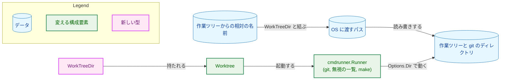
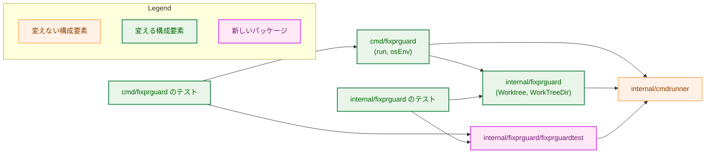
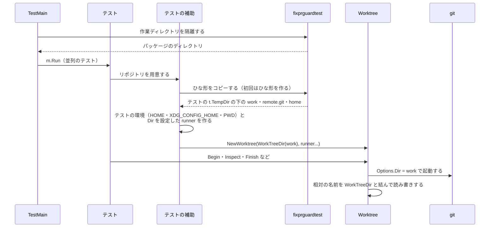
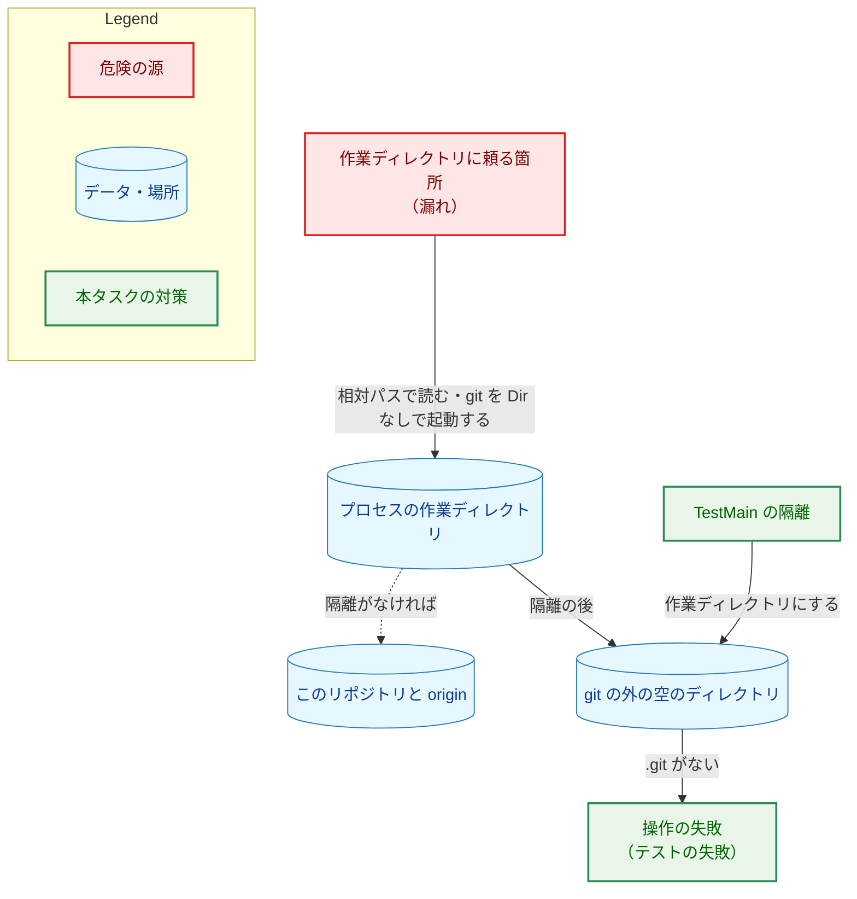
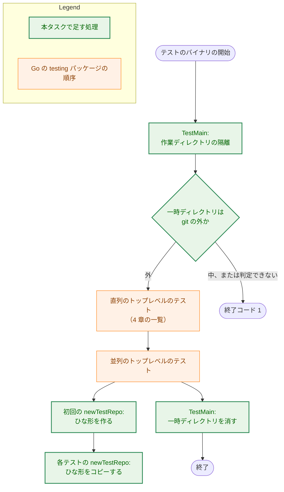

# 設計書：fixprguard のテストの並列化と git フィクスチャの軽量化

## Document Status

| Item | Value |
|---|---|
| Status | `draft` |
| Created | 2026-11-26 |
| Review date | - |
| Reviewer | - |
| Comments | - |

## 1. 設計の全体像

本タスクでは、`internal/fixprguard` と `cmd/fixprguard` のテストを並列に実行できるようにし、テストのリポジトリを作る費用を下げる（[01_requirements.md](01_requirements.md) F-001〜F-005）。そのために、次の 3 つを変える。

-   **製品:** `internal/fixprguard` の `Worktree` は、作業ツリーのディレクトリを呼び出し元から受け取る。CLI は、プロセスの作業ディレクトリを表す値を渡す（F-002）。
-   **テストの補助:** 補助は、`t.Chdir` と `t.Setenv` を使わずに、テストごとのリポジトリと `HOME` を用意する。runner と準備の git には、テストごとの環境を渡す（F-001）。
-   **フィクスチャ:** フィクスチャは、パッケージで 1 回だけ作ったひな形のコピーにする（F-003）。

本書の行番号は、コミット `98456465`（`origin/main`）で確かめた。

### 1.1. 設計原則

-   **作業ツリーからの相対の名前と、OS に渡すパスを分ける。** fixprguard は、git が出す相対パス（変更されたパス、無視されたファイル、`.claude` などの見張るディレクトリ）を、比較・digest・記録のファイル・出力の値として使う。この値は変えない。ファイルのシステムコールに渡すときだけ、作業ツリーのディレクトリと結んだパスを使う。結ぶ関数は `WorkTreeDir` の 1 つだけである（3.2 節）。
-   **CLI の振る舞いはバイト単位で変えない。** CLI が渡す値は `"."` を表す（1.3 節の 2 つ目の決定）。`"."` と結んだパスは、相対パスそのものになる。そのため、CLI が OS に渡すパス、記録のファイルの中身、digest の値、出力、終了コードは、変更の前と同じである（AC-08、AC-09）。
-   **作業ディレクトリへの頼りの漏れは、テストが失敗して見つかる形にする。** 各パッケージの `TestMain` は、プロセスの作業ディレクトリを、どの git リポジトリにも含まれない空のディレクトリに変えてから、テストを走らせる（3.5 節）。渡したディレクトリを使わずに作業ディレクトリに頼る箇所が残っていると、その操作は `.git` を見つけられずに失敗する。このリポジトリには届かない（AC-07）。
-   **プロセス全体の状態を確かめるテストだけを直列に残す。** 直列に残すテストは、4 章の一覧のものだけである（AC-03）。ほかのテストとサブテストは、すべて `t.Parallel()` を呼ぶ（AC-01）。
-   **テストの判定は変えない。** テストの差分は、製品の呼び出しの引数と、テストの準備の変更に限る（AC-16）。直列のまま残すテストの期待値も変えない。

### 1.2. 概念モデル



矢印 A → B は、A が B に使われるか、A が B に作用することを表す。矢印のラベルは、その関係の種類である。`Worktree` は `WorkTreeDir` を持つ。相対の名前は、`WorkTreeDir` と結ばれて OS に渡すパスになる。runner は、呼び出し元が `Options.Dir` に同じディレクトリを設定して作る（3.3 節）。

### 1.3. 設計の際に決めたこと（2026-11-26）

-   **作業ツリーのディレクトリを渡す API の形:** 検証済みの型 `WorkTreeDir` を足し、`fixprguard.NewWorktree(dir, gitRun, listRun, makeRun)` で受け取る。runner の `cmdrunner.Options.Dir` は、呼び出し元が同じディレクトリに設定する（3.2 節、3.3 節）。
    -   理由: `cmdrunner.Runner` の `Run` には作業ディレクトリの引数がなく、`Dir` は runner を作るときの `Options` で決まる（`internal/cmdrunner/runner.go:24-62`）。テストは、呼び出しを記録する `gitRouter` で本物の runner を包み、`ConfigList` と `Before` で一部の呼び出しを差し替える（`internal/fixprguard/test_helpers_git.go:34-79`）。この形は残したい。`WorkTreeDir` と runner の `Dir` が食い違っても、`TestMain` の作業ディレクトリ（3.5 節）の下ではテストが失敗するので、見つけられる（AC-07）。
    -   採らなかった案: `NewWorktree` が `cmdrunner.Options` を受け取り、runner を自分で作る案。食い違いは型で防げるが、テストが runner を差し替える経路を作り直すことになり、変更が大きくなる。
    -   2026-11-26 に人が選んだ。
    -   ADR: なし。`internal/fixprguard` の内部の構造で、CLI の契約もほかの構成要素も変えない。
-   **CLI が渡す値:** `fixprguard.CurrentDir()`（`"."` を表す値）を渡す。
    -   理由: `"."` と結んだパスは相対パスそのものなので、CLI が OS に渡すパス、`.git` のファイルの相対の `gitdir:` の解き方、記録のファイルの置き場所、`filepath.Abs` の結果（`internal/fixprguard/gitstate.go:280`）が、今と変わらない（H-02）。
    -   採らなかった案: `os.Getwd()` の絶対パスを渡す案。`Getwd` の失敗という新しい失敗の経路ができる。シンボリックリンクを含む `$PWD` と物理パスの違いで、digest の値が変わりうる。
    -   2026-11-26 に人が選んだ。
    -   ADR: なし。既存の CLI の契約を保つだけである。
-   **フィクスチャを速くする手段:** ひな形をパッケージで 1 回だけ作り、テストごとにコピーする。パスを含む 2 つの設定（`remote.origin.url` と `core.excludesFile`）は、コピーした `.git/config` を直接書き直してコピー先に合わせる（3.6 節）。
    -   理由: この機械で計ると、今のフィクスチャ（git を 15 回起動する）は 1 つ約 240ms、作ったリポジトリを `cp -Rp` でコピーすると 1 つ約 20ms だった（`-race` なし、直列のシェルのループで 20 回ずつ）。コピーなら、テストごとに起動する git は 0 回になる。
    -   採らなかった案: `git config` だけを直接の書き込みに置き換える案（git の起動は 15 回から 5 回になるが、1 つ約 80ms 残る）。2 つを組み合わせる案（ひな形を作る費用は 1 回だけなので、組み合わせても得はない）。
    -   2026-11-26 に人が選んだ。
    -   `CLAUDE.md`「Performance」の、正しさの義務を足す最適化に当たる。義務は「コピーしたリポジトリは、今の手順で作ったリポジトリと、テストごとに変わる値を除いて同じであること」で、3.6 節のテストで固定する。義務は実装のコミットメッセージに書き、最適化は振る舞いの変更と別のコミットにする。
    -   ADR: なし。テストの補助の作り方で、このタスクの中で閉じる。
-   **2 つのパッケージで共通の補助の置き場所:** テスト専用の新しいパッケージ `internal/fixprguard/fixprguardtest`（`//go:build test`）に、作業ディレクトリの隔離、テストの環境、ひな形のコピーの 3 つを置く。フィクスチャの中身（コミットするファイル、設定）は、それぞれのパッケージが今のまま持つ（3.4 節）。
    -   理由: 3 つの補助は 2 つのパッケージで同じになる（`CLAUDE.md`「DRY」）。テスト専用のパッケージを置く例は、`internal/doctestutil` と `internal/maketestutil` にある。fixprguard の下に置き、ほかのタスク（0127 など）とは結びつけない。
    -   採らなかった案: 2 つのパッケージにそれぞれ書く案（約 100 行が重複する）。
    -   2026-11-26 に人が選んだ。
    -   ADR: なし。テストの補助の置き場所で、このタスクの中で閉じる。
-   **`TestMain` での作業ディレクトリの変更:** 2 つのパッケージの `TestMain` は、`m.Run` の前に一度だけ、プロセスの作業ディレクトリを空の一時ディレクトリに変える。その一時ディレクトリが git のリポジトリに含まれないことは、変える前に git で確かめる。含まれるときは、テストを走らせずに失敗する（3.5 節）。AC-04 が、設計書が場所と理由を記録することを条件に認める例外である。場所と理由は 3.5 節に書く。
    -   理由: パッケージのディレクトリ（このリポジトリの中）のままでは、漏れた操作がこのリポジトリを読み書きし、その `origin` に push しうる。空のディレクトリなら、漏れた操作は失敗する（AC-07）。
    -   作成者が決めた（要件書と H-01 の候補のとおり）。PR のレビューで確かめてもらう。
    -   ADR: なし。テストの実行の準備で、このタスクの中で閉じる。
-   **子のコマンドの `PWD`:** テストの補助は、runner の `Dir` を設定するときに、渡す環境の `PWD` も同じディレクトリにする。CLI の runner は今のまま `Dir` を設定しない（3.3 節）。
    -   背景: Go の `os/exec` は、`Cmd.Env` が nil のときだけ、子の `PWD` を `Cmd.Dir` に合わせる（`go doc os/exec.Cmd` の `Dir`、Go 1.27.1 の `src/os/exec/exec.go:1234`）。fixprguard の runner は `Env` を必ず渡す。
    -   理由: git は、`PWD` が作業ディレクトリと同じ場所を指すときだけ `PWD` を使う。そのため、古い `PWD` が残っても git の対象は変わらない。ただし、フックのシェルなど、git の子が `PWD` を読む余地を残さないために、テストでは `PWD` を合わせる。CLI は `Dir` を設定しないので、子は今と同じ正しい `PWD` を受け継ぐ。
    -   作成者が決めた（H-01）。PR のレビューで確かめてもらう。
    -   ADR: なし。

## 2. システム構成

### 2.1. コンポーネント配置



矢印 A → B は、A が B を import することを表す。`CLI → LIB`・`CLI → CMDR`・`LIB → CMDR` の 3 本は今もある関係である（`cmd/fixprguard/main.go:27-28`、`internal/fixprguard/worktree.go:19`）。テストから `fixprguardtest` への矢印と、`fixprguardtest` から `cmdrunner` への矢印は、本タスクで足す。`fixprguardtest` は `internal/fixprguard` を import しない。そのため、`internal/fixprguard` のテスト（同じパッケージのテスト）からも import できる。

### 2.2. データの流れ（並列のテスト 1 つ）



矢印は呼び出しと、その戻り値（破線）を表す。プロセスの作業ディレクトリと環境変数は、`TestMain` の隔離のあと、どのテストも変えない（直列のまま残すテストを除く。4 章）。

## 3. コンポーネント設計

### 3.1. 変更するファイル

| ファイル | 変更 | 責務 |
|---|---|---|
| `internal/fixprguard/workdir.go` | 追加 | `WorkTreeDir` の型と構築の関数、相対の名前を OS に渡すパスに結ぶ非公開の関数（3.2 節） |
| `internal/fixprguard/worktree.go` | 変更 | `Worktree` が `WorkTreeDir` を持つ。`NewWorktree` は `dir` を受け取り、ゼロ値を拒む。`checkReviewInput`（`:577`）と `blobOf`（`:521`）は、結んだパスで `.git` と作業ツリーのファイルを読む |
| `internal/fixprguard/gitstate.go` | 変更 | `locateGitDirs`（`:187`）は `.git` を結んだパスで読み、相対の `gitdir:` を作業ツリーのディレクトリから解く。`hooksState`（`:535`）は、`git rev-parse --git-path hooks` が返す相対パスを作業ツリーのディレクトリと結ぶ |
| `internal/fixprguard/ignored.go` | 変更 | 無視されたファイルの走査（`checkTopDirGitNames`・`walkIgnoredDir`・`targetStateOf`・`targetEntry`・`linkTarget`・`readTarget`、`:410-600`）は、相対の名前を比較と記録に使い、システムコールには結んだパスを渡す |
| `internal/fixprguard/changes.go` | 変更 | 変更の分類（`:305` の `os.Lstat`、`untrackedChange`・`examine`、`:318-360`）は、結んだパスで作業ツリーを読む |
| `cmd/fixprguard/main.go` | 変更 | `env` に `dir fixprguard.WorkTreeDir` を足し、`osEnv` は `fixprguard.CurrentDir()` を設定する。`execute`（`:378`）は `NewWorktree(e.dir, ...)` のエラーを今の停止の経路で返す |
| `internal/fixprguard/fixprguardtest/*.go` | 追加 | テスト専用のパッケージ。作業ディレクトリの隔離（3.5 節）、テストの環境（3.3 節）、ひな形のコピー（3.6 節） |
| `internal/fixprguard/testmain_test.go`、`cmd/fixprguard/testmain_test.go` | 追加 | `TestMain`。`fixprguardtest` で作業ディレクトリを隔離し、パッケージのディレクトリを記録してから `m.Run` を呼ぶ |
| `internal/fixprguard/test_helpers_git.go` | 変更 | `newTestRepo` は `t.Setenv`・`t.Chdir` を呼ばず、ひな形をコピーする。`newTestWorktree` はリポジトリを受け取り、`Dir` とテストの環境を設定した runner と `WorkTreeDir` で `Worktree` を作る。今の作る手順は、ひな形を作る関数として残す（3.6 節） |
| `cmd/fixprguard/test_helpers.go` | 変更 | 同上。`realGit`・`realGitList` はリポジトリの `Dir` と環境を受け取り、`newTestRun` は `env.dir` を設定する |
| `internal/fixprguard/*_test.go`、`cmd/fixprguard/*_test.go` | 変更 | `t.Parallel()` を足す（4 章）。`t.Chdir` で作業ディレクトリを変えていたテストは、同じディレクトリを `WorkTreeDir` として渡す。相対パスで読んでいた `testdata/`・パッケージのソース・文書は、`TestMain` が記録したパッケージのディレクトリから読む（3.5 節） |
| `internal/fixprguard/construction_test.go` | 変更 | `WorkTreeDir` を、構築の関数でしか作れない型の一覧に加える（3.2 節） |
| `docs/dev/conventions/package_reference.md` | 変更 | 「Test-Only Packages」の表に `internal/fixprguard/fixprguardtest` の行を足す（`internal/pipeline/pipeline_test.go:630` の `TestPackageReferenceListsPackages` が求める） |

`internal/cmdrunner` は変えない（要件書 2.3 節）。`docs/dev/guides/fixprguard_guide.md` と `const Protocol` の行も変えない（AC-09）。

### 3.2. `WorkTreeDir`

```go
// WorkTreeDir is the top of the work tree a Worktree guards. The zero value
// is not usable: NewWorktree rejects it with ErrInvalidInput.
type WorkTreeDir struct{ path string }

// CurrentDir is the process's current directory, as ".". The CLI passes it:
// a name joined with it is the name itself, so every path the tool opens is
// the one it opened before WorkTreeDir existed.
func CurrentDir() WorkTreeDir

// NewWorkTreeDir accepts an absolute path that filepath.Clean leaves as it
// is, and fails with ErrInvalidInput otherwise. It does not touch the file
// system: whether a .git is there is checked where it is checked today.
func NewWorkTreeDir(path string) (WorkTreeDir, error)

// NewWorktree returns a Worktree that guards the work tree at dir. gitRun,
// listRun and makeRun must run their commands in dir (cmdrunner.Options.Dir);
// for CurrentDir that is the process's current directory (an empty Dir).
func NewWorktree(dir WorkTreeDir, gitRun, listRun, makeRun cmdrunner.Runner) (*Worktree, error)
```

-   **公開する名前:** `WorkTreeDir`・`CurrentDir`・`NewWorkTreeDir` と、`NewWorktree` の新しい引数だけである。`WorkTreeDir` が持つパスを返す公開のメソッドは置かない。`cmd/fixprguard` のテストは、runner の `Dir` に設定する値を、自分で作ったリポジトリのパスとして持っている。`internal/fixprguard` のテストは、非公開のフィールドを読める。
-   **パスの結び方:** 非公開の関数 1 つが、相対の名前を OS に渡すパスにする。規則は次の 3 つである。
    -   `CurrentDir()` のときは、名前をそのまま返す。
    -   名前が絶対パス（`.git` のファイルの絶対の `gitdir:`、絶対の `core.hooksPath` など、git の出力の絶対パス）のときは、そのまま返す。
    -   それ以外は、ディレクトリと名前を `/` でつなぐ。`filepath.Join` は使わない。`Join` はパスを `Clean` するので、末尾の `/`（`ls-files` が入れ子のリポジトリに付ける）や `..` の要素の意味が、OS が相対パスとして解くときと変わりうるからである。たとえば、`os.Lstat("link/")` はリンクをたどるが、`Clean` した `os.Lstat("dir/link")` はたどらない（`changes.go:340` は末尾の `/` を自分で取り除いてから読む）。
-   **ゼロ値:** `NewWorktree` は、ゼロ値の `WorkTreeDir` を `ErrInvalidInput` で拒み、git を起動しない。CLI がゼロ値を渡すことはない（`osEnv` が `CurrentDir()` を設定する）。テストの補助が `dir` を設定し忘れたときは、テストが失敗する。
-   **構築の規則のテスト:** `construction_test.go` の `restrictedConstructors`（`internal/fixprguard/construction_test.go:17-22`）は、型ごとに構築の関数を 1 つだけ許す。`WorkTreeDir` は `CurrentDir` と `NewWorkTreeDir` の 2 つで作るので、一覧の値を関数の集合にして加える。このテストの変更は、テストだけを変えるコミットで行う（AC-14）。

#### 結んだパスに変える箇所

コミット `98456465` で、作業ディレクトリからの相対パスをシステムコールに渡している箇所は次のとおりである（`grep -nE 'os\.(Lstat|Stat|ReadFile|Open|OpenFile|Readlink|Remove|CreateTemp|Rename)|filepath\.(Abs|WalkDir|EvalSymlinks)'` で製品のファイルを調べ、相対の値が届く箇所を読んで確かめた）。実装は、これらをすべて結んだパスに変える。

-   `.git` の場所: `locateGitDirs`（`gitstate.go:188`・`:196` の `".git"`）、`checkReviewInput`（`worktree.go:581`）。
-   git のディレクトリの中: `locateGitDirs` が返す `gitDirs` の値は、結んだ `.git` から作るので、`commondir`・`config`・`info/*`・記録のファイル（`gitstate.go:208-224`・`:277-306`、`ignored.go:663`・`:674`、`gitstate.go:614`）は、そのまま結んだパスになる。
-   フックのディレクトリ: `hooksState` が `git rev-parse --git-path hooks` から得る値（`gitstate.go:537-542`）。git は Dir で動くので、相対の出力は作業ツリーのディレクトリからの相対である。
-   変更されたパス: `changes.go:305`・`:340`・`:351`、`changes.go:383` の `openRegular`、`worktree.go:532`・`:538`（`blobOf` の `os.Readlink` と `openRegular`）。
-   無視されたファイルと見張るディレクトリ: `ignored.go:411`・`:421`（`checkTopDirGitNames`）、`:454`（`walkIgnoredDir`）、`:517`（`targetEntry` の `lstat`）、`:534`、`:555`（`linkTarget`）、`readTarget`（`:582` から）。`filepath.WalkDir` に結んだパスを渡すと、コールバックの名前も結んだパスになる。`isWatched`・`slices.Contains(dirs, p)`・記録の行（`ignored.go:499`）には、相対の名前に戻した値を渡す。記録のファイルの中身と digest は、相対の名前で作るので変わらない。

呼び出し元が名前を渡すテキストのファイル（`fence` のファイル、`--body-file`、`--title-file`。`cmd/fixprguard/main.go:620-640`、`internal/fixprguard/write.go:28`・`:54`）は、作業ツリーのファイルではない。今と同じく、渡された名前をプロセスの作業ディレクトリから解く。テストは絶対パスを渡す。

### 3.3. runner とテストの環境

-   **CLI:** `osEnv`（`cmd/fixprguard/main.go:178-190`）の runner は変えない。`Dir` は空のままで、環境は `cmdrunner.GitEnv(os.Environ())` である。足すのは `dir: fixprguard.CurrentDir()` だけである。gh の runner も変えない。gh は今と同じくプロセスの作業ディレクトリ（作業ツリーの最上位）で動く。
-   **テストの環境:** `fixprguardtest` の関数が、`cmdrunner.GitEnv(os.Environ())` から `HOME`・`XDG_CONFIG_HOME`・`PWD` の項目を除き、テストごとの値を足した環境を返す。`HOME` はテストの `t.TempDir()` の下の空のディレクトリ、`XDG_CONFIG_HOME` はその下の `.config`、`PWD` はその runner の `Dir` である。`GitEnv` は `GIT_*` を除くので、`GIT_CONFIG_GLOBAL` で利用者の設定を遮ることはできない（`internal/cmdrunner/git.go:36-45`）。`HOME` を差し替えて遮る（H-03）。
-   **環境を渡す先:** 製品の runner（git と無視の一覧）、テストの準備の git（`gitIn`・`ConfigList` など。`internal/fixprguard/test_helpers_git.go:178-199`、`cmd/fixprguard/test_helpers.go:102-135`）、ひな形を作る git の 3 つに、同じ規則の環境を渡す。make と gh は fake で、プロセスを起動しない。
-   **runner の `Dir`:** テストの補助は、作業ツリーを対象にする runner の `Options.Dir` に、`WorkTreeDir` と同じディレクトリを設定する。`WorkTreeDir` と `Dir` が食い違うと、git と fixprguard のファイルの操作が別の場所を見る。その場合は、`TestMain` の作業ディレクトリの下でテストが失敗する（3.5 節、AC-07）。
-   **プロセスの環境を読むのは、補助が runner を作るときだけである。** 並列のテストが `os.Environ()` を読む間に、プロセスの環境変数を変えるテストは走らない。プロセスの環境変数を変えるテストは直列のトップレベルのテストだけで、Go の `testing` パッケージは、直列のトップレベルのテストがすべて終わってから並列のトップレベルのテストを再開する（`go doc testing.T.Parallel`）。`-count` で繰り返すときも、1 回分のテストがすべて終わってから次の回が始まる。`t.Setenv` は終わりに値を戻す。

### 3.4. `internal/fixprguard/fixprguardtest`

テスト専用のパッケージである。すべてのファイルに `//go:build test` を付け、`internal/fixprguard` を import しない。公開する関数の形の目安を示す。名前と引数の細部は実装計画で決める。

```go
package fixprguardtest

// Isolation is what IsolateWorkingDir set up for one test binary.
type Isolation struct {
	// PackageDir is the directory the test binary started in: the package
	// directory, from which tests read testdata, sources and documents.
	PackageDir string
	// TemplateRoot is where a package's fixture template is built.
	TemplateRoot string
}

// IsolateWorkingDir records the current directory, makes a new empty
// directory, checks with git that no repository contains it, and makes it the
// process's working directory. TestMain calls it once before m.Run and
// removes the directories after.
func IsolateWorkingDir() (Isolation, func(), error)

// Env returns cmdrunner.GitEnv(os.Environ()) with HOME and XDG_CONFIG_HOME
// pointing under home and PWD set to dir, the Dir of the runner it is for.
func Env(home, dir string) []string

// Template is a fixture root (work, remote.git, home) built once and copied
// per test.
type Template struct{ /* unexported */ }

// NewTemplate builds the template under root with build the first time Copy
// runs, once per test binary.
func NewTemplate(root string, build func(root string) error, pathValues int) *Template

// Copy copies the template to dst and rewrites the template root in the work
// tree's .git/config to dst; it fails unless exactly pathValues occurrences
// were rewritten.
func (t *Template) Copy(dst string) error
```

-   **ひな形の中身は、各パッケージが渡す `build` が決める。** `build` は、今の `newTestRepo` の手順（`git init` から `git push` まで）から、`t.Setenv` と `t.Chdir` を除いたものである。git は、`Env` の環境とディレクトリを指定して起動する。2 つのパッケージのフィクスチャは中身が違う（`internal/fixprguard` は 5 つのファイルと `tag.gpgSign`、`cmd/fixprguard` は 1 つのファイル）ので、それぞれが自分の `build` を持つ。
-   **共有する状態:** `Template` は、初回の `Copy` で 1 回だけひな形を作る（`sync.OnceValue` などで、作った結果とエラーを覚える）。作った後のひな形は読むだけで、どのテストも書き換えない。`Isolation` は `TestMain` が `m.Run` の前に 1 回だけパッケージの変数に書き、テストは読むだけである。ほかに、テストの間で共有する書き換えられる状態は置かない（H-06）。

### 3.5. 作業ディレクトリの隔離（`TestMain`）

-   **場所:** `internal/fixprguard/testmain_test.go` と `cmd/fixprguard/testmain_test.go` の `TestMain` が、`fixprguardtest.IsolateWorkingDir` を呼ぶ。プロセスの作業ディレクトリを変える（`os.Chdir`）のは、`IsolateWorkingDir` の中の 1 か所だけである。AC-04 が認める例外は、この 1 か所である。
-   **理由:** テストの中で動く fixprguard の操作が、渡したディレクトリを使わずに作業ディレクトリに頼ったとき、その操作がこのリポジトリとその `origin` に届かないようにするためである（AC-07）。空のディレクトリでは、`.git` がないので `locateGitDirs` が失敗し、git は `not a git repository` で失敗する。
-   **一時ディレクトリが git の外にあることの確かめ:** `os.MkdirTemp` で作ったディレクトリで、`Env` の環境の git に `rev-parse --git-dir` を実行させる。git がリポジトリを見つけた（終了コード `0`）ときや、git を起動できなかったときは、テストを走らせずに、1 行の診断を標準エラーに出して終了コード `1` で終わる。git がリポジトリを見つけられなかった（終了コード `128`）ときだけ先へ進む。git 自身の探し方で確かめるので、漏れた git と同じ規則で判定できる。
-   **ディレクトリの構成:** `IsolateWorkingDir` は、1 つの一時ディレクトリの下に、作業ディレクトリにする空の `cwd` と、ひな形を置く `template` を作る。git は作業ディレクトリから親の方向にだけリポジトリを探すので、`cwd` と並ぶ `template` のリポジトリは見つからない。`m.Run` の後で、一時ディレクトリを消す。
-   **パッケージのディレクトリから読むテスト:** 作業ディレクトリを変えると、パッケージのディレクトリからの相対パスで読むテストが読めなくなる（H-01）。次のテストは、`Isolation.PackageDir` を起点に読むように変える。どれもファイルを読むだけで、fixprguard の操作も git も起動しないので、AC-07 の対象ではない。
    -   `cmd/fixprguard/docs_test.go` の `repoRoot = "../.."`（`:22-23`）と、それを使う `readDoc`・`doctestutil.CommandDocs`。
    -   `internal/fixprguard/review_state_test.go:839` の `testdata/review_state`。
    -   `internal/fixprguard/construction_test.go:153` の `filepath.Glob("*.go")` と `:163` の `os.ReadFile`。
-   **テストの作業ツリーの中の相対パスで読むテスト:** `cmd/fixprguard/main_test.go:1307` の `os.ReadFile(beginRecordName)` など、作業ツリーの中のファイルを相対パスで読むテストは、リポジトリの `Dir` と結んだパスで読むように変える。

### 3.6. フィクスチャのひな形とコピー

-   **作る手順:** 各パッケージの `build` は、ひな形の根（`Isolation.TemplateRoot` の下のパッケージごとの場所）に、`work`・`remote.git`・`home` を作る。手順は今の `newTestRepo` と同じで、`internal/fixprguard` は git を 13 回（`init` 2 回、`config` 7 回、`remote add`・`add`・`commit`・`push` 1 回ずつ。`internal/fixprguard/test_helpers_git.go:129-169`）、`cmd/fixprguard` は 12 回（`config` 6 回。`cmd/fixprguard/test_helpers.go:54-95`）起動する。`core.excludesFile` が指す空のファイルは、ひな形の `home` の下に作る（今の `pinIgnoreConfig` と同じ）。
-   **コピー:** `newTestRepo` は、テストの `t.TempDir()` の下に根をコピーする。コピーは、ディレクトリと通常のファイルの種類・権限の値・中身を保つ。ひな形には、シンボリックリンクとほかの特別なファイルはない。それ以外を見つけたら、コピーは失敗する。
-   **パスを含む設定の書き直し:** ひな形の根の絶対パスは、`work/.git/config` の 2 つの値（`remote.origin.url` と `core.excludesFile`）にだけ現れる。`Copy` は、`work/.git/config` の中のひな形の根の文字列を、コピー先の根に置き換える。置き換えた数がちょうど 2 でなければ失敗する。git が値を引用符やエスケープで書いた場合（パスに `"` や `\` を含むとき）は数が合わず、失敗する。ほかのファイル（`remote.git/config`、reflog）にはパスが含まれないことを、3.6 節の同等性のテストで確かめる。
-   **テストごとの git の数（AC-10）:** コピーの後、テストがリポジトリを受け取るまでに git は起動しない（0 回）。ひな形を作る git（13 回と 12 回）は、テストのバイナリごとに 1 回だけで、AC-10 の数とは別に数える。前の数は、上の手順の呼び出しの数である。`newTestRepo` は分岐もループもない直線の手順で、`r.Git`・`r.gitIn` の 1 回の呼び出しが git の 1 回の起動になる（`internal/fixprguard/test_helpers_git.go:178-187`、`cmd/fixprguard/test_helpers.go:102-111`）。前後の数は、この読み方の根拠の行とともに PR の説明に記録する。
-   **index の stat の情報:** コピーした `work/.git/index` は、ひな形のファイルの stat の情報（mtime・inode など）を持つ。コピー先のファイルとは合わないので、git は変更の検出のときにファイルの中身を読み直す。stat の情報が合わないことは、git に中身を読ませる方向にしか働かず、変更を見落とさせることはない。この差分は、AC-11 が認めるテストごとに変わる値である。テストのファイルのうち index のバイト列を読むのは `TestBaselineIgnoresIndexAndFetchHead`（`internal/fixprguard/gitstate_test.go:317-343`）だけで、これは自分で `git add` した前後を比べるので、コピーの影響を受けない（`grep -n 'index' *_test.go` で確かめた）。
-   **コミットの ID:** すべてのコピーは、ひな形と同じコミットとオブジェクトを持つ。今はテストごとにコミットの時刻が違い、コミットの ID も違う。AC-11 が認める差分である。リポジトリはテストごとに別なので、テストの間で ID が同じでも影響しない。
-   **同等性のテスト（AC-11）:** 各パッケージに、並列のテストを 1 つ足す。今の手順（`build`）でテストの `t.TempDir()` の下に作ったリポジトリと、ひな形のコピーとを比べ、テストごとに変わる値を除いて同じであることを確かめる。比べるのは次の値である。
    -   作業ツリーのファイルの一覧、種類、権限の値、中身。
    -   `work/.git` と `remote.git` の下のファイルの一覧と種類。ただし、`index` と、コミットの ID で名前が決まる `objects` の下は除く。
    -   `git config --list --local --show-origin` の出力（2 つのリポジトリそれぞれ。根の絶対パスは目印の文字列に置き換える）。
    -   `git ls-files -s`（モード・blob の ID・パス）、`HEAD` の指す先、すべての ref の名前、ref ごとのコミットの木の ID と親の数とメッセージ。
    -   `git status --porcelain` が空であること。
    -   `home` の下のファイルの一覧と中身。
-   **分離のテスト（AC-11）:** 各パッケージに、並列のテストを 1 つ足す。コピーを 2 つ作り、片方の作業ツリー・`.git/config`・`remote.git` を変えて、もう片方とひな形が変わらないことを確かめる。

## 4. 直列のまま残すテストの一覧（AC-03）

コミット `98456465` のテストを読んで決めた。ほかのテストとサブテストは、すべて `t.Parallel()` を呼ぶ（AC-01）。新しく足すテスト（3.6 節、8.1 節）も、この一覧にないものは並列にする。

**直列に残す**とは、そのテストもその祖先も `t.Parallel()` を呼ばないことである。ただし、AC-03 の 2 つ目（並列の親の下で 1 つのフィクスチャを順に使うサブテスト）は、親が並列で、そのサブテストだけが `t.Parallel()` を呼ばない。

| パッケージ | テストの名前 | AC-03 の区分 | 理由 |
|---|---|---|---|
| `internal/fixprguard` | `TestGitEnvKeepsGitOnTheWorktree` | プロセス全体の状態 | プロセスの環境変数に `GIT_DIR` を置き（`t.Setenv`、`gitstate_test.go:457`）、それを引き継いだ runner が `GitEnv` で除くことを確かめる。確かめる対象が、プロセスから引き継いだ環境変数である |
| `internal/fixprguard` | `TestWorktreeIgnoresProcessDir`（新しく足す。8.1 節） | プロセス全体の状態 | プロセスの作業ディレクトリを別のリポジトリに変え（`t.Chdir`）、`Worktree` が渡したディレクトリだけを対象にすることを確かめる（AC-06）。確かめる対象が、本物のプロセスの作業ディレクトリである |
| `internal/fixprguard` | `TestEnumerateChanges/content_mode_and_link_change_the_id` | 順に使うサブテスト | 親が作ったリポジトリ `r` と、親が数えた変更 `got` を使い、同じリポジトリを順に変えて judged set の ID が変わることを確かめる（`changes_test.go:86-100`）。親の `TestEnumerateChanges` は並列にする |
| `cmd/fixprguard` | `TestGhTargetEnvRejected` とそのサブテスト | プロセス全体の状態 | サブテストが `GH_REPO`・`GH_HOST` をプロセスの環境変数に置き（`t.Setenv`、`main_test.go:254`）、`lookupEnv` に `os.LookupEnv` を渡して、CLI がプロセスの環境変数を読む経路を確かめる |
| `cmd/fixprguard` | `TestGhRunsWithoutGitVariables` | プロセス全体の状態 | `PATH` に偽の `gh` を置き、`GIT_DIR` をプロセスの環境変数に置いて（`main_test.go:276-277`）、`osEnv` の gh の runner が `PATH` から探したコマンドに `GIT_DIR` を渡さないことを確かめる |
| `cmd/fixprguard` | `TestListRunnerRejectsStderr` とそのサブテスト | プロセス全体の状態 | 同じく `PATH` と `GIT_DIR`（`main_test.go:298-299`）で、`osEnv` の無視の一覧の runner を確かめる |
| `cmd/fixprguard` | `TestRunInProcessDir`（新しく足す。8.1 節）とそのサブテスト | プロセス全体の状態 | `osEnv` の `env` で CLI の入口（`run`）を本物のプロセスの作業ディレクトリで動かし、AC-08 の条件を確かめる。`t.Chdir` と、`HOME`・`XDG_CONFIG_HOME` の `t.Setenv` を使う |

-   **並列にできると判断したテスト:** H-05 が挙げた、`.git` のないディレクトリや最上位でない場所に `t.Chdir` するテスト（`cmd/fixprguard/main_test.go:180`・`:381`・`:971`・`:1129`・`:1549`、`internal/fixprguard/ignored_test.go:379`・`:470`・`:652`・`:662`・`:697`・`:729`・`:824`・`:863`・`:877`・`:929`・`:1386`、`internal/fixprguard/review_test.go:239`・`:257`・`:430`、`internal/fixprguard/gitstate_test.go:249`）は並列にする。これらが確かめるのは、fixprguard が見る場所が `.git` のないディレクトリ、最上位でない場所、リンクされた作業ツリーのときの振る舞いである。`WorkTreeDir` が入った後は、同じディレクトリを `WorkTreeDir` として渡せば、同じことを確かめられる。プロセスの作業ディレクトリそのものは、確かめる対象ではない。CLI のテストは、`newTestRun` の `env.dir` に同じディレクトリを設定する。
-   **一覧を決めた手順:** `t.Setenv`・`t.Chdir`・`os.Setenv`・`os.Chdir` を呼ぶテストを `grep` で探した（上の行番号）。サブテストが親の変数を使うかどうかは、`go/ast` で各 `t.Run` の関数が参照する親の変数を一覧にし、フィクスチャ（リポジトリ・`Worktree`・runner）を共有するものを読んで確かめた。フィクスチャを共有していたのは、上の `TestEnumerateChanges` のサブテストだけだった。ほかのサブテストが参照する親の変数は、文字列・構造体の値・関数で、サブテストはそれを読むだけである。
-   **実装の際に確かめること:** 次のことは、テストを並列にするときに 1 つずつ確かめる。並列にできないものが見つかったら、この一覧を変えることになる。これは設計の決定の変更なので、止めて人に尋ねる（`docs/dev/conventions/requirements_process.md`「Editing an approved document」）。
    -   サブテストが、親の値（スライス・マップ・ポインタの中身）を書き換えないこと。書き換えるなら、値をサブテストの中で作る（判定と入力は変えない）。
    -   親の `t.Run` のループの後に、サブテストの結果を使うコードがないこと。サブテストが `t.Parallel()` を呼ぶと、親の関数はサブテストより先に返る。サブテストが頼る親の `defer` は `t.Cleanup` に移す。
    -   テストが、パッケージの変数を書き換えないこと。決まった名前のファイル（`os.TempDir()` の下など）に書かないこと。
    -   実時間で待つテスト（`ignored_test.go:559-575` の 100ms の期限と 3 秒の上限、`changes_test.go:194`・`ignored_test.go:489`・`:610` の 5 秒の待ち）が、並列の負荷で失敗しないこと。判定の時間は変えない（AC-16）。`-race -count=3`（AC-02）で失敗するときは、止めて人に尋ねる。

## 5. エラーハンドリング設計

-   **新しい番兵は足さない。** `NewWorkTreeDir` が絶対でないパスや `Clean` で変わるパスを受け取ったとき、`NewWorktree` がゼロ値の `WorkTreeDir` を受け取ったときは、既存の `ErrInvalidInput` で失敗する。メッセージは規則だけを示し、パスを含めない（今の `ErrInvalidInput` のメッセージと同じ方針。`gitstate.go:190`）。
-   **CLI の終了コードは変わらない。** `execute` は `NewWorktree` のエラーを今の停止の経路（`stop`）で返す。`ErrInvalidInput` なので終了コード `2` になるが、CLI は `CurrentDir()` を渡すので、この経路を通ることはない。
-   **今の失敗の分類は変えない。** `.git` がない、最上位でない、`.git` の形が誤っているときの失敗（`locateGitDirs` の `ErrInvalidInput`、`CheckState` の `GitStateError{config}`）は、結んだパスで同じ判定を行うので、同じ番兵になる。
-   **`TestMain` の失敗:** `IsolateWorkingDir` が失敗したとき（一時ディレクトリを作れない、git がリポジトリを見つけた、git を起動できない）は、`TestMain` が 1 行の診断を標準エラーに出し、`m.Run` を呼ばずに終了コード `1` で終わる。診断は失敗の種類を示す。
-   **ひな形の失敗:** ひな形を作る git の失敗と、`Copy` の失敗（特別なファイル、置き換えた数の不一致）は、`newTestRepo` を呼んだテストを `t.Fatalf` で失敗させる。ひな形の作成の失敗は覚えておき、後のテストも同じ理由で失敗させる。

## 6. セキュリティ考慮事項

-   [security.md](../../dev/security.md) の条件付きの指針は当てはまらない（N/A）。要件書 4.2 節のとおり、`yt-dlp` も API キーもキャッシュも LLM の API も、信頼できないテキストの埋め込みも扱わない。
-   **信頼の境界は変えない。** fixprguard は、レビューのスレッドを信頼しないための境界を守るツールである（[ADR-0015](../../dev/adr/0015-untrusted-review-threads.md)）。作成者の判定、範囲の規則、git の状態の確かめ、`GIT_*` を除いた子のコマンドの環境の振る舞いは変えない。CLI は `CurrentDir()` を渡し、runner も今のまま作るので、CLI が OS に渡すパスと起動するコマンドは、変更の前と同じである（1.1 節。AC-08 の `TestRunInProcessDir` で確かめる。8.1 節）。
-   **確かめが緩む経路がないこと。** 最上位の確かめ（`.git` が作業ツリーのディレクトリにあること）は、結んだパスで同じ判定を行う。`.git` のファイルの相対の `gitdir:` は、今と同じく作業ツリーのディレクトリから解く（今は作業ディレクトリ = 作業ツリーの最上位から解いている）。`gitDirsDigest` が記録する git のディレクトリの絶対パス（`gitstate.go:280`）は、CLI では今と同じ値になる。

### 6.1. 脅威モデル（テストの漏れ）

本タスクで新しく生まれる危険は、製品ではなくテストにある。作業ディレクトリに頼らない形に変えたとき、渡したディレクトリを使わない箇所が残ると、並列のテストがこのリポジトリを読み書きし、その `origin` に push するおそれがある（要件書 4.2 節）。



矢印 A → B は、A が B に届くか、A が B を生むことを表す。破線は、対策がないときにだけ起こる経路である。

-   **対策 1（隔離）:** `TestMain` が作業ディレクトリを git の外の空のディレクトリにする（3.5 節）。漏れた操作は `.git` を見つけられずに失敗し、このリポジトリには届かない。
-   **対策 2（ゼロ値の拒否）:** `NewWorktree` はゼロ値の `WorkTreeDir` を拒む（3.2 節）。補助が `dir` を設定し忘れても、プロセスの作業ディレクトリで動くことはない。
-   **対策 3（テストごとの `HOME`）:** 子のコマンドの環境の `HOME` をテストごとのディレクトリにする（3.3 節）。開発者の大域の git の設定（署名・フック・除外のファイル）は、テストに届かない（AC-05）。
-   **確かめ（AC-07）:** 実装の後で一度、作業ディレクトリへの依存を製品にわざと 1 か所入れ直し（たとえば `locateGitDirs` を `os.Lstat(".git")` に戻す）、パッケージのテストが失敗することを確かめる。壊した変更はコミットせずに戻す。結果は PR の説明に記録する。
-   **直列のまま残すテストの作業ディレクトリ:** 4 章の `t.Chdir` は、テストが作ったリポジトリ（`t.TempDir()` の下）に移り、終わりに `TestMain` の空のディレクトリに戻る。このリポジトリには移らない。

## 7. 処理フローの詳細

### 7.1. テストのバイナリ 1 つの流れ



矢印は、処理の順序を表す。直列のトップレベルのテストは、並列のトップレベルのテストが再開する前にすべて終わる（`go doc testing.T.Parallel`）。ひな形を作るのは、最初に `newTestRepo` を呼んだテストである。直列のテストが最初に呼べば、そこで作る。`Template` は作るのを 1 回だけにするので、並列のテストが同時に呼んでも 2 回は作らない。

### 7.2. CLI の 1 回の実行

CLI の流れは変わらない。`main` は `osEnv()` の `env` で `run` を呼び、`execute` は `NewWorktree(e.dir, e.git, e.gitList, e.make)` で `Worktree` を作る。`e.dir` は `CurrentDir()` なので、`Worktree` が OS に渡すパスは相対パスそのものである。runner の `Dir` は空なので、git・gh・make は今と同じくプロセスの作業ディレクトリで動く。

## 8. テスト戦略

### 8.1. 受け入れ基準と確かめ方

| AC | 確かめ方 |
|---|---|
| AC-01 | 4 章の一覧にないテストとサブテストに `t.Parallel()` を足す。PR のレビューで、`t.Run` と `func Test` の数と `t.Parallel()` の数を読み合わせる（確かめのコマンドは実装計画で決める） |
| AC-02 | `go test -tags test -race -count=3 ./internal/fixprguard ./cmd/fixprguard` を実行する。`-cpu` の値を変えた実行（たとえば `-cpu 1,4`）も、実装計画で検討する（H-06） |
| AC-03 | 4 章の一覧を PR のレビューで読む。一覧と、`t.Parallel()` を呼ばないテストとの対応を、AC-01 の確かめで見る |
| AC-04 | `grep` で、4 章の一覧にないテストと補助が `t.Chdir`・`t.Setenv`・`os.Chdir`・`os.Setenv`・`os.Unsetenv` を呼ばないことを確かめる。例外は 3.5 節の `IsolateWorkingDir` の 1 か所である |
| AC-05 | 3.3 節の環境を、すべての runner と準備の git に渡す。同等性のテスト（3.6 節）は `home` の中身も比べる。開発者の設定が届かないことは、隔離した `HOME` で全テストが通ることと、PR のレビューで確かめる |
| AC-06 | `TestWorktreeIgnoresProcessDir`（新しく足す。直列）。プロセスの作業ディレクトリを別のテストのリポジトリにして、`Worktree` の `Begin`・`Inspect`・`Finish`・`Push` を渡したリポジトリに対して動かし、渡したリポジトリだけが変わり、作業ディレクトリのリポジトリとその `origin` が変わらないことを確かめる。`.git` のないディレクトリの場合は、並列のテスト全体が `TestMain` の空のディレクトリの下で動くことで確かめる |
| AC-07 | 6.1 節の確かめ。作業ディレクトリへの依存を 1 か所入れ直してテストが失敗することを一度確かめ、PR の説明に記録する |
| AC-08 | `TestRunInProcessDir`（新しく足す。直列）。`osEnv()` の `env` を、gh と make を fake に、出力を捕まえる先に差し替えて使い、プロセスの作業ディレクトリを変えて `run` を呼ぶ。サブテストは次のとおりである。(1) 最上位でない場所での `begin` の終了コード `2` と、`inspect`・`finish`・`push` の `git-state-changed`（`config`）。(2) `.git` がない場所での `check`・`push-review` の終了コード `2` と、git が起動しないこと（git の runner を数える）。(3) `.git` の形が誤っているときの `git-state-changed`（`config`）。(4) detached HEAD での `begin` の終了コード `2`。(5) 最上位で `begin`・`inspect`・`finish`・`push` の 1 ラウンドが成功し、`WorkTreeDir` を渡した並列のテストと同じ出力の形になること。継承した `GIT_DIR` は、4 章の `TestGhRunsWithoutGitVariables`・`TestListRunnerRejectsStderr` が確かめる（期待値は変えない）。`HOME`・`XDG_CONFIG_HOME` は `t.Setenv` でテストごとのディレクトリにしてから `osEnv()` を呼ぶ。コミット `98456465` の `cmd/fixprguard` のテストには、最上位でない場所と detached HEAD を CLI の入口で確かめるものはない（`TestReviewCommandsRefuse` のコメント、`main_test.go:1747-1749`）。足したテストは AC-15 の記録に含める |
| AC-09 | `git diff --stat <マージベース> -- docs/dev/guides/fixprguard_guide.md` が空で、`const Protocol` の行の差分が空であることを、PR ごとに確かめる |
| AC-10 | 3.6 節の数え方で、前（13 回と 12 回）と後（0 回。ひな形は別に 13 回と 12 回）を PR の説明に記録する |
| AC-11 | 3.6 節の同等性のテストと分離のテスト |
| AC-12・AC-13 | 計測の手順（8.2 節）を、タスクを終える PR で実行する |
| AC-14 | 実装の PR の中で、製品を変えるコミットを先に置く（9 章）。その PR で製品を最後に変えたコミットを `BASE` にして `make coverage-compare` を実行する |
| AC-15 | テストの名前の比べ方（8.2 節）を、実装の PR ごとに実行する |
| AC-16 | 期待値を変えたテストを理由とともに PR の説明に記録する。本設計は期待値を変えないので、記録が空であることを示す。製品を変えるコミットのテストの差分が、呼び出しの引数と準備に限られることを、PR のレビューで読む |
| AC-17 | 実装の PR ごとに `make test` と `make lint` を実行する |

### 8.2. 計測とテストの名前の比べ方（H-07）

-   **計測（AC-12）:** 前の木（最初の実装 PR のマージベース）と後の木（タスクを終える PR の先頭）で、`go test -tags test -race -count=1 ./internal/fixprguard` と `go test -tags test -race -count=1 ./cmd/fixprguard` を別々に 3 回ずつ実行する。パッケージの時間は、`go test -json` のパッケージの `pass` の行（`Test` を持たない行）の `Elapsed` から取る。3 回の中央値を比べる。前の木のテストは、今の `newTestRepo` で作業ディレクトリを変えながら直列に動く。
-   **テストの名前（AC-15）:** マージベースと PR の先頭のそれぞれで `go test -tags test -race -count=1 -json ./internal/fixprguard ./cmd/fixprguard` を実行し、`Action` が `pass`・`skip`・`fail` の行の（`Package`, `Test`）の組を取り出して比べる。マージベースで `pass` の組がすべて PR の先頭でも `pass` であること、`skip` に変わった組がないことを確かめる。PR の先頭で新しく現れた組（3.6 節と 8.1 節のテスト）は、理由とともに PR の説明に記録する。
-   **前の木の作り方:** 前の木は、作業ツリーの外に展開して使う（`git archive` か `git worktree`。実装計画で決める）。前の木のテストは、作業ディレクトリをテストのリポジトリに変えるので、展開した場所が git のリポジトリかどうかには左右されない。`cmd/fixprguard/docs_test.go` が読む文書（`../..` の下）が展開した木にあることが要る。
-   **形:** 上の 2 つは、`jq` を使う決まったコマンドとして実装計画に書くか、タスクの `_checks/` に一時スクリプトとして置く。どちらにするかは実装計画で決める。一時スクリプトにするときは、[requirements_process.md](../../dev/conventions/requirements_process.md) の「Temporary scripts (`_checks/`)」の 4 つの性質だけを持たせる。読む入力は、同じ実行者が同じ機械で作った `go test -json` の出力と `git` の出力だけで、それを超える備えは要らない。
-   **coverage-compare の揺れ:** `make coverage-compare` には、`cmdrunner` の `signalGroup` で時間に依存して `FAIL` になる既知の揺れがある。`FAIL` のときは、きれいな作業ツリーで比べ直し、すべての回の出力を最後の行まで PR の説明に記録する（AC-14）。

### 8.3. 単体テスト・統合テスト・セキュリティのテスト

-   **単体テスト:** `WorkTreeDir`（`NewWorkTreeDir` の受け入れと拒否、パスの結び方の 3 つの規則、とくに `CurrentDir()` のときに名前をそのまま返すこと、末尾の `/` を保つこと）と、`fixprguardtest`（`IsolateWorkingDir` が git のリポジトリの中の一時ディレクトリで失敗すること、`Copy` の置き換えの数の不一致で失敗すること、`Env` の 3 つの値）のテストを足す。
-   **統合テスト:** 既存の `internal/fixprguard` のテストは、本物の git でリポジトリを読み書きしており、`WorkTreeDir` を渡す形で、今と同じ判定を確かめる。`cmd/fixprguard` の CLI のテストは、`env.dir` を設定して、今と同じ判定を確かめる。
-   **セキュリティのテスト:** 信頼の境界の判定のテストは、期待値を変えずに残す。AC-07 の確かめ（6.1 節）と、AC-08 の `TestRunInProcessDir` が、本タスクに特有のセキュリティの確かめである。
-   **壊して失敗を確かめる:** 新しく足すテストは、それぞれ確かめる対象を壊して失敗することを確かめ、コミットメッセージに書く（`CLAUDE.md`「Testing Strategy」）。

## 9. 実装の優先順位

AC-14 のため、製品を変えるコミットを、テストだけを変えるコミットより前に置く。PR の区切りは実装計画で決める。次の順序を想定する。

1.  **製品の変更（製品を変えるコミット）:** `WorkTreeDir` を足し、`NewWorktree` と 3.2 節の箇所を変える。CLI に `env.dir` を足す。テストは、`NewWorktree` の呼び出しの引数と、補助が `WorkTreeDir` と runner の `Dir` を設定する準備だけを変える。この時点では、補助はまだ `t.Chdir`・`t.Setenv` を呼び、テストは直列のままである（AC-16）。
2.  **隔離と環境（テストだけを変えるコミット）:** `fixprguardtest` の隔離と環境、2 つの `TestMain` を足す。補助から `t.Chdir`・`t.Setenv` を外し、作業ディレクトリを変えていたテストを `WorkTreeDir` を渡す形にする。パッケージのディレクトリから読むテストを `PackageDir` から読む形にする。`construction_test.go` に `WorkTreeDir` を加える。AC-06 と AC-08 の直列のテストを足す。AC-07 の確かめをする。
3.  **並列化（テストだけを変えるコミット）:** 4 章の一覧のほかのテストとサブテストに `t.Parallel()` を足す。`-race -count=3` で確かめる。
4.  **フィクスチャの軽量化（テストだけを変える、最適化のコミット）:** ひな形とコピー、同等性と分離のテストを足す。`CLAUDE.md`「Performance」に従い、別のコミットにして、義務をコミットメッセージに書く。
5.  **計測と記録:** 8.2 節の計測、AC-10・AC-15・AC-16 の記録、`package_reference.md` の行を仕上げる。

## 10. 将来の拡張性

-   このタスクの後に足すテストは、`newTestRepo` と `newTestWorktree`（`cmd/fixprguard` では `newTestRun`）を使えば、`t.Chdir`・`t.Setenv` を使わずに `t.Parallel()` で書ける。それを義務づける規則や linter は置かない（要件書 2.3 節）。
-   フィクスチャの中身を変える（ファイルや設定を足す）ときは、`build` を変える。同等性のテストは、`build` で作ったものとコピーを比べるので、そのまま働く。パスを含む設定を足すときは、`Copy` に渡す置き換えの数を変える。
-   `fixprguardtest` は fixprguard の 2 つのパッケージのためのものである。ほかのパッケージ（0127 の対象など）が同じ補助を必要とするときは、そのタスクで、より一般的な場所に移すかどうかを決める。

## 11. 設計への申し送りの扱い

| 項目 | 扱い |
|---|---|
| H-01（API の形） | `WorkTreeDir` と `NewWorktree(dir, ...)`、runner の `Dir` は呼び出し元が設定する（1.3 節、3.2 節、3.3 節）。漏れは `TestMain` の隔離（3.5 節）と AC-07 の一度の確かめ（6.1 節）で見つける。隔離したディレクトリは、git で確かめて、どのリポジトリにも含まれないものにする。パッケージのディレクトリから読むテストは `PackageDir` から読む（3.5 節）。`PWD` は、テストでは runner の `Dir` に合わせ、CLI では今のまま受け継ぐ（1.3 節） |
| H-02（最上位の確かめと相対パスの意味） | CLI は `CurrentDir()` を渡し、`"."` と結んだパスは名前そのものなので、調べ方の意味は変わらない（1.3 節、3.2 節）。`.git` のファイルの相対の `gitdir:` と記録のファイルの置き場所は、作業ツリーのディレクトリから解く（3.2 節）。最上位でない場合、`.git` がない場合、リンクされた作業ツリーの場合は、既存のテストを `WorkTreeDir` を渡す形にして保ち、CLI の入口では `TestRunInProcessDir` で確かめる（8.1 節の AC-08） |
| H-03（環境と `HOME` の分離） | `fixprguardtest.Env` が `GitEnv` の結果の `HOME`・`XDG_CONFIG_HOME`・`PWD` を差し替え、製品の runner、準備の git、ひな形を作る git に渡す。make と gh は fake でプロセスを起動しない。CLI の `osEnv` は変えない（3.3 節） |
| H-04（フィクスチャの手段） | ひな形のコピーと、`.git/config` の 2 つの値の直接の書き直しを採る（1.3 節、3.6 節）。ひな形は 1 回だけ作り、テストはコピーだけを変える。同等性と分離のテストを置く。git の数は、直線の手順の呼び出しの数で数える（3.6 節）。`PATH` に置く数える wrapper は使わない。数えるのが手順の呼び出しの数だけなら、コードを読めば数が決まるからである。最適化は別のコミットにする（9 章） |
| H-05（直列のまま残すテスト） | 4 章の一覧。`.git` のないディレクトリなどに `t.Chdir` するテストは、`WorkTreeDir` を渡す形にして並列にする。CLI の入口で作業ディレクトリを読む 1 か所は、`TestRunInProcessDir` で確かめる |
| H-06（共有される状態） | `gitRouter` などの補助の状態はテストごとに作られる（`newTestWorktree` が毎回作る。`internal/fixprguard/test_helpers_git.go:258-266`）。共有するのは、`TestMain` が書く `Isolation` と、1 回だけ作るひな形で、どちらもテストは読むだけである（3.4 節）。サブテストが親の値を書き換えないことは、並列にするときに 1 つずつ確かめる（4 章）。`-cpu` を変えた実行は、実装計画で検討する（8.1 節の AC-02） |
| H-07（計測、名前の比べ方、コミットの順序） | 8.2 節の手順。形（決まったコマンドか一時スクリプトか）は実装計画で決める。コミットの順序は 9 章で、PR の区切りは実装計画で決める。coverage-compare の揺れは、きれいな作業ツリーで比べ直し、すべての回を記録する（8.2 節） |
