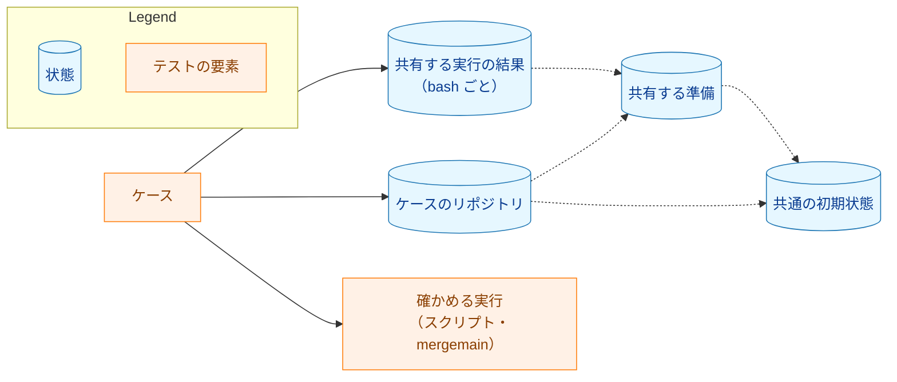
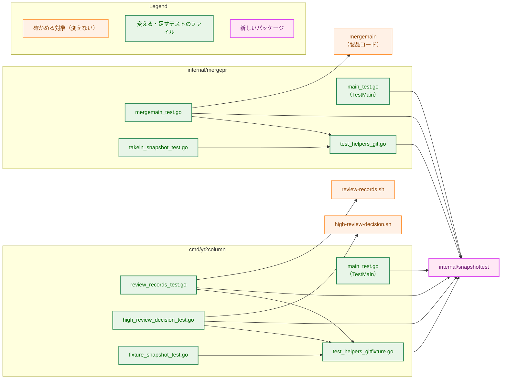
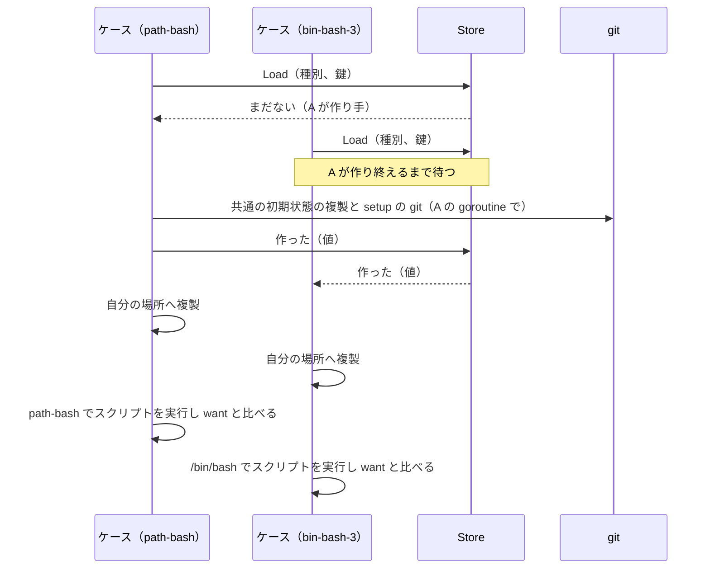
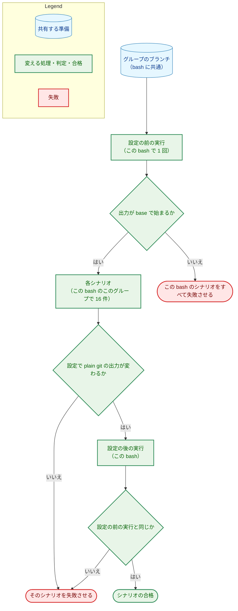

# アーキテクチャ設計書：review_records・high_review_decision・mergemain のテストの高速化

## Document Status

| Item | Value |
|---|---|
| Status | `draft` |
| Created | 2026-11-26 |
| Review date | - |
| Reviewer | - |
| Comments | - |

本書は [01_requirements.md](01_requirements.md)（要件定義書。以下、要件書）の設計である。既存のファイルについての記述は、コミット `95793184` のファイルで確かめた。`file:line` はこのコミットの行番号を指す。F-NNN・AC-NN は要件書の項番を指す。要件の起草で設計に申し送られた事項（[design_handoff.md](design_handoff.md) の H-01〜H-05）への対応は、付録 A にまとめる。

本書の計測は、すべて次の機械で行った（以下、計測の機械）: 12 コアの macOS、`PATH` の bash は 5.3.15、`/bin/bash` は 3.2.57、Go 1.27.1、`GOMAXPROCS` は設定しない。本書の数値は設計を決めるための予備の計測で、AC-03 の記録の代わりにはしない。

## 1. 設計の全体像 (Design Overview)

### 1.1. 設計原則

-   変えるのはテストのコードだけにする。 スクリプト（`review-records.sh`・`high-review-decision.sh`）と `internal/mergepr` の製品コードは変えない（AC-09）。
-   減らすのは、テストのバイナリが起動する git のプロセスである。 計測では、テストの時間の大半がプロセスの起動だった（2.1）。そこで、ケースの準備で起動する git を減らす。確かめる対象の実行（スクリプトと `mergemain`）は減らさない。
-   同じ状態は 1 回だけ作り、ケースごとに複製する。 複数のケースが同じ手順で同じ状態を作っているところは、最初に必要になったケースがその状態を 1 回だけ作る。ほかのケースは、その状態のディレクトリを自分の一時ディレクトリに複製して始める。複製はファイルの読み書きだけで行い、git を起動しない。
-   確かめる実行は、各ケースの bash で各ケースが行う。 ある bash の実行の結果を、ほかの bash の名前の下のケースに使わない（AC-05）。準備（git だけで作るブランチ）は bash に依らないので、2 本の bash の間で共有してよい。準備の中でスクリプトを走らせるケースは、準備を bash ごとに行う。
-   共有の状態を作れなかったときは、それに依るケースを失敗させる。 作る途中で失敗したり skip したりしたときは、その結果を記録し、後から来たケースも失敗させるか skip させる。結果を記録できなかったときは、失敗として扱う（AC-08、AC-04）。
-   ケースの表と期待する出力は、今の場所に残す。 ケースの行・`setup`・`want` は、今と同じ表に置く（要件書 4.5）。変えるのは、表を走らせる関数とフィクスチャを作る関数である。

### 1.2. 設計の際に決めたこと（2026-11-26）

本節が使う「共有の状態」「共通の初期状態」「共有する準備」「ストア」「複製」などの語は、1.3 で定義する。

人間のレビュアーが決めたもの:

-   **`cmd/yt2column` の、ケースの準備の 2 本の bash の間での共有:** 共有する。ただし、準備の中で `requireProbe` を呼んでスクリプトを走らせる 6 件のケース（`cmd/yt2column/review_records_test.go:1645-1759`）は、今と同じく bash ごとに準備する。理由: 要件書の試作（共通の初期状態の複製、設定の前の実行の共有、最上位のテスト関数の並列化）の割合は 0.76 で、AC-01 の目標の 0.75 に届かない。準備を共有すれば、bash ごとの準備の半分が減る。`requireProbe` はケースの前提の検査（AC-07）として、そのケースの bash でスクリプトを走らせる。共有するとその検査が 1 本の bash でしか走らなくなるので、その 6 件は共有から外す。採らなかった案: 6 件も共有して probe を `PATH` の bash だけで走らせる案（bash 3 での probe がなくなる）と、共有しない案（AC-01 に届かないおそれが高い）。ADR: なし。このタスクの 3 つのファイルの中で閉じるテストの作りで、ほかのタスクや製品の構成要素を縛らないためである。
-   **`internal/mergepr` の手段:** `newTakeIn` の状態を共通の初期状態にし、復元と push のケースの準備（`conflictSetup` と begin・merge、`pushFlow`）の後の状態を 1 回だけ作って複製する。それでもこのタスクの `internal/mergepr` の割合の見込み（3.7）が 75% を超えたときは、同じ PR の中で、`Setup` の git の起動を減らす作り（3.7）を足す。理由: 2.1 の見込みは 0.74〜0.76 で、目標との差が小さい（人が選んだ時点の見込みは 0.72〜0.74 だった。後のレビューで、共有しない 4 件を除いて見込みを計算し直した）。最初から `Setup` を作り直すと、作り直した状態と同じであることを固定する義務が増えるので、届かないときだけ足す。採らなかった案: 最初から両方入れる案と、設計の前に試作で確かめる案。ADR: なし（同上）。

設計で決めたもの（人間のレビュアーに諮らず、理由とともに記す）:

-   **共有の状態の置き場所と寿命（H-03）:** パッケージごとに 1 つのストア（3.1）を置く。`TestMain` がテストの開始の前に作り、終わった後に消す。理由: 共有の状態は、それを使う最初のケースが作るので、そのケースの `t.TempDir()` に置くと、そのケースが終わったときに消え、後から来たケースが複製できない。最上位のテスト関数ごとにストアを持つ案は、フィクスチャを作る関数（`newHRDFixture` は 28 か所、`newTakeIn` は 40 か所から呼ばれる）にストアを渡し回す必要があるので採らない。ADR: なし。2 つのパッケージのテストの中だけの置き場所で、製品のコードと開発の手順に影響せず、戻すときもこのタスクが変えるテストの補助の関数だけを変えればよいためである。
-   **複製の仕組みを置くパッケージ:** テストだけのパッケージ `internal/snapshottest` を新しく作る。`cmd/yt2column` と `internal/mergepr` の両方が同じ仕組み（1 回だけ作る、失敗と skip を伝える、ディレクトリを複製する）を使うためである（CLAUDE.md「DRY」）。パッケージは git を起動しない。git の状態を整える処理（3.2・3.6）は、それぞれのパッケージの補助の関数に置く。AC-09 が認める範囲（`test` のビルドタグのファイルだけを持つパッケージ、`package_reference.md` の行、`internal/pipeline/pipeline_test.go` の数）に収まる。ADR: なし。2 つのパッケージから使われるが、どちらもテストのコードで、製品のコードはこのパッケージに依らない。戻すときもテストの補助の関数だけが変わり、ほかのタスクの決定を縛らないので、主要な決定に当たらない。
-   **ディレクトリの複製に `os.CopyFS` を使う:** 標準ライブラリの `os.CopyFS`（`os.DirFS` から読む）は、ファイルの中身と実行の権限とシンボリックリンクを写し、そのほかの種類のファイル（FIFO など）ではエラーを返す。git が読むファイルのモードは実行の権限だけなので、これで足りる。自前の複製は書かない。ADR: なし（このタスクの中で閉じる実装の選択である）。
-   **コミットの日時を固定しない（H-01）:** 複製した状態は、複製のもとと同じオブジェクトを持つので、コミットの ID も同じになる。共有のために日時を固定する必要はない。日時を固定すると、フィクスチャの作り（`cmd/yt2column/test_helpers_gitfixture.go:56-58`）が変わり、ケースの意味を確かめ直す手間が増える。ADR: なし（同上）。
-   **計測と比較の手段（H-05）:** タスクの `_checks/` に 2 つの一時スクリプトを置く（7.5）。BASE と AFTER は、作業ツリーで交互に取り出して流す。git の worktree は作らない（worktree の追加は、開発の規則で使わない操作である: `.claude/commands/_lib/harness-claude.md` の shell-run）。ADR: なし（このタスクの計測の手順である）。

### 1.3. 用語

本書は、要件書 6 章の用語（フィクスチャのリポジトリ、末端のサブテスト、実時間、ケースの前提の検査、計測の条件）を同じ意味で使う。ほかに次の用語を使う。

-   **共有の状態:** 複数のケースが使う、1 回だけ作るディレクトリと値の組。次の 3 種類がある。
    -   **共通の初期状態:** フィクスチャのリポジトリを作る関数（`newRRFixtureWithContext`・`newHRDFixture`・`newTakeIn`）が作る、ケースの中身に依らない初めの状態。
    -   **共有する準備:** 1 つのケースの準備（ケースの `setup` が作るブランチ、git の設定のシナリオのブランチ、`mergemain` の復元と push のケースの準備）の後の状態。
    -   **共有する実行の結果:** git の設定のシナリオの、設定の前のスクリプトの実行の結果。bash ごとに 1 つある。
-   **ストア:** 共有の状態を持つ、パッケージに 1 つの入れ物（3.1）。
-   **共有の状態の種別:** 同じ作り方で作る共有の状態のまとまり（例: `rrFixture` の共通の初期状態、git の設定のシナリオのブランチ）。種別ごとに、名前と値の型を持つ（3.1 の `Kind`）。
-   **鍵:** 1 つの種別の中で、1 つの共有の状態を指す値。その状態を決める入力のすべてから作る。
-   **作り手:** ある共有の状態を最初に求め、それを作るケース。後から求めたケースは、作り手が作り終えるのを待ってから複製する。
-   **複製:** 共有の状態のディレクトリを、ケースの一時ディレクトリに写すこと。git は起動しない。
-   **整え直し:** `takeIn` の複製の後に、複製した場所に合わせて git の状態を直すこと（3.6）。

### 1.4. 概念モデル

ケースと共有の状態の関係を示す。実線の矢印 A → B は「A が B を使う」ことを、点線の矢印 A -.-> B は「A は B から作られる」ことを表す。ストアは 3 種類の共有の状態を持つ入れ物なので、図には描かない。



## 2. システム構成 (System Structure)

### 2.1. 時間の内訳（H-01）

要件書 §1「設計の着手の前の計測で決めたこと」の計測に、本書で次の計測を足した。どれも計測の機械での 1 回の計測である。

| 計測 | 値 |
|---|---|
| `internal/mergepr` のパッケージ全体（テストのバイナリを直接実行） | 実時間 70.9 秒（user 82.6 秒、sys 136.6 秒） |
| `TestMergemain` で始まるテストだけ | 実時間 50.2 秒（user 75.3 秒、sys 126.8 秒） |
| 復元と push の 7 つの最上位のテスト関数を `-skip` で除いたパッケージ全体 | 実時間 41.7 秒 |

-   **sys の時間が大きい:** `TestMergemain*` の CPU の時間の 6 割以上が sys で、プロセスの起動が時間の大半を占める。`-race` 付きのテストのバイナリから git を起動する負担が大きいと推測する（確かめていない）。
-   **git の呼び出しの内訳:** `PATH` に記録用の git を置き、`mergemain_test.go` の最上位のテスト関数を 1 つずつ走らせて数えた。テストの準備（`cmdrunner.GitHardening` の引数を付けない呼び出し）が約 2,570 回、テストする `mergemain`（付ける呼び出し）が約 5,240 回だった。
-   **復元と push のケースの準備:** `TestMergemainPushSuccessRejectedAndUnknown/pushed` は、準備（`newTakeIn`・`Setup`・begin・merge・マージのコミット）で約 68 回、確かめる push で 51 回の git を起動した。復元のケースも、準備はほぼ同じ回数である。この準備を、`conflictSetup` と begin・merge の後の状態を使う 12 件と、`pushFlow` の後の状態を使う 22 件、計 34 件が同じ手順で繰り返す（`mergemain_test.go:642,686,747,800,813,824,841,874,924,967,1254,1267`。747・874・924・967 はそれぞれ 10・6・6・4 件のケースのループの中にある）。
-   **`internal/mergepr` の見込み:** 34 件を含む 7 つの最上位のテスト関数を除くと、70.9 秒が 41.7 秒になった。この 7 つの末端のサブテストは 38 件で、そのうち 34 件が共有する準備を使う。29.2 秒のうち 34 件の分の準備（git の呼び出しの約 6 割）がなくなると見込むと、約 16 秒短くなる。`newTakeIn` の共通の初期状態（1 ケースあたり 6 回の起動が 1 回になる。`mergemain_test.go` の git の呼び出しの約 6% にあたり、約 3 秒）を足して、割合の見込みは **0.74〜0.76** である。目標との差がないので、3.7 を足すことになる見込みが高い。
-   **`cmd/yt2column` の見込み:** 要件書の試作は、共通の初期状態の複製、設定の前の実行の共有、4 つの最上位のテスト関数の並列化で 0.76 だった。準備の共有（3.4）で、bash 3 のケースの準備（テストのバイナリからの git の起動で約 3,400 回）がなくなる。見込みは **0.65〜0.75** で、届かないおそれが残る。
-   **待つケースの影響:** 共有の状態を待つケースは、待つ間も `-test.parallel` の枠を 1 つ使う。git の設定のシナリオ（3.3）は、待ちが最も長くなるところなので、シナリオを始める前に、親のサブテストでグループのブランチを求めておく（3.3）。ケースの準備の共有（3.4）では、2 本の bash の同じケースが同時に走ったときに、片方が準備 1 回分だけ待つ。この待ちがあるので、実時間の減り方は、CPU の時間の減り方より小さくなる。
-   **2 つのパッケージの相互の影響:** 計測の条件のコマンドは 2 つのパッケージのテストのバイナリを同時に走らせるので、一方の変更が、もう一方の実時間も変える。そのため、PR ごとの割合は、そのパッケージの変更の効果だけを表すとは限らない。このタスクの割合は、要件書 F-001 のとおり PR ごとの割合の積で判定する。
-   **`high_review_decision_test.go`:** 末端のサブテストの時間の合計（170.9 秒、要件書 §1）は 3 つのファイルの合計の約 5% である。`newHRDFixture` を同じ入力で呼ぶ所が多い（`realContext` と `markersPlanWith(t, "high")` の組で 16 か所）ので、共通の初期状態の複製だけを当てる。
-   **届かないとき:** 3.7 を足しても、このタスクの割合が AC-01 か AC-02 を満たさない見込みになったときは、実装を止め、要件書の決定の変更をレビューに諮る（要件書の H-02 の扱いと同じ）。

### 2.2. 全体の構成

テストのファイルとパッケージの関係を示す。矢印 A → B は「A が B を呼ぶ」ことを表す。



共有の状態を求める（`snapshottest.Load` を呼ぶ）のは、その状態の作り方を持つファイルである。共通の初期状態は `review_records_test.go`（`rrFixture`）・`high_review_decision_test.go`（`hrdFixture`）・`test_helpers_git.go`（`takeIn`）、共有する準備と共有する実行の結果は `review_records_test.go` と `mergemain_test.go` が求める。`test_helpers_gitfixture.go` は、ストアの変数と、共有する準備の中でスクリプトを走らせない検査（3.4）を持つ。

### 2.3. コンポーネントの配置

-   **`internal/snapshottest`（新規、テストだけのパッケージ）:** ストア。共有の状態を 1 回だけ作り、作った結果（成功・失敗・skip）を記録し、ディレクトリを複製する。git を知らない。
-   **`cmd/yt2column` の補助の関数:** ストアの変数、共有する準備の印と `runScript` の検査を持つ。
-   **`cmd/yt2column` のテストの本体:** フィクスチャを作る関数（`newRRFixtureWithContext`・`newHRDFixture`）が共通の初期状態を使う。`runRRCases`（`review_records_test.go:839-869`）と `checkConfigScenarios`（同 805-834）が、共有する準備と共有する実行の結果を使う。ケースの表は変えない（ただし、準備を bash ごとに行うケースの印を、表の行に足す）。
-   **`internal/mergepr` の補助の関数:** `newTakeIn`（`test_helpers_git.go:245-270`）の共通の初期状態、`takeIn` の複製と整え直しを持つ。
-   **`internal/mergepr` のテストの本体:** `conflictSetup`（`mergemain_test.go:613-616`）と begin・merge の後の状態、`pushFlow`（同 767-776）の後の状態を、共有する準備にする。

## 3. コンポーネント設計 (Component Design)

### 3.1. `internal/snapshottest`

ストアは、種別と鍵の組ごとに 1 つの共有の状態を持つ。共有の状態は、ストアの下のディレクトリ 1 つと、それを作る関数が返した値 1 つの組である。

```go
//go:build test

package snapshottest

// Store keeps the directories that tests build once, one per kind and key,
// under a root the caller owns. It is safe for concurrent use by parallel
// tests.
type Store struct{ /* unexported */ }

// NewStore returns a store whose directories live under root.
func NewStore(root string) *Store

// Close removes every directory the store built.
func (s *Store) Close() error

// Kind names one kind of shared state and fixes the type of its value.
// clone returns a copy of a value that shares no memory with it; it is nil
// for a value type that holds no slice, map, or pointer.
type Kind[V any] struct{ /* unexported */ }

// NewKind returns a kind with the name the failure messages print.
func NewKind[V any](name string, clone func(V) V) Kind[V]

// Snapshot is one directory built once and the value its build returned.
// It gives no path to the directory: a test can only copy it.
type Snapshot[V any] struct{ /* unexported */ }

// Load returns the snapshot of kind and key. The first test that asks for
// them builds it by calling build on its own goroutine, with its own t and
// a new directory dir; the others wait until that build ends. The parts of
// key are joined so that two different lists never make the same key.
func Load[V any](t *testing.T, s *Store, kind Kind[V], key []string,
	build func(t *testing.T, dir string) V) Snapshot[V]

// CopyTo copies the snapshot's directory to dst, which must not exist.
func (sn Snapshot[V]) CopyTo(t *testing.T, dst string)

// Value returns the value the build returned, cloned with the kind's clone.
func (sn Snapshot[V]) Value() V
```

-   **作り手の goroutine で作る:** `build` は作り手のテストの goroutine で走る。`t.Fatal`・`t.Skip` は、そのテストの goroutine から呼ばなければならない（Go の `testing` の規則）ので、別の goroutine では作らない。`build` が受け取る `t` は作り手の `t` である。今のフィクスチャの関数（`gitFixture.t`・`takeIn.t` は `*testing.T`）をそのまま `build` の中で使えるように、型は `*testing.T` にする。
-   **作った結果の記録:** `Load` は、`build` の呼び出しを遅延の関数で囲み、`build` が終わったときの結果を記録する。
    -   `build` が正常に戻り、`build` の間に `t.Failed()` が偽から真に変わっていなければ「作った」。
    -   `build` が正常に戻っても、`build` の間に `t.Failed()` が真になったなら（`t.Errorf` の後など）「失敗」。
    -   `build` が途中で終わり（`t.Fatal`・`t.Skip` などの `runtime.Goexit`）、`build` の間に `t.Failed()` が真になったなら「失敗」、そうでなく `t.Skipped()` が真なら「skip」、どちらでもなければ「失敗」。失敗を先に見るのは、失敗の後に skip したテストは、Go では失敗として報告されるためである。
    -   結果を記録する前に終わったように見えるときは「失敗」。後から来たケースが、作りかけのディレクトリや値の型の 0 値を受け取ることはない。
-   **後から来たケース:** 種別と鍵ごとの完了の通知を待つ。「作った」なら複製と値を受け取る。「失敗」なら、作り手のテストの名前を挙げて失敗する。「skip」なら、作り手のテストの名前を挙げて skip する。skip の理由の文は `testing.T` から取り出せないので、引き継がない。AC-04 が比べるのは skip の事象の `Test` の値の集まりで、理由の文ではない。
-   **鍵:** 共有の状態を決める入力のすべてを、文字列の列で渡す。`Load` は、長さを付けて列をつなぐので、違う列が同じ鍵にならない。同じ種別と鍵に違う作り方が来ないことは、鍵に入力のすべてを含めることと、ケースの名前の重なりの検査（3.4）で保つ。
-   **値:** `Value` は、種別の `clone` で写した値を返す。共有の状態の値をケースが書き換えても、ほかのケースが受け取る値は変わらない（CLAUDE.md「Enforce invariants with the type」）。
-   **ディレクトリを見せない:** `Snapshot` は複製だけを許し、ディレクトリのパスを返さない。ケースが共有の状態を書き換える手段を与えない（AC-10）。
-   **`build` の中で作るもの:** 共有の状態に残すファイルは、すべて `dir` の下に作る。`build` の中で `t.TempDir()` や `t.Cleanup` を使ったものは作り手のもので、作り手のテストが終わると消える。そのため、値と `dir` の中のファイルは、`dir` の外のパスを指してはならない。`cmd/yt2column` と `internal/mergepr` のフィクスチャの関数は、リポジトリを作る場所を引数で受け取る形を足す（今の形は、その場所に `t.TempDir()` を渡す）。
-   **複製:** `CopyTo` は `os.CopyFS(dst, os.DirFS(<共有の状態のディレクトリ>))` で写し、エラーでケースを失敗させる。`os.CopyFS` は、通常のファイル・ディレクトリ・シンボリックリンク以外ではエラーを返す。シンボリックリンクの先は書かれたとおりに写すので、`Load` は、作った直後に、絶対パスを指すリンクと、`dir` の外を指す相対パスのリンクがないことを確かめ、あれば「失敗」とする。
-   **寿命:** `TestMain` が `os.MkdirTemp` で作った場所を `NewStore` に渡し、`m.Run` の後、`os.Exit` の前に `Close` で消す。`cmd/yt2column` の `TestMain` は、子のプロセスとして走るときに最初に抜ける（`cmd/yt2column/main_test.go:23-25`）ので、ストアはその後で作る。各パッケージのストアは、パッケージの変数 1 つに置く。テストのプロセスが異常に終わったときは、ストアのディレクトリが一時ディレクトリに残る（今のケースの `t.TempDir()` も、異常の終わりでは同じく残る）。
-   **`-count` との関係:** 共有の状態はテストのプロセスに 1 つなので、`-count=N` では 2 回目以降も同じ共有の状態を使う。作る処理の不安定を `-count` で探すときは、1 回ずつプロセスを分けて走らせる。
-   **環境:** `build` は、プロセスの環境変数を読む関数（`newTakeIn` は `os.Environ()` を読む: `internal/mergepr/test_helpers_git.go:251`）を呼ぶ。`t.Setenv` を使うテストは並列にできず（Go の `testing` の規則）、並列のテストが走る前に終わるので、並列のケースが作り手になる限り、作り手によって環境は変わらない。共有の状態を求めるテストは `t.Setenv` を使わない、という規則を補助の関数の doc コメントに書く。

### 3.2. `cmd/yt2column`: 共通の初期状態

`newRRFixtureWithContext`（`review_records_test.go:136-152`）と `newHRDFixture`（`high_review_decision_test.go:32-50`）は、次のように作る。

-   **種別と鍵:** `rrFixture` の種別の鍵は、origin/main に置く `_context.md` の中身（空なら置かない）である。2 つの計画のサンプルは `testdata` の固定のファイルなので、同じテストのバイナリの中では変わらない。`hrdFixture` の種別の鍵は、`_context.md`・PR の印のある計画・印のない計画の 3 つの中身である。
-   **作り方:** 今の 2 つの関数のリポジトリの作り方（`git init` から `feature` のブランチまで）を、そのまま作る関数にする。作る関数は、`dir` の下に、自分の `HOME`・`TMPDIR` とリポジトリを作る。複製するのはリポジトリだけである。
-   **ケースの側:** ケースは、今と同じく自分の `HOME`・`TMPDIR`（`t.TempDir()`）を作り、リポジトリを複製する（AC-10）。`m0`・`mb` は、共有の状態の値として受け取る。
-   **index は読み直さない:** 複製でファイルの時刻と inode が変わるので、index の stat の情報は作業ツリーと合わなくなる。しかし、2 つのスクリプトは `GIT_OPTIONAL_LOCKS=0` の下で git を走らせ（`review-records.sh:240`、`high-review-decision.sh:61`）、確かめるのはコミットと ref から読める判定である。ケースの準備で使う git（`add`・`commit`・`switch`・`merge` など）は、自分で index を読み直す。そのため、`cmd/yt2column` では、複製の後に index を読み直さない（読み直すと、ケースごとにテストのバイナリから git を 1 回起動することになる）。スクリプトの出力が index の stat の情報に左右されないことはこの設計の前提で、外れれば、各ケースの出力の比較が一致せずに失敗する（合格の向きには誤らない）。
-   **絶対パス:** `git init` と `cmd/yt2column` のフィクスチャの作り方は、リポジトリの設定に絶対パスを書かない。3.8 の比較のテストが、複製の設定に作り手のディレクトリのパスがないことを確かめる。
-   **起動の数:** 1 ケースあたり、`rrFixture` は 9 回、`hrdFixture` は約 6 回の git の起動がなくなる。

### 3.3. `cmd/yt2column`: git の設定のシナリオ

`checkConfigScenarios`（`review_records_test.go:805-834`）は今、16 のシナリオ（スコープ 2 × 設定 8）のそれぞれで、フィクスチャとブランチを作り、設定の前と後にスクリプトを 1 回ずつ走らせる。これを、グループ（`checkConfigScenarios` の 1 回の呼び出し。今は 3 つのテスト関数から計 4 回）ごとに次のように変える。

-   **グループのブランチ（共有する準備）:** 鍵は、最上位のテスト関数の名前、グループの名前（`git config`・`git config with a merge`）、走らせるスクリプトのモードである。作る関数は、共通の初期状態を複製し、`build`（`rrConfigBranch` など）でブランチを作り、`build` が返した引数を値として返す。bash は鍵に含めない。`build` はスクリプトを走らせない（3.4 の検査で確かめる）。
-   **設定の前の実行（共有する実行の結果）:** 鍵は、グループの鍵に bash の名前を足したものである。作る関数は、グループのブランチを `dir` の下に複製し、その bash でスクリプトを 1 回走らせ、ケースの前提の検査（終了コードが 0 で、出力が `base` で始まること。今の `review_records_test.go:815-818`）を行う。検査が失敗したときは、作る関数が失敗し、そのグループのその bash のシナリオはすべて失敗する（H-04、AC-07、AC-08）。
-   **求める時点:** グループのブランチは、bash ごとの親のサブテストが、シナリオのサブテストを始める前に求める。シナリオが共有の状態を待って枠をふさがないようにするためである（2.1）。設定の前の実行は、各シナリオが求める。前提の検査が崩れたときに、今と同じく各シナリオが失敗するようにするためである（AC-07）。待つのは、bash ごとに 1 回のスクリプトの実行の間だけである。名前は変わらない（`Load` はサブテストを作らない）。
-   **各シナリオ:** グループのブランチを自分のリポジトリに複製し、設定を書く前の plain git の出力を取り、設定を書き、plain git の出力が変わることを確かめる（今の 819-827 行。ケースの前提の検査をシナリオごとに残す）。そして、そのシナリオの bash でスクリプトを走らせ、その bash の設定の前の実行の結果と、終了コード・標準出力・標準エラー出力のすべてを比べる（今の 828-830 行と同じ）。
-   **同じであることの根拠:** 設定の前の実行と各シナリオは、同じ共有の状態の複製の上で走る。複製はオブジェクトを写すのでコミットの ID が同じで、引数と出力に含まれる ID が一致する（要件書 §1 の「同じリポジトリの中だけ」の条件を満たす）。設定の前の実行の `HOME` は空で、シナリオの設定の前の状態と同じである。一方、リポジトリ・`HOME`・`TMPDIR` のパスは違う。スクリプトの出力がこれらのパスを含むなら、比較は一致せず、シナリオは失敗する。合格の向きに誤ることはない。
-   **名前:** 末端の名前（`<bash>/git config/<scope>/<設定の名前>`）は変えない（AC-04）。

### 3.4. `cmd/yt2column`: ケースの準備の bash の間での共有

`runRRCases`（`review_records_test.go:839-869`）は今、bash ごとに、ケースごとにフィクスチャを作り、`setup` を走らせる。これを、次のように変える。

-   **共有する準備:** 鍵は、最上位のテスト関数の名前、走らせるスクリプトのモード、ケースの名前、ケースが置く `_context.md` の中身である。作る関数は、共通の初期状態を複製し、ケースの `setup` を走らせ、`setup` が返した引数と、フィクスチャの Go の側の値（`m0`・`mb`）を値として返す。ケースは、それを自分のリポジトリに複製し、自分の bash でスクリプトを走らせ、自分のリポジトリで `want` を計算して比べる。`env` も、今と同じく各ケースが自分のフィクスチャで作る。
-   **ケースの名前の重なり:** `runRRCases` は、ケースを走らせる前に、表の中にケースの名前の重なりがないことを確かめ、あればテストを失敗させる。同じ名前の 2 つのケースが同じ共有の状態を使い、後のケースが自分の準備を確かめずに合格することを防ぐ（今は重なりはない）。
-   **bash ごとに準備するケース:** `rrCase` に、準備の仕方を表す欄を足す。値は「共有する」（0 値）と「bash ごとに行う」の 2 つである。「bash ごとに行う」を書くのは、準備の中で `requireProbe` を呼ぶ 6 件（1.2）だけである。この欄のケースは、今と同じく bash ごとにフィクスチャを作り、`setup` を走らせる。
-   **共有する準備の中でスクリプトを走らせない検査:** 共有する準備を作るフィクスチャ（その中で `sibling` が作るフィクスチャを含む）には、そのことを表す印を付ける。印のあるフィクスチャで `runScript` を呼ぶと、ケースを失敗させる。CLAUDE.md「Declare, don't infer」は、0 値を、入力について仮定が最も少ない解釈にすることを求める。この欄の 0 値（共有する）は「`setup` がスクリプトを走らせない」という仮定を置く。仮定が外れても、この検査がそのケースを必ず失敗させ、黙って 1 本の bash だけで probe を走らせることはない。そこで、行の大半（約 170 件）に印を書かずに済む「共有する」を 0 値にする。
-   **作り手の bash に依らないこと:** 共有する準備は git だけで作り、スクリプトを走らせないので、どちらの bash のケースが作り手になっても同じ状態になる。並列のどちらが先に来るかで結果が変わらない（AC-11）。
-   **skip の扱い:** `TestReviewRecordsUnreviewed` は、`LAST_REVIEWED..HEAD` を確かめるケースを `setup` の中で skip する（`review_records_test.go:1003-1009`）。共有する準備では、作り手の skip を記録し、もう一方の bash のケースも skip する（3.1）。skip の事象の `Test` の値の集まりは変わらない（AC-04）。
-   **ケースの前提の検査:** `mainMerge`・`rrSubmodule` などの検査は、共有する準備の中で 1 回行う。検査はどれも git だけで確かめるので、bash に依らない。検査が失敗すれば、作る関数が失敗し、両方の bash のケースが失敗する（AC-07、AC-08）。
-   **対象:** `runRRCases` を使う 4 つのテスト関数（`TestReviewRecordsCoverage`・`TestReviewRecordsUnreviewed`・`TestReviewRecordsCrossCheck`・`TestReviewRecordsFableAlias`）のケースである。`TestReviewRecordsCrossCheck` の中に直接書かれた「pattern matching」と「fail-closed context validation」のサブテストは、準備が数回の git の起動だけなので、共通の初期状態の複製だけを当て、準備は共有しない。

### 3.5. `cmd/yt2column`: 最上位のテスト関数の並列化

`TestReviewRecordsCoverage`・`TestReviewRecordsUnreviewed`・`TestReviewRecordsCrossCheck`・`TestReviewRecordsFableAlias` は、今は最上位で `t.Parallel()` を呼ばない（`review_records_test.go:891,992,1943,2070`）。そのため、4 つは順に走り、それぞれの中のサブテストだけが並列に走る。4 つの最上位で `t.Parallel()` を呼び、4 つが重なって走るようにする。`TestReviewRecordsMode`（同 1036-1046）も同じく並列にする。どれも `t.Setenv` や作業ディレクトリの変更を使わず、フィクスチャの環境は許可リストで作る（`test_helpers_gitfixture.go:41-46`）ので、並列にしてもほかのテストの環境を読まない。

### 3.6. `internal/mergepr`: 共通の初期状態と準備の共有

`takeIn` の共有の状態は、origin（bare）と作業ツリーの 2 つのディレクトリを 1 つのディレクトリの下に持つ。

| 共有の状態 | 種類 | 作り方 | 値 | 使うケース |
|---|---|---|---|---|
| 空の `takeIn` | 共通の初期状態 | `newTakeIn` の今の手順（bare の origin の作成、clone、4 つの設定） | なし | `newTakeIn` を呼ぶすべてのケース |
| 競合のマージの途中 | 共有する準備 | 空の `takeIn` の複製に `conflictSetup`、begin、merge | base head、main、begin の結果、merge の結果 | `conflictSetup` の後に begin・merge を呼ぶ 12 件 |
| マージのコミットの後 | 共有する準備 | 空の `takeIn` の複製に `pushFlow` | begin の結果 | `pushFlow` を呼ぶ 22 件 |

`conflictSetup` を呼ぶほかの 2 つのテストは共有しない。`TestMergemainBeginMergeRestoreFlow`（`mergemain_test.go:1068-1084`）は begin と merge そのものを確かめる流れのテストで、`TestMergemainMergeIgnoresConfiguredMergeOptions`（同 1237-1249）は merge の前に設定を書くので、どちらも準備の後の状態が共有の状態と違う。

-   **整え直し:** 複製した後、作業ツリーで次の 2 つを行う。
    -   `remote.origin.url` を、複製した origin のパスにする。clone は origin の絶対パスをこの設定に書く（`test_helpers_git.go:265`）ので、直さないと、ケースが作り手の origin に push する（H-03）。
    -   index の stat の情報を読み直す（unmerged の項目は残す）。`MergemainRestore` は `GIT_OPTIONAL_LOCKS=0`（`internal/cmdrunner/git.go:37`）の下で `git diff-files` を走らせ（`internal/mergepr/mergemain_restore.go:353`）、そこに出たファイルをほかの変更と判断する。stat の情報が合わないと、変えていないファイルがそこに出るためである。
-   **整え直さずに残る絶対パス:** begin の fetch が書く作業ツリーの `.git/FETCH_HEAD` は、作り手の origin のパスを含む。`FETCH_HEAD` は、push が自分で fetch してから読む（`internal/mergepr/mergemain_push.go:128-130`）ので、複製のものは読まれない。3.8 の比較のテストは、`remote.origin.url`（書き換える）と `FETCH_HEAD` のほかに作り手のパスがないことを確かめる。
-   **ケースの側:** ケースは、今と同じく自分の `HOME`・`XDG_CONFIG_HOME` を作る（AC-10）。`PR` は今と同じ既定の値から、`Env`・`GHCalls` は空から始める。共有する準備の作り手が偽の gh に記録した呼び出しは、ケースに引き継がない。これらのケースのどれも、準備の後の `GHCalls` を確かめていない（`GHCalls` を確かめるのは `mergemain_test.go:159,1093` の 2 つのテストだけで、どちらも共有する準備を使わない）。
-   **準備の merge のエラー:** 今の 12 件は、どれも準備の merge のエラーが nil であることを確かめている（例: `mergemain_test.go:643-646`）。共有する準備では、作る関数がこの確かめを行い、エラーが nil でなければ失敗する。それに依る 12 件も失敗する（3.1）。merge の結果は複数のスライスを持つ（`internal/mergepr/mergemain.go:629-642`）ので、種別の `clone` で写して渡す。
-   **起動の数:** 空の `takeIn` は 1 ケースあたり 6 回が 1 回に、準備の共有は 1 ケースあたり約 68 回が 2 回になる（2.1）。

### 3.7. `internal/mergepr`: 届かないときに足す `Setup` の作り

3.6 を入れた PR の計測（F-001 の計測の条件）の後に、このタスクの `internal/mergepr` の割合の見込み（それまでの実装の PR の割合と、この PR の割合の積）が 0.75 を超えたときだけ、同じ PR の中で、`Setup`（`test_helpers_git.go:343-355`）がテストのバイナリから起動する git を減らす。

-   **保つこと:** `Setup` の後の状態（origin の 2 つのブランチ、作業ツリーのリポジトリのブランチと remote-tracking の ref、取り出したブランチ、index、作業ツリーのファイル）と、コミットの順序と親子を今と同じにする。これは 3.8 の比較のテストで確かめる。
-   **記録:** 足したかどうかと、そのときの計測の値を、実装計画の受け入れ基準の検証の節に書く。

### 3.8. 複製が作り直しと同じであることのテスト（H-03）

CLAUDE.md「Performance」の「An optimization that adds a correctness obligation」の義務は、「複製した状態（`takeIn` では整え直した状態）は、ケースの中で作り直した状態と同じである」ことである。これを、パッケージごとに新しいテストのファイルで固定する。

-   **`cmd/yt2column/fixture_snapshot_test.go`:** `rrFixture` と `hrdFixture` の共通の初期状態、git の設定のシナリオのブランチの 1 つ、共有する準備の代表の 1 件について、複製した状態と、今の手順で作り直した状態を比べる。
-   **`internal/mergepr/takein_snapshot_test.go`:** 空の `takeIn`、競合のマージの途中、マージのコミットの後の 3 つについて、同じく比べる。3.7 を足したときは、`Setup` の後の状態も比べる。
-   **比べるもの:** コミットの日時が違うので、コミットの ID ではなく、次を比べる。
    -   作業ツリーのリポジトリと origin のそれぞれの、ref の名前の集まりと、各 ref が指すコミットの木・件名・親の形。
    -   それぞれの `git config --local --list`。origin のパスは、それぞれの origin のパスを同じ記号に置き換えて比べる。
    -   index の項目（`git ls-files -s`、unmerged の段を含む）、作業ツリーのファイル、`MERGE_HEAD` の有無とそれが指すコミットの形。
    -   `internal/mergepr` では、`git diff-files` の出力が、作り直した状態と同じであること（マージの途中の状態では、競合したファイルが作り直した状態でも出る）。
    -   複製の中で作り手のディレクトリのパスを含むファイルが、3.6 で挙げたもののほかにないこと。
-   **壊して確かめる:** `takeIn` の整え直しの 2 つ（index の読み直しと `remote.origin.url` の書き換え）をそれぞれ外すと、このテストが失敗することを確かめ、コミットのメッセージに書く（CLAUDE.md「Testing Strategy」）。

### 3.9. コンポーネントの責務

| ファイル | 新規/変更 | 責務 |
|---|---|---|
| `internal/snapshottest/snapshot.go` | 新規 | `Store`・`Kind`・`Snapshot`・`Load`・`CopyTo`（3.1）。`//go:build test` |
| `internal/snapshottest/snapshot_test.go` | 新規 | 7.1 のとおり |
| `cmd/yt2column/main_test.go` | 変更 | `TestMain` でストアを作り、`m.Run` の後に消す（3.1 の順序） |
| `cmd/yt2column/test_helpers_gitfixture.go` | 変更 | ストアの変数、リポジトリを作る場所を受け取るフィクスチャの関数、共有する準備の印と `runScript` の検査 |
| `cmd/yt2column/review_records_test.go` | 変更 | `newRRFixtureWithContext` の共通の初期状態（3.2）、`checkConfigScenarios` のグループ（3.3）、`runRRCases` の共有する準備と `rrCase` の欄と名前の重なりの検査（3.4）、最上位の並列化（3.5） |
| `cmd/yt2column/high_review_decision_test.go` | 変更 | `newHRDFixture` の共通の初期状態（3.2） |
| `cmd/yt2column/fixture_snapshot_test.go` | 新規 | 3.8 の比較のテスト |
| `internal/mergepr/main_test.go` | 新規 | `TestMain` でストアを作り、`m.Run` の後に消す |
| `internal/mergepr/test_helpers_git.go` | 変更 | ストアの変数、`newTakeIn` の共通の初期状態、`takeIn` の複製と整え直し（3.6）。3.7 を足すときは `Setup` |
| `internal/mergepr/mergemain_test.go` | 変更 | 競合のマージの途中とマージのコミットの後の共有する準備（3.6） |
| `internal/mergepr/takein_snapshot_test.go` | 新規 | 3.8 の比較のテスト |
| `internal/pipeline/pipeline_test.go` | 変更 | `testOnlyPackageDirs` に `internal/snapshottest` を足す（`internal/pipeline/pipeline_test.go:540-547`） |
| `docs/dev/conventions/package_reference.md` | 変更 | `internal/snapshottest` の行 |
| `docs/tasks/0127_git_fixture_test_speedup/_checks/` | 新規 | 計測と比較の一時スクリプト（7.5） |

`internal/snapshottest` は `testutil/` の下に置かないので、`TestFakesCarryBuildTag` の `testutil` のファイルの数（`internal/pipeline/pipeline_test.go:578`）は変わらない。`TestPackageReferenceListsPackages` は、新しいパッケージの行を求める。

### 3.10. 変わる既存のテスト

-   製品コードの挙動を確かめるテストの期待は変えない。変わるのは、3 つのファイルのテストの準備の作り方と、`internal/pipeline/pipeline_test.go` のテストだけのパッケージの一覧である。
-   ほかのタスクの設計書が定めた方針に対する例外はない。`newGitRepo` の「HOME を変えるので並列にできない」という制約（`test_helpers_git.go:44-45`）は、`newGitRepo` を変えないので、そのまま残る。

## 4. エラーハンドリング設計 (Error Handling Design)

新しいエラーの型は作らない。失敗は、今と同じく `t.Fatal` 系でケースを失敗させる。メッセージには、鍵（`_context.md` の中身を含むので長い）ではなく、種別の名前と、作り手のテストの名前を出す。

| 場面 | 振る舞い | メッセージの形 |
|---|---|---|
| 共有の状態を作る途中で失敗した | 作り手は、作る関数の中の失敗のメッセージで失敗する。後から来たケースは失敗する | `the shared <種別の名前> failed to build in <作り手のテストの名前>` |
| 共有の状態を作る途中で skip した | 作り手は自分の理由で skip する。後から来たケースは skip する | `the shared <種別の名前> was skipped in <作り手のテストの名前>` |
| 共有の状態に `dir` の外を指すリンクがある | 作り手も後から来たケースも失敗する | `the shared <種別の名前> holds a link outside itself: <リンクの相対パス>` |
| 共有する準備の中でスクリプトを走らせた | そのケースを失敗させる | `a shared preparation ran the script; mark the case to prepare per bash` |
| ケースの名前が重なっている | そのテスト関数を失敗させる | `two cases are named <ケースの名前>` |
| 複製・整え直しの失敗（ファイルの読み書き、git） | そのケースを失敗させる | 今の `gitIn` と同じ形（`git <args>: <err>: <stderr>`）か、`os.CopyFS` のエラー |

## 5. セキュリティ考慮事項 (Security Considerations)

N/A。要件書 4.2 のとおり、変わるのはテストのコードだけで、`docs/dev/security.md` の規則を適用する場面にならない。ストアのディレクトリは、今のフィクスチャと同じく、テストのプロセスの一時ディレクトリの下に置き、テストの終わりに消す。共有の状態をケースが書き換えられないこと（3.1）と、各ケースの環境を分けること（AC-10）は、セキュリティではなく検証の質の要件として扱う。脅威モデルの図は置かない。

## 6. 処理フロー (Processing Flow Details)

### 6.1. 共有の状態を求めるときの流れ

2 本の bash のケースが、同じ共有する準備を求める場合を示す。



作り手が途中で失敗したときは、`Store` は「失敗」を記録し、待っていた B に返す。B は 4 章のメッセージで失敗する。

### 6.2. git の設定のシナリオの流れ

1 つのグループの、1 本の bash の流れを示す。2 本の bash があるときは、bash ごとにこの流れがあり、グループのブランチだけを共有する。矢印 A → B は処理の順序を表す。



各シナリオは、グループのブランチを自分のリポジトリに複製してから始める。

## 7. テスト戦略 (Test Strategy)

### 7.1. 単体テスト

-   **`internal/snapshottest`:** 次を確かめる。
    -   並列のテストから同じ種別と鍵を同時に求めても、作る関数が 1 回だけ走ること（作る関数の呼び出しの回数で確かめる）。
    -   違う鍵の列が同じ鍵にならないこと。
    -   作る関数の失敗・`t.Errorf` の後の正常な戻り・skip が、後から来たケースを失敗・失敗・skip にすること。`t.Fatal` を呼ぶサブテストはそのテストのプロセスを失敗させるので、テストのバイナリを `-test.run` と環境変数で子のプロセスとして走らせ直し、子の `-test.v` の出力（作り手と後から来たケースの `--- FAIL`・`--- SKIP` の行）を親で確かめる。
    -   `Value` が、ケースが書き換えても後から来たケースに影響しない値を返すこと。
    -   `CopyTo` が、実行の権限とシンボリックリンクを写すこと。`dir` の外を指すリンクを持つ共有の状態を「失敗」にすること。
-   **複製と作り直しの比較:** 3.8 のとおり。

### 7.2. 結合テスト

3 つのファイルのテストそのものが、共有の状態とスクリプト・`mergemain` を組み合わせた結合テストである。共有の状態の作り方を変えても、各ケースの期待する出力は変えない。AC-04 の比較（7.4）が、ケースの集まりが減っていないことを確かめる。

### 7.3. セキュリティのテスト

N/A。5 章のとおり、セキュリティの規則に関わる変更はない。

### 7.4. 受け入れ基準の検証

| AC | 確かめ方 |
|---|---|
| AC-01・AC-02・AC-03 | `_checks/` の計測のスクリプト（7.5）で、実装の PR ごとに BASE と AFTER を 3 回ずつ測る。記録は実装計画に書く。`internal/mergepr` の見込みが 0.75 を超えたときは 3.7 を足して測り直す |
| AC-04 | `_checks/` の比較のスクリプト（7.5）で、末端の名前・`fail`・`skip` の集まりを比べる |
| AC-05 | 3.3 と 3.4 の作り。確かめる実行（設定の前の実行を含む）は、鍵に bash を含めるか、ケースが自分の bash で走らせる。レビューで読み、AC-04 の比較で `path-bash` と `bin-bash-3` の両方の名前の下で合格することを見る |
| AC-06 | `make coverage-compare BASE=<その PR の BASE>` を AFTER で流す |
| AC-07 | 13 か所の検査（下の表）のそれぞれについて、前提を一時的に崩し、ケースが失敗するのを見る。結果をコミットのメッセージに書く |
| AC-08 | `internal/snapshottest` の単体テスト（失敗と skip を伝えること）と、共有の状態を作る関数を一時的に失敗させて `go test` が失敗するのを見ること |
| AC-09 | 実装の PR ごとに、`git diff --name-only <merge-base>...HEAD` が 3.9 の表の範囲に収まることを読む |
| AC-10 | 3.2・3.6 の作り（ケースごとの `HOME` など）と、3.8 の比較のテスト |
| AC-11 | `_checks/` の比較のスクリプト（7.5）で、単独の選択と `-shuffle=on` の実行を行う |
| AC-12 | `make test` と `make lint` |

AC-07 の 13 か所の検査は、AFTER で次の場所に残る。

| 検査（BASE の場所） | AFTER での場所 |
|---|---|
| `requireProbe`（`review_records_test.go:125`） | 準備を bash ごとに行うケースの `setup` の中。今と同じく bash ごとに走る |
| `mainMerge`（同 235）、`rrSubmodule`（同 324）、ケースの `setup` の中の 7 か所（同 379、447、690、1356、1439、1817、1832） | ケースの `setup` の中。共有する準備では 1 回、bash ごとに準備するケースでは bash ごとに走る |
| 設定の前の出力（同 817） | 共有する実行の結果を作る関数の中（3.3）。bash ごと、グループごとに走る |
| 設定による plain git の変化（同 826） | 各シナリオの中（3.3） |
| refs/replace（`high_review_decision_test.go:546`） | 今のまま |

### 7.5. 計測と比較の一時スクリプト（H-05）

`docs/dev/conventions/requirements_process.md`「Temporary scripts (`_checks/`)」に従い、2 つのスクリプトを置く。どちらも bash で書き、`jq` を使う（`make test` も `jq` を求める）。

-   **計測のスクリプト（AC-01〜AC-03）:** BASE と AFTER のコミットを引数に取る。作業ツリーがきれいでなければ止まる。BASE・AFTER・BASE・AFTER・BASE・AFTER の順に、作業ツリーで取り出して（`git switch --detach`）計測の条件のコマンドを流す。交互に流すのは、機械の状態のゆっくりした変化を BASE と AFTER に均等に分けるためである（要件書 §1 の計測で、別の日の基準が約 3 割違った）。`go test` の `ok <パッケージ> <秒>s` の行から時間を読み、1 回でも失敗や読めない行があれば、合格を報告せずに止まる。終わったとき（失敗したときを含む）は、もとのブランチに戻す。AC-03 の機械の情報（OS、コアの数、2 つの bash の版、Go の版、`GOMAXPROCS`）も出す。
-   **比較のスクリプト（AC-04・AC-11）:** 同じく BASE と AFTER を取り出して `-json` で流し、AC-04 のとおり末端の名前・`fail`・`skip` の集まりを、BASE の最上位のテスト関数ごとに比べる。AFTER では、3 つのファイルの最上位のテスト関数ごとに、末端の名前を並べた最初と最後を単独で走らせる。共有の状態の種別ごとの「最初でも最後でもない 1 つ」は、実装計画が名前を挙げ、スクリプトに引数で渡す。`-shuffle=on` での 2 回の実行と、そのシードも出す。
-   **取り出しの注意:** BASE にはスクリプトがないので、スクリプトは作業ツリーの外に写してから走らせる（取り出しで自分のファイルが消えないように）。
-   **作りの大きさ:** 必須の 4 つの性質（目的のものを見つける、健全な状態で誤って見つけない、決められないときは合格にしない、呼び出し元を汚さない）を持たせ、それを超える守りは入れない。テストはコミットしない。

## 8. 実装の優先順位 (Implementation Priorities)

`CLAUDE.md`「Optimizations go in their own commit」に従い、共通の初期状態の複製、実行の結果の共有、準備の共有は、それぞれ revert で切り離せるコミットにする（要件書 5 章）。

1.  `internal/snapshottest` と、2 つのパッケージの `TestMain` のストア。
2.  `cmd/yt2column` の共通の初期状態（3.2）と比較のテスト（3.8）。
3.  git の設定のシナリオの共有（3.3）。
4.  準備の bash の間での共有（3.4）。
5.  最上位のテスト関数の並列化（3.5）。
6.  `internal/mergepr` の共通の初期状態と準備の共有（3.6）と比較のテスト（3.8）。このタスクの割合の見込みで届かなければ 3.7。
7.  計測と比較の一時スクリプト（7.5）。最初の実装の PR の計測の前に置く。

PR の分け方は実装計画で決める。`cmd/yt2column`（1〜5）と `internal/mergepr`（6）を別の PR にしても、2.1 のとおり、PR ごとの割合にはもう一方のパッケージの変更の影響が入りうる。判定は、要件書 F-001 のとおり、PR ごとの割合の積で行う。

## 9. 将来の拡張性 (Future Extensibility)

-   `scriptBashes` を使うほかのテスト（`cross_check_state_docs_test.go`・`adr_candidates_docs_test.go`）も、同じストアで共通の初期状態を共有できる。本タスクの範囲外（要件書 2.3）なので、変えない。
-   `internal/snapshottest` は git を知らないので、ほかの重いフィクスチャ（一時ディレクトリに作るファイルの木）にも使える。

## 付録 A: 設計への申し送りへの対応

| 項目 | 対応 | 本書の場所 |
|---|---|---|
| H-01 | 時間の内訳を測った（要件書 §1 の計測に、`internal/mergepr` の git の呼び出しの内訳と、復元と push のケースを除いた時間を足した）。その内訳から、テストのバイナリが起動する準備の git を減らす手段を選んだ。共有のためにコミットの日時は固定せず、1 つのリポジトリを複製する。`high_review_decision_test.go` と `mergemain_test.go` にも、内訳を見て同じ考え方を当てた | 1.2、2.1、3.2〜3.6 |
| H-02 | 要件の段階で、目標を 75% に下げる決定の変更を経た（要件書「設計の着手の前の計測で決めたこと」）。本書の見込みは `cmd/yt2column` が 0.65〜0.75、`internal/mergepr` が 0.74〜0.76 で、どちらも届かないおそれが残る。`internal/mergepr` には届かないときに足す手段（3.7）を決めた。それでも届かない見込みのときは、要件書の決定の変更をレビューに諮る | 1.2、2.1、3.7 |
| H-03 | 共通の初期状態はストアに 1 回だけ作り、ケースは自分の `HOME`・`TMPDIR` を持つ。`takeIn` では `remote.origin.url` を書き換え、index の stat の情報を読み直す。作れなかったときは、それに依るケースを失敗させる。複製と作り直しを比べるテストで固定する | 3.1、3.2、3.6、3.8 |
| H-04 | 共有するのは、同じ共有の状態の上の同じ実行の結果だけにする。設定の前の出力の検査は共有の側で行い、失敗したときはその bash のグループのシナリオをすべて失敗させる。plain git の比較は各シナリオに残す | 3.3、7.4 |
| H-05 | `_checks/` に計測と比較の 2 つの一時スクリプトを置く。worktree は作らず、作業ツリーで BASE と AFTER を交互に取り出す。機械の情報も同じスクリプトで出す | 1.2、7.5 |
