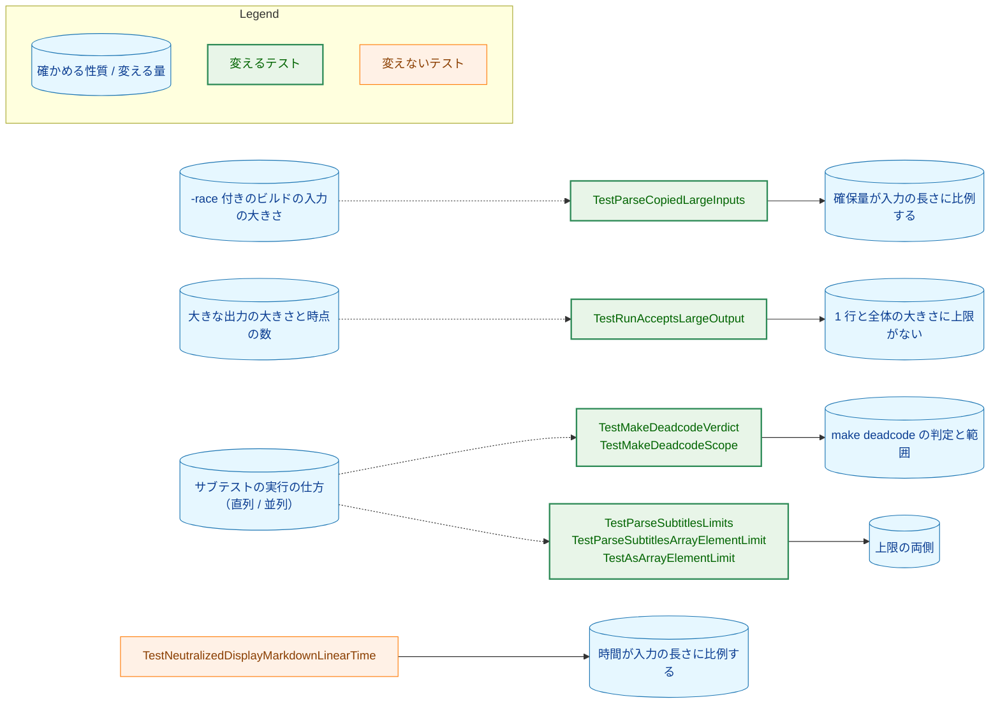
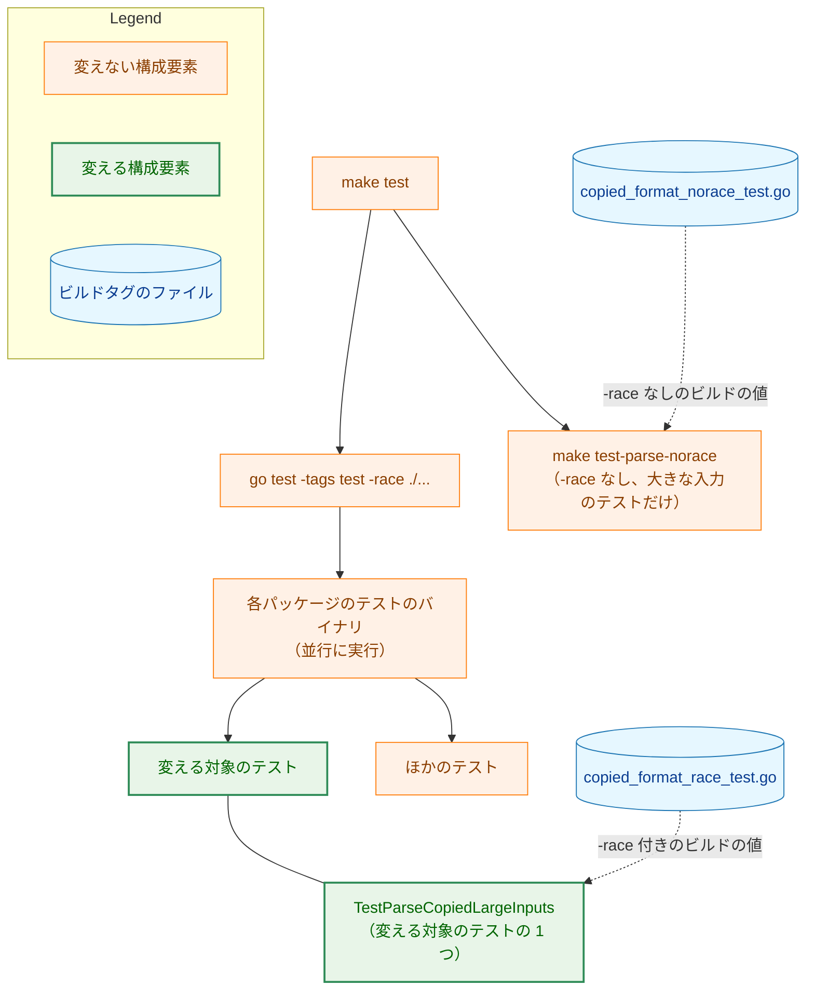
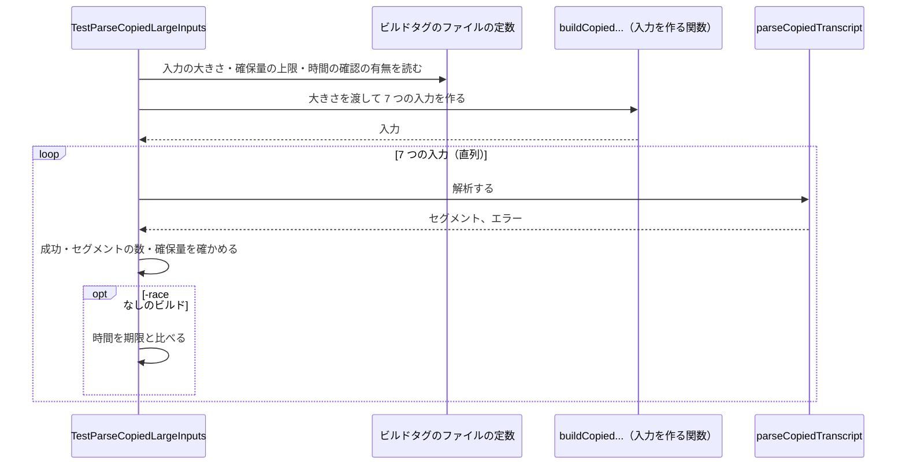
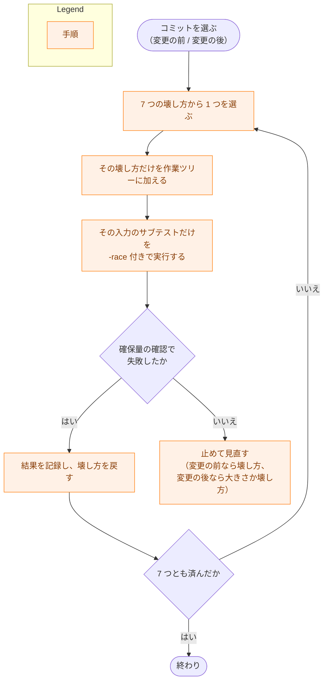
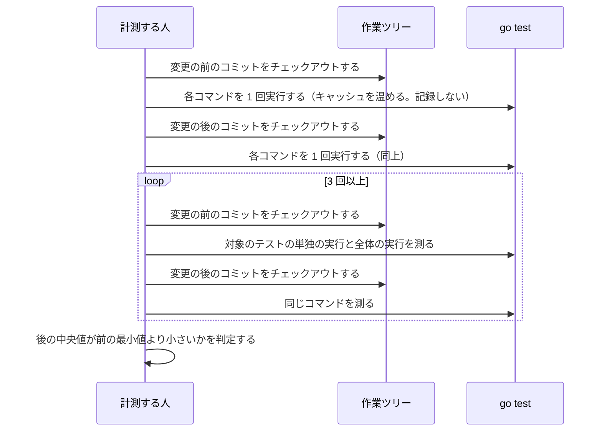

# アーキテクチャ設計書：-race 下の巨大入力テストの軽量化と独立したテストの並列化による Go テストの高速化

## Document Status

| Item | Value |
|---|---|
| Status | `draft` |
| Created | 2026-11-26 |
| Review date | - |
| Reviewer | - |
| Comments | - |

本書は [01_requirements.md](01_requirements.md)（要件定義書。以下、要件書）の設計である。既存のファイルについての記述は、コミット `aa9274fb` のファイルで確かめた。`file:line` はこのコミットの行番号を指す。F-NNN・AC-NN は要件書の項番を指す。要件のレビューで設計に申し送られた事項（[design_handoff.md](design_handoff.md) の H-01〜H-08）への対応は、付録 A にまとめる。

本書の計測は、すべて次の機械で行った（以下、計測の機械）: Apple M3 Pro（12 コア）、メモリ 18 GiB、macOS、`go version go1.27.1 darwin/arm64`。`go.mod` の Go の版は 1.26.5（`go.mod:3`）で、CI はこの版を使う。本書の数値は設計を決めるための予備の計測で、AC-13 の記録の代わりにはしない。

本書は、要件書 6 章の用語（`-race` 付きのビルド、`-race` なしのビルド、確保量、実時間、境界のテスト）を同じ意味で使う。ほかに次の用語を使う。

-   **大きな入力のテスト:** `internal/transcript` の `TestParseCopiedLargeInputs`（`internal/transcript/copied_format_test.go:1061`）。7 つの入力を、それぞれサブテストとして解析する。
-   **大きな出力のテスト:** `internal/coveragecompare` の `TestRunAcceptsLargeOutput`（`internal/coveragecompare/run_test.go:848`）。
-   **deadcode のテスト:** `cmd/yt2column` の `TestMakeDeadcodeVerdict`（`cmd/yt2column/deadcode_test.go:205`）と `TestMakeDeadcodeScope`（`deadcode_test.go:669`）。
-   **線形の時間のテスト:** `internal/publisher` の `TestNeutralizedDisplayMarkdownLinearTime`（`internal/publisher/display_render_test.go:233`）。
-   **対象のテスト:** 要件書 1 章の表の、上の 4 つと境界のテスト 3 つ（`TestParseSubtitlesLimits`、`TestParseSubtitlesArrayElementLimit`、`TestAsArrayElementLimit`）を合わせた 8 つのテスト関数。
-   **壊した解析:** AC-03 の確認のために、確保量が入力の長さの 2 乗に比例するように、パーサに一時的に加える変更。コミットしない（3.1.3）。
-   **単独の実行:** 1 つのテストだけを `-run` で絞った `go test` の実行。AC-13 の「対象のテストの時間」は、この実行の実時間である。
-   **全体の実行:** `go test -tags test -race -count=1 ./...` の実行。

## 1. 設計の全体像 (Design Overview)

### 1.1. 設計原則

-   **変えるのはテストのファイルだけにする。** 本番のコードには、テストから上限を差し替える仕組みも含めて何も加えない（要件書「本番のコードを変えない」、AC-08）。壊した解析は確認のための一時的な変更で、コミットしない。
-   **減らせる仕事は減らし、減らせない仕事は並列にする。** 入力を小さくすれば、単独の実行でも全体の実行でも仕事そのものが減る。そこで、仕事の大きさがテストの側で決まる大きな入力のテストと大きな出力のテストは、入力を小さくする。境界のテストは、本番の上限の値そのものの入力を解析し続ける（要件書「本番のコードを変えない」、AC-10）ので仕事を減らせず、deadcode のテストは子のプロセスを待つ時間が多い。この 2 つは並列にする。並列にすると速くなるのは、空いているコアがあるときだけである。計測の機械では、全体の実行の CPU の時間（user と sys の和）は実時間の約 5.9 倍で、12 コアを使い切ってはいなかった（2.1）。
-   **時間と確保量を測るテストは直列のままにする。** 大きな入力のテストと線形の時間のテストは、`t.Parallel()` を呼ばない（AC-06）。並列にすると、測る値がほかのテストの負荷を受けるためである。
-   **検証の強さは、壊して確かめる。** 入力を小さくしたテストは、確かめる性質を壊したときに失敗することを、実際に壊して確かめる（AC-03、AC-07）。大きさは、この確認に余裕を持って通る値にする。
-   **ビルドごとに違う値は、ビルドタグのファイルに置く。** 大きな入力のテストの入力の大きさは、確保量の上限（`copiedParseAllocPerByte`）と同じく、`copied_format_race_test.go` と `copied_format_norace_test.go` に置く（ADR-0038、要件書 4.5）。

### 1.2. 設計の際に決めたこと（2026-11-26）

人間のレビュアーが決めたもの:

-   **大きな入力のテストの大きさ（H-01）:** `-race` 付きのビルドでは、7 つの入力に共通の 1 MiB で作る。壊した解析での 1 バイトあたりの確保量が上限（8,192）に最も近い入力でも、上限の 2.7 倍ある（3.1.2 の表）。512 KiB では余裕が 1.4 倍しかなく、256 KiB では見逃す入力がある。入力ごとに大きさを変える案は、単独の実行を約 1 秒短くするが、ビルドごとの定数が 7 つに増えるので採らない。ADR: なし。「2 乗の確保を見分けられる大きさにする」という決定は [ADR-0038](../../dev/adr/0038-deadcode-and-race-free-timing.md) がすでに持ち、具体的な値はこのタスクの中で閉じるためである。

-   **全体の実時間の扱い（要件書の決定の変更）:** 記録だけにし、AC-14 の比較から外す。試作で、全体の実時間が対象外の `internal/fixprguard` で決まり、対象のテストを短くしても縮まないと分かった（2.1）。このままでは AC-14 を満たせないので、要件書の AC-14 と「短くなったことの確かめ方」を改め、要件書を `draft` に戻した。対象のテストを加える案（範囲が広がる）と、要件のまま進めて失敗してから戻る案は採らなかった。ADR: なし（判定の仕方はこのタスクの中で閉じる）。
-   **`TestParseSubtitlesArrayElementLimit` の扱い（要件書の決定の変更）:** 並列にするが、AC-14 の比較から外す。このテストのサブテストは 1 つだけで（`internal/ytdlpsource/json3_test.go:276-286`）、単独の実行では `t.Parallel()` を加えても短くならない（2.1 の単独の実行の表）。比較に含めても、効果のない変更の 3 回ずつの計測で、後の中央値が前の最小値より小さくなるのは偶然の約 2 割にとどまり、判定に意味がない。時間は AC-13 のとおり測って記録する。2 つの境界のテストをまとめて測る案は、AC-13 の「テストごとに測る」から外れるので採らなかった。差の小さい `TestParseSubtitlesLimits` は比較に残し、短くならなければ要件書のとおり設計に戻ることを、受け入れる危険とする（2.1）。ADR: なし（判定の仕方はこのタスクの中で閉じる）。
-   **要件書と設計書の承認:** 上の 2 つの決定の変更で、要件書はこの PR で `draft` に戻った。レビュアーは、この PR のマージの質問で、要件書と設計書の両方を承認する。

設計で決めたもの（人間のレビュアーに諮らず、理由とともに記す）:

-   **壊した解析の作り方（AC-03、H-01）:** 7 つの入力のそれぞれが通る経路の単位ごとに、その単位から入力の終わりまでのバイト数と同じ長さのバイト列を、中身を写さずに確保する。経路と単位は 3.1.3 の表のとおりである。写さずに確保するので、確保量に比べて時間が短い。7 つを 1 つずつ壊し、壊した経路の入力のサブテストが失敗することを確かめる。ADR: なし（このタスクの中で閉じる確認の手順である）。
-   **入力の大きさの定数（H-01）:** ビルドタグのファイルに新しく置き、4 MiB の上限の定数は共通のファイルに残す。`copiedLargeInputLimit`（4 MiB、記事生成モジュールの入力の上限）は今の場所に残し、入力を作る大きさを表す新しい定数をビルドごとに置く（3.1.1）。上限の定数は記事生成モジュールの入力の上限を表し、作る大きさとは意味が違うためである。入力が大きすぎないことの確認（`copied_format_test.go:1077-1079`）は、上限でなく作る大きさと比べるように改める。`-race` 付きのビルドでは上限との比較がいつも通ってしまい、作る関数が大きさを超えても見逃すためである。ADR: なし。
-   **大きな出力のテストの出し方（H-05）:** BASE の時点だけで、1 MiB + 1 KiB の行を 9 行出す。合わせて 9,446,400 バイトの行と JSON の枠で 8 MiB（8,388,608 バイト）を超える（AC-12）。8 行でも 8,397,312 バイトで 8 MiB を超えるが、差が 8,704 バイトしかなく、行の長さの小さな変更で 8 MiB を下回るので、約 1 MB の余裕がある 9 行にする。BASE を選ぶのは、テストが確かめる「BASE のテストが 2 件」（`run_test.go:861-863`）が、大きな行の後に書かれた行まで読めたことを示すためである。ADR: なし。
-   **deadcode のテストの並列化（H-02、AC-04、AC-05）:** 2 つのテスト関数とすべてのサブテストを並列にし、状態の移動（共有していた状態をサブテストごとに分けること）はしない。どのサブテストも、プロセスの環境と作業ディレクトリを変えず、書くファイルは自分の `t.TempDir()` の下だけである（3.3）。`isolation` のサブテストが共有するフィクスチャは、親が作った後は読むだけである。ADR: なし。
-   **境界のテストの並列化（H-07、H-08）:** 3 つのテスト関数とすべてのサブテストを並列にし、入力の作り方は変えない。内訳を測ると、どのサブテストも解析が時間の大半で、入力を作る時間は最大 38 ms だった（3.4）。入力を使い回しても短くならないためである。ADR: なし。
-   **線形の時間のテストの扱い（H-06、AC-07）:** 入力を小さくせず、変えない。計測の機械では、全体の実行の中でも 1.26 秒で、単位の数を半分にしても約 0.6 秒しか減らない。単位の数を 4 分の 1（500）にすると、今の実装でも比が 1.99〜5.15 にばらつき、壊した実装を見逃した回があった（3.5）。減る時間に比べて、時間を測るテストを不安定にするおそれと、AC-07 の確認の手間（壊した実装は単位の数 1,000 でも 1 回に 15 分以上かかる見込み）が大きいためである。AC-14 の比較からは外す。ADR: なし。
-   **カバレッジの確かめ方（H-04、AC-11）:** `make coverage-compare` と、大きな入力のテストだけを `-race` 付きで実行したプロファイルの比較の 2 つで確かめる。`make coverage-compare` は `-race` なしでテストを実行する（[0055 設計書](../0055_coverage_compare/02_architecture.md) §3.4）ので、`-race` 付きのビルドだけで変わる入力の大きさ（F-001）は、それだけでは比べられないためである（3.7）。ADR: なし。
-   **ADR-0038 の「食い違い」の項（AC-08）:** 大きな入力のテストを変える PR で消す。その PR で食い違いが解消するためである（3.8）。ADR: [ADR-0038](../../dev/adr/0038-deadcode-and-race-free-timing.md) の決定は変えず、決定の状態の注記だけを消す。

### 1.3. 概念モデル

対象のテストと、各テストが確かめる性質と、このタスクが変える量の関係を示す。矢印 A → B は「A が B を確かめる」ことを表し、点線の矢印 A -.-> B は「A の値をこのタスクが変える」ことを表す。



## 2. システム構成 (System Structure)

### 2.1. 全体の構成

`make test` は、全パッケージを `-race` 付きで実行した後、`make test-parse-norace` で大きな入力のテストだけを `-race` なしで実行する（`Makefile:93-95`、`Makefile:111-112`）。CI の `Test` ジョブは、`make test-ci`（`Makefile:99-101`）の後に同じターゲットを実行する。このタスクは、この流れを変えない（要件書 2.3）。



実線の矢印 A → B は「A が B を実行する」ことを、点線の矢印 A -.-> B は「A がビルドに入り、B の値を決める」ことを、線 A --- B は「B が A に含まれる」ことを表す。変えない対象のテスト（線形の時間のテスト）は「ほかのテスト」に含める。

**今の時間の内訳（予備の計測）:** 計測の機械で、`aa9274fb` の全体の実行を 1 回測った。

| 項目 | 値 |
|---|---:|
| 全体の実行の実時間 | 290.7 秒 |
| CPU の時間（user + sys） | 1,715.1 秒 |
| 最も長いパッケージ | `internal/fixprguard`（276.7 秒） |
| 次に長いパッケージ | `cmd/yt2column`（218.4 秒） |

対象のテストの時間は次のとおりである。「全体の中」は全体の実行の `go test -json` の `Elapsed`（並列にしたサブテストの時間を含まない値である。今は、対象のテストのサブテストはどれも直列である）、「単独」は単独の実行の `Elapsed` で、AC-13 が測る `go test` の実時間（ビルドとテストのバイナリの起動を含む）より小さい。

| テスト | 全体の中（秒） | 単独（秒） |
|---|---:|---:|
| `TestParseCopiedLargeInputs` | 10.03 | 7.47 |
| `TestRunAcceptsLargeOutput` | 17.91 | 6.91 |
| `TestMakeDeadcodeVerdict` | 21.12 | 7.07 |
| `TestMakeDeadcodeScope` | 4.44 | 3.66 |
| `TestParseSubtitlesLimits` | 11.69 | 0.84 |
| `TestParseSubtitlesArrayElementLimit` | 7.21 | 0.62 |
| `TestAsArrayElementLimit` | 1.34 | 1.31 |
| `TestNeutralizedDisplayMarkdownLinearTime` | 1.26 | 1.19 |

issue #1166 の表（`TestParseCopiedLargeInputs` で 101.0 秒など）は、今回の計測よりずっと大きい。issue の計測時の機械の負荷か、その後のテストの変化によるとみられるが、原因は確かめていない。

全体の実行の実時間は、いちばん長いパッケージで決まる。今回の計測では、それは対象のテストを含まない `internal/fixprguard` だった。全体の実時間への効果は、対象のテストが CPU を譲った分だけ、ほかのパッケージが速くなることによる。

**試作での全体の実行:** 3.1〜3.4 の変更を一時的に入れた作業ツリーで、全体の実行を 1 回測った（コミットはしていない）。

| 項目 | 変更の前 | 試作 |
|---|---:|---:|
| 全体の実行の実時間 | 290.7 秒 | 317.8 秒 |
| CPU の時間（user + sys） | 1,715.1 秒 | 1,704.8 秒 |
| `internal/fixprguard` | 276.7 秒 | 309.0 秒 |
| `TestParseCopiedLargeInputs`（全体の中） | 10.03 秒 | 2.38 秒 |
| `TestRunAcceptsLargeOutput`（全体の中） | 17.91 秒 | 11.29 秒 |

対象のテストは短くなったが、全体の実時間は `internal/fixprguard` の時間で決まり、機械の負荷のばらつきの中で縮まなかった。試作は 1 回だけなので、全体の実時間が延びたのが機械の負荷のばらつきによるのか、並列にしたテストが `internal/fixprguard` と CPU を取り合ったためかは見分けられない。この結果を受けて、AC-14 の比較から全体の実時間を外すよう要件書を改めた（1.2）。全体の実時間が大きく延びたときに止まる条件は 3.6 に置く。

**試作での単独の実行:** 変更の前と試作のテストのバイナリをそれぞれ作り、交互に 3 回ずつ実行して、バイナリの実時間を測った（秒）。ビルドの時間を含まないので、AC-13 の値より小さい。

| テスト | 変更の前 | 試作 |
|---|---|---|
| `TestParseCopiedLargeInputs` | 9.54、9.14、9.06 | 3.58、3.10、3.09 |
| `TestRunAcceptsLargeOutput` | 8.78、7.84、7.77 | 3.99、3.34、3.29 |
| `TestMakeDeadcodeVerdict` | 9.30、8.51、8.48 | 7.90、7.40、7.37 |
| `TestMakeDeadcodeScope` | 4.46、4.19、4.23 | 2.77、2.78、2.74 |
| `TestParseSubtitlesLimits` | 2.38、1.89、1.90 | 1.93、1.48、1.46 |
| `TestParseSubtitlesArrayElementLimit` | 1.68、1.65、1.67 | 1.67、1.65、1.66 |
| `TestAsArrayElementLimit` | 2.80、2.30、2.26 | 1.97、1.50、1.51 |

`TestParseSubtitlesArrayElementLimit` だけは短くならなかった（1.2）。`TestParseSubtitlesLimits` の差は約 0.4 秒で、AC-13 の `go test` の実時間（約 2.2 秒）に比べて小さく、機械の負荷のばらつき（同じ計測で約 ±0.2 秒）に近い。AC-14 で短くならなければ、要件書のとおり設計に戻る。同じ日の別の計測では、機械の負荷が高い間に `go test` で測った値が数秒ずつぶれた。3.6 の負荷の記録は、このためである。

### 2.2. コンポーネント配置

| ファイル | 変更 | 内容 |
|---|---|---|
| `internal/transcript/copied_format_test.go` | 変更 | 7 つの入力を、新しい定数の大きさで作り、入力が大きすぎないことをその大きさと比べる（3.1.1）。`copiedLargeInputLimit` は残す。4 MiB と書いたコメント（`copied_format_test.go:1040-1041` のビルドごとの値の説明、`:1047` の「at most 4 MiB」、`:1049` の「nearly 4 MiB long」）を、ビルドごとの大きさに合わせて直す |
| `internal/transcript/copied_format_race_test.go` | 変更 | `-race` 付きのビルドの入力の大きさ（1 MiB）を置き、その doc コメントに、1 MiB を選んだ根拠（3.1.2 の壊した解析の結果）を書く |
| `internal/transcript/copied_format_norace_test.go` | 変更 | `-race` なしのビルドの入力の大きさ（`copiedLargeInputLimit` と同じ 4 MiB）を置く |
| `internal/coveragecompare/run_test.go` | 変更 | 大きな出力を BASE の時点だけにし、doc コメントの「over 20 MiB」を直す（3.2） |
| `internal/coveragecompare/test_helpers.go` | 変更 | `fakeLargeLines` を 9 にし、コメントの「over 20 MiB」を直す（3.2） |
| `cmd/yt2column/deadcode_test.go` | 変更 | 2 つのテスト関数とサブテストに `t.Parallel()` を加える（3.3） |
| `internal/ytdlpsource/json3_test.go` | 変更 | 2 つのテスト関数とサブテストに `t.Parallel()` を加える。入力の作り方は変えない（3.4） |
| `internal/strictjson/strictjson_test.go` | 変更 | `TestAsArrayElementLimit` とサブテストに `t.Parallel()` を加える（3.4） |
| `docs/dev/adr/0038-deadcode-and-race-free-timing.md` | 変更 | 「食い違い」の項を消す（3.8） |
| `docs/tasks/0129_race_test_speedup/03_implementation_plan.md` | 新規（計画で作る） | AC-03・AC-07 の壊した解析の結果、AC-11 のカバレッジの比較、AC-13・AC-14 の計測を記録する |

本番のコード（`_test.go` でも `//go:build test` のファイルでもないファイル）は変えない（AC-08）。

### 2.3. データの流れ

大きな入力のテストが、ビルドごとの大きさで入力を作って確かめる流れを示す。



## 3. コンポーネント設計 (Component Design)

### 3.1. 大きな入力のテスト（F-001、AC-01〜AC-03、AC-06、H-01）

#### 3.1.1. 定数の置き場所

ビルドごとの定数は、次の 3 つになる。型と値の形だけを示す。

```go
// copied_format_race_test.go（//go:build test && race）
const (
	copiedLargeInputSize      = 1 << 20 // 7 つの入力を作る大きさ
	copiedParseAllocPerByte   = 8192    // 変えない
	copiedParseChecksDeadline = false   // 変えない
)

// copied_format_norace_test.go（//go:build test && !race）
const (
	copiedLargeInputSize      = copiedLargeInputLimit // 4 MiB。変更の前と同じ入力（AC-02）
	copiedParseAllocPerByte   = 128                   // 変えない
	copiedParseChecksDeadline = true                  // 変えない
)
```

-   7 つの入力を作る関数（`buildCopied...`、`copied_format_test.go:1108-1146`）と、`wantSegments` の式（`copied_format_test.go:1067-1073`）には、`copiedLargeInputLimit` の代わりに `copiedLargeInputSize` を渡す。関数と式の形は変えない。`-race` なしのビルドでは同じ値を渡すので、7 つの入力は変更の前と 1 バイトも違わない（AC-02）。
-   `copiedLargeInputLimit`（`copied_format_test.go:1043`）は残す。入力が大きすぎないことの確認（`copied_format_test.go:1077-1079`）は、`copiedLargeInputLimit` の代わりに `copiedLargeInputSize` と比べる。`-race` なしのビルドでは 2 つは同じ値なので、確認は変わらない。
-   名前 `copiedLargeInputSize` は計画で変えてよい。`copiedLargeInputLimit` と別の名前にすることだけを決める。
-   AC-01 の「ログに出る各入力のバイト数」は、今のログ（`copied_format_test.go:1089-1090`）がそのまま出す。1 MiB の入力は 1,048,575〜1,048,576 バイトになり、4,194,304 より小さい。

#### 3.1.2. 大きさの決め方と予備の計測（AC-01）

壊さない解析と、3.1.3 の壊した解析を、計測の機械の単独の実行で、256 KiB・512 KiB・1 MiB の大きさについて測った（それぞれ 1 回）。

壊さない解析の結果（1 バイトあたりの確保量と、7 つの入力の計の時間）:

| 大きさ | shortest form A | one long line | textless form B | trailing empty | prefix | form A headings | form B headings | 計の時間 |
|---|---:|---:|---:|---:|---:|---:|---:|---:|
| 4 MiB（今） | 1,718 | 0.01 | 1,866 | 16.0 | 8.0 | 593 | 8.0 | 7.47 秒 |
| 1 MiB | 1,706 | 0.01 | 1,873 | 16.1 | 8.0 | 589 | 8.0 | 1.90 秒 |
| 512 KiB | 1,725 | 0.04 | 1,889 | 16.2 | 8.1 | 592 | 8.2 | 0.98 秒 |
| 256 KiB | 1,740 | 0.06 | 1,842 | 16.2 | 8.4 | 588 | 8.1 | 0.66 秒 |

壊した解析の結果（壊した経路の入力の、1 バイトあたりの確保量。上限は 8,192）:

| 大きさ | shortest form A | one long line | textless form B | trailing empty | prefix | form A headings | form B headings |
|---|---:|---:|---:|---:|---:|---:|---:|
| 1 MiB | 49,938 | 1,056,563 | 107,871 | 528,288 | 264,146 | **22,292** | 264,146 |
| 512 KiB | 26,032 | 532,074 | 55,380 | 266,044 | 133,024 | **11,526** | 133,024 |
| 256 KiB | 14,063 | 269,527 | 29,076 | 134,771 | 67,387 | **6,112（通ってしまう）** | 67,387 |

-   壊さない解析の 1 バイトあたりの確保量は、大きさによらずほぼ一定である。入力の長さによらない固定の確保は、この範囲では無視できる。そのため、`-race` 付きのビルドの上限（8,192）は変えない。
-   壊した解析の 1 バイトあたりの確保量は、大きさに比例して増える（2 乗の確保の性質どおり）。最も見分けにくいのは form A の見出しの入力で、1 単位（見出しと段落の組）が 32 バイトと長いためである。1 MiB で上限の 2.7 倍、512 KiB で 1.4 倍、256 KiB では上限に届かない。
-   1 MiB を選ぶ（1.2）。単独の実行の時間は 7.47 秒から 1.90 秒に減る。
-   `-race` 付きのビルドが見分けられる 2 乗の確保は、4 MiB のときより約 4 倍急なものに限られる。たとえば form A の見出しの入力では、見出しごとに残りの約 3 分の 1 を確保する劣化は、1 MiB では上限を超えない。確保量の劣化を主に見つけるのは、4 MiB の入力をより厳しい上限（1 バイトあたり 128 バイト）で確かめる `-race` なしのビルド（`make test-parse-norace`。`make test` と CI の `Test` ジョブが実行する）で、`-race` 付きのビルドは補助である。
-   AC-01 が求める「その大きさでの `-race` 付きの実行時間」は、上の表の 1 MiB の行（計 1.90 秒）である。AC-13 の計測が、この値を同じ機械で取り直す。

#### 3.1.3. 壊した解析（AC-03）

7 つの入力のそれぞれについて、その入力が通る経路の、単位ごとの処理に、次の確保を一時的に加える。確保するのは、単位の位置から入力の終わりまで（trailing zero-length lines では入力の始まりまで）のバイト数と同じ長さのバイト列で、中身は写さない。写さないので、確保した量に比べて時間は短い。

| 入力 | 確保を加える場所（`internal/transcript/copied_format.go`） | 単位 |
|---|---|---|
| shortest form A lines | `parseCopiedFormA` の、見出しでない行の処理（`:489` 以降） | 行 |
| one long form A line | `hasCopiedControlChar` の、文字ごとの繰り返し（`:341`） | 文字。その文字から行の終わりまでを確保する |
| textless form B timestamps | `parseCopiedFormB` の、タイムスタンプの行の処理（`:540-547`） | 行 |
| trailing zero-length lines | `copiedTrailingStart` の、後ろの領域に数える行の処理（`:378-380`） | 行。行の位置から入力の始まりまでを確保する |
| one-byte prefix lines | `copiedPrefixEnd` の、前置きの行の処理（`:408-419` の繰り返しの終わり） | 行 |
| form A headings between segments | `parseCopiedFormA` の、見出しを飛ばす処理（`:486-488`） | 見出しの行 |
| one-byte form B headings | `parseCopiedFormB` の、見出しを飛ばす処理（`:549-554`） | 見出しの行 |

-   **壊し方の数:** 1 つずつ壊す。7 つのうち 1 つだけを加えて、その入力のサブテストだけを `-run` で実行し、確保量の上限を超えて失敗することを確かめる。ほかの壊し方が混ざると、どの経路の確保で失敗したかが分からなくなるためである。
-   **失敗の理由の確認:** 数えるのは、壊した入力のサブテストが確保量の確認（「parse allocated … want at most … per byte」のエラー、`copied_format_test.go:1100-1103`）で失敗した場合だけである。タイムアウト、解析のエラー、セグメントの数の誤りで失敗した実行は、確認に数えず、壊し方を直してやり直す。
-   **確かめるコミット:** 変更の前と後の両方で確かめる。変更の前のコミット（4 MiB の入力）と変更の後のコミット（1 MiB の入力）で、7 つの壊し方のそれぞれを `-race` 付きで実行する（AC-03）。4 MiB の入力では確保の総量が大きく、`one long form A line` の壊し方は 1 MiB で 38 秒かかった（4 MiB では約 16 倍と見込む）ので、変更の前の確認は `go test` に十分な `-timeout` を付けて実行する。その値は、この壊し方の 4 MiB での時間を先に 1 回測ってから決める。
-   **壊し方の詳細:** 変数の名前や確保の式は、計画と実装で決める。本書は、経路、単位、「残りのバイト数と同じ長さのバイト列を、中身を写さずに確保する」ことだけを決める。結果は実装計画書に記録する（AC-03）。
-   壊した解析で `-race` なしのビルドを確かめることは、AC-03 は求めない。`-race` なしのビルドの入力は変わらない（AC-02）ためである。

#### 3.1.4. 直列のまま保つ（AC-06）

大きな入力のテストは `runtime.MemStats.TotalAlloc` の差で確保量を測る（`copied_format_test.go:1080-1088`）。この値はプロセス全体の確保を数えるので、ほかのテストと並列に走ると、ほかのテストの確保まで数える。そのため `t.Parallel()` を呼ばない。これは今のコメント（`copied_format_test.go:1059-1060`）のとおりで、変えない。

### 3.2. 大きな出力のテスト（AC-12、H-05）

-   **大きさ:** `fakeLargeLine`（1 MiB + 1 KiB = 1,049,600 バイト、`internal/coveragecompare/test_helpers.go:126`）は変えない。`fakeLargeLines` を 21（`test_helpers.go:128`）から 9 にする。1 行の JSON は `{"Action":"output","Package":"example.com/large","Output":"` と `\n"}` と改行で約 60 バイト長くなる（`test_helpers.go:434`）ので、9 行で約 9,447,000 バイトになり、8 MiB（8,388,608 バイト）を超える。
-   **時点:** 大きな出力を、BASE の時点の fake のスイートだけに付ける。今は BASE と HEAD の両方に付けている（`run_test.go:852-855`）。BASE を選ぶ理由は 1.2 のとおりである。
-   **確かめること:** 今のとおり、結果が合格で、BASE のテストが 2 件であること（`run_test.go:861-863`）。大きな出力はツールが子のプロセスとして起動した fake の go の標準出力を読む経路を通るので、AC-12 の「ツールの実行の経路」を満たす。
-   **コメント:** テストの doc コメント（`run_test.go:845-847`）と `fakeLargeLines` のコメント（`test_helpers.go:127`）の「over 20 MiB」を「over 8 MiB」にし、BASE の時点だけで出すことを書く。
-   **並列:** このテストはすでに `t.Parallel()` を呼んでいる（`run_test.go:849`）。変えない。

**試作の結果:** テストのバイナリの単独の実行で約 7.8 秒から約 3.3 秒に、全体の実行の中で 17.91 秒から 11.29 秒になった（2.1）。BASE と HEAD の出力は、ツールの同じ読み取りの経路（`internal/coveragecompare/judge.go:246` の `parseGoTestJSON`）を通るので、大きな出力を BASE だけにしても、確かめる経路は変わらない。

### 3.3. deadcode のテスト（F-002、AC-04、AC-05、H-02、H-08）

**並列にするもの:** `TestMakeDeadcodeVerdict` と `TestMakeDeadcodeScope` の 2 つのテスト関数と、そのすべてのサブテスト（`TestMakeDeadcodeVerdict` の 12 のケースと `environment_does_not_replace_the_command`、`TestMakeDeadcodeScope` の `silent_success`・`isolation` とその 4 つ・`reported` とその 4 つ・`compile_error`）に `t.Parallel()` を加える。直列に残すものはない。

**書き換えられる共有の状態がないことの確認（AC-04 の定義による）:**

| 状態 | 今のコード | 判定 |
|---|---|---|
| プロセスの環境変数 | どのサブテストも `t.Setenv` と `os.Setenv` を呼ばない。パッケージの `TestMain`（`cmd/yt2column/main_test.go:22-48`）はプロキシの環境変数を `os.Setenv` と `os.Unsetenv` で変えるが、`m.Run` の前で、どのテストも始まる前である。子のプロセスの環境は、`exec.Cmd.Env` に `envWithPath`（`deadcode_test.go:469-478`）か `allowlistedEnv`（`cmd/yt2column/test_helpers.go:243-251`）の結果を渡す | 共有しない |
| 作業ディレクトリ | どのサブテストも `t.Chdir` を呼ばない。子のプロセスの作業ディレクトリは `exec.Cmd.Dir` で渡す（`deadcode_test.go:253`・`:316`・`:638`）。`runTarget` は `make -C` で作業ディレクトリを渡す | 共有しない |
| ファイル | スタブ、`mktemp` の記録の包み、`PATH` のディレクトリ、フィクスチャは、それぞれのサブテストの `t.TempDir()` の下に作る（`deadcode_test.go:225`・`:305`・`:853`）。レシピの `mktemp` は `TMPDIR` に一意の名前のファイルを作り、記録の包みは自分の呼び出しだけを記録する（`deadcode_test.go:396-441`） | 共有しない |
| 親のフィクスチャ | `isolation` の 4 つのサブテストは、親が作った 1 つのフィクスチャ（`deadcode_test.go:719-720`）で `deadcode` を実行する。設計の際に、4 つのサブテストを並列に実行する前と後でフィクスチャのファイルの一覧・大きさ・更新の時刻を比べ、変わらないことを確かめた（17 項目） | テストが始まる前に書かれ、読むだけの入力（AC-04） |
| 読むだけの入力 | リポジトリの `Makefile`（`deadcode_test.go:209`・`:676`） | 共有するが書かない |
| Go のビルドのキャッシュ | 子の `go list` と `deadcode` は、`allowlistedEnv` の同じ `HOME` から同じ既定の `GOCACHE` を使う | AC-04 が書き換えられる共有の状態から外すもの。Go のビルドのキャッシュは、同時に使う複数の `go` のプロセスを前提に作られている |

-   **パッケージのほかのテストとの関係:** 同じパッケージの `cmd/yt2column/outpath_test.go:123` と `cmd/yt2column/run_test.go:504` は `t.Chdir` を呼ぶ。Go の `testing` は、`t.Parallel()` を呼んだトップレベルのテストを、直列のトップレベルのテストがすべて終わってから再開する。`t.Chdir` は並列のテストでは使えない（呼ぶと panic する）ので、作業ディレクトリが変わっている間に deadcode のテストが走ることはない。deadcode のテストは相対の `repositoryRoot`（`cmd/yt2column/makefile_test.go:29`）を `exec.Cmd.Dir` に渡すので、この順序に依存する。これは `testing` パッケージの仕様（`go doc testing.T.Parallel`）に基づく。
-   **CI で確かめられる範囲:** `TestMakeDeadcodeScope` は CI ではスキップされるので、並列にしたこのテストが通ることは、`deadcode` のある計測の機械でだけ確かめる（AC-09 の手元の 3 回）。
-   **AC-05 の差分:** 加えるのは `t.Parallel()` の呼び出しだけで、状態の移動はない。
-   **子のプロセスの数（H-08）:** 並列にすると、`TestMakeDeadcodeVerdict` では最大 13 の `make` とその子が、`TestMakeDeadcodeScope` では最大 10 の `make` か `deadcode` とその `go list` が、同時に走りうる。同時に走るテストの数は `-parallel`（既定は `GOMAXPROCS`）で抑えられる。`TestMakeDeadcodeScope` は CI では `deadcode` がないのでスキップされる（`deadcode_test.go:670-673`）。試作では、2 つのテストを実行するテストのバイナリの実時間が 12.28 秒から 7.77 秒になり（テストごとの値は 2.1 の表）、メモリの最大使用量（常駐メモリの最大値）は 424 MB から 417 MB で変わらなかった。CPU の時間はほぼ同じだった。実時間が縮んだのは、子のプロセスを待つ時間が重なるようになったためである。

### 3.4. 境界のテスト（F-002、F-004、AC-04、AC-10、H-07、H-08）

**並列にするもの:** `TestParseSubtitlesLimits` とその 4 つのサブテスト、`TestParseSubtitlesArrayElementLimit` とその 1 つのサブテスト、`TestAsArrayElementLimit` とその 3 つのサブテストに `t.Parallel()` を加える。どれも、プロセスの環境と作業ディレクトリを変えず、ファイルを書かない（`internal/ytdlpsource/json3_test.go:244-286`、`internal/strictjson/strictjson_test.go:559-607`）。入力はそれぞれのサブテストが自分で作る。

**入力の作り方（H-07）:** 計測の機械で、入力を作る時間と解析の時間を `-race` 付きで分けて測った（各 1 回）。

| 入力 | 作る時間 | 解析の時間 |
|---|---:|---:|
| `maxSubtitlesBytes` の大きさ（`padToSize`） | 38 ms | 154 ms |
| `maxSubtitleEvents` 件のイベント（`eventsDocument`） | 6 ms | 363 ms |
| 131,073 件の `segs`（`segsDocument`） | 12 ms | 609 ms |
| `maxArrayElements` 件の配列（`TestAsArrayElementLimit` の `build`） | 6〜12 ms | 407〜429 ms（`ParseObject` と `AsArray`） |

どれも解析が時間の大半なので、入力の作り方は変えない。使い回しても短くならず、AC-10 の「渡すバイト列が変わらない」ことを確かめる手間だけが増える。

**メモリ（H-08）:** 試作で、テストのバイナリのメモリの最大使用量（常駐メモリの最大値）を測った。`internal/ytdlpsource` の 2 つのテストで 210 MB から 283 MB、`internal/strictjson` のテストで 86 MB から 142 MB に増えた。どちらも CI の runner（`ubuntu-latest`）のメモリに比べて小さいので、直列に残すテストはない。テストのバイナリの実時間は、それぞれ 2.86 秒から 2.06 秒、2.69 秒から 1.86 秒になった。AC-09 の CI の 3 回の実行で、メモリの不足による失敗がないことを確かめる。

**AC-14 の比較:** `TestParseSubtitlesArrayElementLimit` は比較から外し、時間は記録する（1.2）。並列にする効果は、同じパッケージのほかの並列のテストと重なるときにだけ現れ、単独の実行では現れない。

**確かめる値は変えない（AC-10）:** どのテストも、本番の上限の定数（`maxSubtitlesBytes`、`maxSubtitleEvents`、`maxArrayElements`）とリテラルの `131073` を今のとおり使い、確かめる関数に渡すバイト列を変えない。

### 3.5. 線形の時間のテスト（F-003、AC-06、AC-07、H-06）

入力を小さくせず、テストを変えない（1.2）。並列にもしない（AC-06）。判断の根拠は、計測の機械で単独の実行をした次の結果である。表の「単位の数」は、短い入力を作る単位の数（今は `n = 2000`、`display_render_test.go:259`）を指す。

| 単位の数 | 今の実装の比（3 回、2 つのサブテスト） | 壊した実装の比 | 単独の実行の時間 |
|---|---|---|---:|
| 2,000（今） | 3.96〜4.13 | （1 回に数十分かかる見込みで測らなかった） | 1.53 秒 |
| 1,000 | 3.99〜4.13 | 測らなかった | 0.77 秒 |
| 500 | 1.99〜5.15 | 16.39 と **4.12（見逃し）** | 0.42〜0.90 秒 |
| 250 | 測らなかった | 15.08、14.37 | — |

壊した実装は、`urlPathTracker.keeps`（`internal/publisher/mention.go:232`）で、各 `@` から行の先頭まで戻って探すように一時的に変えたものである。AC-07 のとおり小さくしないので、壊した実装での確認は求められない。

### 3.6. 時間の計測（F-005、AC-13、AC-14、H-03）

以下、変更の前のコミットで測った値を「前」、変更の後のコミットで測った値を「後」と呼ぶ。

-   **単独の実行の時間:** 対象のテストのそれぞれについて、`go test -tags test -race -count=1 -run '^<テストの名前>$' <パッケージ>` を実行し、コマンドの実時間を測る（AC-13）。この値は、テストのバイナリを作る時間と起動の時間を含む。そのうちパッケージのコンパイルの時間を除くために、前と後のそれぞれで、計測の前に同じコマンドを 1 回実行してビルドのキャッシュを温める。キャッシュを温めた実行は記録に数えない。
-   **全体の実行の時間:** `go test -tags test -race -count=1 ./...` の実時間を測る。同じく、計測の前に 1 回実行してビルドのキャッシュを温める。
-   **回数と順序:** 前と後をそれぞれ 3 回以上測る。前の 3 回をすべて測ってから後の 3 回を測るのではなく、前と後を交互に測る。機械の負荷が時間とともに変わるとき、その影響が片方だけに偏らないようにするためである。前と後は、それぞれのコミットをチェックアウトして測る。後のコミットは、前のコミットにこのタスクの変更だけを加えたものにする。0126〜0128 のようなほかのタスクの変更が間に入ると、全体の実行の値にその効果が混ざるためである。
-   **記録:** 機械（CPU、コアの数、メモリ、OS）、電源（AC 電源か、省電力のモードか）、Go の版、2 つのコミット、コマンド、各回の実時間、各回の測定前の負荷の平均（`uptime`）、計測の間に動いていたほかの重い処理の有無を、実装計画書に記録する（AC-13、H-03）。計測は、ほかの重い処理を止め、負荷の平均が下がってから始める。
-   **判定（AC-14）:** 変えた対象のテストのそれぞれについて、後の中央値が前の最小値より小さいことを確かめる。比較から外すのは、変えない線形の時間のテストと、`TestParseSubtitlesArrayElementLimit` である（1.2）。この規則は、効果のない変更でも約 2 割の確率で通るので、差が大きいテストにだけ意味がある。差の小さい `TestParseSubtitlesLimits` は、2.1 のとおり通らないおそれがある。
-   **全体の実時間の扱い:** 判定に使わない。2.1 の試作のとおり、全体の実時間は対象のテストを含まない `internal/fixprguard` で決まり、縮まなかった。そこで AC-14 は、全体の実時間を記録だけにし、比較から外した（要件書の AC-14）。記録は、ほかのパッケージの変化を後で読み取るために残す。
-   **全体の実行が延びたときの停止条件:** 全体の実行の、変更の後の中央値が、変更の前の最大値を超えたときは、その結果を記録して設計に戻る。並列にしたテストが、全体の実時間を決めるパッケージと CPU を取り合っているおそれがあるためである（2.1）。これは AC-14 の合否とは別の、設計が置く止まる条件である。効果のない変更でもばらつきで約 2 割は超えうるので、止まったときは、設計を見直す前に負荷の記録と、パッケージごとの時間を読む。

### 3.7. カバレッジの比較（AC-11、H-04）

2 つの比較で確かめる。どちらも、変更の前のコミットを BASE とし、変更の後のコミットと比べる。

-   **`-race` なしのビルド:** `make coverage-compare BASE=<変更の前のコミット>` を実行し、最後の行が `coverage-compare: PASS` であることを確かめる。このタスクのすべての変更のうち、`-race` なしのビルドに現れるものを比べる。`internal/cmdrunner` の `signalGroup` のように時間の具合で揺れる関数が `FAIL` になったときは、変更のない作業ツリーで実行し直し、すべての実行を記録する（H-04）。
-   **`-race` 付きのビルドの大きな入力のテスト:** 大きな入力のテストの入力の大きさは `-race` 付きのビルドでだけ変わる。そこで、前と後のコミットのそれぞれで `go test -tags test -race -count=1 -coverpkg=./internal/transcript -coverprofile=<ファイル> -run '^TestParseCopiedLargeInputs$' ./internal/transcript` を実行し、`go tool cover -func=<ファイル>` の出力を比べる。どの関数の割合も下がっていないことを確かめ、2 つの出力を実装計画書に記録する。大きな入力のテストだけに絞るのは、このテストが通る文が減っていないことを直接に確かめるためである。パッケージのほかのテストは変えないので、このテストの通る文が減らなければ、パッケージ全体の `-race` 付きのビルドのカバレッジも下がらない。
-   比べる手順は一度だけ実行する手作業で、`_checks/` のスクリプトは置かない。2 つの出力を記録すれば、レビューで読んで確かめられる大きさだからである。

### 3.8. ADR-0038 の食い違いの項（AC-08）

ADR-0038 の決定の「`-race` 付きのビルドでは、4 MiB より小さい入力で確かめる」の項には、まだ実装されていないことを示す「食い違い」の項がある（`docs/dev/adr/0038-deadcode-and-race-free-timing.md` の `## 決定` の最後の項）。大きな入力のテストを変える PR で、この項を消す。決定の文は変えない。食い違いを直す PR は同じ PR でその項を消すという、ADR の書き方（[adr.md](../../dev/conventions/adr.md) の「Discrepancy statements」）に従う。その PR を作る前に、`git grep -nE 'issues/1166([^0-9]|$)' origin/main -- docs/dev/adr/` で項を探し、決定の中のこの食い違いの項だけを消す。項を消すことは決定を変えない編集上の訂正なので、そのコミットのメッセージに訂正の行（correction line）を書き、PR の説明に訂正の段落を書く。経緯の行は加えない。

### 3.9. コンポーネントの責務

| ファイル | 責務 | 変更で更新が要る既存のテスト |
|---|---|---|
| `internal/transcript/copied_format_test.go` | 7 つの入力を作り、解析の成功・セグメントの数・確保量・（`-race` なしのビルドでは）時間を確かめる | `TestParseCopiedLargeInputs` そのもの。`internal/transcript/makefile_test.go` の、`make test-parse-norace` のレシピを守るテストは、テストの名前と呼び出しを変えないので更新しない |
| `internal/transcript/copied_format_race_test.go`・`copied_format_norace_test.go` | ビルドごとの入力の大きさ・確保量の上限・時間の確認の有無を定める | なし |
| `internal/coveragecompare/run_test.go`・`test_helpers.go` | 大きな出力を BASE の時点で出し、判定まで読めることを確かめる | `TestRunAcceptsLargeOutput` そのもの。`LargeStdout` を使うのはこのテストだけである（`run_test.go:853`、`test_helpers.go:433`） |
| `cmd/yt2column/deadcode_test.go` | `make deadcode` の判定と範囲を確かめる | 2 つのテスト関数そのもの |
| `internal/ytdlpsource/json3_test.go`・`internal/strictjson/strictjson_test.go` | 本番の上限の両側を確かめる | 3 つのテスト関数そのもの |
| `docs/dev/adr/0038-deadcode-and-race-free-timing.md` | パースの時間の期限と `-race` 付きのビルドの確認の決定を持つ | なし（食い違いの項を消すだけ） |
| `docs/tasks/0129_race_test_speedup/03_implementation_plan.md` | 壊した解析・カバレッジ・計測の記録を持つ | なし |

## 4. エラーハンドリング設計 (Error Handling Design)

新しいエラーの型は加えない。テストの失敗の報告は、今の形のままにする。

-   大きな入力のテストは、各入力のバイト数・セグメントの数・時間・確保量を、確かめる前にログに出す（`copied_format_test.go:1086-1090`）。壊した解析で失敗したときも、どの入力がどれだけ確保したかがログに残る。
-   並列にしたサブテストの失敗は、`go test` がサブテストの名前とともに報告する。並列にしても、各サブテストが自分の値だけを報告するので、失敗の原因の切り分けは変わらない。

## 5. セキュリティ考慮事項 (Security Considerations)

N/A。テストのファイルだけの変更で、`yt-dlp` の起動、API キー、キャッシュのディレクトリ、ネットワークへの送信、信頼できないテキストの扱いのどれも変えない（要件書 4.2）。deadcode のテストの子のプロセスは、今と同じ許可リストの環境（`allowlistedEnv`）で起動する。

## 6. 処理フローの詳細 (Processing Flow Details)

### 6.1. 壊した解析による確認（AC-03）



矢印 A → B は「A の次に B を行う」ことを表す。ひし形は判定、角の丸い四角は始まりと終わりで、色で分けない。「確保量の確認で失敗したか」は、3.1.3 の「失敗の理由の確認」のとおり、確保量の確認のエラーで失敗した場合だけを「はい」とする。変更の前のコミット（4 MiB）で失敗しない壊し方は、壊し方そのものが誤っているので直す。変更の後のコミットで失敗しない壊し方があれば、大きさか壊し方を見直し、設計に戻る。

### 6.2. 時間の計測（AC-13、AC-14）



## 7. テスト戦略 (Test Strategy)

### 7.1. 単体テスト

-   変えたテストは、確かめる対象を壊して失敗することを確かめる（`CLAUDE.md`「Testing Strategy」）。
    -   大きな入力のテスト: 3.1.3 の 7 つの壊し方（AC-03）。
    -   大きな出力のテスト: ツールの側に、1 行の大きさの上限（たとえば `bufio.Scanner` の既定の上限で読む）と、出力の全体の大きさの上限（8 MiB を超えたら読むのをやめてエラーにする）を、1 つずつ一時的に加え、それぞれで失敗することを確かめる。AC-12 が、1 行の小さな上限と、実際の出力より大きく 8 MiB より小さな全体の上限の両方を見つけるために大きさを決めているためである。壊し方の詳細は計画で決める。
    -   並列化だけのテスト（deadcode のテスト、境界のテスト）: 確かめる対象は変わらない。`t.Parallel()` の追加でテストが何も確かめなくなっていないことを、各テストの確かめる対象を 1 つ壊して失敗することで確かめる。
-   AC-09 のとおり、変更の後に、計測の機械で全体の実行を 3 回続けて通し、`make test` と `make lint` を通す。CI の `Test` ジョブを同じコミットで 3 回続けて通す。
-   **時間を測るテストの安定（H-08）:** 境界のテストと deadcode のテストを並列にすると、全体の実行の中で同時に走る処理が増え、線形の時間のテストが負荷を受けうる。このテストは 5 回の測定の最小値を使い、今の比は約 4 で閾値 8 に約 2 倍の余裕がある（3.5）ので、不安定になるおそれは小さいとみる。AC-09 の変更の後の全体の実行では、このテストのログの比を `-v` の出力から読み、実装計画書に記録する。

### 7.2. 統合テスト

新しい統合テストは加えない。`make test` の流れ（`-race` 付きの実行と `make test-parse-norace`）は変えないので、AC-09 の `make test` の実行がそのまま統合の確認になる。

### 7.3. セキュリティテスト

N/A（5 章）。

### 7.4. 受け入れ基準と設計要素の対応

確かめ方の種類（test・static・diff・manual）は計画で決める。AC-03 の壊した解析と AC-13・AC-14 の計測は、コミットしない一時的な変更や計測の結果を実装計画書に記録するもので、計画がそれぞれの確かめ方を決める。

| AC | 設計の要素 |
|---|---|
| AC-01 | 3.1.1、3.1.2 |
| AC-02 | 3.1.1 |
| AC-03 | 3.1.3、6.1 |
| AC-04 | 3.3、3.4 |
| AC-05 | 3.3 |
| AC-06 | 3.1.4、3.5 |
| AC-07 | 3.5 |
| AC-08 | 2.2、3.8 |
| AC-09 | 7.1 |
| AC-10 | 3.4 |
| AC-11 | 3.7 |
| AC-12 | 3.2 |
| AC-13 | 3.6、6.2 |
| AC-14 | 3.6 |

## 8. 実装の優先順位 (Implementation Priorities)

1.  **変更の前の計測と確認:** 変更の前のコミットで、AC-13 の前の計測と、AC-03 の変更の前の壊した解析の確認を行う。後の変更で前の状態に戻すのは手間がかかるので、先に済ませる。
2.  **大きな入力のテスト（3.1）と ADR-0038 の項（3.8）:** 時間の効果が大きく、壊した解析の確認が要る。
3.  **大きな出力のテスト（3.2）。**
4.  **deadcode のテストと境界のテストの並列化（3.3、3.4）。**
5.  **変更の後の確認:** AC-09 の 3 回の実行、AC-11 のカバレッジの比較、AC-13・AC-14 の後の計測。

PR の分け方は計画で決める。

## 9. 将来の拡張性 (Future Extensibility)

-   要件書 2.3 のとおり、対象の表にないテストは扱わない。2.1 の計測では、全体の実時間を決めているのは対象のテストを含まない `internal/fixprguard` だった。そのパッケージのテストの並列化と軽量化は、別のタスク 0126（[#1167](https://github.com/isseis/yt2column/issues/1167)）が扱う。対象外のパッケージのテストを短くするタスクには、ほかに 0127（[#1168](https://github.com/isseis/yt2column/issues/1168)）と 0128（[#1169](https://github.com/isseis/yt2column/issues/1169)）がある。
-   `-race` 付きのビルドの確保量の上限（8,192）は、Go の版が変わってデータ競合の検出器の確保が増えると、壊さない解析で超えうる。そのときは、3.1.2 の表と同じ計測で上限と大きさを見直す。

## 付録 A. 設計への申し送り（H-01〜H-08）への対応

| 項目 | 対応 | 本書の場所 |
|---|---|---|
| H-01 | 壊し方を先に決め（3.1.3）、大きさを 1 MiB に決めた（3.1.2）。大きさの定数をビルドタグのファイルに置く（3.1.1）。`-race` 付きのビルドの上限は、小さな入力でも固定の確保の割合が無視できることを測ったので変えない | 1.2、3.1 |
| H-02 | 各サブテストの環境・作業ディレクトリ・ファイルを読んで確かめ、すべてを並列にする。子のプロセスの数を見た | 3.3 |
| H-03 | 単独の実行の実時間を測り、前と後を交互に 3 回以上測る。機械と負荷を記録する | 3.6、6.2 |
| H-04 | `make coverage-compare` と、`-race` 付きのビルドの大きな入力のテストのプロファイルの比較の 2 つで確かめる | 3.7 |
| H-05 | BASE の時点だけで 9 行の大きな出力を出す。doc コメントを直す | 3.2 |
| H-06 | 単位の数を何通りか試し、500 では今の実装でも比がばらつき、壊した実装を見逃したので、今のまま残す | 1.2、3.5 |
| H-07 | 内訳を測り、解析が時間の大半だったので、入力の作り方は変えず並列化だけにする | 3.4 |
| H-08 | 試作でメモリの最大使用量と子のプロセスの数を見た。直列に残すテストはない。CI のメモリは AC-09 の 3 回の実行で確かめる。時間を測るテストの安定は、余裕の大きさから判断し、AC-09 の実行で比を記録する | 3.3、3.4、7.1 |
