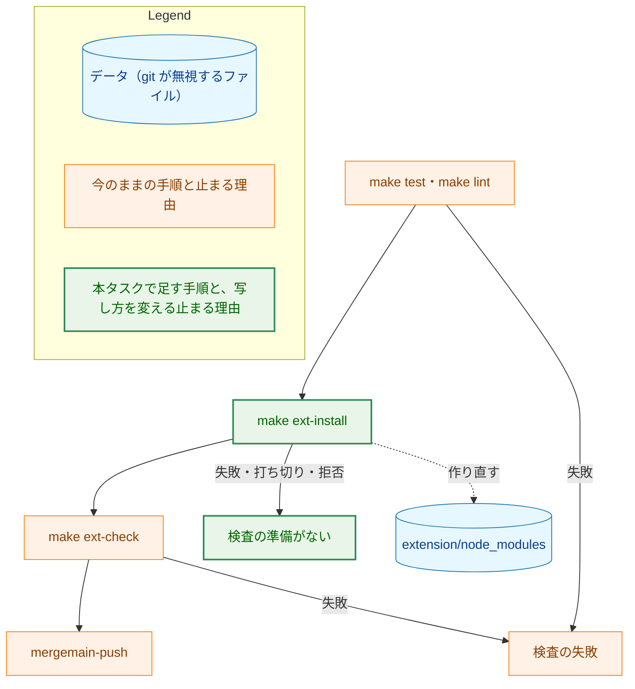
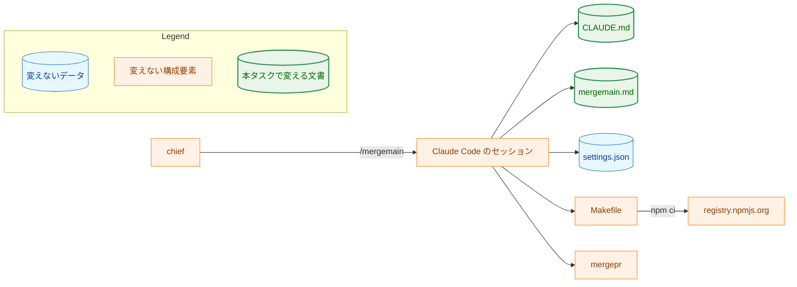
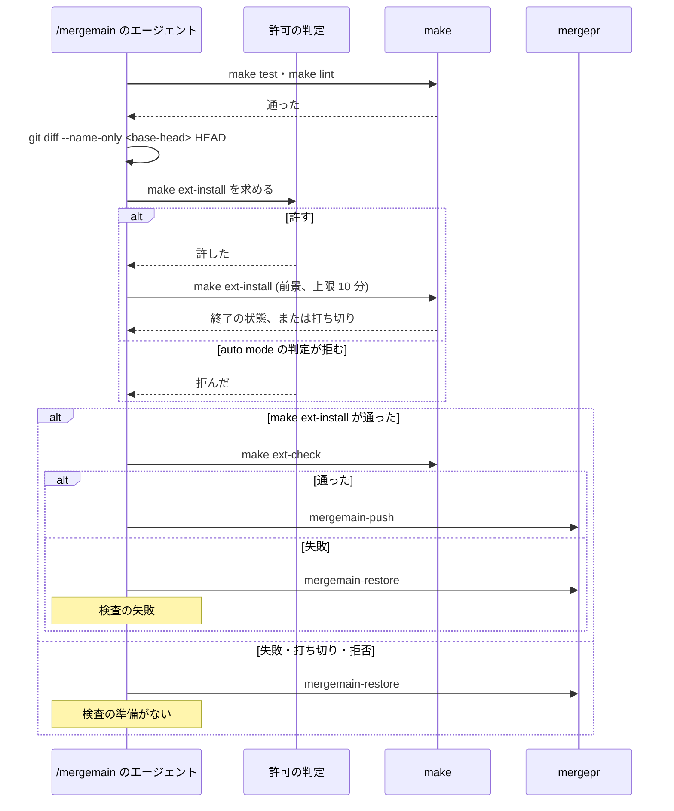
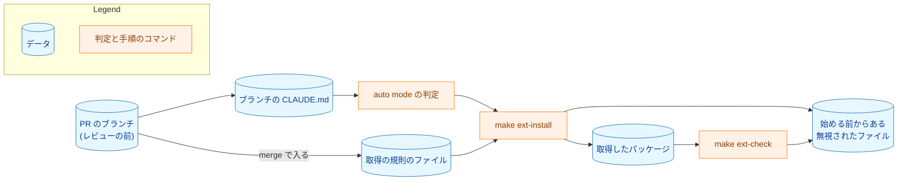
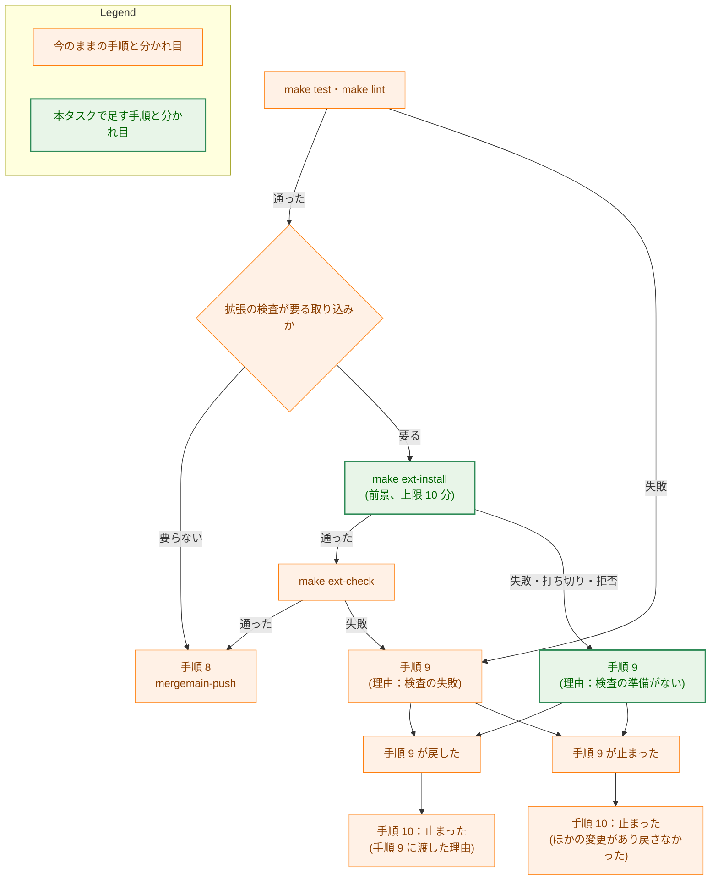

# アーキテクチャ設計書：`/mergemain` は拡張の検査の前に `make ext-install` で依存を入れる

## Document Status

| Item | Value |
|---|---|
| Status | `draft` |
| Created | 2026-11-27 |
| Review date | - |
| Reviewer | - |
| Comments | - |

本書は [01_requirements.md](01_requirements.md)（要件定義書。以下、要件書）の設計である。既存のファイルについての記述は、コミット `e7150e43` のファイルで確かめた。`file:line` はこのコミットの行番号を指す。F-NNN・AC-NN は要件書の項番を指す。要件の起草で設計に申し送られた事項（[design_handoff.md](design_handoff.md) の H-01〜H-03）への対応は、付録 A にまとめる。

## 1. 設計の全体像 (Design Overview)

本タスクで変えるのは、コマンドの定義 `.claude/commands/mergemain.md` と、`CLAUDE.md` の「Tool Execution Safety」の `/mergemain` の項と、[ADR-0046](../../dev/adr/0046-chief-of-staff.md) と、Antigravity のアダプタ `.claude/commands/_lib/harness-antigravity.md` の 4 つの文書だけである。Go のコード、`Makefile`、`.claude/settings.json`、ほかのハーネスのアダプタ（`.claude/commands/_lib/harness-claude.md`）、ガードテストは変えない。

今の `/mergemain` は、拡張の検査が要る取り込み（要件書 3.1）で、手順 7 の `make test`・`make lint` の後に `make ext-preflight` を走らせ、通れば `make ext-check` を走らせる（`.claude/commands/mergemain.md:251-267`）。本設計では、`make ext-preflight` を `make ext-install` に置き換え、手順 7 を `make test` → `make lint` → `make ext-install` → `make ext-check` の順にする。

### 1.1. 設計原則

-   **依存の入れ方の正本:** `Makefile` の `ext-install` に置いたままにする。`mergemain.md` は `make ext-install` を呼ぶだけで、版の確かめ、`check-lockfile`、`npm ci` の引数を書き写さない（要件書 4.5）。
-   **失敗の理由の種類:** どのコマンドが失敗したかで決める。`make ext-install` が通らなかったとき（失敗、時間の上限での打ち切り、許可の判定による拒否）は「検査の準備がない」、`make ext-check` の失敗は「検査の失敗」とする（AC-03・AC-04）。どちらの場合も、作業の前の状態に戻してから止まる。
-   **許す範囲:** 文書の承認で広げ、設定の規則では広げない。`make ext-install` を確認なしに走らせるために、`.claude/settings.json` の `allow` に規則を足さない。承認は `CLAUDE.md` と `mergemain.md` に書き、確認を出すかどうかは、pane の許可のモードと auto mode（Claude Code の許可のモードの 1 つ。1.2）の判定に任せる（3.3）。
-   **依存を入れる道:** 手順 7 のほかの道からは入れない。`make ext-install` が拒まれても失敗しても、`npm ci` を直接走らせるなどの別の道を探さず、人に尋ねもせずに、戻して止まる（AC-08）。
-   **コマンドの定義の書き方:** ハーネスに依らない言葉で書く。時間の上限は `shell-run` に渡す値として書き、ハーネスごとの扱いはアダプタの規則に任せる（3.3）。Antigravity で `make ext-install` を昇格させる扱いも、`mergemain.md` ではなくアダプタに書く（3.7）。

### 1.2. 設計の際に決めたこと（2026-11-27）

人間のレビュアーが決めたもの:

-   **`make ext-install` を確認なしに走らせる仕組み（H-01、AC-05）**
    -   **決定:** `.claude/settings.json` に規則を足さない。chief が人に尋ねずに送る `/mergemain` の pane は Claude Code の auto mode で走るものとし、`make ext-install` に確認を出すかどうかは auto mode の判定に任せる。承認は `CLAUDE.md` の「Tool Execution Safety」と `mergemain.md` の承認の節に書く（3.1・3.2）。判定がこの承認を拠り所にして `make ext-install` を許すと想定する。
    -   **確かめ:** この想定はまだ確かめていない。実装の PR のマージの前に、人が auto mode の pane で打つ `/mergemain` で確かめる（7.3）。確認が出るか拒まれたときは、設計の変更として本書に戻る。
    -   **理由:** `allow` に `Bash(make ext-install)` を足すと、確認が出ないことは確実になる。しかし `cmd/yt2column/settings_test.go:21-36` の `unpromptedWords` は、「渡されたコマンドを走らせない」と確かめた語だけを `allow` に許している。作業ツリーの `Makefile` を走らせる `make` は、この前提に反する。規則はリポジトリのすべてのセッションに当たるので、auto mode の外のセッションでも、書き換えた `Makefile` が確認なしに走りうる。
    -   **採らなかった案:** `allow` に `Bash(make ext-install)` を足す案。設計の承認の前に確かめる案も採らない。今の `mergemain.md` は `make ext-install` を禁じていて、新しい定義の `/mergemain` は承認の前には走らせられないためである。実装の PR での確かめも、chief が送る道そのものではなく人が打つ `/mergemain` で行うが（7.3）、判定が読む入力は新しい定義と承認の文になるので、それで確かめられる。
    -   **ADR:** [ADR-0046](../../dev/adr/0046-chief-of-staff.md) を更新する（「決定」の `/mergemain` の確認の項、「採らなかった案」、「結果」）。確認なしに許す範囲は、開発ツールの信頼の境界に関わる方針で、`.claude/settings.json` を変えるほかのタスクも縛るためである。
-   **`make ext-install` の時間の上限（H-03）**
    -   **決定:** 手順 7 に、`make ext-install` を前景で、上限を 10 分にして走らせると書く。上限に達したら、そのコマンドを止め、失敗として戻し、「検査の準備がない」で止まる。走らせ直しも、後ろでの実行の続行もしない。
    -   **理由:** Claude Code の Bash は、前景のコマンドの上限を既定で 120 秒とし、最大の値も既定では 600 秒である。上限に達したコマンドは止まらず、ハーネスが追う後ろの実行に移される（2026-11-27 に、このセッションの Claude Code で 3 秒の上限を超える `sleep` を走らせて確かめた。結果は「上限の内に終わらず、後ろの実行に移した。止めるなら TaskStop で止めよ」という知らせだった）。そのため、手順には、上限に達したら移された実行を止めることまで書く。止めないと、`npm ci` が後ろで続き、手順 9 の後も `extension/node_modules` を書き換えうる。キャッシュのない `npm ci` は 120 秒を超えうるので、上限を書かないと、ネットワークが遅いだけで止まりやすくなる。10 分は、Claude Code の Bash が既定で許す最大の値である。利用者がそれより低い最大の値を設定していれば、上限はその値になる。
    -   **採らなかった案:** 上限を置かず、残る危険として受け入れる案。既定の 120 秒の打ち切りで止まりやすく、打ち切りを失敗として扱う決まりも要るためである。
    -   **ADR:** なし。手順の値は本タスクの中で閉じ、ほかのタスクや構成要素を縛らないためである。

-   **Claude Code の外のハーネスでの `make ext-install`**
    -   **決定:** Antigravity のアダプタ（`.claude/commands/_lib/harness-antigravity.md` の 4 章）の、サンドボックスで失敗したときに昇格（`BypassSandbox: true`）してよいコマンドの種類に、`make ext-install` を足す（3.7）。まずサンドボックスの中で試す規則（4 章の 1）は変えない。OpenCode は OS のサンドボックスを持たないので、変えない。
    -   **理由:** `/mergemain` は、人が Antigravity で打つこともできる。Antigravity の `shell-run` は、まずサンドボックスの中で走らせ、昇格してよい種類を限っている。そこに `npm` も `make ext-install` もないので、足さないと、`make ext-install` はネットワークに届かずに失敗し、「検査の準備がない」で止まる。`npm ci` は取得の前に `extension/node_modules` を消す。そのため、今は `make ext-preflight` を通って `make ext-check` まで進む worktree でも、`node_modules` を失って止まる。人が Antigravity で打つ `/mergemain` には、これが後退になる。昇格には利用者の承認が要るので、確認なしに走る範囲は広がらない。
    -   **残ること:** サンドボックスの中での最初の試みが `node_modules` を消してから失敗し、昇格して走らせ直したときに入れ直す。利用者が昇格を断ると、`node_modules` を失ったまま「検査の準備がない」で止まる。報告は、`make ext-install` が失敗したときの項目（3.1 の 5）で、人が入れ直す必要を示す。サンドボックスの中での失敗と、昇格して走らせ直すことは、Antigravity でまだ確かめていない（7.3）。
    -   **採らなかった案:**
        -   後退を、chief が送らないハーネスでの制限として受け入れる案。人が Antigravity で打つ `/mergemain` で、今は通る取り込みが止まるようになり、`node_modules` も失うためである。
        -   `mergemain.md` の手順 7 をハーネスで分け、Antigravity では今の `make ext-preflight` の道を残す案。コマンドの定義はハーネスに依らずに書き、ハーネスごとの扱いはアダプタに置く方針（[ADR-0055](../../dev/adr/0055-harness-independent-commands.md)）に反するためである。
        -   `make ext-install` だけは、サンドボックスで試さずに初めから昇格する案。`node_modules` を一度消すことは避けられるが、まずサンドボックスで試す規則（ADR-0055 の「標準サンドボックス優先と最小限の昇格」）に例外を作ることになり、ADR-0055 を変える必要が出る。昇格して走らせ直せば入れ直されるので、得るものが小さい。
    -   **ADR:** なし。ADR-0055 は、ネットワーク通信で拒まれるコマンドに限って昇格すると決めており（`gh`・`git fetch` などを例に挙げる）、`make ext-install` はその種類に当たる。足すのはアダプタの例の一覧で、ADR-0055 の決定は変わらない。

設計で決めたもの（人間のレビュアーに諮らず、理由とともに記す）:

-   **`make ext-preflight` の削除（H-02）:** 手順 7 から `make ext-preflight` を外す。`make ext-install` は走る前に Node.js と npm の版を確かめる（`Makefile:425-426` が `ext_check_versions` を呼ぶ）。`make ext-check` の各段も `ext_preflight` を呼び、版と `extension/node_modules` があることを確かめる（`Makefile:430-441` など）。そのため、`make ext-preflight` を `make ext-install` の前に残すと、`node_modules` のない worktree で必ず失敗する。後に置いても確かめが重なるだけである。外しても、版が合わないことは `make ext-install` の失敗として「検査の準備がない」に写る。ADR: なし。手順の書き方は本タスクの中で閉じる。
-   **`make ext-install` の書き場所:** 実行のブロックではなく本文に書く。今の手順 7 は、`make test`・`make lint`・`make ext-preflight`・`make ext-check` を本文の箇条に書いている（`.claude/commands/mergemain.md:252,264-267`）。`make ext-install` も同じ書き方にそろえる。`cmd/mergepr/docs_test.go` の `TestMergemainCommandLinesAreListed` は、囲みのコードブロックの行だけを読み、その範囲を取り込みのサブコマンド・merge コミット・差分に限っている（`cmd/mergepr/docs_test.go:537-547` のコメント）。本文に書けば、このガードの受け付ける形も変わらない。ADR: なし（同上）。
-   **許可の判定による拒否と、人が断った後の扱い:**
    -   **auto mode の判定が拒んだとき:** エージェントは人に尋ねず、別の道も探さずに、手順 9 で戻して「検査の準備がない」で止まる。理由: 拒まれたときにエージェントが別の道で依存を入れると、AC-08 に反する。人に尋ねて許しを得る道は採らない。判定が拒んだコマンドを、エージェントの問いで通す形になり、確認なしに許す範囲を判定の外で広げるためである。手順 9 の `mergemain-restore` は今のとおり確認を出すので、人はそこで戻すことを確かめる。拒まれた後もエージェントの番が続き、手順 9 へ進めることは想定で、7.3 で見る（拒否が起きた場合）。
    -   **人が確認の画面で断ったとき:** Claude Code はエージェントの番を終え、人の次の入力を待つと想定する（7.3 で合わせて見る）。そうなると `/mergemain` は、push していない merge コミットを残したまま、戻しも報告もせずに止まる。この振る舞いは `mergemain.md` では変えられない。`mergemain.md` には、人が断った後の指示（確認の画面で断るときに添えた言葉を含む）が何であっても、取り込みの手順を変えず、ほかの道で依存を入れず、手順 9 で戻して「検査の準備がない」で報告すると書く。chief から見ると、PR は同じ head のまま `CONFLICTING` なので、エージェントが入力を待つ状態に戻れば「解消できず」の行になり、人が気づける（ADR-0046 の「解消できなかったこと」の判定）。
    -   **報告:** どちらの拒否も AC-03 の「`make ext-install` が失敗したとき」には当たらないとし、AC-03 の (2) は書かない。`npm ci` が走っておらず、`node_modules` は始める前のままだからである。代わりに、拒まれて走らなかったことを書く（3.1 の 5）。
    -   ADR: なし。ADR-0046 の「拒まれたときは別の道で依存を入れずに戻して止まる」の中の、写し方の細部である。

### 1.3. 概念モデル

手順 7 の検査の並びと、各コマンドの結果がどの止まる理由に写るかを示す。矢印 A → B は「A が通ったら B へ進む」を表し、ラベルの付いた矢印は「A がそのラベルの結果なら B へ進む」を表す。戻す手順（手順 9）とその結果は 6 章の図に示す。

点線の矢印は、`make ext-install` が `extension/node_modules` を書くことを表す。拡張の検査が要らない取り込みでは、`make test`・`make lint` の後に直接 `mergemain-push` へ進む（6 章）。

## 2. システム構成 (System Structure)

### 2.1. 全体構成

`/mergemain` の手順はコマンドの定義が持ち、依存の入れ方は `Makefile` が持つ。`/mergemain` を走らせる Claude Code のセッションは、`CLAUDE.md` と `mergemain.md` を読む。auto mode の判定は、その承認と手順を根拠に、コマンドに確認を出すかを決めると想定する（1.2）。矢印 A → B は「A が B を読むか、走らせるか、B に送る」を表す。

### 2.2. コンポーネント配置

| ファイル | 変更 | 内容 |
|---|---|---|
| `.claude/commands/mergemain.md` | 変更 | 承認の節、禁止事項の 9、止まる理由の対応の「検査の準備がない」の行、手順 7、手順 10 の報告の項目（3.1） |
| `CLAUDE.md` | 変更 | 「Tool Execution Safety」の `/mergemain` の項に `make ext-install` の承認を足す（3.2） |
| `docs/dev/adr/0046-chief-of-staff.md` | 変更 | 本書の PR で方針を足し、実装の PR で食い違いの文を消す（3.4） |
| `.claude/settings.json` | 変えない | 規則を足さない（1.2） |
| `Makefile` | 変えない | 要件書 2.3 |
| `.claude/commands/_lib/harness-antigravity.md` | 変更 | 4 章の昇格してよいコマンドの種類に `make ext-install` を足す（3.7） |
| `.claude/commands/_lib/harness-claude.md` | 変えない | Claude Code の扱いは 3.3 |
| `cmd/mergepr/docs_test.go`・`cmd/yt2column/settings_test.go` | 変えない | 3.5 |

### 2.3. データの流れ

拡張の検査が要る取り込みの手順 7 の流れを、実行の主体ごとに示す。実線の矢印は呼び出しか依頼を、点線の矢印はその結果の返りを表す。

人が確認の画面で断ったときは、この図の途中でエージェントの番が終わる（1.2）。

## 3. コンポーネント設計 (Component Design)

本タスクは Go のコードを変えないので、データ構造の拡張とインタフェースの定義はない（N/A）。変えるのはコマンドの定義と文書である。

### 3.1. コマンドの定義 `mergemain.md`

AC-08 が差分を許す 5 か所だけを変える。どの変更も、`make ext-install` とその失敗に関わる記述に限る。次の 5 項目が、`mergemain.md` の変更の完全な一覧である。

1.  **承認の節（`.claude/commands/mergemain.md:16-28`）。** 4 つのネットワークの操作に加え、手順 7 が拡張の検査を走らせる取り込みに限り、`make ext-install`（`registry.npmjs.org` からの依存の取得を含む）を、手順 7 の形（引数もつなぎもない、それだけのコマンド）に限って承認すると書く。「no dependency installation」は、それ以外の依存のインストールを承認しない、という意味に改める（AC-07）。
2.  **禁止事項の 9（`.claude/commands/mergemain.md:78-80`）。** 括弧の中から `make ext-install` を外す。代わりに、次のことを禁じる（AC-08）。
    -   手順 7 の外で `make ext-install` を走らせること（手順 9 で戻した後を含む）。
    -   ほかの方法で依存を入れること（`extension/` での `npm ci`・`npm install`・`npx` など）。
    -   `make ext-install` が拒まれたか失敗したときに、別の道で依存を入れようとすることと、エージェント自身が人に尋ねること（ハーネスが出す許可の確認の画面は除く）。
3.  **止まる理由の対応の「検査の準備がない」の行（`.claude/commands/mergemain.md:110`）。** 括弧の中を、「`make ext-install` が失敗した、時間の上限で打ち切られた、または許可の判定で拒まれた」に改める。
4.  **手順 7（`.claude/commands/mergemain.md:251-267`）。** `make test`・`make lint` と、`git diff --name-only <base-head> HEAD` による判定は変えない。判定が「要る」のときの 2 つの小手順を次に改める。
    1.  `make ext-install` を、リポジトリの最上位で、引数・変数・ほかのコマンドとのつなぎなしの、それだけのコマンドとして、前景で、上限を 10 分にして走らせる（`_lib/harness.md` の `shell-run`）。上限に達してハーネスが後ろの実行に移したときは、その実行をハーネスの止め方（Claude Code では TaskStop）で止め、打ち切られたものとする。その結果を、通った・失敗した・打ち切られた・拒まれた、のどれかとして手順 10 のために覚える。通らなかったときは、手順 9 を走らせ、手順 10 へ理由の種類「検査の準備がない」で進む。走らせ直しはしない。アダプタが `shell-run` の中で行う、サンドボックスで失敗した後の昇格しての走らせ直し（3.7）は、この走らせ直しに当たらない。`shell-run` の結果は、昇格した後の結果とする。
        -   許可の判定が拒んだときは、人に尋ねずに手順 9 へ進む。
        -   人が確認の画面で断った後は、人の指示が何であっても、手順 9 へ進む（1.2）。
    2.  `make ext-check` を走らせる。失敗したら、手順 9 を走らせ、手順 10 へ理由の種類「検査の失敗」で進む。

    判定が「要らない」ときは、どちらも走らせず、`make ext-install` の結果は「走らせていない」とする（AC-02）。`make ext-preflight` は手順から消える（1.2）。
5.  **手順 10 の報告（`.claude/commands/mergemain.md:305-336`）。** 11 個の理由の種類の文字列は変えない。次の項目を足す。
    -   **「解消した」:** 新しい項目「拡張の依存」に、`make ext-install` を走らせたかどうかを書く（AC-06）。
    -   **「止まった」で、`make ext-install` が失敗したか打ち切られたとき:** 「詳細」に次の 3 点を書く（AC-03）。
        1.  `make ext-install` が失敗したことと、打ち切りであったかどうか。失敗した段（版の確かめ、`check-lockfile`、`npm ci`）と、最後のエラーの数行も書く。
        2.  `extension/node_modules` が欠けているか不完全でありうるので、原因を直した後に人が `make ext-install` を走らせる必要があること。
        3.  打ち切りのときは、入れ直す前に、`extension/` で `npm` のプロセスが残っていないことを確かめる必要があること（4.2）。
    -   **「止まった」で、`make ext-install` が拒まれたとき:** 「詳細」に、許可の判定で拒まれたか人が断って走らなかったことと、判定が理由を示したときはその理由を書く。`node_modules` は始める前のままであることも書く（1.2）。
    -   **「止まった」で、`make ext-install` が通った後に戻したとき**（`make ext-check` の失敗、`push_rejected` など）: 「詳細」に、(1) `make ext-install` を走らせたことと、(2) `extension/node_modules` は merge の後のロックファイルに合わせたもので、戻したブランチのロックファイルとは食い違いうること、そのため拡張を扱う前に人が `make ext-install` を走らせ直す必要があることを書く（AC-11）。
    -   **「止まった」で、`make ext-install` が通った後に戻さずに止まったとき**（`push_unknown`、手順 9 が `ほかの変更があり戻さなかった` に上書きしたときなど）: 「詳細」に、`make ext-install` を走らせたことを書く。

### 3.2. `CLAUDE.md` の「Tool Execution Safety」

`/mergemain` の項（`CLAUDE.md:1259`）は、4 つのネットワークの操作を承認すると書いている。この項に、拡張の検査が要る取り込みでの `make ext-install`（`registry.npmjs.org` からの依存の取得を含む）を承認することを足す。ほかの文は変えない。設定の規則を足さないので、規則と承認の関係は書かない（AC-07）。

承認は、その PR の `/mergemain` に限る。auto mode の判定は、この記述を拠り所に `make ext-install` を許すと想定する（1.2・7.3）。

### 3.3. 確認なしに走らせる仕組み（AC-05）

`make ext-install` に確認が出るかは、`/mergemain` を誰が打ったかではなく、pane の許可のモードと、利用者の設定の規則で決まる。

| pane の許可のモードと規則 | `make ext-install` の扱い |
|---|---|
| auto mode で、どの規則にも当たらない | auto mode の判定が許すか拒むかを決める。許すと想定し、実装の PR で確かめる（7.3）。拒まれたら「検査の準備がない」で戻して止まる |
| 確認を出すモード（`default` など）で、どの規則にも当たらない | 許可の確認が出る。人が許せば走る。断ると、エージェントの番が終わる（1.2） |
| 利用者の設定（`~/.claude/settings.json` や worktree の `.claude/settings.local.json`）の規則に当たるか、確認を出さないモード | その設定のとおりに扱う。リポジトリからは決められない |
| Claude Code の外のハーネス | アダプタの `shell-run` の規則による。Antigravity では、サンドボックスの中で失敗した後、利用者の承認で昇格して走らせ直す（1.2・3.7） |

本設計は、chief が人に尋ねずに送る `/mergemain` の pane が auto mode で走ることを前提にする。この前提はリポジトリからは確かめも強制もできない。リポジトリの `.claude/settings.json` には、確認を出さないモードを置かないことになっているためである（`cmd/yt2column/settings_test.go:38-45` の `promptingModes`）。chief のツールも送り先の表も、pane の許可のモードを確かめない。design_handoff.md の H-01 は「chief が送る pane の許可のモードを前提にできるかも確かめる」と挙げていたが、本設計は確かめずに前提とする。前提が成り立たない pane では、`make ext-install` で確認が出る。chief はその行を質問で止まった行として示し、人がその pane で答える（0115 設計書の 3.9）。

`mergemain-restore` は、今のとおり `ask` の規則で確認を出す（`.claude/settings.json:12-15`）。そのため、`make ext-install` が通らずに戻すときも、人が戻すことを確かめる。

### 3.4. ADR-0046 の更新

本書の PR で、ADR-0046 を次のように更新する（ADR-0046 の「経緯」に 2026-11-27 の行を足す）。

-   **「決定」:** 「マージコンフリクトの解消の自動送信」の、`mergepr` のサブコマンドを確認なしに許す項の後に、次のことを書く。`make ext-install` には `.claude/settings.json` の規則を足さず、chief が送る pane の auto mode の判定に任せる。auto mode の判定に拒まれたときと失敗したときは、別の道で依存を入れずに戻して止まる。理由として、`make` は作業ツリーの `Makefile` を走らせるので、規則を足すとすべてのセッションで確認なしに走りうることを書く。
-   **「採らなかった案」:** `allow` に `Bash(make ext-install)` を足す案を、理由とともに足す。
-   **「結果」:** auto mode の判定が `make ext-install` を許すかは、モデルの判定によること。実装の PR で確かめた時点で許していても、後で拒みうること。拒まれると `/mergemain` は「検査の準備がない」で止まり、依存が入らないまま検査が通ることはないこと。

要件書の PR が ADR-0046 に書いた食い違いの文（「CLAUDE.md と `mergemain.md` はまだ `make ext-install` を承認せず…」）は、実装の PR で `mergemain.md` と `CLAUDE.md` を変えるときに消す。本書の PR では残す。実装の PR では、7.3 の確かめの結果に合わせて、「結果」の「未確認である」の文と、人が断ったときの振る舞いの文も直す。

### 3.5. 変えないガードテスト

-   **`cmd/yt2column/settings_test.go` の `TestSettingsAllowsOnlyVettedCommands`:** `.claude/settings.json` を変えないので、変えない。
-   **`cmd/mergepr/docs_test.go` の `TestSettingsAllowsOnlySafeMergemainSubcommands`・`TestSettingsAsksBeforeMergemainRestore`:** 同上。
-   **`cmd/mergepr/docs_test.go` の `TestMergemainCommandLinesAreListed`・`TestMergemainNoDirectGitMutation`:** どちらも囲みのコードブロックの行だけを読む（`unlistedCommandLines` は `cmd/mergepr/docs_test.go:561-584`、`directGitMutations` は `cmd/mergepr/docs_test.go:403-424`）。`make ext-install` は本文に書く（1.2）ので、受け付ける行の形も、検出する git の操作も変わらない。
-   **`cmd/mergepr/docs_test.go` の `TestDocumentedProtocolMatches`・`TestDocumentedInvocationsParse`:** `mergepr` の呼び出しと `--protocol` を変えないので、変えない。

`mergemain.md` の承認の節・禁止事項・報告の項目の文言を固定するテストは今なく、足さない。文言の変更は PR のレビューで読む（CLAUDE.md「Document tests check values, structure, and executable examples, never prose」）。

### 3.6. コンポーネントの責務

| 構成要素 | 責務 | 本タスクでの変化 |
|---|---|---|
| `mergemain.md` | 取り込みの手順、承認、禁止事項、止まる理由の写し方、報告の項目 | `make ext-install` を手順 7 に足し、通らなかったときを「検査の準備がない」に写し、報告の項目を足す |
| `CLAUDE.md`「Tool Execution Safety」 | `/mergemain` の承認の範囲 | `make ext-install` を承認に足す |
| `Makefile` の `ext-install` | 版の確かめ、`check-lockfile`、`npm ci` の引数 | 変えない |
| `.claude/settings.json` | 確認なしに許す規則と、確認を出す規則 | 変えない |
| `harness-antigravity.md` | Antigravity での `shell-run` のサンドボックスと昇格の規則 | 昇格してよい種類に `make ext-install` を足す（3.7） |
| ADR-0046 | 承認と確認の方針、残る危険 | 3.4 のとおり更新する |

### 3.7. Antigravity のアダプタ

`.claude/commands/_lib/harness-antigravity.md` の 4 章の「Sandbox Elevation Rules」の 2 が挙げる、サンドボックスで失敗したときに昇格してよいコマンドの種類に、`make ext-install` を足す。足すのはこの一覧の 1 項目だけで、4 章のほかの規則（まずサンドボックスで試すこと、昇格は 1 つのコマンドに限ること、`toolSummary` を変えないこと）と禁止事項は変えない。

-   **書き方:** コマンドの定義がそれを指示するときに限る、と添える。今それを指示するのは `/mergemain` の手順 7 だけである。アダプタは走らせてよいかを決めず、走らせると決まったコマンドの昇格の扱いだけを決めるためである。要件書 2.3 は、`/mergemain` 以外のコマンドで `make ext-install` を走らせることを範囲の外としている。
-   **理由の書き方:** ほかの項目と同じく、ネットワーク通信の例として挙げる（`npm ci` がレジストリから取得するため）。

`cmd/yt2column/skills_docs_test.go` と `cmd/yt2column/fixpr_docs_test.go` はこのアダプタを読むが、4 章の昇格の一覧は読まない（前者は入口からのリンク、後者は `gh` の本文の読み方を見る）。そのためガードテストは変えない。

## 4. エラーハンドリング設計 (Error Handling Design)

本タスクは Go のコードを変えないので、エラー型の定義はない（N/A）。止まる理由の種類は、`mergemain.md` の今の 11 個の文字列のままである。

### 4.1. 止まる理由の写し方

| 起きたこと | 理由の種類 | 戻すか |
|---|---|---|
| `make ext-install` の終了の状態が 0 でない（版が合わない、`check-lockfile` が拒む、`npm ci` が失敗する、ネットワークにつながらない） | `検査の準備がない` | 戻す |
| `make ext-install` が 10 分の上限に達し、移された後ろの実行を止めた | `検査の準備がない` | 戻す |
| `make ext-install` が auto mode の判定で拒まれた | `検査の準備がない` | 戻す |
| 人が確認の画面で `make ext-install` を断った | `検査の準備がない` | 戻す |
| `make ext-install` が通った後に `make ext-check` が失敗した | `検査の失敗` | 戻す |
| `make ext-install` が通った後に push が `push_rejected` で止まった | `push の失敗` | 戻す |

報告の「詳細」に書くことは、3.1 の 5 が定める。

`make ext-check` が時間の上限に達したときの扱いは、今の手順のままで、本設計は決めない（Claude Code では後ろの実行に移される）。`make ext-check` の上限は書かない。AC-08 が `mergemain.md` の差分を `make ext-install` に関わる記述に限っているためである（5.3）。

### 4.2. 失敗の向き

-   **`make ext-install` が通らないとき:** `make ext-check` に進まない。依存が欠けたまま検査を走らせて、検査の失敗と取り違えないためである（AC-03）。
-   **上限で打ち切られたとき:** コマンドを走らせ直さない。やり直しは、ネットワークか registry が応じないときに `/mergemain` を長く止める。人が報告を読んで入れ直す。
-   **止めた後にプロセスが残る場合。** 上限に達して後ろの実行に移されたコマンドは、手順 7 で止める（3.1 の 4）。止めたときに `npm ci` の子のプロセスまで止まるかは、確かめていない。残った `npm ci` は、手順 9 の後も `extension/node_modules` を書き換えうる。ただし手順 9 には影響しない。`mergemain-restore` が無視されたファイルで止まるのは、基準の head が追跡するパスにあるときだけで（`internal/mergepr/mergemain_restore.go:32-33`）、基準の head は `extension/node_modules` の下を追跡しないためである（`.gitignore:11`）。問題になるのは、人の入れ直しや次の `/mergemain` と重なったときである。2 つの `npm ci` が同じディレクトリを書き換え、中身を壊しうる。報告は、入れ直す前に残ったプロセスを確かめるよう人に示す（3.1 の 5）。

## 5. セキュリティ考慮事項 (Security Considerations)

`docs/dev/security.md` の発動条件（`yt-dlp` の起動、API キー、キャッシュ、LLM API への送信、信頼できない文字列のプロンプトか記事への埋め込み）には当たらない（要件書 4.2）。`docs/dev/security.md` の「`npm ci --ignore-scripts` でインストールする」規則は変えない。以下は、開発ツールの信頼の境界についての考慮である。

### 5.1. 脅威モデル

矢印 A → B は「A が B の中身を決めうる」を表す。

取得の規則のファイルは、`Makefile`・`extension/package.json`・`extension/package-lock.json`・`extension/.npmrc`・`extension/scripts/check-lockfile.ts` である。

### 5.2. 守ること

-   **取得の守り:** `Makefile` に任せる。版の確かめ、`check-lockfile` による取得先の限定、`--ignore-scripts`、`--registry` と `--replace-registry-host=never` による取得先の固定（`Makefile:420-428`）は変えない。
-   **書くもの:** `make ext-install` が作業ツリーに書くのは `npm ci` の `extension/node_modules` だけで、版の確かめと `check-lockfile` は読むだけである（`Makefile:425-428`）。そのため、ブランチが `Makefile`・`extension/package.json`・`extension/scripts/check-lockfile.ts` を変えていなければ、変わる無視されたファイルは `extension/node_modules` と、今のとおり `make ext-check` が書くものに限られる（AC-10）。AC-10 の条件は `Makefile` と `extension/package.json` だけを挙げるが、`check-lockfile` は `extension/scripts/check-lockfile.ts` を走らせるので、これも書き換えうる。要件書 4.2 はこのファイルを残る危険に挙げている。
-   **確認なしに許す範囲:** 規則では広げない。`.claude/settings.json` に規則を足さないので、確認を出すモードのセッションでは、`make ext-install` は今と同じに確認が出る。
-   **依存を入れる手順:** 手順 7 でだけ入れる。拒まれても失敗しても、ほかの道で入れない（3.1 の 2）。

### 5.3. 残る危険

要件書 4.2 と ADR-0046 の「結果」が受け入れた危険（レビューされていない取得の規則、`--ignore-scripts` の守りが外れうること、ほかの無視されたファイルの書き換え）は、本設計でも変わらない。本設計が足すか、明らかにする危険は次のとおりである。

-   **auto mode の判定の振る舞い。** 判定が `make ext-install` を許すかは、モデルの判定による。実装の PR で確かめた時点で許していても、後で拒みうる。拒まれれば `/mergemain` は「検査の準備がない」で止まる。止まる向きに倒れるので、依存が入らないまま検査が通ることはない。
-   **auto mode の判定が、承認の範囲の外でも許しうること。** 判定は CLAUDE.md の承認を根拠にしうるが、承認の範囲（その PR の `/mergemain` の手順 7）を判定が守る保証はない。auto mode のほかのセッションも、作業ツリーの `Makefile` を走らせる `make ext-install` を確認なしに走らせうる。規則を足さないことで守られるのは、確認を出すモードのセッションだけである。また、CLAUDE.md は PR のブランチから読まれ、chief が行う定義の比較（ADR-0046）の対象に入っていないので、ブランチが CLAUDE.md の承認の文を広げることもできる。これは ADR-0046 の「結果」の、`/mergemain` がたどる規則のファイルの危険と同じものである。
-   **`make ext-check` の時間。** `extension/node_modules` のない worktree でも、`make ext-check` まで進むようになる。`make ext-check` は 2 つのビルドを含み、最初のビルドでは Go のツールチェーンを取得しうる（`Makefile:455-457` の `ext-build`、CLAUDE.md の「Extension Commands」）。ハーネスの既定の上限（Claude Code では 120 秒）に達すると、後ろの実行に移され、その後の扱いはエージェントに任される。上限を書くことは AC-08 の範囲の外なので、別の issue で扱う。ツールチェーンの取得は本タスクの前からある取得で、`/mergemain` の承認は名指していない。
-   **止めた後に残る `npm ci`。** 4.2 のとおり、人の入れ直しと重なりうる。報告で人に示す。
-   **ほかの道での依存のインストール。** `npm ci`・`npm install`・`npx` を直接走らせることは、`mergemain.md` の禁止事項だけで禁じる。`.claude/settings.json` の `deny` の規則は足さない。auto mode の判定がそれを許せば、`check-lockfile` と取得先の固定を通らない取得が起きうる。

## 6. 処理フローの詳細 (Processing Flow Details)

手順 7 から手順 10 までの、止まる理由の分かれ目を示す。手順の並びは、本図が正本である。矢印 A → B は「A の次に B へ進む」を表す。

手順 8 の後の流れ（push の結果と、そこからの手順 9）は変えない。

## 7. テスト戦略 (Test Strategy)

### 7.1. 単体テスト

変える Go のコードがないので、足す単体テストはない。今のガードテスト（3.5）が通ることを、`make test` で確かめる。

### 7.2. 結合テスト

なし。`/mergemain` はエージェントが文書の手順に従って走らせるもので、手順の結合を自動で確かめるテストは今もない。

### 7.3. 実地の確かめ（AC-05 など）

実装の PR のマージの前に、次のことを実地で確かめる。確かめの細部（取り込みの用意の仕方、記録の置き場所）は実装計画書が決める。

-   **確かめの形:** chief が送る道そのものは確かめられない。chief は、ブランチの `mergemain.md` が `origin/main` と同じときだけ送り（要件書 4.4、ADR-0046）、新しい定義はマージの前には `origin/main` にないためである。そこで、人が auto mode の Claude Code の pane で打つ `/mergemain` を、その代わりとする。chief が送るときと形を合わせるため、pane は新しいか `/clear` の直後のものとし、人の入力は `/mergemain <PR>` だけにする。利用者の設定に `make` に当たる許可の規則がないことも確かめる。そうすれば、auto mode の判定が読む入力（コマンドの定義、CLAUDE.md の承認の文、pane の許可のモード、会話）は、chief が送ったときと同じになる。取り込む側のブランチは、実装の PR の `mergemain.md` と `CLAUDE.md` を持つこと。`main` の側には、拡張の検査が要る変更が入っていること。
-   **確かめること:** `make ext-install` が許可の確認なしに実際に走ったこと。確認が出ないことだけでなく、コマンドの出力が Claude Code のセッションの記録（transcript）にあることまで見る。判定が拒むと、確認が出ずにエージェントが止まりうるためである（design_handoff.md の H-01）。確かめた回数と各回の結果を記録する。判定はモデルによるので、1 回の結果は、その時点で許したことの記録にとどまる（5.3）。
-   **合わせて見ること:** `extension/node_modules` のない worktree で、`make ext-check` まで通ること（AC-01）。報告の「拡張の依存」の項目（AC-06）。人が確認の画面で断ったときに、エージェントの番が終わるか。判定が拒んだ回があれば、その後にエージェントが手順 9 へ進んだか。
-   **確かめが通らないとき:** 確認が出るか拒まれたら、設計の変更として本書と ADR-0046 に戻り、人と方針を決め直す（1.2）。
-   **Antigravity:** 実地の確かめは求めない。chief が送らない道で、昇格には利用者の承認が出るので、昇格の一覧が足りなくても、止まる向きに倒れるためである。人が Antigravity で `/mergemain` を打つ機会があれば、サンドボックスの中での失敗と、昇格して走らせ直した結果を実装計画書に記録する。

### 7.4. セキュリティのテスト

なし。取得の守りは `Makefile` のままで、本タスクは変えない（5.2）。`.claude/settings.json` を変えないことは、今のガードテスト（3.5）が通ることで足りる。

### 7.5. 文書の確かめ

文言の変更は PR のレビューで読む（`manual`）。各 AC の確かめの種類は次のとおりとし、細部は実装計画書が決める。

| AC | 確かめ |
|---|---|
| AC-01・AC-02・AC-03・AC-04 | `manual`: 手順 7 と止まる理由の対応を読む。AC-01 は 7.3 の実地の確かめも |
| AC-05 | `manual`: 7.3 の実地の確かめ |
| AC-06・AC-11 | `manual`: 手順 10 の報告の項目を読む |
| AC-07 | `manual`: 承認の節と CLAUDE.md を読む。`diff`: CLAUDE.md の差分が `/mergemain` の項に限ること |
| AC-08 | `manual`: 禁止事項を読む。`diff`: `mergemain.md` の差分が 3.1 の 5 か所に限ること |
| AC-09・AC-10 | `manual`: `Makefile` と `mergemain-restore` を変えないことを、差分のファイルの一覧で読む（理由は 4.2 と 5.2） |
| （1.2 の Antigravity の決定） | `manual`: `harness-antigravity.md` の差分が、4 章の昇格の一覧の 1 項目に限ることを読む |

## 8. 実装の優先順位 (Implementation Priorities)

1 つの PR で、次の順に変える。

1.  `mergemain.md` の 5 か所（3.1）。
2.  `CLAUDE.md` の `/mergemain` の項（3.2）。
3.  ADR-0046 の食い違いの文を消す（3.4）。
4.  `harness-antigravity.md` の昇格の一覧（3.7）。
5.  `make test`・`make lint` を走らせる。
6.  7.3 の実地の確かめを行い、その記録を実装計画書に残す。

手順 1〜4 は同じコミットで変える。`mergemain.md` と `CLAUDE.md` の片方だけが `make ext-install` を承認する状態と、Antigravity で新しい手順 7 だけが入って昇格の一覧が追いつかない状態を作らないためである。

## 9. 将来の拡張性 (Future Extensibility)

-   **auto mode の判定が許さなくなったとき:** 確認なしに許す仕組みを決め直す。どの仕組みも、作業ツリーの `Makefile` を走らせるものを確認なしに許すかぎり、1.2 で規則を退けた理由に当たる。決め直すときは、その危険を受け入れるかを人と決める。
-   **ほかのコマンドで依存を入れるとき:** `/runplan` などが `make ext-install` を走らせることは、本タスクの範囲の外である（要件書 2.3）。そのときも、承認はそのコマンドに限って CLAUDE.md に書き、規則を足さない本書の方針を出発点にできる。

## 付録 A. 申し送りの扱い

| 項目 | 採った方針 |
|---|---|
| H-01 | `.claude/settings.json` に規則を足さず、chief が送る pane の auto mode の判定に任せる。判定が許すことは、実装の PR のマージの前に、人が打つ `/mergemain` で実地に確かめる（1.2・3.3・7.3）。chief が送る pane の許可のモードは、確かめずに前提とする（3.3）。ADR-0046 を更新する（3.4） |
| H-02 | 手順 7 から `make ext-preflight` を外し、`make ext-install` → `make ext-check` とする。`make ext-install` が通らなかったときを「検査の準備がない」に写す。`make ext-install` は本文に書き、`mergemainLinePrefixes` は変えない（1.2・3.1・3.5） |
| H-03 | `make ext-install` を前景で、上限を 10 分にして走らせ、打ち切られたら失敗として戻して止まる。打ち切りの後に残りうるプロセスは報告で人に示す（1.2・3.1・4.2） |
