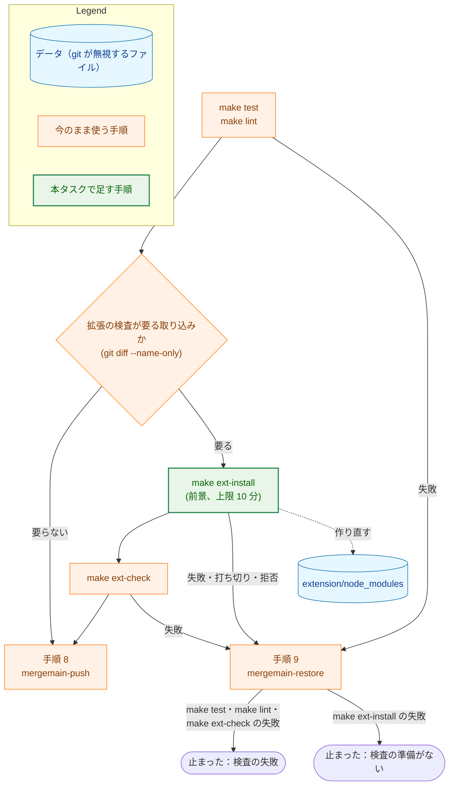
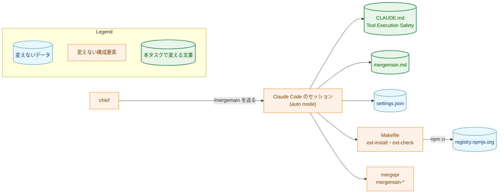
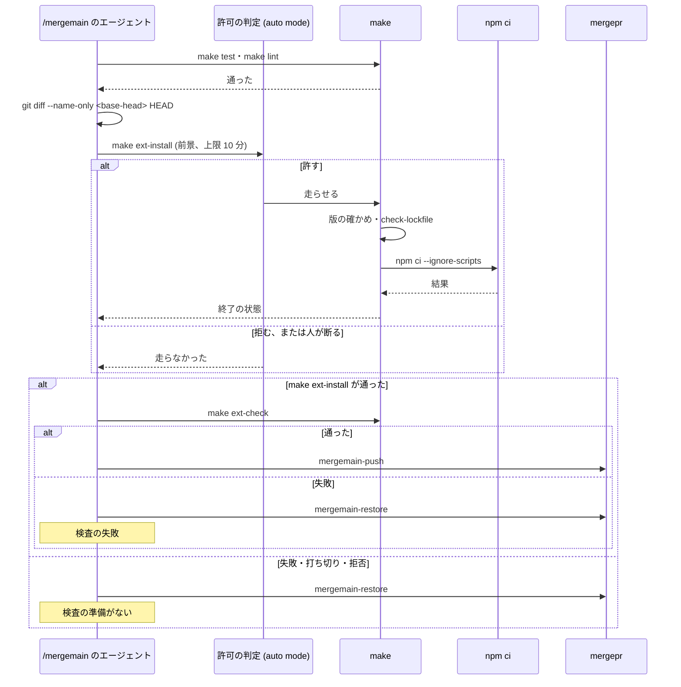
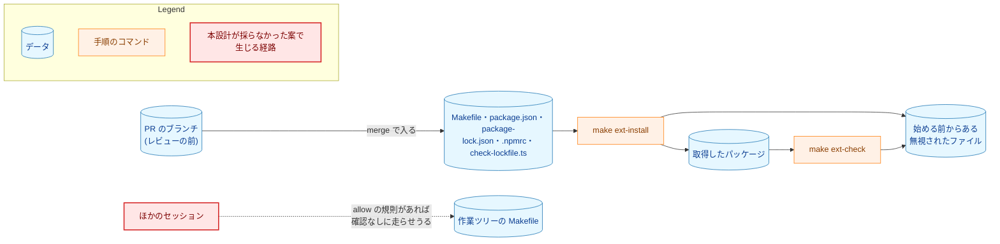
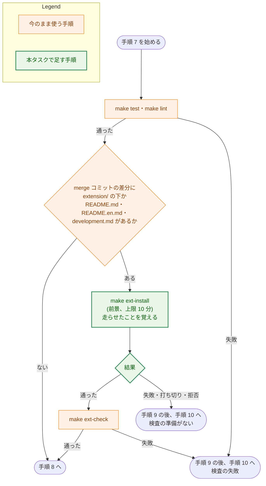

# アーキテクチャ設計書：`/mergemain` は拡張の検査の前に `make ext-install` で依存を入れる

## Document Status

| Item | Value |
|---|---|
| Status | `draft` |
| Created | 2026-11-27 |
| Review date | - |
| Reviewer | - |
| Comments | - |

本書は [01_requirements.md](01_requirements.md)（要件定義書。以下、要件書）の設計である。既存のファイルについての記述は、コミット `e7150e43` のファイルで確かめた。`file:line` はこのコミットの行番号を指す。F-NNN・AC-NN は要件書の項番を指す。要件の起草で設計に申し送られた事項（[design_handoff.md](design_handoff.md) の H-01〜H-03）への対応は、付録 A にまとめる。

## 1. 設計の全体像 (Design Overview)

本タスクで変えるのは、コマンドの定義 `.claude/commands/mergemain.md` と、`CLAUDE.md` の「Tool Execution Safety」の `/mergemain` の項と、[ADR-0046](../../dev/adr/0046-chief-of-staff.md) の 3 つの文書だけである。Go のコード、`Makefile`、`.claude/settings.json`、ガードテストは変えない。

今の `/mergemain` は、拡張の検査が要る取り込み（要件書 3.1）で、手順 7 の `make test`・`make lint` の後に `make ext-preflight` を走らせ、通れば `make ext-check` を走らせる（`.claude/commands/mergemain.md:251-267`）。本設計では、`make ext-preflight` を `make ext-install` に置き換え、手順 7 を `make test` → `make lint` → `make ext-install` → `make ext-check` の順にする。

### 1.1. 設計原則

-   **依存の入れ方の正本は `Makefile` の `ext-install` に置いたままにする。** `mergemain.md` は `make ext-install` を呼ぶだけで、版の確かめ、`check-lockfile`、`npm ci` の引数を書き写さない（要件書 4.5）。
-   **失敗の理由の種類は、どのコマンドが失敗したかで決める。** `make ext-install` の失敗（終了の状態が 0 でない、時間の上限で打ち切られた、許可の判定で拒まれた）は「検査の準備がない」、`make ext-check` の失敗は「検査の失敗」とする（AC-03・AC-04）。どちらの場合も、作業の前の状態に戻してから止まる。
-   **許す範囲は、文書の承認で広げ、設定の規則では広げない。** `make ext-install` を確認なしに走らせるために、`.claude/settings.json` の `allow` に規則を足さない。承認は `CLAUDE.md` と `mergemain.md` に書き、確認を出すかどうかは、chief が送る pane の auto mode の判定に任せる（1.2、3.3）。
-   **依存は、手順 7 のほかの道からは入れない。** `make ext-install` が拒まれても失敗しても、`npm ci` を直接走らせるなどの別の道を探さず、戻して止まる（AC-08）。

### 1.2. 設計の際に決めたこと（2026-11-27）

人間のレビュアーが決めたもの:

-   **`make ext-install` を確認なしに走らせる仕組み（H-01、AC-05）:** `.claude/settings.json` に規則を足さない。chief が人に尋ねずに送る `/mergemain` の pane は Claude Code の auto mode で走るものとし、`make ext-install` に確認を出すかどうかは auto mode の判定に任せる。判定が拠り所にする承認は、`CLAUDE.md` の「Tool Execution Safety」と `mergemain.md` の承認の節に書く（3.2・3.1）。auto mode の判定がこのコマンドを許すことは、まだ確かめていない。そこで、実装の PR のマージの前に実地で確かめる（7.3）。確かめで確認が出るか拒まれたときは、設計の変更として本書に戻る。理由: `allow` に `Bash(make ext-install)` を足すと、確認が出ないことは確実になる。しかし `cmd/yt2column/settings_test.go:21-36` の `unpromptedWords` は、「渡されたコマンドを走らせない」と確かめた語だけを `allow` に許しており、作業ツリーの `Makefile` を走らせる `make` はこの前提に反する。規則はリポジトリのすべてのセッションに当たるので、ほかのセッションが書き換えた `Makefile` も確認なしに走りうる。設計の承認の前に確かめる案は、今の `mergemain.md` が `make ext-install` を禁じていて本物の `/mergemain` では試せず、模した実行になる。確かさが実装の PR での確かめと変わらないので採らない。ADR: [ADR-0046](../../dev/adr/0046-chief-of-staff.md) を更新する（「決定」の `/mergemain` の確認の項、「採らなかった案」、「結果」）。確認なしに許す範囲は、開発ツールの信頼の境界に関わる方針で、`.claude/settings.json` を変えるほかのタスクも縛るためである。
-   **`make ext-install` の時間の上限（H-03）:** 手順 7 に、`make ext-install` を前景で、上限を 10 分にして走らせると書く。上限で打ち切られたら、失敗として戻し、「検査の準備がない」で止まる。後ろで走らせ直したり、やり直したりはしない。理由: Claude Code の Bash は前景のコマンドを既定で 120 秒で打ち切る（最大 600 秒）。キャッシュのない `npm ci` は 120 秒を超えうるので、上限を書かないと、ネットワークが遅いだけで止まりやすくなる。10 分は Claude Code の Bash で指定できる最大の値である。上限を置かずに残る危険とする案は、既定の 120 秒の打ち切りで止まりやすく、打ち切りを失敗として扱う決まりも要るので採らない。ADR: なし。手順の値は本タスクの中で閉じ、ほかのタスクや構成要素を縛らないためである。

設計で決めたもの（人間のレビュアーに諮らず、理由とともに記す）:

-   **手順 7 から `make ext-preflight` を外す（H-02）:** `make ext-install` は走る前に Node.js と npm の版を確かめる（`Makefile:425-426` が `ext_check_versions` を呼ぶ）。`make ext-check` の各段も `ext_preflight` を呼び、版と `extension/node_modules` があることを確かめる（`Makefile:430-441` など）。そのため、`make ext-preflight` を `make ext-install` の前に残すと、`node_modules` のない worktree で必ず失敗し、後に置いても確かめが重なるだけである。外しても、版が合わないことは `make ext-install` の失敗として「検査の準備がない」に写る。ADR: なし。手順の書き方は本タスクの中で閉じる。
-   **`make ext-install` を、実行のブロックではなく本文に書く:** 今の手順 7 は、`make ext-preflight` と `make ext-check` を本文の箇条に書いている（`.claude/commands/mergemain.md:264-267`）。`make ext-install` も同じ書き方にする。`cmd/mergepr/docs_test.go` の `TestMergemainCommandLinesAreListed` は、囲みのコードブロックの行だけを読み、その先頭を `mergemainLinePrefixes`（`cmd/mergepr/docs_test.go:543-547`）に限る。本文に書けば、このガードの受け付ける形を変えずに済む。ADR: なし（同上）。
-   **許可の判定で拒まれたときも「検査の準備がない」とする:** auto mode の判定が `make ext-install` を拒むか、人が確認の画面で断ったときは、コマンドが走らなかったものとして失敗と同じに扱う。理由: 拒まれたときにエージェントが別の道で依存を入れると、AC-08 に反する。戻して止まれば、人が報告を読んで判断できる。ADR: なし。ADR-0046 の「`make ext-install` は手順 7 のほかでは走らせない」の中の、失敗の写し方の細部である。

### 1.3. 概念モデル

手順 7 の検査の並びと、各コマンドの結果がどこへ進むかを示す。矢印 A → B は「A が通ったら B へ進む」を、ラベルの付いた矢印は「A がそのラベルの結果なら B へ進む」を表す。

点線の矢印は、`make ext-install` が `extension/node_modules` を書くことを表す。手順 9 の `mergemain-restore` は無視されたファイルを消さないので（`internal/mergepr/mergemain_restore.go:32-35`）、戻した後もこのディレクトリは残る（AC-09）。

## 2. システム構成 (System Structure)

### 2.1. 全体構成

`/mergemain` の手順はコマンドの定義が持ち、依存の入れ方は `Makefile` が持つ。`/mergemain` を走らせる Claude Code のセッションは、`CLAUDE.md` と `mergemain.md` の承認を読み、auto mode の判定は、その承認と手順を根拠に、コマンドに確認を出すかを決める。矢印 A → B は「A が B を読むか、走らせる」を表す。

### 2.2. コンポーネント配置

| ファイル | 変更 | 内容 |
|---|---|---|
| `.claude/commands/mergemain.md` | 変更 | 承認の節、禁止事項の 9、止まる理由の対応の「検査の準備がない」の行、手順 7、手順 10 の報告の項目（3.1） |
| `CLAUDE.md` | 変更 | 「Tool Execution Safety」の `/mergemain` の項に `make ext-install` の承認を足す（3.2） |
| `docs/dev/adr/0046-chief-of-staff.md` | 変更 | 本書の PR で更新する（3.4） |
| `.claude/settings.json` | 変えない | 規則を足さない（1.2） |
| `Makefile` | 変えない | 要件書 2.3 |
| `cmd/mergepr/docs_test.go`・`cmd/yt2column/settings_test.go` | 変えない | 3.5 |

### 2.3. データの流れ

拡張の検査が要る取り込みの手順 7 の流れを示す。

## 3. コンポーネント設計 (Component Design)

### 3.1. コマンドの定義 `mergemain.md`

AC-08 が差分を許す 5 か所だけを変える。どの変更も、`make ext-install` とその失敗に関わる記述に限る。

1.  **承認の節（`.claude/commands/mergemain.md:16-28`）。** 4 つのネットワークの操作に加え、手順 7 が拡張の検査を走らせる取り込みに限り、`make ext-install`（`registry.npmjs.org` からの依存の取得を含む）を承認すると書く。「no dependency installation」は、それ以外の依存のインストールを承認しない、という意味に改める（AC-07）。
2.  **禁止事項の 9（`.claude/commands/mergemain.md:78-80`）。** 括弧の中から `make ext-install` を外す。代わりに、次のことを禁じる（AC-08）。
    -   手順 7 の外で `make ext-install` を走らせること（手順 9 で戻した後を含む）。
    -   ほかの方法で依存を入れること（`extension/` での `npm ci`・`npm install`・`npx` など）。
    -   `make ext-install` が拒まれたか失敗したときに、別の道で依存を入れようとすること。
3.  **止まる理由の対応の「検査の準備がない」の行（`.claude/commands/mergemain.md:110`）。** 括弧の中を、「`make ext-install` が失敗した、時間の上限で打ち切られた、または許可の判定で拒まれた」に改める。
4.  **手順 7（`.claude/commands/mergemain.md:251-267`）。** `make test`・`make lint` と、`git diff --name-only <base-head> HEAD` による判定は変えない。判定が「要る」のときの 2 つの小手順を次に改める。
    1.  `make ext-install` を前景で、上限を 10 分にして走らせる（`_lib/harness.md` の `shell-run`）。走らせたことを手順 10 のために覚える。終了の状態が 0 でない、上限で打ち切られた、許可の判定で拒まれたときは、手順 9 を走らせ、手順 10 へ理由の種類「検査の準備がない」で進む。走らせ直しはしない。
    2.  `make ext-check` を走らせる。失敗したら、手順 9 を走らせ、手順 10 へ理由の種類「検査の失敗」で進む。

    判定が「要らない」ときは、どちらも走らせない（AC-02）。`make ext-preflight` は手順から消える（1.2）。
5.  **手順 10 の報告（`.claude/commands/mergemain.md:305-336`）。** 次の項目を足す。11 個の理由の種類の文字列は変えない。
    -   **「解消した」:** 新しい項目「拡張の依存」に、`make ext-install` を走らせたかどうかを書く（AC-06）。
    -   **「止まった」で、`make ext-install` が失敗したとき:** 「詳細」に、(1) `make ext-install` が失敗したこと（打ち切りと拒否の別も書く）と、(2) `extension/node_modules` が欠けているか不完全でありうるので、原因を直した後に人が `make ext-install` を走らせる必要があることを書く（AC-03）。
    -   **「止まった」で、`make ext-install` が通った後に戻したとき**（`make ext-check` の失敗、push の失敗など）: 「詳細」に、(1) `make ext-install` を走らせたことと、(2) `extension/node_modules` は merge の後のロックファイルに合わせたもので、戻したブランチのロックファイルと食い違いうるので、拡張を扱う前に人が `make ext-install` を走らせ直す必要があることを書く（AC-11）。

### 3.2. `CLAUDE.md` の「Tool Execution Safety」

`/mergemain` の項（`CLAUDE.md:1259`）は、4 つのネットワークの操作を承認すると書いている。この項に、拡張の検査が要る取り込みでの `make ext-install`（`registry.npmjs.org` からの依存の取得を含む）を承認することを足す。ほかの文は変えない。設定の規則を足さないので、規則と承認の関係は書かない（AC-07）。

この記述は、auto mode の判定が `make ext-install` を許す拠り所にもなる（1.2）。承認は、その PR の `/mergemain` に限る。

### 3.3. 確認なしに走らせる仕組み（AC-05）

| pane の許可のモード | `make ext-install` の扱い |
|---|---|
| auto mode（chief が人に尋ねずに送るとき） | 規則がないので、auto mode の判定が許すか拒むかを決める。許すことを前提にし、実装の PR で確かめる（7.3）。拒まれたら「検査の準備がない」で戻して止まる（3.1 の 4） |
| auto mode の外（人が打ったとき） | 許可の確認が出る。人が許せば走り、断れば「検査の準備がない」で戻して止まる。AC-05 は、この場合の確認を許している |

chief が送る pane の許可のモードは、今は利用者の設定による（0115 設計書の 3.9「許可の確認」）。本設計は、chief が人に尋ねずに送る `/mergemain` の pane が auto mode で走ることを前提にする。chief の道具も送り先の表も、pane の許可のモードを確かめない。この前提が成り立たない pane では、`make ext-install` で確認が出て、chief はその行を質問で止まった行として示す（0115 設計書の 3.9）。人がその pane で答える。

`mergemain-restore` は、今のとおり `ask` の規則で確認を出す（`.claude/settings.json:12-15`）。そのため、`make ext-install` が拒まれて戻すときも、人が戻すことを確かめる。

### 3.4. ADR-0046 の更新

本書の PR で、ADR-0046 を次のように更新する（ADR-0046 の「経緯」に 2026-11-27 の行を足す）。

-   **「決定」:** 「マージコンフリクトの解消の自動送信」の、`mergepr` のサブコマンドを確認なしに許す項に、`make ext-install` は `.claude/settings.json` に規則を足さず、chief が送る pane の auto mode の判定に任せることを書く。理由として、`make` は作業ツリーの `Makefile` を走らせるので、規則を足すとすべてのセッションで確認なしに走ることを書く。
-   **「採らなかった案」:** `allow` に `Bash(make ext-install)` を足す案を、理由とともに足す。
-   **「結果」:** auto mode の判定が `make ext-install` を許すことを実装の PR で確かめるまでは、前提が確かめられていないこと。判定の振る舞いが後で変わると、`make ext-install` で確認が出るか拒まれ、`/mergemain` は「検査の準備がない」で止まること。

要件書の PR が ADR-0046 に書いた食い違いの文（「CLAUDE.md と `mergemain.md` はまだ `make ext-install` を承認せず…」）は、実装の PR で `mergemain.md` と `CLAUDE.md` を変えるときに消す。本書の PR では残す。

### 3.5. 変えないガードテスト

-   **`cmd/yt2column/settings_test.go` の `TestSettingsAllowsOnlyVettedCommands`:** `.claude/settings.json` を変えないので、変えない。
-   **`cmd/mergepr/docs_test.go` の `TestSettingsAllowsOnlySafeMergemainSubcommands`・`TestSettingsAsksBeforeMergemainRestore`:** 同上。
-   **`cmd/mergepr/docs_test.go` の `TestMergemainCommandLinesAreListed`・`TestMergemainNoDirectGitMutation`:** 囲みのコードブロックの行だけを読む（`cmd/mergepr/docs_test.go:561-584`）。`make ext-install` は本文に書く（1.2）ので、受け付ける行の形も、検出する git の操作も変わらない。
-   **`cmd/mergepr/docs_test.go` の `TestDocumentedProtocolMatches`・`TestDocumentedInvocationsParse`:** `mergepr` の呼び出しと `--protocol` を変えないので、変えない。

`mergemain.md` の承認の節・禁止事項・報告の項目の文言を固定するテストは今なく、足さない。文言の変更は PR のレビューで読む（CLAUDE.md「Document tests check values, structure, and executable examples, never prose」）。

### 3.6. コンポーネントの責務

| 構成要素 | 責務 | 本タスクでの変化 |
|---|---|---|
| `mergemain.md` | 取り込みの手順、承認、禁止事項、止まる理由の写し方、報告の項目 | `make ext-install` を手順 7 に足し、失敗を「検査の準備がない」に写し、報告の項目を足す |
| `CLAUDE.md`「Tool Execution Safety」 | `/mergemain` の承認の範囲 | `make ext-install` を承認に足す |
| `Makefile` の `ext-install` | 版の確かめ、`check-lockfile`、`npm ci` の引数 | 変えない |
| `.claude/settings.json` | 確認なしに許す規則と、確認を出す規則 | 変えない |
| ADR-0046 | 承認と確認の方針、残る危険 | 3.4 のとおり更新する |

## 4. エラーハンドリング設計 (Error Handling Design)

### 4.1. 止まる理由の写し方

| 起きたこと | 理由の種類 | 戻すか | 報告の詳細に足すこと |
|---|---|---|---|
| `make ext-install` の終了の状態が 0 でない（版が合わない、`check-lockfile` が拒む、`npm ci` が失敗する、ネットワークにつながらない） | `検査の準備がない` | 戻す | AC-03 の (1)・(2) |
| `make ext-install` が 10 分の上限で打ち切られた | `検査の準備がない` | 戻す | AC-03 の (1)・(2)。打ち切りであったことも書く |
| `make ext-install` が許可の判定で拒まれたか、人が確認の画面で断った | `検査の準備がない` | 戻す | 拒まれて走らなかったこと。`node_modules` は変わっていない |
| `make ext-install` が通った後に `make ext-check` が失敗した | `検査の失敗` | 戻す | AC-11 の (1)・(2) |
| `make ext-install` が通った後に push が `push_rejected` で止まった | `push の失敗` | 戻す | AC-11 の (1)・(2) |
| `make ext-install` が通った後に、戻さずに止まった（`push_unknown` など） | 今のとおり | 戻さない | `make ext-install` を走らせたこと |
| 手順 9 が `ほかの変更があり戻さなかった` に上書きした | `ほかの変更があり戻さなかった` | 戻せなかった | `make ext-install` を走らせたかどうかと、その結果 |

拒まれた場合は、`npm ci` が走っていないので `node_modules` は始める前のままである。AC-03 の (2) は、`npm ci` が走ったかもしれない場合に向けた案内なので、拒まれた場合には書かない。

### 4.2. 失敗の向き

-   **`make ext-install` のどの失敗も、`make ext-check` に進まない。** 依存が欠けたまま検査を走らせて、検査の失敗と取り違えないためである（AC-03）。
-   **上限で打ち切られたコマンドを走らせ直さない。** やり直しは、ネットワークか registry が応じないときに `/mergemain` を長く止める。人が報告を読んで入れ直す。
-   **打ち切りの後にプロセスが残る場合。** ハーネスが打ち切ったコマンドのプロセスを確実に止めるかは、ハーネスによる。残ったプロセスが手順 9 の後も `extension/node_modules` を書くことはありうるが、書くのは無視されたファイルだけで、`mergemain-restore` の確かめは無視されたファイルを読まない（`internal/mergepr/mergemain_restore.go:32-35`）。報告は `node_modules` が不完全でありうると書くので、人はそれを前提に入れ直す。

## 5. セキュリティ考慮事項 (Security Considerations)

`docs/dev/security.md` の発動条件（`yt-dlp` の起動、API キー、キャッシュ、LLM API への送信、信頼できない文字列のプロンプトか記事への埋め込み）には当たらない（要件書 4.2）。`docs/dev/security.md` の「`npm ci --ignore-scripts` でインストールする」規則は変えない。以下は、開発ツールの信頼の境界についての考慮である。

### 5.1. 脅威モデル

矢印 A → B は「A が B に影響を与えうる」を表す。

点線は、`allow` に `Bash(make ext-install)` を足した場合に生じる経路で、本設計は規則を足さないので生じない（1.2）。

### 5.2. 守ること

-   **取得の守りは `Makefile` に任せる。** 版の確かめ、`check-lockfile` による取得先の限定、`--ignore-scripts`、`--registry` と `--replace-registry-host=never` による取得先の固定（`Makefile:420-428`）は変えない。
-   **確認なしに許す範囲を広げない。** `.claude/settings.json` に規則を足さないので、`/mergemain` の外のセッションでは、`make ext-install` は今と同じに扱われる（auto mode の外なら確認が出る）。
-   **依存は手順 7 でだけ入れる。** 拒まれても失敗しても、ほかの道で入れない（3.1 の 2）。

### 5.3. 残る危険

要件書 4.2 と ADR-0046 の「結果」が受け入れた危険（レビューされていない取得の規則、`--ignore-scripts` の守りが外れうること、ほかの無視されたファイルの書き換え）は、本設計でも変わらない。本設計が足す危険は次の 2 つである。

-   **auto mode の判定の振る舞い。** 判定が `make ext-install` を許すかは、Claude Code の判定の振る舞いによる。実装の PR で確かめた後に振る舞いが変わると、確認が出るか拒まれ、`/mergemain` は「検査の準備がない」で止まる。止まる向きに倒れるので、依存が黙って入らないまま検査が通ることはない。
-   **auto mode の判定が、承認の範囲の外でも許しうること。** 判定は CLAUDE.md の承認を根拠にしうるが、承認の範囲（その PR の `/mergemain` の手順 7）を判定が守る保証はない。これは規則を足さないことで新たに生じるものではない。今も、`allow` にないコマンドは auto mode の判定に任されている（0115 設計書の 3.9）。

## 6. 処理フローの詳細 (Processing Flow Details)

手順 7 の全体を示す。2.3 のシーケンスと同じ流れを、判定の分かれ目で示す。矢印 A → B は「A の次に B へ進む」を表す。

## 7. テスト戦略 (Test Strategy)

### 7.1. 単体テスト

変える Go のコードがないので、足す単体テストはない。今のガードテスト（3.5）が通ることを、`make test` で確かめる。

### 7.2. 結合テスト

なし。`/mergemain` はエージェントが文書の手順に従って走らせるもので、手順の結合を自動で確かめるテストは今もない。

### 7.3. 実地の確かめ（AC-05 など）

実装の PR のマージの前に、次のことを実地で確かめる。確かめの細部（取り込みの用意の仕方、記録の置き場所）は実装計画書が決める。

-   **確かめること:** auto mode の Claude Code のセッションで、新しい `mergemain.md` の `/mergemain` を、拡張の検査が要る取り込みに走らせ、`make ext-install` が許可の確認なしに実際に走ったこと。確認が出ないことだけでなく、コマンドの出力が transcript にあることまで見る。判定が拒むと、確認が出ずにエージェントが止まりうるためである（design_handoff.md の H-01）。
-   **合わせて見ること:** `extension/node_modules` のない worktree で、`make ext-check` まで通ること（AC-01）。報告の「拡張の依存」の項目（AC-06）。
-   **確かめが通らないとき:** 確認が出るか拒まれたら、設計の変更として本書と ADR-0046 に戻り、人と方針を決め直す（1.2）。

### 7.4. セキュリティのテスト

なし。取得の守りは `Makefile` のままで、本タスクは変えない（5.2）。`.claude/settings.json` を変えないことは、今のガードテスト（3.5）が通ることで足りる。

### 7.5. 文書の確かめ

文言の変更は PR のレビューで読む（`manual`）。各 AC の確かめの種類は次のとおりとし、細部は実装計画書が決める。

| AC | 確かめ |
|---|---|
| AC-01・AC-02・AC-03・AC-04 | `manual`: 手順 7 と止まる理由の対応を読む。AC-01 は 7.3 の実地の確かめも |
| AC-05 | `manual`: 7.3 の実地の確かめ |
| AC-06・AC-11 | `manual`: 手順 10 の報告の項目を読む |
| AC-07 | `manual`: 承認の節と CLAUDE.md を読む。`diff`: CLAUDE.md の差分が `/mergemain` の項に限ること |
| AC-08 | `manual`: 禁止事項を読む。`diff`: `mergemain.md` の差分が 5 か所に限ること |
| AC-09・AC-10 | `manual`: `Makefile` と `mergemain-restore` を変えないことを、差分のファイルの一覧で読む |

## 8. 実装の優先順位 (Implementation Priorities)

1 つの PR で、次の順に変える。

1.  `mergemain.md` の 5 か所（3.1）。
2.  `CLAUDE.md` の `/mergemain` の項（3.2）。
3.  ADR-0046 の食い違いの文を消す（3.4）。
4.  `make test`・`make lint` を走らせる。
5.  7.3 の実地の確かめを行い、その記録を実装計画書に残す。

手順 1〜3 は同じコミットで変える。手順 1 と 2 の間で `mergemain.md` だけが `make ext-install` を承認する状態を `main` に入れないためである。

## 9. 将来の拡張性 (Future Extensibility)

-   **auto mode の判定が許さなくなったとき:** 確認なしに許す仕組みを変える。例えば、`make ext-install` だけを走らせる決まった入口を `mergepr` のサブコマンドに置き、`allow` の規則を `mergepr` の語に限ったまま許す案がある。`mergepr` は取り込みの判定を持つ道具で、要件書 2.3 は本タスクの範囲の外としたので、本タスクでは採らない。
-   **ほかのコマンドで依存を入れるとき:** `/runplan` などが `make ext-install` を走らせることは、本タスクの範囲の外である（要件書 2.3）。そのときも、承認はそのコマンドに限って CLAUDE.md に書き、規則を足さない本書の方針を出発点にできる。

## 付録 A. 申し送りの扱い

| 項目 | 採った方針 |
|---|---|
| H-01 | `.claude/settings.json` に規則を足さず、chief が送る pane の auto mode の判定に任せる。判定が許すことは、実装の PR のマージの前に実地で確かめる（1.2・3.3・7.3）。ADR-0046 を更新する（3.4） |
| H-02 | 手順 7 から `make ext-preflight` を外し、`make ext-install` → `make ext-check` とする。`make ext-install` の失敗を「検査の準備がない」に写す。`make ext-install` は本文に書き、`mergemainLinePrefixes` は変えない（1.2・3.1・3.5） |
| H-03 | `make ext-install` を前景で、上限を 10 分にして走らせ、打ち切られたら失敗として戻して止まる（1.2・4.1・4.2） |
