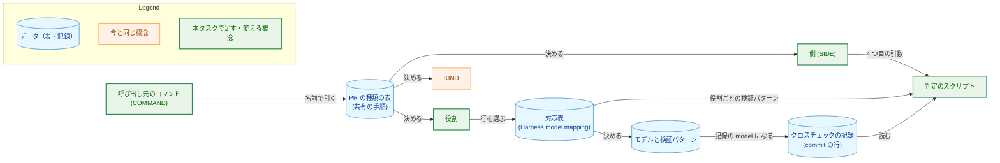
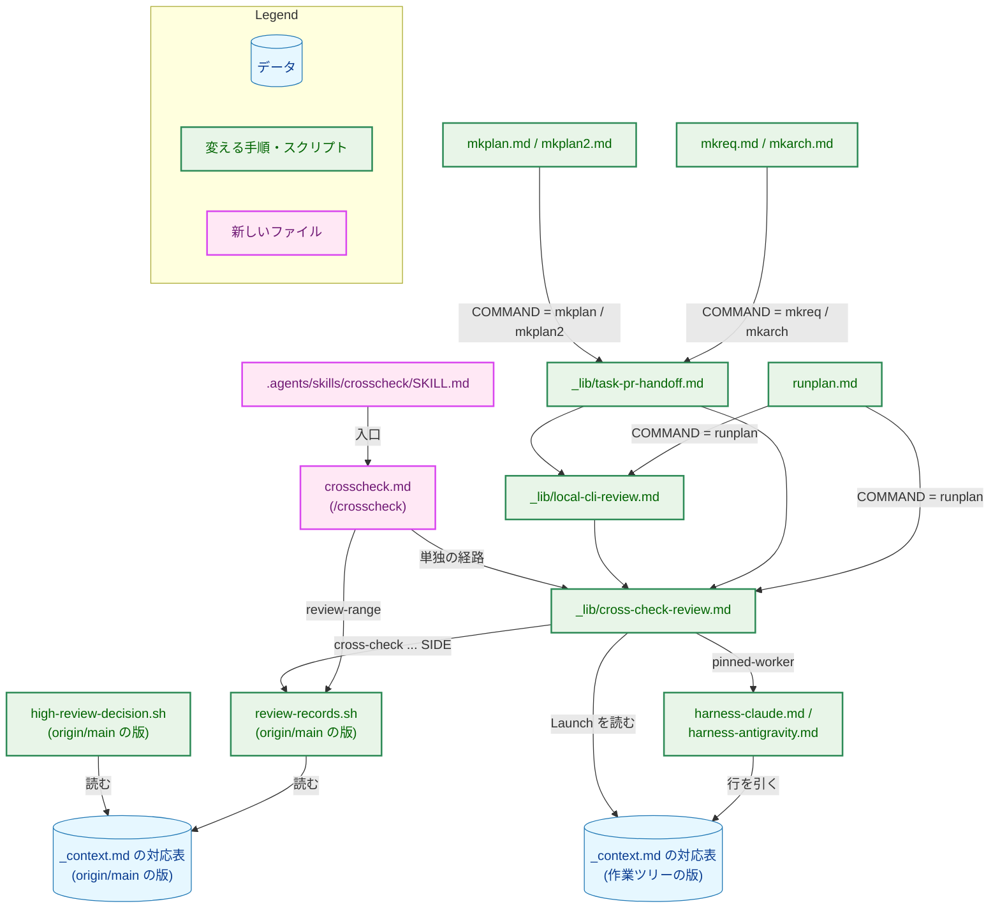
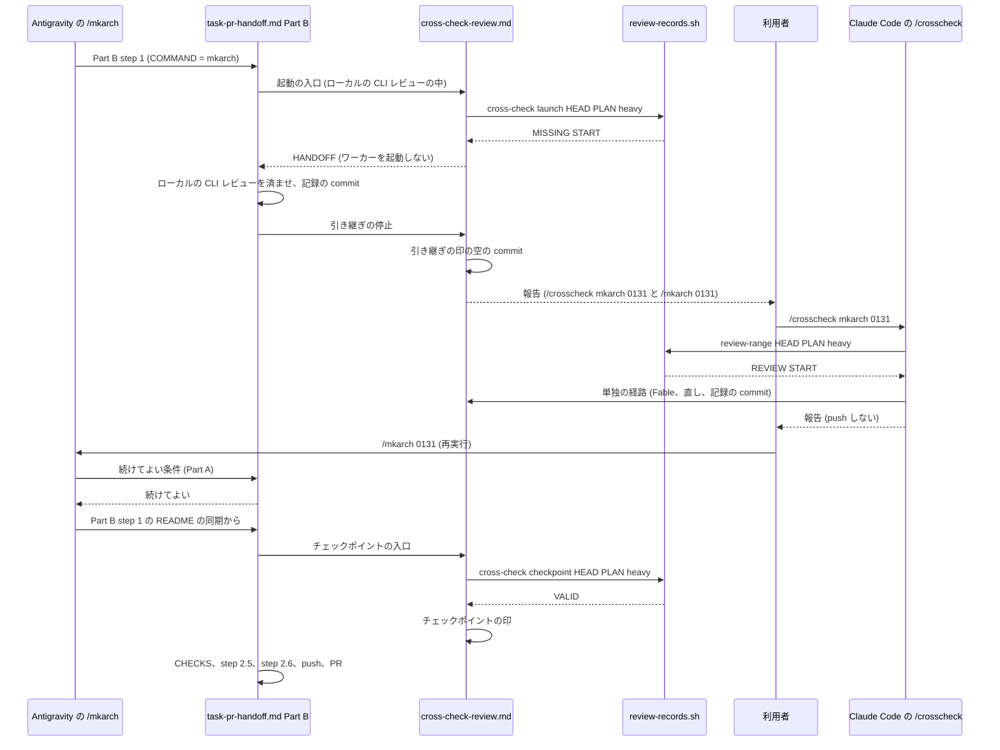
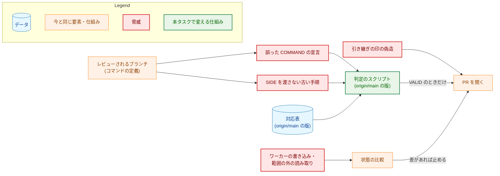
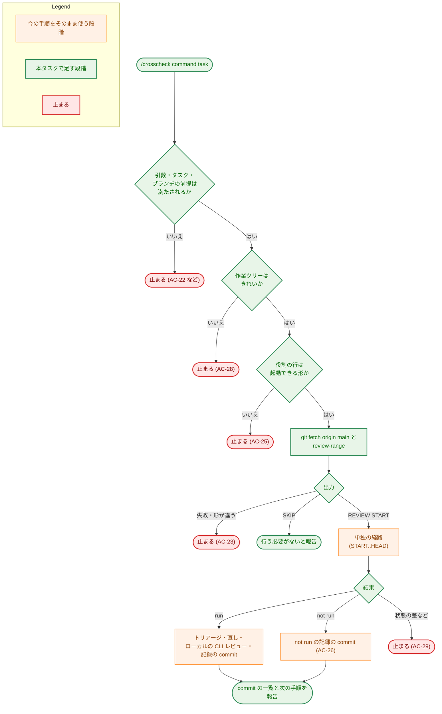
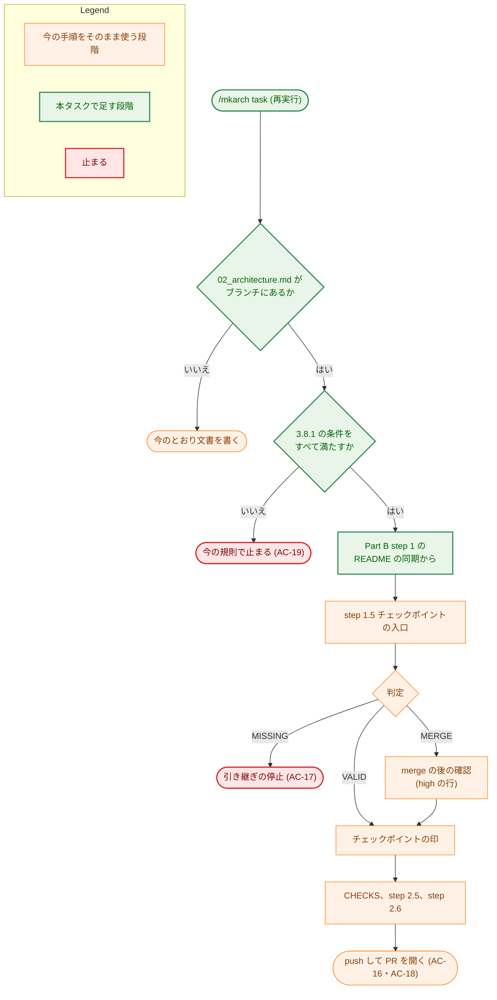

# アーキテクチャ設計書：クロスチェックの部分レビューを重い側と軽い側の役割に分け、強めたプロンプトと単独実行のコマンドを足す

## Document Status

| Item | Value |
|---|---|
| Status | `draft` |
| Created | 2026-11-27 |
| Review date | - |
| Reviewer | - |
| Comments | - |

本書は [01_requirements.md](01_requirements.md)（要件定義書。以下、要件書）の設計である。既存のファイルの内容は、commit `ff197333`（`origin/main`）で確かめた。`file:line` の行番号は、この commit での行番号である。F-NNN・AC-NN は要件書の項番を、H-NN は [design_handoff.md](design_handoff.md)（以下、申し送り）の項番を指す。申し送りへの対応は 10 章に、受け入れ基準との対応は付録 A にまとめる。

本書は、要件書 6 章の用語（重い側・軽い側・重い側の PR・軽い側の PR・重い側のモデル・軽い側のモデル・クロスチェックの記録・有効な記録・引き継ぎ・再実行したコマンド・単独実行のコマンド）を、要件書と同じ意味で使う。そのほかに、次の用語を使う。

-   **判定のスクリプト:** `.claude/commands/_lib/review-records.sh`。`origin/main` から取り出して走らせる。
-   **共有の手順:** `.claude/commands/_lib/cross-check-review.md`。クロスチェックの部分レビューの規則の正本である。
-   **対応表:** `.claude/commands/_context.md` の「Harness model mapping」の表（`_context.md:208-218`）。
-   **呼び出し元のコマンド（COMMAND）:** 部分レビューを起動するコマンドの名前。`mkreq`・`mkarch`・`mkplan`・`mkplan2`・`runplan` の 5 つのどれかである。共有の手順の新しい入力の値であり、`/crosscheck` の 1 つ目の引数でもある（3.1）。
-   **側（SIDE）:** COMMAND から決まる `heavy`（重い側）か `light`（軽い側）の値。判定のスクリプトに渡す値でもある（3.1・3.3）。
-   **引き継ぎの印:** Antigravity のセッションが引き継ぎで止まるときに残す、空の commit の行 `Cross-check review: handoff`（3.6.4）。クロスチェックの記録ではない。
-   **END:** クロスチェックの記録の範囲の終わりの commit（記録の行の `<END12>` が指す commit）。
-   **入口:** 共有の手順が部分レビューを始める場所の呼び名。起動の入口（ローカルの CLI レビューと並列に起動する）・収集の入口（その結果を受け取る）・チェックポイントの入口・push の直前の入口がある（`cross-check-review.md:14-21`）。
-   **KIND・TASK_DIR・SELF_REJECTED:** 共有の手順の入力 CROSS_CHECK の値（`cross-check-review.md:44-50`）。KIND は PR が文書の PR（`documents`）か実装の PR（`implementation`）かを表す。本書では KIND を COMMAND から引く（3.1・3.6.1）。

## 1. 設計の全体像 (Design Overview)

### 1.1. 設計原則

-   **PR の種類は、呼び出し元が宣言する。** どのコマンドの PR かを COMMAND として宣言し、側・役割・KIND は、共有の手順の 1 つの表から引く（3.1）。ブランチの差分や文書からは推定しない（`CLAUDE.md` の「Declare, don't infer」）。`/crosscheck` も、同じ値を引数で受け取る。
-   **有効かは、今と同じく判定のスクリプトだけが決める。** 記録の役割を PR の種類と照合すること（F-002）も、`/crosscheck` が見る範囲の始点（AC-23）も、スクリプトが commit のデータと対応表から決める。セッションは出力を決まった形で読むだけである（ADR-0050 の決定 5「有効かは、判定のスクリプトが決める」）。
-   **今の呼び出しの形と出力の形は変えない。** 判定のスクリプトの `cross-check` のモードには、省略できる 4 つ目の引数を足すだけにする。出力の形（`VALID`・`MISSING <START>`・`MERGE <n>`）は変えない。古い手順のままのブランチが新しいスクリプトを呼んでも、今と同じく読める（AC-12）。`/crosscheck` に要る出力は、新しいモードに置く（3.4）。
-   **割り当ては表、起動の仕方はアダプタに置く。** 役割ごとのモデルと検証パターンは対応表に置く。軽い側の effort `high` のように、検証できない起動の引数は Claude Code のアダプタの「pinned-worker」の節に書く（決定 3）。
-   **既存の部品を使い回す。** `/crosscheck` は、共有の手順の「The standalone path」をそのまま使う。新しく書くのは、範囲の決め方（新しいモード）と、引数・報告・止まる条件だけである。引き継ぎの再実行も、`_lib/task-pr-handoff.md` Part B の途中から続けるだけで、新しい PR の開き方は作らない。

### 1.2. 設計の際に決めたこと（2026-11-27）

人に問うて決めた項目（決定 1〜9）と、要件と申し送りから設計が決めた項目（決定 10〜16）を挙げる。

-   **決定 1.** Antigravity の `claude-opus-5-5-high` の実測は、この設計書の PR のレビュー中に行い、承認の前に結果を 1.4 節に書き込む（H-01）。 このセッションは Claude Code で動いており、`swarm` を呼べない。そのため、実測は利用者が Antigravity で行う。1.4 節に、手順と、使えると判断する条件を書く。条件を満たさなければ、要件書の決定の変更として要件書に戻す（要件書「要件定義の際に決めたこと（2026-11-26）」の「Antigravity の軽い側のモデル」）。人の答え：PR レビュー中（推奨）。
    -   **採らなかった案：** 結果が出るまで設計書を書かない案。結果と関係のない設計まで待つことになる。実装の段階に回す案。要件書が設計の段階で確かめると決めているのに反する。
    -   **ADR：** 結果が条件を満たせば、ADR は変えない。満たさなければ、要件の変更として [ADR-0050](../../dev/adr/0050-fable-partial-review.md) の決定 4 を更新する。
-   **決定 2.** 役割の名前は、重い側を今の `cross-check` のまま残し、軽い側に `cross-check-light` を足す（H-02）。 今の `cross-check` の行と、それを読む既存の記録・文書・テストの入力（`cmd/yt2column/harness_mapping_cases_test.go` の `mappingValidTable`）が、そのまま重い側として通る。人の答え：`cross-check` に `-light` を足す（推奨）。
    -   **採らなかった案：** 両方を `cross-check-heavy`・`cross-check-light` に改める案。対称にはなるが、`harness.md`・両アダプタ・判定のスクリプトのコメント・ADR-0050 の記述が広く変わり、得るものが名前の対称だけである。
    -   **ADR：** ADR-0050 を更新する（決定 4。役割の名前は、対応表・両スクリプト・アダプタを縛るため）。
-   **決定 3.** 軽い側の effort `high` は、Claude Code のアダプタの「pinned-worker」の節に書く。対応表に列は足さない（H-02、AC-03）。 Claude Code の `Agent` ツールには `effort` の引数（`low`〜`max`）がある。この引数は、指示ファイルが明示したときだけ設定してよい（このセッションの `Agent` ツールの定義で確かめた）。アダプタが `cross-check-light` のワーカーを `effort: high` で起動すると書けば、その明示に当たる。effort はモデルの ID に出ず、記録から確かめられない（要件書 4.2 で受け入れた危険）。判定のスクリプトも effort を使わないので、表に列を足しても、照合できる値は増えない。人の答え：アダプタに書く（推奨）。
    -   **AC-05 との関係：** AC-05 が表 1 か所に置くよう求める「割り当て」は、役割ごとのモデルと検証パターンと読む。effort は、Claude Code の起動の引数としてアダプタに置く。Antigravity の軽い側の effort は、モデルの名前 `claude-opus-5-5-high` に含まれるので、表に出る。
    -   **採らなかった案：** 表に `Effort` 列を足す案。両スクリプトの表の文法（5 列の見出しと区切り、`review-records.sh:337`）と、共通のテスト入力のすべての行が変わる。
    -   **ADR：** ADR-0050 を更新する（決定 4 に、effort をアダプタに置くことを足す）。
-   **決定 4.** `/crosscheck` は、PR の種類を引数で宣言させ、引数の形を `/crosscheck <command> <task>` とする（H-03、AC-22）。 `<command>` は、ブランチの PR を開くコマンドの名前（`mkreq`・`mkarch`・`mkplan`・`mkplan2`・`runplan`）である。側・役割・KIND は、3.1 の表から引く。`<task>` は、`docs/dev/conventions/task_identification.md` の規則 1 で解決する。どちらかの引数が欠けるか、受け付けない値なら、commit を作らずに止める。人の答え：最初の問いで「引数で宣言」（推奨）を選んだ。続く問いで、KIND と TASK_DIR も決める必要から、値の形を `<command> <task>` に決めた（推奨）。
    -   **理由：** 軽い側には、計画書の PR（KIND `documents`）と実装の PR（KIND `implementation`）がある。そのため、`heavy`・`light` だけでは、基準 2 の当てはめ方（`cross-check-review.md:501`）が決まらない。コマンド名なら、3 つの値が 1 つの表から決まる。止まったときの報告にも、打つべき行をそのまま書ける（AC-15）。
    -   **採らなかった案：** ブランチの差分から推定する案（`01_requirements.md` か `02_architecture.md` を足していれば重い側）。また、`heavy|light <task>` とし、軽い側の KIND を計画書の `PR を作成した` の行から推定する案。どちらも、推定が残る。
    -   **ADR：** ADR-0050 を更新する（決定 7 の `/crosscheck`）。
-   **決定 5.** 本タスク自身の PR は、順序で開く（H-03、AC-13）。 PR の種類を受け付ける判定のスクリプトと新しい対応表を、先の PR で `main` に入れる。手順が PR の種類を渡すのは、その後の PR からにする（8 章）。今のスクリプトは、引数が 3 つでなければ失敗する（`review-records.sh:888`）。そのため、手順が先に `main` に入るか、同じ PR に入ると、その PR のチェックポイントの判定が失敗し、PR を開けない。人の答え：順序で解く（推奨）。
    -   **確かめ方（AC-13）：** 先の PR は、古い手順（3 つの引数）と古いスクリプトで判定されて開く。後の PR は、新しい手順（4 つの引数）と、先の PR で `main` に入った新しいスクリプトで判定されて開く。後の PR の説明の push の直前の判定の行には、渡した側（`light`）が出る（決定 16）。`VALID` だけでは、引数を渡さずに判定されても同じに見えるので、側の値とあわせて確かめる（7.3）。
    -   **採らなかった案：** 引数付きの呼び出しが失敗したら、引数なしで呼び直す案。失敗を別の判定に読み替える経路が手順に残り、AC-11（失敗は `MISSING` と読む）と食い違う。
    -   **ADR：** ADR なし（実装の順序であり、タスク内で閉じるため）。
-   **決定 6.** Antigravity は、Part B step 1 のローカルの CLI レビューとその記録の commit を済ませてから止まる。チェックポイントの入口と push の直前の入口では、単独の経路の代わりに止まる（H-04、AC-14）。 止まる前のローカルの CLI レビューの直しは、その記録の commit の範囲に入る。その後に `/crosscheck` が範囲の全体を見て、記録を作る。再実行したコマンドは、step 1.5 の判定で `VALID` を得て、印を残す（6.2）。人の答え：CLI レビューの後（推奨）。
    -   **採らなかった案：** Part B に入る前に止まる案。再実行したコマンドがローカルの CLI レビューを走らせると、その直しの commit が `/crosscheck` の記録の後に来る。直しは中身のある commit なので、step 1.5 で記録が無効になり、もう一度止まる。これは AC-16 に反する。
    -   **ADR：** ADR-0050 を更新する（決定 4 の引き継ぎ）。
-   **決定 7.** 引き継ぎで止まったブランチは、引き継ぎの印で見分ける（H-04、AC-16、AC-19）。 止まるときに、空の commit に `Cross-check review: handoff` の行を残す。再実行したコマンドは、印があり、ほかの条件（3.8.1）もすべて満たすときだけ続ける。印は、チェックポイントの印（`Cross-check review: checkpoint`）と同じく、クロスチェックの記録ではない。判定のスクリプトの記録の正規表現（`review-records.sh:272-273`）にも合わない。人の答え：印の commit（推奨）。
    -   **採らなかった案：** 印を残さず、PR がないこと・文書がそろっていることなどから推定する案。止まった理由（引き継ぎか、ほかの停止か）を、状態からは見分けられない。
    -   **ADR：** ADR-0050 を更新する（決定 4 の引き継ぎ）。
-   **決定 8.** 対応表の Antigravity の重い側の行は `| Antigravity | cross-check | none | fable | - |` とする（H-02、AC-04、AC-25）。 今の表の文法のままで書ける（`Launch` が `none` なら検証パターンは `-`、`review-records.sh:396-400`）。行は「Antigravity でも重い側のモデルは `fable` だが、Antigravity からは起動しない」ことを表す。人の答え：Launch `none`（推奨）。
    -   **`none` の 2 つの読み方の分け方：** 今の `none` は OpenCode の `low` の行だけにあり、「`pinned-worker` を使えない」ことを表す（`harness.md:92`）。本書では、部分レビューの役割について、行があるかないかで分ける。このハーネスにその役割の行があり、`Launch` が `none` なら引き継ぎ（3.6.4）とする。行がなければ、今と同じく `not run agent-cannot-call` とする（3.6.3）。役割の名前で分けることはしない。
    -   **採らなかった案：** 引き継ぎを表す新しい `Launch` の値（例: `handoff`）を足す案。両スクリプトの文法とテストが変わり、`none` と区別して得るものがない。
    -   **ADR：** ADR-0050 を更新する（決定 4 のハーネスごとのモデル）。
-   **決定 9.** 判定のスクリプトに渡す PR の種類の値は `heavy` と `light` とする（H-03、AC-11）。 `cross-check` のモードの 4 つ目の引数である。省略は「どちらの役割の記録も数える」（AC-12）。ほかの値と空の値は失敗とする（AC-11）。人の答えは決定 4 と決定 5 に含まれる（値の名前は、`/crosscheck` の引数から決めた側の値と同じにした）。
    -   **ADR：** ADR-0050 を更新する（決定 5 の「記録の役割を PR の種類と照らし合わせる」に、渡し方を足す）。
-   **決定 10.** 共有の手順の入力 CROSS_CHECK の KIND を、COMMAND に置き換える（3.1、3.6.1）。 側・役割・KIND を COMMAND から 1 つの表で引く。今の KIND は、`_lib/task-pr-handoff.md` が「タスク文書のコマンド」にまとめて `documents` と書く（`task-pr-handoff.md:55-58`）。このままでは、`/mkreq`・`/mkarch` と `/mkplan`・`/mkplan2` を区別できない。KIND を残して SIDE を足すと、同じ表の 2 つの列を呼び出し元がそれぞれ書くことになり、食い違いうる。
    -   **ADR：** ADR-0050 を更新する（決定 4 に、PR の種類を 1 つの表が決め、呼び出し元はコマンドの名前だけを渡すことを書く。PR の種類の唯一の定義の置き場所は、5 つのコマンドと共有の手順を縛るため）。
-   **決定 11.** `/crosscheck` が見る範囲は、判定のスクリプトの新しいモード `review-range` が決める（H-05、AC-23）。 今の `cross-check` のモードの出力に行を足す案は採らない。古い手順の読み方（`VALID` だけの 1 行、`cross-check-review.md:114-130`）では、行の足された出力が失敗と読まれ、すべてのブランチで部分レビューが走り直すためである。
    -   **ADR：** ADR-0050 を更新する（決定 7 の `/crosscheck` の範囲の決め方）。
-   **決定 12.** 範囲の終点より後の情報を読ませない方法として、作業ツリーの読み取りは許し、ref の読み取りを禁じる（H-06、AC-32）。 どの入口でも、END は起動の時点の HEAD である（`cross-check-review.md:63`）。起動から結果の受け取りまで、セッションは commit を作らない（`cross-check-review.md:221`）。作業ツリーは起動の前にきれいである（`_lib/local-cli-review.md` step 1、`cross-check-review.md:274`）。そのため、作業ツリーの内容は END の内容と同じである。プロンプトは、`origin/main`・`main`・ほかのブランチの ref と、END の祖先でない commit を読むことを禁じる。START より前の commit（merge-base の木や、同じ PR の先の commit）は END の祖先なので、読んでよい。
    -   **ADR：** ADR なし（ADR-0050 の決定 2 がすでに持つ制約の、書き方の選択であるため）。
-   **決定 13.** 引き継ぎの停止は共有の手順の新しい節に、再実行で続けてよい条件は `_lib/task-pr-handoff.md` の新しい節に置く（3.6.4・3.8.1）。 止まる箇所（Part B step 1・1.5・2.6 と、merge の後の確認から単独の経路へ回る箇所）は、共有の手順の「The handoff stop」を名指しするだけにする。ブランチを使い回してよいかの規則は、今も Part A step 3 が持つ（`/runplan` の続きと簡易プロセスの再開の場合）。そのため、引き継ぎの後の再実行の条件も同じファイルに置き、`/mkreq` step 1 と `/mkarch` step 3 はそれを名指しする。共有の手順は、引き継ぎの停止と印の意味を持ち、ブランチを使い回す条件は持たない。
    -   **ADR：** ADR なし（手順の置き場所であり、ADR-0050 の決定 7「手順の置き場所」の中で閉じるため）。
-   **決定 14.** `/crosscheck` の判定は、起動の入口と同じ規則で行う（3.4）。 つまり、チェックポイントの印の後の commit も、記録を無効にしうる commit として数える。チェックポイントの規則で判定すると、PR を開いた後に足された commit（`/fixpr` の直しなど）は印の後にあるので、どのクロスチェックも見ていないのに「行う必要がない」と報告することになる。起動の入口の規則で `VALID` なら、チェックポイントの規則でも `VALID` である（規則 3 は記録を無効にしない commit を足すだけ、`review-records.sh:940-956`）。`launch` の判定が `MERGE` なら、`checkpoint` の判定は `MERGE` か `VALID` である。そのため、`/crosscheck` が「行う必要がない」と判断したブランチを再実行すると、step 1.5 は印を残すか、merge の後の確認を走らせる。引き継ぎの停止には入らない。
    -   **採らなかった案：** チェックポイントの入口と同じ規則で判定する案。上のとおり、印の後の commit を見ずに済ませる。
    -   **ADR：** ADR なし（ADR-0050 の決定 5 の規則のうち、厳しい側を使うだけであるため）。
-   **決定 15.** 重い側と軽い側のパターンが重ならないことは、PR-2 で判定のスクリプトのフェイルクローズの検査にし、実際の対応表に対するテストでも確かめる（3.2、3.3、7.1）。 AC-08 は、軽い側のモデルの ID が重い側のパターンに合わないことに頼る。スクリプトが `origin/main` の表を読むたびに検査すれば、重なる表が `main` に入っても、重い側の判定が軽い側の記録を黙って数えることはない。PR-1 では検査を入れない。PR-1 の途中の表（Antigravity の `cross-check` の行が `claude-opus-5-5-medium` のまま、8 章）は重なるので、PR-1 で入れると、PR-2 までのすべての判定が失敗するためである。PR-2 は最後の表と検査を同時に `main` に入れる。
    -   **採らなかった案：** テストだけで固定する案。テストは作業ツリーの表しか見ないので、`origin/main` の表が重なったときに判定が気づかない。
    -   **ADR：** ADR なし（検査の置き場所であり、タスク内で閉じるため）。
-   **決定 16.** PR の説明の push の直前の判定の行に、判定のスクリプトに渡した側を出す（3.8、7.3）。 側を渡したか、どちらを渡したかは、今は commit にも PR の説明にも残らない。行に側を出せば、重い側の PR が `heavy` で判定されたかを人が読める。AC-13 の PR-2 の確かめも、この値で行える（決定 5）。
    -   **ADR：** ADR なし（PR の説明の 1 行の形であり、タスク内で閉じるため）。

### 1.3. なぜ今の仕組みでは足りないか

-   **役割が 1 つしかない。** 対応表の `Role` 列は 4 つの値に限られる（`review-records.sh:379`、`high-review-decision.sh:206`）。部分レビューの役割は `cross-check` の 1 つだけである。PR の種類で役割を分ける要件（F-001）は、表に役割を足さなければ満たせない。
-   **PR の種類が判定に届かない。** `cross-check` のモードは 3 つの引数しか受け付けず（`review-records.sh:888`）、`run` の記録は、どの `cross-check` の行の検証パターンに合っても数える（`review-records.sh:906-910`）。そのため、重い側の PR で軽い側の記録を数えない（AC-08）には、種類の入力が要る。
-   **「最後の記録が `not run`」が出力に出ない。** `not run` の記録の後に中身のある commit がなければ、出力は `VALID` だけになる（`review-records.sh:1050`）。AC-23 の振る舞いの表は「`not run` で `VALID`」と「`run` で `VALID`」を分ける。今の出力では分けられない。
-   **Antigravity は Fable を起動できない。** モデルの固定は `swarm` で選べるモデルに限られる（`harness-antigravity.md` の「8. pinned-worker」の手順 3）。重い側を Antigravity で走らせるには、Claude Code に引き継ぐしかない。
-   **再実行は止まる。** `/mkreq` は既存の要件定義書を見つけると止まり（`mkreq.md:84-95`）、`/mkarch` は `02_architecture.md` があると止まる（`mkarch.md:51`）。引き継ぎの後に同じコマンドで続けるには、続けてよい条件を足す必要がある。

### 1.4. 実測の結果（H-01）

> この節は、PR のレビュー中に書き込む（決定 1）。承認の前に、下の手順の結果を書き込む。条件のどれかを満たさなければ、要件書に戻す。

**手順（利用者が Antigravity で行う）:**

1.  `swarm(action: "models", all: true)` を呼び、`models` に `claude-opus-5-5-high` があることと、`quotas.claude-opus-5-5-high.quota_remaining` を記録する。
2.  小さなクロスチェックの部分レビュー（たとえば、このブランチの `origin/main..HEAD` の範囲で、1〜2 か所を範囲に入れたもの）を、`harness-antigravity.md` の「8. pinned-worker」の手順どおりに、`model: "claude-opus-5-5-high"` で起動する。
3.  次を記録する。
    -   `add` の返却の JSON の `"model"` の値
    -   起動から投稿までの時間
    -   投稿の数と、1 行目が `@coordinator` だけか
    -   本文が「The prompt」の出力の形（`No findings.` か 4 行の塊）に合うか
    -   走らせた後の `quota_remaining`（1 回あたりの消費）

**使えると判断する条件:**

-   `models` にあり、`quota_remaining` が 0% より大きい。
-   `"model"` が `claude-opus-5-5-high` に、1 バイトも違わずに一致する。
-   30 分以内に、1 つの投稿で、出力の形に合う本文を返す。
-   1 回あたりの消費が、週の割り当てを数回で使い切るほど大きくない（判断は利用者に委ねる。参考として、`claude-opus-5-5-medium` の消費は 1 PR あたり数 % だった。0120 設計書 1.4）。

**結果:** （未記入）

### 1.5. 概念モデル

呼び出し元のコマンドが、PR の種類（側・役割・KIND）を決める。側は、判定のスクリプトが数える記録を決める。



矢印 A → B は「A が B を決める、または A が B の入力になる」ことを表す。側の値は `heavy`・`light`、役割は `cross-check`・`cross-check-light`、KIND は `documents`・`implementation` である（3.1）。

側と、数える `run` の記録の関係は次のとおりである（F-002）。`not run` の記録は、側によらず今と同じく扱う（AC-10）。

| 判定のスクリプトへの 4 つ目の引数 | 数える `run` の記録の `model` |
|---|---|
| `heavy` | `cross-check` の行の検証パターンのどれかに合うもの |
| `light` | `cross-check` か `cross-check-light` の行の検証パターンのどれかに合うもの |
| 省略 | `light` と同じ（AC-12） |
| ほかの値・空の値 | 判定の失敗（AC-11） |

## 2. システム構成 (System Structure)

### 2.1. 全体構成



矢印 A → B は「A が B を呼ぶ、または読む」ことを表す。ラベルは、渡す値かモードである。`/runplan` が共有の手順を直接呼ぶのは、チェックポイントの入口（`runplan.md` step 5a・step 8）である。

対応表は 2 つの版が読まれる。判定のスクリプトは `origin/main` の版を読み、レビューされるブランチは数え方を変えられない。アダプタと共有の手順は、作業ツリーの版を読んで起動するモデルと `Launch` を決める（`harness-claude.md:73`、`harness-antigravity.md:160-161`）。ブランチが作業ツリーの表を書き換えて、Antigravity の重い側を別のモデルで起動させても、その記録は `origin/main` の表の重い側のパターンに合わないので、`heavy` の判定では数えられない。

### 2.2. コンポーネント配置

| ファイル | 新規・変更 | 変えること |
|---|---|---|
| `.claude/commands/_context.md` | 変更 | 対応表に `cross-check-light` の 2 行を足し、Antigravity の `cross-check` の行を `none` にする。文法の説明の `Role` の値と、両スクリプトの集め方の説明を直す（3.2） |
| `.claude/commands/_lib/review-records.sh` | 変更 | 表の文法に `cross-check-light` を足す。`cross-check` のモードに省略できる 4 つ目の引数を足す。新しいモード `review-range` を足す。PR-2 で、重い側と軽い側のパターンの重なりの検査を足す（3.3・3.4） |
| `.claude/commands/_lib/high-review-decision.sh` | 変更 | 表の文法に `cross-check-light` を足す（3.5） |
| `.claude/commands/_lib/cross-check-review.md` | 変更 | PR の種類の表、入力 COMMAND、判定の呼び出しの 4 つ目の引数、役割による行の選び方、引き継ぎの停止、プロンプトの義務と制約、記録の行の印を足す（3.6） |
| `.claude/commands/_lib/local-cli-review.md` | 変更 | CROSS_CHECK の説明を COMMAND に改め、起動の入口が引き継ぎを返したことを宣言した値（`HANDOFF`）として呼び出し元に返す（3.8） |
| `.claude/commands/_lib/harness.md` | 変更 | 操作の一覧の `pinned-worker` の役割に `cross-check-light` を足す。OpenCode の「`Launch` が `none`」の説明に、部分レビューの役割の行が `none` のときの読み方を足す（3.7） |
| `.claude/commands/_lib/harness-claude.md` | 変更 | `pinned-worker` の役割に `cross-check-light` を足し、`effort: high` で起動すると書く（3.7） |
| `.claude/commands/_lib/harness-antigravity.md` | 変更 | `pinned-worker` の役割に `cross-check-light` を足し、`Launch` が `none` の重い側の行では起動しないと書く（3.7） |
| `.claude/commands/_lib/task-pr-handoff.md` | 変更 | 入力 CROSS_CHECK を COMMAND に改める。引き継ぎの後に続けてよい条件の節を足し、Part A step 3 から名指しする。Part B step 1・1.5・2.6 で引き継ぎの停止を受ける。step 3 の push の直前の判定の行に側を出し、push が失敗したら PR を作らずに止まると書く（3.8） |
| `.claude/commands/mkreq.md`・`mkarch.md`・`mkplan.md`・`mkplan2.md` | 変更 | Part B に渡す COMMAND を書く。`mkreq.md` step 1 と `mkarch.md` step 3 に、再実行で続ける場合を足す（3.8） |
| `.claude/commands/runplan.md` | 変更 | CROSS_CHECK の KIND `implementation` を COMMAND `runplan` に改める（`runplan.md:109,138,287`）（3.8） |
| `.claude/commands/_lib/simple-process.md` | 変更 | 「Resuming a stopped run」に、引き継ぎの印のあるブランチは `_lib/task-pr-handoff.md` の新しい節で扱うと書く（3.8） |
| `.claude/commands/crosscheck.md` | 新規 | 単独実行のコマンド（3.9） |
| `.agents/skills/crosscheck/SKILL.md` | 新規 | Antigravity の薄い入口（3.9） |
| `CLAUDE.md` | 変更 | 「Claude Commands」に `/crosscheck` を足し、部分レビューの段落に 2 つの役割と引き継ぎを書く（AC-21・AC-35） |
| `docs/translation_glossary.md` | 変更 | 「クロスチェックの部分レビュー」の行と、重い側・軽い側・引き継ぎの用語（AC-35） |
| `docs/dev/adr/0050-fable-partial-review.md` | 変更 | 本書の決定を反映する（3.10） |
| `cmd/yt2column/harness_mapping_cases_test.go` | 変更 | 共通のテスト入力に `cross-check-light` の行を足す（7.1） |
| `cmd/yt2column/review_records_test.go` | 変更 | 4 つ目の引数・`review-range`・軽い側のパターンのない表・別名 `fable`・呼び出しの形の場合と、実際の表でパターンが重ならないことのテスト（PR-2）を足す（7.1・7.2） |
| `cmd/yt2column/high_review_decision_test.go` | 変更 | 新しい役割の行を含む表を受理する場合を足す（7.1） |

### 2.3. データフロー

Antigravity の `/mkarch` が引き継ぎで止まり、Claude Code の `/crosscheck` の後に再実行して PR を開く流れを示す（F-003）。



## 3. コンポーネント設計 (Component Design)

### 3.1. PR の種類の表（F-001、AC-01・AC-02・AC-22、決定 4・10）

共有の手順に、COMMAND から側・役割・KIND を引く表を置く。この表が、PR の種類の唯一の定義である。呼び出し元と `/crosscheck` は、COMMAND だけを渡す。

| COMMAND | 側（SIDE、判定のスクリプトへの値） | 役割（対応表の `Role`） | KIND |
|---|---|---|---|
| `mkreq` | `heavy` | `cross-check` | `documents` |
| `mkarch` | `heavy` | `cross-check` | `documents` |
| `mkplan` | `light` | `cross-check-light` | `documents` |
| `mkplan2` | `light` | `cross-check-light` | `documents` |
| `runplan` | `light` | `cross-check-light` | `implementation` |

-   `/mkreq` は、完全プロセスでも簡易プロセスでも `mkreq` を渡す（AC-01）。簡易プロセスの 3 文書の PR も重い側である。
-   表にない COMMAND を渡すことは、手順の誤りである。共有の手順は、そのとき部分レビューを起動せず、記録も書かずに、呼び出し元を止める。誤った COMMAND を、どちらかの側と推定しない。

### 3.2. 対応表（F-001、AC-03〜AC-06、決定 2・3・8）

対応表の行は次のとおりになる。`high`・`standard`・`low` の行と OpenCode の行は変えない。

| Harness | Role | Launch | Model | Verification pattern |
|---|---|---|---|---|
| `Claude Code` | `cross-check` | `agent` | `fable` | `claude-fable-*` |
| `Claude Code` | `cross-check-light` | `agent` | `opus` | `claude-opus-*` |
| `Antigravity` | `cross-check` | `none` | `fable` | `-` |
| `Antigravity` | `cross-check-light` | `swarm` | `claude-opus-5-5-high` | `claude-opus-5-5-high` |

-   **文法:** `Role` の値に `cross-check-light` を足す。ほかの規則（5 列、code span、`(Harness, Role)` の重複の禁止、`none` なら `-`、正規表現でない照合）は変えない（AC-06）。
-   **重い側と軽い側のパターンは重ならない（上の最後の表について）:** `claude-fable-*` と、`claude-opus-*`・`claude-opus-5-5-high` は、どの ID にも同時には合わない（`claude-fable-` で始まる ID は `claude-opus-` で始まらない）。そのため、記録の `model` から役割が 1 つに決まる（要件書 2.3）。PR-1 の後、PR-2 の前の途中の表では、Antigravity の `cross-check` の行が `claude-opus-5-5-medium` のままなので重なる（8 章）。その間は、どの手順も 4 つ目の引数を渡さないので、判定は変わらない。この性質は、PR-2 から判定のスクリプトがフェイルクローズで検査し、テストでも確かめる（決定 15、3.3、7.1）。
-   **作業中のブランチの `claude-opus-5-5-medium` の記録（AC-09）:** 切り替えの前の Antigravity の記録の `model` は `claude-opus-5-5-medium` である。これは、Claude Code の軽い側のパターン `claude-opus-*` に合う（接尾辞 `5-5-medium` は `[a-z0-9.-]` の 1〜48 文字）。そのため、軽い側の PR と種類を渡さない呼び出しでは、今の表の行がなくなっても数えられる。重い側の PR では数えない（AC-08）。この性質は `claude-opus-*` が接頭辞のパターンであることに頼るので、7.1 のテストで固定する。
-   **merge の後の確認:** `high` の行は変えない。merge の後の確認は、今と同じく `high` の行のモデルで走る（AC-07）。
-   **effort:** 表には書かない。Claude Code の `cross-check-light` は、アダプタが `effort: high` で起動する（決定 3、3.7）。

### 3.3. 判定のスクリプト：`cross-check` のモード（F-002、AC-06・AC-08〜AC-12、決定 9）

呼び出しの形は次のとおりになる。

```text
bash review-records.sh cross-check <ENTRY> <HEAD> <PLAN> [<SIDE>]
```

-   **引数:** 3 つか 4 つ。4 つ目の `<SIDE>` は `heavy` か `light` に、バイト単位で一致しなければならない。空の文字列・大文字・前後の空白を含む値は、今の引数の誤りと同じく失敗とする（AC-11）。5 つ以上も失敗とする。
-   **表の読み方:** `cross-check` の行の検証パターン（`-` を除く）を重い側の集まりに、`cross-check-light` の行の検証パターンを軽い側の集まりに入れる。`high` の行は、今と同じく merge の後の確認の記録に使う。重い側・軽い側・`high` のどれかの集まりが空なら、フェイルクローズで失敗する（AC-06）。PR-2 からは、重い側のパターンと軽い側のパターンが同じ ID に合いうるときも、フェイルクローズで失敗する（決定 15）。重なりは、接頭辞のパターンどうし・文字どおりのパターンと接頭辞のパターン・文字どおりのパターンどうしの組で、正規表現を使わずに判定する。この検証は、4 つ目の引数の有無によらず行う。
-   **数える `run` の記録:** `heavy` なら、`model` が重い側の集まりに合う記録だけを数える。`light` と省略なら、どちらかの集まりに合う記録を数える（1.5 の表）。合わない `run` の記録は、今の `model` の合わない記録と同じく無視する（`review-records.sh:910`）。数える記録がなければ、今と同じく `MISSING <merge-base>` になる（AC-08）。
-   **`not run` の記録:** 側によらず今と同じく扱う（AC-10）。
-   **出力と失敗:** 出力の形と失敗の形（`MISSING` だけの行、終了コード 1）は変えない（AC-11）。

-   **別名 `fable`:** `cross-check` のモードの移行用の別名 `fable`（`review-records.sh:8,1062-1064`）は、今と同じく同じ関数に渡るので、4 つ目の引数も同じ規則で受け付ける。別名だけを 3 つの引数に固定する分岐は作らない。手順は別名を呼ばない（`TestReviewRecordsCallSite`）ので、1 つのテストの場合で同じ振る舞いを固定するだけにする（7.1）。

ヘッダの使い方と契約のコメント（`review-records.sh:1-200`）も、同じ規則に直す。

### 3.4. 判定のスクリプト：新しいモード `review-range`（F-004、AC-23、H-05、決定 11・14）

`/crosscheck` だけが呼ぶ。呼び出しの形は次のとおりである。

```text
bash review-records.sh review-range <HEAD> <PLAN> <SIDE>
```

-   **引数:** ちょうど 3 つ。`<HEAD>` と `<PLAN>` の形は `cross-check` のモードと同じである。`<SIDE>` は `heavy` か `light` で、省略できない。`/crosscheck` は、いつも種類を宣言するためである。
-   **出力（標準出力）:**

    | 出力 | 意味 |
    |---|---|
    | `SKIP`（ほかの行なし） | 最後に数える記録が `run` で、`cross-check` のモードの `launch` の判定が `VALID` か `MERGE` になる。部分レビューは要らない |
    | `REVIEW <START>`（ほかの行なし） | それ以外。`<START>..<HEAD>` を部分レビューの範囲にする。`<START>` は 40 桁の小文字の 16 進数 |

-   **最後に数える記録:** `cross-check` のモードと同じ規則で、同じ `<SIDE>` の照合をして選ぶ。
-   **判定の規則:** `cross-check` のモードの `launch` と同じ規則を使う（決定 14）。チェックポイントの印の後の commit も、中身があれば記録を無効にする。
-   **`<START>` の決め方（AC-23）:** 最後に数える `run` の記録の END とする。次のときは merge-base とする。
    -   数える `run` の記録がない。
    -   その END の後に、親が 1 つでない commit がある。
    -   その END の後にある `not run` の記録のどれかの START が、その END の子孫でも END 自身でもない。そのような `not run` の記録の範囲は、END の後から始めると含まれないためである。

    これで、最後に数える `run` の記録より後の commit と、その後の `not run` の記録の範囲が、すべて見る範囲に入る。今の `MISSING <START>` の START（記録を無効にする最初の commit の第 1 親、`review-records.sh:1031`）は、ここでは使わない。`not run` の記録の範囲を飛ばしうるためである（申し送り H-05）。
-   **失敗:** git の失敗、引数の誤り、表の検証の失敗などのときは、`FAIL` だけを標準出力に書き、診断を標準エラーに書いて、終了コード 1 で終わる。`/crosscheck` は、終了コードが 0 でないとき、または 1 行目がこの 2 つの形でないとき、判定の失敗として止まる（AC-23）。
-   **入力と環境:** `cross-check` のモードと同じく、git のオブジェクトと引数と `origin/main` の `_context.md` だけを読む。ネットワークは使わず、ファイルも書かない（`review-records.sh` のヘッダの「Inputs」）。
-   **`launch` の判定と `SKIP`:** `SKIP` は、同じ HEAD で `cross-check launch <HEAD> <PLAN> <SIDE>` が `VALID` か `MERGE` を返し、かつ最後に数える記録が `run` であることと同じ意味である。同じ関数で判定し、2 つのモードの結果が食い違わないようにする（7.1 で、同じ枝で両方を走らせて確かめる）。`launch` の判定が `VALID` なら `checkpoint` の判定も `VALID` であり、`MERGE` なら `MERGE` か `VALID` である（決定 14）。そのため、`SKIP` のブランチを再実行しても、step 1.5 は引き継ぎの停止に入らない。

### 3.5. 判定のスクリプト：`high-review-decision.sh`（AC-06）

表の文法の `Role` の値に `cross-check-light` を足すだけにする（`high-review-decision.sh:206`）。照合に使うのは、今と同じく `Role` が `high` で `Launch` が `agent` の行だけである（`high-review-decision.sh:246-248`）。表の読み方と照合の関数は、`review-records.sh` の写しである（`review-records.sh:288-291` のコメント）。そのため、両方の写しを同じ PR で直し、共通のテスト入力を両方のテストで走らせる（7.1）。

### 3.6. 共有の手順 `_lib/cross-check-review.md`（F-001〜F-005）

#### 3.6.1. 入力（決定 10）

CROSS_CHECK は、COMMAND・TASK_DIR・SELF_REJECTED の 3 つになる。KIND は COMMAND から 3.1 の表で引く。

-   CROSS_CHECK の値を並べる箇所（`cross-check-review.md:44-57,297,331`、`_lib/local-cli-review.md:60`、`runplan.md:109,138,287`、`_lib/task-pr-handoff.md:55-58`）は、COMMAND に改める。
-   KIND の値で振る舞いを分ける箇所（基準 2 の当てはめ方、`cross-check-review.md:501`、「The prompt」の `prior-docs` の役目、`:524-525`）は、文を変えずに、表から引いた KIND を使う。「The prompt」の節の文を変えないので、AC-33 の差分の制限に触れない。

#### 3.6.2. 判定の呼び出し（AC-08〜AC-12）

「The validity decision」の 3 行目を、次の形にする。`<SIDE>` は、COMMAND から 3.1 の表で引いた値である。

```bash
bash <records-script> cross-check <ENTRY> <HEAD> <PLAN> <SIDE>
```

この行は、手順が 4 つ目の引数を渡す PR（8 章の PR-2）で変える。それより前の PR では、3 つの引数のままにする（決定 5）。結果の読み方（`cross-check-review.md:114-130`）は変えない。

#### 3.6.3. 役割による行の選び方（AC-01〜AC-05）

「cross-check の行」と書かれている箇所を、「3.1 の表で COMMAND から引いた役割の行」に改める。該当するのは次の箇所である。

-   冒頭（`cross-check-review.md:7-12`）と、具体的な ID を書かない理由（`:31-33`）
-   「Authorization and constraints」（`:78-80`）
-   起動の入口 step 2・7（`:193-198,209-215`）
-   「Checking the output」の step 1（`:589-602`）と、その後の段落（`:614-619`）
-   「Record lines」の `agent-cannot-call` の説明（`:744`）

モデルの具体的な ID は、今と同じく書かない（AC-05、`cross-check-review.md:31-33`）。

起動の入口 step 2 は、起動できない場合を次の 2 つに分ける（決定 8）。

| 場合 | 扱い |
|---|---|
| このハーネスに、その役割の対応表の行があり、`Launch` が `none`（Antigravity の重い側） | 引き継ぎ（3.6.4）。`not run` と記録しない |
| このハーネスに、その役割の行がない。または、アダプタがワーカーを起動できない文脈である（OpenCode で動く `/runplan`、入れ子の `invoke_subagent` など） | 今と同じく `not run agent-cannot-call`（AC-07） |

表の行の有無と `Launch` で分けるので、セッションがハーネスや役割の名前から推定することはない。

#### 3.6.4. 新しい節「The handoff stop」（F-003、AC-14・AC-15・AC-17、決定 6・7・13）

**入る箇所と、そのときの振る舞い:**

| 入る箇所 | 条件 | 振る舞い |
|---|---|---|
| 起動の入口（Part B step 1 のローカルの CLI レビューの中） | 判定のスクリプトが `MISSING <START>` を出力し、3.6.3 の引き継ぎに当たる | ワーカーを起動しない。起動の入口は、宣言した値 `HANDOFF` を返す。収集の入口は何もせず、ローカルの CLI レビューは CROSS_CHECK がないときと同じく続き、その記録の commit を作る（その commit にクロスチェックの行は入らない）。ローカルの CLI レビューは `HANDOFF` を呼び出し元に返し（3.8）、Part B step 1 はその値を見て、下の「止まり方」を行う |
| チェックポイントの入口（Part B step 1.5） | 判定のスクリプトが `MISSING <START>` を出力し、引き継ぎに当たる | 単独の経路を走らせずに、下の「止まり方」を行う |
| push の直前の入口（Part B step 2.6）の第 1 段 | 同上 | 同上 |

判定が `VALID` か `MERGE` のときは、引き継ぎに当たらない。判定の失敗（コマンドの失敗、0 でない終了コード、形の違う出力。今の手順はこれを `MISSING <merge-base>` と読む、`cross-check-review.md:125-130`）も、引き継ぎに当たらない。このときは印を残さず、チェックポイントの入口の 2 回目の判定と同じく、失敗の理由・出力の 1 行目・標準エラーを報告して止まる。引き継ぎにすると、失敗の診断が隠れ、Claude Code の `/crosscheck` と再実行の間を行き来するだけになるためである。`MERGE` のときの merge の後の確認は、今と同じく `high` の行で走る（Antigravity では `swarm`）。

**引き継ぎに入らない停止:** push の直前の入口の最終段と、Part B step 3 の「HEAD が D と違う」ときの判定のやり直しは、救済を走らせない（`cross-check-review.md:356-369`、`task-pr-handoff.md` Part B step 3）。merge の後の確認が、範囲を求める git の失敗で単独の経路に回るとき（`cross-check-review.md:410-415`）も、Antigravity の重い側の PR では単独の経路を走らせず、git の失敗を報告して止まる。引き継ぎにすると、`/crosscheck` は最後の記録が有効な `run` で判定が `MERGE` なので `SKIP` と答え、再実行が同じ箇所で止まり続けるためである。どちらも、今と同じく理由を報告して止まるだけで、印を残さない。Antigravity の重い側の PR で最終段に達するのは、第 1 段（判定が `VALID` でないときに救済を走らせる段。救済は、`MISSING` なら単独の経路、`MERGE` なら merge の後の確認である）の救済が merge の後の確認だった後に限られる。第 1 段が `MISSING` なら、引き継ぎの停止に入るためである。このときは `/crosscheck` を案内せず、今と同じく、利用者が報告からブランチを確かめる。

**止まり方（AC-14）:**

1.  作業ツリーがきれいなことを確かめる。きれいでなければ、何も commit せず、破棄もせずに止まり、変更のあるファイルを報告する。
2.  HEAD の commit のメッセージが引き継ぎの印の行（1 桁目から始まる行全体が `Cross-check review: handoff` に一致する行。チェックポイントの印と同じ読み方）を持たなければ、印の空の commit を作る（`git commit --allow-empty -F <file>`）。件名は自分の言葉で書き、記録の行の接頭辞で始めない。commit の前に、`_lib/local-cli-review.md` step 7 の「Mention check」を行う。HEAD がすでに印の commit なら、作らない（AC-17 の 2 回目の停止で、印を重ねない）。
3.  ワーカーを起動せず、クロスチェックの記録を書かず、push せず、PR を開かずに、呼び出し元のコマンドを止める。ブランチの commit は消さない。

**報告（AC-15）:** 次の 4 つを含める。

-   重い側の部分レビューは、Antigravity では走らせられないこと。
-   同じ worktree で Claude Code を開き、同じブランチのまま `/crosscheck <COMMAND> <task>` を走らせること（例: `/crosscheck mkarch 0131`）。値は実際のものを書く。
-   その後に Antigravity で、同じ worktree のまま同じコマンド（`/mkreq <issue>` か `/mkarch <task>`、値は実際のもの）を再実行すること。
-   止まったブランチの名前。

**Claude Code では入らない（AC-20）:** Claude Code の `cross-check` の行の `Launch` は `agent` なので、3.6.3 の引き継ぎに当たらない。

#### 3.6.5. 引き継ぎの後の再実行（F-003、AC-16〜AC-19、決定 7・13）

再実行で続けてよい条件と続け方は、`_lib/task-pr-handoff.md` の新しい節に置く（3.8.1）。共有の手順は、引き継ぎの印の意味と、再実行が判定でどう扱われるかだけを持つ。

-   **AC-16 が成り立つ理由:** `/crosscheck` の記録の後の commit は、`/crosscheck` 自身の直し（同じ実行の直し）と記録の commit（空）である。再実行の step 1.5 は、この記録を `VALID` と判定して印を残す。その後の CHECKS の直しなどは印の後の commit なので、記録を無効にしない（ADR-0050 の決定 5）。
-   **`/crosscheck` を走らせずに再実行したとき（AC-17）:** step 1.5 の判定が `MISSING` になり、3.6.4 の止まり方で、もう一度止まる。
-   **`/crosscheck` の記録が `not run` のとき（AC-18）:** その記録は有効と判定される（AC-10）。そのため、再実行は止まらずに PR を開く。PR の説明は、今の規則のとおり `not run` の記録を理由とともに書く（`task-pr-handoff.md` Part B step 3）。
-   **簡易プロセスとの区別:** 印のあるブランチは 3.8.1 の節で扱い、「Resuming a stopped run」（`_lib/simple-process.md`）は印のないブランチだけを扱う。印のあるブランチが 3.8.1 の条件を満たさないときは、簡易プロセスの再開に回さずに止まる。簡易プロセスの 3 文書を書き終えて Part B に入ったブランチが引き継ぎで止まったなら、文書を書き直さずに Part B から続ける。

#### 3.6.6. 「The prompt」の義務と制約（F-005、AC-31〜AC-33、決定 12）

「The prompt」の節には、次の 2 つの項目を足すだけにする（AC-33）。既存の項目の文は変えない。2 つとも「Constraints」の外の独立した項目にする。merge の後の確認のプロンプトは「The prompt」の「Constraints」を名指しで受け継ぐ（`cross-check-review.md:444`）ので、Constraints に足すと、変えないはずの merge の後の確認（要件書 2.3）にも及び、その RANGE のない指示や `<M>^1` の木を読む指示と食い違うためである。

-   **義務（Duties）:** AC-31 の 6 つの義務を、ワーカーへの指示として足す。外部の挙動の実験は、今の「Constraints」の範囲（作業ツリーの外の写し、ローカルのコマンド、ネットワークなし）で行い、ローカルで確かめられない主張はその旨を指摘に書かせる。
-   **範囲の終点より後の情報（独立した項目）:** `origin/main`・`main`・ほかのブランチの ref と、END の祖先でない commit を読まないこと。START より前の commit は読んでよい。先行文書と ADR は、作業ツリー（END の内容）で読むこと。END が HEAD であり、作業ツリーが END の内容と同じであることは、決定 12 に書いた根拠のとおりである。

#### 3.6.7. 記録の行（決定 7、要件書 2.3）

「Record lines」の表に、引き継ぎの印の行を足す。

| Line | Form | When |
|---|---|---|
| `Cross-check review: handoff` | `Cross-check review: handoff` | 引き継ぎで止まった（「The handoff stop」） |

-   「Reading the record lines」に、この行は記録ではなく、引き継ぎで止まった箇所の印だと書く（チェックポイントの印と同じ扱い）。`/runpr` のマージの質問の要約と PR の説明の数え方（`runpr.md:1181-1195`、`task-pr-handoff.md` Part B step 3）は、記録（`run`・`not run`）だけを数えるので変わらない。PR の説明の `<details>` の行の一覧には、チェックポイントの印と同じく入る。
-   `/runpr` のマージの質問の要約は、今と同じく記録の役割を PR の種類と照合しない。重い側の PR に軽い側の `run` の記録しかなくても `run` と出る。照合は push の直前の判定が済ませており、要約は記録の有無を示すだけなので、変えない。記録の `model` は PR の説明の `<details>` の行で読める。
-   既存の行の形と `not run` の理由の値は変えない（要件書 2.3）。

### 3.7. アダプタ（AC-03・AC-04・AC-36、決定 3・8）

-   **`harness.md`:** 操作の一覧の `pinned-worker` の目的（`harness.md:52`）に、`cross-check-light` を足す。「OpenCode Fallback Rules」の `pinned-worker`（`harness.md:92`）の「`Launch` が `none`」の説明は OpenCode の行のことであり、部分レビューの役割の行が `none` のときは共有の手順の引き継ぎに当たる、と分けて書く（決定 8）。
-   **`harness-claude.md` の「8. pinned-worker」:**
    -   役割に `cross-check-light` を足す。
    -   `cross-check-light` のワーカーは、`Agent` に `effort: high` を渡して起動すると書く。ほかの役割には `effort` を渡さない（今と同じ）。
    -   モデルの検証（1 行目の `Model:` の行と検証パターン）は、役割の行の検証パターンで行う。
-   **`harness-antigravity.md` の「8. pinned-worker」:**
    -   役割に `cross-check-light` を足す。
    -   役割の行の `Launch` が `none` なら、`swarm` を呼ばずに呼び出し元に返すと書く（手順 1 の前）。呼び出し元の共有の手順が、引き継ぎ（3.6.4）か `agent-cannot-call` かを決める。
    -   「重い側（`cross-check`）は Antigravity では起動しない」と明記する（AC-36）。
    -   手順 3 のモデルの確かめは、軽い側の行の `Model`（`claude-opus-5-5-high`）で行う。

### 3.8. 呼び出し元のコマンドと Part A・Part B（AC-01・AC-02・AC-14〜AC-19）

-   **`_lib/task-pr-handoff.md`:**
    -   「Inputs」の CROSS_CHECK を、COMMAND・TASK_DIR・SELF_REJECTED に改める。タスク文書のコマンドは、それぞれ自分の名前を COMMAND として渡す。
    -   新しい節「Continuing after the handoff」を足す（3.8.1）。Part A step 3 に場合を 1 つ足し、呼び出し元が `mkreq.md` か `mkarch.md` で、その節の条件をすべて満たすときは、今のブランチを、`origin/main` を merge せずにそのまま使う。
    -   Part B step 1 は、ローカルの CLI レビューが `HANDOFF` を返したら、README の同期より前に、共有の手順の「The handoff stop」の止まり方を行う。
    -   Part B step 1.5・2.6 は、共有の手順の入口が止まり方を行ったら、push せずに止まる（今の「When it stops」の扱いと同じ）。
    -   Part B step 3 の push の直前の判定の行（`task-pr-handoff.md:363`）に、判定のスクリプトに渡した側を足す（決定 16）。例: `push の直前の判定: VALID（判定のスクリプト: origin/main <12-hex>、D: <12-hex>、側: heavy）`。引数を渡さない手順では `側: なし` とする。この行は、後のスクリプトが読む `<details>` の行の一覧の外にある。
    -   Part B step 3 の `git push` が失敗したら、`gh pr create` を走らせずに止まる、と明記する。今の step 3 は、push の失敗の扱いを書いていない。
-   **`_lib/local-cli-review.md`:**
    -   CROSS_CHECK の説明（`local-cli-review.md:60`）を、COMMAND・TASK_DIR・SELF_REJECTED に改める。
    -   起動の入口が `HANDOFF` を返したとき、収集の入口は何もせず、CROSS_CHECK がないときと同じく続く。今の「`VALID` か `MERGE` で何も起動しなかった」ときの扱い（`cross-check-review.md:72-74`）に、この場合を並べる。step 8 の出力の説明（`local-cli-review.md:240-243`）にも足す。
    -   出力に、宣言した値 `HANDOFF` を足す。呼び出し元（Part B step 1）は、SUMMARY の文ではなく、この値で止まるかを決める。
-   **`mkreq.md`:** step 1 の既存の要件定義書の検索で見つかったとき、そのブランチに引き継ぎの印があれば、3.8.1 の条件を確かめる。
    -   満たせば、TASK_DIR を見つかった要件定義書のディレクトリとする。step 2（番号を決める）と step 4〜7（読み込み・決定・執筆・レビュー）を飛ばす。step 3（Part A、3.8.1 の場合で今のブランチを使う）を行ってから、step 8（Part B）を 3.8.1 の続け方で行う。
    -   印があって条件を満たさなければ、止まって報告する（AC-19）。印がなければ、今の簡易プロセスの再開の条件を確かめる。
-   **`mkarch.md`:** step 1.5 の Part A は、3.8.1 の場合で今のブランチを使う。step 3 の「`02_architecture.md` があれば止まる」に、3.8.1 の条件を満たすときの例外を足す。満たせば、step 4〜9 を飛ばし、step 10（Part B）を 3.8.1 の続け方で行う。step 1 の process の記録の読み取りは、今のとおり行う。
-   **`mkplan.md`・`mkplan2.md`:** Part B に渡す COMMAND を書く。引き継ぎは起こらない（軽い側の Antigravity の行は `swarm`）。
-   **`runplan.md`:** step 5a・step 8・step 7.7 の CROSS_CHECK の KIND `implementation` を、COMMAND `runplan` に改める（`runplan.md:109,138,287`）。
-   **`_lib/simple-process.md`:** 「Resuming a stopped run」の冒頭に、引き継ぎの印のあるブランチは `_lib/task-pr-handoff.md` の「Continuing after the handoff」で扱い、この節では扱わないと書く。

#### 3.8.1. 新しい節「Continuing after the handoff」（`_lib/task-pr-handoff.md`、AC-16・AC-19、決定 7・13）

次の条件がすべて成り立つときだけ、再実行したコマンドは続ける。成り立たない条件があれば、今の規則のとおり止まり、成り立たなかった条件を報告する（AC-19）。

-   今のブランチの名前が、TASK_DIR の feature branch の名前の規則（`_context.md`）に合う。
-   `origin/main..HEAD` に、引き継ぎの印の行（3.6.4 の読み方）を持つ commit がある。
-   ブランチに PR がない。開いた PR も閉じた PR も含む（`gh pr list --head <branch> --state all --json number`。Part A の「Authorization」の `gh pr list` に含まれる）。
-   作業ツリーがきれいである。
-   `/mkreq` のとき: issue を自分のものとして名指す要件定義書が、`origin/main` になく、今のブランチだけにある（同じ名前のローカルのブランチと `origin` のブランチは 1 つと数える）。`[task]` を渡したときは、その要件定義書のタスクのディレクトリを指す。
-   `/mkarch` のとき: `02_architecture.md` が今のブランチにあり、`origin/main` にない。

`origin` の同じ名前のブランチが今の commit より先に進んでいないかは、条件にしない。`/mkarch` は `git fetch origin main` しかしないので、確かめるには承認されていないネットワークの操作（`git ls-remote` など）が要る。`/mkreq` は step 1 で `git fetch origin` をするので確かめられるが、2 つのコマンドで条件をそろえるために、どちらも push の拒否に任せる。先に進んでいれば、step 3 の non-force の `git push` が拒まれ、上の「push が失敗したら止まる」で PR を開かずに止まる。

**続け方:**

-   新しいタスク番号を決めず（`numreserve` を呼ばない）、新しいブランチを作らない。決定を問い直さず、文書を書き直さない（AC-16）。
-   Part B の step 1 のうち、ローカルの CLI レビューを飛ばし、「README sync」の段落から続ける。step 1.5・2・2.5・2.6・3 以降は、今のとおり行う。
    -   ローカルの CLI レビューは、止まる前に済んでいる（決定 6）。
    -   `/crosscheck` の直しは、`/crosscheck` のローカルの CLI レビューが見ている（「The standalone path」step 3）。
    -   飛ばした分の確かめは、step 2.5 のローカルの CLI レビューの未レビューの commit の確かめ（`coverage none`）が受け持つ。
-   CROSS_CHECK の SELF_REJECTED は空にする。PR を開くコマンドのセッションが却下した指摘は、再実行したセッションには残っていない（要件書 4.3）。

### 3.9. 単独実行のコマンド `/crosscheck`（F-004、AC-21〜AC-30、決定 4・11・14）

`.claude/commands/crosscheck.md` に手順を置き、`.agents/skills/crosscheck/SKILL.md` は、ほかのコマンドの入口（例: `.agents/skills/weakreview/SKILL.md`）と同じく、4 つの文書を指すだけの薄い入口にする（AC-21、ADR-0055）。手順の主な流れは 6.1 に示す（6.1 は、引数・タスクのディレクトリ・ブランチの前提の止まり方を 1 つにまとめ、README の同期を省いている）。

-   **引数:** `/crosscheck <command> <task>`（決定 4）。
-   **認可（AC-30）:** `_lib/task-pr-handoff.md` の「Authorization」と同じ形で、起動が承認するネットワークの操作を書く。承認するのは、判定に要る `git fetch origin main` と、ローカルの CLI レビュー（`coderabbit review`）だけである。`gh` は呼ばない。PR があるかも調べない（AC-27）。
-   **止まる条件（commit を作らない）:**
    -   引数が欠けている、または表にない（AC-22）。
    -   タスクのディレクトリが見つからない。
    -   今のブランチの名前が、TASK_DIR の feature branch の名前の規則（`_context.md`）に合わない。別のタスクのブランチや `main` の上で、誤った TASK_DIR と計画書で走らせないためである。
    -   HEAD が `origin/main` の祖先である（ブランチに自分の commit がない）。見る範囲が空なのに、ワーカーを起動することになるためである。
    -   作業ツリーに変更がある（AC-28）。
    -   実行中のハーネスで、その役割の行が起動できない形（`Launch` が `none`）であるか、その役割の行がない（AC-25）。報告には、起動できない役割と、起動できるハーネス（その役割の行の `Launch` が `agent` か `swarm` のハーネス）を書く。
    -   判定が失敗した（AC-23）。
    -   単独の経路が止まった（状態の比較、メンションの確かめ、ローカルの CLI レビューが止まった。AC-29）。
-   **判定:** 始める前に `ENTRY_HEAD` = `git rev-parse HEAD` を記録する。共有の手順の「The validity decision」と同じく、`git fetch origin main` をしてから `origin/main` の判定のスクリプトを取り出す。上の「HEAD が `origin/main` の祖先」の確かめは、この fetch の後に行う。その後、`review-range` のモードを走らせる（3.4）。
-   **`SKIP` のとき:** 部分レビューを行わず、commit を作らず、行う必要がないことを報告する（AC-23 の表の 1・2 行目）。報告には、下の「報告」と同じ規則で次の手順も書く。`VALID` と `MERGE` は報告で分けない。`MERGE` のときに残る merge の後の確認は、引き継ぎで止まったブランチなら再実行したコマンドのチェックポイントの入口が行う（要件書「要件定義の際に決めたこと」の「`/crosscheck` と merge の後の確認」）。
-   **`REVIEW <START>` のとき:** 共有の手順の「The standalone path」を、RANGE = `<START>..HEAD`、CROSS_CHECK = COMMAND・TASK_DIR・SELF_REJECTED（空）で走らせる（AC-24）。走らなかった場合（`unavailable`・`timeout`・`wrong-model`・`unreadable`・`no-target`）は、単独の経路が `not run <reason>` の記録の commit を作る（AC-26）。
-   **ワーカーの制約と状態の比較:** 単独の経路が、起動の入口の step 2〜8 と「The state check」をそのまま使う（AC-29）。
-   **push しない（AC-27）:** 単独の経路は push しない。`/crosscheck` も push・GitHub への書き込み・PR の作成をしない。
-   **README の同期:** 単独の経路の直しが `README.md` を変えたときに備えて、単独の経路の後に、`_lib/task-pr-handoff.md` Part B step 1 の「README sync」の段落と同じ確かめを行う。`stopped` なら止まり、作った commit を報告する。
-   **報告（AC-27）:** 作った commit の一覧（`git log --format='%h %s' <ENTRY_HEAD>..HEAD`）と次の手順を書く。
    -   `origin/main..HEAD` の最後の引き継ぎの印より後に、チェックポイントの印（`Cross-check review: checkpoint`）がなければ、引き継ぎを待つブランチである。次の手順は「Antigravity で、同じ worktree のまま元のコマンドを再実行する」である。
    -   それ以外（印がない、または印の後にチェックポイントの印がある。後者は再実行が済んだブランチ）なら、次の手順は「利用者が push する」である。
    -   どちらのときも、「ブランチに PR があれば、その説明の『クロスチェックの部分レビュー』の節は古いままで、記録は commit にある」と書く。

### 3.10. 文書（F-006、AC-34〜AC-36）

-   **ADR-0050:** 要件定義書の PR が、4 つの事項（役割とモデル、引き継ぎ、記録の照合、`/crosscheck` とプロンプト）をすでに反映している（`docs/dev/adr/0050-fable-partial-review.md:36,54,63-72,98-99,114-115`）。本書では、次の決定を足す。
    -   役割の名前と effort の置き場所（決定 2・3）、Antigravity の重い側の行（決定 8）：決定 4
    -   引き継ぎの停止の位置と印（決定 6・7）：決定 4 の「Antigravity の重い側は Claude Code に引き継ぐ」
    -   PR の種類の渡し方（決定 9）：決定 5 の「記録の役割を PR の種類と照らし合わせる」
    -   PR の種類の表と、呼び出し元がコマンドの名前だけを渡すこと（決定 10）：決定 4
    -   `/crosscheck` の引数と範囲の決め方（決定 4・11）：決定 7 の「単独実行のコマンド」

    採らなかった案と経緯にも、それぞれを足す。
-   **`CLAUDE.md`:**
    -   「Claude Commands」の一覧に `/crosscheck <command> <task>` を足す。
    -   部分レビューを述べる段落（`CLAUDE.md:263-271`）に、次の 2 点を書く。
        -   重い側（`/mkreq`・`/mkarch`）と軽い側（`/mkplan`・`/mkplan2`・`/runplan`）の使い分け。
        -   Antigravity の重い側は Claude Code の `/crosscheck` に引き継ぐこと。
-   **`docs/translation_glossary.md`:**
    -   「クロスチェックの部分レビュー」の行（`translation_glossary.md:204`）を、2 つの役割を述べる形にする。
    -   重い側の役割（heavy role）・軽い側の役割（light role）・引き継ぎ（handoff）の行を足す。

### 3.11. 既存のテストへの影響

-   `cmd/yt2column/harness_mapping_cases_test.go`:
    -   `mappingValidTable` は、`review-records.sh` が軽い側のパターンを求めるようになるので、`cross-check-light` の行を足さないと通らない。
    -   `mappingGrammarCases` の「unknown Role」（`` `low` `` を `` `ultra` `` に変える場合）は、そのまま通る。
-   `cmd/yt2column/review_records_test.go`:
    -   `crossCheckCases` の「run record of another model」（`model claude-opus-example` の記録で、4 つ目の引数なしで `MISSING` を期待する）は、実際の `_context.md` を読む。PR-1 で Claude Code の軽い側の `claude-opus-*` が表に入ると、引数なしの呼び出しは軽い側のパターンも数えるので、`VALID` に変わる。この場合は、`heavy` を渡して `MISSING` を期待する形と、どちらのパターンにも合わないモデル（例: `claude-sonnet-example`）で引数なしのまま `MISSING` を期待する形に分ける。
    -   表の文法の場合「zero cross-check patterns」と「zero high patterns」は、軽い側の行のない表を使う。軽い側のパターンがないことの失敗が先に出ると、期待する診断の文が合わなくなる。空の集まりを調べる順序（重い側・`high`・軽い側の順）を決めるか、表に軽い側の行を足して、それぞれの場合が調べたい失敗だけを起こすようにする。「zero cross-check-light patterns」の場合を足す。
    -   `TestReviewRecordsMode` の引数の数の場合（3 つ以外を失敗とする）は、4 つを受け付けるように変わる。
    -   `TestReviewRecordsCallSite` の `reviewRecordsRunCrossCheck`（`bash <records-script> cross-check <ENTRY> <HEAD> <PLAN>`）は、8 章の PR-2 で `<SIDE>` 付きの形に変わる。`crosscheck.md` の `review-range` の呼び出しの形も、許す形に足す。
-   `cmd/yt2column/high_review_decision_test.go`: 共通のテスト入力を使うので、その変更に従う。
-   `cmd/yt2column/skills_docs_test.go` の `TestSkillsMatchCommands`・`TestSkillFrontMatter`: 新しい `crosscheck` の入口が対象に入る。テストは変えずに、入口を規則どおりに書く。
-   `cmd/yt2column/review_records_test.go` の `TestRecordLinePrefixesDistinct`: 引き継ぎの印は既存の接頭辞 `Cross-check review:` を使う。同じ族の中の接頭辞の共有は許されている（同テストのコメント）ので、通る。

## 4. エラーハンドリング設計 (Error Handling Design)

手順の失敗は、型ではなく、判定のスクリプトの出力と、手順の止まり方で表す。

| 失敗 | 起きる箇所 | 扱い |
|---|---|---|
| 4 つ目の引数が `heavy`・`light` でない、空、5 つ以上 | `cross-check` のモード | `MISSING` だけを出し、終了コード 1。呼び出し元は `MISSING <merge-base>` と読む（AC-11） |
| 表に重い側・軽い側・`high` のどれかのパターンがない、表の文法の違反 | 両モード | フェイルクローズで失敗（AC-06）。`cross-check` のモードは `MISSING`、`review-range` は `FAIL` |
| `review-range` の失敗、または出力が 2 つの形のどれでもない | `/crosscheck` | 部分レビューも commit もせずに止まり、標準エラーの内容と 1 行目を報告する（AC-23） |
| COMMAND が 3.1 の表にない | 共有の手順 | 起動せず、記録も書かずに呼び出し元を止める（3.1） |
| `/crosscheck` の引数の誤り | `/crosscheck` | commit を作らずに止まり、受け付ける値を報告する（AC-22） |
| 引き継ぎの停止のときに作業ツリーに変更がある | 「The handoff stop」 | 印を作らずに止まり、ファイルを報告する |
| 再実行の条件のどれかが成り立たない | `/mkreq` step 1、`/mkarch` step 3 | 今の規則のとおり止まり、成り立たなかった条件を報告する（AC-19） |

**報告の文の形:** 止まったときは、「何ができなかったか」「なぜか（成り立たなかった条件や判定の 1 行目）」「次に何をするか（打つべきコマンドの行）」の順に書く。引き継ぎの報告は AC-15 の 4 つを含める。

## 5. セキュリティ考慮事項 (Security Considerations)

### 5.1. 製品

`N/A`。`yt-dlp` の呼び出し・API キー・キャッシュ・LLM API への送信・信頼しないテキストの埋め込みを変えない（要件書 4.2、`_context.md` の「Conditional-guide trigger」に当たらない）。

### 5.2. 開発ツールの関門



矢印 A → B は「A が B に影響する、または B の入力になる」ことを表す。

-   **誤った COMMAND（T1）:** ブランチが自分の定義の COMMAND を変えれば、重い側の PR が軽い側の記録で開きうる。この危険は、要件定義の際に受け入れた（要件書 4.2）。ブランチは今も、定義を変えて判定の呼び出しそのものを飛ばせるためである。判定のスクリプトと対応表は `origin/main` の版を使うので、ブランチは数え方そのものは変えられない。
-   **SIDE を渡さない古い手順（T2）:** どちらの役割の記録も数える（AC-12）。移行期の Antigravity の重い側の PR が、`claude-opus-5-5-medium` の記録で開く危険は受け入れた（要件書 4.4）。
-   **ワーカーの書き込みと範囲の外の読み取り（T3）:** 書き込みは、今の「The state check」が見つけて止める（AC-29）。範囲の外の読み取りは、プロンプトで禁じるだけで、仕組みでは制限しない（3.6.6）。今のネットワークと秘密のファイルの制約と同じ扱いである（ADR-0050 の決定 6 の「受け入れる危険」）。
-   **引き継ぎの印の偽造（T4）:** 印は、再実行が続けてよいかの条件の 1 つにすぎない。印があっても、PR を開くには step 1.5 と step 2.6 の判定が `VALID` でなければならない。そのため、印を手で足しても、部分レビューを飛ばせない。
-   **`/crosscheck` のネットワーク:** `git fetch origin main` と `coderabbit review` だけである（AC-30）。push と GitHub への書き込みはしない（AC-27）。
-   **ワーカーの出力:** 今の「Checking the output」のとおり、データとして扱い、その文を commit のメッセージにも報告にも写さない。`/crosscheck` も単独の経路を使うので、同じである。
-   **effort:** 軽い側が effort `high` で走ったかは、記録から確かめられない（要件書 4.2 で受け入れた危険）。

## 6. 処理フローの詳細 (Processing Flow Details)

### 6.1. `/crosscheck`



矢印 A → B は「A の後に B を行う」ことを表す。ラベルは、分かれ道の条件である。

### 6.2. 再実行したコマンド（Antigravity の `/mkarch`）



矢印 A → B は「A の後に B を行う」ことを表す。ラベルは、分かれ道の条件である。

`/mkreq` の再実行も同じ流れで、入口が step 1 の既存の要件定義書の検索になる。

## 7. テスト戦略 (Test Strategy)

### 7.1. 判定のスクリプトのテスト

`cmd/yt2column/review_records_test.go` と `high_review_decision_test.go` は、今と同じく、git の一時的なリポジトリの上でスクリプトを走らせる。単体のテストは LLM を呼ばない。足す場合は次のとおりである。

-   **表（両スクリプト）:** 共通のテスト入力 `mappingValidTable` に、`cross-check-light` の行（Claude Code と Antigravity）と、`Launch` が `none` の Antigravity の `cross-check` の行を足す。両スクリプトが受理する。
-   **軽い側のパターンがない表（`review-records.sh`）:** `cross-check-light` の行を除いた表で、`cross-check` のモードと `review-range` が失敗する（AC-06）。`high-review-decision.sh` は受理する（軽い側を読まないため）。
-   **照合（`cross-check` のモード）:**
    -   AC-08: `heavy` で、`model` が `claude-opus-…` の `run` の記録だけがあるとき、`MISSING <merge-base>`。
    -   AC-08: `heavy` で、`claude-opus-5-5-medium` の記録が数えられない。
    -   AC-09・AC-12: `light` と省略で、`claude-fable-…`・`claude-opus-…`・`claude-opus-5-5-medium` の記録が、今と同じく `VALID` になる。
    -   AC-10: どの側でも、`not run` の記録が今と同じく扱われる。
    -   AC-11: 4 つ目の引数が、空・`Heavy`・`heavy `・`medium`、および 5 つの引数のとき、`MISSING` と終了コード 1。
-   **`review-range`（AC-23）:** 次の場合で、出力を確かめる。
    -   記録がない。
    -   最後の記録が `run` で、後に中身のない commit だけがある。
    -   最後の記録が `run` で、後に中身のある commit がある。
    -   最後の記録が `not run` で、その前に `run` がある。
    -   `not run` が 2 つ続く。
    -   `run` の END の後に merge commit がある。
    -   `heavy` で、最後の `run` が軽い側のモデルのもの。
    -   チェックポイントの印の後に commit がある。
    -   各場合で、同じ枝で `cross-check launch ... <SIDE>` も走らせ、`SKIP` が「最後の記録が `run` で、判定が `VALID` か `MERGE`」と一致することを確かめる。
    -   同じ各場合で、`cross-check launch` が `VALID` なら `cross-check checkpoint` も `VALID` であることを確かめる（決定 14 が頼る性質）。
-   **別名 `fable`:** 1 つの場合で、`fable` に 4 つ目の引数 `heavy` を渡すと `cross-check` と同じ出力になることを確かめる。
-   **重い側と軽い側のパターンが重ならない（決定 15）:** PR-2 で、`review-records.sh` の重なりの検査の場合（重なる表でフェイルクローズに失敗する。接頭辞どうし・文字どおりと接頭辞・文字どおりどうしの組の、代表的な場合）と、実際の `_context.md` の表を受理する場合を足す。
-   **AC-07:** merge の後の確認の記録を `high` の行のパターンで数える既存の場合（`crossCheckCases` の merge の後の確認の場合）が、軽い側の行を足した後も通ることで確かめる。
-   **壊し確認:** 各テストが、述べた理由で失敗しうることを、実装の commit ごとに、照合の分岐を戻すなどして確かめ、commit のメッセージに書く（`CLAUDE.md` の「Testing Strategy」）。

### 7.2. 文書のガードのテスト

-   `TestReviewRecordsCallSite` の許す呼び出しの形を、`<SIDE>` 付きの `cross-check` の形（PR-2 から）と、`crosscheck.md` の `review-range` の形に改める。`crosscheck.md` にも、取り出し・書き出し・実行の 3 行が続けて書かれていることを確かめる。
-   新しい入口 `.agents/skills/crosscheck/SKILL.md` は、既存の `TestSkillsMatchCommands`・`TestSkillFrontMatter` が確かめる。
-   手順の文（引き継ぎの報告の 4 つ、`/crosscheck` の報告、プロンプトの義務）は、文の意味を確かめるテストを書かない。PR のレビューで読む（`CLAUDE.md` の「Document tests check values, structure, and executable examples, never prose」、検証の種類は `manual`）。
-   AC-33（「The prompt」の節の差分が義務と制約の追加に限られる）は、merge-base に対する `diff` の確かめで行う（`requirements_process.md` の「`diff` verification」）。一時スクリプトを置くか、記録した差分の読み取りにするかは、計画書が決める。

### 7.3. 実地の確かめ

-   **AC-13:** PR-1 と PR-2 を開くときの、push の直前の判定の行で確かめる（決定 5）。PR-1 の行は今の形（側なし）で `VALID`、PR-2 の行は `VALID` かつ `側: light` であることを確かめる（決定 16）。
-   **AC-03・AC-04:** 本タスクの PR のうち、`/runplan` が開くものの部分レビューの記録の `model` で確かめる（Claude Code では `claude-opus-…`）。Antigravity の軽い側は 1.4 の実測で確かめる。
-   **F-003（AC-14〜AC-19）:** Antigravity での引き継ぎは、実装の PR の後、最初の Antigravity の `/mkreq` か `/mkarch` の実行で確かめる。確かめる前に問題が見つかれば、手順の誤りとして直す。どの PR で確かめるかは計画書が決める。

## 8. 実装の優先順位 (Implementation Priorities)

PR の境界は計画書が決める。決定 5 から、次の順序の制約と、PR-2 を分けない制約だけを設計として決める。PR-1 も PR-2 も、計画書がさらに分けてはならない。PR-1 の両スクリプトの文法・`review-records.sh` の新しい規則・対応表の `cross-check-light` の行・テストは、同じ PR で `main` に入れる。分けると、`origin/main` のスクリプトが `origin/main` の表を拒み（軽い側のパターンがない、または未知の役割）、すべてのタスクの PR の判定が失敗するためである（申し送り H-02）。PR-2 の 4 つの変更も、下の「この PR の中身は分けない」のとおり同じ PR に入れる。

1.  **PR-1（判定のスクリプトと対応表）:**
    -   両スクリプトの表の文法に `cross-check-light` を足す。
    -   `review-records.sh` に、4 つ目の引数と `review-range` を足す。
    -   対応表に `cross-check-light` の 2 行を足す。
    -   共通のテスト入力とテストを直す。
    -   Antigravity の `cross-check` の行は、この PR では今の `claude-opus-5-5-medium` のままにする。手順がまだ `cross-check` の役割で Antigravity のワーカーを起動するので、`none` にすると、PR-1 と PR-2 の間に Antigravity の部分レビューが走らなくなるためである。この間はどの手順も 4 つ目の引数を渡さないので、重い側の照合に `claude-opus-5-5-medium` が入っていても判定は変わらない。
    -   この PR は、`origin/main` の古いスクリプトと古い手順で判定されて開く。
2.  **PR-2（手順と文書）:**
    -   共有の手順・アダプタ・呼び出し元・Part A と Part B の変更を入れる。
    -   `/crosscheck` とその入口を足す。
    -   Antigravity の `cross-check` の行を `none` にする。
    -   `CLAUDE.md`・用語集・ADR-0050 を直す。
    -   この PR は、新しい手順と PR-1 の新しいスクリプトで判定されて開く。
    -   **分けない:** この PR の中身は分けない。次の 4 つは、同じ PR で `main` に入れる。分けると、それぞれ次の穴が開く。
        -   Antigravity の `cross-check` の行を `none` にする変更：引き継ぎの手順より先に入ると、古い手順が `fable` を `swarm` で探して `not run unavailable` になり、Antigravity の重い側の PR が、どれも `not run` の記録で開く。
        -   手順が `heavy` を渡す変更：Antigravity の行の変更より先に入ると、重い側のパターンに `claude-opus-5-5-medium` が残り、AC-08 が破れる。
        -   引き継ぎの停止と再実行の続け方：`/crosscheck` より先に入ると、存在しないコマンドを案内する。
        -   `/crosscheck` とその入口：引き継ぎの停止より後に入ると、その間に止まったブランチの利用者は、報告が案内するコマンドを走らせられない。引き継ぎの停止より先に入るだけなら穴は開かないが、上の 3 つと同じ PR に入れれば順序を考えずに済む。

        重い側と軽い側のパターンが重ならないことの判定のスクリプトの検査とそのテスト（決定 15）も、この PR で足す。

## 9. 将来の拡張性 (Future Extensibility)

-   **`chief` による引き継ぎ:** 引き継ぎの印は、ブランチが引き継ぎを待っていることを示す値である。`chief` が引き継ぎを制御するとき（要件書 2.3 のスコープ外）に、Claude Code の pane に `/crosscheck <command> <task>` を送る条件として読める。
-   **役割を足す:** 3.1 の表に行を、対応表に役割を足せば、PR の種類ごとに別の役割を割り当てられる。判定のスクリプトの側の値は `heavy`・`light` の 2 つに固定しているので、3 つ目の側を足すときは、スクリプトの引数の値と照合の規則も変える。
-   **#1082（Antigravity から Claude Code の CLI を呼ぶ）:** 実現すれば、Antigravity の `cross-check` の行の `Launch` を新しい値に変え、引き継ぎの代わりに起動できる。引き継ぎの停止は、`Launch` が `none` のときだけ入るので、手順の分岐はそのまま使える。

## 10. 設計への申し送りの扱い (Design Handoff)

| 項目 | 扱い |
|---|---|
| H-01 | 決定 1。PR のレビュー中に実測し、1.4 に結果を書く。使えなければ要件書に戻す |
| H-02 | 決定 2（`cross-check` と `cross-check-light`）・決定 3（effort はアダプタ）・決定 8（Antigravity の重い側は `none`）。3.2・3.7 |
| H-03 | 決定 4（`/crosscheck <command> <task>`）・決定 5（順序で開く）・決定 9（`heavy`・`light` の 4 つ目の引数）。3.1・3.3・3.9・8 章 |
| H-04 | 決定 6（CLI レビューの後に止まる）・決定 7（引き継ぎの印）・決定 13（停止は共有の手順、再実行の条件は `_lib/task-pr-handoff.md`）。3.6.4・3.6.5・3.8.1 |
| H-05 | 決定 11（新しいモード `review-range`）。範囲の始点は 3.4。修正の確かめと記録の commit は「The standalone path」をそのまま使う（3.9） |
| H-06 | 決定 12。END はいつも起動の時点の HEAD なので作業ツリーを読ませ、ref を読ませない（3.6.6） |

## 付録 A. 受け入れ基準との対応

| AC | 設計の箇所 | 確かめ方（計画書で詳しく決める） |
|---|---|---|
| AC-01 | 3.1・3.8 | 手順の読み取り（manual） |
| AC-02 | 3.1・3.8 | 手順の読み取り（manual） |
| AC-03 | 3.2・3.7、決定 3 | 実地（7.3）、手順の読み取り |
| AC-04 | 3.2・3.7、1.4 | 実測（1.4）、手順の読み取り |
| AC-05 | 3.2・3.6.3、決定 3 | 手順の読み取り（manual） |
| AC-06 | 3.2・3.3・3.5 | テスト（7.1） |
| AC-07 | 3.2・3.6.3 | テスト（7.1 の AC-07）、手順の読み取り |
| AC-08 | 3.3 | テスト（7.1） |
| AC-09 | 3.2・3.3 | テスト（7.1） |
| AC-10 | 3.3 | テスト（7.1） |
| AC-11 | 3.3 | テスト（7.1） |
| AC-12 | 3.3 | テスト（7.1） |
| AC-13 | 決定 5、8 章 | 実地（7.3） |
| AC-14 | 3.6.4 | 手順の読み取り、実地（7.3） |
| AC-15 | 3.6.4 | 手順の読み取り（manual） |
| AC-16 | 3.6.5・3.8.1 | 手順の読み取り、実地（7.3） |
| AC-17 | 3.6.5 | 手順の読み取り（manual） |
| AC-18 | 3.6.5 | 手順の読み取り（manual） |
| AC-19 | 3.8・3.8.1 | 手順の読み取り（manual） |
| AC-20 | 3.6.4 | 手順の読み取り（manual） |
| AC-21 | 3.9・3.10 | テスト（7.2 の入口のテスト）、手順の読み取り |
| AC-22 | 3.1・3.9、決定 4 | 手順の読み取り（manual） |
| AC-23 | 3.4・3.9 | テスト（7.1 の `review-range`）、手順の読み取り |
| AC-24 | 3.9 | 手順の読み取り（manual） |
| AC-25 | 3.9 | 手順の読み取り（manual） |
| AC-26 | 3.9 | 手順の読み取り（manual） |
| AC-27 | 3.9 | 手順の読み取り（manual） |
| AC-28 | 3.9 | 手順の読み取り（manual） |
| AC-29 | 3.9 | 手順の読み取り（manual） |
| AC-30 | 3.9 | 手順の読み取り（manual） |
| AC-31 | 3.6.6 | 手順の読み取り（manual） |
| AC-32 | 3.6.6、決定 12 | 手順の読み取り（manual） |
| AC-33 | 3.6.6 | `diff` の確かめ（7.2） |
| AC-34 | 3.10 | 文書の読み取り（manual） |
| AC-35 | 3.10 | 文書の読み取り（manual） |
| AC-36 | 3.7 | 文書の読み取り（manual） |
